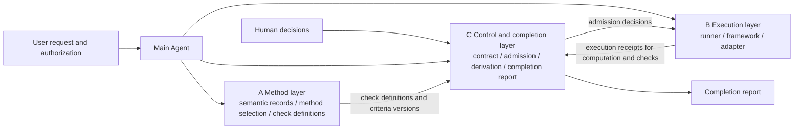
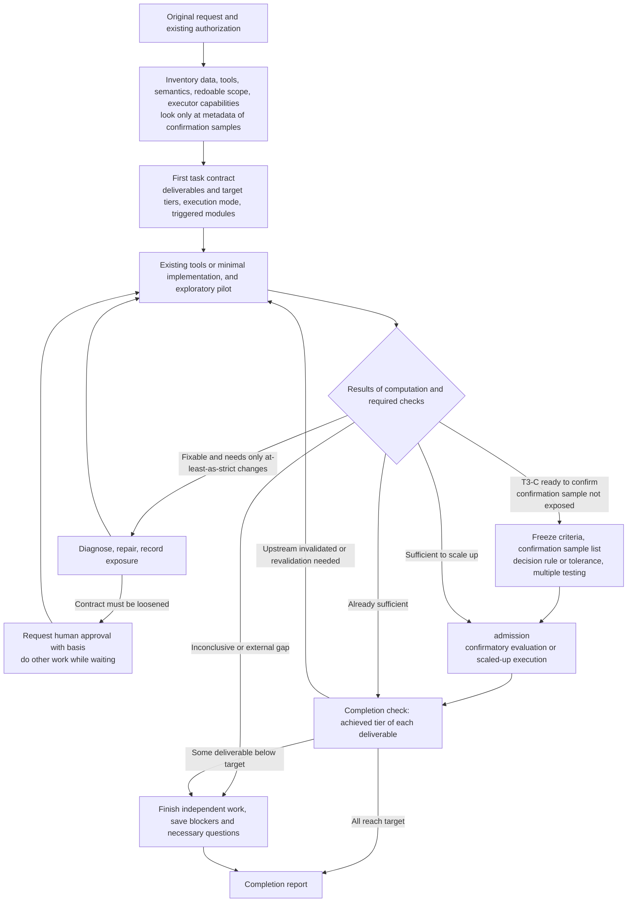

# Part I — Core

> **Reading entry point for Claude. Read this part first for any task.** This part decides what evidence is needed this time, which rules to load, when to ask a human, and how to report; the other parts are loaded on demand per Core §0.2.
> This spec is a **design and handover spec**; it is not a list of completed features, nor system instructions or a new operating authorization.
> **v12 is the final consolidated edition**: it revises the 18 findings on v11.1 from S0 (hep-review R2, 2026-10-30) (Core §0.5, History §11). v12 itself has not yet passed S0; **this file is the v12.1 spec copy**, revised after the first S0 round of v12 (Core §0.5); the runbook (Part 0) sets S0 as the first gate of implementation, and **the corresponding parts are not written into the skills before they pass S0**. Known gaps: see Core §1.4.
> **T0/T1 fast path:** When the question is only about concepts or feasibility, read Core §0.1–0.5, Core §2.1–2.3, Core §2.4 items 1–2, Core §5.1, Core §5.2 (the execution mode that Core §2.4 item 2 asks for), Core §5.3 (the trigger matrix: its “When not triggered” column holds the T0/T1 rules, e.g. the TASK-01 row, and its “Load” column names the Methods subsections to read), Core §6.2, Core §6.3, Core §7.2–7.4 (plus Core §8.3 for research execution), Core §8.4, and the subsections of the Methods part that Core §5.3 points to. The remaining sections do not leave out any rule that T0/T1 needs, because: Core §1, Core §3, Core §4 are summary, terminology and architecture descriptions and add no norms; Core §2.4 items 3–5, Core §8.1, Core §8.2 apply only to documentation or implementation tasks; Core §5.4, Core §6.1, Core §6.4, Core §7.1 each state that they apply only at T2 or above or when triggered.

---

## 0. Document information and reading rules

### 0.1 Document information

| Item | Content |
|---|---|
| Document version | `v12` (2026-10-30, Asia/Taipei): final consolidated edition; revises the S0 findings on v11.1 (History §11). v11 is an overall redesign (History §2); v11.1 revised the S0 findings on v11 (History §9) |
| Previous version | `v11.1` (did not pass hep-review R2, 18 findings; History §10); `v11` (did not pass, 32 findings; History §8); the earlier `v10.2` failed both of its reviews (History §3) |
| Content baseline | The original v8 design (SHA-256 `fb255289079df43d20e9ed399c6895672c7d5a4f57ed5586b390922f24b6c3e1`); every “v8 §x” cited in this document refers to it |
| Purpose | Plan a general detector reconstruction capability in hep-research, and let the Agent carry a research request through to the corresponding delivery within the authorized scope |
| Nature of this version | Design and handover spec: five parts (Core, Methods, Control, Delivery, History) plus a reference model; also compiled into a **task file** that can be handed directly to Claude for execution (runbook + four parts + reference model + review summary). **No new literature sources added; no plugin modified, installed or published** |
| Design baseline version | Current-state statements checked on 2026-10-30 against the local hep-research `0.49.0` (the named code is byte-for-byte identical to 0.48.0) (the runner, campaign and dependencies code named in the spec has not changed since 0.41.0). When an **implementation task** takes over, it must check the actual version of the target checkout (Core §2.4) |
| Supersession | This version supersedes v11.1 and all earlier integrated specs; old drafts and review records serve only as historical evidence and **do not add requirements** |

### 0.2 Document composition and loading rules

| Part | File name | Content | When to read |
|---|---|---|---|
| **Core** (this part) | `…-v12-en-0-core.md` | Always-on rules, evidence tiers and execution modes, trigger matrix, transition-period rules, policy and human decisions, workflow and completion report, handover checklist | Read first for any task |
| **Methods** | `…-v12-en-1-methods.md` | Scientific method contracts for reconstruction, validation discipline, partitioning and scope, representative cases, division of labor with profiles | Read the corresponding section when the trigger matrix (Core §5.3) points to it; research execution almost always needs Methods §1 and Methods §2 |
| **Control** | `…-v12-en-2-control.md` | Closed format and strictness order of the task contract, facts and writers, execution state, artifact derivation and achieved tier, admission, human decisions, fact sources and how to write them during the transition period | Deliveries at T2-numeric or above, any contract change, and implementing layer C (there it is the specification of the code being written, although the implementation's own T2-code contract still does not use the Control format); other T2-code work does not need it |
| **Delivery** | `…-v12-en-3-delivery.md` | Inter-layer interfaces, capabilities and qualification tests, cache and output, provenance chain, submission/stop/resources, rollout plan, open design decisions, acceptance, requirement index | Implementing layers B/C, or when capability, cache, output or resource details must be judged |
| **History** | `…-v12-en-4-history.md` | Version context, why the redesign, design decisions, handling of the findings of each review, evidence list | Required reading when reviewing or revising this spec; may be skipped for research execution and implementation |
| Reference model | `…-v12-en-reference-model.py` (Appendix A of the task file) | Executable reference model and scenario tests for the Control part | When implementing C1; when reviewing the Control part |
| **Task file** | `hep-research-reconstruction-v12-en-task.md` | Part 0 runbook, Parts I–IV (Core, Methods, Control, Delivery; text identical to the split edition; cross-part references always carry the part name), Appendix A reference model, Appendix B review and revision summary | **Use this one when handing to Claude for execution** |

- Cross-part references are written as “Methods §2.4”, “Control §1.2”, “Delivery §2.1”, “History §2”; **every cross-part reference carries a prefix**; **a bare “§x” without a prefix always refers to this part**.
- **All parts have the same normative force**; the split is only for on-demand loading.
- When a needed part is not at hand, state which part is missing and limit claims per the table below:

  | Missing | Effect |
  |---|---|
  | Methods part | No physics claims; **no deliverables at T2-numeric or above** (T2-numeric relies on the four-valued check semantics of Methods §2.2, §2.3 and §2.5); numeric results may only be treated as exploratory and marked unattested, noting that the method contracts were not applied |
  | Control part | **No deliveries at T2-numeric or above** (the transition rules of Core §5.4 themselves depend on Control §1.2, Control §4.3, Control §5.1, Control §7); numeric results may only be treated as exploratory and marked unattested; do not change an existing task contract of T2-numeric or above; do not claim M2/M3 (T2-code contracts, Core §6.1, are unaffected) |
  | Delivery part | Do not implement layers B/C; **no deliveries at T2-numeric or above** (the definition of attested is in Delivery §2.3–2.4); T0/T1 and T2-code are unaffected; do not claim any executor capability |
  | History part | Research execution and implementation are unaffected; the **coordinator of a spec review** needs it (when only the Appendix B summary is available, the summary governs and this is stated in the report); reviewers do not receive it in any case (runbook 0.5.2) |

### 0.3 Strength of wording

| Wording | Meaning |
|---|---|
| **must / must not / cannot** | Hard contract. Clauses belonging to a trigger module (Core §5.3) take effect when the module is triggered; **Core clauses that belong to no trigger module always take effect**; the rules listed in Core §0.4 are always on |
| **should** | Default practice; a deviation must record its rationale and must not lower the Core §0.4 rules or the evidence requirements of that delivery tier |
| **may / for example / example** | Leaves room for implementation; not a fixed API, field or mandatory data table (exception: the contract fields of Control §1.1, which are a closed format) |
| **current state (with the checked version noted)** | Describes documents read, probes run or existing code, noting the plugin version at the time of checking; **does not represent facts about the target checkout**; must be rechecked before implementation |
| **open design decision (DEC-xx)** | A design decision that must be made and recorded before implementation (Delivery §4.3), each with a decider and a recommended default |

**Always-on clauses exist only in the Core part.** In the Core part, Core §1 (summary), Core §3 (terminology and skill division) and Core §4 (architecture) are descriptive and add no norms; the terms used in them are governed by the section that defines them. Core clauses that state their own scope of application (e.g. Core §5.4 “T2-numeric or above”, Core §6.1, Core §7.1) apply within the scope they state; the remaining Core clauses that belong to no trigger module always take effect. Every section of the Methods, Control and Delivery parts is loaded by at least one row of Core §5.3 (the coverage table at the end of Core §5.3); the only exception is the illustrative cases of Methods §4.1–4.3, whose norms are already written in Methods §1–3.

**Relation between the trigger matrix and v8**: v8 specifies “only steps that involve a given risk load the corresponding rules”; the trigger matrix is the concrete form of this principle. Trigger conditions are judged by “whether the risk exists”; **the trigger scope must not be narrowed to evade the prohibitions of v8**.

### 0.4 Always-on rules (RULE-01, not limited by the trigger matrix)

1. The LLM's final text cannot override fail or inconclusive.
2. Must not deliberately hit a failure first and then ask for confirmation at every step.
3. not-applicable must come with the task type and a rationale; it cannot be granted as an arbitrary exemption after a failure.
4. Do not substitute writing a plan for the work that was requested to be executed; do not stop after every skill switch (v8 §1).
5. Do not falsely claim capabilities, APIs or completed validations that do not exist.
6. No computed artifact with insufficient checks may be automatically accepted (v8 §9).
7. Must not silently fall back to "latest" conditions.
8. Must not move failures out of the required denominator after the fact based on the result for the measured quantity.
9. Authorization, blinding and the boundaries of human decisions follow host, project and existing tool rules; this document does not loosen them.
10. Must not loosen the rules that judge one's own work: any loosening in a task contract waits for human approval — at T2-numeric or above per the strictness order of Control §1.2; at T2-code per the code-contract rules of Core §6.1; if the target tier cannot be reached, report partial completion; completion must not be achieved by rewriting the target.

### 0.5 Review status

| Content | Status |
|---|---|
| v12.1 spec copy (2026-10-29) | Revises the findings of the first S0 round on v12 (hep-review context `s0-reconstruction-v12`, achieved R2; all five obligations violated); the revision log is kept beside this copy (`docs/dev/reconstruction-v12/spec/revision-log.md`); later revised for the findings of further S0 rounds on this copy, the last ones after the fourth and fifth rounds with changes approved by the user (control rules: content reverts and reproduced digests, the deliverable's confirmation fields, check inputs); the reference model of this copy was revised and self-tested by the reviser (89 scenarios, 42 mutation tests); **the control part (N1) is not yet through S0** |
| v12 (the normative content of this spec, 2026-10-30) | Revises all 18 findings on v11.1 from S0 (History §11); the reference model was written and self-tested by the author (70 scenarios, 25 mutation tests); first S0 round: did not pass |
| v11.1 (2026-10-29) | Revises all 32 findings on v11 from S0 (History §9) |
| S0 (v11.1, 2026-10-30) | hep-review context `s0-reconstruction-v11.1`, **achieved R2** (five fresh-context reviewers, all submissions digest-bound; the Control-part reviewer actually ran the reference model and wrote attack scripts). **Did not pass**: N1 violated (3 findings, major 2); N2 violated (7 findings, major 3); N3 violated (2 findings, major 1); N4 violated (1 finding, major 0); N5 violated (5 findings, major 1); 18 findings in total (major 7). Item by item: see History §10 |
| S0 (v11, 2026-10-29) | hep-review context `s0-reconstruction-v11`, **achieved R2** (five fresh-context reviewers who had not seen any earlier assessment, all submissions digest-bound; the Control-part reviewer actually ran the reference model). N1 violated (9 findings, major 5); N2 violated (11 findings, major 4); N3 supported (0 findings, major 0); N4 violated (3 findings, major 1); N5 violated (9 findings, major 3). Item by item: see History §8 |
| Reused content | The Methods part and the cache/output/provenance chain/submission and resources sections of the Delivery part largely reuse v10.2, corrected per the findings of the two reviews; these were reviewed at v10.2, but v11 changed the context they sit in, so **they are all listed as unreviewed** |
| Past reviews | Advisory independent reviews of v9, v9.1 and v10; two hep-review R2 runs around v10.2 (S0 and the S0 rerun), neither of which passed. Summary and handling: see History §3, History §4 |

Until the S0 review of Delivery §4.1 (recorded through hep-review) passes, the corresponding passages of v12 are not written into the skills (which stage needs which parts to have passed: see the runbook, Part 0). All reviews are advisory: they are not collaboration/custodian approval, and do not mean that any runtime has passed acceptance.

---

## 1. One-page summary

### 1.1 Remember these eight points first

1. **Architecture:** A main Agent with continuing responsibility coordinates three layers — the **method layer** (A, the reconstruction domain module), the **execution layer** (B) and the **control and completion layer** (C) — and reuses existing tools and research frameworks. B/C are a foundation that all hep-research skills can share. The main Agent carries the work from the authorized original request through to the corresponding delivery.
2. **Two-axis classification, loaded by trigger:** The evidence tier (T0–T3) decides what evidence is needed; the execution mode (M1–M3) decides what execution guarantees are needed. Each contract module has an explicit trigger condition and states which section of which part to load.
3. **Capability matching:** The guarantees a task needs (G1–G6) must match capabilities that the executor declares **and that have passed the qualification test**.
4. **Record only facts; derive state:** Layer C only appends what has happened; “accepted”, “invalidated” and “blocked” are all derived on the fly from facts.
5. **The judging rules cannot be loosened by the one being judged:** The task contract uses a closed format; only a new contract that is **at least as strict** in every field takes effect automatically; any other contract waits, as a whole, for human approval (Control §1).
6. **Target and achievement are separate:** The contract writes the target tier of each deliverable; the achieved tier is derived from facts; there is no downgrade mechanism, and if the target cannot be reached the result is partial completion (Control §4.5).
7. **Four things are judged separately:** execution success, check results, whether a scientific claim holds, and whether authorization has been obtained; none substitutes for another.
8. **Not yet implemented:** Reading the spec, producing documents or running the reference model does not justify claiming that the plugin already has autonomous reconstruction capability.

### 1.2 Design highlights (why it is designed this way)

1. **On-demand loading** (Core §0.2, Core §5.3): an Agent doing research reads only the sections the trigger matrix points to.
2. **Record only facts, derive state** (Control §0): a design that stores conclusions and then propagates them lets conclusions drift apart from the facts that produced them; with derivation, invalidation, blocking and recovery need no propagation.
3. **Allowlist rather than denylist** (Control §1.2): the v10 series enumerated item by item “which changes count as loosening”, and both review rounds found loosening paths that were not listed. v11 instead lists only “what counts as tightening”; everything else waits for human approval (History §2).
4. **Only deliverables and artifacts designated by the contract need checks**; intermediate artifacts need only be usable and current.
5. **Confirmation comes in two types** (Methods §2.1): holdout confirmation guards against tuning bias; method-independent confirmation guards against shared systematics.
6. **B/C are a shared foundation** (Core §4.2); A is the reconstruction domain module.

**Boundaries that never change:** a single main Agent + thin control; no new scheduler, LLM service, conditions database or global schema; the always-on rules of Core §0.4; the transition-period rules can be used without writing new code.

### 1.3 The six scientific-semantics reinforcements from v8 (retained)

1. conditions are resolved by the actually observed context/interval of validity; “latest” conditions must not be used based on execution order (Methods §1.2).
2. Physical quantities are propagated together with their uncertainty representation, shared sources and identifiability; not all uncertainties are forced into a Gaussian covariance (Methods §1.3).
3. Distinguish candidate compatibility, definite assignment, probability and physical counts; keep the ambiguity when information is insufficient (Methods §1.4).
4. The partitioning contract covers physical neighborhoods, state and boundaries; after changing the chunking/parallelism, verify the corresponding equivalence (Methods §3.1).
5. The processing accounts for a fixed scope retain failures and exclusions; the pilot checks both performance coverage and resource extrapolation (Methods §3.2).
6. Concise method routing for each subdetector, so that the design does not drift toward the executor version after version and lose sight of the reconstruction goal (Methods §1.5).

### 1.4 Current status

| Category | Content |
|---|---|
| **Done** | v8 method and architecture design; v9–v10.2 revisions and reviews (History §1); v11 redesign and its S0; v11.1 revision and its S0; v12 revision and reference model (author self-test: 70 scenarios, 25 mutations) |
| **Not yet done** | S0 of v12; plugin modification, installation or publication; fixes for the known runner gaps; control-layer helpers; G1–G6 qualification tests; the full fault-injection acceptance suite; Agent evaluation starting from original research requests; performance validation on real experiment frameworks/data; decisions on DEC-01–14 |

Runtime gaps that have been reproduced but not yet fixed (current state: reproduced at 0.41.0; reproduced again at 0.47.0 on 2026-10-29; the relevant code is unchanged in 0.48.0 and 0.49.0):

| ID | Gap | Corresponding requirements |
|---|---|---|
| BUG-01 | A stale output with the same name can make “an exit-0 command that writes no new result” be judged a success | OUT-01, CACHE-01 |
| BUG-02 | After a new required output is added, incremental can still skip and report success, yet the new file does not exist. It appears only when the release digest is known; when the local copy is inconsistent with its release manifest the digest is unknown, and INC-03 makes incremental never skip, which masks this gap rather than fixing it. Reproductions and tests must pin a known `plugin_release` (Delivery §2.1) | CACHE-01 |
| BUG-03 | A fresh work directory still accepts an absolute output path pointing to an old file | OUT-01 |
| BUG-04 | After the parent process times out, `TimeoutExpired` is not handled and there is no run record; the child process can still write files | EXEC-02, STATE-01 |

> BUG IDs are labels added for ease of reference, not existing issue numbers. Reproduction method and probe details: see History §5.

---

## 2. Goals, scope and handover boundaries

### 2.1 Intended outcome

Add a reusable reconstruction planning capability to hep-research: starting from the available observations and the target physical quantity, judge whether the information is sufficient → choose an appropriate method → retain conditions and uncertainties → execute and validate → deliver traceable results with a clearly stated scope.

Covers: different detection technologies; trigger/online and offline reconstruction; event-based or continuous readout; raw/compressed/derived data; real data and simulation; from a single subsystem to cross-subsystem combinations; one-off computation and iterative calibration.

### 2.2 Architectural boundaries (the only list of prohibitions in the whole document)

- Reuse the existing skills, projects, frameworks, runners and partition/campaign capabilities.
- **Do not add**: a general-purpose scheduler, an additional LLM service, a conditions database, a global event class/graph, a large schema shared by all tasks (the task-contract format of the Control part is used only to control this workflow; it is not a schema for research data).
- The storage location and format of the fact log belong to DEC-01; **until it is decided, fields must not be added to the project config**.
- Single Agent by default; reviewers/workers are used only when they bring independent benefit and authorization permits. A single-process local task does not need a pre-deployed distributed transaction system (v8 §3).

### 2.3 Explicitly out of scope

- Does not replace each experiment's official reconstruction software, conditions service or production system.
- Does not provide each experiment's current parameters; specific values and configurations come from experiment/project sources (Methods §5).
- Does not treat a text policy as an enforcement mechanism; permissions, privacy, blinding and resource limits are still actually enforced by the host/executor. This is a reliability contract, not a sandbox.

### 2.4 Items to check first at handover

All tasks:
1. Whether the user currently wants document organization, design review, implementation, or actual research execution.
2. The target tier and execution mode of each deliverable this time (Core §5).

**Implementation tasks only** additionally check:

3. Which repository/checkout is the modification target this time — this document does not specify a maintained official checkout. **If it cannot be determined, it is a required question; ask once.**
4. That checkout's version, project instructions, existing APIs/schemas, tests and working-tree changes.
5. The data, frameworks, executors, permissions and effective quotas actually available.

The previously inspected install cache is only a baseline; it cannot be assumed to be the location to modify or publish. If the version has changed, recheck against the target version.

---

## 3. Terminology and skill division

### 3.1 Core terms

| Term | Meaning in this document |
|---|---|
| observable/estimand | A quantity defined from observations / the target the research aims to estimate; its definition, units and assumptions must be retained |
| reconstruction | Deriving objects or physical quantities from known observations, conditions and models; with insufficient information there may be multiple solutions, or reconstruction may be impossible |
| conditions/payload/IOV | Versioned external conditions such as calibration, geometry, field, simulation settings and model versions / their actual content / the interval of validity of the observations to which they apply |
| context | The information that decides which conditions a given observation should use; **not the chat context** |
| candidate/association | A reconstruction candidate / a relation between observations or candidates; not equivalent to a confirmed particle identity |
| reference surface | The reference surface on which parameters and uncertainties are defined; comparisons across surfaces need appropriate propagation |
| scope | The range of data, observations, periods, phase space and required results that this delivery covers |
| exposure | Normalization quantities such as live time and luminosity; must be consistent with the exclusions in the numerator |
| fact/derived state | A fact is a record that is not changed after it is appended; accepted, held, invalidated and the like are conclusions derived from facts and are not stored (Control §0) |
| task contract | A record in the closed format of Control §1.1: steps, deliverables and target tiers, iteration families, sample roles, budget |
| strictness order/at least as strict | The rule for judging whether a new contract only tightens and does not loosen (Control §1.2); only a contract that is at least as strict takes effect automatically |
| human approval | A decision written by a human (Control §6); a contract that is not at least as strict, identity continuation, producer attribution and the like can take effect only through it |
| target tier/achieved tier | The tier the contract writes for a deliverable / the tier actually reached, derived from facts (Control §4.5) |
| checked artifact | The artifacts of a checked step: the deliverables, and the intermediate artifacts the contract designates for checks (e.g. the final round of an iteration); other intermediate artifacts need only be usable and current |
| effective validation identity | The set of “required check × criteria” that a checked step currently has to pass, written in the task contract and the freeze record |
| usable as a dependency | An artifact that is usable and current; when the downstream is to be accepted, the consumed upstream must be the bound version and ok |
| chunk/partition | A unit of computational splitting; not guaranteed to equal an independent physical unit |
| halo/ownership | The neighborhood a partition needs to read in addition / which partition is responsible for publishing a given output |
| task/step/attempt | A research task / an execution step / a specific execution attempt |
| iteration | One round of an iterative calibration step; each round is a step |
| evidence tier/execution mode | Evidence tier T0–T3 / execution mode M1–M3 (Core §5) |
| executor/adapter | The method or system that actually performs the work / the interface that connects its capabilities to the workflow |
| guarantee/capability | A guarantee the task needs / a capability that the executor declares and that has passed the qualification test |
| trigger | The condition that activates a contract module (Core §5.3) |
| admission | Before work starts, C checks dependencies, permissions, resources, samples and capabilities, and computes the identities |
| intent/receipt/reconcile | The intent record made before an action / the receipt of an external response / reconciliation against the actual state |
| computational-run | An execution record; its existence does not directly prove any physics claim |
| attested/unattested | An artifact with / without a verifiable producer edge (Delivery §2.3) |
| typed artifact | A formal research artifact conforming to an existing specified contract; not arbitrary JSON or Markdown |
| producer edge | The provenance relation that links an artifact to the execution and inputs that actually produced it |
| check/criteria | Check / criteria; program success must be distinguished from scientific conclusions |
| check role | closure/internal consistency, or independent confirmation (Methods §2.3) |
| criteria freeze | Recording the criteria, decision rules and multiple-testing handling before accessing the results of the confirmation sample |
| holdout exposure | The results of the confirmation sample have been used to choose a method or tune parameters, so it has lost its confirmatory power |
| invalidation | An artifact becomes invalid because the identity of something it depends on has changed |
| retry/repair/replan | Resending the same action that has external side effects or metered cost / a causal correction / changing the work arrangement (Core §6.2); none of them can reset the task's total limits |

### 3.2 Use the existing skills; do not add an “orchestrator skill”

| Work | Primary skill | Layer |
|---|---|---|
| Reconstruction, calibration, alignment, detector response and performance | `hep-detector` | A |
| Estimation targets, selection, backgrounds, correction chains, blinding policy | `hep-measurement` | A |
| likelihood, inference, unfolding, coverage, multiple testing and combination | `hep-statistics` | A |
| Theory models, truth predictions and physical approximations | `hep-theory` | A |
| Learned reconstruction, training and model studies | `hep-ml` | A |
| Code, execution environment, runner, partitioning and recovery | `hep-computing` | B (and the implementation location of C) |
| Literature, source identity and the extent to which a claim is supported | `hep-citations` | Main Agent support |
| Argumentation, figures and tables, and handover of results | `hep-authoring` | Main Agent support |
| Recorded review of analyses, derivations, fits, statistical treatments or code (review obligations, R0–R3 tiers, commit log) | `hep-review` | Main Agent support; belongs to none of the layers A/B/C |

- Skill switches are performed by the main Agent; the user is not required to carry context between skills.
- Locally there are nine `hep-*` skill directories (current state, 0.49.0); the skill counts in the metadata are inconsistent, so the number of capabilities must not be fixed on that basis, and no orchestrator skill is added.
- The review tiers of `hep-review` (R0–R3) and the checks of layer C are two different things: the check results and completion judgments of layer C are not hep-review outcomes, a hep-review review does not replace the required checks, and it is not a human decision under Control §6 either (DEC-14). When a recorded review is needed, hand the check results and the fact log to hep-review as review material. Review of the measurement design itself still belongs to `hep-measurement`, and manuscript review still belongs to `hep-authoring`.

---

## 4. Architecture

### 4.1 Layers and responsibilities

| Component | Responsible for | Not responsible for |
|---|---|---|
| **Main Agent** | Understanding the goal, writing the task contract, choosing methods, editing the necessary code, diagnosing errors and scientific discrepancies, reading the real results, coordinating across layers, raising the matters that need a human decision; carrying the work from the authorized request through to the corresponding delivery | Treating the skills as separate chat rooms that the user must relay between; overriding fail/inconclusive with text; approving a loosened contract on its own |
| **A Method layer** | Physics semantic records, method routing, judging whether work can be redone, and the **definition** of check programs and criteria | Execution reliability, resource control |
| **B Execution layer** | Actually executing the computation **and the checks**, output isolation, termination observation, producing receipts; reusing runners, frameworks, partitions or schedulers | Judging scientific conclusions |
| **C Control and completion layer** | Contract format and strictness judgment, admission (including identity computation), dependencies, attempt state, quotas, derivation and achieved tier, completion checks and the report | Adding an LLM internally; producing scientific judgments on its own |
| **Human** | The decisions of Control §6, and the matters reserved for humans under existing rules per Core §6.3 | — |

Physical validity is limited by the data and the models; validation can establish claims only within its domain of applicability (v8 §4).

**The three layers can be delivered independently:** A can improve the quality of interactive research without depending on B/C; fixes to B alone can improve local execution reliability; C depends on B's receipts and A's check semantics. Transition-period rules: see Core §5.4.

### 4.2 B/C are a shared foundation; A is a domain module

- B and C contain no reconstruction-specific content: task contracts, execution receipts, output isolation, the fact log, derived state and the completion report apply equally to `hep-statistics` fits, `hep-ml` training and `hep-theory` numerical predictions. Their specs are in the Control and Delivery parts; the recommended default implementation location is the shared references and helpers of `hep-computing` (DEC-11).
- The A method layer is the domain module for reconstruction (the Methods part). Other skills have their own method content, but can directly use the same tiers, triggers, contracts, facts and completion judgments.
- Inter-layer interfaces and capability definitions: see Delivery §1.

---

## 5. Evidence tiers, execution modes and triggers

### 5.1 Evidence tiers (what evidence is required)

| Tier | Typical deliverable | Required evidence |
|---|---|---|
| T0 answer | Concept explanation, single fact | General answering discipline |
| T1 method or feasibility | Method explanation, source survey, feasibility conclusion | Reasoning, sources, scope and limits; **do not force a computational run** |
| T2-code | Implementation, fix, script | diff/commit digest + test-execution receipt (test command, exit code, tested commit digest and a summary of the test output; running it with the project's existing test framework suffices and it need not go through the runner; this holds also when fixing the runner itself). The unattested rule of Delivery §2.3 applies only to numeric artifacts; the contract uses only the code-deliverable fields of Core §6.1, **not the Control part's format** |
| T2-numeric | Numeric artifacts, tables, figures | attested artifacts (Delivery §2.3), the owning step has at least one required check, and **every required check is pass** (Control §4.3); on reuse, add the cache identity |
| T3-E exploratory claim | Conclusions such as “roughly how much” or “is a trend visible” for which confirmation was not requested | T2-numeric + the report states explicitly: sample roles are recorded, but samples may have been exposed or not separated for confirmation use; criteria are not frozen; **does not support confirmatory claims**; every number carries the visible marker “exploratory, unconfirmed” |
| T3-C confirmatory claim | Reconstruction performance, physics conclusions, numbers reported externally | T2-numeric + sample roles and exposure, freeze and confirmation (Methods §2.4, Control §4.4), four-valued checks, scope and exposure accounts; **threshold validation** and **performance estimate/data-driven measurement** have different evidence requirements (Core §7.2) |

**Determination rules (against circumvention)**:

1. **The target tier is determined in the first task contract, from the request and the intended use**, not from the wording of the report:
   - The user requests a confirmatory conclusion, wants to report externally, wants it as a claim that holds for **data** or as downstream input to such a claim, or wants a comparison against a threshold → T3-C;
   - Performance numbers stated only on synthetic or simulated samples, for internal use, and not claimed to apply to data → T2-numeric (with the Methods §1.8 limitation “supports only performance in simulation”) when the number is delivered **without any statement about it** (no assessment of quality, adequacy, trend or comparison); as soon as the deliverable makes such a statement, → T3-E;
   - A performance or physics number measured **on data** for internal use, which the user does not want as a claim that holds for data → T3-E (a number on data is itself a statement about data; it carries the exploratory marker);
   - Other statements involving performance, physics or consistency, **resting on numbers this task computes**, are at least T3-E; a feasibility or method conclusion drawn from reasoning and sources, with expected performance stated as an expectation and attributed to its sources, stays T1 (a threshold comparison of a computed number is T3-C).
   A claim that the report presents as an “established conclusion” is at least T3-C; adding wording such as “approximately” or “preliminary” **cannot** lower the target tier. When both apply (for example, a performance number on a simulated sample that is nevertheless presented as an established conclusion or used externally), the higher one is taken.
2. **Whether something is required is determined by the original request**; when unclear, it is treated as required. Changing it to optional is a loosening and needs human approval (T2-numeric and above: Control §1.2; T2-code: Core §6.1).
3. **The target tier does not change; falling short of it is partial completion.** The achieved tier is derived (Control §4.5).
   - When the achieved tier is below the target, the deliverable is recorded as “partially complete” in paragraph 1 of the completion report, with the reason; the results at the achieved tier may be reported truthfully (for example, T3-E exploratory numbers with their marker), but must not be reported as completion at the target tier.
   - Lowering the target tier is a change that is “not at least as strict”; only a human approval can make it effective; both the approval and the original target are listed in the report.
   - **Deleting a claim does not waive the reporting obligation**: the results of frozen confirmations already executed (including fail and inconclusive) must be written in paragraph 3 of the completion report.
4. One task may contain multiple deliverables; each is judged by its own target tier.

### 5.2 Execution modes (what execution guarantees are required)

Evidence tier and execution mode are independent of each other: for example, a purely numeric task executed remotely is “T2-numeric × M3”. For the definitions and qualification tests of guarantees G1–G6, see Delivery §1.2.

| Execution mode | Determination (operational definition) | Required guarantees | Work that may be done automatically | Limits |
|---|---|---|---|---|
| **M1 interactive, bounded local** | Completed within this session, locally, in the foreground | Reuse host limits, existing authorization and a bounded work plan; T2-numeric and above additionally need G1 (for the transition period see Core §5.4) | Inventory, local implementation, pilots on synthetic or permitted samples, checks and delivery; the main Agent works across skills on its own | Does not claim cross-host unattended recovery or strict total-cost guarantees |
| **M2 resumable local/existing framework** | A deliverable of T2-numeric or above that is expected to exceed a single session, is moved to the background, or needs resumption after interruption (T0/T1 and T2-code work spanning sessions is not an execution mode; it uses the handover note of the TASK-03 row) | **Output/dependency/validation identities and the necessary state must be persisted**: G1, G2, G5; G6 when conditions are relevant; needs C2 | checkpoint, legitimate cache, bounded repair, isolation of failed branches, reconciliation and completion checks after restart | All facts are appended by compare-and-set; locks may only additionally serialize writers and do not replace compare-and-set (Control §5.5) |
| **M3 long-running, expensive or remote unattended** | Remote submission, or no one present (metered cost locally only triggers BUDGET-01 and does not raise the mode to M3) | **The executor must actually support job reconciliation, resource commitments, termination observation and permission rules**: G1–G5; G6 when conditions are relevant; needs stage D | Authorized submission, monitoring, collection, permitted bounded resubmission and controlled stop | Capabilities that do not exist cannot be simulated by a written policy; when no one is present, matters that need a human decision can only wait |

- This is not an artifact status, nor a stage every research task must pass through. When an existing workflow or framework already provides a guarantee, use it directly instead of implementing another copy.
- **When a required guarantee is missing:** switch to a weaker, explicitly stated process and explain it in the completion report; **capabilities must not be fabricated for the sake of a uniform interface**. Lacking a higher-level capability does not prevent authorized lower-level work from completing; lacking a required guarantee also does not permit falsely claiming that higher-level capability.
- **Upgrading the mode during execution**: if an M1 task will exceed the session, move to the background or need remote submission, first redo admission under the new mode; without the required guarantees, fall back to segmented execution per Core §5.4.
- The number of additional reviewers/workers is not an indicator of quality or of the degree of autonomy.

### 5.3 Trigger matrix

The “Load” column names the parts and sections to read when triggered; when not triggered, they need not be read.

| Module (requirement ID) | Trigger condition | Required guarantees | Load | When not triggered |
|---|---|---|---|---|
| Task contract (TASK-01) | T2 and above, or the user asks for records to be kept | — | Core §6.1; for T2-numeric and above, add Control §1.1 (the format is loaded together via AUTH-01) | T0/T1: state the goal, scope and limits in a sentence or two in the reply; no file is created |
| Physics semantics (SCI-01/02) | Producing, converting or comparing physical quantities | — | Methods §0, Methods §1.1, Methods §1.5 | Skip |
| conditions (SCI-03) | Depends on any versioned external conditions (including static geometry, field map, simulation settings, model versions) | G6 (M2/M3) | Methods §1.2 | Skip |
| Uncertainties and constraints (SCI-04) | The deliverable contains precision/uncertainty claims, combines multiple quantities, or performs coordinate/surface transformations | — | Methods §1.3 | When delivering only central values, state the limitation explicitly |
| Association and counting (SCI-05) | Many-to-many candidates exist, or a yield/count is to be made | — | Methods §1.4 | Skip |
| Iterative steps (SCI-06) | Calibration/alignment is derived from reconstruction results and fed back | — | Methods §1.6, Methods §4.4, Control §1.1 | Skip |
| Selection bias and exposure (SCI-07) | Data passed trigger/online selection, prescale or DQ exclusion, or the deliverable contains flux/cross-section/rate | — | Methods §1.7 | Skip |
| Simulation to data (SCI-08) | Performance is evaluated with MC truth or with a model trained on simulation | — | Methods §1.8 | Skip |
| Experiment profile (PROF-01) | Involves a named experiment, its data, software or conventions | — | Methods §5 | Skip |
| Sample roles (VAL-01) | T3 (including T3-E) always records sample roles; exposure handling is triggered when there is a confirmation sample | — | Methods §2.1 | Skip |
| criteria changes and four-valued results (VAL-02) | When T2-numeric and above has checks | — | Methods §2.2, Methods §2.3; when the checks include validity checks under a tolerance (closure, pull, stability) or a power design, also the tolerance row and the power paragraphs of Methods §2.4 | Skip |
| Criteria freeze and confirmation access (VAL-03) | Target T3-C | — | Methods §2.4, Control §4.4 | T3-E does not freeze, but must not be used as confirmation evidence |
| Decision rules (VAL-04) | Threshold-validation checks of T3-C; performance-estimate checks use a frozen method and validity tolerance instead | — | Methods §2.4 | Skip |
| blinding (VAL-05) | The project or the user has a blinding policy | — | Methods §2.6 | Skip |
| check provenance chain (VAL-06) | check results support a deliverable of T2-numeric and above | — | Methods §2.5, Delivery §1.1 | Skip |
| Partitioning (PART-01) | Any partitioning or parallel execution | — | Methods §3.1 | Skip when not partitioning |
| Scope and exposure accounts (PART-02) | Claiming coverage of some data range, or doing normalization | — | Methods §3.2 | Skip |
| Contracts and human decisions (AUTH-01) | Deliverables of T2-numeric and above; or any change that modifies an existing task contract of T2-numeric or above (T2-code contracts follow Core §6.1 and Core §6.3) | — | Control §0, Control §1, Control §6 | Skip |
| Derivation and achieved tier (STATE-01) | Deliverables of T2-numeric and above | G5 (M2/M3) | Control §3, Control §4, Control §8 | — |
| admission (ADM-01) | T2-numeric and above: any execution of a computation or check that will be delivered or used downstream (does not apply to test execution for T2-code) | — | Control §5 | — |
| Writing facts (CTRL-01) | Writing any fact log (including the task record directory of the transition period) | — | Control §2, Control §7, Delivery §2.5 (during the transition period, writing follows Control §7.3, an exception listed explicitly in Delivery §2.5) | Skip |
| Cache identity (CACHE-01) | Reusing earlier results, or incremental | — | Delivery §2.1, Control §5.3 | Every execution is fresh |
| Output freshness (OUT-01) | Any numeric output that will be delivered or used downstream (scope of the v8 original text; does not apply to the code and test output of T2-code); exploratory output that is not delivered is treated as unattested | G1 | Delivery §2.2; after C1, also read the G1 definition in Delivery §1.2 | — |
| producer edge (PROV-01/02) | An artifact supports a deliverable of T2-numeric and above | G1 | Delivery §2.3, Delivery §2.4 | Mark as unattested |
| Capability matching (CAP-01) | M2/M3 | Per mode | Delivery §1.2 | M1 reuses the host |
| Submission reconciliation (EXEC-01) | External or background execution | G3 | Delivery §3.1 | Skip |
| Termination confirmation (EXEC-02) | There is a timeout, a cancel, or child processes that may survive | G2 | Delivery §3.2 | Skip |
| Resources (BUDGET-01) | There are meterable costs or limits | G4 | Delivery §3.3 | Skip |
| Resumption summary (TASK-03) | Deliverables of T2-numeric and above that are expected to span sessions, have already fallen back to segmented execution, or run in M2/M3 (T0/T1 and T2-code spanning sessions: a short handover note in the reply or in the code task's own progress record — goal, state, next step — with no fact log) | G5 (M2/M3) | Core §6.4 | Skip |
| Completion report (FLOW-01) | Always; content scales with tier | — | Core §7.2–7.4 | — |
| Implementing layers B/C (ARC-01 etc.) | The user asks to modify the runner, the control layer or their tests | — | The whole Delivery part; when modifying layer C, add the whole Control part; the section corresponding to the gap being fixed (for example BUG-02 → Delivery §2.1) | — |
| Spec review or revision | The user asks to review or revise this spec | — | Coordinator: all parts, the reference model and the History part; reviewer: the material assigned by runbook 0.5.2 | — |

When a trigger condition holds, the contract is binding; when it does not, no fact log, manifest or literature ledger is required. The rules of Core §0.4 and the clauses of the Core part that do not belong to any module are not limited by this table.

**Typical loading during research execution** (the table above governs):
- T1 method question → Core + the relevant sections of Methods §1;
- T2-code → Core §0.4, Core §2.4, Core §5.1, Core §6.1, Core §6.3, Core §7.2–7.4, Core §8.2 (the table above governs; this list is not exhaustive); when fixing the runner or the control layer, see the second-to-last row of the table (implementing layer C loads the whole Control part as the specification of the code); otherwise do not load the Control part;
- T2-numeric → additionally Methods §2.2, Methods §2.3, Methods §2.5, Control §0–8 (the whole part), Delivery §1.1, Delivery §2.2–2.5 (on reuse, add Delivery §2.1);
- T3 → additionally Methods §2.1 (T3-E and T3-C) and, for T3-C, all of Methods §2 (the table above governs); when a named experiment is involved, add Methods §5;
- Implementing layers B/C → see the second-to-last row of the table.

**Coverage table: which row loads each section of the Methods, Control and Delivery parts**

| Section | Row(s) that load it |
|---|---|
| Methods §0, Methods §1.1, Methods §1.5 | SCI-01/02 |
| Methods §1.2, Methods §1.3, Methods §1.4 | SCI-03, SCI-04, SCI-05 |
| Methods §1.6, Methods §4.4 | SCI-06 |
| Methods §1.7, Methods §1.8 | SCI-07, SCI-08 |
| Methods §2.1–2.6 | VAL-01–06 |
| Methods §3.1, Methods §3.2 | PART-01, PART-02 |
| Methods §4.1–4.3 | Illustrative cases, not normative; optional reading (the exception in Core §0.3) |
| Methods §5 | PROF-01 |
| Control §0, Control §1, Control §6 | AUTH-01 (Control §1.1 is also loaded by SCI-06) |
| Control §2, Control §7 | CTRL-01 |
| Control §3, Control §4, Control §8 | STATE-01 (Control §4.4 is also loaded by VAL-03) |
| Control §5 | ADM-01 (Control §5.3 is also loaded by CACHE-01) |
| Delivery §0, Delivery §4, Delivery §5, Delivery §6 | Implementing layers B/C |
| Delivery §1.1 | VAL-06, Implementing layers B/C |
| Delivery §1.2 | CAP-01, Implementing layers B/C |
| Delivery §2.1, Delivery §2.2 | CACHE-01, OUT-01 |
| Delivery §2.3, Delivery §2.4 | PROV-01/02 |
| Delivery §2.5 | CTRL-01 |
| Delivery §3.1–3.3 | EXEC-01, EXEC-02, BUDGET-01 |

### 5.4 Transition-period rules

Scope: deliverables of T2-numeric and above; period: until the control-layer helper (C1) is complete; capability qualification tests do not exist before B2. During this period, T2-numeric and T3 deliverables are completed as “**transitional attested (declared inputs)**”, rather than always being reported as partial completion. For the sources of facts and their mapping, see Control §7.

1. **Execution**: artifacts go through `run_workflow.py`, **one step per invocation**, each executed in a **fresh output directory** with its upstream outputs staged in, and have a run record; during the transition period the attempt registration line in the task record takes the place of the intent written by C, and the run record serves as the content of the receipt (Control §2, Control §7.1). An equivalent framework does not require capability qualification tests, but a field-mapping table must first be written in the task record (Control §7.1); otherwise its output is unattested.
2. **check**s must also be executed through the runner or an equivalent framework; the check program writes (check, criteria, target digest, four-valued result, sample) into an output file, whose hash is in the run record; the check attempt's registration line declares the check, criterion and target digests and the read list before execution, and the result counts only when its self-declared identity is bound to the run (check program hash, criteria file and staged target in the run record, Control §7.2). Results must not rest solely on the Agent writing them out in the conversation.
3. **Avoid known gaps not yet fixed in the target checkout**: while BUG-01/02 are unfixed, do not use incremental skip, and declared outputs must not share a name with inputs staged in or with files that existed before execution (Control §7.4); while BUG-03 is unfixed, output paths use only paths that are relative to the output directory, contain no `..`, and do not pass through a symlink; while BUG-04 is unfixed, do not rely on timeout, and after execution confirm that no child processes remain; the runner's fixed per-step deadline still applies, so a step expected to exceed it is split or run through the campaign with a field mapping table (Control §7.4). For gaps already fixed, citing their tests suffices.
4. **Task record directory**: each execution uses a fresh output directory; records across executions and across sessions are kept in **one persistent task record directory**, separate from the output directory, without touching the project config (DEC-09). The task record is a **single** append-only file, and all lines share one sequence-number and digest chain (Control §7.3). The main Agent writes only the lines listed in Control §7.3: contract, freeze, exposure, attempt registration line (before execution), run registration line (after execution, citing the run record and its SHA-256; on a timeout without a run record, registered as termination unconfirmed; when the runner refused the step before starting it, registered as not started, Control §7.2), the mapping table of an equivalent framework, and transcribed human decisions; it does not write the contents of receipts or check-results, except the two labelled statements of Control §2 in the run registration line (resource usage; and, while BUG-04 is unfixed, that no child processes remain). Human decisions are written by the human, or given explicitly by the human in the conversation and transcribed verbatim by the main Agent and marked as transcribed.
   **Identity must be complete**: list as inputs of the step (Control §7.2) the code other than the `.py` named by argv (code manifest), the other software the result depends on (environment manifest) and the versioned external conditions (conditions file); an identity that omits them is incomplete and cannot be the basis for claiming current status or reuse. Declared inputs use only paths that are relative to the output directory, contain no `..`, and do not pass through symlinks.
   **admission is performed by the main Agent in place of C**: before each execution, check per Control §5.1 and state each item in the report (Control §7.1).
5. **Contract changes**: the same as after C1 — only contracts that are at least as strict take effect automatically; the rest wait for human approval (Control §1.2); the main Agent judges this itself per Control §1.2 and lists each contract in the report.
6. **unknown**: when the same step has an execution whose termination is unconfirmed, no further execution may be started until a human abandons it (Control §3).
7. **Confirmation and blinded samples**: a run that reads a confirmation sample or a blinded region must cite in its command, as an argument, the digest of the freeze record (or of the unblind decision), so that the citation is visible in the run record; confirmation samples are read only by check runs.
8. **M2/M3 must not be claimed**: M2 needs C2, M3 needs D. Work expected to exceed the session is changed to M1 segmented execution, with each segment following the rules of this section on its own and explained in the report; **the resumption summary (Core §6.4) must still be written**; work that needs remote submission is handled per the existing campaign rules and the manual boundary (Delivery §3.1).
9. **The limitations paragraph of the report** must state: the BUGs not yet fixed in the target checkout; that transitional attested (declared inputs) was used this time; that derivation and admission are stated item by item by the main Agent according to the Control part and are not mechanically guaranteed; incomplete identities; transcribed human decisions; the statement “no child processes remain”; that DEC-09 is still pending maintainer approval.

Transitional attested can support T2-numeric, T3-E and T3-C. If the checks of a T3-C deliverable cannot be executed per item 2, or the confirmation sample was not accessed per item 7, the achieved tier is at most T3-E. Even if both are satisfied, the report must still state explicitly that neither the access order of the confirmation samples nor the fact that the blinded region was not read can be proven mechanically (Methods §2.4, Methods §2.6).

---

## 6. Startup contract, policy and human decisions

### 6.1 The task contract depends on the deliverable

The task contract for **T2-code** records only: the scope of code to be changed, the acceptance tests (commands and the set of tests that must pass), the tested commit, and required/optional (Core §5.1 determination rule 2); it does not use the Control part's format. **Loosening** means: deleting or loosening acceptance tests, marking tests as skip/xfail to make them pass, or changing required to optional; loosening needs human approval, and other changes (adding tests, changing the implementation) are free.

The task contract for **T2-numeric and above** uses the closed format of Control §1.1 (its location falls under DEC-08), with content following the original request:

- **Deliverables**: required/optional status and target tier of each (Core §5.1 determination rules);
- **step**: method, program, upstream, required checks and criteria; iteration family, final round, and its convergence and unconstrained-mode checks;
- **Sample roles** (T3) and **budget** (when there are limits);
- Also recorded (outside the contract, in the task record): the original goal, usable data and physics assumptions, baseline and alternative methods, triggered modules, sources and execution scope. Existing project documents may serve as the sole source; the record cites them rather than copying them.

The first contract is the baseline for all subsequent determinations. In M1 it takes effect directly; the main Agent lists the deliverables and target tiers in its first reply, and the user may correct them on the spot; in M2/M3 it takes effect only after a human confirms it with `approve_contract` (Control §1.3). This is the recommended default of DEC-12: the reference model is implemented accordingly; when the maintainer decides otherwise, that decision governs, and Control §1.3 and the model are updated.

| Request | Needed for completion |
|---|---|
| “Implement the reconstructor” | Code and corresponding tests (T2-code) |
| “Evaluate mass performance” | Data/model and performance evidence for that scope (T3) |
| “Explain when reconstruction is possible” | May be completed with a well-founded feasibility conclusion (T1) |

### 6.2 Policy resolution procedure

1. First read the current request, session authorization, host limits and effective project policy; **do not re-ask what already has an answer**.
2. Judge separately “**whether there is permission for this action**” and “**how the loop/resources are bounded**”. A missing amount setting ≠ all reversible local checks are unauthorized; available quota ≠ freedom to submit expensive work at will.
3. Local, bounded interactive work may be carried out under an authorized bounded plan/concrete repair list and the actual limits of the host or tools. If a technical upper limit is derived from the length of the list, record the derivation; the quota must not be reset by endlessly adding to the list.
4. retry, repair and replan are each limited by the effective policy. **retry** means resending the same action that has external side effects or metered cost, without a new causal correction; without a retry setting, nothing is resent automatically. Local, reversible reruns within a bounded plan are repair or routine steps. Routine corrections do not escape the task's overall bounds by being renamed.
5. **Raise decisions in batches**: before starting, ask all **foreseeable** necessary questions at once; necessary decisions that **newly arise** during execution (for example contract changes that need approval, lifting blinding, changing the estimand, resource extrapolation exceeding limits) are also gathered into one batch, each with its basis; while waiting, continue the work that does not depend on those decisions. Foreseeable questions must not be split into multiple step-by-step inquiries.

This design does not invent the user's counts, CPU hours, costs or deadlines. List-based derivation is a **proposed** method for technical bounds, **not a source of authorization**; it cannot override stricter requirements of existing tools, nor does it permit unauthorized external actions.

### 6.3 When a human is needed

| No manual gate needed | Left to a human to decide |
|---|---|
| Authorized local reading, fixing, verification and routine steps; contract changes that are at least as strict (for example adding a required check, adding a deliverable or sample, lowering the budget); changing the method or code (which invalidates the corresponding artifacts); no manual gate is added at every physics stage | **Decisions of Control §6**: approving a contract that is not at least as strict, identity continuation, producer attribution, unblind, abandon. **Loosening a T2-code contract** (Core §6.1: deleting or loosening acceptance tests, marking tests skip/xfail, changing required to optional). **Under existing rules**: changing the estimand/required claims; submission/installation/publication beyond authorization; **irreversible deletion or overwriting (raw, cache, accepted artifacts, and bound ok intermediate artifacts), unless explicitly authorized**; **open design decisions that the maintainer decides (Delivery §4.3) must not be settled by the Agent on its own**, though a prototype may be built on the recommended default and marked pending approval; operations that the host/tools explicitly reserve for humans |

The current campaign reserves a human decision for confirming certain unclear submissions; **the new design having task-state is no reason to bypass this on one's own**.

### 6.4 Resumption summary

When triggered (Core §5.3), the fact log must suffice for **a new session or a new Agent without the chat history** to take over:

- The effective task contract, contracts pending approval, and the currently effective scope of authorization;
- The state of each deliverable: target and achieved tier, done/in progress/blocked (with reason and diagnostic label, Control §4.6)/not started;
- Unconfirmed external actions and resource commitments in flight;
- Exposed samples, blinding state and frozen criteria versions;
- Matters pending a human decision;
- The next step and its dependencies.

The successor reconciles first (Delivery §3), then continues per the summary; when the summary conflicts with the actual state, the actual state takes precedence and the difference is recorded.

---

## 7. Flow and completion determination

### 7.1 End-to-end flow

Applies to deliverables of T2-numeric and above; for T0/T1 and T2-code, determining completion per Core §7.2 suffices.

- Freeze (K) is passed through only when the target is T3-C, after the exploratory pilot and before the confirmatory evaluation; on entering K, the confirmation sample must be unexposed. After a failed confirmation, returning to K via repair requires switching to another unexposed sample in the freeze list; when the list is used up, unexposed confirmation samples may be added in a new freeze record, but cross-round error control is not reset (Methods §2.4 item 5); when no usable sample remains, the achieved tier of that deliverable stops at T3-E and it is reported as partial completion.
- **Data for the exploratory pilot**: for performance-estimate and data-driven T3-C, the exploratory pilot may use only simulation or an exploratory subsample carved out in advance, which is **excluded from the confirmatory derivation** (if it cannot be excluded — e.g. a flux that must use the full dataset — any procedure choice made after looking at it makes the quantity tuned, Methods §2.1); for derived samples, the derived values are looked at only after the derivation procedure has been declared (Methods §2.1).
- **Number of confirmation rounds**: when re-confirming with a different sample after repair, the completion report lists the number of confirmation rounds and each round's result. At freeze, declare the cross-round error control of Methods §2.4 item 5: for confirmations whose pass rejects “non-compliant” (threshold validation), an α allocation across rounds (Σᵣ αᵣ ≤ α) or an upper limit R with the implied overall false-pass rate in the report — 1 − (1 − α)ᴿ only when every round uses an independent fresh sample, otherwise min(1, Rα); only the allocation controls the false-pass rate at α. For compatibility-type confirmations (pass = no significant disagreement), α must not be split across rounds; the per-round test stays as frozen and the frozen overall false-pass budget is split as per-round pass probabilities under the frozen unfavourable alternative (Σᵣ pᵣ ≤ p_total). In every case the overall false-pass rate is bounded by a ceiling frozen at freeze; a confirmation whose implied overall rate would exceed it does not support T3-C (Methods §2.4 item 5).
- The “Already sufficient” branch applies only to deliverables that need no additional execution; any new execution goes through admission.
- Blocked work and partial completion also conclude with a completion report.

### 7.2 Completion determination by evidence tier

| Deliverable | Applicable required evidence |
|---|---|
| T1 method explanation/source survey/feasibility conclusion | The needed reasoning and sources, scope, limits, and an answer to the original question; **do not force a computational run** |
| T2-code | diff/commit digest, execution receipt of the relevant tests |
| T2-numeric | Real execution or legitimate cache, binding of inputs/conditions/code to artifacts; artifacts are attested (for the transition period see Core §5.4), there is at least one required check, and every required check is pass |
| T3-E | T2-numeric + explicitly stated exploratory limitations |
| T3-C threshold validation | Corresponding sample, denominator and exposure, uncertainty/sensitivity, control, frozen criteria and decision rule; **confirmation depends on the claim type** (Methods §2.1): a quantity that was tuned needs unexposed holdout confirmation; when the threshold is applied directly to an untuned data-driven quantity derived by a pre-declared procedure, no holdout confirmation is needed; **in both cases an absolute-scale or performance claim on data also needs method-independent confirmation** — the first contract sets “independent confirmation required” for the step and the freeze lists which confirmation samples are method-independent, so the derivation checks it (Control §1.1, Control §4.4) — (or human approval to cancel it, otherwise partial completion, “not independently confirmed”); inconclusive must not be counted as pass |
| T3-C performance estimate/data-driven measurement | “Value ± uncertainty”, pre-declared method and derivation procedure, closure, cross-checks, systematic evaluation, validity check under the frozen tolerance; **the feasibility of independent confirmation is determined at freeze, with reasons, and must not be re-determined afterwards**: if feasible, it must be executed and reported; when determined infeasible, the determination and the conditions for feasibility are written into the freeze record, but the contract's “confirmation required” does not change, so the deliverable cannot reach T3-C, is reported as partial completion, and is explicitly stated as “not independently confirmed”; completing with an unconfirmed result requires human approval to cancel the confirmation requirement (Control §1.1) |
| Partitioned computation | Required chunks and physics scope complete, legitimate ownership and merge, boundary/state handling and the corresponding equivalence evidence |
| Formal typed artifact | Truly corresponds to the contract and passes typed dependency/status checks; ordinary reports are not forced into a response |

- not-applicable must come with the task type and the reason; **it must not be used as an arbitrary waiver after a failure**.
- Only when all required deliverables reach their target tier, the job states are consistent, and there is a reproduction/traceability entry point, is “complete” said for that scope.
- A well-evidenced negative answer can complete a feasibility question; but if the original request wants actual reconstruction results, a report of missing data counts only as partial completion or an external block.
- Deliver once the original target is reached; do not extend indefinitely to add more checks; requiring that no required active job is ignored does not mean all optional work must be finished.

### 7.3 Four judgments reported separately

Execution success, check results, whether the scientific claim holds, and whether authorization was obtained — each is reported separately, and none substitutes for another. The scope of delivery is described separately in paragraph 5 of the completion report.

### 7.4 Completion report structure (scaled by tier)

| Paragraph | Content | T0/T1 | T2 | T3 |
|---|---|---|---|---|
| 1. Deliverable mapping | For each required/optional deliverable: **target tier, achieved tier**, done/partial/blocked/not done, with reason; deliverables already published (after C1), or the stated derivation at a named task-record sequence number (transition period, Control §7.3) | One sentence | ✓ | ✓ |
| 2. Computation state | Results and diagnostic labels of the main steps; the attested kind of the artifacts, using only three names: attested, attested (declared inputs), transitional attested (declared inputs) (Delivery §2.3); unattested listed separately | — | ✓ | ✓ |
| 3. Scientific evidence | The tier of each claim (T3-E/T3-C), check results (four-valued), decision rule, sample roles and exposure, **historical fail/inconclusive on the dependency chain** (Control §4.5, including failures before fixes) | — | Write if present, for numeric deliverables | ✓ |
| 4. Contracts, authorization and pending items | The status of each contract (effective, superseded, pending approval, lapsed); all human decisions (including the transcriber); the authorization scope used; matters needing a human decision | Write if present | ✓ | ✓ |
| 5. Scope of applicability and limitations | scope, conditions context, known biases, uncovered regions, the limitations of Core §5.4/Methods §2.4 | One sentence | ✓ | ✓ |
| 6. Unconfirmed risks | unknown submissions, unconfirmed terminations, resource commitments in flight | — | Write if present | Write if present |
| 7. Reproduction entry points | Locations of the task contract, fact log, artifacts and receipts | — | ✓ | ✓ |

Paragraphs that do not apply may be omitted; T0/T1 may be condensed into one paragraph of text, but still must not present inconclusive as holding.

---

## 8. Claude handover checklist

### 8.1 When only organizing or reviewing documents

- [ ] Preserve scientific and authorization boundaries; do not start modifying the plugin because of reorganizing text.
- [ ] Clearly distinguish: design requirements, existing facts (current state), historical evidence, unreviewed state, unfinished work.
- [ ] The review coordinator reads all parts, the reference model and the History part (reviewers' material is assigned per runbook 0.5.2 and excludes the History part); check links, sections, the requirement index and source scope; do not present format checks as scientific acceptance.

### 8.2 When the user requests implementation

- [ ] **Work in an isolated git worktree** (runbook Part 0, 0.2): do not modify anything directly in the main checkout, the installed plugin directory or the user's workspace.
- [ ] Verify the target checkout and version; read the effective project instructions, existing skills/contracts and relevant code (Core §2.4).
- [ ] Confirm which track and stage this work belongs to (Delivery §4.1); map the scope to requirement IDs, distinguishing required from optional work.
- [ ] Handle the open design decisions relevant to that stage (Delivery §4.3): matters the maintainer decides must not be settled on one's own; a prototype may be built on the default and marked pending approval.
- [ ] Reproduce the existing gaps relevant to this change (Core §1.4), fix them and run the corresponding positive and negative tests.
- [ ] If modifying generated content, change its source and use the existing generation process.
- [ ] Verify according to task risk; to claim stronger resumable or unattended capabilities, add the corresponding fault and Agent tests.
- [ ] Deliver with the completion report structure (Core §7.4): actual changes, test results, capability scope, remaining gaps.

This checklist is not a new fixed approval process: reuse existing authorization; necessary decisions are raised in batches per Core §6.2, and other independent work keeps progressing.

### 8.3 When used for research execution

Research execution likewise takes place in an isolated worktree of the project repo (runbook 0.2). First write the first task contract from the original research request: deliverables, target tiers and execution mode (Core §5, Core §6.1); load only the triggered modules, then build the methods and evidence according to Core §6–7 and Methods §1–3. Before C1 is complete, deliver per the transition-period rules of Core §5.4. **Do not add “implement the whole plugin” to a task that originally asked for a single piece of research.**

### 8.4 Handover

Handing the whole task file directly to Claude is enough: the **runbook (Part 0)** at the start of the file is the handover instruction, and it specifies the execution environment (isolated worktree), stages, gates, the limits of autonomous decisions and the final reporting format. When only some parts are handed over, limit claims per the table in Core §0.2.

Providing this document alone does not constitute authorization to install, submit remote work or publish.

