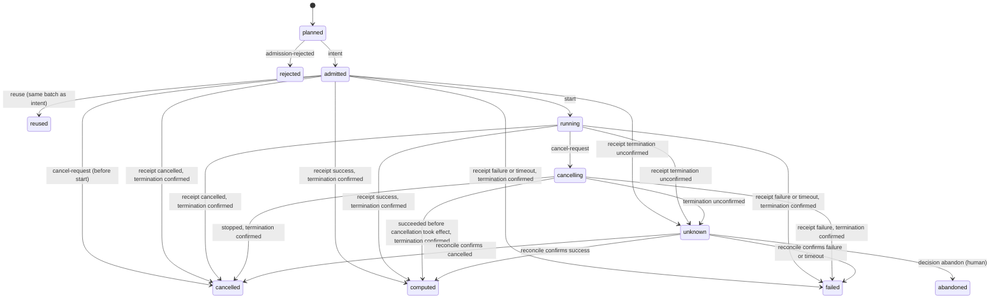

# Part III — Control

> This part defines layer C: **the closed format and strictness order of the task contract, facts and writers, execution state, artifact derivation, achieved tier, admission and publish**. The Agent executing the research reads the corresponding section only when the trigger matrix (Core §5.3) points to it; whoever implements layer C reads the whole text. **Read the Core part first.**
> This part contains no reconstruction-specific content and may be shared by other hep-research skills (Core §4.2, DEC-11). Its normative force is the same as that of the other parts.

## 0. Purpose of this part and design principles

- Control §1 Task contract: closed format, strictness order, effective contract. Control §2 Facts and writers. Control §3 Execution state. Control §4 Artifact derivation and achieved tier. Control §5 admission, check attempt, reuse and publish. Control §6 Human decisions. Control §7 Transition period: where facts come from and how to write them. Control §8 Reference model.
- The derivation has an executable reference model `hep-research-reconstruction-v12-en-reference-model.py` (Control §8). When the spec and the model disagree, report the discrepancy first; do not pick a side on your own.
- **Applicable deliverables:** The contract format and derivation of this part apply only to **numeric and claim deliverables** (T2-numeric, T3-E, T3-C). T2-code deliverables are not written in this part's format; their contract and completion conditions are only in Core §5.1 and Core §6.1.

**Design principles** (rationale and history in History §2):

1. **Record only facts; derive state.** Layer C only appends things that happened; “accepted”, “invalidated” and “blocked” are all pure functions of the facts, and are neither stored nor propagated.
2. **Decision rules cannot be loosened by the party being judged.** The task contract is written by the main Agent, but only a new contract that is **at least as strict in every field** takes effect automatically; all others wait for human approval. This is a allowlist: a change not listed in the strictness order is not “stricter”, so there is no need to enumerate one by one which changes are dangerous.
3. **Closed format.** The contract has only the fields listed in this part, and each field has a fixed type; the helper rejects unknown fields and anything whose type or range does not conform. New requirements can only be met by modifying this part and the reference model, not by adding ad hoc fields in the contract.
4. **Target and achievement are separate.** The contract records only the **target** tier of each deliverable; the **achieved** tier is derived from facts. There is no downgrade mechanism — not reaching the target means partial completion.
5. **Any shortcut that would make a result accepted requires a human.** Replacing or removing a required check, removing or replacing an upstream, changing a pin, identity continuation, changing iteration rounds, changing sample roles, raising the budget, and reassigning artifact ownership can only be approved by a human.
6. **Computed by C, not supplied by the caller.** The computational identity, whether a reuse is legitimate, the identity of a check attempt, and resource accounting are all computed and checked by C; the caller of admission only says what it wants to do, not what that computes to.
7. **Results bind to the computation, not to the copy.** A check's fail and inconclusive bind to “the same step, the same computational identity”; rerunning the same computation cannot wash a failure away.

---

## 1. Task contract

### 1.1 Closed format

The contract has exactly the following five fields, no more and no fewer (the concrete serialization belongs to DEC-01):

| Field | Content | Format rules (verified by the helper; rejected if not met) |
|---|---|---|
| `steps` | step name (string, not starting with `__`) → step specification (table below) | every field conforms to the type in the table below; all upstreams exist and are not duplicated; the graph of upstreams **and check inputs** is acyclic (so a check input never depends on the step it checks); a checked step has at least one required check; the allowed not-applicable set can only be a subset of the required checks; `family` and `round` are either both present or both absent; a pin must be an existing output of that step |
| `deliverables` | deliverable ID → {step (string), target tier (T2/T3E/T3C), required (boolean), **confirmation required** (boolean, default yes), **independent confirmation required** (boolean, default no)} (the two confirmation fields are fields of the **deliverable**, not of its step: they belong to the claim, so a deliverable added later cannot inherit another claim's “no”) | the step exists and is a checked step; a deliverable belonging to an iteration family must be the family's final step (the checked step of the final round) |
| `families` | iteration family → {final round (positive integer), convergence check, unconstrained-mode check (each named by its **check digest**; the two are distinct)} | the rounds of that family are **exactly 1…final round, each with at least one step**; a round may hold several steps (a **partitioned round**, e.g. per-chunk reconstruction with the previous round's constants and a global solve for this round's constants); the final round has **exactly one checked step**, the family's **final step**, and the check digests of its required checks include these two checks, neither of which is in the allowed not-applicable set (Methods §1.6); **rounds are chained**: a member step of round r may have in-family upstreams only in rounds r and r−1, and **every** step of round r > 1 consumes a step of round r−1, directly or through steps of its own round (so every chunk of a round uses the previous round's constants); **only the final step is checked** (members of earlier rounds and the other members of the final round are unchecked). None of these determinations depends on the order in which steps are listed |
| `samples` | sample ID → role (exploration, training, control, confirmation, blinded) | the role must be in the enumeration |
| `budget` | effective resource limit, or “not set” | not set, or a finite, non-negative number; NaN and infinity are not legal values |

**step specification:**

| Field | Type | Kind | Meaning |
|---|---|---|---|
| program, environment | string | content | determine the computational identity (Control §4.2); changing them invalidates the artifacts, and is not a loosening |
| external dependencies (including task-bound conditions) | sequence of strings | content | same as above |
| upstream | sequence of step names, no duplicates | **requirement** | which steps this step depends on; determines the computational identity, and also determines which upstream check results are on the deliverable's dependency chain (Control §1.2) |
| checked | boolean | requirement | whether checks are required |
| required checks | set of (check digest, criterion digest) | requirement | the step's **effective validation identity** |
| allowed not-applicable | same as above | requirement | which required checks may be not-applicable |
| check inputs | set of (check digest, step name) | requirement | the further artifacts a required check of this step reads (for example the convergence check reads the previous round's constants): the check digest is one of the step's required checks and the step is another step of the contract that does not depend on this step (acyclicity, row `steps`). C resolves them at admission and they are part of the check attempt's identity (Control §5.2) |
| family, round | string, positive integer, or neither | requirement | membership of an iteration step; a round may hold several steps (Control §1.1 `families`) |
| same-identity rerun allowed | boolean | requirement | needed only for non-deterministic outputs (UUIDs, timestamps) |
| pin | artifact digest, or none | requirement | an artifact deliberately fixed |

**The deliverable's confirmation fields.** “Confirmation required” (default yes) says whether a result on a confirmation sample is required when the deliverable's target is T3C; “independent confirmation required” (default no in the first contract) says whether a pass on a confirmation sample that the freeze lists as **method-independent** is also required (Methods §2.1); the first contract sets it to yes for an absolute-scale or performance claim on data (Core §7.2). **Setting “confirmation required” to no:** Only when the claim type itself requires **neither** holdout **nor** method-independent confirmation (Methods §2.1: for example a threshold applied directly to an untuned data-driven quantity derived by a pre-declared procedure, when the claim is not an absolute-scale or performance claim on data) does the **first contract** write no for that deliverable, with the rationale attached in the task record; a deliverable that becomes T3C by a later contract (added, or its target raised) takes yes for **both** fields unless a human approves (Control §1.2), because the claim-type determination of the first contract did not cover it. Whether the claim needs method-independent confirmation is likewise decided from the request in the first contract (“independent confirmation required”), and the report states, for each T3C deliverable, its claim type and the confirmation types required. **When it is determined at freeze time that independent confirmation is infeasible** (Methods §2.4 item 3), the determination is written in the freeze record but does not change the contract: the field remains yes, so the T3C deliverable does not reach its target, is reported as partial completion, and is explicitly marked “not independently confirmed”; to complete the deliverable with an unconfirmed result, a human must approve changing the field to no (Control §1.2, Control §6).

### 1.2 Strictness order: what counts as “at least as strict”

A new contract N is **at least as strict** as the current effective contract E if and only if every one of the following holds:

| Field | Condition for N to be at least as strict |
|---|---|
| each step of E | still exists in N; **its upstream set is a superset of E's** (upstreams may only be added, not removed or replaced); checked does not become unchecked; the required checks are a **superset** of E's; the allowed not-applicable set is a **subset** of E's; check inputs unchanged; family and round unchanged; no new same-identity rerun is enabled; pin unchanged |
| each deliverable of E | still exists in N, points to the same step, target tier not lowered, required does not become optional; confirmation required and independent confirmation required do not become no |
| each deliverable that is T3C in N but not in E (added, or its target raised) | confirmation required and independent confirmation required are both yes (the values for a claim whose type was not determined by the first contract; no needs a human approval, Control §1.1) |
| each step N adds | same-identity rerun is not allowed; the allowed not-applicable set is empty; it is not a member of a family of E (these values are reserved for the first contract or a human approval: Control §1.1, Control §5.1 item 6) |
| each family of E | final round and both check digests unchanged, and no step joins it (so adding a round, removing a round, partitioning a round further, or naming a replaced check all need human approval) |
| each sample of E | role unchanged |
| budget | when E has a limit, N also has a limit, and it is not greater than E's |
| content changes | when N changes a step's content fields (program, environment, external dependencies), no attempt of that step written before N has an identity that is current under N (computed from N's content and that attempt's consumed inputs). Such a change is a **revert**: it makes an artifact already produced — and possibly already checked on a confirmation sample — the bound one again, which is a choice of binding among artifacts already seen, and like a pin it needs human approval (Control §4.2) |

N may **add** steps (within the limits of the row above), deliverables, families, samples and upstreams, and may also change a step's content fields (program, environment, external dependencies) to values that revive no earlier attempt (row “content changes”); a content change of a checked step is subject to the check-before-recompute rule of Control §5.1 item 6. A newly added step cannot take over an existing artifact (Control §4.1); a newly added deliverable does not replace an original deliverable (each deliverable is reported separately; accepted requires every deliverable bound to the same artifact to reach its target, Control §4.5).

The reason the upstream set is listed among the requirement fields: removing an upstream moves its check results (including fail) out of the deliverable's dependency chain; that amounts to removing a required check, so it needs human approval.

### 1.3 Effective contract

The effective contract is derived in fact order (reference model `_contracts`):

- **The first contract.** When the execution mode is M1, it takes effect directly, as the baseline. Under M2/M3 (the mode is determined by the session fact that C writes when creating the fact log, Control §2), the first contract **waits for human confirmation** (decision `approve_contract`, referencing it); before confirmation there is no effective contract, and admission always rejects (DEC-12). **Whether the first contract matches the original request** (the tier is determined from the request, Core §5.1) is not a mechanical guarantee: M1 relies on the first reply, which lets the user correct it on the spot (Core §6.1); M2/M3 rely on this confirmation.
- **Each later contract.** If it is at least as strict as the effective contract at that time, the **whole** contract takes effect; otherwise the **whole** contract is pending human approval, and it is recorded against which effective contract it was proposed. Before approval it does not take effect at all — not even its stricter parts take effect on their own. There is no partial application.
- **Approval takes effect at the position of the approval fact.** `approve_contract` takes effect only when both conditions hold: the approved contract is still pending, and the effective contract is still the one that was effective when it was proposed. Contracts written afterward are not retroactively re-evaluated because of the approval.
- **Lapsed.** When a contract takes effect, all contracts still pending lapse; they must be proposed again before they can be approved. So “first write a loose contract and wait for later facts to make it take effect” cannot happen, and a late approval does not roll back a stricter contract that has since taken effect.
- The state of each contract (effective, superseded, pending approval, lapsed) is derived, and listed in the completion report.

---

## 2. Facts and writers

Append-only; each entry carries a sequence number, its writer, and the digest of the previous entry (format and location belong to DEC-01). The helper first validates **every entry** of the whole batch (writer, kind, the type and value of every field, including exposure); if any entry violates the rules, nothing in the batch is written; after a write, the derivation cache is always recomputed and must not retain old results.

| Fact | Writer | Content |
|---|---|---|
| session | C (when creating the fact log, and only as the first entry) | execution mode (M1/M2/M3). The absence of a session fact is treated as M1 |
| contract | main Agent, via helper | a complete contract (Control §1.1); format and types are validated on write |
| freeze | main Agent, via helper | exactly: step, **effective validation identity**, confirmation sample list (may list only samples whose role is confirmation), and optionally which of those samples are of the method-independent type (Methods §2.1; the others are holdout); the digest of a freeze document may additionally be attached (Methods §2.4: multiple testing, cross-round error control, feasibility determination). An effective contract must already exist before it is written |
| intent | C (when admission passes) | attempt (unique across intents and admission rejections: an id that admission rejected is not admitted later), step (computation step or `__check__`), the declared computational identity **computed by C**, the **actually consumed inputs `{upstream step: artifact digest}`** (Control §4; for a check attempt: the target and the resolved check inputs, Control §5.2), samples to be read, declared cost |
| admission-rejected | C | attempt, step, rejection reason |
| reuse | C | the attempt of the cache hit and the source artifact; written in the same append as that attempt's intent |
| cancel-request | C | attempt |
| start | B; adapter | the attempt starts executing |
| receipt | B; adapter | end status (success/failure/timeout/cancelled), termination certainty (confirmed/unknown), output digest (valid only when termination is confirmed), observed input evidence, conditions resolution result, **resource usage** (finite, non-negative; mandatory under M2/M3) |
| reconcile | B; adapter | the confirmed outcome of the attempt; takes effect only for unknown or abandoned |
| check-result | B, produced by the execution of the check attempt; adapter | target artifact digest, check digest, criterion digest, four-valued result (pass/fail/inconclusive/not-applicable) and reason, check attempt, samples used (must be in that check attempt's read list, otherwise it does not count as confirmation) |
| exposure | C (at admission, **every read is recorded, regardless of role**), B or the main Agent | exactly: the sample accessed (string), the accessing attempt or activity (string, may be omitted). The attempt named by an exposure that B or the main Agent writes is a free label: it is never attributed to a check attempt (Control §4.4 item 3) |
| decision | **human** | only the kinds listed in Control §6 |
| publish | C | deliverable ID, bound artifact digest, target and achieved tier, number of historical failures, of artifacts, of failed draws and of confirmation-sample results on the dependency chain, and of task-wide failures and artifacts (Control §4.5), the fact sequence number at derivation time, derivation version |

- **Writer restrictions:** The main Agent may write only contract, freeze and exposure. session, intent, reuse, admission-rejected and publish are written only by C; receipt, reconcile and check-result are produced only by B or an adapter from actual execution; decision is written only by a human.
- **Existing frameworks (after C1):** an adapter converts a framework's provenance or job records into receipts and check-results, but **the intent is always written by C at admission**; outputs without an intent written by C are not usable. The conversion preserves the original records' references and digests; the adapter must pass the corresponding capability qualification test (Delivery §1.2).
- **Transition period (before C1):** there is no C; the runner's run records serve as the content of receipts and check-results, and the main Agent additionally writes the **registration lines** listed in Control §7.3 (attempt registration, run registration, mapping table, transcribed decisions) in place of C's intent and fact ordering. The run registration line carries two receipt fields that the runner does not record, as **labelled Agent statements**: the resource usage (when there is a budget), and — only while the target checkout's runner does not record termination itself (BUG-04 unfixed) — the statement that no child processes remain (Control §7.2). These are the only writer restrictions loosened in the transition period; every such statement is listed in the report (Control §7.4). The main Agent still cannot write any other content of a receipt or a check-result.

---

## 3. Execution state (per attempt)

Derived from that attempt's facts; **only one terminal fact per attempt is effective**: the first receipt with confirmed termination, or the first confirming reconcile after unknown. Later receipts or reconciles do not change the state and produce no output. Only the transitions shown in the diagram below are accepted.

- **Entry into unknown always goes through a receipt.** When the outcome of a submission is unclear (lost response, submission command timed out), B or the adapter must write a receipt with unconfirmed termination; the attempt must not be left in admitted (mapping table in Delivery §3.1).
- **unknown**: counts toward in-flight resources; while there is an unknown attempt with **the same side effect** (for a computation step, determined by step; for a check attempt, by check × criterion × target, whatever check inputs were resolved), admission rejects new attempts until reconciliation or a human abandon.
- **abandoned**: can only be decided by a human; it is not automatically resubmitted. Its resources continue to count as in flight; a later confirmed reconciliation moves the cost from in flight to used (recorded in the derivation as abandoned-reconciled), rather than deleting it from the books; an unconfirmed reconciliation changes no account. An abandoned attempt is not a producer, and its outputs (even if collected later) are not usable.
- **failed** and **cancelled** are recorded separately, and neither is deleted; whether they count in the denominator is handled according to their scope accounting, and cancellation must not be used to move a failure out of the denominator (Core §0.4 item 8).
- **reused** is a kind of attempt; its legitimacy is checked at admission (Control §5.3).

---

## 4. Artifact derivation

Notation: a is an artifact digest; “consumed inputs” are the `{upstream step: digest}` recorded in the intent.

**An artifact is the whole set of outputs of one attempt.** An attempt may write multiple files; its artifact is represented by a canonical manifest of “logical name → content digest” and **the artifact digest is the SHA-256 of this manifest**. **Canonical form** (used for every digest of a JSON object in this spec, including the artifact manifest and the input manifest): UTF-8 bytes of the JSON serialization with keys sorted, separators `,` and `:` with no whitespace, and non-ASCII characters written literally (Python: `json.dumps(obj, sort_keys=True, separators=(",", ":"), ensure_ascii=False).encode("utf-8")`); content digests are lowercase hexadecimal SHA-256. Check targets, pin, bound and consumed inputs are all in units of artifact digests; when a downstream step consumes any one or several outputs of an upstream step, this is recorded as consuming that upstream's artifact digest, and individual files are located in the manifest by logical name. Outputs of a step that downstream steps need to consume separately and check separately should be split into different steps.

### 4.1 producer and owning step

- **producer**: an attempt that has a as its output, whose terminal fact is the fact that outputs a, whose execution state is computed or reused, that has an intent written by C (in the transition period, per Control §7), and that is **attested**. The definition of attested is only in Delivery §2.3: it has items 1–4 of the producer edge, and neither the reads nor the resource usage observed by B exceed the declaration (under M2/M3 the receipt must carry usage). A check attempt is not a producer. The same digest may have multiple producers.
- **owning step**: when all producers belong to the same step, it is that step. When producers come from **different steps**, it is a **producer conflict**: a is not usable and cannot be checked until a human decision `assign_producer` designates the owning step; after the designation, the check results of the original step (including fail) still apply.
- **usable** usable(a): the owning step is determined, and there is at least one producer belonging to that step.

### 4.2 Identity and currency

- **Computational identity** = (owning step, program, environment, external dependencies and task-bound conditions, **actually consumed inputs**). It is computed by C at admission using the effective contract at that time, and written into the intent; the caller cannot supply it. The full cache identity additionally includes the items listed in Delivery §2.1.
- **Self-current**: the producer's computational identity equals the identity recomputed from the **current** effective contract and the inputs it consumed; or a human, via decision `accept_identity`, approves “this artifact continues from this old identity to this new identity” (the human may require a methods-level impact-bound check as the basis). The approval is valid only for the specified artifact and that pair of identities; any further change needs a new approval.
- **Representative producer**: among the producers of the owning step, the one with the **earliest sequence number** among those whose identity is current (or approved for continuation); when none is current, the most recent one. The derivation uses its identity and its consumed inputs.
- **The computational identity binds to the actually consumed inputs**, not to the accepted version of the upstream: after a downstream step starts computing with provisional inputs, once the upstream passes, the downstream identity is unchanged and need not be recomputed.
- **Upstream state**: the contract's upstream step set ≠ the key set of the consumed inputs → stale. For each upstream u and consumed d: d not usable, not current (recursively), or not belonging to u → stale; u is a member of an iteration family other than its final step, and the consumer is not in the same family → stale; bound(u) = d → intact; u has a pin and pin ≠ d → stale; bound(u) exists and its binding sequence number is newer than d's → stale; otherwise (d is the latest, but not yet ok) → waiting.
- **Current** current(a): self-current, and the upstream state is not stale.
- **Reproduced**: the representative producer of a has another computational identity than the **first** producer of a in its owning step — an output already produced earlier is produced again by a changed computation (for example a cosmetic program change after a content change, or a refactor that gives the same bytes). Detected by digest, so it needs no knowledge of what changed.
- **Binding** bound(s): when s has a pin, take the pin, **but that artifact must still be ok, otherwise none**; otherwise take, among the artifacts of s that are ok and **not reproduced**, the one with the largest **binding sequence number** (the sequence number of the representative producer); if there is none, none. A reproduced artifact binds only through a pin, which needs human approval: re-binding an output already seen — possibly already checked on a confirmation sample — is a choice among artifacts already seen. reuse produces a later producer, but not the representative producer, so **reuse does not change the binding order**: the main Agent cannot use reuse to pick one among several ok artifacts (changing the binding goes through pin, which needs human approval). Nor can it do so through a content change: a contract that makes an earlier attempt's identity current again (a revert) is not at least as strict and needs human approval (Control §1.2, row “content changes”), and a changed computation that reproduces an earlier digest does not re-bind it either (Reproduced, above); so after several artifacts of a step have been seen, only the newest current one that was not seen before binds without a human.

### 4.3 Checks

- s is not a checked step → checks pass.
- Otherwise, for each required (check, criterion) in the effective validation identity:
  - **any fail or inconclusive, regardless of the state of its check attempt, → held**; moreover, this rule **binds to the computational identity**: a fail or inconclusive on any artifact of the same step and the same computational identity (another copy from a same-identity rerun) also makes artifact *a* held. A not-applicable that was not allowed in advance → held;
  - pass and allowed not-applicable count only when their check attempt is computed, is attested, and has the identity “this check × this criterion × this target × its resolved check inputs”, its check inputs are exactly those the effective contract declares for this check, an input that is an upstream of the target's step is the version the target consumed, and **any other input is still the bound version of its step** (Control §5.2) — otherwise the result is not counted and the check is missing;
  - every required check has a counted result, and there is no same-identity check attempt still running or unreconciled → checks pass; otherwise → results missing.
- **ok(a)**: usable ∧ current ∧ upstream intact ∧ checks pass.
- **Pass after correction**: an artifact whose program, environment or external dependencies were changed (new computational identity) is not affected by the old identity's fail — that is the legitimate correction path (Methods §2.2) — but the old failure does not disappear: the deliverable status lists every fail and inconclusive that any artifact on the dependency chain ever had (Control §4.5), and publish records their count; T3C is additionally subject to the restriction that a confirmation sample is used only once (Control §4.4).

### 4.4 Freeze and confirmation (when the target is T3C)

The freeze holds if and only if:

1. there exists a freeze of that step whose effective validation identity equals the current one;
2. the sequence numbers of all relevant check-results are later than the earliest such freeze;
3. for each confirmation result (a result whose sample used has the role confirmation), the sample used is listed in the read list of that result's check attempt and is listed in the list of some freeze; that freeze is earlier than this sample's first exposure; **before this confirmation result, this sample was exposed only by required check attempts of this artifact**, where an exposure counts as one of those attempts only when **C wrote it at that attempt's admission** (an exposure written by B or the main Agent is never attributed to a check attempt, whatever attempt it names). Required check results on samples of other roles (e.g., control) are constrained only by items 1 and 2;
4. a confirmation sample can confirm only once: when **another artifact** of the same step had a result on this sample earlier, this result is invalid (multiple required checks of the same artifact may share a sample; re-evaluating the same artifact with a corrected check follows the post-hoc correction rules of Methods §2.4);
5. when the **deliverable** requires confirmation, there is at least one pass on a confirmation sample, from a valid check attempt; when the deliverable also requires independent confirmation, at least one such pass is on a sample that a freeze **preceding that sample's first exposure** lists as method-independent (a label added by a later freeze does not count) (a pass on a control or other non-confirmation sample never counts).

Confirmation samples can only be read by check attempts (Control §5.1); every read writes an exposure, so that for a sample “declared a confirmation sample only later”, its earlier exposure can still be found (but an existing sample role cannot be changed, Control §1.2).

### 4.5 Achieved tier and deliverable status

| Achieved tier | Condition |
|---|---|
| none | not ok, or the owning step is not a checked step |
| T2/T3E | ok (T3E and T2 have the same mechanical conditions; the difference lies in report labeling and use, Core §5.1) |
| T3C | ok ∧ freeze holds (items 1–4, and item 5 with the deliverable's confirmation fields) |

- **Deliverable status**: take the bound artifact of the deliverable's step, and report “target tier, achieved tier, whether reached”, together with the **historical failures on the dependency chain**: every fail and inconclusive ever had by any artifact of the deliverable's step and of all its upstream steps in the effective contract (whether or not the identity has since changed), the **number of artifacts** those steps produced (every computed, attested draw, whether current or not), the **failed draws**: every computation attempt of those steps that ended without a usable artifact (failed, cancelled, unknown, abandoned, or computed but unattested), and the **confirmation-sample results**: every result on a confirmation sample of any artifact of those steps (so confirming several draws on different confirmation samples and keeping one is visible). Together these make every draw visible, including one turned into an execution failure after its output was seen. The report also lists the **task-wide history** — fail and inconclusive results, failed draws and the number of artifacts of every step of the effective contract, including steps off the deliverable's chain (so variants computed on an unchecked side step are counted) — so that a selection made on a side step and then adopted in the deliverable's step by a content change stays visible.
- **accepted(a)**: a is the bound artifact of at least one deliverable, and **every deliverable bound to a** reaches its target tier. A deliverable with a lower target on the same step cannot vouch for a deliverable with a higher target.
- **publish is per deliverable** (Control §5.4): what is published is “deliverable D reaches tier t with artifact a”, not an artifact on its own.
- **No downgrade**: when the achieved tier is below the target, the deliverable is partially complete; the report may truthfully state conclusions at the achieved tier (e.g., T3E exploratory results), but must not present it as completion at the target tier (Core §5.1 rule 3).

### 4.6 Diagnostic labels

Derived, not stored; evaluated in order, and the first one that holds is taken:

| Label | Condition |
|---|---|
| producer_conflict | producers of different steps produce the same digest, and there is not yet a human ownership decision |
| not_usable | not usable |
| invalidated | not current |
| iteration_internal | family member other than the final step, and there is not yet a usable artifact of a later round |
| superseded_by_iteration | family member other than the final step, and there is already a usable artifact of a later round |
| blocked_upstream | current, but the upstream is waiting |
| held | check status is held |
| unchecked | check results missing |
| reproduced | ok, not bound(s), and reproduced (Control §4.2): binds only through an approved pin |
| superseded | ok but not bound(s) |
| ok | ok and is bound(s); deliverables additionally list the achieved tier (Control §4.5) |

The report additionally lists: the historical fail/inconclusive results on the dependency chain (Control §4.5, including check failures from before an approved replacement and failures from before a correction); the state of each contract (effective, superseded, pending approval, lapsed); and all human decisions.

### 4.7 Behaviors that follow automatically

| Situation | Derivation result |
|---|---|
| upstream recomputed, or program, bound conditions, environment or upstream list changed | downstream consumed inputs are stale → invalidated |
| a human approves replacing a check (artifact digest unchanged) | old results do not belong to the new identity → only the missing check needs to be run, no recomputation; the old fail is listed in history |
| upstream held, revalidated and passing under an approved new validation identity | downstream returns from blocked_upstream to the state determined by its own checks, no recomputation; if the upstream was fixed by recomputation (digest changed), downstream is stale |
| the contract fixes the old conditions (pin), new conditions are released | binding unchanged → still current |
| the same check has both a pass and a fail; the fail's check attempt failed or was abandoned | held |
| two copies of a same-identity rerun, one fail and one pass | both held; a same-identity rerun after a fail is rejected by admission (Control §5.1) |
| pin points to a held artifact | not bound → downstream blocked_upstream |
| iteration | members other than the final step are iteration_internal/superseded_by_iteration; the final step is checked, and its convergence and unconstrained-mode checks determine held or ok; a final round that has not converged is held, and adding a round needs human approval |
| a human approves adding rounds after a non-converged final round | the approved contract makes the old final step an unchecked member (its round is no longer final) and gives the new final step the two checks; downstream consumes the new final step; the old convergence fail stays in the history of the dependency chain (Control §4.5) |
| a new artifact replaces an old artifact | the old artifact is no longer bound → superseded |
| a changed computation (cosmetic or a refactor) produces the digest of an artifact already seen | reproduced: not bound; the deliverable and downstream wait until a human approves a pin, or a new artifact is computed |
| a check input that is not an upstream of the target is recomputed, or its version stops being bound | the check result no longer counts → the target's checks are missing; run the check again |
| reuse of an older ok artifact | binding unchanged |
| a confirmation sample is first used on an old artifact, then on a new artifact | the new artifact's freeze does not hold → achieves T3E; another sample in the freeze list must be used instead |
| a new step produces the digest of an existing artifact | producer_conflict; a human designates ownership |
| a loose contract written earlier, not approved | pending approval; lapses as soon as any contract takes effect afterward |
| the first contract under M2/M3 | waits for human confirmation; all admissions are rejected before confirmation |
| deliverable requirements change | only the completion check is redone; artifact derivation unchanged |

### 4.8 Cost

Recursive derivation must cache every derivation result **within the same fact sequence number**, and must index facts by kind, attempt, target artifact, sample, output digest, computational identity and step, so that the cost is roughly proportional to “number of facts + number of artifacts × number of upstreams”; it must not scan the whole fact log in every derivation call. Incremental derivation across sequence numbers belongs to DEC-02. Under extensive partitioning (Methods §3.1), aggregate per step.

---

## 5. admission, check attempt, reuse and publish

### 5.1 admission

admission writes, in the same append, the intent, an exposure for each read, and (for a reuse) the reuse fact; it checks at least:

1. there is an **effective contract** (the first contract under M2/M3 must already be confirmed, Control §1.3); capability (Delivery §1.2) and permissions;
2. the **cost** is a finite, non-negative number, and used + in flight + requested ≤ effective budget (when set). **The accounts are kept by C**: each attempt is counted as “the larger of the declared cost and the usage reported by the receipt”; an attempt whose reported usage exceeds its declared cost is not attested (Control §4.1), and its outputs are not usable — **when the receipt carries usage** (mandatory under M2/M3), under-reporting cost cannot buy quota. Under M1 without metered usage (G4 absent), the charge is the declared cost, so the budget is only as strong as the declared costs; the report states that the budget was not enforced against actual usage (Delivery §3.3);
3. **reads**: confirmation samples can only be read by check attempts, and require a prior freeze that includes them; blinded samples require a human unblind decision;
4. **computation step**: the step exists in the effective contract; all upstreams have a version usable as a dependency (bound, or, when there is no bound, the latest current artifact), otherwise reject; the identity is computed by C;
5. there is no unknown attempt with **the same side effect**;
6. **same-identity rerun**:
   - reject when this computational identity already has a fail or inconclusive on a required check (what must change is the computation, not another draw);
   - when the step **does not allow** same-identity reruns: if the same identity already has an attempt in flight, or one that succeeded and is attested — **regardless of whether it has been checked** — reject; reuse should be used instead. After an attempt that failed in execution, was cancelled, or whose output is unattested, a retry is allowed, and that attempt is counted as a failed draw (Control §4.5). Together with the next bullets, “run several copies first, look at the outputs, and send only the one you like to be checked” cannot be done without trace: every draw is either checked or reported as a failed draw;
   - when the step allows same-identity reruns (this must be stated in the first contract or approved by a human), a rerun produces a new binding version, making downstream steps that consumed the old version stale; the risk of picking among copies is borne by the approver, and the report lists all copies;
   - **check before recompute** (any identity): for a checked step, reject while any earlier artifact of the step (an output of a computed, attested attempt of that step, current or not) lacks a counted result — pass, fail, inconclusive or not-applicable from a valid check attempt — for some required check of the effective contract. A content change (program, environment, external dependencies) gives a new identity and takes effect automatically, so without this rule it would be another draw; with it, every draw of a checked step that produced a usable artifact is checked and its failures enter the history, and every draw that did not is a failed draw (Control §4.5). Reuse is not a new computation and is not affected; steps that are not checked (e.g. intermediate rounds) may be recomputed freely, and the number of their draws is reported (Control §4.5).

### 5.2 check attempt

The caller specifies only (check, criterion, target artifact); the target must be usable (an artifact in conflict or not usable cannot be checked); the identity is computed by C from (check, criterion, target, resolved check inputs). A check may read further artifacts — for example the convergence check reads the previous round's constants, or a closure check reads a reference sample — only as the **check inputs** the contract declares for that check on the target's step (Control §1.1). A check input cannot depend on the target's step (acyclicity): a check that needs data processed with the target (for example a mode check on data reconstructed with the final constants) does that processing **inside the check attempt**, as part of the check program. **C resolves them at admission**, the caller cannot name them: an input that is an upstream of the target's step resolves to the version the target consumed; any other to that step's **bound** version (never a held, unchecked or reproduced one); if one cannot be resolved, admission rejects. The resolved digests are written in the intent, are part of the check attempt's identity, and are staged and recorded in the check's receipt. The result is bound to the versions resolved at its admission, and, like an upstream's state (Control §4.2), it **counts only while each non-upstream input is still the bound version of its step**; the report lists them. The check is executed through layer B and produces a receipt; the check-result is written by B for that attempt.

### 5.3 reuse

reuse is a kind of attempt. C first computes the step's computational identity as of now, then checks the source: it must be a usable, current artifact of **the same step**, and the computational identity of its representative producer must **equal** the identity just computed; otherwise reject. One cannot reuse a digest that was never produced, an artifact of another step, or an invalidated or unattested artifact. After the reuse, the artifact is derived as usual (its check results are governed by digest and computational identity), and the binding order does not change (Control §4.2).

### 5.4 publish

publish is per **deliverable**: it is accepted only when that deliverable reaches its target tier, and it records the deliverable ID, the bound artifact, the target and achieved tier, the number of historical failures, of artifacts, of failed draws and of confirmation-sample results on the dependency chain, and the number of task-wide failures and artifacts; it uses the fact sequence number at derivation time for compare-and-set, and records the derivation version. After the derivation functions are modified, past publish determinations can be reproduced from their version and sequence number. When conditions are relevant and G6 is available, re-resolve or compare against the snapshot before publish and before the completion check; without G6, record this limitation in the report.

### 5.5 Atomicity

**The only thing that requires atomicity is append.** Every append carries the “expected previous sequence number” (compare-and-set); if it does not match, re-read, re-derive, and retry. Locks may additionally serialize writers but **do not replace compare-and-set**; when locks are used, a lock carries an owner and a lease, and after a restart, reconcile first, then take over expired locks (C2). No accept guard lock is needed: accepted is not a written state. For how to write in the transition period, see Control §7.3.

---

## 6. Human decisions

decisions are written only by a human, and their kinds are **limited to** the table below; the helper rejects any other kind.

| decision | Meaning |
|---|---|
| `approve_contract` | makes a **pending** contract take effect as a whole (under the conditions of Control §1.3). There are two kinds of pending contracts: the first contract under M2/M3; and later contracts that are not “at least as strict” (e.g., replacing or removing a required check, removing or replacing an upstream, adding an allowed not-applicable, changing checked to unchecked, lowering a target tier, removing the confirmation requirement, changing a pin, enabling same-identity reruns, changing iteration rounds or a family's check digests, adding a step to an existing family, adding a step with confirmation not required, same-identity reruns allowed or allowed not-applicable, changing sample roles, raising the budget, changing what a deliverable points to) |
| `accept_identity` | approves an artifact continuing from an old computational identity to a new computational identity |
| `assign_producer` | designates the owning step for an artifact in producer conflict |
| `unblind` | lifts the blinding of a blinded sample |
| `abandon` | turns an unknown attempt into abandoned |

- When a human makes a decision, the Agent should attach the basis: e.g., when replacing a check, the receipts of the positive and negative tests (Methods §2.2); for identity continuation, the result of the impact-bound check and the criteria recorded in advance (Methods §2.4); when confirming the first contract, the rationale for the determination of the deliverables and target tiers (Core §5.1). These bases are for the human to read; they are not automatic authorization.
- Core §6.3 lists other matters that existing rules hand to a human (irreversible deletion, submissions beyond authorization, etc.); those do not go through this part's decision facts, but likewise must not be decided by the Agent on its own.

---

## 7. Transition period: where facts come from and how to write them

Before the control-layer helper (C1) is complete, there is no C. The rules of the transition period are in Core §5.4; this section specifies **who stands in for C, how the fields of the existing run records map to facts, and how the task record is written**, so that every item of the derivation has a source and an order. It is based on the current computational-run record of `run_workflow.py` (current state, unchanged from 0.41.0 to 0.49.0; must be rechecked on the target checkout). In the transition period, the derivation is stated item by item by the main Agent in the completion report, following the rules of this part; it is not a mechanical guarantee.

### 7.1 Scope in which the runner and the main Agent stand in for C

- **The run record serves as the content of the receipt (and of the check-result).** In the transition period, “has an intent written by C” in Control §4.1 is reread as “the task record has an attempt registration line for that attempt, and there is a run record written by run_workflow”; if either is missing, the output is not usable.
- **admission is performed on C's behalf, and stated, by the main Agent** (each item of Control §5.1): effective contract, cost and budget, reads (confirmation and blinded samples, Core §5.4 item 7), upstream versions, no unknown on the same step, same-identity rerun. The main Agent checks before writing the attempt registration line, and lists each item in the derivation section of the report; these are the Agent's statements, and the report must label them as such.
- **One step per invocation.** For a step whose artifacts support a deliverable at T2-numeric or above (and for every check run), each `run_workflow.py` invocation runs **exactly one step** in its own fresh output directory, with the upstream outputs staged in as declared inputs. Only then does each attempt have its registration line before execution, its run registration line after it, and an upstream terminal fact before the downstream's admission (Control §5.1 item 4). A multi-step invocation may be used for exploration; its outputs are unattested.
- **Valid only for run_workflow.** For an equivalent framework to support deliverables at T2-numeric or above in the transition period, a field mapping table in the same format as Control §7.2 must first be written in the task record and cited in the report; without a mapping table, its outputs are unattested in the transition period. **The partition campaign (`core/partition/campaign.py`) is such an equivalent framework**: remote or background work supports such deliverables in the transition period only with that table (Control §7.4, Delivery §3.1). Using it does not make the task M3: the task is still reported as M1 (segmented where needed, Core §5.4 item 8), the M3 guarantees are reported as absent (Core §5.2 “When a required guarantee is missing”), and ambiguous submissions stay unknown.

### 7.2 Field mapping

| Needed by the derivation | Source in the transition period | Who writes |
|---|---|---|
| attempt and its order | the **attempt registration line** in the task record (written before execution): attempt = **path of the output directory + step id** (each execution uses a fresh output directory, so it is unique). The artifact ID in the run record is the same for every execution of the same step and cannot serve as the attempt | main Agent |
| samples to be read (read list) | the attempt registration line lists every sample the attempt will read (empty when none); a sample a check-result names that is not in this list does not count as confirmation (Control §2, Control §4.4) | main Agent |
| exposure | for every sample in the read list, the main Agent appends an **exposure line** right after the attempt registration line and before execution (as C does at admission); any other access to a sample (a look outside a registered run) is also appended as an exposure line when it happens. The position of a sample's first exposure line is its first exposure (Control §4.4). Only the exposure lines written for a registered check attempt's read list, between its registration line and its execution, stand in for C's exposures; any other exposure line is never attributed to a check attempt, whatever it names (Control §4.4 item 3) | main Agent |
| declared check identity (check attempts only) | the attempt registration line of a check attempt (step `__check__`) declares the check digest, the criterion digest, the target artifact digest and the digests of the check inputs the contract declares for that check (resolved per Control §5.2) before execution | main Agent |
| step | the step id in the workflow, mapped in the registration line to the contract's step name | main Agent |
| computational identity | the run record's `argv`, `script_sha256`, `plugin_release`, plus the SHA-256 of the input manifest, plus two kinds of files that **must be listed as step inputs** (so that their hashes enter the input manifest): (1) a **code manifest** — the code the result depends on other than the `.py` named in argv (ROOT macros, shell scripts, compiled binaries, imported local modules); the commit of the git checkout holding that code plus the digest of the uncommitted diff may be used, or per-file hashes; (2) when the result depends on software beyond Python/NumPy, the output of `environment_manifest.py`; when it depends on versioned external conditions, the conditions payload or snapshot. The `environment` field contains only the Python and NumPy versions and is not sufficient to represent the environment (Delivery §2.1). The environment manifest must describe the environment that actually ran the step: it is produced, or verified with `environment_manifest.py check` (exit 0), by a registered run in the same environment and session, after the last change to that environment and before the step's attempt registration, which cites that run's record digest; a manifest staged from an earlier session without that verification does not count. That verification run is evidence for the identity, not an upstream: code manifests, environment manifests, conditions snapshots and criteria files are **declared inputs** whose hashes enter the identity; only staged outputs of upstream steps are consumed upstream artifacts. The identity is also incomplete when the run record's `plugin_release` digest is `unknown` and the step imports plugin code (argv names `{plugin}`). When these are not listed or not verified, the identity is **incomplete**: the main Agent must not claim that the artifact is still current after the corresponding change, nor reuse it on that basis | runner; whether to list them is decided and stated by the main Agent |
| actually consumed inputs | the paths and SHA-256 in the input manifest, mapped to the artifact digests of the upstream run records. **Declared input paths must be relative to the output directory, must not contain `..`, and must not pass through symlinks** (run_workflow does not prevent absolute paths or `..`, so this rule is followed and stated by the main Agent); upstream outputs are first staged into the output directory. Undeclared reads cannot be detected; this is the limitation of “transitional attested (declared inputs)” | runner; the mapping is listed by the main Agent in the report |
| declared cost and usage | not recorded by the runner. When there is a budget, the main Agent writes the declared cost in the attempt registration line, and writes the actual usage that can be obtained (wall-clock time, external billing) in the run registration line, as a **labelled Agent statement** (a transition loosening, Control §2) | main Agent (labelled statement) |
| end status | the run record's `exit_status` and `status` | runner |
| termination certainty and order | the **run registration line** in the task record (written after execution): cites the path and SHA-256 of the run record file; its position in the task record is the position of that attempt's terminal fact. Termination is taken as follows: (a) when the target checkout's runner records termination on every run record (BUG-04 fixed: the record has a termination field with `confirmed` or `unconfirmed`), that field governs — `unconfirmed` makes the attempt unknown even when the record exists, and the Agent may not override it; (b) while BUG-04 is unfixed, it is registered as confirmed only if the run record exists and the main Agent has confirmed, as a labelled statement, that there are no leftover child processes, and a timeout leaves no run record, in which case the run registration line states “no run record, termination unconfirmed” and the attempt is unknown; (c) **definitely not started**: when the runner refused the invocation before starting any process of the step (exit 2 with no run record for that step: a rejected workflow, an unsafe path, a missing input), the run registration line states “not started” with the runner's output digest, and the attempt is **failed with termination confirmed and no outputs** (as `not-submitted` in Delivery §3.1). A failed **parameter-digest command** did start a process: it counts as not started only when that command's termination is confirmed (the runner's output field after BUG-04 is fixed, or the labelled statement of (b) before), otherwise the attempt is unknown. With one step per invocation (Control §7.1) no step is left unreached | registered by the main Agent; content from the runner |
| output and artifact digest | the run record's `output_hashes`; the artifact digest is the SHA-256 of its canonical form (Control §4) | runner (or computed by the main Agent when the runner does not record it); written in the run registration line |
| check-result | the output file of the check run (recording check, criterion, target artifact digest, four-valued result, samples), whose hash is in that check run's run record; its position is that check run's run registration line. **It counts only when its self-declared identity is bound to the run**: (1) the check digest equals the SHA-256 the run record holds for the check program (`script_sha256`, or a code-manifest input when the check is not a `.py`); (2) the criterion digest equals the SHA-256 of a criteria file listed in that run's input manifest; (3) the target artifact digest equals the canonical-form SHA-256 of the target's output manifest, and every output file of the target is staged as an input of the check run with the hash its upstream run record holds; (4) all three equal the declared check identity of the attempt registration line, and every sample used is in its read list. Otherwise the result is not a result of that required check | runner (produced by the check program; not rewritten by the main Agent); the binding is verified and stated by the main Agent |
| contract, freeze, exposure | the corresponding lines in the task record | main Agent |
| human decisions | written by a human into the task record; or given explicitly by a human in the conversation and **transcribed verbatim by the main Agent, marked as transcribed** | human; or transcribed by the main Agent |
| session (mode) | the transition period has only M1 (Core §5.4 item 8); not written | — |

### 7.3 How the task record is written

The “appended only via the helper” of Delivery §2.5 applies from C1 on; in the transition period it is replaced by the following:

- The task record is kept in a persistent directory, separate from the output directory of each execution (DEC-01, DEC-09).
- **There is only one append-only file** (e.g., `task-log.jsonl`; the name belongs to DEC-01), and lines of all kinds share **one sequence number** and one digest chain: each line carries a sequence number, a kind, a writer (main Agent, human, or “main Agent transcription”) and **the SHA-256 of the previous line**. All ordering relations the derivation needs (the position of approvals, freeze before exposure and confirmation, representative producer) are determined by this sequence number.
- In the transition period, the kinds of lines the main Agent may write are **limited to**: contract, freeze, exposure, attempt registration, run registration, the field mapping table of an equivalent framework, transcribed human decisions. A human may write decisions.
- Before appending, the main Agent first reads the last line and verifies its SHA-256, and references it when writing; if they do not match, it stops and explains in the report (this is compare-and-set simulated with a digest chain, not an atomicity guarantee).
- Lines already written are not modified or deleted; a correction is expressed as a new line.
- **No publish in the transition period.** publish is written only by C (Control §2, Control §5.4). Before C1, the completion report instead **states** for each deliverable the derivation at a named task-record sequence number (bound artifact, target and achieved tier, number of historical failures and of artifacts on the dependency chain), labelled “stated, transition period, not published”.

### 7.4 Other

- There is no reconcile in the transition period: an unknown attempt stays unknown, and no other attempt may be started on the same step until a human abandons it (Control §3). This includes campaign work: the person-run campaign flows (`reconcile()` read-only listing, `confirm_submission`, `abandon_submission`) may be used to settle the campaign's own state, but they produce no fact here; an attempt whose submission was ambiguous stays unknown in the task record, and its outputs are not usable in the transition period even if the job later completes. `run_workflow.py` has no cancel operation and its records carry no cancelled end status: a run stopped by a signal is recorded as failed, and an interrupted invocation that leaves no run record makes the attempt unknown. Cancel requests are therefore not lines of the task record.
- **While BUG-01 is unfixed**: a step's declared outputs must not have the same name as any input staged in or any file that exists before execution; before execution, confirm that none of the declared outputs exists. Steps that need an “in-place update” are changed to read the old name and write a new name.
- Remote or background submission follows the existing campaign rules. The mapping between campaign state and this part's facts in Delivery §3.1 is the adapter's mapping **from stage D**; during the transition period, only its rows that need no reconcile or cancel-request fact are used, through the field mapping table of Control §7.1 (intent → attempt registration line; `not-submitted`, `lost` and a confirmed job end → run registration line; anything ambiguous → unknown).
- **Long steps**: while BUG-04 is unfixed, the runner's fixed per-step deadline (3600 s in 0.49.x) is a timeout path without a run record; a step expected to exceed it is split, or run through the campaign with a field mapping table.
- Transcribed human decisions, as well as the statements of “no leftover child processes”, of resource usage, of each admission check, of the binding of each check-result (Control §7.2), and of whether an identity is complete, must all be marked in the report.

---

## 8. Reference model

`hep-research-reconstruction-v12-en-reference-model.py` (derivation version `v12.1` in this spec copy) implements, per the definitions of this part, fact writing (writers, allowlist, format and type validation of contracts and freezes), the effective contract (including the first contract under M2/M3, the position of approvals, and lapse) and the strictness order, execution state, artifact derivation and achieved tier, admission (including usage accounting), check attempt, reuse, and per-deliverable publish (capability and permission matching, and the transition period of Control §7, are outside the model's scope), and includes:

- **89 scenarios** (v12.1 spec copy):
  - Basic paths and states: success, unknown and reconciliation, timeout, approved check replacement without recomputation, invalidation from program and condition changes, no cherry-picking of results, iteration and non-convergence, freeze before confirmation, compare-and-set and budget, unattested, unchecked intermediate artifacts, superseded and approved pin, same-identity rerun and reuse, unapproved loosening does not take effect, approved changes, check attempt state asymmetry, result allowlist and NA, pin must be ok, per-sample freeze and single use of confirmation samples, identity continuation approved only by a human, upstream list change, multiple producers, accounting for abandoned, check source, an adapter requires an intent written by C, scale (at 4× depth, derivation time must be under 9×), fact order, three-level invalidation, transition allowlist, admission, publish, waiting and stale, writer restrictions, invariants over 250 random fact sequences, closed format;
  - **Attacks from past reviews** (each must fail): self-authorized check replacement, adding unknown contract fields, a new step taking over an artifact, obtaining identity continuation through a superficial program change, a freeze listing non-confirmation samples and tuning on confirmation samples after the freeze, changing sample roles, downgrading and pre-written loose contracts, reuse source, single terminal fact and check source, raising the budget and a NaN budget, a non-final round consumed from outside the loop, invalidated taking precedence over iteration labels, the final round must be checked and cannot be changed, a deliverable cannot be repointed or replaced by a stand-in, identity computed by C, two required checks of the same artifact sharing a confirmation sample, a family must have rounds, contracts are all-or-nothing, target and achievement reported separately, same-identity rerun cannot be enabled on one's own;
  - **Attacks from S0 (v11)**: removing a held upstream, same-round twins and validation dependent on listing order, same-identity rerun after a fail to pick a result, vouching with a lower-target deliverable, declaring zero cost, freeze format, a late approval retroactively re-evaluated, field types, reuse changing the binding, the first contract under M2, an iteration family missing the convergence or mode check;
  - **Attacks from S0 (v11.1)**: rerunning several copies before checking to pick a result, a malformed exposure causing a batch to be half-written, a required check on a control sample should not block T3C;
  - **Attacks from S0 (v12)**: an added step carrying values reserved for the first contract or a human, redrawing through cosmetic content changes (check before recompute), reusing a rejected attempt id, partitioned rounds and round chaining, adding rounds after non-convergence, changing a family's check digests; draws turned into execution failures or unattested outputs (failed draws), a method-independent confirmation that is required but missing, unvalidated fields of B and human facts, family membership (every chunk consumes the previous round; only the final step is checked); a method-independent label added after exposure, selection on an off-chain step;
  - **Attacks from the fourth S0 round (r4)**: re-binding a confirmed draw by reverting the program, a T3C deliverable added later inheriting another claim's “no”, check inputs chosen outside C, an agent-written exposure labelled with a check attempt, variants on an unchecked side step;
  - **Attacks from the fifth S0 round (r5)**: a cosmetic change reproducing an already-seen digest (in the step or an unchecked upstream), a held or later replaced check input, a second check attempt while one with other check inputs is unknown;
- **42 mutation tests**: each deliberately breaks one rule, and each must be caught by at least one scenario: fail counts only computed check attempts, freeze not checked, upstream ignores currency, strictness order not checked, required checks can be reduced, a family's final round can be changed, sample roles can be changed, the budget can be loosened, a deliverable can be repointed, pin does not require ok, check does not verify identity, multiple steps not treated as a conflict, exposure after freeze not checked, a non-final round can be consumed outside the family, identity continuation does not need a human, reuse source not checked, format not validated, an upstream can be removed, fail binds only to digest, accepted with any one deliverable, budget looks only at declared cost, still attested when usage exceeds the declaration, reuse changes the binding, same-identity rerun allowed before checking, freeze constrains all samples, an added step may take reserved values, recompute before checking the earlier artifact, a rejected attempt id is reusable, rounds need not be chained, failed draws not counted, method-independent confirmation not checked, fact fields not validated, independent label from any freeze, task-wide history omitted, a content revert re-binds without a human, confirmation results not reported, an added T3C deliverable inherits no, check inputs not resolved by C, an agent exposure attributed to a check attempt, a reproduced digest binds without a human, a check input need not stay bound, the check side effect not recognised across check inputs.

It is **an executable illustration of the spec, not plugin code**, and it does not mean that any runtime has passed acceptance. When implementing C1, use it as the reference for property tests (Delivery §5.1).

