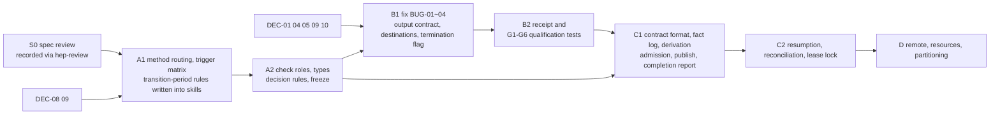

# Part IV — Delivery

> This part is for **those implementing layers B and C**, and for Agents that need to judge details of capabilities, cache, outputs, the provenance chain or resources: inter-layer interfaces and capabilities, cache and outputs, storage of the provenance chain and the fact log, submission and stopping, the rollout plan, open design decisions, acceptance and the requirement index. The derivation rules of layer C are in the Control part. **Read the Core part first.**
> Its normative force is the same as that of the other parts.

## 0. Purpose of this part

- Delivery §1 inter-layer interfaces and capabilities; Delivery §2 cache, outputs and provenance; Delivery §3 submission, stopping and resources; Delivery §4 rollout plan and open design decisions; Delivery §5 acceptance; Delivery §6 requirement index.
- During the transition period (Core §5.4), the Agent executing research usually does not need to read this whole part, only the sections the trigger matrix points to.

---

## 1. Inter-layer interfaces and capabilities

### 1.1 Minimal inter-layer interface (conceptual fields, not an API)

The concrete format belongs to DEC-01/DEC-03.

**Execution receipt (B → C; produced by both computations and checks)**

| Information | Purpose |
|---|---|
| attempt identity (assigned by C at admission) and owning step | reconciliation; derivation (Control §3, Control §4) |
| End status (success/failure/timeout/cancelled) and **termination certainty (confirmed/unknown)** | execution state (Control §3) |
| For each output: logical name, actual location, content digest (obtained after termination is confirmed), whether it was written to an attempt-owned location or to a location explicitly mapped by the adapter; and the **artifact digest** of the whole output set (the SHA-256 of the canonical manifest of logical name → digest, Control §4) | freshness and producer edge; derivation |
| **Observed input evidence**: the inputs actually read and their digests (when observable); the actual resolution results of conditions (G6) | attested determination; comparison with the declaration |
| Environment reference, timestamps, **resource usage** (when meterable; mandatory for M2/M3, Control §2) | reproduction; budget accounting and attested determination (Control §5.1) |

**check result (defined by A, executed by B, derived by C)**

| Information | Purpose |
|---|---|
| check program digest, criteria digest, freeze record reference | prevents after-the-fact adjustment |
| Target artifact digest | binds the object being checked |
| check attempt (admitted by C; identity = check × criteria × target) | proves that the check actually ran, and that the check that ran is this one (Control §5.2) |
| check role (closure/independent confirmation, including the holdout or method-independent type) and type (threshold validation/performance estimate) | Methods §2.1, Methods §2.3 |
| Result: pass/fail/inconclusive/not-applicable, with reasons and a reference to the decision rule | completion determination |
| Samples used (must be in the read list of that check attempt) | confirmation validity (Control §4.4) |

### 1.2 Capabilities and qualification tests

An executor declares the capabilities it supports; **a declaration must reference the passing record of that capability's qualification test, otherwise admission treats the capability as absent**.

| Guarantee | Meaning | Minimal qualification test (fault injection) |
|---|---|---|
| G1 output isolation | All outputs are written to attempt-owned locations, or are explicitly mapped by the adapter with provable freshness; actual locations and digests are reported | old file with the same name; absolute/`..`/symlink destinations; an exit-0 command that writes no new result |
| G2 termination confirmation | Can identify and confirm that the owning process tree/job has stopped | child process still alive after the parent process times out |
| G3 submission reconciliation | Can query the true state of remote work by intent/tag | submission response lost |
| G4 resource metering | Can report used and in-flight commitments, and atomically reserve quota at intent | concurrent admissions exceeding the budget; orphans counted |
| G5 persistent state | State can be recovered after a process/session restart | restart recovery; stale lock takeover |
| G6 conditions resolution evidence | Can report the actually resolved conditions payload and its validity range | IOV boundary crossing; content change behind a mutable alias |

**When a required guarantee is missing:** switch to a weaker, explicitly stated procedure and explain it in the completion report; **capabilities must not be fabricated for the sake of a uniform interface**. For the guarantees required by each execution mode (M1–M3), see Core §5.2.

---

## 2. Cache, outputs and provenance

### 2.1 Cache: identities kept separate

| Identity | What it binds | When it is determined | Behavior after a change |
|---|---|---|---|
| **Declared computational identity** (cache key) | The owning step (each round of an iteration is one step), the declared input data/parameters and their digests, the program and required external dependencies, environment/binary, actual seed/settings, the global tag/resolution rules of models and conditions, the complete output contract, and the partitioning/state/RNG approach where it affects the result. For the core part used in derivation, see Control §4.2 | Before execution, computed by C | The affected computation is redone, or the outcome is determined by an explicit compatibility/reuse rule |
| **Observed input evidence** | The inputs actually read (when observable), the actual resolution results of conditions (G6) | After execution, written into the receipt | Compared with the declaration (see below) |
| **Validation identity** | Artifact hash, required checks and criteria, sample role and exposure, domain of validity | At check time | The computation may remain valid, but the checks must be rebuilt |
| **Delivery requirements** | The deliverables required this time, target tier, required checks | Task contract | Only the completion check is redone; **artifacts are not invalidated** |

Relation between observation and declaration:
- Observed reads **exceed the declaration** → that attempt must not write to the reusable cache, and must not be marked attested.
- Reads **cannot be observed** (this is the case for the current runner, 0.41.0 through 0.49.0) → it may be marked “attested (declared inputs)”, with a note in the report; reuse relies only on the strict matching of DEC-05. The observation method belongs to DEC-10.

Other rules:
- The seed in the metadata must match the one the program actually uses; filling in a single seed in the run record is not a reproducibility guarantee.
- Environment identification must not record only Python/NumPy and treat that as covering ROOT, the compiler, the GPU or external experimental conditions.
- **Complete output contract**: the first version adopts conservative strict matching (decided, DEC-05) — the set of logical outputs, the required/optional semantics and the schema/format are consistent with the reusable record, and the files and hashes currently required can all be retrieved. **If a newly added required output does not match, the step cannot be skipped** (fixes BUG-02). The BUG-02 test **must** be run under conditions in which the release digest is known (for example, by fixing `plugin_release` in the test); otherwise INC-03 means the skip never happens, and the test passes falsely.
- **Cache provenance**: the legitimacy of reuse is checked by C (Control §5.3): same step, same computational identity, usable and current; unattested is not allowed. After reuse, derivation proceeds as usual under this run's validation identity.
- Hash comparison guards against substitution, but does not prove that the dependency list is complete or that the scientific model is correct. When unknown dependencies/the release digest do not support reliable reuse, conservatively rerun the corresponding steps, but there is no need to redo the entire project.

### 2.2 attempt isolation and output freshness

- A fresh working directory is only a means; **all actual output destinations** must have evidence of freshness and ownership.
- logical outputs map to attempt-owned locations; after resolution, absolute, `..` and symlink paths must not silently land on old results or on another attempt's destination (fixes BUG-03).
- When an external framework needs other storage, the adapter explicitly maps it and specifies freshness/acceptance; it must not be presumed that everything is new just because the folder is new.
- accepted inputs and cache lookups are staged separately into the new output area, so that reusing upstream data does not also put old downstream outputs back into this run's namespace. **Use old artifacts only after a cache hit has been proven**; when actually rerunning, write to a clean destination.
- Publish accepted references only after the corresponding checks are complete; failures and partials stay in the attempt area. Bound, ok intermediate artifacts that are not checked are likewise protected by the irreversible-operation protections of Core §6.3; downstream references them by their digest and stages them.
- After an interruption, reconcile using the actual data, receipts and commit state. A single process may use simple atomic state updates and rebuildable references; multiple writers/remote storage use the protocol supported by that system. **Do not claim that a single rename establishes a transaction across multiple files.**
- Passing a public/synthetic probe does not mean that deployment on private data is qualified.

### 2.3 attested and unattested artifacts

**attested** (the only definition in this spec; Control §4.1 references this one): the artifact has the producer edge of Delivery §2.4 items 1–4, the reads observed by B do not exceed the declaration (Delivery §2.1), and the reported resource usage does not exceed the declared cost; under M2/M3 the receipt must carry usage, and without it the artifact is not attested. “Accepted by a check” is a condition for accepted, not the definition of attested.

The kind names in reports are fixed to three: **attested** (after C1, reads observable), **attested (declared inputs)** (after C1, reads not observable, Delivery §2.1), **transitional attested (declared inputs)** (before C1, per Core §5.4 and Control §7).

Artifacts that the main Agent produces by directly running ad-hoc commands or scripts, bypassing the runner/framework, are **unattested**:
- they may be used for exploration, debugging and drafts;
- they **cannot** serve as evidence for deliverables at T2-numeric or above or for any completion claim, until they are regenerated through an execution path with a receipt, or the producer edge is completed with an equivalent framework receipt;
- they are listed separately in the completion report.

The code of T2-code itself needs no producer edge; its evidence is the diff/commit digest and the execution receipt of the tests.

### 2.4 producer edge and formal artifacts

A correctly formatted run record that is unrelated to the result cannot prove that this run's artifact has provenance. A producer edge contains:

1. the logical output, its actual path/URI and its content digest;
2. the reference to the run that produced it, the run digest and the execution result;
3. the raw input mapping/digests read by that run (declared or observed, Delivery §2.1), and the correspondence to upstream artifacts;
4. if there are typed sources: the real artifact ID/ref/digest and the source status;
5. (the condition for accepted) which required checks accepted the artifact, and the identities of those checks.

Rules:
- This fills in the missing raw-file/run edges; it is not a rebuild of an entire provenance platform. Use the existing manifest and run information; do not re-copy them.
- **The typed part reuses `contracts/dependencies.py`** (current state, unchanged from 0.41.0 through 0.49.0; must be rechecked in the target checkout): it can resolve real typed sources and verify hash/identity/actual status and source validity; but it does not replace the raw-file producer chain, nor does it authorize formal use.
- The empty top-level inputs of the existing runner **must not** be taken to mean that there are no scientific provenance dependencies.
- The following block the claims that depend on the artifact: a missing required producer edge, a substituted source, a lost synthetic label, an omitted required typed source.
- Ordinary JSON/tool outputs stay in work; only genuinely typed artifacts go into `artifacts_dir`. **Do not extend Geant4's specific status exception into a general promotion rule.**

### 2.5 Storage and protection of the fact log

The format and location belong to DEC-01. The fact log must be able to express all fact kinds of Control §2; the resumption summary (Core §6.4), sample exposure and blinding state, scope/exposure accounts (Methods §3.2) and in-flight commitments are all derived from facts or reference facts; the processing state of the scope accounts references the existing manifest.

- **From C1 on**, facts are **appended only through the helper**; each entry carries the digest of the previous entry and is written with compare-and-set (Control §5.5). Agents do not edit the log file directly.
- **During the transition period (before C1)** there is no helper: the main Agent, per Control §7.3, itself appends the line kinds listed in that section (contract, freeze, exposure, attempt registration line, run registration line, mapping table, transcribed decision) to a single append-only task record in which each line carries the SHA-256 of the previous line; this is the only exception to this rule, and it lapses once C1 is complete.
- For writer restrictions, see Control §2; for the sources during the transition period, see Control §7 and Core §5.4.
- workers do not write the fact log directly; their results become receipts via layer B.
- The fact log is only an operational record, not a source of scientific status.

---

## 3. Submission, stopping and resources

### 3.1 Preserve intents and receipts according to the existing executor

- A remote action may have taken place while the response was lost. On restart, it is not enough to look only for saved job IDs; intents/scheduler tags recorded before submission and attempts not yet confirmed must also be handled.
- The current campaign already has intent, unique tag, unconfirmed and a reconcile/confirm flow (current state, unchanged from 0.41.0 through 0.49.0; must be rechecked in the target checkout) — **reuse it as the executor-side submission record; do not build a separate submission ledger**. It is not the fact log of the Control part: the campaign's `state.json` is rewritten in place under a lock, is not append-only and has no compare-and-set. At the fact layer, the correspondence is given by the table below (implemented by the adapter in stage D). **During the transition period** the campaign is an equivalent framework (Control §7.1): only the rows that need neither a reconcile nor a cancel-request fact are used, through the field mapping table, and an ambiguous submission stays unknown until a human abandon (Control §7.4):

  | campaign state or action | Fact in the Control part |
  |---|---|
  | Writing intent/unique tag (before submission) | C's intent (transition period: the attempt registered in the task record) |
  | Submission response lost or ambiguous, marked unconfirmed | the adapter writes a **receipt with termination unconfirmed** → unknown (Control §3) |
  | reconcile (read-only query of the job list) | not a fact; only a basis for reconciliation |
  | `confirm_submission` (confirms that the job ID exists) | not a termination fact; the attempt is still not terminated; after the job ends, the result is recorded by a receipt or by reconcile |
  | Job ended and result confirmed | receipt (or reconcile after unknown) |
  | `abandon_submission` | executed only after the human `abandon` decision; the fact is the human decision (Control §6) |
  | Outputs collected from an abandoned submission (`merge()` only warns) | not a producer; the outputs are not usable (Control §3, Control §4.1) |
  | `not-submitted` (`SubmitRefused` before submission; definitely not sent) | receipt with termination confirmed, end status failure, no outputs |
  | `lost` (the scheduler reports the job as ended but there are no valid outputs) | receipt with termination confirmed, end status failure, no outputs |
  | `cancel()` request | cancel-request (not termination) |
  | `termination_observed` | receipt with termination confirmed, end status cancelled (or the status with which the job actually ended) |
  | `reset()`/`resubmit()` | a new attempt (a new intent; in the transition period, a new attempt registration line); the old attempt must already be terminated or abandoned by a human (Control §3) |
  | Other campaign states not listed | treated as termination unconfirmed (unknown) until they can be mapped to one of the above |

- Where existing rules require human confirmation for ambiguous submissions, keep that boundary; unknown/abandoned does not prove that the work was never accepted.
- When the submission result cannot be determined: block blind resubmission of the same side effect; keep any possibly committed resources reserved, and keep the affected branch blocked; other independent work may be completed; **do not claim exactly-once or fully automatic elimination of ambiguous states**.

### 3.2 timeout and stopping differ in strength

- Stopping waiting/stopping new submissions ≠ the work already running has stopped.
- The local executor **must** identify the process tree/group it owns and the termination methods it supports (per-platform approaches belong to DEC-04); **until stopping is confirmed, a new attempt must not be allowed to overlap unsafely with old work that may still be alive** (fixes BUG-04).
- A successful return from a remote cancel is only a request receipt; termination must be confirmed by subsequent executor state.
- The step itself and auxiliary steps that execute programs, such as parameter-digest, are all subject to the applicable deadline and failure handling.
- When termination cannot be confirmed, the attempt enters unknown (Control §3), retaining the risk and the resource commitments. Do not claim support for a cross-platform termination capability that has not been tested.

### 3.3 Resource admission includes in-flight commitments

- Within the meterable scope: **used + reserved/in-flight commitments + next bounded request ≤ effective budget**; the request cost must be a finite, non-negative number.
- When the intent is written, **reserve the quota in the same atomic step**; concurrent admissions must be serialized or use compare-and-set.
- The budget is written in the task contract (Control §1.1): lowering it takes effect automatically; **raising it requires human approval** (Control §1.2).
- **Actual usage governs the accounts**: each attempt is charged the larger of its declared cost and its reported usage; an attempt whose reported usage exceeds its declared cost is not attested (Delivery §2.3), and its outputs are not usable (Control §5.1).
- Unknown/orphan work is counted conservatively per the existing risk rules; it is not reset to zero by a chat restart, a plan rename or an expired deadline. Abandoned work moves from in-flight to used once reconciliation **confirms** it; an unconfirmed reconciliation does not release quota.
- The deadline policy must state clearly whether it means: stop new work, keep collecting, or terminate existing work. The last is promised only when permissions and executor capabilities suffice. Without actual enforcement/estimation capability, report only the weaker guarantee; do not falsely claim a hard cap on total cost.
- Identifiable transient failures are retried under a bounded retry/backoff policy; deterministic failures stop unless there is a new causal basis for a fix. Both are subject to the task's overall bounds; **quota must not be reset by swapping among retry/repair/replan**.

---

## 4. Rollout plan

### 4.1 Tracks and dependencies

(The A2 → B1 edge refers only to the definition of the validation identity fields; B1 may start with placeholder fields.)

| Stage | Minimal work | Capability that may be claimed after completion |
|---|---|---|
| **S0** spec review | Review of v12 by someone who did not take part in writing it (Core §0.5); **conducted and recorded via `hep-review`**, target R2: the reviewers work in a fresh context, without having seen any other evaluation, submit via files with SHA-256 comparison, and write to the commit log; the report cites only its **computed** tier. Reviewing a design spec is outside the scope already evaluated in the hep-review support matrix; the tier achieved describes only this review. hep-review/1 currently cannot submit verification records (T04); verification of findings in the second round can only be stored separately and explained in the report. The store must be on local disk, outside the project; on hosts that will be reclaimed, export before finishing and hand the checkpoint line to the user. If the review does not pass, revise according to the findings and rerun | Reviewed clauses may be written into skills; **v12 is not written into skills until the corresponding part has passed S0** |
| **A1** Methods and main-Agent resumption | Edit the detector/computing entry points; write in the method routing, trigger matrix, transition-period rules and cases — the reconstruction methods extend the existing `hep-detector` pages (`event-reconstruction.md`, `reconstruction-performance-and-truth-matching.md`, `calibration-and-alignment.md`, etc.) rather than opening parallel pages; update the ownership rows of `docs/routing-contract.md` and `check_ownership.py` at the same time | Method/skill wiring is documented; **the capability to keep making progress awaits the Delivery §5.2 evaluation**; no claim that the new runtime already exists |
| **B1** runner gap fixes (in parallel with A1) | Fix `run_workflow.py` and the existing workflow tests: complete output contract, actual destinations, timeout/process handling; record termination on every run record (`termination: confirmed` or `unconfirmed`, so that a record without the field identifies a runner without the fix), which C1 later maps to unknown when unconfirmed | Local execution reliability, as supported by the tested platforms and negative cases |
| **A2** check definitions | check roles and types, four-valued results, decision rules, multiple testing and cross-round error control, criteria freeze records, positive and negative check tests | The check semantics of T3-C are usable |
| **B2** receipts and capabilities | receipt fields (Delivery §1.1); checks executed via layer B; G1–G6 qualification tests and capability declarations | Capability declarations can be verified mechanically |
| **C1** Control and completion | Contract format validation and strictness order (Control §1); fact log (append + compare-and-set, writers and allowlist); derivation functions and achieved tier (with the reference model as the property-test oracle); admission (dependencies, capabilities, resources, samples, reuse, check attempt); publish; write interface for human decisions; completion report | Evidence-backed completion determination within the specified scope |
| **C2** Resumption | Resumption summary, restart reconciliation, lease lock (G5) | Resumable within the specified scope; **M2 usable** |
| **D** Remote, resources and partitioning | Connect executor admission, intent/receipt, termination observation, atomic resource reservation, partitioning semantics; conform to the existing manual/permission boundaries | The corresponding capabilities are claimed only for environments that are connected, tested and authorized (M3) |

**Rationale for priority:** B1's gaps are known, reproducible and affect all computational deliverables; A1 touches only documentation and skill content and can proceed concurrently.

### 4.2 Existing code locations (current state, as checked in 0.49.0 on 2026-10-30; must be rechecked in the target checkout)

- `skills/hep-computing/scripts/run_workflow.py`
- `tests/skills/hep_computing/test_workflow_c6.py`
- `contracts/dependencies.py`
- `core/partition/campaign.py`
- Environment manifest tool (`skills/hep-computing/scripts/environment_manifest.py`)
- Review records: `skills/hep-review/` (`scripts/review.py`) and its kernel `contracts/hep_review.py` (present since 0.47.0; DEC-13)
- Existing reconstruction method content: the reconstruction, performance, calibration and alignment pages under `skills/hep-detector/references/`

The first five items above are byte-for-byte unchanged between 0.41.0 and 0.49.0. Helper names and the concrete API are fixed in the implementation plan for the formal checkout; **do not falsely claim that an API already exists**. When existing SKILL/topic rules conflict, fix them in the corresponding source; generated stanzas are maintained by their source and the generation tool.

### 4.3 Open design decisions

| ID | Open decision | Decided by | Recommended default | Affected stages |
|---|---|---|---|---|
| DEC-01 | Storage location and serialization of the fact log and contracts | maintainer | An append-only log inside one **persistent task record directory**, separate from the output directory of each execution (run_workflow's work directory, fresh every time); references the existing manifest; no project config fields added | B1, B2, C1 |
| DEC-02 | Implementation form of the derivation functions and completion checks | proposed by the implementer, approved by the maintainer | Library + CLI helper; the reference model as oracle; caching within the same fact sequence number; incremental derivation across sequence numbers not provided in the first version | C1 |
| DEC-03 | Representation of check results and freeze records | implementer | Append-only record with a digest chain | A2 |
| DEC-04 | Per-platform local termination approaches and the scope actually tested | implementer | POSIX process group + confirmation; claim only tested platforms | B1 |
| DEC-05 | Cache compatibility rules | — | **Decided: strict matching in the first version** | B1 |
| DEC-06 | Identity representation of iteration steps | maintainer | **Decided in v12: one step per round; the identity includes the owning step (Control §4.2).** The v12.1 spec copy proposes **one or more steps per round** (partitioned rounds, chained rounds, exactly one checked final step; Control §1.1), keeping “the identity includes the owning step”; **pending maintainer re-confirmation** | C1 |
| DEC-07 | Which executor adapters are included in this stage | maintainer | The first version connects only the local executor | B2, D |
| DEC-08 | Location of task contracts for T2 and above | maintainer | The same sidecar as DEC-01; for T0/T1, stated only in the reply | A1, C1 |
| DEC-09 | Transition-period records | maintainer | Adopt Core §5.4 and Control §7 | A1, B1 |
| DEC-10 | Method for observing actual reads | implementer | The first version uses only declared inputs, marked “attested (declared inputs)” | B1, B2 |
| DEC-11 | Ownership of the B/C spec and the helpers | maintainer | Extract into a shared `hep-computing` reference; the reconstruction spec keeps the Methods part and references | A1, C1 |
| DEC-12 | Whether the first contract needs separate human confirmation | maintainer | M1: takes effect directly; the main Agent lists the deliverables and target tier in its first reply, the user may correct them on the spot, and no separate gate is set. M2/M3: when creating the fact log, C writes a session fact recording the mode, and the first contract waits for the human `approve_contract` (Control §1.3, Control §6; the reference model already implements this default) | C1 |
| DEC-13 | Relation between the fact log and the `hep-review` commit log | maintainer | **No shared store**; reuse its already implemented mechanisms as a reference for DEC-01: compare-and-set append, operation-id idempotency, head continuity, checkpoint lines, fork segments, export/import | C1, C2 |
| DEC-14 | Whether human decisions can be delegated | maintainer | No delegation in the first version: decisions are written only by humans; results reviewed via hep-review R2 may serve as a basis for a human decision, but do not automatically become decisions | C1 |

For items whose decider is the maintainer, the Agent must not settle them on its own; it may implement a prototype following the recommended default, but must mark it “pending approval” in the completion report.

---

## 5. Acceptance strategy

### 5.1 Deterministic negative tests (with positive controls)

| Category | Test cases |
|---|---|
| Outputs and cache | Additions/removals in the complete output contract / schema changes; old file with the same name; absolute/`..`/symlink destinations; upstream rerun; a cache source that is held, unattested, from another step or never produced; observed reads exceeding the declaration; the BUG-02 test fixes a known release digest |
| Execution and recovery | a step the runner refused before starting is failed with termination confirmed, not unknown; a run record carrying termination unconfirmed is unknown; timeout child process; exit 0 with termination unconfirmed must not enter computed; unknown submission; unconfirmed cancellation; starting another attempt for the same step while unknown is rejected; in-flight resources; concurrent admissions exceeding the budget; declared cost of zero but reported usage over budget; ambiguous submission written as a receipt with termination unconfirmed; stale lock on restart |
| Contract | A step added by a later contract with confirmation not required, same-identity reruns allowed, allowed not-applicable, or joining an existing family does not take effect without approval; a family's check digests changed; Unknown fields, wrong types (e.g. a string in place of a boolean), NaN/infinite budget, unknown roles rejected; a checked step without required checks rejected; in an iteration family, non-consecutive rounds, two steps in the same round, exceeding the final round, a final round that is not a checked step or that lacks the convergence/mode check rejected, independently of listing order; a freeze with missing fields or wrong types rejected; **a contract that is not at least as strict does not take effect as a whole** (replacing or removing a required check, removing or replacing an upstream, adding NA, lowering the target tier, cancelling confirmation, changing a pin, enabling same-identity reruns, changing rounds, changing sample roles, raising the budget, changing what a deliverable points to); takes effect after human approval; **a looser contract written earlier does not take effect because of later facts, and lapses as soon as a contract takes effect**; a late approval is not retroactive; under M2/M3 the first contract awaits confirmation; contracts are all-or-nothing |
| State and invalidation | Another computation of a checked step rejected while an earlier artifact of it lacks a counted result for a required check (including after a cosmetic content change), and publish counts the artifacts and the failed draws (execution failures, timeouts, unattested outputs) on the dependency chain; a T3C deliverable requiring method-independent confirmation does not reach T3C on a holdout-only pass; a content revert that re-binds an earlier artifact, and a deliverable becoming T3C later without the reserved confirmation values, need a human; check inputs resolved by C and part of the check identity; agent-written exposures never attributed to a check attempt; publish counts confirmation-sample results on the chain and artifacts task-wide; fields of B and human facts validated; only the final step of a family is checked and every step of a later round consumes the previous round; an attempt id rejected at admission cannot be admitted later; a partitioned round (several steps per round) with chained rounds, and the add-round path after non-convergence; Downstream invalidated after upstream changes; upstream voided while downstream is in flight; a held artifact used as a dependency; unknown resubmitted; an iteration chain does not invalidate itself; no recomputation when only the check is changed; no false invalidation when old conditions are pinned; after upstream passes again, downstream returns to the state determined by its own checks; intermediate rounds of an iteration exempt from checks, final round not converged is held; a non-final round consumed outside the loop is invalidated; timeout with termination confirmed is failed; cancellation and failure recorded separately; still held when the check attempt for a fail fails or is abandoned; result allowlist and disallowed NA; a pin pointing to a held or nonexistent artifact; per-sample freeze, a confirmation sample used only once, confirmation validity lost if it is exposed by another activity after the freeze; a new step producing an existing digest is a producer conflict; identity continuation only through human approval; only one termination fact per attempt; an unrelated attempt posing as a check; adapter outputs must have an intent written by C; derivation cost linear in depth; publish per deliverable, with compare-and-set on the fact sequence number; a fail on one same-identity copy makes the other copy held; reuse does not change binding; a deliverable with a lower target cannot vouch for one with a higher target; **the reference model's scenario and mutation tests are converted into property tests of the implementation, and the implementation and the model must give the same derivation results for the same fact sequence** |
| Capabilities | The qualification test for each of G1–G6 (Delivery §1.2); admission refused when not passed |
| Provenance and checks | a transition-period check-result whose check, criterion or target digest is not bound to its run record and registration line is not counted; Wrong producer; missing source/status; required check inconclusive; an unattested artifact used to claim completion; a check that can only pass; a check result without a receipt accepted; confirmation sample read before the freeze; a confirmation evaluation outside the freeze list taken as confirmation evidence; a transition-period check not run via the runner yet supporting T3-C |
| Scientific semantics | IOV boundary crossing/out of order; lost correlated uncertainties; box uncertainties treated as Gaussian; miscounting from ambiguous tabulation; data/MC conditions not matched; reporting results from an unconverged iteration; multiple bins without multiple-testing treatment; result-dependent DQ exclusion; exclusion without synchronously deducting exposure; truth performance taken as data performance; a check reading a blinded region |
| Partitioning | Improper halo/state/RNG and merge; failed scopes discarded |
| Proportionality | T0/T1 tasks should not be required to create runs, manifests or fact logs; T3-E can complete without a freeze; **when the achieved tier is below the target, report partial completion; overall completion must not be reported**; a performance-estimate-type T3-C can complete without fabricating thresholds; locally metered cost does not escalate to M3 |
| Positive cases | Legitimate methods are not over-rejected, including in-situ calibration, tag-and-probe, multi-seed variance estimation, after-the-fact DQ certification based on detector state, contract modifications that only add and never remove |

### 5.2 Agent evaluation starting from the original user request

- Use permitted public/synthetic data, and expected scientific conclusions **specified independently in advance**.
- The Agent receives only the research request and the scope of available resources; no pre-written workflow is given.
- It is required to do on its own: inventory → choose skills → build an executable method → diagnose planted fixable errors → handle a missing backend for an independent optional branch → resume after an interruption → deliver.
- **Paired case:** make the branch with the missing backend a required deliverable; the expectation is that overall success must not be reported.
- **Resumption case:** midway, switch to a new session with no chat history and give it only the fact log; it should continue correctly and not resubmit unknown actions.
- **Classification consistency case**: give the same batch of tasks to multiple Agents and compare whether their determinations of target tier and execution mode agree.
- **Approval case:** plant a scenario that requires replacing a check; the Agent is expected to submit an approval request with its justification, rather than bypassing it on its own.
- Scientific validation data/oracles are not given to the Agent as tuning answers; an “ideal result” picked by the authors after the fact is not used as the baseline.
- Measure separately: completed deliveries, scientific errors/false completion, unnecessary human relaying, reasonable necessary interventions, retry/repair/replan behavior, actual loading/computation cost.
- Running only the fixed runner examples does not mean that the Agent has end-to-end autonomous capability.

### 5.3 Proportionate scope

Small documentation/routing changes do not uniformly trigger all of the expensive model evaluations; choose tests and existing regressions according to the risk of the change. When raising reliability or unattended-operation claims, fault-injection and Agent tests for that scope **must** be added; adding documentation descriptions alone is not enough.

---

## 6. Requirement index

The summaries add no new norms; where they fall short, the main text governs. The “Layer” column uses A/B/C/main Agent.

| ID | Requirement summary | Main text | Layer | Stage | Related gaps/tests |
|---|---|---|---|---|---|
| RULE-01 | Always-on rules | Core §0.4 | main Agent | A1 | all negative tests |
| ARC-01 | A single main Agent + three layers A/B/C; layers hand over via receipts and check results | Core §4.1, Delivery §1.1 | main Agent | A1; B2, A2 | — |
| CAP-01 | Capability declarations must reference G1–G6 qualification tests; admission compares them against the execution mode | Delivery §1.2 | B/C | B2, C1 | G qualification tests |
| TIER-01 | Evidence tier × execution mode; target tier determined from the request; achieved tier obtained by derivation; completion above what was achieved must not be reported | Core §5.1–5.2, Control §4.5 | main Agent/C | A1, C1 | classification consistency; partial completion |
| TRANS-01 | Transition-period rules; the scope in which the runner stands in for C, the field mapping and how the task record is written | Core §5.4, Control §7 | main Agent/B | A1, B1 | — |
| TASK-01 | Task contract (T2 and above); required/optional according to the original request | Core §5.1, Core §6.1 | C | A1 | proportionality tests |
| TASK-02 | Permissions and bounds kept separate; definition of retry; decisions presented in batches | Core §6.2–6.3 | main Agent | A1 | — |
| TASK-03 | The resumption summary suffices for a new session to take over | Core §6.4 | C | C2 | resumption case |
| SCI-01 | Physical quantity definition, units, surface, particle/topology assumptions and identifiability | Methods §1.1, Methods §1.5 | A | A1 | — |
| SCI-02 | ownership, shared/split, multi-pass and information-consumption semantics | Methods §1.1 | A | A1 | — |
| SCI-03 | Versioned external conditions resolved by context (including simulation settings); resolution time; correspondence of data/MC conditions | Methods §1.2 | A/B | A1, B2 | IOV boundary crossing/out of order |
| SCI-04 | Uncertainty representation, sources of correlation, constraints, nonlinearity and domain of validity | Methods §1.3 | A | A1 | lost correlated uncertainties |
| SCI-05 | Candidate compatibility, hard assignment, probabilities and physical counts kept separate | Methods §1.4 | A | A1 | ambiguity miscounting |
| SCI-06 | Iterative calibration: one or more steps per round (partitioned rounds), rounds fixed as 1…final round and chained, the final round has exactly one checked step (the final step), which is checked and must include the convergence and unconstrained-mode checks, convergence ≠ validation, non-final rounds do not leak out | Methods §1.6, Methods §4.4, Control §1.1 | A/C | A2, C1 | unconverged iteration; non-final round leaking out; missing mode check |
| SCI-07 | trigger/online selection bias; classification of DQ exclusions; exposure consistency | Methods §1.7 | A | A1 | result-dependent DQ exclusion; exposure |
| SCI-08 | MC truth performance supports only performance in simulation; ML training domain and application domain | Methods §1.8 | A | A1 | truth taken as data performance |
| VAL-01 | Sample roles always recorded; three uses: data-driven/tuning/confirmation | Methods §2.1 | A | A2 | — |
| VAL-02 | Three-way classification of criteria changes; check roles and types; four-valued results | Methods §2.2–2.3 | A | A2 | required check inconclusive |
| VAL-03 | Criteria frozen first; controlled access to confirmation samples; confirmation used only once | Methods §2.4, Control §4.4 | A/C | A2, C1 | confirmation sample read before the freeze |
| VAL-04 | Three-region decision and power design for threshold validation; tolerance freeze for performance estimates; multiple testing and cross-round error control | Methods §2.4 | A | A2 | multiple bins without multiple testing |
| VAL-05 | blinding: role labelling, freeze as a precondition for unblinding, read checks | Methods §2.6 | A/C | A2, C1 | reading a blinded region |
| VAL-06 | Checks executed via layer B with a complete provenance chain | Delivery §1.1, Methods §2.5 | B/C | B2, C1 | check without a receipt |
| FLOW-01 | Completion determined by the achieved tier; four judgments kept separate; completion report scaled by tier | Core §7.1–7.4 | C | C1 (A1 writes into skills first) | missing-backend paired case |
| PART-01 | merge, equivalence and RNG of partitioning; neighborhoods and state | Methods §3.1 | A/B | D | halo/state/RNG/merge |
| PART-02 | scope and exposure accounts, retention of failures, pilot coverage and resource extrapolation | Methods §3.2 | C | C1, D | failed scope discarded |
| CACHE-01 | Identities kept separate; strict output contract; reuse checked by C | Delivery §2.1, Control §5.3 | B/C | B1, C1 | BUG-01, BUG-02 |
| OUT-01 | All outputs that are delivered or used downstream have freshness and attempt ownership | Delivery §2.2 | B | B1 | BUG-01, BUG-03 |
| STATE-01 | Facts and execution state (a single termination fact), artifact derivation (producer conflict, usable, binding, current, upstream state, asymmetric checks, freeze and exposure, achieved tier, diagnostic labels), caching within the same fact sequence number; consistent with the reference model | Control §2–4, Control §8 | C | B1 (flag), C1 | BUG-04; contract and state tests |
| AUTH-01 | Closed contract format and types; strictness order (including the upstream set); contracts that are not at least as strict, and the first contract under M2/M3, wait as a whole for human approval; an approval takes effect at its position; human decisions are limited to the enumerated kinds | Control §1, Control §6 | C | C1 | contract tests |
| ADM-01 | In admission, C computes identities, inputs and accounts; checks of the effective contract, sample reads, budget (counted by actual usage), unknown, same-identity reruns (refused after a fail), reuse and check attempt; publish per deliverable | Control §5 | C | C1 | admission and reuse tests |
| PROV-01 | The single definition of attested (including usage) and the three names used in reports; producer edge; unattested does not support completion claims | Delivery §2.3–2.4 | B/C | C1 | wrong producer; unattested |
| PROV-02 | Reuse typed dependencies; preserve source status and the formal-use boundary | Delivery §2.4 | C | C1 | missing source/status |
| CTRL-01 | From C1 on, facts are appended only through the helper, carry the previous entry's digest, and use compare-and-set (a lock does not substitute for it); during the transition period, self-appended with a digest chain per Control §7.3; writer restrictions; lease lock | Control §2, Control §5.5, Control §7.3, Delivery §2.5 | C | C1, C2 | stale lock |
| EXEC-01 | intent/receipt/actual-state reconciliation; ambiguous submissions written as receipts with termination unconfirmed, no blind resubmission; correspondence between campaign states and facts | Delivery §3.1 | B | D | unknown submission |
| EXEC-02 | timeout/cancel receipt ≠ stopped; unconfirmed enters unknown | Delivery §3.2 | B | B1 | BUG-04; unconfirmed cancellation |
| BUDGET-01 | Used (counted as the larger of declared cost and reported usage), in-flight commitments and the next request are bounded by the effective budget; atomic reservation at intent; lowering takes effect automatically, raising requires human approval | Delivery §3.3, Control §5.1 | C | C1 (accounts and admission), D (remote resource reservation) | in-flight resources; concurrent over-budget; under-reported cost |
| PROF-01 | Division of labor among profiles and conflict handling | Methods §5 | A | A1 | — |
| TEST-01 | Positive/negative cases, fault injection, and Agent evaluation starting from the original request kept separate | Delivery §5 | main Agent | each stage | — |

