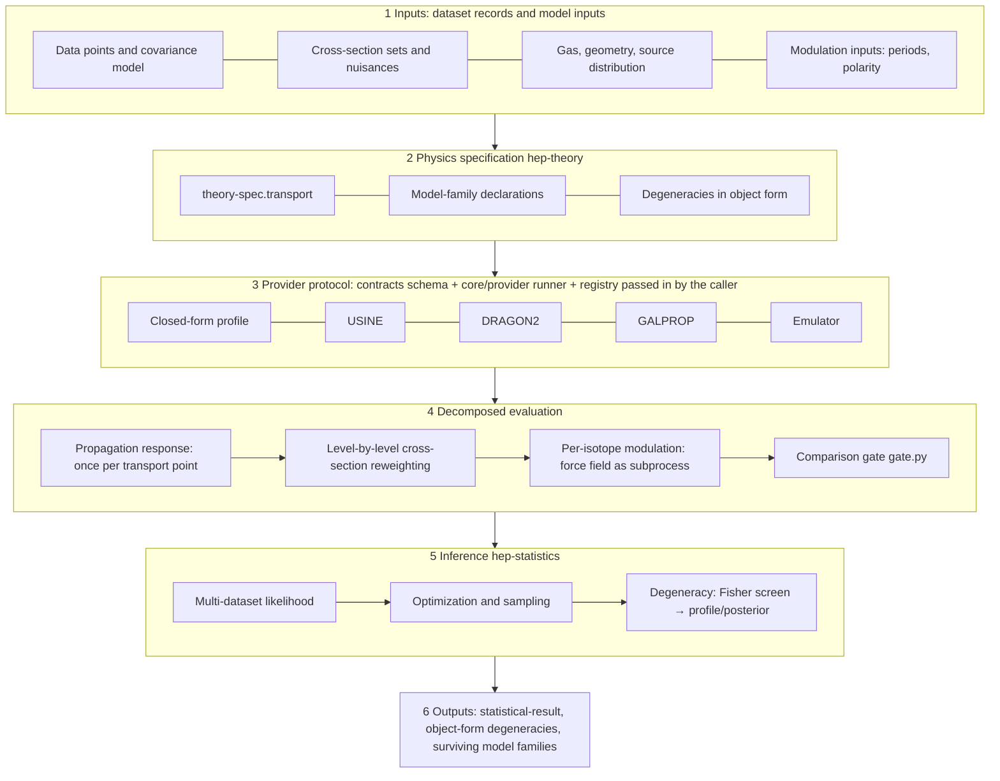

# Cosmic-Ray Propagation and Parameter-Degeneracy Capability for hep-research

| Item | Content |
|---|---|
| Version | r3, 2026-10-26 (final check against hep-research 0.42.0; history in References → Version history) |
| Baseline | hep-research 0.42.0, contracts 3.13.0, `CORE_VERSION` 1.1.0, adapter `cr-propagation` 0.1.0 |
| Language | English, translated from the Traditional Chinese original; file names, commands, fields and identifiers unchanged. The two versions are edited together; if they differ, report it instead of choosing one |
| Execution environment | Every work package (WP) runs in its own isolated git worktree (Technical Approach §0, following `docs/dev/geant4-architecture/geant4-program.md` §P.10); never modify the main checkout or another worktree |
| Readers | The Claude main session and subagents that execute it; the researchers who review it |

All paths are relative to the plugin root `plugins/hep-research/` unless they start with `.claude/`.

## Background

#### How to use this document (executing agent)

1. Read Background to learn what exists. Do not redo it.
2. Find your WP in the stage map under Objective. Check that its prerequisites are merged and that its user decisions (Open Questions) are answered; if not, stop and report.
3. Create your worktree as in Technical Approach §0.
4. Do the steps of your WP card (Technical Approach §A1–§F3).
5. Meet the Acceptance Criteria with your WP's prefix **and** the `ALL-` criteria; run Validation.
6. Take conventions, formulas and units only from Repository Context → Physics and numerical rules, never from memory.

**Before starting:** check whether `origin/main` is beyond the baseline (0.42.0). If it is, read the new CHANGELOG entries, recheck every [C] claim in Repository Context that your WP relies on, and report any difference before writing code.

**Stop and report, without guessing, when:** an Open Question your WP needs is unanswered; a check fails in a way this document does not list; the instructions here conflict with the repository; or any condition in Technical Approach §0.7 holds.

#### Glossary

| Term | Meaning |
|---|---|
| [C] Confirmed | Read directly in the repository (0.42.0) or in a source that was read |
| [I] Inferred | A conclusion drawn from [C] items |
| WP | Work package; one WP is one worktree, one branch, one merge |
| Gate X | The listed WPs have been merged into `main` by the user, and `run_all_checks.py` passes on the merged `main` |
| harmonized-v1 | The fixed cross-code configuration defined in Technical Approach §5.5 |
| Main production channels | Under `harmonized-v1` at 10 GV, the channels ranked by their contribution to the B (and ¹⁰Be) flux, taken until the cumulative contribution reaches 95% |
| Valid domain | The closed interval a provider declares for each parameter, plus the observables, axes and energy ranges it supports |
| Mandatory environment | `MANDATORY` in `tools/check_layering.py`: numpy, scipy, matplotlib, sympy, mpmath [C] |
| Environment E2 | The macOS arm64 host in the environment table of `VALIDATION.md`, where DRAGON2 was built [C] |

#### What exists today [C]

| Component | Path | Status and limits |
|---|---|---|
| Propagation references | `skills/hep-theory/references/cosmic-ray-propagation.md`, `cosmic-ray-phenomenology.md`, `nuclear-cross-sections.md`, `solar-modulation-models.md` | Model families, convention table, V_A–D_pp relation, BIG/SLIM/QUAINT, literature values of L, nuisance blocks of a global fit |
| Theory profiles | `profiles/theory/cr-secondary-ratio`, `cr-secondary-antiprotons`, `heliospheric-modulation` | 1D thin-disc and weighted-slab closed forms with ILLUSTRATIVE cross sections; `heliospheric-modulation` benchmarks the force-field script by calling it as a subprocess |
| Propagation adapter | `adapters/cr-propagation/` (`dragon2_run.py`, `dragon2_to_prediction.py`), version 0.1.0 | Overall `proposed`. DRAGON2 commit cd588707 is `tested-in-declared-environment`, for pure diffusion only; GALPROP and USINE are `proposed` and have never run |
| Grid fit | `skills/hep-statistics/scripts/covariance_fit.py`, model `tabulated-grid` | Full rectilinear grid, one prediction per node, accepts only `representation: grid` (line 1025), multilinear interpolation, no extrapolation; keeps only string `degenerate_directions` (line 1110); synthetic data only |
| Covariance | `skills/hep-statistics/scripts/build_covariance.py` | `length` model R_ij = exp(−\|ln x_i − ln x_j\|/length) and a `scan` subcommand |
| Toys and boundaries | `core/stats/toy_ensemble.py`, `statistical_toys.py`, `fit_diagnostics.py` (`newton_fit`, `boundary_kkt`) | Toy generation must be declared explicitly; `covariance_fit.py break-scan` is the precedent for toy-calibrated, non-Wilks intervals |
| Modulation | `skills/hep-measurement/scripts/solar_modulation_force_field.py` | Supports `--lis-table`. hep-statistics cannot import it but may call it as a subprocess through a tool contract (precedent: `skills/hep-detector/scripts/evaluate_design.py` via `contracts/tool_contracts/cosmic_ray_flux.json`) |
| Emulator domain check | `skills/hep-ml/scripts/check_surrogate_domain.py` (`DomainModel`); `ext_ml_artifact` fields `training_domain`, `extrapolation_policy`, `regression_validation` | Reuse; do not rewrite |
| Data | `adapters/hepdata`, `adapters/crdb`, `skills/hep-theory/scripts/import_published_table.py`, experiment profile `experiment:ams-02` | CRDB is a secondary compilation; HEPData or the paper's tables are primary |
| Batch | `adapters/batch-schedulers`, `skills/hep-computing/scripts/local_partition.py` | Slurm and HTCondor have run synthetic jobs only |
| Constants | `core/constants/physical.py` (`half_life()`, `convert()`) | `convert()` does not know kpc, pc or Myr |
| Example | `examples/bc-propagation-fit` | Synthetic B/C, D0/L flat direction |
| Scope | `docs/capability-map.json`: `propagation-global-fits` is `v1: false`, `state: none`, case `out-of-v1-1` (`tests/routing/make_cases.py` line 123) | Prompt: "Fit cosmic-ray propagation parameters with GALPROP across all species." |

Contract details [C]: `contracts/schemas/ext_theory_spec.json` has `additionalProperties: false`; its `degenerate_directions` is an array of strings, required non-empty by validator rule `theory.degeneracy_missing` when `model.family = cosmic-ray-propagation` (from contracts 2.6.0); `_blank` in `contracts/validate.py` (line 1239) treats any non-string as blank. `contracts/schemas/ext_prediction.json` allows `representation` symbolic, numerical or grid, and any keys in `parameter_point`. `adapter.json` has no schema; `tests/adapters/test_adapter_declarations.py` checks fixed keys only.

#### Changes in 0.39.0–0.42.0 that this plan follows [C]

- Contracts 3.13.0 was released in 0.39.0, so this plan's contract changes use the placeholders `CV-A2` and `CV-C1` (Technical Approach §0.4).
- `contracts/schema.py` now implements `oneOf`, `not`, `maximum`, `exclusiveMaximum` and `maxItems`.
- Semantic naming governance (0.42.0): `run_all_checks` runs the naming gate (`tools/check_naming.py`, surfaces N1, N5, N16) and the registry check; new names must pass it, and `tools/naming_known_gaps.json` may only shrink. Charter: `skills/hep-computing/references/semantic-naming.md`.
- Isolated-worktree execution is the maintainer's rule for multi-stage work (`docs/dev/geant4-architecture/geant4-program.md` §P.10; applied in `docs/dev/frontend-electronics/frontend-reco-sim-calibration.md` §0).
- Task documents pass `skills/hep-computing/scripts/lint_task.py`; independent review of a document uses `skills/hep-authoring/scripts/review.py` (`docs/dev/independent-review-spec.md`).

#### Why the architecture changed (review summary)

The first plan was sound in direction but had structural problems; three independent reviews (References → Version history) led to these decisions:

- **Efficiency.** A rectilinear grid costs n^d (10 parameters × 5 points per axis ≈ 9.8 million predictions). Predictions are instead evaluated on demand through providers; the computation is split into propagation response, cross-section reweighting and modulation; the protocol supports batches, a resident mode and a cache; emulators are trained from a Sobol design with bounded active point addition.
- **Correctness.** The cross-section decomposition is linear only in production cross sections and only at fixed parent fluxes, so it runs level by level in mass, and slope-type reweighting is not applied after propagation. Isotope and bin handling, clock physics, boundary and Davies cases, the nuisance prescription, Δχ²-based emulator acceptance and n-dependent coverage tolerances are fixed in Repository Context.
- **Soundness.** USINE is the reference semi-analytic code (no in-house 2D model). The provider protocol precedes any high-dimensional fit. Entry into v1 requires a real-data reproduction. The force field is called as a subprocess, not moved into core. Existing tools are reused.
- **Flexibility.** A canonical `transport` block; declarative model families; a language-neutral subprocess protocol whose registry is passed in by the caller; `user-supplied` labels for user providers; object-form degeneracies with the string form still accepted.

## Objective

The plugin can study Galactic cosmic-ray propagation with GALPROP, DRAGON2 and USINE: fit diffusion, convection, reacceleration and the halo size L, and report the degeneracies among them with reproducible evidence.

**Definition of done (all hold):**

1. At least two propagation codes and the closed form produce `prediction` artifacts through one provider protocol and are interchangeable inside one likelihood.
2. Multi-dataset global fits of secondary-to-primary nuclear ratios and radioactive clocks are in v1, with a shared LIS, modulation parameters per data-taking period, cross-section nuisances and covariance models as model alternatives.
3. Every fit result carries object-form `degenerate_directions` (combination, valid range, evidence method, observables that break it) and lists every surviving model family.
4. At least one published result is reproduced from public data with the original paper's code, within a tolerance the user confirmed.
5. With user consent, the capability map lists secondary-nucleus propagation fits as `v1: true`; leptons, antinuclei and gamma rays stay outside v1.

#### Stage map

| WP | Content | Prerequisites (merged) | Weeks | Track | Version effect |
|---|---|---|---|---|---|
| A1 | Convention conversion, `harmonized-v1` | — | 1–3 | main | — |
| A2 | `transport` block, object-form degeneracies | — | 1–3 | main | contracts `CV-A2` (minor) |
| A3 | Two-level degeneracy diagnostics | — (rebase after A2) | 1–3 | main | — |
| A4 | Cost benchmark | A1 reported | 2–3 | main | — |
| B1 | USINE tool in the adapter | Gate A | 4–8 | main | adapter minor |
| B2 | Closed forms with convection and decay | Gate A | 4–8 | main | profile minor |
| C1 | Provider protocol | Gate A | 4–8 | main | contracts `CV-C1`, `CORE_VERSION` minor |
| B1b | USINE provider | B1, C1 | 9–10 | main | adapter minor |
| B3 | Harmonized comparison, decomposition check | B1, B2 | 9–10 | main | — |
| C2 | Multi-dataset propagation fit | C1, B1b | 9–13 | main | — |
| D1 | DRAGON2 physics items | Gate A | 4–10 | side | adapter minor |
| D2 | GALPROP tool | Gate A, Q2 | 4–10 | side | adapter minor |
| D1b, D2b | DRAGON2, GALPROP providers | D1/D2, C1 | 11–14 | side | adapter minor |
| D3 | Two-level cross-code comparison | D1, D2, B1 | 11–14 | side | — |
| E1 | Training set, bounded active addition | Gate D | 15–20 | side | — |
| E2, E2b | Emulator, emulator provider | E1 (E2b also C1) | 15–20 | side | adapter minor |
| F1 | Reproduction with the original code | Gate C | 14–18 | main | — |
| F2 | Cross-code extension (optional) | F1, Gate E | 20–22 | side | — |
| F3 | Entry into v1 | F1, user consent | 19–20 | main | — |

Gates: A = A1–A4; B = B1, B1b, B2, B3; C = C1, C2; D = D1, D1b, D2, D2b, D3 (DRAGON2 alone if GALPROP is `unavailable`); E = E1, E2, E2b. The main track takes about 20 weeks; weeks 21–24 are buffer and F2.

## Scope

### In Scope

- Secondary-to-primary nuclear ratios (Li, Be, B over C, O and heavier parents) and radioactive clocks (¹⁰Be/⁹Be and others listed in Repository Context P6).
- GALPROP, DRAGON2 and USINE as tools of one adapter `cr-propagation`, each with a translator, a reader and a provider entrypoint; the closed-form profile and an emulator as further providers.
- The provider protocol, the canonical `transport` block, object-form degeneracies, two-level degeneracy diagnostics, the multi-dataset propagation fit, one real-data reproduction, and the v1 entry of the part above.
- This plan document itself, kept in the repository in two languages (Deliverables).

### Out of Scope

- Leptons, antinuclei, diffuse gamma rays, radio, anisotropy and 3D non-axisymmetric Galaxy structure (the `transport` fields leave room for them; they stay outside v1).
- An in-house 2D semi-analytic propagation code; modifying any external code's physics defaults.
- Moving the force field into `core/` (Open Questions Q4).
- Renaming existing names (for example the `D0` and `L` keys of existing grid examples); new names only.
- Non-public data (only through the companion `ams02-research:profile`).
- The plugin version, host manifests and release manifests (set by the user at release).

## Repository Context

#### Rules enforced by checks [C]

- **R1 Layering** (`tools/check_layering.py`). `core/` imports only core, stdlib and the mandatory environment; `contracts/` imports contracts and core; `skills/<s>/scripts` and `adapters/<a>` import only core and contracts (another skill may be called as a subprocess, never imported); profiles import core, contracts and declared `depends_on` profiles. Text rules: `core/` code holds no `profiles/`, `adapters/` or `skills/` path string; skill, core and contract text and code hold no experiment name (the list includes AMS, PAMELA and others), profile id or profile path outside example blocks; no core schema requires an experiment-only field such as `rigidity`.
- **R2 Admission to core** (`core/OWNERS.json`). Code enters `core/` only if more than one top-level component (skills scripts, profiles, adapters, contracts; not tests) uses it; domain specifics never enter; every core module has a steward.
- **R3 Adapter status** (`docs/adapter-authoring.md`). The adapter's status is its weakest tool's; above `documented` needs tests that run the tool, a declared environment and tested versions; no skill or core module may require an adapter.
- **R4 Missing tool.** Produce a `failed` artifact with the reason; never fall back silently.
- **R5 Validation and comparison.** Every output passes `contracts/validate.py`; comparison with data passes `contracts/comparison/gate.py` first.
- **R6 Status labels.** `synthetic`, `asimov`, `observed`, `preliminary`, `failed`, `unvalidated`, `user-supplied`, `outside-validated-range` carry through to every derived result.
- **R7 Covariance.** A fit without a data covariance exits 3; no diagonal matrix is assumed.
- **R8 Cross-section sets** are model alternatives, never turned into Gaussians without a hep-theory prescription.
- **R9 Criteria first.** Acceptance criteria and tolerances are written to `VALIDATION.md` before the comparison and never loosened afterwards; a program that ran is not a validated prediction.
- **R10 Generated files.** Capability map: edit `docs/capability-map.json`, run `python3 tools/capability_map.py --write`. Stanzas: edit `contracts/stanzas/`, run `python3 tools/build_stanzas.py`. Routing cases: edit `tests/routing/make_cases.py`, run it. Reference pages: rerun `python3 tools/reference_inventory.py`.
- **R11 Schema changes** (`docs/maintenance.md`, Schema migration). An optional field or widened type is minor; removal, renaming or tightening is major and needs a converter, fixtures in `contracts/fixtures/` and a CHANGELOG entry. Only keywords in `SUPPORTED_KEYWORDS` of `contracts/schema.py` may be used (0.42.0: `$ref`, `anyOf`, `oneOf`, `not`, `type`, `const`, `enum`, `minLength`, `pattern`, `minimum`, `exclusiveMinimum`, `maximum`, `exclusiveMaximum`, `x-vocab`, `required`, `properties`, `additionalProperties`, `minItems`, `maxItems`, `items`).
- **R12 CLI.** Every `.py` under `skills/*/scripts/` and `adapters/*/assets/` answers `--help` and is listed in `MISSING_FILE_ARGS` or `NO_INPUT_FILE` of `tests/skills/test_cli_robustness.py`; a shared helper follows `adapters/geant4/assets/g4common.py`. A new or changed CLI with a tool contract passes `python3 contracts/tool_contract.py`.
- **R13 Packaging.** `tools/check_packaging.py` and `tools/check_relocation.py` scan tracked and untracked, not ignored, files; they reject home-directory paths, `hep-research-artifacts/` and files over 2 MiB; the package size in the README stays within 10%.
- **R14 Naming** (0.42.0). Every new code identifier (N1), CLI flag or environment variable (N5) and contract vocabulary term (N16) passes `tools/check_naming.py`, whose baseline only shrinks; theory parameter names (N13) follow the canonical table below and are checked with `python3 skills/hep-computing/scripts/extract_names.py --surface N13` and `python3 contracts/naming_check.py check`. Forbidden whole names (`data`, `tmp`, `helper`, `final` and others in `core/naming/data/forbidden.json`) are never used.
- **R15 Entry budgets.** Changes to a `SKILL.md` or an entry reference page keep `python3 tools/measure_entrypoints.py` within budget.

#### Physics and numerical rules

- **P1 Diffusion conventions.** Before comparing, align: reference rigidity (GALPROP commonly ρ0 = 4 GV; USINE per paper, K0 at 1 GV in Weinrich et al. 2020a and K10 at 10 GV in Génolini et al. 2019; DRAGON2 commonly 1 GV); β^η; break shape, smoothness convention and the sign of Δ; units (1 kpc²/Myr = 3.017e29 cm²/s, IAU parsec and Julian year); the region where V_A acts and w (USINE reaccelerates only in the thin disc of half-thickness h = 100 pc, GALPROP and DRAGON2 in the whole halo; they differ by about √(L/h)). A conversion is `exact` only for a pure power law; otherwise compare predictions, not parameters.
- **P2 Binning.** Predictions are bin integrals; a ratio is the ratio of the bin-integrated numerator and denominator, not the bin average of the ratio.
- **P3 Isotope sums.** Elements are summed over isotopes on the data's axis: equal rigidity for rigidity data, equal E_k/n for kinetic-energy-per-nucleon data (for example ¹⁰Be/⁹Be); never sum on one axis and then change axis.
- **P4 Modulation** is applied per isotope (with its Z and A) before forming elements and ratios; never to a ratio.
- **P5 Cross-section linearity.** At fixed transport parameters, inelastic cross sections and parent fluxes, a secondary LIS is linear in the production cross section of a channel; the network is multilinear. When a parent has a secondary component (O→C→B, O→N→B, ¹¹B→¹⁰B, ¹⁰Be→¹⁰B), reweight level by level from heavy to light, updating parent fluxes first. Inelastic cross sections are not linear. Only an energy-independent norm may be applied after propagation; an energy-dependent slope needs energy-basis responses or a rerun.
- **P6 Decay.** Cumulative cross sections absorb only ghost nuclei with lifetimes far below the propagation time. ¹⁰Be, ¹⁴C, ²⁶Al, ³⁶Cl, ⁵⁴Mn and electron-capture nuclei are propagated explicitly; the decay rate is 1/(γτ₀) and the daughter's gain term is kept (¹⁰Be→¹⁰B). Fully stripped ⁷Be is treated as stable, and the assumption is recorded. Half-lives come from `core.constants.physical.half_life()` (¹⁰Be: 1.387 ± 0.012 Myr, NUBASE2020), never hard-coded.
- **P7 Degeneracies.** The Fisher matrix is a local linear screen; a conclusion needs a profile-likelihood scan or posterior samples. Every degeneracy records the range where it holds. Example [C]: with a radial boundary at 20 kpc, DRAGON2 keeps D0/L within 2% between L = 2 and 4 kpc and is off by 15–18% at L = 8 kpc (`cosmic-ray-propagation.md`, Tool coverage).
- **P8 Non-standard inference.** Wilks' theorem fails for parameters on a physical boundary (V_A ≥ 0, V_c ≥ 0, L > 0) and for parameters not identifiable under the null (Davies problem: break position and smoothness when testing for a break; comparisons among BIG, SLIM and QUAINT). Calibrate intervals and tests with toys.
- **P9 Covariance models.** The correlation model of the data covariance (correlation length) is a model alternative with a sensitivity scan.
- **P10 Emulator error** enters the covariance as an uncertainty component; out-of-domain evaluation is refused.
- **P11 Output units** of every code are declared and checked. Example [C]: DRAGON2's ASCII columns are per total kinetic energy; species with different mass numbers need each column multiplied by A before forming a ratio. `VALIDATION.md` records that this unit made B/C 12/11 too high and the closed form's O/C input 12/16 too low (about 1.19 together), which with DRAGON2's fixed helium target (1.143) made up the first version's 32–34% B/C excess.
- **P12 Quoting L.** Values of L from different papers are never averaged; each is quoted with its data, model family and cross-section treatment.
- **P13 Reaction network.** B/C and Be/B fits use an isotopic network starting at least at Fe (Z = 26); at 10 GeV/n, parents from Mg up give about 90% of the LiBeB sources, and stopping at O biases ratios by order 10% (`cosmic-ray-phenomenology.md`).
- **P14 Source abundances and Li.** Source abundances of C, N, O and others are free or fixed by primary-flux fits; Li enters only with cross-section nuisances enabled.
- **P15 Cross-section nuisances** (Weinrich et al. 2020a, App. B): inelastic, norm + energy scale (prior about 5%); production, norm + low-energy slope below threshold (prior about 10%); proxies, N_eff = 1 + x(N_proxy − 1).

#### Canonical parameter names (N13; R14)

One concept, one name, the same in `transport`, `free`, provider `domain`, request `points` and `parameter_point`. Units follow principle P4 of the naming charter (lower-case unit suffix); symbols follow P7.

| Quantity | Name | Unit |
|---|---|---|
| Diffusion normalization | `D0_cm2_s` | cm²/s |
| Its reference rigidity | `R0_gv` | GV |
| Diffusion slope; β exponent | `delta`; `eta` | — |
| Halo half-height | `L_kpc` | kpc |
| Radial boundary | `radius_kpc` | kpc |
| Disc half-thickness | `disc_halfwidth_pc` | pc |
| Break rigidity; slope below; smoothness | `R_break_gv`; `delta_below`; `s` | GV; —; — |
| Alfvén speed | `V_A_kms` | km/s |
| Convective speed; its gradient | `V_c_kms`; `dVc_dz_kms_per_kpc` | km/s; km/s/kpc |
| Modulation potential of period p | `phi_<period>_gv` | GV |
| Helium-to-hydrogen number ratio | `He_to_H_number` | — |

Existing names such as `D0` and `L` in `examples/bc-propagation-fit` stay; `transport_conventions.py` maps them. If the naming gate rejects a name here, stop and report; do not choose another name silently.

#### File ownership of new components (R1, R2)

| New component | Location | Owner |
|---|---|---|
| `transport` block, object-form degeneracy | new fields in `contracts/schemas/ext_theory_spec.json` | contracts (A2) |
| Provider protocol schema | new schema under `contracts/schemas/` | contracts (C1) |
| Provider runner, protocol validation, `--serve` loop, hashing | new module `core/provider/` | hep-computing (C1; used by hep-statistics scripts and adapter provider entrypoints, which satisfies R2) |
| Registry generator | new `tools/provider_registry.py` | hep-computing (C1) |
| Convention conversion | new `skills/hep-theory/scripts/transport_conventions.py` | hep-theory (A1) |
| Translators, readers, provider entrypoints | new files in `adapters/cr-propagation/assets/` | hep-computing |
| Closed-form provider entrypoint | new `profiles/theory/cr-secondary-ratio/scripts/provider.py` | hep-theory (C1) |
| Multi-dataset propagation fit | new `skills/hep-statistics/scripts/propagation_fit.py` | hep-statistics (C2) |
| Fisher and degeneracy diagnostics | new `skills/hep-statistics/scripts/degeneracy.py` (same-skill import; not core) | hep-statistics (A3) |
| Force-field tool contract | new `contracts/tool_contracts/solar_modulation_force_field.json` | contracts (C1) |
| Emulator training | `skills/hep-ml/scripts/`, producing an `ml-artifact` | hep-ml (E2) |

## Technical Approach

#### §0 Execution protocol (every WP)

Follows `docs/dev/geant4-architecture/geant4-program.md` §P.10 [C]. Additions specific to this plan are marked (plan).

**§0.1 Preconditions for the main session.** The main session's cwd is inside the source git repo: `git rev-parse --show-toplevel` succeeds and `<toplevel>/plugins/hep-research/.claude-plugin/plugin.json` exists. The installed copy under `/mnt/skills/plugin-files/hep-research/` is not a git repo and is read-only; from there, or from any non-git directory, ask for the repo path (Q1) and stop.

**§0.2 One WP, one worktree, one branch.**

| Item | Rule |
|---|---|
| Location | `.claude/worktrees/crprop-<wp>`, WP id in lower case (for example `.claude/worktrees/crprop-a1`, `.claude/worktrees/crprop-b1b`) |
| Branch | `worktree-crprop-<wp>` (the `EnterWorktree` naming rule) |
| Base | The latest `origin/main` that contains the merge commits of every prerequisite in the stage map |
| In Claude Code | The session enters with `EnterWorktree` (name `crprop-<wp>`); a subagent doing the implementation gets `isolation: "worktree"` in the Agent tool. One WP is never implemented by two agents at once |
| Elsewhere | `git fetch origin && git worktree add .claude/worktrees/crprop-a1 -b worktree-crprop-a1 origin/main` |
| Plan document | Its own worktree `.claude/worktrees/crprop-plan`, branch `worktree-crprop-plan`, until it is merged (Deliverables D-PLAN) |

**§0.3 Check before starting**, recorded in the environment field of the WP's `VALIDATION.md` entry: `git rev-parse --show-toplevel` is this worktree; `git branch --show-current` is the WP branch; `git status` is clean; for every prerequisite, `git merge-base --is-ancestor <merge commit> HEAD` succeeds; the line numbers this document cites are rechecked on the new base.

**§0.4 Work inside the worktree.**

1. Edit, build, test and run only here; never `cd` into the main checkout or another worktree. Use explicit paths inside the worktree in git commands.
2. Never use a bare `git stash` or `git stash pop` (shared by all worktrees); make a WIP commit instead.
3. Run outputs (check `--out` directories, `hep-research-artifacts/`, provider caches, external run directories, emulator training sets) go either to a worktree-specific directory outside the repo, `${CRPROP_OUT:-$TMPDIR/crprop}/<wp>/` (plan), or to `work/` inside the worktree only if `git check-ignore -q work/` succeeds. Never add `.gitignore` entries to hide outputs (R13). Build directories are never shared between worktrees; an external installation (USINE, GALPROP, DRAGON2) may be shared read-only, located only through `HEP_USINE_BIN`, `HEP_USINE_DATA`, `HEP_GALPROP_BIN`, `HEP_GALPROP_DATA`, `HEP_DRAGON2_BIN`, `HEP_DRAGON2_DATA`.
4. The first commit holds only the acceptance criteria and tolerances added to `VALIDATION.md` (R9) (plan). Every later commit does one thing, message `crprop(<wp>): <verb> <object>`, with the required trailer. Never `--amend` a reported commit or use `--no-verify`.
5. Commit only to the WP branch. Push it to the remote branch of the same name only with consent (§0.6); otherwise keep it local and report. Never push `main` or open a pull request without the maintainer's approval.
6. Fixtures go to `tests/adapters/fixtures/cr_propagation/<tool>/` with absolute paths replaced by `<TOOL_HOME>` or `<RUN_DIR>` and host and user names removed; each file ≤ 2 MiB, ≤ 2 MB added per WP, otherwise stop and report (plan).

**§0.5 Shared files and versions** (plan, in line with §P.10.4).

| File | Rule |
|---|---|
| `contracts/__init__.py` (`CONTRACTS_VERSION`), tests pinning it | Only A2 and C1. If `## Unreleased` of `CHANGELOG.md` already names an unreleased contracts version, reuse it; otherwise bump minor (3.13.0 is released, so at least 3.14.0). Gate each WP's new rules with its own constant (`CRPROP_A2_FROM`, `CRPROP_C1_FROM`) set to that version; in this document the versions are called `CV-A2` and `CV-C1` |
| `core/__init__.py` (`CORE_VERSION`), `core/OWNERS.json` | Only C1: minor bump (1.1.0 → 1.2.0 unless an unreleased bump exists) and one new key `provider` |
| Plugin version, `.claude-plugin/plugin.json`, `.codex-plugin/*`, `pyproject.toml`, `release-manifests/` | No WP; the user at release |
| `CHANGELOG.md` | Append under `## Unreleased` only, each entry starting `crprop <wp>:` |
| `VALIDATION.md` | Append one section `## CRPROP-<WP> — <date> (environment <label>)` at the end |
| `contracts/validate.py`, `contracts/vocab/core.json`, `contracts/schemas/*` | Only A2 and C1; any other WP that needs a term stops and reports |
| `adapters/cr-propagation/adapter.json`, `docs/capability-matrix.md`, `tests/adapters/test_cr_propagation.py` | Merge order B1 → D1 → D2 → B1b → D1b → D2b → E2b; keep earlier tool entries |
| README counts and Resources tables | Only as `tools/check_wiring.py` requires; on conflict, rerun it after the rebase |
| `docs/capability-map.json`, `tests/routing/*`, `contracts/stanzas/*`, `SKILL.md` descriptions | Only F3 |

Whichever of two parallel WPs merges later rebases onto the new `main` and reruns all checks. A conflict outside this table, or a file not in the WP card, means stop and report. Never `git push --force`.

**§0.6 Actions that need user consent.** The main session obtains consent before dispatch and writes it into the assignment message as "Consented: <action>, <scope>, <date>"; a subagent does only listed actions and otherwise reports `NEEDS_CONSENT`. The actions: installing any package; cloning or downloading external code or data; network access (the only exception, still listed: read-only `adapters/hepdata` and `adapters/crdb` queries in F1); building an external program; submitting batch jobs, including each round of active addition; pushing, opening a pull request, any `gh` write; merging into `main`; a contracts or core version bump; `--force` or rewriting a reported commit; deleting a worktree or branch with changes; changing the v1 scope; a paid live routing run.

**§0.7 Stop and ask when:** a §0.6 action lacks consent; an acceptance number has no default and the user gave none; a file outside §0.5 and the WP card would change; the repository differs from Repository Context; the same error persists after the maximum of 2 attempts; a check already fails on `main` (report it, do not fix unrelated failures); a result misses its tolerance and cannot be attributed; a tolerance in `VALIDATION.md` would need loosening; the step needs environment E2 and this is not E2 (`BLOCKED: environment E2 required`); the naming gate rejects a new name.

**§0.8 Assignment message (main session → subagent).** It contains: the absolute path of this document (read-only; if unreadable, stop); the WP id, worktree name and branch; the merge commits of the prerequisites; the consented actions; the `CRPROP_OUT` path and external-program environment variables; the Open Question answers or defaults adopted; the report format below.

**§0.9 Report format (the subagent's final message).**

```
WP: <id>   Status: DONE | PARTIAL | BLOCKED | NEEDS_CONSENT
Worktree: .claude/worktrees/crprop-<wp>   Branch: worktree-crprop-<wp>   HEAD: <sha>   base: <sha>
Files changed: <paths, marked added/modified>
Acceptance criteria: one line each (<ID> passed / failed / not run), with evidence
Checks: run_all_checks (passed/failed, --out path), check_relocation, check_wiring, check_naming
Run records: computational-run references, environment label
Open Questions: answers or defaults used; new open issues
Consent needed: (for NEEDS_CONSENT) action, scope, reason
Not done, and why
```

**§0.10 Finish.** After the merge, `git worktree remove .claude/worktrees/crprop-<wp>` and delete the local branch; when abandoning, remove both; never clean up in the main checkout. Independent review of documents follows `docs/dev/independent-review-spec.md` (Appendix A7 isolation, `skills/hep-authoring/scripts/review.py`); worktrees are for implementation only, and reviewers only read.

#### §5 Target architecture

**§5.1 Layers and data flow.**



`tabulated-grid` stays a separate path for 2–3 dimensions; it accepts only `representation: grid` and does not use providers.

**§5.2 Provider protocol (C1).**

- Invocation: a subprocess, `python3 <entrypoint> --request req.json --response resp.json`; also `--serve` (JSON Lines over stdin/stdout) and batches of points.
- Registry: `core/provider/` never searches for providers and holds no path string (R1). The caller passes `--provider-registry <json>`, generated by the new `tools/provider_registry.py --write "$CRPROP_OUT/registry.json"` from the `provider` fields of `adapter.json` and `profile.json` files; the registry is not committed. Only listed entrypoints run. A user-supplied provider must be listed explicitly; its outputs carry `user-supplied` and are never evidence for v1.
- The `provider` field (C1 adds a check to `tests/adapters/test_adapter_declarations.py` and a row to the field table of `docs/adapter-authoring.md`):

```json
{"id": "usine", "entrypoint": "assets/usine_provider.py", "protocol": "cr-provider/1",
 "domain": {"D0_cm2_s": {"min": 1e27, "max": 1e30}, "L_kpc": {"min": 1, "max": 20}},
 "observables": ["B/C", "Be/B", "10Be/9Be"], "axes": ["rigidity", "ekn"],
 "decomposable": true, "deterministic": true,
 "output_units": {"flux": "per (m2 s sr GeV/n)", "energy": "ekn"}}
```

- Request:

```json
{"protocol": "cr-provider/1", "provider": "usine", "provider_version": "<tested version>",
 "theory_spec_ref": "theory-spec.json",
 "points": [{"D0_cm2_s": 3.0e28, "delta": 0.45, "L_kpc": 5.0, "V_A_kms": 10.0, "V_c_kms": 5.0}],
 "observables": [{"id": "B/C", "axis": "rigidity", "unit": "GV", "bins": [[2.0, 2.5], [2.5, 3.0]]}],
 "want": ["lis", "components"], "seed": null}
```

- `want` accepts only `lis` and `components`; providers never modulate; any other value returns `failed`.
- Response: one `prediction` per point (`representation: numerical`, `values` as bin integrals, P2) with an evaluation record (`computational-run` reference, input hash, `elapsed_s`, numerical tolerance); with `decomposable: true`, also `components`, defined in the protocol schema and never an undeclared `prediction` field. Provider output never feeds `tabulated-grid`.
- Failure returns `failed` with the reason (R4). Out of domain, the default is refusal: `failed` with `"reason": "out-of-domain"` and no prediction. Only with the existing flag `--allow-outside-validated-range` is a prediction produced, labelled `outside-validated-range` (which fails the publication gate). No new vocabulary.
- Hash: `sha256(json.dumps(obj, sort_keys=True, separators=(",", ":"), ensure_ascii=False))` with `obj = {"transport": <canonical units>, "provider": id, "provider_version": v, "point": <sorted keys; floats as repr>}`, implemented in `core/provider/` and tested equal to `contracts/recipe_semantics.py` `canonical_sha256` on the same object. The cache lives in `$CRPROP_OUT/cache/`.

**§5.3 Decomposed evaluation.** For isotope i with parents p:

```latex
\Phi^{\rm LIS}_i(E)=\Phi^{\rm prim}_i(E)+\sum_{p}\int\!dE'\,\mathcal{G}_i\!\left(E,E';\theta_{\rm tr},\sigma^{\rm inel}_i\right)\nu_{p\to i}(E';\theta_{\rm xs})\,q^{\rm nom}_{p\to i}\!\left(E';\Phi^{\rm LIS}_p\right)
```

```latex
\Phi^{\rm TOA}_e(R)=\sum_{i\in e}\mathcal{M}_{\phi_t,Z_i,A_i}\!\left[\Phi^{\rm LIS}_i\right](R)
```

𝒢_i is the propagation response of isotope i (transport parameters and its inelastic cross section). Reweighting runs level by level from heavy to light (P5). A norm-type ν may be applied after propagation; a slope-type ν needs one energy-basis `component` per source-energy bin or a rerun; an inelastic change always reruns. M is the force-field modulation of period t per isotope, then summed into elements (P3), called as a subprocess through the tool contract (Q4). Nuisance prescription: P15.

**§5.4 Contract changes (A2).** `ext_theory_spec.transport`, optional, recommended when `model.family = cosmic-ray-propagation`:

```json
{"geometry": {"kind": "cylinder-2d", "L_kpc": 5.0, "radius_kpc": 20.0, "disc_halfwidth_pc": 100},
 "diffusion": {"form": "beta^eta (R/R0)^delta with smooth breaks",
               "D0_cm2_s": 3.0e28, "R0_gv": 1.0, "eta": 1.0, "delta": 0.45,
               "breaks": [{"kind": "low", "R_break_gv": 5.0, "delta_below": 0.15, "s": 0.05, "s_convention": "usine"}]},
 "reacceleration": {"V_A_kms": 0.0, "zone": "thin-disc", "relation": "Seo-Ptuskin 1994", "w": 1.0},
 "convection": {"V_c_kms": 0.0, "dVc_dz_kms_per_kpc": 0.0},
 "losses": ["ionization", "coulomb", "adiabatic"],
 "decay": {"enabled": true, "lorentz_dilation": true, "ec_treatment": "fully-stripped"},
 "gas": {"model": "<name>", "He_to_H_number": 0.1},
 "sources": {"spatial": "<name>", "injection": [{"species_group": "Z>2", "gamma": 2.3, "breaks": []}],
             "abundances": "fitted"},
 "cross_sections": {"production_set": "<name>", "inelastic_set": "<name>", "ghost_threshold": "<lifetime cut>"},
 "species": {"network_top": "Ni-64", "isotopic": true},
 "family": "BIG",
 "free": ["D0_cm2_s", "delta", "L_kpc", "V_A_kms", "V_c_kms"]}
```

`degenerate_directions.items` becomes `oneOf: [string, object]` (supported since 0.42.0, R11):

```json
{"combination": "D0_cm2_s/L_kpc", "form": "power", "exponents": {"D0_cm2_s": 1, "L_kpc": -1},
 "valid_range": {"L_kpc": {"min": 2, "max": 6}},
 "broken_by": ["10Be/9Be", "Be/B"],
 "evidence": "profile-scan"}
```

`evidence` is one of `fisher-screen`, `profile-scan`, `posterior`. A2 also fixes `_blank` in `contracts/validate.py` (an object entry counts as non-blank) and the reader in `covariance_fit.py` (an object contributes its `combination`; a string such as `D0/L` keeps its current meaning).

**§5.5 Harmonized configuration `harmonized-v1` (A1).** A new file `tests/adapters/fixtures/cr_propagation/specs/harmonized-v1.json` in the `transport` format:

| Item | Setting |
|---|---|
| Geometry | `cylinder-2d`, `L_kpc` = 4, `radius_kpc` = 20, `disc_halfwidth_pc` = 100 |
| Gas | uniform n_H = 1 cm⁻³, `He_to_H_number` = 0.1 |
| Diffusion | β¹ (R/1 GV)^0.5, no break, `D0_cm2_s` = 3e28 |
| Reacceleration, convection | `V_A_kms` = `V_c_kms` = 0 |
| Losses, decay | off; D1 adds `harmonized-v1-<item>.json` per item it turns on |
| Sources | all primaries R^−2.3, no break |
| Cross sections and network | the ILLUSTRATIVE set and parent list of profile `cr-secondary-ratio`; tertiary chains and ghost nuclei off on both sides |
| Output | unmodulated LIS, 1–10³ GeV/n, 20 points per decade |

A code that cannot express an item records the difference and its substitute; it never falls back to a default silently.

#### §A1 Convention conversion and harmonized configuration

Worktree `crprop-a1`. Steps: (1) create `transport_conventions.py` converting among GALPROP's β ρ^δ, USINE's β^η K0 (R/R0)^δ with smooth breaks (K0 and K10), and DRAGON2's (p/p0)^δ, and between per-nucleon and per-total kinetic energy; (2) mark each result `exact`, `approximate` with a relative-error bound, or `not-convertible`; (3) derive kpc and Myr from the IAU parsec and Julian year in the module; (4) map existing names (`D0`, `L`) to the canonical table; (5) write `harmonized-v1` per §5.5; (6) add a usage paragraph to `cosmic-ray-phenomenology.md` and rerun `tools/reference_inventory.py`. Stop if the convention table cannot be parsed. Out: model-family mapping, providers. Consent: none. Acceptance: A1-1 to A1-6.

#### §A2 Contract extension

Worktree `crprop-a2`. Steps: (1) add `transport` and `oneOf` degeneracy items to `ext_theory_spec.json`; (2) in `contracts/validate.py`, fix `_blank`, add the error codes `theory.degeneracy_evidence_missing`, `theory.degeneracy_range_missing`, `theory.degeneracy_evidence_unknown`, gated by `CRPROP_A2_FROM`; (3) add positive and negative fixtures in `contracts/fixtures/`; (4) update the reader in `covariance_fit.py`; (5) set the contracts version per §0.5 and update the pinning tests and CHANGELOG. Stop if a keyword outside `SUPPORTED_KEYWORDS` is needed or a new term fails the naming gate. Out: provider schema (C1). Consent: contracts version bump. Acceptance: A2-1 to A2-5.

#### §A3 Degeneracy diagnostics

Worktree `crprop-a3`; rebase after A2 merges. Steps: (1) before any change, run the `tabulated-grid` test cases on the base and save the sha256 of each output in `$CRPROP_OUT/a3/baseline.txt`; (2) move Fisher eigendecomposition and flat-direction detection into the new `degeneracy.py`, called by `covariance_fit.py`; (3) add profile-likelihood scans along a direction or over a plane; (4) register the module in `NO_INPUT_FILE` and update README counts. Stop if the baseline hash changes for an unexplained reason. Out: moving into core. Consent: none. Acceptance: A3-1 to A3-4.

#### §A4 Cost benchmark

Worktree `crprop-a4`; starts when A1 has reported. Steps: (1) with `harmonized-v1`, measure wall time and peak RSS three times each for the closed form and DRAGON2 and take medians; (2) grid convergence: largest relative change of B/C over 2–1000 GV when spatial and energy grids are doubled once (reported, no threshold); (3) add the `CRPROP-COST` section to `VALIDATION.md` and de-identified run records under `tests/adapters/fixtures/cr_propagation/cost/`. Stop if `HEP_DRAGON2_BIN` or `HEP_DRAGON2_DATA` is missing or this is not environment E2. Out: USINE and GALPROP rows (B1, D2 add them). Consent: running DRAGON2. Acceptance: A4-1, A4-2.

#### §B1 USINE tool

Worktree `crprop-b1`. Steps: (1) build USINE outside the repository (version confirmed by the user; F1 needs V3.5 or an explained difference), declaring ROOT and compiler versions; (2) create the translator (`transport` → USINE parameter file) and the reader (output → bin-integrated `prediction`; P2, P3, P11) as new files `usine_translate.py` and `usine_to_prediction.py` in `adapters/cr-propagation/assets/`; (3) record runs as offline fixtures; (4) gate the live test with `HEP_USINE_LIVE_TEST=1`; (5) add the USINE row to the cost table; (6) update `adapter.json`, `docs/capability-matrix.md`, the adapter version. Stop if the same build error occurs twice, the ROOT requirement does not match environment E2, or the licence forbids redistributing fixtures. Out: changing USINE physics defaults; the provider (B1b). Consent: download, ROOT, build, run. Acceptance: B1-1 to B1-4.

#### §B1b USINE provider

Worktree `crprop-b1b`; needs B1 and C1 merged. Create the new `adapters/cr-propagation/assets/usine_provider.py` and the `provider` field of `adapter.json`. Acceptance: PRV-1, PRV-2.

#### §B2 Closed forms with convection and decay

Worktree `crprop-b2`. Add to `profiles/theory/cr-secondary-ratio/` the analytic 1D thin-disc solutions with convection and with radioactive decay (rate 1/(γτ₀), ¹⁰Be→¹⁰B gain, ⁷Be stable with the assumption recorded, half-lives from `half_life()`), with derivation records of status `analytic-derivation`. Out: reacceleration (no closed form). Consent: none. Acceptance: B2-1 to B2-3.

#### §B3 Harmonized comparison and decomposition check

Worktree `crprop-b3`; needs B1 and B2 merged. Steps: (1) compare USINE with the closed form under `harmonized-v1`, both with the same parents, cross-section table, tertiary and ghost settings; (2) list the main production channels in `$CRPROP_OUT/b3/b3-channels.json` and summarize them in `VALIDATION.md`; (3) for each main channel, compare level-by-level norm reweighting at ±20% with a full rerun, and slope reweighting with energy-basis responses or a rerun. Out: inelastic reweighting (recorded as not applicable, P5). Acceptance: B3-1 to B3-3.

#### §C1 Provider protocol

Worktree `crprop-c1`. Create the protocol schema, `contracts/tool_contracts/solar_modulation_force_field.json`, the new module `core/provider/` (runner, hashing, `--serve` loop), the `provider` entry in `core/OWNERS.json`, `tools/provider_registry.py`, the closed-form provider `profiles/theory/cr-secondary-ratio/scripts/provider.py` with its `profile.json` field, the declaration-test check and the `docs/adapter-authoring.md` row; set the contracts and core versions per §0.5. Stop if the protocol needs a new vocabulary term or a name fails the naming gate. Out: other providers. Consent: contracts and core version bumps. Acceptance: C1-1 to C1-7.

#### §C2 Multi-dataset propagation fit

Worktree `crprop-c2`; needs C1 and B1b merged (if B1b is not merged, complete everything with the closed-form provider and list the USINE case as an open issue). Steps: (1) create `propagation_fit.py` with a shared LIS, one `phi_<period>_gv` per period and charge sign via the tool contract, P15 nuisances, P14 abundances, and covariance models as model alternatives using `build_covariance.py scan --lengths`; (2) declarative model families; (3) convergence by `core/stats/fit_diagnostics.py`, boundary minima by `boundary_kkt`; (4) toys declared through `core/stats/toy_ensemble.py`, boundary and Davies cases calibrated as in `covariance_fit.py break-scan`; (5) posterior diagnostics with `bayes_diagnostics.py`; (6) degeneracies from A3; (7) a new end-to-end synthetic example under `examples/` and a new section of `core-stats-commands.md`. Loop limits: at most 5 restarts per optimization, an unconverged toy recorded as `failed`, stop when more than 2% of toys fail, at most 2×10⁵ steps per chain, no posterior interval when R̂ > 1.01 or ESS < 400 (report `unvalidated`). Out: real data. Acceptance: C2-1 to C2-6.

#### §D1 DRAGON2 physics items

Worktree `crprop-d1`. Turn on V_c, V_A, energy losses and decay one at a time, each with its `harmonized-v1-<item>.json`, compared with B2 where a closed form exists, else with USINE once B1 is merged. A new DRAGON2 commit or build is a new test (R3). Stop if not in environment E2 or the same error occurs twice. Consent: running DRAGON2. Acceptance: D1-1, D1-2.

#### §D1b DRAGON2 provider

Worktree `crprop-d1b`; needs D1 and C1 merged. Create `dragon2_provider.py` in `adapters/cr-propagation/assets/`. Acceptance: PRV-1, PRV-2.

#### §D2 GALPROP tool

Worktree `crprop-d2`; needs Q2 answered. Steps: (1) create the translator (`transport` → galdef) and the reader (FITS → `prediction`) as new adapter assets; (2) record gas model, source distribution and cross-section options (opt12 and opt22 differ by over an order of magnitude in Fe→Li/Be/B, about 5% in B/C and about 15% in Li/C); (3) gate the live test with `HEP_GALPROP_LIVE_TEST=1`; (4) add the GALPROP row to the cost table; (5) declare `astropy` as an optional dependency in `tools/optional_modules.json`. Stop if Q2 is unanswered, the same build error occurs twice, or the licence forbids fixtures. Out: changing GALPROP defaults; the provider (D2b). Consent: download GALPROP; install CFITSIO, HEALPix and `astropy`; build; run. Acceptance: D2-1, D2-2.

#### §D2b GALPROP provider

Worktree `crprop-d2b`; needs D2 and C1 merged. Create `galprop_provider.py` in `adapters/cr-propagation/assets/`. Acceptance: PRV-1, PRV-2.

#### §D3 Two-level cross-code comparison

Worktree `crprop-d3`; needs D1, D2, B1 merged. Level 1: `harmonized-v1` (unexpressible items recorded per §5.5). Level 2: each code's defaults, every difference registered as `model-alternative` and attributed. If GALPROP is `unavailable`, compare DRAGON2 and USINE only. Acceptance: D3-1, D3-2.

#### §E1 Training set and bounded active addition

Worktree `crprop-e1`; needs Gate D. Generate N₀ points with a Sobol design (`scipy.stats.qmc`) and run them through `local_partition.py` or the batch adapter, one `computational-run` each. Active-addition loop (Plan-and-Solve), each round: fit synthetic data with the current emulator; pick the k points of largest emulator error inside the 95% posterior region; run them with the original provider; retrain. Termination: both E2 criteria met. Maximum iterations: 5 rounds by default; on reaching it, stop and report the best emulator and failing bins. Early stop: the largest error falls by less than 10% for 2 consecutive rounds, or every new point lies closer to an existing point than the design's minimum distance. Cost cap: total provider evaluations within the budget the user approved from the cost table. Training data stay in `$CRPROP_OUT/e1/`; only the design file, per-point hashes and a summary ≤ 2 MiB are committed. Consent: every batch submission, including each round. Acceptance: E1-1 to E1-3.

#### §E2 Emulator and valid domain

Worktree `crprop-e2`. hep-ml trains the emulator and writes an `ml-artifact` with `training_domain`, `extrapolation_policy` and `regression_validation`; the domain is judged by `DomainModel` of `check_surrogate_domain.py` (`outside` or `sparse` means out of domain); emulator error enters as an uncertainty component (P10). Acceptance: E2-1 to E2-3.

#### §E2b Emulator provider

Worktree `crprop-e2b`; needs E2 and C1 merged. Create `emulator_provider.py` in `adapters/cr-propagation/assets/`, reading only the `ml-artifact` and model files and importing no skill; `deterministic: true`; out-of-domain handling as §5.2. Acceptance: PRV-1, PRV-2.

#### §F1 Reproduction with the original code

Worktree `crprop-f1`; needs Gate C. Default target (Q5): with USINE, Table II of Génolini et al. 2019 (arXiv:1904.08917): L fixed at 10 kpc, 1D thin disc, h = 100 pc, s_l = 0.05, modulation and main cross sections as nuisances; published values BIG δ = 0.48 (+0.04/−0.03), K10 = 0.30 kpc²/Myr; SLIM δ = 0.51 ± 0.02, K10 = 0.28; QUAINT δ = 0.45 (+0.05/−0.02), K10 = 0.33. Alternative: Weinrich et al. 2020a (δ = 0.50 ± 0.03). Halo-size extension: Weinrich et al. 2020b (L = 5 (+3/−2) kpc from Be/B). Data: the B/C ratio of the experiment profile `experiment:ams-02` (PRL 120, 021101, 2018) through `adapters/hepdata` or the paper's tables, labelled `observed`; CRDB only as a cross-check; the experiment name appears only in profile, example or example-block text (R1). Covariance: none is published; build one with `build_covariance.py` from the systematic breakdown and per-source correlation lengths following Derome et al. 2019, label it model-supplied, and treat correlation-length variations as model alternatives (P9; satisfies R7). Tolerance: none by default; propose one (for example best-fit δ and K10 within the paper's 1σ), and compare only after the user confirms and it is in `VALIDATION.md`. Consent: the hepdata and crdb queries. Acceptance: F1-1, F1-2.

#### §F2 Cross-code extension (optional)

Worktree `crprop-f2`; needs F1 and Gate E. Redo F1 with the emulator, DRAGON2 or GALPROP and report the differences as model alternatives.

#### §F3 Entry into v1

Worktree `crprop-f3`; needs F1 passed and the user's consent to change the v1 scope. Steps: (1) give the user F1's `VALIDATION.md` section and attribution table; (2) in `docs/capability-map.json`, set `propagation-global-fits` to `v1: true`, `state: tool`, items `CRP1` (A–C), `CRP2` (D–E), `CRP3` (F), drop its `cases`, and add a new row outside v1 for lepton, antinucleus and gamma-ray propagation fits (owner hep-statistics); stop if an item id clashes; (3) rewrite `out-of-v1-1` to fall in the new row and add English and Traditional Chinese direct cases with trigger terms; (4) run `tests/routing/make_cases.py` and `tools/capability_map.py --write`; (5) update step 4 of `contracts/stanzas/context-resolution.md` and run `tools/build_stanzas.py`; (6) update the outside-v1 wording in the hep-statistics description and Resources table, the hep-theory Resources table and `skills/hep-theory/README.md`; (7) keep `tools/measure_entrypoints.py` within budget. Consent: the v1 scope change; the paid live routing run after the description change. Acceptance: F3-1, F3-2.

## Deliverables

- **D-PLAN** — this document in the repository: `docs/dev/cr-propagation/cr-propagation-plan.zh.md` (original) and `docs/dev/cr-propagation/cr-propagation-plan.md` (English), edited together, each passing `lint_task.py`; written in worktree `crprop-plan`.
- **A1** — `skills/hep-theory/scripts/transport_conventions.py`; `tests/skills/hep_theory/test_transport_conventions.py`; `tests/adapters/fixtures/cr_propagation/specs/harmonized-v1.json`; usage text in `cosmic-ray-phenomenology.md`.
- **A2** — `ext_theory_spec.json` fields; validator rules and three error codes; fixtures; `covariance_fit.py` reader; contracts `CV-A2`; CHANGELOG entry.
- **A3** — `skills/hep-statistics/scripts/degeneracy.py`; profile-scan tests; unchanged `tabulated-grid` outputs.
- **A4** — the `CRPROP-COST` section of `VALIDATION.md`; de-identified run records.
- **B1, B1b** — `adapters/cr-propagation/assets/usine_translate.py`, `usine_to_prediction.py`, `usine_provider.py`; fixtures; tests; `adapter.json`, capability-matrix row.
- **B2** — closed-form derivations, models, tests and benchmarks in `profiles/theory/cr-secondary-ratio/`.
- **B3** — channel list, decomposition table, `VALIDATION.md` section.
- **C1** — protocol schema; `core/provider/` module; `tools/provider_registry.py`; `profiles/theory/cr-secondary-ratio/scripts/provider.py`; `contracts/tool_contracts/solar_modulation_force_field.json`; declaration-test check; `docs/adapter-authoring.md` row; contracts `CV-C1`; `CORE_VERSION` minor.
- **C2** — `skills/hep-statistics/scripts/propagation_fit.py`; tests; a synthetic end-to-end example; a section of `core-stats-commands.md`.
- **D1, D1b, D2, D2b, D3** — DRAGON2 item configurations and records; `adapters/cr-propagation/assets/dragon2_provider.py`; GALPROP translator, reader and `adapters/cr-propagation/assets/galprop_provider.py`; cross-code tables.
- **E1, E2, E2b** — design file and hashes; `ml-artifact`; `adapters/cr-propagation/assets/emulator_provider.py`.
- **F1, F3** — reproduction record and attribution table; capability map, routing cases, stanza and SKILL text for v1.
- Every WP: a `VALIDATION.md` section, a CHANGELOG entry under Unreleased, and the report of Technical Approach §0.9.

## Acceptance Criteria

#### All WPs (ALL)

- [ ] ALL-1 The §0.3 checks are recorded in the WP's `VALIDATION.md` environment field.
- [ ] ALL-2 The first commit holds only the acceptance criteria and tolerances; no tolerance is loosened later.
- [ ] ALL-3 `run_all_checks.py` and `check_relocation.py` pass, or every failure is shown to fail identically on `main`.
- [ ] ALL-4 `tools/check_naming.py` passes with `tools/naming_known_gaps.json` not grown; new theory parameter names match the canonical table.
- [ ] ALL-5 `tools/check_layering.py` passes; no file outside §0.5 and the WP card changed.
- [ ] ALL-6 No run output, home path or file over 2 MiB is committed.
- [ ] ALL-7 The report follows §0.9.

#### A1

- [ ] A1-1 Pure power-law round trips have relative error < 1e-12.
- [ ] A1-2 1 kpc²/Myr converts to 3.0172e29 cm²/s within relative error 1e-4.
- [ ] A1-3 The tests read the convention table of `cosmic-ray-phenomenology.md` row by row; a parse failure fails the test; no value is copied by hand.
- [ ] A1-4 With a break and different smoothness parameters the result is `approximate` or `not-convertible`; K0 ↔ K10 with a break is never `exact`.
- [ ] A1-5 V_A between thin disc and whole halo is only `approximate`.
- [ ] A1-6 `harmonized-v1.json` matches §5.5 and validates as a `transport` block.

#### A2

- [ ] A2-1 Every existing theory-spec in `contracts/fixtures` and `examples/` validates with the same result before and after.
- [ ] A2-2 Each of the three new error codes is triggered by one negative fixture.
- [ ] A2-3 A list holding only objects does not trigger `theory.degeneracy_missing`.
- [ ] A2-4 `tabulated-grid` gives the same result for an object entry as for the equivalent string.
- [ ] A2-5 The new rules apply from `CRPROP_A2_FROM` only.

#### A3

- [ ] A3-1 Each `tabulated-grid` output has the baseline sha256.
- [ ] A3-2 Synthetic curved degeneracy (D0 ∝ L^1.2, valid for L in [2, 6] kpc, broken above 8 kpc): the Fisher screen gives `fisher-screen` without `valid_range`; the profile scan gives `profile-scan` with `valid_range.L_kpc.max` in [6, 8]; both in one output.
- [ ] A3-3 `degeneracy.py --help` works and the module is in `NO_INPUT_FILE`.
- [ ] A3-4 `check_wiring.py --since <base>` passes.

#### A4

- [ ] A4-1 Every cost number has its run record; none comes from the literature.
- [ ] A4-2 The cost table has closed-form and DRAGON2 rows.

#### B1

- [ ] B1-1 Offline replay tests pass without USINE installed.
- [ ] B1-2 A live rerun differs from the fixtures by at most 1e-6 relative.
- [ ] B1-3 `tested_versions` names the USINE version or commit, compiler and ROOT version; the adapter status follows R3.
- [ ] B1-4 The cost table has a USINE row.

#### Providers (PRV; B1b, D1b, D2b, E2b)

- [ ] PRV-1 The provider passes C1's conformance tests.
- [ ] PRV-2 Single-shot and `--serve` responses have the same sha256 after removing `elapsed_s` and timestamps.

#### B2

- [ ] B2-1 For V_c → 0 and τ → ∞ the solutions reduce to pure diffusion.
- [ ] B2-2 Unit and dimension checks are recorded.
- [ ] B2-3 The profile tests pass.

#### B3 (suggested defaults)

- [ ] B3-1 B/C over 2–1000 GV and ¹⁰Be/⁹Be over 0.05–10 GeV/n agree with the closed form within 2%, with the same loss settings.
- [ ] B3-2 Level-by-level norm reweighting agrees with a full rerun within 0.5%.
- [ ] B3-3 Channels beyond that are marked `must_rerun: true`.

#### C1

- [ ] C1-1 A provider not in the registry is refused.
- [ ] C1-2 Single-shot and `--serve` responses agree as in PRV-2.
- [ ] C1-3 A cache hit does not call the provider.
- [ ] C1-4 A forced provider crash is reported as `failed` with the reason.
- [ ] C1-5 Out of domain gives `failed` with `reason: out-of-domain`; with `--allow-outside-validated-range` a prediction labelled `outside-validated-range`.
- [ ] C1-6 The core hash equals `canonical_sha256` on 10 random objects.
- [ ] C1-7 `contracts/tool_contract.py` passes; `core/provider/` holds no path string.

#### C2 (suggested defaults)

- [ ] C2-1 Asimov recovery within 0.1σ; on a boundary, σ is the one-sided interval width; at least one interior true point is tested.
- [ ] C2-2 With n ≥ 1000 toys, 68% coverage differs from 0.6827 by at most 3·√(0.6827·0.3173/n) (about ±0.044 at n = 1000), Bonferroni-corrected for several parameters, including one along a nearly flat direction.
- [ ] C2-3 With BIG and SLIM declared, every surviving family is listed with its toy-calibrated Δχ².
- [ ] C2-4 `degenerate_directions` are objects.
- [ ] C2-5 A missing covariance exits 3; an out-of-domain point is refused.
- [ ] C2-6 The loop limits of §C2 are tested by a forced-failure test that hits the restart cap and the toy-failure threshold.

#### D1, D2, D3 (suggested defaults)

- [ ] D1-1 After each item, B/C over 2–1000 GV and ¹⁰Be/⁹Be over 0.05–10 GeV/n agree with the reference within 3%.
- [ ] D1-2 Every item has recorded runs.
- [ ] D2-1 GALPROP reaches `tested-in-declared-environment` in environment E2, or is marked `unavailable` with the reason.
- [ ] D2-2 The cost table has a GALPROP row (unless `unavailable`).
- [ ] D3-1 At level 1, the codes agree pairwise within 5% over 2–1000 GV.
- [ ] D3-2 At level 2, no difference is unattributed.

#### E1, E2 (suggested defaults)

- [ ] E1-1 Every design point has a `computational-run`; failures are recorded, and more than 5% failures stops the WP.
- [ ] E1-2 A forced test with the termination threshold at 0 stops at the maximum number of rounds and reports why.
- [ ] E1-3 Training data are not committed.
- [ ] E2-1 On the hold-out set, Δχ² = bᵀC⁻¹b ≤ 1 (C the full data covariance, b emulator minus provider).
- [ ] E2-2 In every bin, |b_i| ≤ 0.2 σ_i^stat.
- [ ] E2-3 The same synthetic fit with the emulator and the original provider gives best-fit values within 0.2σ and interval widths within 10%.

#### F1, F3

- [ ] F1-1 Reproduction within the user-confirmed tolerance, every difference attributed (cross sections, modulation, covariance, numerics, USINE version); a partial reproduction with full attribution is recorded but does not enable F3.
- [ ] F1-2 The data carry `observed`, the covariance carries its model-supplied label, and CRDB rows are marked secondary.
- [ ] F3-1 `tools/check_routing_static.py`, `tools/capability_map.py --check` and `run_all_checks.py` pass.
- [ ] F3-2 `tools/measure_entrypoints.py` stays within budget.

## Validation

Run from `<worktree>/plugins/hep-research/`.

- During development: `PYTHONDONTWRITEBYTECODE=1 python3 tools/run_all_checks.py --part static`, and the unit tests that `python3 contracts/rule_registry.py impact <path>...` names.
- Before hand-back: `python3 tools/run_all_checks.py --out "$CRPROP_OUT/<wp>/checks"` and `python3 tools/check_relocation.py --out "$CRPROP_OUT/<wp>/reloc"`; add `--no-cli` without the `claude` or `codex` CLI and say so.
- Naming: `python3 tools/check_naming.py`; for theory parameters, `python3 skills/hep-computing/scripts/extract_names.py --surface N13` followed by `python3 contracts/naming_check.py check`.
- Wiring and references: `python3 tools/check_wiring.py --since <base SHA>`; `python3 tools/reference_inventory.py` after any reference page change; `python3 tools/measure_entrypoints.py` after any `SKILL.md` or entry-page change.
- Contracts and tools: `python3 contracts/validate.py <artifacts>`; `python3 contracts/tool_contract.py` (C1, C2).
- Per WP: A1 `python3 -m unittest tests.skills.hep_theory.test_transport_conventions`; A2 `python3 -m unittest discover -s tests/contracts -t .`; A3 `python3 -m unittest tests.skills.hep_statistics.test_grid_fit` and the new tests; B1, D1, D2 the adapter tests offline, and live with `HEP_USINE_LIVE_TEST=1`, `HEP_DRAGON2_LIVE_TEST=1`, `HEP_GALPROP_LIVE_TEST=1` in environment E2; F3 `python3 tools/check_routing_static.py`.
- This document: `python3 skills/hep-computing/scripts/lint_task.py --repo <repo root>/plugins/hep-research <file>` for both language versions (planned paths give warnings, not errors).
- Loop termination: the forced-failure tests of C2-6 and E1-2 show the limits are hit and reported, not exceeded.

## Open Questions

- Q1 — Location of the source repo containing `plugins/hep-research/`. **Requires Confirmation**; nothing starts before it is given.
- Q2 — GALPROP: how it is obtained, which version, and whether its licence allows fixtures. Default: ask before downloading; D2 stays `proposed` until answered.
- Q3 — One shared `adapters/cr-propagation` with three tools, or one adapter per code. Default: one shared adapter; status per R3.
- Q4 — How hep-statistics uses the force field. Default: a subprocess through the new tool contract, never moved into core; a move is proposed only if A4 or C2 shows the overhead is unacceptable, arguing R2 with hep-theory as steward.
- Q5 — F1 target. Default: Génolini et al. 2019 with USINE; halo-size extension Weinrich et al. 2020b; antiprotons later.
- Q6 — Environments. Default: external builds and live tests in environment E2; emulator training on the Slurm site already used by `adapters/batch-schedulers`.
- Q7 — Non-public data. Default: public data only; non-public data only through `ams02-research:profile`.
- Q8 — Acceptance numbers. Default: the suggested defaults here; F1 has none and needs the user.
- Q9 — E1 sizes. Default: N₀ = 10 × number of free parameters, rounded up to a power of 2; k = N₀/10; cost cap from A4, approved by the user.
- Q10 — Formal independent review. The r2 reviews used ad-hoc subagents, not `review.py`. Default: before D-PLAN is merged, run `skills/hep-authoring/scripts/review.py` on the English version and record the review id in Version history.

## References

#### Repository (read at 0.42.0)

- `skills/hep-computing/assets/task-template.md`, `skills/hep-computing/references/task-authoring-guide.md`, `skills/hep-computing/scripts/lint_task.py` (this document's format)
- `docs/dev/geant4-architecture/geant4-program.md` §P.10 and `docs/dev/frontend-electronics/frontend-reco-sim-calibration.md` §0 (isolated worktrees)
- `skills/hep-computing/references/semantic-naming.md`, `tools/check_naming.py`, `contracts/naming_check.py` (naming)
- `docs/dev/independent-review-spec.md`, `skills/hep-authoring/scripts/review.py` (independent review)
- `skills/hep-theory/references/cosmic-ray-propagation.md`, `cosmic-ray-phenomenology.md`, `nuclear-cross-sections.md`, `regularization-and-schemes.md` (N13)
- `skills/hep-statistics/scripts/covariance_fit.py`, `build_covariance.py`, `references/core-stats-commands.md`
- `skills/hep-measurement/scripts/solar_modulation_force_field.py`, `skills/hep-detector/scripts/evaluate_design.py`, `skills/hep-ml/scripts/check_surrogate_domain.py`
- `adapters/cr-propagation/adapter.json`, `docs/adapter-authoring.md`, `contracts/schema.py`, `contracts/validate.py`, `contracts/recipe_semantics.py`, `core/OWNERS.json`, `core/constants/physical.py`
- `tools/check_layering.py`, `tools/check_packaging.py`, `docs/maintenance.md`, `docs/capability-map.json`, `VALIDATION.md`, `CHANGELOG.md`, `tests/routing/make_cases.py`

#### External (consulted 2026-10-24)

- GALPROP website: https://galprop.stanford.edu/
- T. A. Porter, G. Jóhannesson, I. V. Moskalenko, *The GALPROP Cosmic-ray Propagation and Non-thermal Emissions Framework: Release v57*, arXiv:2112.12745
- USINE documentation: https://lpsc.in2p3.fr/usine
- D. Maurin, *USINE: semi-analytical models for Galactic cosmic-ray propagation*, arXiv:1807.02968
- C. Evoli et al., *Cosmic-ray propagation with DRAGON2: I*, arXiv:1607.07886
- L. Derome et al. 2019, *Fitting B/C cosmic-ray data in the AMS-02 era: a cookbook*, arXiv:1904.08210
- Y. Génolini et al. 2019, *Cosmic-ray transport from AMS-02 B/C data: benchmark models and interpretation*, arXiv:1904.08917
- M. Weinrich et al. 2020a, *Combined analysis of AMS-02 (Li,Be,B)/C, N/O, 3He, and 4He data*, arXiv:2002.11406
- M. Weinrich et al. 2020b, *Galactic halo size in the light of recent AMS-02 data*, arXiv:2004.00441
- S. Balan et al. 2023, *Fast and accurate AMS-02 antiproton likelihoods for global dark matter fits*, arXiv:2303.07362

#### Version history

| Version | Date | Change |
|---|---|---|
| r1 | 2026-10-24 | First structured plan (baseline 0.38.0) |
| r2 | 2026-10-24 | Three independent reviews (physics 20 findings, repository 18, executability 35; 12 critical): level-by-level cross-section decomposition, provider registry passed by the caller, force field by subprocess, full worktree protocol, `harmonized-v1`, contract fixes, reuse of existing tools, loop limits, schedule. Conflicts resolved: force field stays out of core (R2); registry not committed (R1); only A2 and C1 change the contracts version |
| r3 | 2026-10-26 | Final check against 0.42.0: restructured into the task-template sections required by `lint_task.py`; worktree protocol aligned with §P.10 (`.claude/worktrees/crprop-<wp>`, `worktree-crprop-<wp>`, no bare stash, finish steps); contracts placeholders `CV-A2`, `CV-C1` because 3.13.0 is released; `CORE_VERSION` bump for `core/provider/`; `oneOf` now supported; naming gate (R14) and one canonical name per parameter (previously `L`, `L_kpc` and `D0`, `D0_cm2_s` were mixed); acceptance criteria collected with WP prefixes; Q10 formal review added |
