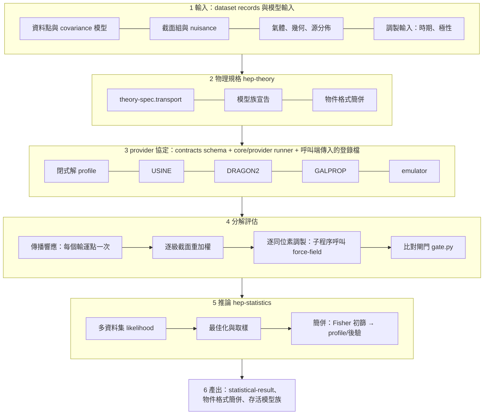

# hep-research 的宇宙線傳播與參數簡併研究能力

| 項目 | 內容 |
|---|---|
| 版本 | r3，2026-10-26（以 hep-research 0.42.0 做最後檢查；歷程見 References → 版本歷程） |
| 基準 | hep-research 0.42.0、contracts 3.13.0、`CORE_VERSION` 1.1.0、adapter `cr-propagation` 0.1.0 |
| 語言 | 繁體中文原文；英文版 `hep-research-cr-propagation-plan.en.md` 為其翻譯。兩版同時修改；若兩版不一致，回報而不是自行擇一。第二層標題沿用 plugin 任務範本的英文名稱，以通過 `lint_task.py` |
| 執行環境 | 每個工作包（WP）都在自己的 isolated git worktree 中執行（Technical Approach §0，依 `docs/dev/geant4-architecture/geant4-program.md` §P.10）；不修改主要 checkout 或其他 worktree |
| 讀者 | 執行本文件的 Claude 主 session 與子 agent；審閱的研究者 |

除以 `.claude/` 開頭者外，路徑一律相對於 plugin 根目錄 `plugins/hep-research/`。

## Background

#### 如何使用本文件（執行的 agent）

1. 讀 Background，了解已經存在的東西，不要重做。
2. 在 Objective 的階段表找到你的 WP，確認前提都已合併、所需的使用者決定（Open Questions）都已回答；否則停止並回報。
3. 依 Technical Approach §0 建立 worktree。
4. 執行你的 WP 卡（Technical Approach §A1–§F3）的步驟。
5. 滿足 Acceptance Criteria 中以你的 WP 為前綴的條目，**以及** `ALL-` 條目；執行 Validation。
6. 慣例、公式與單位只取自 Repository Context → 物理與數值規則，不憑記憶。

**開始前：** 確認 `origin/main` 是否已超過基準（0.42.0）。若是，讀新的 CHANGELOG 條目，重新核對你的 WP 依賴的 Repository Context 中每個 [C] 敘述，有差異先回報再寫程式。

**以下情況停止並回報，不要猜：** 你的 WP 需要的 Open Question 尚未回答；檢查以本文件未列出的方式失敗；本文件與 repo 的實況衝突；或 Technical Approach §0.7 的任一條件成立。

#### 名詞

| 名詞 | 意義 |
|---|---|
| [C] 已確認 | 在 repo（0.42.0）或已讀的來源中直接讀到 |
| [I] 推論 | 由 [C] 項目推得的結論 |
| WP | 工作包；一個 WP 對應一個 worktree、一個分支、一次合併 |
| Gate X | 所列 WP 已由使用者合併到 `main`，且合併後的 `main` 上 `run_all_checks.py` 通過 |
| harmonized-v1 | Technical Approach §5.5 定義的固定跨程式設定（調和設定） |
| 主要產生反應道 | 在 `harmonized-v1`、10 GV 下，依對 B（與 ¹⁰Be）通量的貢獻排序，累積達 95% 的反應道 |
| 有效域 | provider 對每個參數宣告的閉區間，加上它支援的觀測量、軸與能量範圍 |
| 強制環境 | `tools/check_layering.py` 的 `MANDATORY`：numpy、scipy、matplotlib、sympy、mpmath [C] |
| 環境 E2 | `VALIDATION.md` 環境表中的 macOS arm64 主機，DRAGON2 在此建置 [C] |

#### 現況 [C]

| 元件 | 路徑 | 狀態與限制 |
|---|---|---|
| 傳播參考 | `skills/hep-theory/references/cosmic-ray-propagation.md`、`cosmic-ray-phenomenology.md`、`nuclear-cross-sections.md`、`solar-modulation-models.md` | 模型族、慣例對照表、V_A–D_pp 關係、BIG/SLIM/QUAINT、L 的文獻值、全域擬合的 nuisance 區塊 |
| 理論 profile | `profiles/theory/cr-secondary-ratio`、`cr-secondary-antiprotons`、`heliospheric-modulation` | 1D 薄盤與 weighted-slab 閉式解，截面為 ILLUSTRATIVE；`heliospheric-modulation` 以子程序呼叫 force-field 腳本做 benchmark |
| 傳播 adapter | `adapters/cr-propagation/`（`dragon2_run.py`、`dragon2_to_prediction.py`），版本 0.1.0 | 整體 `proposed`。DRAGON2 commit cd588707 為 `tested-in-declared-environment`，只測過純擴散；GALPROP、USINE 為 `proposed`，從未執行 |
| 網格擬合 | `skills/hep-statistics/scripts/covariance_fit.py`，model `tabulated-grid` | 完整直角網格、每節點一份 prediction、只收 `representation: grid`（第 1025 行）、多線性內插、不外推；只保留字串格式的 `degenerate_directions`（第 1110 行）；只驗證過合成資料 |
| 協方差 | `skills/hep-statistics/scripts/build_covariance.py` | `length` 模型 R_ij = exp(−\|ln x_i − ln x_j\|/length) 與 `scan` 子命令 |
| toys 與邊界 | `core/stats/toy_ensemble.py`、`statistical_toys.py`、`fit_diagnostics.py`（`newton_fit`、`boundary_kkt`） | toy 產生方式必須明確宣告；`covariance_fit.py break-scan` 是 toy 校準、非 Wilks 區間的先例 |
| 調製 | `skills/hep-measurement/scripts/solar_modulation_force_field.py` | 支援 `--lis-table`。hep-statistics 不能 import 它，但可依 tool contract 以子程序呼叫（先例：`skills/hep-detector/scripts/evaluate_design.py` 經 `contracts/tool_contracts/cosmic_ray_flux.json`） |
| emulator 有效域 | `skills/hep-ml/scripts/check_surrogate_domain.py`（`DomainModel`）；`ext_ml_artifact` 的 `training_domain`、`extrapolation_policy`、`regression_validation` | 直接沿用，不重寫 |
| 資料 | `adapters/hepdata`、`adapters/crdb`、`skills/hep-theory/scripts/import_published_table.py`、experiment profile `experiment:ams-02` | CRDB 是次級彙編；HEPData 或論文表格為主要來源 |
| 批次 | `adapters/batch-schedulers`、`skills/hep-computing/scripts/local_partition.py` | Slurm 與 HTCondor 只跑過合成作業 |
| 常數 | `core/constants/physical.py`（`half_life()`、`convert()`） | `convert()` 不認得 kpc、pc、Myr |
| 範例 | `examples/bc-propagation-fit` | 合成 B/C 與 D0/L 平坦方向 |
| 範圍 | `docs/capability-map.json`：`propagation-global-fits` 為 `v1: false`、`state: none`，case `out-of-v1-1`（`tests/routing/make_cases.py` 第 123 行） | prompt：「Fit cosmic-ray propagation parameters with GALPROP across all species.」 |

合約細節 [C]：`contracts/schemas/ext_theory_spec.json` 為 `additionalProperties: false`；`degenerate_directions` 是字串陣列，`model.family = cosmic-ray-propagation` 時由 validator 規則 `theory.degeneracy_missing` 要求非空（自 contracts 2.6.0）；`contracts/validate.py` 的 `_blank`（第 1239 行）把任何非字串視為空白。`contracts/schemas/ext_prediction.json` 的 `representation` 只有 symbolic、numerical、grid，`parameter_point` 可放任意鍵。`adapter.json` 沒有 schema；`tests/adapters/test_adapter_declarations.py` 只檢查固定的鍵。

#### 0.39.0–0.42.0 中本規劃依循的變更 [C]

- contracts 3.13.0 已在 0.39.0 發布，因此本規劃的合約變更以佔位名 `CV-A2`、`CV-C1` 表示（Technical Approach §0.5）。
- `contracts/schema.py` 現在支援 `oneOf`、`not`、`maximum`、`exclusiveMaximum`、`maxItems`。
- 語意命名治理（0.42.0）：`run_all_checks` 執行命名閘門（`tools/check_naming.py`，表面 N1、N5、N16）與登錄檢查；新名稱必須通過，`tools/naming_known_gaps.json` 只能縮小。章程：`skills/hep-computing/references/semantic-naming.md`。
- isolated worktree 是維護者對多階段工作的規定（`docs/dev/geant4-architecture/geant4-program.md` §P.10；`docs/dev/frontend-electronics/frontend-reco-sim-calibration.md` §0 的實例）。
- 任務文件須通過 `skills/hep-computing/scripts/lint_task.py`；文件的獨立審查使用 `skills/hep-authoring/scripts/review.py`（`docs/dev/independent-review-spec.md`）。

#### 架構為何改變（審查摘要）

第一版方向正確，但有結構性問題；三份獨立審查（References → 版本歷程）導出以下決定：

- **效率。** 直角網格的成本為 n^d（10 個參數 × 每軸 5 點 ≈ 980 萬份預測）。改由 provider 即時評估；計算拆為傳播響應、截面重加權與調製三段；協定支援批次、常駐模式與快取；emulator 以 Sobol 設計加有上限的主動加點訓練。
- **正確性。** 截面分解只對產生截面、且只在母核通量固定時線性，因此依質量逐級進行，slope 型重加權不在傳播後套用。同位素與分箱處理、時鐘物理、邊界與 Davies 情況、nuisance 處方、以 Δχ² 驗收 emulator、隨 n 調整的覆蓋率容差，都在 Repository Context 中定下。
- **合理性。** 以 USINE 為半解析參考程式，不自寫 2D 模型。provider 協定先於任何高維擬合。進入 v1 須有真實資料重現。force-field 以子程序呼叫，不移入 core。沿用既有工具。
- **靈活性。** 正準 `transport` 區塊；以宣告定義模型族；與語言無關的子程序協定，登錄檔由呼叫端傳入；使用者自備 provider 標記 `user-supplied`；簡併改為物件格式，舊字串格式仍接受。

## Objective

讓 plugin 能用 GALPROP、DRAGON2、USINE 研究銀河宇宙線傳播：擬合擴散、對流、再加速與 halo size L，並以可重現的證據回報它們之間的簡併。

**完成定義（全部成立）：**

1. 至少兩套傳播程式加上閉式解，透過同一個 provider 協定產生 `prediction`，並可在同一個 likelihood 中互換。
2. 次級核比值與放射性時鐘的多資料集全域擬合在 v1 內，包含共享 LIS、每個資料時期的調製參數、截面 nuisance，以及作為 model alternative 的 covariance 模型。
3. 每個擬合結果都附物件格式的 `degenerate_directions`（組合、有效範圍、判定方法、可打破它的觀測量），並列出所有存活的模型族。
4. 已用公開資料、以原論文的程式，在使用者確認的容差內重現至少一個已發表結果。
5. 經使用者同意，capability map 把次級核傳播擬合列為 `v1: true`；輕子、反核、γ 射線仍在 v1 之外。

#### 階段表

| WP | 內容 | 前提（已合併） | 週 | 軌道 | 版本影響 |
|---|---|---|---|---|---|
| A1 | 慣例換算、`harmonized-v1` | — | 1–3 | 主線 | — |
| A2 | `transport` 區塊、物件格式簡併 | — | 1–3 | 主線 | contracts `CV-A2`（minor） |
| A3 | 兩層簡併診斷 | —（A2 合併後 rebase） | 1–3 | 主線 | — |
| A4 | 成本基準 | A1 已回報 | 2–3 | 主線 | — |
| B1 | adapter 中的 USINE tool | Gate A | 4–8 | 主線 | adapter minor |
| B2 | 含對流與衰變的閉式解 | Gate A | 4–8 | 主線 | profile minor |
| C1 | provider 協定 | Gate A | 4–8 | 主線 | contracts `CV-C1`、`CORE_VERSION` minor |
| B1b | USINE provider | B1、C1 | 9–10 | 主線 | adapter minor |
| B3 | 調和比對、分解驗證 | B1、B2 | 9–10 | 主線 | — |
| C2 | 多資料集傳播擬合 | C1、B1b | 9–13 | 主線 | — |
| D1 | DRAGON2 物理項目 | Gate A | 4–10 | 旁路 | adapter minor |
| D2 | GALPROP tool | Gate A、Q2 | 4–10 | 旁路 | adapter minor |
| D1b、D2b | DRAGON2、GALPROP provider | D1/D2、C1 | 11–14 | 旁路 | adapter minor |
| D3 | 兩級跨程式比對 | D1、D2、B1 | 11–14 | 旁路 | — |
| E1 | 訓練集、有上限的主動加點 | Gate D | 15–20 | 旁路 | — |
| E2、E2b | emulator、emulator provider | E1（E2b 另需 C1） | 15–20 | 旁路 | adapter minor |
| F1 | 以原程式重現 | Gate C | 14–18 | 主線 | — |
| F2 | 跨程式延伸（選用） | F1、Gate E | 20–22 | 旁路 | — |
| F3 | 進入 v1 | F1、使用者同意 | 19–20 | 主線 | — |

Gate：A = A1–A4；B = B1、B1b、B2、B3；C = C1、C2；D = D1、D1b、D2、D2b、D3（GALPROP 為 `unavailable` 時只需 DRAGON2）；E = E1、E2、E2b。主線約 20 週；第 21–24 週為緩衝與 F2。

## Scope

### In Scope

- 次級核比值（Li、Be、B 對 C、O 與更重的母核）與放射性時鐘（¹⁰Be/⁹Be，以及 Repository Context P6 列出的其他核）。
- GALPROP、DRAGON2、USINE 作為同一個 adapter `cr-propagation` 的 tool，各有翻譯器、讀取器與 provider 入口；閉式解 profile 與 emulator 作為另外的 provider。
- provider 協定、正準 `transport` 區塊、物件格式簡併、兩層簡併診斷、多資料集傳播擬合、一次真實資料重現，以及上述部分進入 v1。
- 本規劃文件本身，以兩種語言放進 repo（Deliverables）。

### Out of Scope

- 輕子、反核、彌散 γ 射線、無線電、異向性與 3D 非軸對稱銀河結構（`transport` 欄位保留擴充空間；仍在 v1 之外）。
- 自寫 2D 半解析傳播程式；修改任何外部程式的物理預設。
- 把 force-field 移入 `core/`（Open Questions Q4）。
- 改名既有名稱（例如既有網格範例的 `D0`、`L` 鍵）；只新增名稱。
- 非公開資料（只能經 companion `ams02-research:profile`）。
- plugin 版本、主機 manifest 與 release manifest（由使用者在發布時設定）。

## Repository Context

#### 由檢查強制的規則 [C]

- **R1 分層**（`tools/check_layering.py`）。`core/` 只 import core、stdlib 與強制環境；`contracts/` import contracts 與 core；`skills/<s>/scripts` 與 `adapters/<a>` 只 import core 與 contracts（其他 skill 可以子程序呼叫，不可 import）；profiles import core、contracts 與 `depends_on` 宣告的 profile。文字規則：`core/` 程式不含 `profiles/`、`adapters/`、`skills/` 路徑字串；skill、core、contracts 的文字與程式在 example 區塊外不含實驗名稱（清單包含 AMS、PAMELA 等）、profile id 或 profile 路徑；core schema 不得把 `rigidity` 等實驗專屬欄位設為 required。
- **R2 core 准入**（`core/OWNERS.json`）。程式只有在一個以上的頂層元件（skills scripts、profiles、adapters、contracts；不含 tests）使用時才進 `core/`；領域特定內容不進 core；每個 core 模組都有 steward。
- **R3 adapter 狀態**（`docs/adapter-authoring.md`）。adapter 的狀態取最弱 tool 的狀態；高於 `documented` 需要實際執行工具的測試、宣告的環境與實測版本；任何 skill 或 core 模組不得依賴 adapter。
- **R4 缺工具。** 產出 `failed` artifact 並附原因；不默默改用其他方法。
- **R5 驗證與比對。** 所有輸出通過 `contracts/validate.py`；與資料比較前先通過 `contracts/comparison/gate.py`。
- **R6 狀態標籤。** `synthetic`、`asimov`、`observed`、`preliminary`、`failed`、`unvalidated`、`user-supplied`、`outside-validated-range` 傳遞到所有衍生結果。
- **R7 covariance。** 缺資料 covariance 的擬合 exit 3；不假設對角矩陣。
- **R8 截面組** 是 model alternative；沒有 hep-theory 的處方不轉成高斯。
- **R9 準則先行。** 驗收準則與容差在比較前寫入 `VALIDATION.md`，之後不放寬；程式跑完不等於預測已驗證。
- **R10 生成檔。** capability map：改 `docs/capability-map.json`，執行 `python3 tools/capability_map.py --write`。stanza：改 `contracts/stanzas/`，執行 `python3 tools/build_stanzas.py`。routing case：改 `tests/routing/make_cases.py` 後執行它。參考頁：重跑 `python3 tools/reference_inventory.py`。
- **R11 schema 變更**（`docs/maintenance.md` 的 Schema migration）。新增選用欄位或放寬型別為 minor；移除、改名或收緊為 major，須附轉換器、`contracts/fixtures/` 的 fixtures 與 CHANGELOG。只能使用 `contracts/schema.py` 的 `SUPPORTED_KEYWORDS`（0.42.0：`$ref`、`anyOf`、`oneOf`、`not`、`type`、`const`、`enum`、`minLength`、`pattern`、`minimum`、`exclusiveMinimum`、`maximum`、`exclusiveMaximum`、`x-vocab`、`required`、`properties`、`additionalProperties`、`minItems`、`maxItems`、`items`）。
- **R12 CLI。** `skills/*/scripts/` 與 `adapters/*/assets/` 下的每個 `.py` 都支援 `--help`，並列入 `tests/skills/test_cli_robustness.py` 的 `MISSING_FILE_ARGS` 或 `NO_INPUT_FILE`；共用 helper 比照 `adapters/geant4/assets/g4common.py`。有 tool contract 的新增或修改 CLI 須通過 `python3 contracts/tool_contract.py`。
- **R13 封裝。** `tools/check_packaging.py` 與 `tools/check_relocation.py` 掃描已追蹤與未追蹤、未被忽略的檔案；拒絕家目錄路徑、`hep-research-artifacts/` 與大於 2 MiB 的檔案；README 中的套件大小須在 10% 內。
- **R14 命名**（0.42.0）。新的程式識別字（N1）、CLI 旗標或環境變數（N5）與合約詞彙（N16）都要通過 `tools/check_naming.py`，其基準只能縮小；理論參數名稱（N13）依下方正準表，並以 `python3 skills/hep-computing/scripts/extract_names.py --surface N13` 與 `python3 contracts/naming_check.py check` 檢查。不使用禁用的完整名稱（`data`、`tmp`、`helper`、`final` 等，見 `core/naming/data/forbidden.json`）。
- **R15 入口預算。** 修改 `SKILL.md` 或入口參考頁後，`python3 tools/measure_entrypoints.py` 須在預算內。

#### 物理與數值規則

- **P1 擴散慣例。** 比較前統一：參考剛度（GALPROP 常用 ρ0 = 4 GV；USINE 依論文而異，Weinrich et al. 2020a 用 1 GV 的 K0，Génolini et al. 2019 用 10 GV 的 K10；DRAGON2 常用 1 GV）；β^η；break 形狀、smooth 慣例與 Δ 的符號；單位（1 kpc²/Myr = 3.017e29 cm²/s，IAU parsec 與 Julian year）；V_A 的作用區域與 w（USINE 只在半厚 h = 100 pc 的薄盤內再加速，GALPROP 與 DRAGON2 在全 halo，兩者約差 √(L/h)）。只有純冪律的換算是 `exact`；否則比較預測，不比較參數。
- **P2 分箱。** 預測取分箱積分；比值取分子與分母分箱積分之比，不取比值的分箱平均。
- **P3 同位素求和。** 元素在資料所用的軸上逐同位素求和：剛度資料在相同剛度上求和，每核子動能資料（例如 ¹⁰Be/⁹Be）在相同 E_k/n 上求和；不在一個軸上求和後再換軸。
- **P4 調製** 逐同位素（帶 Z、A）進行，再組成元素與比值；不對比值直接調製。
- **P5 截面線性。** 在固定輸運參數、非彈性截面與母核通量下，次級 LIS 對某反應道的產生截面是線性的；整個網路是多線性的。母核含次級成分時（O→C→B、O→N→B、¹¹B→¹⁰B、¹⁰Be→¹⁰B），依質量由重到輕逐級重加權，先更新母核通量。非彈性截面不是線性的。只有與能量無關的 norm 可以在傳播後套用；與能量相依的 slope 需要能量基底響應或重跑。
- **P6 衰變。** 累積截面只可併入壽命遠短於傳播時間的鬼核。¹⁰Be、¹⁴C、²⁶Al、³⁶Cl、⁵⁴Mn 與電子捕獲核明確傳播；衰變率為 1/(γτ₀)，保留子核的增益項（¹⁰Be→¹⁰B）。完全剝離的 ⁷Be 視為穩定，並記錄此假設。半衰期取自 `core.constants.physical.half_life()`（¹⁰Be：1.387 ± 0.012 Myr，NUBASE2020），不寫死。
- **P7 簡併。** Fisher 矩陣只是局部線性的初篩；定論需要 profile likelihood 掃描或後驗樣本。每條簡併記錄它成立的範圍。實例 [C]：徑向邊界 20 kpc 時，DRAGON2 的 D0/L 在 L = 2 與 4 kpc 之間在 2% 內成立，在 L = 8 kpc 偏離 15–18%（`cosmic-ray-propagation.md`，Tool coverage）。
- **P8 非標準推論。** 參數在物理邊界上（V_A ≥ 0、V_c ≥ 0、L > 0），或在虛無假設下不可辨識（Davies 問題：檢定有無 break 時的 break 位置與平滑度；BIG、SLIM、QUAINT 之間的比較）時，Wilks 定理不成立；區間與檢定以 toys 校準。
- **P9 covariance 模型。** 資料 covariance 的相關模型（相關長度）是 model alternative，要做敏感度掃描。
- **P10 emulator 誤差** 作為 uncertainty component 進入 covariance；域外評估一律拒絕。
- **P11 輸出單位。** 每個程式的輸出單位都要宣告並檢查。實例 [C]：DRAGON2 的 ASCII 欄位是每總動能；質量數不同的物種組成比值前，每欄須乘 A。`VALIDATION.md` 記錄這個單位讓 B/C 偏高 12/11、閉式解的 O/C 輸入偏低 12/16（合計約 1.19 倍），再加上 DRAGON2 固定氦靶（1.143 倍），構成首版 32–34% 的 B/C 偏高。
- **P12 引用 L。** 不同文獻的 L 不得平均；每個值連同資料、模型族與截面處理一起引用。
- **P13 反應網路。** B/C、Be/B 擬合使用同位素網路，至少從 Fe（Z = 26）開始；在 10 GeV/n，Mg 以上的母核約貢獻 90% 的 LiBeB 源，只做到 O 會造成 10% 量級的偏差（`cosmic-ray-phenomenology.md`）。
- **P14 源豐度與 Li。** C、N、O 等的源豐度為自由參數，或由主要通量擬合決定；Li 只在截面 nuisance 啟用時納入。
- **P15 截面 nuisance**（Weinrich et al. 2020a，App. B）：非彈性為 norm + energy scale（先驗約 5%）；產生為 norm + 門檻以下的 low-energy slope（先驗約 10%）；代理反應為 N_eff = 1 + x(N_proxy − 1)。

#### 正準參數名稱（N13；R14）

一個概念一個名稱，在 `transport`、`free`、provider `domain`、請求的 `points` 與 `parameter_point` 中一律相同。單位依命名章程原則 P4（小寫單位後綴）；符號依原則 P7。

| 物理量 | 名稱 | 單位 |
|---|---|---|
| 擴散係數歸一化 | `D0_cm2_s` | cm²/s |
| 其參考剛度 | `R0_gv` | GV |
| 擴散斜率；β 指數 | `delta`；`eta` | — |
| halo 半高 | `L_kpc` | kpc |
| 徑向邊界 | `radius_kpc` | kpc |
| 盤半厚 | `disc_halfwidth_pc` | pc |
| break 剛度；break 以下斜率；平滑度 | `R_break_gv`；`delta_below`；`s` | GV；—；— |
| Alfvén 速度 | `V_A_kms` | km/s |
| 對流速度；其梯度 | `V_c_kms`；`dVc_dz_kms_per_kpc` | km/s；km/s/kpc |
| 時期 p 的調製勢 | `phi_<period>_gv` | GV |
| 氦氫數量比 | `He_to_H_number` | — |

`examples/bc-propagation-fit` 中既有的 `D0`、`L` 等名稱不改；由 `transport_conventions.py` 對應。若命名閘門拒絕此表中的名稱，停止並回報，不自行另取名稱。

#### 新元件的檔案歸屬（R1、R2）

| 新元件 | 位置 | 擁有者 |
|---|---|---|
| `transport` 區塊、物件格式簡併 | `contracts/schemas/ext_theory_spec.json` 的新欄位（new） | contracts（A2） |
| provider 協定 schema | `contracts/schemas/` 下的新 schema（new） | contracts（C1） |
| provider runner、協定驗證、`--serve` 迴圈、雜湊 | 新模組 `core/provider/`（new） | hep-computing（C1；使用者為 hep-statistics 腳本與 adapter 的 provider 入口，符合 R2） |
| 登錄檔產生器 | 新增（new）`tools/provider_registry.py` | hep-computing（C1） |
| 慣例換算 | 新增（new）`skills/hep-theory/scripts/transport_conventions.py` | hep-theory（A1） |
| 翻譯器、讀取器、provider 入口 | `adapters/cr-propagation/assets/` 中的新檔（new） | hep-computing |
| 閉式解 provider 入口 | 新增（new）`profiles/theory/cr-secondary-ratio/scripts/provider.py` | hep-theory（C1） |
| 多資料集傳播擬合 | 新增（new）`skills/hep-statistics/scripts/propagation_fit.py` | hep-statistics（C2） |
| Fisher 與簡併診斷 | 新增（new）`skills/hep-statistics/scripts/degeneracy.py`（同 skill 內 import；不進 core） | hep-statistics（A3） |
| force-field tool contract | 新增（new）`contracts/tool_contracts/solar_modulation_force_field.json` | contracts（C1） |
| emulator 訓練 | `skills/hep-ml/scripts/`，產出 `ml-artifact` | hep-ml（E2） |

## Technical Approach

#### §0 執行協定（每個 WP）

依 `docs/dev/geant4-architecture/geant4-program.md` §P.10 [C]。本規劃另加的規定標示（plan）。

**§0.1 主 session 的前置條件。** 主 session 的 cwd 位於來源 git repo 內：`git rev-parse --show-toplevel` 成功，且 `<toplevel>/plugins/hep-research/.claude-plugin/plugin.json` 存在。`/mnt/skills/plugin-files/hep-research/` 下的安裝副本不是 git repo，只能讀；在那裡或任何非 git 目錄時，索取 repo 路徑（Q1）後停止。

**§0.2 一個 WP、一個 worktree、一個分支。**

| 項目 | 規定 |
|---|---|
| 位置 | `.claude/worktrees/crprop-<wp>`，WP id 小寫（例如 `.claude/worktrees/crprop-a1`、`.claude/worktrees/crprop-b1b`） |
| 分支 | `worktree-crprop-<wp>`（`EnterWorktree` 的命名規則） |
| 基底 | 已包含階段表中所有前提之合併 commit 的最新 `origin/main` |
| 在 Claude Code 中 | 工作階段以 `EnterWorktree`（name `crprop-<wp>`）進入；把實作委派給子 agent 時，Agent 工具使用 `isolation: "worktree"`。同一個 WP 不由兩個 agent 同時實作 |
| 其他環境 | `git fetch origin && git worktree add .claude/worktrees/crprop-a1 -b worktree-crprop-a1 origin/main` |
| 規劃文件 | 在自己的 worktree `.claude/worktrees/crprop-plan`、分支 `worktree-crprop-plan` 中撰寫，直到合併（Deliverables D-PLAN） |

**§0.3 開始前確認**，結果寫入該 WP 的 `VALIDATION.md` 條目的環境欄：`git rev-parse --show-toplevel` 是這個 worktree；`git branch --show-current` 是 WP 分支；`git status` 乾淨；每個前提的 `git merge-base --is-ancestor <合併 commit> HEAD` 成立；本文件引用的行號在新基底上重新核對。

**§0.4 在 worktree 中的規則。**

1. 編輯、建置、測試與執行都只在這裡；不 `cd` 到主要 checkout 或其他 worktree。git 指令使用 worktree 內明確的路徑。
2. 不使用裸的 `git stash` 或 `git stash pop`（所有 worktree 共用）；需要暫存時用 WIP commit。
3. 執行輸出（檢查的 `--out` 目錄、`hep-research-artifacts/`、provider 快取、外部程式的 run 目錄、emulator 訓練集）放在 repo 外、該 worktree 專屬的目錄 `${CRPROP_OUT:-$TMPDIR/crprop}/<wp>/`（plan），或在 `git check-ignore -q work/` 成立時放在 worktree 內的 `work/`。不得為了隱藏輸出而新增 `.gitignore` 條目（R13）。不同 worktree 不共用建置目錄；外部程式的安裝（USINE、GALPROP、DRAGON2）可以唯讀共用，位置只以 `HEP_USINE_BIN`、`HEP_USINE_DATA`、`HEP_GALPROP_BIN`、`HEP_GALPROP_DATA`、`HEP_DRAGON2_BIN`、`HEP_DRAGON2_DATA` 表示。
4. 第一個 commit 只含寫入 `VALIDATION.md` 的驗收準則與容差（R9）（plan）。之後每個 commit 只做一件事，訊息為 `crprop(<wp>): <動詞> <對象>`，附規定的 trailer。不 `--amend` 已回報的 commit，不用 `--no-verify`。
5. 只在 WP 分支提交。只有經同意（§0.6）才推送到同名的遠端分支；否則保留在本地並回報。未經維護者核准，不推送 `main`、不開 pull request。
6. fixtures 放在 `tests/adapters/fixtures/cr_propagation/<tool>/`，絕對路徑換成 `<TOOL_HOME>` 或 `<RUN_DIR>`，移除主機名與使用者名；單檔 ≤ 2 MiB，每個 WP 新增合計 ≤ 2 MB，超出時停止並回報（plan）。

**§0.5 共用檔案與版本**（plan，與 §P.10.4 一致）。

| 檔案 | 規則 |
|---|---|
| `contracts/__init__.py`（`CONTRACTS_VERSION`）與釘住它的測試 | 只有 A2 與 C1。若 `CHANGELOG.md` 的 `## Unreleased` 已列出尚未發布的 contracts 版本，沿用它；否則做 minor bump（3.13.0 已發布，因此至少 3.14.0）。每個 WP 的新規則以自己的常數（`CRPROP_A2_FROM`、`CRPROP_C1_FROM`）閘控，設為該版本；本文件稱這兩個版本為 `CV-A2` 與 `CV-C1` |
| `core/__init__.py`（`CORE_VERSION`）、`core/OWNERS.json` | 只有 C1：minor bump（1.1.0 → 1.2.0，除非已有未發布的 bump），並新增一個鍵 `provider` |
| plugin 版本、`.claude-plugin/plugin.json`、`.codex-plugin/*`、`pyproject.toml`、`release-manifests/` | 任何 WP 都不改；由使用者在發布時處理 |
| `CHANGELOG.md` | 只在 `## Unreleased` 下附加，每條以 `crprop <wp>:` 開頭 |
| `VALIDATION.md` | 只在檔尾附加一節 `## CRPROP-<WP> — <日期>（環境 <標籤>）` |
| `contracts/validate.py`、`contracts/vocab/core.json`、`contracts/schemas/*` | 只有 A2 與 C1；其他 WP 需要新詞彙時停止並回報 |
| `adapters/cr-propagation/adapter.json`、`docs/capability-matrix.md`、`tests/adapters/test_cr_propagation.py` | 合併順序 B1 → D1 → D2 → B1b → D1b → D2b → E2b；保留先前的 tool 條目 |
| README 計數與 Resources 表 | 只在 `tools/check_wiring.py` 要求時修改；衝突時 rebase 後重跑它 |
| `docs/capability-map.json`、`tests/routing/*`、`contracts/stanzas/*`、`SKILL.md` 的 description | 只有 F3 |

兩個平行的 WP 中，後合併者 rebase 到新的 `main` 並重跑所有檢查。上表以外的衝突，或修改不在 WP 卡中的檔案，一律停止並回報。不 `git push --force`。

**§0.6 需要使用者同意的動作。** 主 session 在派工前取得同意，寫入指派訊息，格式為「已同意：<動作>，<範圍>，<日期>」；子 agent 只執行列出的動作，其他一律回報 `NEEDS_CONSENT`。這些動作是：安裝任何套件；clone 或下載外部程式碼或資料；網路連線（唯一例外，但仍須列出：F1 中 `adapters/hepdata` 與 `adapters/crdb` 的唯讀查詢）；建置外部程式；送出批次作業，包括主動加點的每一輪；推送、開 pull request、任何 `gh` 寫入；合併到 `main`；contracts 或 core 版本 bump；`--force` 或改寫已回報的 commit；刪除有變更的 worktree 或分支；改變 v1 範圍；會產生費用的 live routing run。

**§0.7 以下情況停止並詢問：** 需要未獲同意的 §0.6 動作；驗收數值沒有預設、使用者也未指定；將修改 §0.5 與 WP 卡以外的檔案；repo 與 Repository Context 不符；同一錯誤在最多 2 次嘗試後仍存在；某項檢查在 `main` 上原本就失敗（回報，不修無關的失敗）；結果超出容差且無法歸因；需要放寬 `VALIDATION.md` 中的容差；該步驟需要環境 E2 而目前不是（`BLOCKED: 需要環境 E2`）；命名閘門拒絕新名稱。

**§0.8 指派訊息（主 session → 子 agent）** 包含：本文件的絕對路徑（只讀；讀不到就停止）；WP id、worktree 名稱與分支；前提的合併 commit；已同意的動作；`CRPROP_OUT` 路徑與外部程式的環境變數；採用的 Open Question 答案或預設；以下的回報格式。

**§0.9 回報格式（子 agent 的最後一則訊息）。**

```
WP：<id>   狀態：DONE | PARTIAL | BLOCKED | NEEDS_CONSENT
Worktree：.claude/worktrees/crprop-<wp>   分支：worktree-crprop-<wp>   HEAD：<sha>   base：<sha>
變更檔案：<路徑，標記新增/修改>
驗收準則：每條一行（<ID> 通過 / 未通過 / 未執行），附證據
檢查：run_all_checks（通過/失敗，--out 路徑）、check_relocation、check_wiring、check_naming
執行紀錄：computational-run 參照、環境標籤
Open Questions：採用的答案或預設；新的待決事項
需要的同意：（NEEDS_CONSENT 時）動作、範圍、理由
未做與原因
```

**§0.10 結束。** 合併後 `git worktree remove .claude/worktrees/crprop-<wp>` 並刪除本地分支；放棄時兩者都移除；不在主要 checkout 中做任何清理。文件的獨立審查依 `docs/dev/independent-review-spec.md`（附錄 A7 的隔離，`skills/hep-authoring/scripts/review.py`）；worktree 只用於實作，審查者只讀。

#### §5 目標架構

**§5.1 分層與資料流。**



`tabulated-grid` 保留為 2–3 維的獨立路徑；它只收 `representation: grid`，不經 provider。

**§5.2 provider 協定（C1）。**

- 呼叫方式：子程序 `python3 <entrypoint> --request req.json --response resp.json`；另有 `--serve`（stdin/stdout JSON Lines）與一次多個參數點的批次。
- 登錄檔：`core/provider/` 不自行搜尋 provider，也不含路徑字串（R1）。呼叫端傳入 `--provider-registry <json>`，由新增（new）的 `tools/provider_registry.py --write "$CRPROP_OUT/registry.json"` 從 `adapter.json` 與 `profile.json` 的 `provider` 欄位產生；登錄檔不提交。只有列出的入口會被執行。使用者自備的 provider 必須明確列入；其輸出標記 `user-supplied`，不得作為進 v1 的證據。
- `provider` 欄位（C1 在 `tests/adapters/test_adapter_declarations.py` 加入檢查，並在 `docs/adapter-authoring.md` 的欄位表加一列）：

```json
{"id": "usine", "entrypoint": "assets/usine_provider.py", "protocol": "cr-provider/1",
 "domain": {"D0_cm2_s": {"min": 1e27, "max": 1e30}, "L_kpc": {"min": 1, "max": 20}},
 "observables": ["B/C", "Be/B", "10Be/9Be"], "axes": ["rigidity", "ekn"],
 "decomposable": true, "deterministic": true,
 "output_units": {"flux": "per (m2 s sr GeV/n)", "energy": "ekn"}}
```

- 請求：

```json
{"protocol": "cr-provider/1", "provider": "usine", "provider_version": "<tested version>",
 "theory_spec_ref": "theory-spec.json",
 "points": [{"D0_cm2_s": 3.0e28, "delta": 0.45, "L_kpc": 5.0, "V_A_kms": 10.0, "V_c_kms": 5.0}],
 "observables": [{"id": "B/C", "axis": "rigidity", "unit": "GV", "bins": [[2.0, 2.5], [2.5, 3.0]]}],
 "want": ["lis", "components"], "seed": null}
```

- `want` 只接受 `lis` 與 `components`；provider 不做調製；其他值回 `failed`。
- 回應：每個點一份 `prediction`（`representation: numerical`，`values` 為分箱積分，P2），附評估紀錄（`computational-run` 參照、輸入雜湊、`elapsed_s`、數值容差）；`decomposable: true` 時另附 `components`，定義在協定 schema 中，不得成為 `prediction` 的未宣告欄位。provider 的輸出不送進 `tabulated-grid`。
- 失敗時回 `failed` 並附原因（R4）。域外時預設拒絕：回 `failed` 與 `"reason": "out-of-domain"`，不產生預測。只有使用既有旗標 `--allow-outside-validated-range` 時才產生預測，並標記 `outside-validated-range`（不能通過發表閘門）。不新增詞彙。
- 雜湊：`sha256(json.dumps(obj, sort_keys=True, separators=(",", ":"), ensure_ascii=False))`，`obj = {"transport": <正準單位>, "provider": id, "provider_version": v, "point": <鍵排序；浮點以 repr 表示>}`，實作在 `core/provider/`，並以測試確認它與 `contracts/recipe_semantics.py` 的 `canonical_sha256` 對同一物件結果相同。快取放在 `$CRPROP_OUT/cache/`。

**§5.3 分解評估。** 對母核為 p 的同位素 i：

```latex
\Phi^{\rm LIS}_i(E)=\Phi^{\rm prim}_i(E)+\sum_{p}\int\!dE'\,\mathcal{G}_i\!\left(E,E';\theta_{\rm tr},\sigma^{\rm inel}_i\right)\nu_{p\to i}(E';\theta_{\rm xs})\,q^{\rm nom}_{p\to i}\!\left(E';\Phi^{\rm LIS}_p\right)
```

```latex
\Phi^{\rm TOA}_e(R)=\sum_{i\in e}\mathcal{M}_{\phi_t,Z_i,A_i}\!\left[\Phi^{\rm LIS}_i\right](R)
```

𝒢_i 是同位素 i 的傳播響應（依賴輸運參數與 i 的非彈性截面）。重加權由重到輕逐級進行（P5）。norm 型 ν 可以在傳播後套用；slope 型 ν 需要每個源能量分箱一個能量基底 `component`，或重跑；非彈性截面變動一律重跑。M 是時期 t 的 force-field 調製，逐同位素計算後再求和成元素（P3），經 tool contract 以子程序呼叫（Q4）。nuisance 處方見 P15。

**§5.4 合約變動（A2）。** `ext_theory_spec.transport` 為選用，`model.family = cosmic-ray-propagation` 時建議填寫：

```json
{"geometry": {"kind": "cylinder-2d", "L_kpc": 5.0, "radius_kpc": 20.0, "disc_halfwidth_pc": 100},
 "diffusion": {"form": "beta^eta (R/R0)^delta with smooth breaks",
               "D0_cm2_s": 3.0e28, "R0_gv": 1.0, "eta": 1.0, "delta": 0.45,
               "breaks": [{"kind": "low", "R_break_gv": 5.0, "delta_below": 0.15, "s": 0.05, "s_convention": "usine"}]},
 "reacceleration": {"V_A_kms": 0.0, "zone": "thin-disc", "relation": "Seo-Ptuskin 1994", "w": 1.0},
 "convection": {"V_c_kms": 0.0, "dVc_dz_kms_per_kpc": 0.0},
 "losses": ["ionization", "coulomb", "adiabatic"],
 "decay": {"enabled": true, "lorentz_dilation": true, "ec_treatment": "fully-stripped"},
 "gas": {"model": "<name>", "He_to_H_number": 0.1},
 "sources": {"spatial": "<name>", "injection": [{"species_group": "Z>2", "gamma": 2.3, "breaks": []}],
             "abundances": "fitted"},
 "cross_sections": {"production_set": "<name>", "inelastic_set": "<name>", "ghost_threshold": "<lifetime cut>"},
 "species": {"network_top": "Ni-64", "isotopic": true},
 "family": "BIG",
 "free": ["D0_cm2_s", "delta", "L_kpc", "V_A_kms", "V_c_kms"]}
```

`degenerate_directions.items` 改為 `oneOf: [string, object]`（0.42.0 起支援，R11）：

```json
{"combination": "D0_cm2_s/L_kpc", "form": "power", "exponents": {"D0_cm2_s": 1, "L_kpc": -1},
 "valid_range": {"L_kpc": {"min": 2, "max": 6}},
 "broken_by": ["10Be/9Be", "Be/B"],
 "evidence": "profile-scan"}
```

`evidence` 為 `fisher-screen`、`profile-scan`、`posterior` 之一。A2 同時修正 `contracts/validate.py` 的 `_blank`（物件項目算非空白），以及 `covariance_fit.py` 的讀取（物件取其 `combination`；`D0/L` 等字串維持原意）。

**§5.5 調和設定 `harmonized-v1`（A1）。** 新增（new）檔案 `tests/adapters/fixtures/cr_propagation/specs/harmonized-v1.json`，採 `transport` 格式：

| 項目 | 設定 |
|---|---|
| 幾何 | `cylinder-2d`，`L_kpc` = 4，`radius_kpc` = 20，`disc_halfwidth_pc` = 100 |
| 氣體 | 均勻 n_H = 1 cm⁻³，`He_to_H_number` = 0.1 |
| 擴散 | β¹ (R/1 GV)^0.5，無 break，`D0_cm2_s` = 3e28 |
| 再加速、對流 | `V_A_kms` = `V_c_kms` = 0 |
| 能損、衰變 | 關閉；D1 每開啟一項，另存 `harmonized-v1-<項目>.json` |
| 源 | 所有原級物種 R^−2.3，無 break |
| 截面與網路 | profile `cr-secondary-ratio` 的 ILLUSTRATIVE 截面組與母核清單；三級鏈與鬼核雙方一致關閉 |
| 輸出 | 不調製的 LIS，1–10³ GeV/n，每十倍 20 點 |

程式無法表達某一項時，記錄差異與替代設定；不默默改用預設值。

#### §A1 慣例換算與調和設定

worktree `crprop-a1`。步驟：(1) 新增（create）`transport_conventions.py`，在 GALPROP 的 β ρ^δ、USINE 的 β^η K0 (R/R0)^δ 加 smooth break（K0 與 K10）、DRAGON2 的 (p/p0)^δ 之間換算，並在每核子與每總動能之間換算；(2) 每個結果標記 `exact`、附相對誤差上限的 `approximate`，或 `not-convertible`；(3) 在模組內以 IAU parsec 與 Julian year 推導 kpc 與 Myr；(4) 把既有名稱（`D0`、`L`）對應到正準表；(5) 依 §5.5 寫出 `harmonized-v1`；(6) 在 `cosmic-ray-phenomenology.md` 加一段用法，並重跑 `tools/reference_inventory.py`。慣例表無法解析時停止。不做：模型族對應、provider。同意：無。驗收：A1-1 至 A1-6。

#### §A2 合約擴充

worktree `crprop-a2`。步驟：(1) 在 `ext_theory_spec.json` 加入 `transport` 與 `oneOf` 的簡併項目；(2) 在 `contracts/validate.py` 修正 `_blank`，新增錯誤碼 `theory.degeneracy_evidence_missing`、`theory.degeneracy_range_missing`、`theory.degeneracy_evidence_unknown`，以 `CRPROP_A2_FROM` 閘控；(3) 在 `contracts/fixtures/` 加正反例；(4) 更新 `covariance_fit.py` 的讀取；(5) 依 §0.5 設定 contracts 版本，更新釘住版本的測試與 CHANGELOG。需要 `SUPPORTED_KEYWORDS` 以外的關鍵字，或新詞彙未通過命名閘門時停止。不做：provider schema（C1）。同意：contracts 版本 bump。驗收：A2-1 至 A2-5。

#### §A3 簡併診斷

worktree `crprop-a3`；A2 合併後 rebase。步驟：(1) 修改前，在基底上執行 `tabulated-grid` 的測試案例，把每個輸出的 sha256 存到 `$CRPROP_OUT/a3/baseline.txt`；(2) 把 Fisher 特徵分解與平坦方向判定移到新增（new）的 `degeneracy.py`，由 `covariance_fit.py` 呼叫；(3) 新增沿方向或在平面上的 profile likelihood 掃描；(4) 把模組列入 `NO_INPUT_FILE`，更新 README 計數。baseline 雜湊在無法解釋的情況下改變時停止。不做：移入 core。同意：無。驗收：A3-1 至 A3-4。

#### §A4 成本基準

worktree `crprop-a4`；A1 回報後開始。步驟：(1) 以 `harmonized-v1` 對閉式解與 DRAGON2 各量測 3 次 wall time 與峰值 RSS，取中位數；(2) 網格收斂：空間與能量格點各加倍一次時 B/C 在 2–1000 GV 的最大相對變化（只報告，不設門檻）；(3) 在 `VALIDATION.md` 加 `CRPROP-COST` 一節，並把去識別化的執行紀錄放在 `tests/adapters/fixtures/cr_propagation/cost/`。缺 `HEP_DRAGON2_BIN` 或 `HEP_DRAGON2_DATA`，或不在環境 E2 時停止。不做：USINE 與 GALPROP 的列（由 B1、D2 加入）。同意：執行 DRAGON2。驗收：A4-1、A4-2。

#### §B1 USINE tool

worktree `crprop-b1`。步驟：(1) 在 repo 外建置 USINE（版本由使用者確認；F1 需要 V3.5 或說明差異），宣告 ROOT 與編譯器版本；(2) 新增（new）翻譯器（`transport` → USINE 參數檔）與讀取器（輸出 → 分箱積分 `prediction`；P2、P3、P11），即 `adapters/cr-propagation/assets/usine_translate.py` 與 `usine_to_prediction.py`；(3) 把執行結果錄成離線 fixtures；(4) live 測試以 `HEP_USINE_LIVE_TEST=1` 開關；(5) 在成本表加 USINE 列；(6) 更新 `adapter.json`、`docs/capability-matrix.md` 與 adapter 版本。同一建置錯誤出現兩次、ROOT 需求與環境 E2 不符，或授權不允許散布 fixtures 時停止。不做：修改 USINE 的物理預設；provider（B1b）。同意：下載、ROOT、建置、執行。驗收：B1-1 至 B1-4。

#### §B1b USINE provider

worktree `crprop-b1b`；需要 B1 與 C1 已合併。新增（new）`adapters/cr-propagation/assets/usine_provider.py` 與 `adapter.json` 的 `provider` 欄位。驗收：PRV-1、PRV-2。

#### §B2 含對流與衰變的閉式解

worktree `crprop-b2`。在 `profiles/theory/cr-secondary-ratio/` 新增 1D 薄盤含對流、含放射性衰變的解析解（衰變率 1/(γτ₀)、¹⁰Be→¹⁰B 增益、⁷Be 視為穩定並記錄假設、半衰期取自 `half_life()`），附狀態為 `analytic-derivation` 的推導紀錄。不做：再加速（沒有閉式解）。同意：無。驗收：B2-1 至 B2-3。

#### §B3 調和比對與分解驗證

worktree `crprop-b3`；需要 B1 與 B2 已合併。步驟：(1) 在 `harmonized-v1` 下比較 USINE 與閉式解，雙方使用相同的母核、截面表、三級鏈與鬼核設定；(2) 把主要產生反應道列在 `$CRPROP_OUT/b3/b3-channels.json`，並在 `VALIDATION.md` 摘要；(3) 對每個主要反應道，以 ±20% 比較逐級 norm 重加權與完整重跑，slope 重加權則與能量基底響應或重跑比較。不做：非彈性重加權（依 P5 記為不適用）。驗收：B3-1 至 B3-3。

#### §C1 provider 協定

worktree `crprop-c1`。新增（create）協定 schema、`contracts/tool_contracts/solar_modulation_force_field.json`、新模組 `core/provider/`（runner、雜湊、`--serve` 迴圈）、`core/OWNERS.json` 的 `provider` 條目、`tools/provider_registry.py`、閉式解 provider `profiles/theory/cr-secondary-ratio/scripts/provider.py` 與其 `profile.json` 欄位、宣告測試的檢查與 `docs/adapter-authoring.md` 的欄位列；依 §0.5 設定 contracts 與 core 版本。協定需要新詞彙，或名稱未通過命名閘門時停止。不做：其他 provider。同意：contracts 與 core 版本 bump。驗收：C1-1 至 C1-7。

#### §C2 多資料集傳播擬合

worktree `crprop-c2`；需要 C1 與 B1b 已合併（B1b 未合併時，以閉式解 provider 完成所有驗收，USINE 案例列為待決事項）。步驟：(1) 新增（create）`propagation_fit.py`：共享 LIS；每個時期與電荷符號一個 `phi_<period>_gv`，經 tool contract 呼叫；P15 的 nuisance；P14 的源豐度；covariance 模型作為 model alternative，相關長度直接用 `build_covariance.py scan --lengths`；(2) 以宣告定義模型族；(3) 收斂以 `core/stats/fit_diagnostics.py` 判定，邊界上的最小值以 `boundary_kkt` 判定；(4) toys 以 `core/stats/toy_ensemble.py` 宣告，邊界與 Davies 情況比照 `covariance_fit.py break-scan` 以 toys 校準；(5) 後驗診斷用 `bayes_diagnostics.py`；(6) 簡併由 A3 產生；(7) 在 `examples/` 下新增端到端合成範例，並在 `core-stats-commands.md` 新增一節。迴圈上限：每次最佳化最多重啟 5 次，未收斂的 toy 記為 `failed`；超過 2% 的 toys 失敗時停止；每條鏈最多 2×10⁵ 步；R̂ > 1.01 或 ESS < 400 時不報後驗區間（回報 `unvalidated`）。不做：真實資料。驗收：C2-1 至 C2-6。

#### §D1 DRAGON2 物理項目

worktree `crprop-d1`。依序開啟 V_c、V_A、能損與衰變，每項各有 `harmonized-v1-<項目>.json`；有閉式解的項目與 B2 比較，否則在 B1 合併後與 USINE 比較。新的 DRAGON2 commit 或建置是新的測試（R3）。不在環境 E2，或同一錯誤出現兩次時停止。同意：執行 DRAGON2。驗收：D1-1、D1-2。

#### §D1b DRAGON2 provider

worktree `crprop-d1b`；需要 D1 與 C1 已合併。新增（new）`adapters/cr-propagation/assets/dragon2_provider.py`。驗收：PRV-1、PRV-2。

#### §D2 GALPROP tool

worktree `crprop-d2`；需要 Q2 已回答。步驟：(1) 新增（new）翻譯器（`transport` → galdef）與讀取器（FITS → `prediction`）作為 adapter 的 assets；(2) 記錄氣體模型、源分佈與截面選項（opt12 與 opt22 在 Fe→Li/Be/B 差一個數量級以上，在 B/C 約差 5%，在 Li/C 約差 15%）；(3) live 測試以 `HEP_GALPROP_LIVE_TEST=1` 開關；(4) 在成本表加 GALPROP 列；(5) 在 `tools/optional_modules.json` 宣告 `astropy` 為選用依賴。Q2 未回答、同一建置錯誤出現兩次，或授權不允許 fixtures 時停止。不做：修改 GALPROP 預設；provider（D2b）。同意：下載 GALPROP；安裝 CFITSIO、HEALPix 與 `astropy`；建置；執行。驗收：D2-1、D2-2。

#### §D2b GALPROP provider

worktree `crprop-d2b`；需要 D2 與 C1 已合併。新增（new）`adapters/cr-propagation/assets/galprop_provider.py`。驗收：PRV-1、PRV-2。

#### §D3 兩級跨程式比對

worktree `crprop-d3`；需要 D1、D2、B1 已合併。第一級：`harmonized-v1`（無法表達的項目依 §5.5 記錄）。第二級：各程式的預設，每項差異都以 `model-alternative` 登記並歸因。GALPROP 為 `unavailable` 時只比較 DRAGON2 與 USINE。驗收：D3-1、D3-2。

#### §E1 訓練集與有上限的主動加點

worktree `crprop-e1`；需要 Gate D。以 Sobol 設計（`scipy.stats.qmc`）產生 N₀ 個點，透過 `local_partition.py` 或 batch adapter 執行，每點一份 `computational-run`。主動加點迴圈（Plan-and-Solve），每輪：以目前的 emulator 擬合合成資料；在後驗 95% 區域內選出 emulator 誤差最大的 k 個點；以原 provider 執行；重新訓練。終止條件：同時滿足 E2 的兩項準則。最大輪數（maximum iterations）：預設 5；達到時停止，回報最佳 emulator 與未達標的分箱。提前停止：連續 2 輪最大誤差下降不到 10%，或每個新點與既有點的距離都小於設計的最小距離。成本上限（cap）：provider 總評估次數不超過使用者依成本表核准的額度。訓練資料留在 `$CRPROP_OUT/e1/`；只提交設計檔、各點雜湊與 ≤ 2 MiB 的摘要。同意：每一次批次送出，包括每一輪。驗收：E1-1 至 E1-3。

#### §E2 emulator 與有效域

worktree `crprop-e2`。由 hep-ml 訓練 emulator，寫出填有 `training_domain`、`extrapolation_policy`、`regression_validation` 的 `ml-artifact`；有效域以 `check_surrogate_domain.py` 的 `DomainModel` 判定（`outside` 或 `sparse` 即為域外）；emulator 誤差作為 uncertainty component（P10）。驗收：E2-1 至 E2-3。

#### §E2b emulator provider

worktree `crprop-e2b`；需要 E2 與 C1 已合併。新增（new）`adapters/cr-propagation/assets/emulator_provider.py`，只讀 `ml-artifact` 與模型檔，不 import 任何 skill；`deterministic: true`；域外處理同 §5.2。驗收：PRV-1、PRV-2。

#### §F1 以原程式重現

worktree `crprop-f1`；需要 Gate C。預設目標（Q5）：以 USINE 重現 Génolini et al. 2019（arXiv:1904.08917）的 Table II：L 固定 10 kpc、1D 薄盤、h = 100 pc、s_l = 0.05，調製與主要截面作為 nuisance；原論文值 BIG δ = 0.48 (+0.04/−0.03)、K10 = 0.30 kpc²/Myr；SLIM δ = 0.51 ± 0.02、K10 = 0.28；QUAINT δ = 0.45 (+0.05/−0.02)、K10 = 0.33。替代：Weinrich et al. 2020a（δ = 0.50 ± 0.03）。halo size 延伸：Weinrich et al. 2020b（由 Be/B 得 L = 5 (+3/−2) kpc）。資料：experiment profile `experiment:ams-02` 的 B/C（PRL 120, 021101, 2018），經 `adapters/hepdata` 或論文表格取得，標記 `observed`；CRDB 只作交叉檢查；實驗名稱只出現在 profile、範例或 example 區塊中（R1）。covariance：未公開；依 Derome et al. 2019，以 `build_covariance.py` 由系統誤差分項與各自的相關長度建構，標記為 model-supplied，相關長度的變動作為 model alternative（P9；滿足 R7）。容差：沒有預設；提出建議值（例如 δ 與 K10 的最佳值落在原論文 1σ 內），使用者確認並寫入 `VALIDATION.md` 後才比較。同意：hepdata 與 crdb 查詢。驗收：F1-1、F1-2。

#### §F2 跨程式延伸（選用）

worktree `crprop-f2`；需要 F1 與 Gate E。以 emulator、DRAGON2 或 GALPROP 重做 F1，差異作為 model alternative 回報。

#### §F3 進入 v1

worktree `crprop-f3`；需要 F1 通過，以及使用者同意改變 v1 範圍。步驟：(1) 把 F1 的 `VALIDATION.md` 一節與歸因表交給使用者；(2) 在 `docs/capability-map.json` 把 `propagation-global-fits` 設為 `v1: true`、`state: tool`，items 為 `CRP1`（A–C）、`CRP2`（D–E）、`CRP3`（F），移除其 `cases`，並新增一列 v1 之外的輕子、反核、γ 射線傳播擬合（owner hep-statistics）；item id 衝突時停止；(3) 改寫 `out-of-v1-1` 使其落在新列，並新增含 trigger terms 的英文與繁中 direct case；(4) 執行 `tests/routing/make_cases.py` 與 `tools/capability_map.py --write`；(5) 更新 `contracts/stanzas/context-resolution.md` 第 4 步並執行 `tools/build_stanzas.py`；(6) 更新 hep-statistics 的 description 與 Resources 表、hep-theory 的 Resources 表與 `skills/hep-theory/README.md` 中關於 v1 之外的敘述；(7) 維持 `tools/measure_entrypoints.py` 在預算內。同意：v1 範圍變更；description 變更後會產生費用的 live routing run。驗收：F3-1、F3-2。

## Deliverables

- **D-PLAN** — 本文件放入 repo：`docs/dev/cr-propagation/cr-propagation-plan.zh.md`（原文）與 `docs/dev/cr-propagation/cr-propagation-plan.md`（英文），兩版同時修改，各自通過 `lint_task.py`；在 worktree `crprop-plan` 中撰寫。
- **A1** — `skills/hep-theory/scripts/transport_conventions.py`；`tests/skills/hep_theory/test_transport_conventions.py`；`tests/adapters/fixtures/cr_propagation/specs/harmonized-v1.json`；`cosmic-ray-phenomenology.md` 的用法說明。
- **A2** — `ext_theory_spec.json` 的欄位；validator 規則與三個錯誤碼；fixtures；`covariance_fit.py` 的讀取；contracts `CV-A2`；CHANGELOG 條目。
- **A3** — `skills/hep-statistics/scripts/degeneracy.py`；profile 掃描測試；不變的 `tabulated-grid` 輸出。
- **A4** — `VALIDATION.md` 的 `CRPROP-COST` 一節；去識別化的執行紀錄。
- **B1、B1b** — `adapters/cr-propagation/assets/usine_translate.py`、`usine_to_prediction.py`、`usine_provider.py`；fixtures；測試；`adapter.json` 與 capability matrix 列。
- **B2** — `profiles/theory/cr-secondary-ratio/` 中的閉式解推導、模型、測試與 benchmark。
- **B3** — 反應道清單、分解表、`VALIDATION.md` 一節。
- **C1** — 協定 schema；`core/provider/` 模組；`tools/provider_registry.py`；`profiles/theory/cr-secondary-ratio/scripts/provider.py`；`contracts/tool_contracts/solar_modulation_force_field.json`；宣告測試的檢查；`docs/adapter-authoring.md` 的一列；contracts `CV-C1`；`CORE_VERSION` minor。
- **C2** — `skills/hep-statistics/scripts/propagation_fit.py`；測試；合成端到端範例；`core-stats-commands.md` 的一節。
- **D1、D1b、D2、D2b、D3** — DRAGON2 各項設定與紀錄；`adapters/cr-propagation/assets/dragon2_provider.py`；GALPROP 翻譯器、讀取器與 `adapters/cr-propagation/assets/galprop_provider.py`；跨程式比較表。
- **E1、E2、E2b** — 設計檔與雜湊；`ml-artifact`；`adapters/cr-propagation/assets/emulator_provider.py`。
- **F1、F3** — 重現紀錄與歸因表；進入 v1 的 capability map、routing case、stanza 與 SKILL 文字。
- 每個 WP：一節 `VALIDATION.md`、一條 Unreleased 下的 CHANGELOG，以及 Technical Approach §0.9 的回報。

## Acceptance Criteria

#### 所有 WP（ALL）

- [ ] ALL-1 §0.3 的確認結果記錄在該 WP 的 `VALIDATION.md` 環境欄。
- [ ] ALL-2 第一個 commit 只含驗收準則與容差；之後沒有放寬任何容差。
- [ ] ALL-3 `run_all_checks.py` 與 `check_relocation.py` 通過，或每個失敗都證明在 `main` 上以相同方式失敗。
- [ ] ALL-4 `tools/check_naming.py` 通過，且 `tools/naming_known_gaps.json` 未增加；新的理論參數名稱符合正準表。
- [ ] ALL-5 `tools/check_layering.py` 通過；沒有修改 §0.5 與 WP 卡以外的檔案。
- [ ] ALL-6 沒有提交任何執行輸出、家目錄路徑或大於 2 MiB 的檔案。
- [ ] ALL-7 回報依 §0.9 格式。

#### A1

- [ ] A1-1 純冪律往返的相對誤差 < 1e-12。
- [ ] A1-2 1 kpc²/Myr 換算為 3.0172e29 cm²/s，相對誤差在 1e-4 內。
- [ ] A1-3 測試逐列讀取 `cosmic-ray-phenomenology.md` 的慣例表；解析失敗即測試失敗；沒有手抄任何數值。
- [ ] A1-4 有 break 且 smooth 參數不同時，結果為 `approximate` 或 `not-convertible`；有 break 時 K0 ↔ K10 永遠不是 `exact`。
- [ ] A1-5 薄盤與全 halo 之間的 V_A 只能是 `approximate`。
- [ ] A1-6 `harmonized-v1.json` 符合 §5.5，且能以 `transport` 區塊通過驗證。

#### A2

- [ ] A2-1 `contracts/fixtures` 與 `examples/` 中所有既有 theory-spec 在修改前後的驗證結果相同。
- [ ] A2-2 三個新錯誤碼各由一個反例 fixture 觸發。
- [ ] A2-3 只含物件的清單不觸發 `theory.degeneracy_missing`。
- [ ] A2-4 `tabulated-grid` 對物件項目與等價字串給出相同結果。
- [ ] A2-5 新規則只從 `CRPROP_A2_FROM` 起套用。

#### A3

- [ ] A3-1 每個 `tabulated-grid` 輸出的 sha256 與 baseline 相同。
- [ ] A3-2 合成彎曲簡併（D0 ∝ L^1.2，L 在 [2, 6] kpc 成立，8 kpc 以上被打破）：Fisher 初篩給出不含 `valid_range` 的 `fisher-screen`；profile 掃描給出 `valid_range.L_kpc.max` 落在 [6, 8] 的 `profile-scan`；兩者在同一份輸出中。
- [ ] A3-3 `degeneracy.py --help` 可用，且模組列在 `NO_INPUT_FILE`。
- [ ] A3-4 `check_wiring.py --since <base>` 通過。

#### A4

- [ ] A4-1 每個成本數值都有對應的執行紀錄；沒有數值取自文獻。
- [ ] A4-2 成本表有閉式解與 DRAGON2 兩列。

#### B1

- [ ] B1-1 沒有安裝 USINE 時離線重播測試通過。
- [ ] B1-2 live 重跑與 fixtures 的相對差最多 1e-6。
- [ ] B1-3 `tested_versions` 寫明 USINE 版本或 commit、編譯器與 ROOT 版本；adapter 狀態依 R3。
- [ ] B1-4 成本表有 USINE 列。

#### provider（PRV；B1b、D1b、D2b、E2b）

- [ ] PRV-1 provider 通過 C1 的一致性測試。
- [ ] PRV-2 單次模式與 `--serve` 模式的回應在去除 `elapsed_s` 與時間戳後 sha256 相同。

#### B2

- [ ] B2-1 V_c → 0 與 τ → ∞ 時解回到純擴散。
- [ ] B2-2 單位與維度檢查有紀錄。
- [ ] B2-3 profile 測試通過。

#### B3（建議預設）

- [ ] B3-1 能損設定相同時，B/C 在 2–1000 GV、¹⁰Be/⁹Be 在 0.05–10 GeV/n 與閉式解相差在 2% 內。
- [ ] B3-2 逐級 norm 重加權與完整重跑相差在 0.5% 內。
- [ ] B3-3 超出的反應道標記 `must_rerun: true`。

#### C1

- [ ] C1-1 不在登錄檔中的 provider 被拒。
- [ ] C1-2 單次與 `--serve` 回應如 PRV-2 一致。
- [ ] C1-3 快取命中時不呼叫 provider。
- [ ] C1-4 強制讓 provider 崩潰時，回報 `failed` 並附原因。
- [ ] C1-5 域外時回 `failed` 與 `reason: out-of-domain`；加 `--allow-outside-validated-range` 時產生標記 `outside-validated-range` 的預測。
- [ ] C1-6 core 的雜湊在 10 個隨機物件上與 `canonical_sha256` 相同。
- [ ] C1-7 `contracts/tool_contract.py` 通過；`core/provider/` 不含路徑字串。

#### C2（建議預設）

- [ ] C2-1 Asimov 還原在 0.1σ 內；真值在邊界上時以單側區間寬度為 σ；至少測試一個內部真值點。
- [ ] C2-2 n ≥ 1000 個 toys 時，68% 覆蓋率與 0.6827 的差距不超過 3·√(0.6827·0.3173/n)（n = 1000 時約 ±0.044），多個參數以 Bonferroni 調整，其中包含一個接近平坦方向的參數。
- [ ] C2-3 宣告 BIG 與 SLIM 時，列出每個存活族及其以 toys 校準的 Δχ²。
- [ ] C2-4 `degenerate_directions` 為物件格式。
- [ ] C2-5 缺 covariance 時 exit 3；域外的點被拒。
- [ ] C2-6 §C2 的迴圈上限由強制失敗測試驗證：觸及重啟上限與 toy 失敗門檻。

#### D1、D2、D3（建議預設）

- [ ] D1-1 每開啟一項後，B/C 在 2–1000 GV、¹⁰Be/⁹Be 在 0.05–10 GeV/n 與參考解相差在 3% 內。
- [ ] D1-2 每一項都有錄製的執行紀錄。
- [ ] D2-1 GALPROP 在環境 E2 達到 `tested-in-declared-environment`，或附原因標記 `unavailable`。
- [ ] D2-2 成本表有 GALPROP 列（`unavailable` 時除外）。
- [ ] D3-1 第一級中，各程式在 2–1000 GV 兩兩相差在 5% 內。
- [ ] D3-2 第二級中，沒有未歸因的差異。

#### E1、E2（建議預設）

- [ ] E1-1 每個設計點都有 `computational-run`；失敗都有紀錄，失敗超過 5% 時 WP 停止。
- [ ] E1-2 把終止門檻設為 0 的強制測試在最大輪數停止並回報原因。
- [ ] E1-3 訓練資料沒有被提交。
- [ ] E2-1 留出集上 Δχ² = bᵀC⁻¹b ≤ 1（C 為完整資料 covariance，b 為 emulator 減 provider）。
- [ ] E2-2 每個分箱 |b_i| ≤ 0.2 σ_i^stat。
- [ ] E2-3 同一合成擬合用 emulator 與原 provider，最佳值相差在 0.2σ 內，區間寬度相差在 10% 內。

#### F1、F3

- [ ] F1-1 在使用者確認的容差內重現，所有差異都已歸因（截面、調製、covariance、數值、USINE 版本）；只做到部分重現加完整歸因時記錄下來，但不啟動 F3。
- [ ] F1-2 資料標記 `observed`，covariance 帶 model-supplied 標記，CRDB 的列標記為 secondary。
- [ ] F3-1 `tools/check_routing_static.py`、`tools/capability_map.py --check` 與 `run_all_checks.py` 通過。
- [ ] F3-2 `tools/measure_entrypoints.py` 在預算內。

## Validation

在 `<worktree>/plugins/hep-research/` 下執行。

- 開發中：`PYTHONDONTWRITEBYTECODE=1 python3 tools/run_all_checks.py --part static`，以及 `python3 contracts/rule_registry.py impact <path>...` 列出的單元測試。
- 交回前：`python3 tools/run_all_checks.py --out "$CRPROP_OUT/<wp>/checks"` 與 `python3 tools/check_relocation.py --out "$CRPROP_OUT/<wp>/reloc"`；沒有 `claude` 或 `codex` CLI 時加 `--no-cli` 並註明。
- 命名：`python3 tools/check_naming.py`；理論參數用 `python3 skills/hep-computing/scripts/extract_names.py --surface N13`，再執行 `python3 contracts/naming_check.py check`。
- wiring 與參考頁：`python3 tools/check_wiring.py --since <base SHA>`；修改參考頁後執行 `python3 tools/reference_inventory.py`；修改 `SKILL.md` 或入口頁後執行 `python3 tools/measure_entrypoints.py`。
- 合約與工具：`python3 contracts/validate.py <artifacts>`；`python3 contracts/tool_contract.py`（C1、C2）。
- 各 WP：A1 `python3 -m unittest tests.skills.hep_theory.test_transport_conventions`；A2 `python3 -m unittest discover -s tests/contracts -t .`；A3 `python3 -m unittest tests.skills.hep_statistics.test_grid_fit` 與新測試；B1、D1、D2 的 adapter 測試離線執行，並在環境 E2 以 `HEP_USINE_LIVE_TEST=1`、`HEP_DRAGON2_LIVE_TEST=1`、`HEP_GALPROP_LIVE_TEST=1` 執行 live 版本；F3 `python3 tools/check_routing_static.py`。
- 本文件：兩種語言版本各執行 `python3 skills/hep-computing/scripts/lint_task.py --repo <repo root>/plugins/hep-research <file>`（尚未建立的路徑給出警告，不是錯誤）。
- 迴圈終止：C2-6 與 E1-2 的強制失敗測試證明上限會被觸及並回報，而不是被超過。

## Open Questions

- Q1 — 含 `plugins/hep-research/` 的來源 repo 位置。**Requires Confirmation**；提供前不開始任何工作。
- Q2 — GALPROP 如何取得、哪個版本、授權是否允許 fixtures。預設：下載前詢問；回答前 D2 保持 `proposed`。
- Q3 — 一個共用的 `adapters/cr-propagation` 含三個 tool，或每套程式一個 adapter。預設：一個共用 adapter；狀態依 R3。
- Q4 — hep-statistics 如何使用 force-field。預設：經新的 tool contract 以子程序呼叫，不移入 core；只有 A4 或 C2 顯示開銷不可接受時，才提出移入的提案，並以 hep-theory 為 steward 論證 R2。
- Q5 — F1 的目標。預設：以 USINE 重現 Génolini et al. 2019；halo size 延伸到 Weinrich et al. 2020b；反質子之後再做。
- Q6 — 環境。預設：外部程式的建置與 live 測試在環境 E2；emulator 訓練在 `adapters/batch-schedulers` 已使用的 Slurm 站點。
- Q7 — 非公開資料。預設：只用公開資料；非公開資料只能經 `ams02-research:profile`。
- Q8 — 驗收數值。預設：採用本文件的建議預設；F1 沒有預設，須由使用者決定。
- Q9 — E1 的規模。預設：N₀ = 10 × 自由參數數目，向上取到 2 的冪；k = N₀/10；成本上限依 A4，由使用者核准。
- Q10 — 正式的獨立審查。r2 的審查使用臨時的子 agent，不是 `review.py`。預設：D-PLAN 合併前，對英文版執行 `skills/hep-authoring/scripts/review.py`，並把審查 id 記入版本歷程。

## References

#### repo（以 0.42.0 讀取）

- `skills/hep-computing/assets/task-template.md`、`skills/hep-computing/references/task-authoring-guide.md`、`skills/hep-computing/scripts/lint_task.py`（本文件的格式）
- `docs/dev/geant4-architecture/geant4-program.md` §P.10 與 `docs/dev/frontend-electronics/frontend-reco-sim-calibration.md` §0（isolated worktree）
- `skills/hep-computing/references/semantic-naming.md`、`tools/check_naming.py`、`contracts/naming_check.py`（命名）
- `docs/dev/independent-review-spec.md`、`skills/hep-authoring/scripts/review.py`（獨立審查）
- `skills/hep-theory/references/cosmic-ray-propagation.md`、`cosmic-ray-phenomenology.md`、`nuclear-cross-sections.md`、`regularization-and-schemes.md`（N13）
- `skills/hep-statistics/scripts/covariance_fit.py`、`build_covariance.py`、`references/core-stats-commands.md`
- `skills/hep-measurement/scripts/solar_modulation_force_field.py`、`skills/hep-detector/scripts/evaluate_design.py`、`skills/hep-ml/scripts/check_surrogate_domain.py`
- `adapters/cr-propagation/adapter.json`、`docs/adapter-authoring.md`、`contracts/schema.py`、`contracts/validate.py`、`contracts/recipe_semantics.py`、`core/OWNERS.json`、`core/constants/physical.py`
- `tools/check_layering.py`、`tools/check_packaging.py`、`docs/maintenance.md`、`docs/capability-map.json`、`VALIDATION.md`、`CHANGELOG.md`、`tests/routing/make_cases.py`

#### 外部（2026-10-24 查閱）

- GALPROP 官網：https://galprop.stanford.edu/
- T. A. Porter, G. Jóhannesson, I. V. Moskalenko, *The GALPROP Cosmic-ray Propagation and Non-thermal Emissions Framework: Release v57*, arXiv:2112.12745
- USINE 文件：https://lpsc.in2p3.fr/usine
- D. Maurin, *USINE: semi-analytical models for Galactic cosmic-ray propagation*, arXiv:1807.02968
- C. Evoli et al., *Cosmic-ray propagation with DRAGON2: I*, arXiv:1607.07886
- L. Derome et al. 2019, *Fitting B/C cosmic-ray data in the AMS-02 era: a cookbook*, arXiv:1904.08210
- Y. Génolini et al. 2019, *Cosmic-ray transport from AMS-02 B/C data: benchmark models and interpretation*, arXiv:1904.08917
- M. Weinrich et al. 2020a, *Combined analysis of AMS-02 (Li,Be,B)/C, N/O, 3He, and 4He data*, arXiv:2002.11406
- M. Weinrich et al. 2020b, *Galactic halo size in the light of recent AMS-02 data*, arXiv:2004.00441
- S. Balan et al. 2023, *Fast and accurate AMS-02 antiproton likelihoods for global dark matter fits*, arXiv:2303.07362

#### 版本歷程

| 版本 | 日期 | 變更 |
|---|---|---|
| r1 | 2026-10-24 | 第一版結構化規劃（基準 0.38.0） |
| r2 | 2026-10-24 | 三份獨立審查（物理 20 項、repo 18 項、可執行性 35 項；critical 12 項）：逐級截面分解、由呼叫端傳入的 provider 登錄檔、以子程序呼叫 force-field、完整的 worktree 協定、`harmonized-v1`、合約修正、沿用既有工具、迴圈上限、時程。衝突取捨：force-field 不進 core（R2）；登錄檔不提交（R1）；只有 A2 與 C1 改 contracts 版本 |
| r3 | 2026-10-26 | 以 0.42.0 做最後檢查：改為 `lint_task.py` 要求的任務範本章節；worktree 協定對齊 §P.10（`.claude/worktrees/crprop-<wp>`、`worktree-crprop-<wp>`、不用裸 stash、結束步驟）；因 3.13.0 已發布，contracts 改用佔位名 `CV-A2`、`CV-C1`；`core/provider/` 需要 `CORE_VERSION` bump；`oneOf` 已支援；命名閘門（R14）與每個參數一個正準名稱（原本 `L` 與 `L_kpc`、`D0` 與 `D0_cm2_s` 混用）；驗收準則依 WP 前綴集中；新增 Q10 正式審查 |
