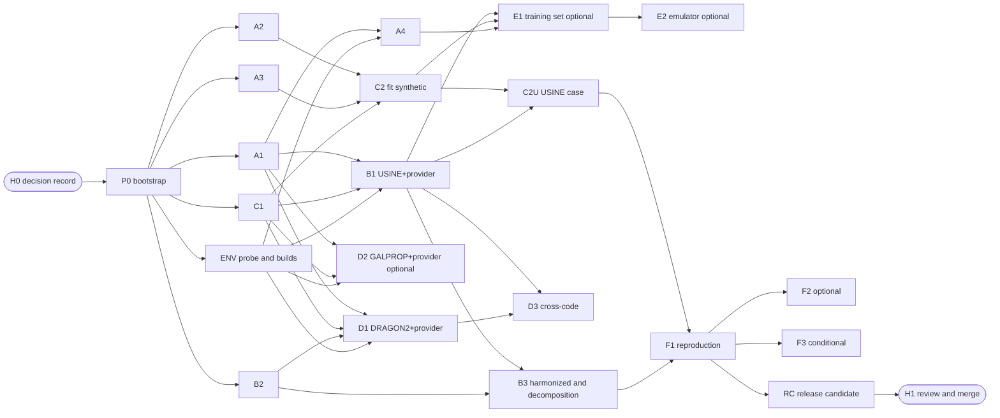

# hep-research Cosmic-Ray Propagation Capability: Autonomous Execution Workflow (r4)

| Item | Content |
|---|---|
| Version | r4, 2026-10-26; a separate file that replaces r3's "how to execute" but not r3's "technical content" |
| Baseline | hep-research 0.42.0, contracts 3.13.0, `CORE_VERSION` 1.1.0 |
| Companion files | `crprop-workflow.json` (machine-readable workflow manifest; this document's DAG follows it); `hep-research-cr-propagation-plan.md` (r3, technical reference) |
| Language | English, translated from the Traditional Chinese original `hep-research-cr-propagation-workflow-r4.md`; file names, commands, fields and identifiers unchanged. The two versions are edited together; if they differ, report it instead of choosing one |
| Execution environment | Every work package runs in its own isolated git worktree; integration happens in a dedicated integration worktree (Technical Approach §2) |
| Goal | A person answers decisions once at the start (H0) and reviews the result once at the end (H1); agents do everything in between |

All paths are relative to the plugin root `plugins/hep-research/` unless they start with `.claude/`. The second-level headings keep the English names of the plugin's task template so that the document passes `lint_task.py`.

## Background

#### Why a new workflow

r3's technical content has been through three independent reviews and a final check against 0.42.0, but its way of executing would stop an agent about 30 times along the way:

| r3 design | Effect on autonomous execution |
|---|---|
| Every Gate requires "merged into `main` by the user" | 6 Gates and 19 work packages: a person must merge a dozen or more times mid-run |
| Consent obtained item by item and time by time (install, download, build, every batch round, version bumps) | Every external program and every round of active addition stops the run |
| F1's tolerance is "asked of the user at the start of F1" | The main track stops and waits around week 14 |
| Acceptance criteria are prose | They need a person, or the same agent, to interpret them; they cannot be rerun by machine |
| External programs are built from week 4 on | The largest risk (USINE or GALPROP failing to build) surfaces last |
| No shared state file | After a cloud session is reclaimed, a new session does not know where the work stands |

#### Measured limits of the execution environment [C]

Measured in the cloud workspace on 2026-10-26: only GitHub is reachable (DRAGON2 can be cloned, HEAD = cd588707). GitLab, `lpsc.in2p3.fr` (USINE documentation and CRDB), `galprop.stanford.edu`, PyPI, conda-forge and apt are all refused by the network policy. g++ and cmake exist; GSL, CFITSIO and ROOT do not. Building external programs and fetching data are therefore where autonomous execution is most likely to stall, so they are probed in wave 0 and work is routed to a suitable host by capability (§3).

#### Design principles

1. **Decisions up front.** Every decision that needs a person is asked once at H0 and written into a decision record; afterwards agents act only on that record.
2. **Integration branch.** Work packages merge into an integration branch, merged automatically by the orchestrator on machine checks; `main` is merged only once, at H1.
3. **Acceptance as code.** Acceptance criteria are written as executable checks, frozen in wave 0 with their hash recorded; afterwards they may only be tightened, never loosened.
4. **Independent verification.** The worker who writes the code does not decide whether it passes; a verifier who has not seen the worker's process runs the checks.
5. **Risk first.** External programs are built in wave 0; if one cannot be built, the predefined fallback is taken immediately.
6. **Dispatch by capability.** Each work package declares the capabilities it needs; when one is missing, the package waits or takes its fallback, and other branches keep moving.
7. **Resumable.** All state lives in a status file on the integration branch; any session can pick up where the last one stopped.
8. **Bounded self-repair.** Every loop has a maximum count; beyond it, the item is escalated rather than retried forever.

## Objective

Between H0 and H1, without human intervention, the orchestrator agent completes all technical goals defined by r3 (items 1–4 of r3's definition of done, and item 5 when pre-consented at H0). When a problem cannot be solved autonomously, it goes into the escalation queue and work on unaffected branches continues.

**Definition of done:**

1. Every non-optional work package in `crprop-workflow.json` has status `merged`, or `skipped` with its fallback completed.
2. After the integration branch is rebased onto the latest `main`, `run_all_checks.py` and `check_relocation.py` pass.
3. A campaign report exists: each work package's status, acceptance results, escalations and how they were handled, and the items left for a person to decide.
4. A pull-request draft exists; merging, pushing and releasing are left for H1.
5. A person is needed only at H0 and H1; escalations along the way do not block unrelated work.

## Scope

### In Scope

- The division of work among the orchestrator, worker and verifier roles, and their message formats.
- Creating the integration branch, its merge rules and conflict handling.
- The formats of the decision record (H0) and the campaign report (H1).
- Capability probing, external builds and dispatch by capability.
- The frozen acceptance list, the status file, the escalation queue, resumption and the heartbeat.
- The reorganization of r3's work packages (Technical Approach §6).

### Out of Scope

- r3's technical content (rules R1–R15 and P1–P15, canonical names, the physics and code of each work package) is not rewritten; r4 lists only the differences in §6.
- Merging into `main`, pushing, opening a pull request, the official contracts version number, and a paid live routing run: all done or approved by a person at H1.
- Changing the plugin's workflow tools (for example `review.py`) beyond this plan.

## Repository Context

#### Plugin rules followed [C]

- **Isolated worktrees:** `docs/dev/geant4-architecture/geant4-program.md` §P.10 (location `.claude/worktrees/<prefix>-<stage>`, branch `worktree-<prefix>-<stage>`, no bare `git stash`, commit only to the stage branch, no push to `main` or pull request without approval, remove the worktree after merging).
- **Exception for the base:** §P.10.2 requires the base to be "the latest `main` that contains the prerequisites". r4 uses the integration branch as the base instead, following the exception wording of item 2 of §0 in `docs/dev/frontend-electronics/frontend-reco-sim-calibration.md`: H0 approves the exception, each work package records it in the environment field of its `VALIDATION.md` entry, and RC rebases onto the new `main` and reruns every check before merging.
- **Independent review:** `docs/dev/independent-review-spec.md` and `skills/hep-authoring/scripts/review.py` (document review); reviewers only read, never write.
- **Task documents:** `skills/hep-computing/scripts/lint_task.py`.
- **Naming:** `tools/check_naming.py`; charter `skills/hep-computing/references/semantic-naming.md`.
- **Technical rules:** r3's Repository Context (R1–R15, P1–P15, canonical parameter names, file ownership of new components) applies in full.

#### Plugin mechanisms to reuse [C]

| Need | Existing mechanism |
|---|---|
| Parallel batched execution and resubmission of failures | `skills/hep-computing/scripts/local_partition.py` (bounded resubmission, duplicate-safe merge) |
| Batch jobs | `adapters/batch-schedulers` (Slurm, HTCondor) |
| Run records and environment manifests | the `computational-run` artifact; `skills/hep-computing/scripts/environment_manifest.py` |
| Task-card validation | `skills/hep-computing/scripts/lint_task.py` |
| Which tests a change affects | `contracts/rule_registry.py impact` |

## Technical Approach

#### §1 Roles

| Role | Played by | Responsibilities | Does not |
|---|---|---|---|
| orchestrator | the main session | read the status file, dispatch by DAG and capability, merge into integration, update status and the escalation queue, schedule the heartbeat, produce the report | write work-package code; judge acceptance |
| worker | a subagent (Agent tool, `isolation: "worktree"`) | implement one work package in `.claude/worktrees/crprop-<wp>`, run its own checks and fixes, return the branch and a report | merge, push, or change the frozen acceptance list |
| verifier | another subagent that has not seen the worker's process, checking out the worker's branch in a fresh worktree | run the work package's frozen acceptance checks, check the rules, check that the diff stays within the allowed files, and return PASS or REWORK with evidence | change code; loosen criteria |
| physics reviewer | an optional third subagent (read-only) | for physics-heavy work packages such as B2, B3, C2, C2U and F1, independently check derivations, units, conventions and attributions | change code |
| env worker | the worker of the ENV work package | probe capabilities, build external programs, write the capability file and environment manifests | change plugin code |

The verifier receives only the work-package card, the frozen acceptance entries and the branch name, not the worker's conversation or the conclusions in its report, so that one judgment is not simply confirmed twice.

#### §2 Branches and worktrees

- **integration:** `.claude/worktrees/crprop-integration`, branch `worktree-crprop-integration`, created by P0 from `origin/main`; only the orchestrator writes to it.
- **Work packages:** `.claude/worktrees/crprop-<wp>`, branch `worktree-crprop-<wp>`, created from the current integration HEAD (at which point all its dependencies are merged).
- **Merge:** after the verifier returns PASS, the orchestrator runs `git merge --no-ff worktree-crprop-<wp>` in the integration worktree, then `tools/run_all_checks.py --part static` and the work package's affected tests; on failure it runs `git merge --abort` or reverts the merge, and the work package returns to REWORK.
- **Merge order:** work packages that pass at the same time are ordered by `merge_before` and `merge_after` in `crprop-workflow.json` and by r3 §0.5's shared-file rules, and merged one at a time.
- **Conflict handling:** the orchestrator resolves only these conflicts mechanically: appended sections of `CHANGELOG.md` and `VALIDATION.md` (keep both, in merge order); generated files (README counts, reference inventory, capability-matrix table) by rerunning the generating tool. Any other conflict sends the work package back to its worker with a request to rebase onto the latest integration HEAD.
- **Contracts version:** the whole campaign shares one unreleased version `CV-CRPROP` and one gating constant `CRPROP_FROM`, set by A2 and reused by C1; the official version number is decided at H1. C1 sets the minor bump of `CORE_VERSION`.
- **Finish:** after each work package is merged, the orchestrator removes its worktree and local branch; after RC, the integration worktree is kept until H1.

#### §3 Capability probing and dispatch by capability

- The ENV work package first writes the capability file `$CRPROP_OUT/capabilities.json`, listing each capability in `crprop-workflow.json` as `present`, `absent` or `partial`, with evidence (command and output).
- Probed items: `repo`, `net-github`, `net-sources`, `net-data`, `pkg-install`, `batch`. It then builds, in order, DRAGON2 (GitHub, commit cd588707 or as set at H0), USINE (the source set at H0; if the network is closed, a user-supplied tarball in `CRPROP_SOURCES`) and GALPROP (when D5 is yes); each success records `env-dragon2`, `env-usine` or `env-galprop`.
- Each build writes a `computational-run` and an environment manifest (`environment_manifest.py`), and the environment is registered in `VALIDATION.md` under a new environment label (for example "environment E-crprop"), so that an adapter's `tested-in-declared-environment` status has a basis.
- The orchestrator dispatches only work packages whose `requires` are all `present`; the others are marked `waiting-capability` with the missing capability named.
- When a capability is confirmed unobtainable, the manifest's `fallback` applies: for example, if GALPROP fails, D2 is marked `unavailable` and D3 compares only the existing codes; a USINE failure is critical, enters the escalation queue, and F1 switches to the fallback target decided at H0 (D8).
- Per the measurements in Background, the cloud workspace lacks `net-sources` and `pkg-install`; by default the run happens on a host that can build external programs (H0 decision D2).

#### §4 The orchestrator's main loop

Each cycle:

1. Read the status file `docs/dev/cr-propagation/status.json` and the escalation queue on the integration branch.
2. Collect finished worker and verifier reports and update each work package's status.
3. Merge PASS work packages per §2; after merging, recompute which work packages have their dependencies satisfied.
4. Dispatch runnable work packages within the capability constraints and the concurrency limit (4 workers); dispatch a verifier for each finished worker.
5. Commit the status changes to integration (message `crprop(status): 
`); only the orchestrator writes the status file.
6. If nothing can be dispatched and work is in progress, schedule the heartbeat (30 minutes) and end the cycle; if nothing is in progress, enter RC, or stop and produce the report.

**Work-package state machine:** `pending` → `waiting-capability` (missing capability) or `ready` → `dispatched` → `verifying` → `merged`. A REWORK verdict in `verifying` returns to `dispatched`; reaching a limit gives `blocked`; bypassing by fallback gives `skipped`.

**Limits (maximum iterations):**

| Loop | Limit | When reached |
|---|---|---|
| A worker's fixes of the same failing check | 3 attempts | the worker reports PARTIAL with the reason |
| Rework after a verifier's REWORK verdict | 2 rounds | the work package becomes `blocked` and enters the escalation queue |
| Total dispatches of one work package | 3 | `blocked` |
| Total orchestrator cycles | 200 | stop and produce the report |
| Concurrent workers | 4 | the rest wait |
| Compute budget (provider evaluations, batch core-hours) | H0 decision D7 | stop the affected work packages and escalate |

**Resumption:** after a cloud session is reclaimed or interrupted, a new session runs P0's resumption check (the integration worktree exists, the status file is readable, the branches of in-progress work packages exist). For a work package that is `dispatched` without a report, check its branch HEAD: if it has commits, dispatch a verifier; if not, dispatch it again (counted against its dispatch limit).

**Heartbeat:** in Claude Code, a scheduled wakeup (ScheduleWakeup or send_later) wakes the orchestrator every 30 minutes; background agents notify on completion anyway, so the heartbeat is only a safety net.

#### §5 Acceptance as code

- P0 generates `docs/dev/cr-propagation/acceptance.json` (new) from r3's Acceptance Criteria. Each entry has: `id` (as in r3, for example `B3-1`), `wp`, `kind` (`command`: run and compare output; `artifact`: check a file or field; `judgment`: the verifier reads evidence and decides), `command`, `expect`, `tolerance`, `evidence_path`.
- P0 commits it to integration and records its sha256 in a `CRPROP-ACCEPTANCE` section of `VALIDATION.md`. This is R9's "criteria first", so work packages no longer need their own first criteria commit.
- Afterwards only stricter entries may be added; loosening or deleting any entry waits for H1 and is listed in the report.
- The verifier gives each entry `pass`, `fail` or `not-run` with evidence; `judgment` entries must cite specific files and line numbers.
- F1's tolerance is decided at H0 (D9) and written into the frozen list by P0; nobody is asked again mid-run.

#### §6 Reorganization of r3's work packages

| Change | r3 | r4 | Reason |
|---|---|---|---|
| External builds | Inside B1, D1, D2, from week 4 | ENV in wave 0 | The largest risk surfaces first; if a build fails, the fallback is taken at once |
| Provider wrapping | Separate B1b, D1b, D2b, E2b, waiting for C1 to merge | Folded into B1, D1, D2, E2 | C1 moves to wave 1 (contract first), so each tool carries its provider entrypoint from the start; 4 fewer work packages and one serialized merge chain gone |
| C1 | Depends on Gate A | Wave 1, in parallel with A1–A3, merged after A2 | The provider interface is a prerequisite of every tool |
| A4 cost benchmark | Part of Gate A | Depends on A1 and ENV; does not block wave 2 | The cost table only affects E1's budget |
| C2 | Depends on B1b | Split into C2 (closed-form provider, synthetic data) and C2U (USINE case) | C2 need not wait for USINE |
| Emulator | Depends on Gate D (including GALPROP) | Trained on USINE; depends on B1, C2, A4; optional | Removes the dependence on GALPROP and shortens the path |
| Gate definition | Merged into `main` by the user | Verifier PASS and merged into integration, with static checks passing after the merge | Removes manual merges mid-run |
| Contracts version | One placeholder version each for A2 and C1 | Shared `CV-CRPROP` and `CRPROP_FROM` | One bump per campaign |
| F1 tolerance | Asked at the start of F1 | Decided at H0 | The main track does not stop mid-run |
| F3 | Needs consent mid-run | Conditional consent at H0 (prepared only if F1 passes); the paid routing run is left to H1 | Only a settled result enters v1 |
| Consent | Item by item, time by time | One standing grant with scopes and budgets at H0 | No stops mid-run |

Each work package's technical steps, files and acceptance entries still follow the matching r3 section (the `card` field of `crprop-workflow.json`).

#### §7 Waves and the critical path

Critical path: H0 → P0 → ENV (USINE build) → B1 → B3 and C2U → F1 → RC → H1. Rough estimate 13–15 weeks, of which the most uncertain parts are the USINE build and the F1 reproduction; the parallel work (A, C, D, E) is off the critical path.

#### §8 Escalation queue

- File: `docs/dev/cr-propagation/escalations.md` (new) on the integration branch, written only by the orchestrator.
- Each item has: the work package; the type (`capability`, `tolerance-miss`, `rule-conflict`, `repo-mismatch`, `budget`, `blocked`); evidence; the handling already attempted; the affected downstream packages; the suggested human decision.
- Once an item is queued, the orchestrator follows the `fallback` and keeps advancing unaffected work packages; the critical path stops only when a critical work package (B1, F1) has no fallback.
- When a physics result misses its tolerance, the tolerance is never loosened and the criterion never rewritten; the miss is recorded and attributed.

#### §9 H0 decision record (answered once, before starting)

P0 writes the answers to `docs/dev/cr-propagation/decisions.md` (new), each dated; afterwards every agent acts only on it.

| # | Decision | Suggested default |
|---|---|---|
| D1 | Location of the source repo | Must be provided by the user |
| D2 | Execution host: the cloud workspace, the user's computer (environment E2, through Claude Code or a linked device), or another host | A host that can reach the USINE and GALPROP sources and install packages (per the measurements, the cloud workspace cannot) |
| D3 | Scope of the standing grant: installable package list, URLs that may be cloned or downloaded, build directories, whether commits and merges on integration are allowed, unreleased contracts and core bumps | All granted, limited to this list; no push and no `main` |
| D4 | USINE source and version | V3.5 (needed for F1); if the network is closed, the user puts a tarball in `CRPROP_SOURCES` |
| D5 | Whether GALPROP is included, its version and licence (whether fixtures may be committed) | Include v57; if the licence is unclear, commit no fixtures |
| D6 | Batch site and how each round's submission is consented | The Slurm site already tested by `adapters/batch-schedulers`; E1's batches within the D7 budget count as consented |
| D7 | Compute budget: total provider evaluations, batch core-hours, total duration | Derived from A4's cost table; fill in the caps here |
| D8 | F1's target paper and fallback target | Génolini et al. 2019 (USINE); if USINE is unavailable, a cross-code reproduction with DRAGON2, marked as insufficient for v1 |
| D9 | F1's tolerance | The best-fit δ and K10 lie within 1σ of the original paper, for all three model families |
| D10 | Whether to accept the exception of basing work on the integration branch (§P.10.2) | Accept; RC rebases onto `main` and reruns the checks before merging |
| D11 | Conditional consent for F3: when F1 passes, whether to prepare the v1 changes on integration | Yes; the paid live routing run is left to H1 |
| D12 | Notification method | Notify on each critical escalation and when RC completes; report the rest at H1 |

#### §10 H1 deliverables and review

The RC work package produces:

- the results of all checks after the integration branch is rebased onto the latest `main`;
- `docs/dev/cr-propagation/campaign-report.md` (new): each work package's status, per-entry acceptance results with evidence, escalations and how they were handled, fallbacks used, open issues;
- a pull-request draft (title, summary, check results, unfinished items);
- what a person must do: merge into `main`, push, decide the official contracts version number, approve the live routing run, resolve unresolved escalations.

## Deliverables

- `crprop-workflow.json`: the machine-readable workflow manifest (work packages, dependencies, capabilities, fallbacks, limits, checkpoints); P0 commits it as `docs/dev/cr-propagation/workflow.json`.
- This document (r4), committed by P0 as `docs/dev/cr-propagation/workflow-r4.md` together with its Chinese original; the r3 technical plan is committed as `docs/dev/cr-propagation/cr-propagation-plan.zh.md` and its English version.
- Generated and committed by P0: `docs/dev/cr-propagation/decisions.md`, `docs/dev/cr-propagation/acceptance.json`, `docs/dev/cr-propagation/status.json`, `docs/dev/cr-propagation/escalations.md`.
- Produced by ENV: `$CRPROP_OUT/capabilities.json`, a `computational-run` and environment manifest per external program, and the environment registration in `VALIDATION.md`.
- Produced by RC: `docs/dev/cr-propagation/campaign-report.md` and the pull-request draft.
- Each work package's deliverables follow r3's Deliverables, with providers folded into the matching work packages per §6.

## Acceptance Criteria

#### The workflow itself (WF)

- [ ] WF-1 `crprop-workflow.json` passes the structural check: every dependency and capability is defined, the DAG is acyclic, and every dependency's wave is no later than its dependant's.
- [ ] WF-2 After P0, the sha256 of `acceptance.json` is recorded in `VALIDATION.md`; up to RC, no entry has been loosened or deleted.
- [ ] WF-3 Every `merged` work package has a verifier PASS report, and the verifier is not the agent that wrote the package.
- [ ] WF-4 After every merge into integration, the static checks pass; failed merges have been reverted.
- [ ] WF-5 The status file is written only by the orchestrator; no other agent's branch modifies it.
- [ ] WF-6 No loop exceeds the limits of §4; every work package that reached a limit is in the escalation queue.
- [ ] WF-7 From H0 to RC, no person was asked anything outside the decision record; nothing was pushed, `main` was not modified, and no pull request was opened.
- [ ] WF-8 Resumption test: ending the session while a work package is `dispatched`, then resuming per §4 in a new session, results in that work package being merged exactly once.
- [ ] WF-9 No work package lacking a capability was dispatched; every `skipped` work package took the fallback in the manifest.
- [ ] WF-10 When RC completes, after the integration branch is rebased onto the latest `main`, `run_all_checks.py` and `check_relocation.py` pass, or every failure is shown to occur identically on `main`.

#### Technical goals

- [ ] The acceptance entries of each work package follow r3's Acceptance Criteria (ALL, A1–A4, B1–B3, PRV, C1–C2, D1–D3, E1–E2, F1, F3), as frozen by P0 in `acceptance.json`; the PRV entries of B1b, D1b, D2b and E2b now belong to B1, D1, D2 and E2.

## Validation

- Workflow manifest: P0 runs the DAG check (dependencies exist, no cycles, capabilities defined) and records the result in `VALIDATION.md` (WF-1).
- This document and r3: `python3 skills/hep-computing/scripts/lint_task.py --repo <repo root>/plugins/hep-research <file>`, with 0 errors.
- Every merge: `PYTHONDONTWRITEBYTECODE=1 python3 tools/run_all_checks.py --part static`, plus the tests named by `python3 contracts/rule_registry.py impact <changed paths>` (WF-4).
- Resumption: force-end the session on a test work package, then take over with a new session (WF-8).
- Limits: with a forced-failure work package (for example a check that always fails), confirm that the worker stops after 3 attempts and the verifier after 2 rounds, and that the item enters the escalation queue (WF-6).
- RC: `python3 tools/run_all_checks.py --out "$CRPROP_OUT/rc/checks"` and `python3 tools/check_relocation.py --out "$CRPROP_OUT/rc/reloc"`; naming with `python3 tools/check_naming.py` (WF-10).
- Each work package's validation commands follow r3's Validation.

## Open Questions

- H0 decisions D1–D12 must be answered before P0; unanswered items take the suggested default, except D1 (repo location) and D2 (execution host), which have none, so the run does not start without them.
- The location (GitLab or LPSC) and licence of the USINE source are not yet confirmed; the cloud workspace cannot reach either, so the host chosen in D2, or a user-supplied tarball, is needed.
- Formal independent review (r3's Q10): run `skills/hep-authoring/scripts/review.py` on r3's English version and on this document during P0. It needs the host to configure review isolation (`docs/dev/independent-review-spec.md`, Appendix A7); if the D2 host cannot, run it before H1 instead.
- The week counts are rough estimates; once the A4 cost benchmark is done, the orchestrator recomputes the critical path from the measurements and updates the report.

## References

- `hep-research-cr-propagation-plan.md` (r3, technical reference) and its English version.
- `crprop-workflow.json` (the authoritative source for this document's DAG and limits).
- `docs/dev/geant4-architecture/geant4-program.md` §P.10; `docs/dev/frontend-electronics/frontend-reco-sim-calibration.md` §0 (isolated worktrees and the base exception).
- `docs/dev/independent-review-spec.md`, `skills/hep-authoring/scripts/review.py` (independent review).
- `skills/hep-computing/assets/task-template.md`, `skills/hep-computing/references/task-authoring-guide.md`, `skills/hep-computing/references/loop-engineering.md`, `skills/hep-computing/scripts/lint_task.py`.
- `skills/hep-computing/scripts/local_partition.py`, `skills/hep-computing/scripts/environment_manifest.py`, `adapters/batch-schedulers`.
- Network and tool measurements of the cloud workspace, 2026-10-26 (Background → Measured limits of the execution environment).

#### Version history

| Version | Date | Change |
|---|---|---|
| r3 | 2026-10-26 | Final check of the technical plan (a separate file) |
| r4 | 2026-10-26 | This document: a workflow architecture aimed at autonomous execution — two checkpoints H0/H1, an integration branch, the orchestrator/worker/verifier split, frozen acceptance as code, capability probing and dispatch by capability, external builds moved first, providers folded into tool work packages, C1 moved earlier, C2 split, the emulator trained on USINE, a shared contracts version, a resumable status file, bounded self-repair and an escalation queue |
