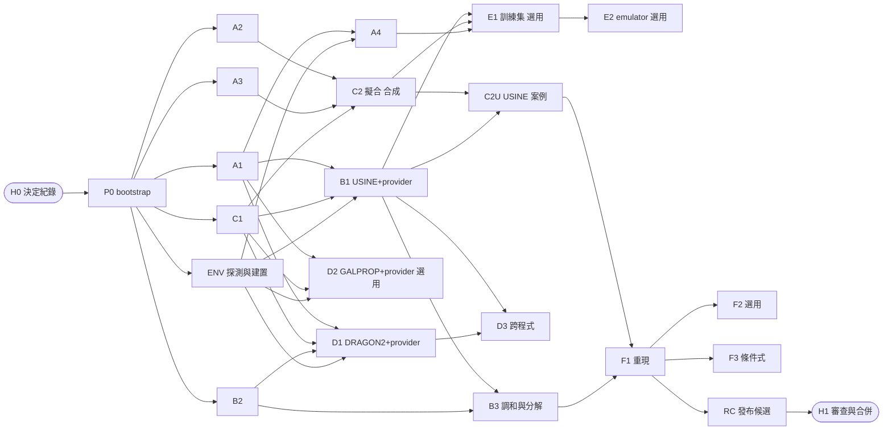

# hep-research 宇宙線傳播能力：自主執行工作流架構（r4）

| 項目 | 內容 |
|---|---|
| 版本 | r4，2026-10-26；獨立檔案，取代 r3 的「執行方式」，不取代 r3 的「技術內容」 |
| 基準 | hep-research 0.42.0、contracts 3.13.0、`CORE_VERSION` 1.1.0 |
| 配套檔案 | `crprop-workflow.json`（機器可讀的工作流清單，本文件的 DAG 以它為準）；`hep-research-cr-propagation-plan.md`（r3，技術參考） |
| 執行環境 | 每個工作包都在自己的 isolated git worktree 中執行；整合在專屬的 integration worktree 中進行（Technical Approach §2） |
| 目標 | 人只在開頭回答一次決定（H0）、在結尾審查一次成果（H1），其餘由 agent 自動完成 |

除以 `.claude/` 開頭者外，路徑一律相對於 plugin 根目錄 `plugins/hep-research/`。第二層標題沿用 plugin 任務範本的英文名稱，以通過 `lint_task.py`。

## Background

#### 為什麼需要新的工作流

r3 的技術內容已經過三次獨立審查與 0.42.0 的最後檢查，但它的執行方式會讓 agent 在途中停下約 30 次：

| r3 的設計 | 對自主執行的影響 |
|---|---|
| 每個 Gate 都要求「使用者已合併到 `main`」 | 6 個 Gate、19 個工作包，人必須在途中合併十幾次 |
| 同意逐項、逐次取得（安裝、下載、建置、每一輪批次送出、版本 bump） | 每個外部程式與每一輪主動加點都會停下 |
| F1 的容差「開工時再問使用者」 | 主線在第 14 週左右停下等待 |
| 驗收準則是文字 | 需要人或同一個 agent 判讀，無法機器重跑 |
| 外部程式的建置排在第 4 週之後 | 最大的風險（USINE、GALPROP 建不起來）最晚才暴露 |
| 沒有共用狀態檔 | 雲端 session 被回收後，新的 session 不知道做到哪裡 |

#### 執行環境的實測限制 [C]

2026-10-26 在雲端工作區實測：只有 GitHub 可連線（DRAGON2 可 clone，HEAD = cd588707）；GitLab、`lpsc.in2p3.fr`（USINE 文件與 CRDB）、`galprop.stanford.edu`、PyPI、conda-forge 與 apt 皆被網路政策拒絕；有 g++ 與 cmake，沒有 GSL、CFITSIO、ROOT。因此「建置外部程式」與「取得資料」是自主執行最可能卡住的地方，必須在第 0 波先探測，並依能力把工作派到合適的主機（§3）。

#### 設計原則

1. **決定前置。** 所有需要人的決定，在 H0 一次問完，寫成決定紀錄；之後 agent 只依紀錄行事。
2. **整合分支。** 工作包合併到 integration 分支，由 orchestrator 依機器檢查自動合併；`main` 只在 H1 合併一次。
3. **驗收即程式。** 驗收準則寫成可執行的檢查，在第 0 波凍結並記錄雜湊；之後只能加嚴，不能放寬。
4. **獨立驗證。** 寫程式的 worker 不判定自己是否通過；由沒看過其過程的 verifier 執行檢查。
5. **風險前移。** 外部程式在第 0 波就建置；建不起來時立刻改走預先定義的替代路線。
6. **依能力派工。** 每個工作包宣告需要的能力；能力不足時排隊或改走替代路線，其他分支照常前進。
7. **可續跑。** 所有狀態都在 integration 分支上的狀態檔；任何 session 都能從中斷處接手。
8. **有上限的自動修復。** 每個迴圈都有最大次數；超過就升級，不無限重試。

## Objective

讓 orchestrator agent 在 H0 與 H1 之間，不需人介入，完成 r3 定義的全部技術目標（r3 Objective 的完成定義 1–4，以及經 H0 預先同意時的第 5 項）；遇到無法自行解決的問題時，把它放入升級佇列，並繼續推進不受影響的分支。

**完成定義：**

1. `crprop-workflow.json` 中所有非選用工作包的狀態為 `merged`，或為 `skipped` 且其替代路線已完成。
2. integration 分支 rebase 到最新 `main` 後，`run_all_checks.py` 與 `check_relocation.py` 通過。
3. 產出一份 campaign 報告：每個工作包的狀態、驗收結果、升級項目與其處置、待人決定的事項。
4. 產出 pull request 草稿；合併、推送與發布留給 H1。
5. 全程只在 H0 與 H1 需要人；途中的升級不阻擋無關的工作。

## Scope

### In Scope

- orchestrator、worker、verifier 三種角色的分工與通訊格式。
- integration 分支的建立、合併規則與衝突處理。
- 決定紀錄（H0）與 campaign 報告（H1）的格式。
- 能力探測、外部程式建置與依能力派工。
- 凍結的驗收清單、狀態檔、升級佇列、續跑與心跳。
- 對 r3 工作包的重組（見 Technical Approach §6）。

### Out of Scope

- r3 的技術內容（規則 R1–R15、P1–P15、正準名稱、各工作包的物理與程式內容）不重寫；r4 只在 §6 列出差異。
- 合併到 `main`、推送、開 pull request、正式 contracts 版本號、會產生費用的 live routing run：一律在 H1 由人執行或核准。
- 在本規劃之外修改 plugin 的工作流工具（例如 `review.py`）。

## Repository Context

#### 依循的 plugin 規定 [C]

- **isolated worktree**：`docs/dev/geant4-architecture/geant4-program.md` §P.10（位置 `.claude/worktrees/<前綴>-<階段>`、分支 `worktree-<前綴>-<階段>`、不用裸 `git stash`、只在階段分支提交、未經核准不推送 `main` 或開 pull request、合併後移除 worktree）。
- **基底的例外**：§P.10.2 要求以「已含前提的最新 `main`」為基底。r4 改以 integration 分支為基底，比照 `docs/dev/frontend-electronics/frontend-reco-sim-calibration.md` §0 第 2 項的例外寫法：H0 核准此例外，每個工作包在 `VALIDATION.md` 的環境欄記錄，RC 在合併前 rebase 到新 `main` 並重跑全部檢查。
- **獨立審查**：`docs/dev/independent-review-spec.md` 與 `skills/hep-authoring/scripts/review.py`（文件審查）；審查者只讀、不寫。
- **任務文件**：`skills/hep-computing/scripts/lint_task.py`。
- **命名**：`tools/check_naming.py`；章程 `skills/hep-computing/references/semantic-naming.md`。
- **技術規則**：r3 的 Repository Context（R1–R15、P1–P15、正準參數名稱、新元件的檔案歸屬）全部沿用。

#### 可沿用的 plugin 機制 [C]

| 需要 | 既有機制 |
|---|---|
| 平行分批執行與失敗重送 | `skills/hep-computing/scripts/local_partition.py`（有上限的重送、不重複的合併） |
| 批次作業 | `adapters/batch-schedulers`（Slurm、HTCondor） |
| 執行紀錄與環境清單 | `computational-run` artifact；`skills/hep-computing/scripts/environment_manifest.py` |
| 任務卡驗證 | `skills/hep-computing/scripts/lint_task.py` |
| 檢查影響範圍 | `contracts/rule_registry.py impact` |

## Technical Approach

#### §1 角色

| 角色 | 由誰擔任 | 職責 | 不做 |
|---|---|---|---|
| orchestrator | 主 session | 讀狀態檔、依 DAG 與能力派工、合併到 integration、更新狀態與升級佇列、排定心跳、產出報告 | 不寫工作包的程式；不判定驗收 |
| worker | 子 agent（Agent 工具，`isolation: "worktree"`） | 在 `.claude/worktrees/crprop-<wp>` 實作一個工作包，自行跑檢查與修正，交回分支與回報 | 不合併、不推送、不改凍結的驗收清單 |
| verifier | 另一個子 agent（沒有看過 worker 的過程，在新的 worktree 中 checkout worker 分支） | 執行該工作包的凍結驗收檢查、比對規則、檢查 diff 是否超出檔案範圍，給出 PASS 或 REWORK 與證據 | 不修改程式；不放寬準則 |
| physics reviewer | 選用的第三個子 agent（只讀） | 對 B2、B3、C2、C2U、F1 等物理密集的工作包，獨立檢查推導、單位、慣例與歸因 | 不修改程式 |
| env worker | ENV 工作包的 worker | 探測能力、建置外部程式、寫出能力檔與環境清單 | 不修改 plugin 程式 |

verifier 只拿到工作包卡、凍結的驗收條目與分支名稱，不拿到 worker 的對話或回報中的結論，避免同一個判斷被重複確認。

#### §2 分支與 worktree

- **integration**：`.claude/worktrees/crprop-integration`，分支 `worktree-crprop-integration`，由 P0 從 `origin/main` 建立；只有 orchestrator 寫入。
- **工作包**：`.claude/worktrees/crprop-<wp>`，分支 `worktree-crprop-<wp>`，從 integration 的當前 HEAD 建立（此時其依賴都已合併）。
- **合併**：verifier 判定 PASS 後，orchestrator 在 integration worktree 中 `git merge --no-ff worktree-crprop-<wp>`，接著跑 `tools/run_all_checks.py --part static` 與該工作包的影響測試；失敗則 `git merge --abort` 或還原該合併，工作包回到 REWORK。
- **合併順序**：同時 PASS 的工作包依 `crprop-workflow.json` 的 `merge_before`、`merge_after` 與 r3 §0.5 的共用檔案規則排序，一次合併一個。
- **衝突處理**：只有以下衝突由 orchestrator 機械地解決：`CHANGELOG.md` 與 `VALIDATION.md` 的附加段落（兩者都保留，依合併順序排列）；生成檔（README 計數、reference inventory、capability matrix 表）以重跑產生工具解決。其他衝突一律把工作包退回 worker，要求 rebase 到 integration 最新 HEAD。
- **contracts 版本**：整個 campaign 共用一個未發布版本 `CV-CRPROP` 與一個閘控常數 `CRPROP_FROM`，由 A2 設定、C1 沿用；正式版本號在 H1 決定。`CORE_VERSION` 的 minor bump 由 C1 設定。
- **結束**：每個工作包合併後，orchestrator 移除其 worktree 與本地分支；RC 完成後保留 integration，直到 H1。

#### §3 能力探測與依能力派工

- ENV 工作包先寫出能力檔 `$CRPROP_OUT/capabilities.json`，列出 `crprop-workflow.json` 的每個能力是 `present`、`absent` 或 `partial`，並附證據（指令與輸出）。
- 探測項目：`repo`、`net-github`、`net-sources`、`net-data`、`pkg-install`、`batch`；接著依序建置 DRAGON2（GitHub，commit cd588707 或 H0 指定）、USINE（H0 指定來源；網路不通時改用 `CRPROP_SOURCES` 中使用者提供的 tarball）、GALPROP（D2 為 yes 時），成功者寫出 `env-dragon2`、`env-usine`、`env-galprop`。
- 每個建置寫出一份 `computational-run` 與環境清單（`environment_manifest.py`），環境以新的環境標籤登記在 `VALIDATION.md`（例如「環境 E-crprop」），讓 adapter 的 `tested-in-declared-environment` 有依據。
- orchestrator 只派出 `requires` 全部為 `present` 的工作包；其餘標記 `waiting-capability` 並寫明缺少的能力。
- 某能力確定無法取得時，依清單中的 `fallback` 處理：例如 GALPROP 失敗時 D2 標記 `unavailable`，D3 只比較現有的程式；USINE 失敗屬 critical，進入升級佇列，F1 改用 H0 決定的替代目標（D8）。
- 依實測（Background），雲端工作區不具備 `net-sources`、`pkg-install`；預設在能建置外部程式的主機執行（H0 的 D2 決定）。

#### §4 orchestrator 主迴圈

每一輪（cycle）：

1. 讀 integration 分支上的狀態檔 `docs/dev/cr-propagation/status.json` 與升級佇列。
2. 收集已完成的 worker 與 verifier 回報，更新各工作包狀態。
3. 對 PASS 的工作包依 §2 合併；合併後重算哪些工作包的依賴已滿足。
4. 依能力與並行上限（4 個 worker）派出可執行的工作包；對完成的 worker 派出 verifier。
5. 把狀態變化提交到 integration（訊息 `crprop(status): <摘要>`），只有 orchestrator 寫狀態檔。
6. 若沒有可派的工作且有工作在進行中，排定心跳（30 分鐘）後結束這一輪；若沒有任何進行中的工作，進入 RC 或停止並產出報告。

**工作包狀態機**：`pending` → `waiting-capability`（缺能力）或 `ready` → `dispatched` → `verifying` → `merged`；`verifying` 判定 REWORK 時回到 `dispatched`；達上限時成為 `blocked`；以替代路線略過時為 `skipped`。

**上限（maximum iterations）**：

| 迴圈 | 上限 | 達到時 |
|---|---|---|
| worker 對同一個失敗檢查的修正 | 3 次 | worker 回報 PARTIAL 並附原因 |
| verifier 判定 REWORK 後的重做 | 2 輪 | 工作包成為 `blocked`，進入升級佇列 |
| 同一工作包的派工總次數 | 3 次 | `blocked` |
| orchestrator 的總輪數 | 200 輪 | 停止並產出報告 |
| 同時進行的 worker | 4 個 | 其餘排隊 |
| 計算預算（provider 評估次數、批次核心時數） | H0 的 D7 | 停止相關工作包並升級 |

**續跑**：雲端 session 被回收或中斷後，新的 session 執行 P0 的續跑檢查（integration worktree 存在、狀態檔可讀、進行中的工作包分支存在）；`dispatched` 但沒有回報的工作包，檢查其分支 HEAD：有提交就派 verifier，沒有就重新派工（計入派工次數）。

**心跳**：在 Claude Code 中以排程喚醒（ScheduleWakeup 或 send_later）每 30 分鐘喚醒一次 orchestrator；背景 agent 完成時會自動通知，因此心跳只是保險。

#### §5 驗收即程式

- P0 從 r3 的 Acceptance Criteria 產生 `docs/dev/cr-propagation/acceptance.json`（new），每條包含：`id`（沿用 r3，例如 `B3-1`）、`wp`、`kind`（`command`：可執行並比對輸出；`artifact`：檢查檔案或欄位；`judgment`：需要 verifier 讀證據判斷）、`command`、`expect`、`tolerance`、`evidence_path`。
- P0 把它提交到 integration，並在 `VALIDATION.md` 的 `CRPROP-ACCEPTANCE` 一節記錄其 sha256；這就是 R9 的「準則先行」，所以工作包不再需要各自的第一個準則 commit。
- 之後只能新增更嚴的條目；放寬或刪除任何條目必須等到 H1，並在報告中列出。
- verifier 對每條給出 `pass`、`fail` 或 `not-run`，附證據；`judgment` 類條目必須引用具體檔案與行號。
- F1 的容差在 H0 決定（D9），P0 寫入凍結清單；途中不再詢問。

#### §6 對 r3 工作包的重組

| 變更 | r3 | r4 | 理由 |
|---|---|---|---|
| 外部程式建置 | 在 B1、D1、D2 內部，第 4 週之後 | 第 0 波的 ENV | 最大的風險最先暴露；建不起來時立即改走替代路線 |
| provider 包裝 | 另外的 B1b、D1b、D2b、E2b，等 C1 合併 | 併入 B1、D1、D2、E2 | C1 提前到第 1 波（合約先行），工具一開始就帶 provider 入口；少 4 個工作包與一條序列化的合併鏈 |
| C1 | 依賴 Gate A | 第 1 波，與 A1–A3 並行，合併排在 A2 之後 | provider 介面是所有工具的前提 |
| A4 成本基準 | Gate A 的一部分 | 依賴 A1 與 ENV，不阻擋第 2 波 | 成本表只影響 E1 的預算 |
| C2 | 依賴 B1b | 拆成 C2（閉式解 provider，合成資料）與 C2U（USINE 案例） | C2 不必等 USINE |
| emulator | 依賴 Gate D（含 GALPROP） | 以 USINE 為訓練程式，依賴 B1、C2、A4；選用 | 去掉對 GALPROP 的依賴，縮短路徑 |
| Gate 定義 | 使用者已合併到 `main` | verifier PASS 且已合併到 integration，合併後 static 檢查通過 | 去掉途中的人工合併 |
| contracts 版本 | A2 與 C1 各一個佔位版本 | 共用 `CV-CRPROP` 與 `CRPROP_FROM` | 一個 campaign 一次 bump |
| F1 容差 | 開工時詢問 | H0 決定 | 主線不在途中停下 |
| F3 | 需要途中同意 | H0 的條件式同意（F1 通過才準備），付費的 routing run 留到 H1 | 只有結果確定後才進入 v1 |
| 同意 | 逐項逐次 | H0 一次給出有範圍與預算的常設授權 | 途中不停 |

各工作包的技術步驟、檔案與驗收條目，仍以 r3 對應章節為準（`crprop-workflow.json` 的 `card` 欄位）。

#### §7 波次與關鍵路徑

關鍵路徑：H0 → P0 → ENV（USINE 建置）→ B1 → B3 與 C2U → F1 → RC → H1。粗估約 13–15 週，其中最不確定的是 USINE 建置與 F1 的重現；平行工作（A、C、D、E）不在關鍵路徑上。

#### §8 升級佇列

- 檔案：integration 分支上的 `docs/dev/cr-propagation/escalations.md`（new），只由 orchestrator 寫入。
- 每項包含：工作包、類型（`capability`、`tolerance-miss`、`rule-conflict`、`repo-mismatch`、`budget`、`blocked`）、證據、已嘗試的處置、受影響的下游、建議的人類決定。
- 進入佇列後，orchestrator 依 `fallback` 繼續推進不受影響的工作包；只有 critical 工作包（B1、F1）沒有替代路線時，關鍵路徑才會停下。
- 物理結果超出容差時，一律不放寬、不改寫準則，只記錄並歸因。

#### §9 H0 決定紀錄（開始前一次回答）

P0 把答案寫成 `docs/dev/cr-propagation/decisions.md`（new），每項附日期；之後所有 agent 只依此行事。

| # | 決定 | 建議預設 |
|---|---|---|
| D1 | 來源 repo 的位置 | 必須由使用者提供 |
| D2 | 執行主機：雲端工作區、使用者的電腦（環境 E2，經 Claude Code 或連結的裝置）、或其他主機 | 能連到 USINE 與 GALPROP 來源、能安裝套件的主機（依實測，雲端工作區不行） |
| D3 | 常設授權的範圍：可安裝的套件清單、可 clone 或下載的網址、建置目錄、是否可在 integration 上提交與合併、contracts 與 core 的未發布 bump | 全部同意，範圍限於本清單；不含推送與 `main` |
| D4 | USINE 的來源與版本 | V3.5（F1 需要）；網路不通時由使用者放 tarball 到 `CRPROP_SOURCES` |
| D5 | GALPROP 是否納入、版本與授權（fixtures 能否提交） | 納入 v57；授權不明時不提交 fixtures |
| D6 | 批次站點與每輪送出的同意方式 | 使用 `adapters/batch-schedulers` 已測過的 Slurm 站點；E1 的批次在 D7 預算內視為已同意 |
| D7 | 計算預算：provider 評估總次數、批次核心時數、總時長 | 依 A4 成本表推算；在此填上限 |
| D8 | F1 的目標論文與替代目標 | Génolini et al. 2019（USINE）；USINE 不可用時以 DRAGON2 做跨程式重現，標記為不足以進 v1 |
| D9 | F1 的容差 | δ 與 K10 的最佳值落在原論文 1σ 內，三個模型族皆需 |
| D10 | 是否接受以 integration 分支為基底的例外（§P.10.2） | 接受；RC 在合併前 rebase 到 `main` 並重跑檢查 |
| D11 | F3 的條件式同意：F1 通過時，是否在 integration 上準備 v1 的變更 | 是；付費的 live routing run 留到 H1 |
| D12 | 通知方式 | 每個 critical 升級與 RC 完成時通知；其餘在 H1 報告 |

#### §10 H1 交付與審查

RC 工作包產出：

- integration 分支 rebase 到最新 `main` 後的全部檢查結果；
- `docs/dev/cr-propagation/campaign-report.md`（new）：每個工作包的狀態、驗收逐條結果與證據、升級項目與處置、替代路線的使用、待決事項；
- pull request 草稿（標題、摘要、檢查結果、未完成項目）；
- 需要人做的事：合併到 `main`、推送、決定正式 contracts 版本號、核准 live routing run、處理未解的升級項目。

## Deliverables

- `crprop-workflow.json`：機器可讀的工作流清單（工作包、依賴、能力、替代路線、上限、檢查點）；P0 把它提交為 `docs/dev/cr-propagation/workflow.json`。
- 本文件（r4），P0 提交為 `docs/dev/cr-propagation/workflow-r4.md`；r3 技術規劃一併提交為 `docs/dev/cr-propagation/cr-propagation-plan.zh.md` 與英文版。
- P0 產生並提交：`docs/dev/cr-propagation/decisions.md`、`docs/dev/cr-propagation/acceptance.json`、`docs/dev/cr-propagation/status.json`、`docs/dev/cr-propagation/escalations.md`。
- ENV 產生：`$CRPROP_OUT/capabilities.json`、各外部程式的 `computational-run` 與環境清單、`VALIDATION.md` 的環境登記。
- RC 產生：`docs/dev/cr-propagation/campaign-report.md` 與 pull request 草稿。
- 各工作包的交付物沿用 r3 的 Deliverables，provider 依 §6 併入對應工作包。

## Acceptance Criteria

#### 工作流本身（WF）

- [ ] WF-1 `crprop-workflow.json` 通過結構檢查：每個依賴與能力都有定義、DAG 無環、每個依賴所在波次不晚於依賴者。
- [ ] WF-2 P0 之後，`acceptance.json` 的 sha256 記錄在 `VALIDATION.md`；到 RC 為止沒有條目被放寬或刪除。
- [ ] WF-3 每個 `merged` 的工作包都有一份 verifier 的 PASS 回報，且 verifier 不是寫該工作包的 agent。
- [ ] WF-4 每次合併到 integration 後，static 檢查通過；失敗的合併已還原。
- [ ] WF-5 狀態檔只由 orchestrator 寫入；其他 agent 的分支中沒有對它的修改。
- [ ] WF-6 沒有任何迴圈超過 §4 的上限；達到上限的工作包都在升級佇列中。
- [ ] WF-7 從 H0 到 RC，沒有在決定紀錄以外向人詢問；沒有推送、沒有修改 `main`、沒有開 pull request。
- [ ] WF-8 中斷續跑測試：在某個工作包 `dispatched` 時結束 session，新的 session 依 §4 續跑後，該工作包最終只被合併一次。
- [ ] WF-9 能力不足的工作包沒有被派出；所有 `skipped` 的工作包都走了清單中的替代路線。
- [ ] WF-10 RC 完成時，integration rebase 到最新 `main` 後 `run_all_checks.py` 與 `check_relocation.py` 通過，或每個失敗都證明在 `main` 上相同。

#### 技術目標

- [ ] 各工作包的驗收條目沿用 r3 的 Acceptance Criteria（ALL、A1–A4、B1–B3、PRV、C1–C2、D1–D3、E1–E2、F1、F3），以 P0 凍結的 `acceptance.json` 為準；B1b、D1b、D2b、E2b 的 PRV 條目改屬 B1、D1、D2、E2。

## Validation

- 工作流清單：P0 執行 DAG 檢查（依賴存在、無環、能力已定義），結果記入 `VALIDATION.md`（WF-1）。
- 本文件與 r3：`python3 skills/hep-computing/scripts/lint_task.py --repo <repo root>/plugins/hep-research <file>`，0 個錯誤。
- 每次合併：`PYTHONDONTWRITEBYTECODE=1 python3 tools/run_all_checks.py --part static`，以及 `python3 contracts/rule_registry.py impact <changed paths>` 列出的測試（WF-4）。
- 續跑：在測試用的工作包上強制中斷 session，再以新 session 接手（WF-8）。
- 上限：以強制失敗的工作包（例如一條永遠失敗的檢查）確認 worker 在 3 次、verifier 在 2 輪後停止，並進入升級佇列（WF-6）。
- RC：`python3 tools/run_all_checks.py --out "$CRPROP_OUT/rc/checks"` 與 `python3 tools/check_relocation.py --out "$CRPROP_OUT/rc/reloc"`；命名 `python3 tools/check_naming.py`（WF-10）。
- 各工作包的驗證指令沿用 r3 的 Validation。

## Open Questions

- H0 的 D1–D12 必須在 P0 之前回答；未回答的項目採用建議預設，D1（repo 位置）與 D2（執行主機）沒有預設，未回答時不開始。
- USINE 的原始碼位置（GitLab 或 LPSC）與授權尚未確認；雲端工作區無法連線，需要 D2 指定的主機或使用者提供的 tarball。
- 正式的獨立審查（r3 的 Q10）：建議在 P0 對 r3 英文版與本文件執行 `skills/hep-authoring/scripts/review.py`；它需要主機設定審查隔離（`docs/dev/independent-review-spec.md` 附錄 A7），若 D2 的主機無法設定，改在 H1 前執行。
- 週數為粗估；A4 成本基準完成後，orchestrator 依實測重算關鍵路徑並更新報告。

## References

- `hep-research-cr-propagation-plan.md`（r3，技術參考）與其英文版。
- `crprop-workflow.json`（本文件的 DAG 與上限的權威來源）。
- `docs/dev/geant4-architecture/geant4-program.md` §P.10；`docs/dev/frontend-electronics/frontend-reco-sim-calibration.md` §0（isolated worktree 與基底例外）。
- `docs/dev/independent-review-spec.md`、`skills/hep-authoring/scripts/review.py`（獨立審查）。
- `skills/hep-computing/assets/task-template.md`、`skills/hep-computing/references/task-authoring-guide.md`、`skills/hep-computing/references/loop-engineering.md`、`skills/hep-computing/scripts/lint_task.py`。
- `skills/hep-computing/scripts/local_partition.py`、`skills/hep-computing/scripts/environment_manifest.py`、`adapters/batch-schedulers`。
- 2026-10-26 雲端工作區的網路與工具實測（Background → 執行環境的實測限制）。

#### 版本歷程

| 版本 | 日期 | 變更 |
|---|---|---|
| r3 | 2026-10-26 | 技術規劃的最後檢查（另一個檔案） |
| r4 | 2026-10-26 | 本文件：以自主執行為目標的工作流架構——H0/H1 兩個檢查點、integration 分支、orchestrator/worker/verifier 分工、凍結的驗收即程式、能力探測與依能力派工、外部建置前移、provider 併入工具工作包、C1 提前、C2 拆分、emulator 改以 USINE 訓練、共用 contracts 版本、可續跑的狀態檔、有上限的自動修復與升級佇列 |
