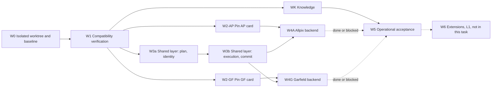
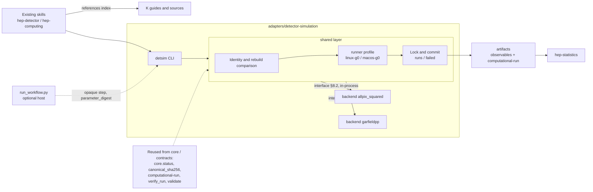

# Task: Integrate Allpix Squared and Garfield++ into hep-research

**Final version 9.1 — an autonomously executable task specification**

> **To the Claude receiving this document.** This document is your task. Do not wait for further instructions: go to §0.1 and start. **Everything you write — code, documents, ledger, builds, environments, test runs — goes into one isolated Git worktree and its work root (§2); never into the main checkout or the installed plugin.** Stop to ask a person only at the gates of §4.2; do everything else yourself, verify it yourself and record it yourself in the ledger (§3.5). When you finish, or when nothing more can be done without a person, write the final report (§3.8) and stop.

| Attribute | Value |
|---|---|
| Version / date | 9.1 / 2026-11-01 (Asia/Taipei) |
| Status | Final; independently reviewed. Do not reverse a decision listed in Appendix D.1 without gate H3. Review history is in a companion file and is not needed to execute |
| Mandatory execution environment | An isolated, linked Git worktree of hep-research on branch `detsim-integration`, plus a work root next to it (§2). Checked by the isolation guard (§2.4) at the start of every work item and before every commit |
| Target repository | hep-research, source `https://github.com/hchouTW/hep-research`, a plugin marketplace whose plugin lives in **`plugins/hep-research/`** (the plugin root `PR`, §2.2). Baseline: source `main` at `bf5e453` (2026-11-01): plugin **0.51.0** plus unreleased changes, contracts **3.17.0**, `CORE_VERSION` **1.5.0**. The design was first checked against installed 0.46.0 and 0.49.1; every cited file still exists in the latest source and the changes that matter are built in (Appendix C). Re-check on the source checkout in W1 |
| What gets built | One optional adapter `adapters/detector-simulation/` containing a shared execution layer, two backends (Allpix Squared, Garfield++) and the CLI `detsim`; knowledge guides in two existing skills; three or four contract schemas (four unless D-W1-2 reuses `simulation-summary/1`) |
| First batch | K (knowledge), A (AP-BOOT), G (GF-QUERY); see §1.2 |
| Out of scope | MCP interface, resident services, multi-user platforms; recover command, in-run cancellation, cross-session retry (L1, §10.6); everything in §1.3 |
| Evidence boundary | Only design and review exist. No worktree created yet, no code, no simulator run, no test run. Facts marked "Verified (repo)" were read from the hep-research source `main` at `bf5e453` (2026-11-01), paths relative to its plugin root |

---

## 0. Start here

### 0.1 Quick start

1. Read §0–§5 completely (execution part). Skim §6–§17 (specification part); read each section in full when a work item card tells you to.
2. Do Phase 1 of §3.1: locate the repository, resume check, read-only environment reconnaissance, gate H0, then W0 (create the isolated worktree and work root, pass the isolation guard, create the ledger). **Nothing is written before the worktree exists.**
3. Run the work loop of §3.1 Phase 2 over the work items of §5, in dependency order, until every item is `done` or `blocked`. Run the isolation guard at the start of every item and before every commit.
4. Do Phase 3 of §3.1: tick §17, write the final report (§3.8), present the open gate questions, stop. Never push, merge or remove the worktree.

### 0.2 Execution at a glance

| Question | Answer |
|---|---|
| Where do I work? | Only in the task worktree `WT` (branch `detsim-integration`) and the work root `WR` next to it (§2.2) |
| What do I build? | One optional adapter `adapters/detector-simulation/` (shared layer + two backends + CLI `detsim`), contract schemas, knowledge guides (§1.2, §8) |
| In what order? | W0 → W1 → (WK, W2-AP, W2-GF, W3a → W3b in parallel where allowed) → W4A, W4G → W5 (§5.1) |
| When do I ask a person? | Only at gates H0–H5 (§4.2); otherwise decide, record, continue |
| When is an item finished? | Its **Done when** tests have evidence → `done`; it needs a person or resource → `blocked` (§3.3) |
| When do I stop? | Every item `done` or `blocked` → final report (§3.8) |
| What must I never do? | Write outside WT/WR, push, merge, delete, use sudo, invent sources or results, signal a process the current command did not start (§4.1) |
| Where is progress kept? | The ledger `PR/docs/dev/detector-simulation/PROGRESS.md` (`PR` = `WT/plugins/hep-research`), committed (§3.5) |

### 0.3 How this document is organized

| Part | Sections | Use it for |
|---|---|---|
| I Execution | §0–§5 | What to do, in what order, what you may decide alone, when to stop |
| II Specification | §6–§15 | What to build: guarantees, reuse, architecture, contracts, protocol, CLI, task cards, knowledge, environment, states |
| III Acceptance | §16–§17 | Tests and the definition of done |
| Appendices | A–E | Deferred physics rules, items to verify (V-01 …), sources, decision record, templates |

### 0.4 Wording

| Marker | Meaning |
|---|---|
| MUST / MUST NOT | Requirement; a violation does not conform |
| SHOULD | Default; a deviation is recorded with its reason in the ledger's decision log |
| Verified | Read from the cited primary source (Appendix C) |
| Verified (repo) | Read from the hep-research source `main` at `bf5e453` (2026-11-01) at the cited path, relative to the plugin root `plugins/hep-research/`; re-read on the source checkout in W1 |
| To verify (V-nn) | Not yet confirmed; MUST be resolved by the procedure of §3.6 before the work that depends on it. All are listed in Appendix B |
| `TBD` | Unresolved precondition; MUST NOT be filled with invented data, hashes or values |
| [L1] | Deferred; not implemented in this task |

All file names, formats, commands and field names below are specifications to implement; they do not exist yet unless marked Verified (repo).

**Repository paths** such as `core/status.py`, `adapters/…`, `docs/dev/detector-simulation/PROGRESS.md` are relative to the **plugin root `PR`** = `$WT/plugins/hep-research` (§2.2), not to the repository root. Only `.claude-plugin/marketplace.json`, `.githooks/`, `.github/` and `evals/` are at the repository root.

---

# Part I — Execution

## 1. Mission and scope

### 1.1 Goal

Bring Allpix Squared and Garfield++ into hep-research as optional, versioned capabilities with a declared validation scope. One shared layer handles identity, plan rebuild, execution and commit; each backend implements only a small interface (§8.2). Both tools keep their native models and outputs; the plugin coordinates, records sources and states applicability, and does not take over upstream physics. The intended research workflow is: tool selection → correct version basis → check native inputs → pin the plan → execute and store → check results.

### 1.2 Deliverables (each reported separately)

| Code | Deliverable | Content | Needs |
|---|---|---|---|
| K | Knowledge | Tool selection and non-applicability, official sources and versions, limitations, the two task cards, entry points in `hep-detector` and `hep-computing` (§13) | No simulator |
| A | Allpix | AP-BOOT: pinned rerun of the official pixel example with native result extraction and checks (§12.2) | Shared layer + pinned AP card + environment |
| G | Garfield | GF-QUERY: electron drift velocity query on one pinned gas table with checks (§12.3) | Shared layer + pinned GF card + environment + table |

- A does not wait for G, and nothing about G blocks K or A.
- Documents alone MUST NOT be called "backend available". If only A is complete, deliver A and MUST NOT say "both backends available".

### 1.3 Not in this task

Full waveform engine, gas table generation, microscopic tracking, avalanche, ASIC / SPICE, parameter scans, general TCAD conversion, cross-tool coupling, a general detector schema, vector database, arbitrary code executor, a new scheduling platform, a simulation result cache, the G1 container runtime, and everything marked [L1].

### 1.4 Value path (why the first batch is small)

The two first-batch cases are **pipeline-validation cases**: they prove that identity, execution, commit and extraction are correct; they do not produce research conclusions. Research value comes later:

| Stage | Capability | Research value | Extra mechanism needed |
|---|---|---|---|
| First batch | AP-BOOT official example rerun | Low: pipeline validation | None |
| First batch | GF-QUERY pinned table query | Low to moderate: B=0 drift velocity only | None |
| Second step | Garfield query extension: diffusion, Townsend, attachment | Moderate: same backend, lowest cost | Per-quantity semantics: log-space storage and interpolation of Townsend and attachment, handling of zero below threshold, diffusion's own density scaling (√N); new checks |
| Second step | Allpix user configurations (controlled subset) | High | Configurations can read/write arbitrary paths → G1 |
| Second step | Allpix + TCAD field maps (MeshConverter + own detector model) | High: the most common real use of Allpix | Large external files and hash management; G1 |
| Second step | Garfield gas table generation (Magboltz) | High: the most common real need | Hours per run → L1 |
| Later | Waveforms, microscopic tracking, cross-tool coupling | High, large physics risk | Separate task cards per Appendix A |

### 1.5 Requirement applicability

| Requirement | K | A: AP-BOOT | G: GF-QUERY |
|---|---|---|---|
| Sources, versions, limitations, skill entry points | Required | Cite K | Cite K |
| Worktree and code baseline | Required before changes | Required | Required |
| Task, plan, content-addressed identity, commit | — | Required | Required |
| Event count and RNG settings | — | Required | Deterministic; no invented seed |
| Charge / hit fields, empty-event semantics | Describe | Required | — |
| Table conditions, interpolation path and extrapolation | Describe | — | Required |
| Guarantee level declaration (§6) | — | G0 | G0 |
| Claim, cancel, recover, cross-session retry [L1] | — | Not done | Not done |

### 1.6 Trade-off principle

Physics semantics, sources and permission boundaries are necessary conditions. Within them choose the simplest solution; decide on acceleration or abstraction by measurement. A weighted total score MUST NOT offset a major error.

---

## 2. Isolated worktree (mandatory)

> **Requirement.** Every action of this task that writes anything — code, documents, the ledger, builds, virtual environments, downloaded sources, test runs and their artifacts, caches — happens inside **one isolated, linked Git worktree** of hep-research on branch `detsim-integration` (`WT`), inside its **work root** (`WR`), or inside a **subagent worktree** (§2.7). The only other writes allowed are the exceptions listed in §2.5. Nothing is ever written into the main checkout's working tree or index, nor into the installed plugin. If isolation cannot be created **and confirmed by the isolation guard** (§2.4), only read-only work is allowed and results are given in the conversation (§2.6).

### 2.1 Why

- The main checkout may hold the user's uncommitted work, and the installed plugin is what other sessions run. A linked worktree is a separate working tree and branch on the same repository: every change is reviewable as one branch and removable without touching anything else.
- A worktree isolates files and Git state only — not processes, network or credentials. Runtime isolation of simulations is §6 (G0).

### 2.2 Layout

All task locations sit side by side in one parent folder `PARENT`, outside every checkout:

| Name | Path | Holds | Committed |
|---|---|---|---|
| Main checkout `MAIN` | The user's editable hep-research checkout; or, if there is none and H0 #1 allows, a fresh clone at `~/detsim-integration/hep-research` | The user's work | Never written (Git metadata exceptions, §2.5) |
| `PARENT` | The folder that contains `MAIN` | — | — |
| Task worktree `WT` | `PARENT/hep-research-detsim` | The whole repository checkout on branch `detsim-integration` | Yes, on branch `detsim-integration` |
| Plugin root `PR` | `$WT/plugins/hep-research` — the folder named by the `source` of plugin `hep-research` in `$WT/.claude-plugin/marketplace.json` (if a future layout has no marketplace file and `$WT/.claude-plugin/plugin.json` names `hep-research`, `PR` = `$WT`) | Code, tests, documents, `TASK.md` and the ledger under `docs/dev/detector-simulation/`; every repository path in this document is relative to it | Yes, inside `WT` |
| Work root `WR` | `PARENT/hep-research-detsim-work` | `isolation.env`, `isolation-guard.sh`, `venv/`, `upstream/` (read-only clones, H0 #2), `env/` (environment records and builds, if allowed), `projects/` (artifacts directories of acceptance runs), `patches/`, `scratch/` (temporary files, caches, review inputs) | Never |
| Subagent worktree | `PARENT/hep-research-detsim-sub-<key>` on branch `detsim-sub-<key>`, where `<key>` is the item ID, or `<item>-2`, `<item>-3`, … for a rerun | One subagent's changes | Only on its own branch; returned as a patch (§2.7) |
| Installed plugin `PLUGIN_INSTALL_DIR` | The hep-research folder this session loads skills from: two levels above any hep-research `SKILL.md` the session lists; if hep-research skills are loaded but no path is shown, the folder whose `.claude-plugin/plugin.json` names `hep-research` among the host's plugin folders; `none` only if no hep-research skill is loaded | What other sessions run | Never written |

If a path already exists and does not belong to this task (not a worktree of `MAIN` on `detsim-integration`, or a `WR` without this task's `isolation.env`), do not reuse or overwrite it: append `-2`, `-3`, … to the name and record the chosen paths. A path the ledger's isolation record names is always this task's: never create a suffixed copy of it. `WT` is always created with `git worktree add` at the path above. A harness worktree tool may be used only to switch the session into an existing path (`WT`); never let it choose the location, branch or base. Absolute paths never enter a plan's hash scope (WT-04).

### 2.3 Creating or reusing (work item W0)

1. **Locate `MAIN`** (read-only): the current directory if it is a hep-research checkout (its `.claude-plugin/marketplace.json` lists a plugin named `hep-research`, or its `.claude-plugin/plugin.json` names `hep-research`, or a remote URL ends in `hchouTW/hep-research`); else `~/detsim-integration/hep-research` if it exists; else ask in H0 (attended). If none is found and H0 #1 allows, clone `https://github.com/hchouTW/hep-research` to `~/detsim-integration/hep-research`. Locate `PLUGIN_INSTALL_DIR` as in §2.2.
2. **Inspect** read-only and record: root, current commit, branch or detached state, uncommitted changes (`git status --porcelain`, saved for T-WT), worktree list, submodules, and which hooks will run on our commits: `git -C "$MAIN" config core.hooksPath` (the repository ships `.githooks/` — a path allowlist on pre-commit and pre-push, plus lint when `pre-commit` is installed; its README asks for `git config core.hooksPath .githooks`) and the files in `$(git rev-parse --git-common-dir)/hooks`. Record them; never change them, never bypass them (`--no-verify` is forbidden; R-07 (n)).
   ```bash
   git -C "$MAIN" rev-parse --show-toplevel HEAD
   git -C "$MAIN" status --porcelain
   git -C "$MAIN" branch --show-current
   git -C "$MAIN" worktree list --porcelain
   git -C "$MAIN" submodule status 2>/dev/null
   git -C "$MAIN" config core.hooksPath
   ls "$(git -C "$MAIN" rev-parse --path-format=absolute --git-common-dir 2>/dev/null || echo "$MAIN/.git")/hooks"
   ```
3. **Base ref**: `origin/HEAD` if it exists (after `git fetch origin`, only if H0 #1 allows network access), else the `HEAD` of `MAIN`. Record ref and commit. Never assume a branch named `main`.
4. **Create `WT`**:
   - Branch `detsim-integration` does not exist: `git -C "$MAIN" worktree add -b detsim-integration "$WT" <base-commit>`.
   - A worktree on `detsim-integration` already exists without a ledger (an interrupted W0): reuse it; `BASE` from `WR/isolation.env` if present, else `git -C "$WT" merge-base HEAD <base ref of step 3>`; `WR` is `<WT path>-work`.
   - Branch exists without a worktree: `git -C "$MAIN" worktree add "$WT" detsim-integration`. If that branch already contains `docs/dev/detector-simulation/PROGRESS.md`, this is a **resume**: take `WT` and `WR` paths and `BASE` from the ledger's isolation record, still do step 5 (recreate `WR` and its files if missing) and run the guard, reuse the ledger's H0 answers, then skip step 6 and Phase 1 step 7 and apply §3.5.
5. **Create `WR`** and its subfolders (or complete them on resume). Write `WR/isolation.env` (template below, values written with `printf %q`) and `WR/isolation-guard.sh` (§2.4, verbatim). Create the virtual environment with `<python> -m venv --system-site-packages "$WR/venv"` (H0 #6), where `<python>` is an interpreter **≥ 3.13** (the repository's floor: `pyproject.toml` `requires-python`; every skill script stops below it, `core/interpreter_guard.py`); find one with `python3 skills/hep-computing/scripts/find_python.py` run from `PR`. If the host has none, W0 is `blocked` under H1 (do not point `HEP_RESEARCH_PYTHON` at the venv: the guard refuses an interpreter in an agent-writable folder). `--system-site-packages` lets the repository's checks see the host's scientific packages; if H0 #6 allows, install `requirements-core.txt` and `requirements-test.txt` of `WT` into it. Record the interpreter path and versions.
6. **Guard and baseline**: run the isolation guard. Then, from inside `PR`, run `python3 tools/run_all_checks.py --no-cli --out "$WR/scratch/baseline"` (Verified (repo): `README.md`; `--no-cli` skips the host CLI checks, which may write under `~`); record pass, fail and skip counts, the interpreter, and pre-existing failures separately from anything this work causes.

`WR/isolation.env` — every shell command of this task starts with `. "<WR>/isolation.env"` (each tool call may start a fresh shell, so nothing is assumed to persist):

```bash
# written by W0 with printf 'export MAIN=%q ...' so that paths with spaces stay quoted
export MAIN=<abs path> PARENT=<abs path> WT=<abs path> WR=<abs path> PLUGIN_INSTALL_DIR=<abs path or none>
export PR="$WT/plugins/hep-research"   # the plugin root (§2.2)
export BASE=<base commit>
export TMPDIR="$WR/scratch/tmp" PIP_CACHE_DIR="$WR/scratch/pip" XDG_CACHE_HOME="$WR/scratch/xdg-cache"
export XDG_STATE_HOME="$WR/scratch/xdg-state" MPLCONFIGDIR="$WR/scratch/mpl"
export PYTHONDONTWRITEBYTECODE=1 PYTEST_ADDOPTS="-p no:cacheprovider"
export VIRTUAL_ENV="$WR/venv" PATH="$WR/venv/bin:$PATH"
mkdir -p "$TMPDIR" "$PIP_CACHE_DIR" "$XDG_CACHE_HOME" "$XDG_STATE_HOME" "$MPLCONFIGDIR"
```

`XDG_STATE_HOME` also keeps hep-review's store (default `~/.local/state/hep-research/hep-review`, Verified (repo)) inside `WR`.

### 2.4 Isolation guard

Run it **at the end of W0, at the start of every work item, and immediately before every commit**, from inside `WT`: `cd "$WT" && bash "$WR/isolation-guard.sh"`. It must print `isolation-guard: pass` and exit 0. Running it from `PR` (inside `WT`) is equivalent. Record the result in the ledger at W0 and in every delivery report.

**If the guard fails after W0** (for example someone switched `WT`'s branch): Phase 2 ends at once. Write nothing more (no ledger, no commit); let running subagents finish but apply nothing; give the final report (template E.3) **only in the conversation**, quoting the guard's failure line and asking the user to restore `WT` (gate H1); stop. **On resume after such a failure:** if the ledger's `WT` path exists but is not on `detsim-integration`, or the guard still fails, create no worktree (no suffixed copy) and write nothing; repeat the conversation-only H1 report and stop. Once the guard passes, continue the item that was current with its status unchanged.

```bash
#!/usr/bin/env bash
# WR/isolation-guard.sh            — main agent:  cd "$WT"  && bash "$WR/isolation-guard.sh"
# WR/isolation-guard.sh SUB KEY    — subagent:    cd "$SUB" && bash "$WR/isolation-guard.sh" "$SUB" "$KEY"
set -uo pipefail
. "$(cd "$(dirname "$0")" && pwd -P)/isolation.env"
fail() { echo "isolation-guard: FAIL: $*" >&2; exit 1; }
yes()  { "${@:2}" >/dev/null 2>&1 || fail "$1"; }              # the command must succeed
no()   { ! "${@:2}" >/dev/null 2>&1 || fail "$1"; }            # the command must fail
r() { (cd "$1" 2>/dev/null && pwd -P) || fail "missing folder $1"; }   # resolve symlinks (macOS /private/var)
inside() { case "$1/" in "$2"/*) return 0;; esac; return 1; }  # $1 equals or lies inside $2
common() { (cd "$1" && cd "$(git rev-parse --git-common-dir)" && pwd -P); }
M=$(r "$MAIN") || exit 1; T=$(r "$WT") || exit 1; W=$(r "$WR") || exit 1
if [ "$PLUGIN_INSTALL_DIR" = none ]; then P=/nonexistent-plugin; else P=$(r "$PLUGIN_INSTALL_DIR") || exit 1; fi
if [ $# -eq 2 ]; then HERE=$(r "$1") || exit 1; WANT="detsim-sub-$2"; else HERE=$T; WANT=detsim-integration; fi
yes "not running inside $HERE"            inside "$(pwd -P)" "$HERE"
yes "$HERE is not a work tree root"       test "$(r "$(git -C "$HERE" rev-parse --show-toplevel)")" = "$HERE"
yes "$HERE is a main checkout, not a linked worktree" \
                                          test "$(r "$(git -C "$HERE" rev-parse --absolute-git-dir)")" != "$(common "$HERE")"
yes "$HERE is not a worktree of MAIN"     test "$(common "$HERE")" = "$(common "$M")"
yes "branch is not $WANT"                 test "$(git -C "$HERE" branch --show-current)" = "$WANT"
yes "branch does not contain the recorded base commit" git -C "$HERE" merge-base --is-ancestor "$BASE" HEAD
wts=$(git -C "$M" worktree list --porcelain | sed -n 's/^worktree //p' |
      while IFS= read -r p; do (cd "$p" 2>/dev/null && pwd -P) || continue; done)   # skip stale entries
yes "$HERE is not registered"             grep -Fx -- "$HERE" <<<"$wts"
no  "$HERE lies inside MAIN"              inside "$HERE" "$M"
no  "WR lies inside MAIN"                 inside "$W" "$M"
no  "WR lies inside WT"                   inside "$W" "$T"
no  "WT lies inside WR"                   inside "$T" "$W"
no  "$HERE lies inside the installed plugin" inside "$HERE" "$P"
no  "the installed plugin lies inside $HERE" inside "$P" "$HERE"
no  "WR lies inside the installed plugin" inside "$W" "$P"
if [ $# -eq 2 ]; then
  no  "subagent worktree lies inside WT"  inside "$HERE" "$T"
  no  "subagent worktree lies inside WR"  inside "$HERE" "$W"
  yes "subagent branch does not start from its recorded base" \
      git -C "$HERE" merge-base --is-ancestor "$(cat "$W/patches/$2.base")" HEAD
fi
echo "isolation-guard: pass"
```

`--absolute-git-dir` needs Git ≥ 2.13; W0 records `git --version`. The guard's text is part of this specification: copy it unchanged into `WR/isolation-guard.sh`; it reads paths and the base commit from `WR/isolation.env`, and the branch name `detsim-integration` is fixed in the script, so a wrong `isolation.env` cannot approve another branch. Each check prints its own failure reason. Checks are written as explicit `yes` / `no` calls because `set -e` does not stop on a negated command; stale entries in `git worktree list` (folders deleted by someone) are skipped. The installed plugin may be `MAIN` itself (a session that loads skills from the user's checkout): that is allowed, because `WT` and `WR` are still checked to lie outside it.

### 2.5 Rules

| ID | Rule |
|---|---|
| WT-01 | All writing work happens in `WT`, `WR` or a subagent worktree. If a worktree cannot be created and confirmed, never fall back to the main checkout |
| WT-02 | Never stash, reset, move or delete the user's uncommitted content, in any checkout |
| WT-03 | Code, tests and committable documents in `WT`; large data, environments, builds, upstream clones, run artifacts, caches and temporary files in `WR`; no build folder shared between worktrees |
| WT-04 | The ledger records `MAIN`, `WT`, `WR`, `PLUGIN_INSTALL_DIR`, base, branch and baseline; absolute host paths never enter a plan's hash scope |
| WT-05 | Without confirmed isolation: only read-only research and documentation, delivered in the conversation |
| WT-06 | Never push, merge, publish, or remove `WT`, `WR`, a subagent worktree or a branch without explicit authorization (H4) |
| WT-07 | Every shell command starts with `. "<WR>/isolation.env"` and uses absolute paths under `WT` or `WR` for anything it writes |
| WT-08 | Subagents follow §2.7 |
| WT-09 | At the end, everything is kept. The final report states the paths and the commands a person would use to inspect (`git -C "$WT" log`, `git -C "$MAIN" diff <base>..detsim-integration`) and, if wanted, to remove (`git -C "$MAIN" worktree remove "$WT"` and the subagent worktrees; delete `WR`); the agent runs none of them |

**Permitted writes outside `WT` / `WR`** (and only these): (1) the clone of §2.3 step 1, when H0 #1 allows; (2) Git metadata in the repository's common Git directory created by `git fetch`, `git worktree add`, and commits on `detsim-integration` and `detsim-sub-*` (objects, refs, logs, `worktrees/`), plus whatever the repository's own hooks do on those operations (recorded in W0, never changed); (3) the subagent worktrees of §2.7. `MAIN`'s working tree, index and current branch are never touched.

### 2.6 If isolation fails

W0 is `blocked` under H1; by §3.2 every dependent item is blocked. Do not create a ledger and skip Phase 2. Give the final report (template E.3) **only in the conversation**: what was found, what is needed (an editable checkout, permission to clone, a writable `PARENT`), and the H0 questions.

### 2.7 Subagent worktrees and patches

Used only for items marked `parallel: true` (WK, W2-AP, W2-GF, W3a, W4A, W4G). Reviewers (§3.7) and the W5 rerun subagent get no worktree; they write only into `WR/scratch/<their name>/` (reviewers) or `WR/projects/W5-rerun-<backend>/` (rerun).

The **key** of a subagent is the item ID for its first run and `<item>-2`, `<item>-3`, … for reruns; path, branch, base file, patch folder and guard argument all use the key.

1. **Create** (main agent, after its own guard passes, on a clean `WT` — if its own item has uncommitted changes, it first commits them as `<item>: work in progress`): `git -C "$MAIN" worktree add -b detsim-sub-<key> "$PARENT/hep-research-detsim-sub-<key>" "$(git -C "$WT" rev-parse HEAD)"`; write that commit to `WR/patches/<key>.base`; record key, path, branch and base commit in the ledger's subagent table (state `running`) and commit the ledger.
2. **Brief**: the subagent gets its worktree path, its key, `WR`, the item's card and the sections it lists, and §2, §3.3, §3.6, §4. It may write only into its worktree, `WR/scratch/<key>/`, `WR/projects/<key>/` (acceptance runs), `WR/env/<key>/` (environment records) and `WR/patches/<key>/` (its patches and `REPORT.md`). If its own guard fails, it writes `WR/patches/<key>/REPORT.md` with status `blocked` (H1) and the guard's failure line, and stops. It does not install into `WR/venv`: packages it needs are listed in its report and installed by the main agent. It runs `bash "$WR/isolation-guard.sh" <its path> <key>` at its start and before each commit, and commits only on `detsim-sub-<key>`.
3. **Subagent procedure**: §3.3 steps 2–5 (step 0 is its own guard), where every "record in the ledger / decision log / To-verify table" means "record in `REPORT.md`". It does **not** run the independent review (step 6) and never edits the ledger, `CHANGELOG.md`, `VALIDATION.md`, `adapter.json` or `docs/capability-matrix.md`. It ends by writing `git format-patch <base>..HEAD -o "$WR/patches/<key>/"` and, **last**, `WR/patches/<key>/REPORT.md`: test evidence, V-item conclusions, proposed ledger, CHANGELOG and VALIDATION entries, packages needed, the proposed changes to `adapter.json` and the `docs/capability-matrix.md` row (for W3a, their initial versions), proposed status (`done` or `blocked` with gate). Tests that need those files (T-CONV) are run by the main agent after applying. A subagent counts as **finished** only when `REPORT.md` exists. A subagent that ends without `REPORT.md` is rerun once under the next key; if that also ends without it, the item is `blocked` (H5).
4. **Apply** (main agent): only on a clean `WT` (if its own item has uncommitted changes, it first commits them as `<item>: work in progress`); guard; set the row's state to `applying` and commit the ledger; `git -C "$WT" am -3 "$WR/patches/<key>/"*.patch`. A conflict → `git am --abort`; rerun the item under the next key from the new `WT` commit (counts as one implement-and-test cycle). Then apply the entries and the proposed `adapter.json` / capability-matrix changes from `REPORT.md`, rerun T-CONV and any test that needed them in `WT`, run the item's independent review (§3.3 step 6) if the card asks for it, decide the item's status (§3.3 step 8), update the subagent table (state `applied`), guard, commit.
5. **Applied or not?** A patch is applied when `git -C "$WT" cherry HEAD detsim-sub-<key>` lists no line starting with `+`. If a `git am` was interrupted (an `rebase-apply` folder exists in `WT`'s Git directory), run `git -C "$WT" am --abort` — this undoes only the agent's own unfinished apply — and apply again.
6. **After applying**, the subagent worktree and branch are kept (WT-06, WT-09).

---

## 3. Execution protocol

### 3.1 Three phases

**Phase 1 — Startup (once)**

Steps 1–5 are **read-only**: nothing is created, installed or written anywhere until step 6 creates the worktree. The only exceptions are those of §2.5 and, on a resume (step 3), recreating missing files in this task's existing `WR` (§2.3 step 5).

1. Read §0–§5.
2. **Locate** `MAIN` and `PLUGIN_INSTALL_DIR` per §2.3 step 1; change nothing.
3. **Resume check.** If `MAIN` exists, run `git -C "$MAIN" worktree list --porcelain` and `git -C "$MAIN" branch --list detsim-integration`. Take `WT` from the worktree list (the worktree on `detsim-integration`, whatever its suffix); take `WR` from the isolation record of the ledger in `WT`, or, without a ledger, `<WT path>-work`.
   - A worktree on `detsim-integration` exists → (re)create `WR/isolation.env` and `WR/isolation-guard.sh` if missing (§2.3 step 5; `BASE` from the ledger, or as in §2.3 step 4 for an interrupted W0), run the isolation guard (if it fails, follow "If the guard fails after W0", §2.4); if `PR/docs/dev/detector-simulation/PROGRESS.md` exists, reuse its H0 answers, apply the resume rules of §3.5 and go to Phase 2; if not (interrupted during W0), continue at step 4 and reuse both.
   - A worktree registered at the ledger's `WT` path exists but is on another branch → §2.4 "On resume after such a failure" (create nothing, report, stop).
   - Branch `detsim-integration` exists without a worktree → continue at step 4; §2.3 step 4 checks it out and, if it carries a ledger, resumes.
   - Nothing found, or no `MAIN` → continue at step 4 (H0 #1 decides whether to clone).
4. **Environment reconnaissance** (read-only commands of §14.1): what simulators, ROOT, Geant4 data, CVMFS, container runtimes and disk space this host has. Keep the result in memory.
5. **Gate H0.** If the user is present and a question tool is available, state the reconnaissance result in one line and ask all H0 questions of §4.3 in one message; wait for the answer. Otherwise (unattended or scheduled session, or the user said they will check back) do **not** ask: apply the defaults of §4.3 and list the H0 questions in the final report.
6. **W0** (card §5.2): create the isolated worktree `WT` and work root `WR` per §2.3, pass the isolation guard (§2.4), run the baseline tests. If W0 cannot finish, follow §2.6 (no ledger, report in the conversation) and stop.
7. In `PR`: copy this document to `docs/dev/detector-simulation/TASK.md`; create the ledger from template E.1; write the isolation record, the reconnaissance result and the H0 result; record W0 as `done` with its T-WT evidence and its delivery report (E.2); create one task-list entry per work item of §5.1; run the isolation guard; commit (`W0: worktree, task and ledger`).

**Phase 2 — Work loop (repeat until no item can progress)**

1. Select the items that are ready (§3.2). Items marked `parallel: true` may be given to subagents and run at the same time, each in its own subagent worktree with the procedure of §2.7; the main agent applies their patches one at a time. Items with `parallel: false` are done by the main agent itself in `WT`.
2. Process each selected item by the per-item procedure (§3.3).
3. When an item hits a gate (§4.2): add the question to the ledger's gate queue, mark the item `blocked`, and return to step 1. One gate never stops all work.
4. Apply the loop bounds of §3.4. When a full pass changes no item's status **and no subagent is still running**, go to Phase 3.

**Phase 3 — Wrap-up**

1. Tick the items of §17 that have evidence; note the evidence for each in the ledger.
2. Write the final report (§3.8, template E.3) into the ledger, commit it (`final report`), and return it to the user.
3. Present **all** open gate-queue questions at once, each with the work it blocks and suggested options.
4. Stop. When the user answers, start again at Phase 1 (the resume check finds the ledger).

### 3.2 Which items are ready

Apply these rules at the start of every loop pass, in this order:

1. **Propagation.** If any item in an item's `depends_on` is `blocked`, mark that item `blocked` too, citing the same gate-queue entry (repeat until nothing changes). When the upstream item is unblocked, its dependents return to `not-started` (or `in-progress` if work exists).
2. **Environment rule.** An item with `requires_backend_environment: true` (W3b) is ready only if W1's environment availability table shows at least one backend that is available here or obtainable within the H0 answers. Otherwise mark it `blocked` under H1 with the question "Allow obtaining an Allpix Squared or Garfield++ environment (which option)?"; the shared layer then stops at W3a, which is useful on its own (schemas, plans, identities).
3. **Ready.** An item is ready when its status is `not-started` or `in-progress`, every item in its `depends_on` is `done`, the environment rule holds, and, if it has `ready_when_settled`, every listed item is `done` or `blocked`. If none of those is `done`, the item runs in its reduced scope (W5: knowledge part only).

Statuses: `not-started`, `in-progress`, `blocked`, `done`. Nothing else. Because of rules 1 and 2, every item ends `done` or `blocked`.

### 3.3 Per-item procedure

This procedure applies to every item except W0, which runs only through Phase 1 steps 6–7 (its delivery report is written in step 7).

0. Run the isolation guard (§2.4) (a subagent runs its subagent form). If it fails, follow "If the guard fails after W0" in §2.4.
1. Mark the item `in-progress` in the ledger and the task list.
2. Read the item's card (§5) and every section it lists under **Read**.
3. Resolve the To-verify items the card lists, by §3.6, before writing code that depends on them.
4. Carry out the card's **Do** steps. Decisions this document leaves open are made per §4.1 and recorded in the decision log.
5. Run every test in the card's **Done when** row. Record in the ledger: command, short output summary, result. A test that cannot run is recorded as "not run" with the reason; it is never reported as passed.
6. If the card says `independent_review: true`, run the independent review (§3.7), fix the findings, rerun the affected tests. A review **passes** when a round leaves no accepted finding open.
7. Run the isolation guard, then commit on `detsim-integration` with a message that starts with the work item ID (for example `W3b: add run lock and commit`). Never push.
8. If every **Done when** criterion has evidence, mark `done`. If evidence is missing and getting it needs a person or a resource you do not have (privileges, an environment, a source), mark `blocked` and queue the matching gate (H1 environment or privileges, H2 data or license, H5 budget). Only if you can still produce the evidence yourself, keep `in-progress` and record what is missing.
9. When the item becomes `done` or `blocked`, append a delivery report (template E.2) to the ledger and commit.

### 3.4 Loop bounds and termination

This is a closed loop (implement → test → review → fix). It terminates when every item is `done` or `blocked`.

| Bound | Default | When reached |
|---|---|---|
| Implement-and-test cycles per item (steps 4–5 repeated because tests fail) | 3 | Mark `blocked`, gate H5, keep the failing evidence |
| Independent review rounds per item (step 6) | 2 | Mark `blocked` with the open findings, gate H5; never `done` |
| Two consecutive cycles failing with the same signature (test ID + error class) | — | Stop that item at once, as above |
| Loop passes in which no item changes status and no subagent is running | 1 | Go to Phase 3 |

The user may change these bounds in H0. Count cycles and review rounds in the ledger's work-status table.

### 3.5 Ledger and resuming

The ledger is `docs/dev/detector-simulation/PROGRESS.md` in the worktree, committed with the work branch (the repository keeps development records under `docs/dev/<programme>/`, Verified (repo)). It is the single source of truth for progress; the chat history is not. Template: Appendix E.1.

**Resume rules**

1. Read the ledger; compare its last entries with `git log` and the worktree state.
2. If they disagree, correct the ledger to match git and record the correction in the decision log.
3. Gate-queue items that the user has answered: move the blocked work back to `in-progress`.
4. Do not redo `done` work unless its evidence became invalid (for example a file it depends on changed); then move it back to `in-progress` and say why.
5. First, if a `git am` was interrupted in `WT`, abort it (§2.7 step 5). If a row of the subagent table is `applying`, the uncommitted changes in `WT` belong to that apply: finish it per §2.7 step 4 (entries from `REPORT.md`, tests, review, status, commit). Otherwise remaining uncommitted changes in `WT` belong to the main agent's own (`parallel: false`) in-progress item; commit them as `<item>: work in progress` and record that in the decision log (never stash or reset, R-02, WT-02). Then check each row of the ledger's subagent table: applied (§2.7 step 5) but the ledger says otherwise → correct the ledger and apply the `REPORT.md` entries if missing; finished (`REPORT.md` exists) but not applied → apply (§2.7 step 4); not finished → rerun the item under its next key from the current `WT` commit.
6. An item unblocked by the user's answer to an H5 gate starts with its cycle and review counters reset to 0.
7. Continue with Phase 2.

### 3.6 Resolving To-verify items

Every To-verify item has an ID V-nn (Appendix B). Before the work that depends on it:

1. Obtain the pinned upstream source or official documentation, within the H0 authorization; the version is the commit or tag the task card pins.
2. Read the relevant file or symbol.
3. Record the conclusion and evidence (repository, commit, file:line, or URL and retrieval date) in the ledger's To-verify table under its V-ID.
4. Conclusion matches this document → proceed. It changes only an implementation detail → implement accordingly and record it in the decision log. It changes a contract of §8–§11 or a decision of D.1 → gate H3.
5. Source not obtainable → if Appendix B gives a fallback for that V-ID, apply it and record it in the decision log; otherwise mark the dependent work `blocked` under H1 (code, documentation or environment unreachable) or H2 (data or license). Never substitute memory or inference. Facts about the host platform itself (V-04) may be established by measuring on the host.

**Obtaining the gas table for GF-QUERY:** a table the user supplied under H0 #13 takes precedence. Otherwise use `Examples/GasFile/ar_80_co2_20_0T.gas` of the pinned Garfield++ commit under the two conditions of H0 #13 (its unstated licence is accepted for this use by the H0 #13 default). If that file is missing or not 1D at the pinned commit, search the pinned Garfield++ source tree (example and test directories) for a `.gas` file distributed with it; only a 1D table (no B or angle grid) is usable in the first batch (§12.3). Any other table is used only if its licence permits this use. Record path, commit, hash, composition, temperature, pressure, grid and the H0 #13 conditions in the plan and the ledger. Tables are never committed to the plugin (§8.6). If no usable table exists, raise gate H2.

### 3.7 Independent review

For items with `independent_review: true`: start a subagent that has not seen the implementation. Put into a folder of its own (`WR/scratch/review-<item>/`) only the relevant sections of this document, the code diff and the test evidence, and ask it to find specification violations, missing tests and insufficient evidence, each with evidence. Decide on each finding (accept, accept modified, reject with reason), fix, rerun the affected tests, and record the outcome in the ledger. The implementer never reviews its own work. Subagents of one session can share the session scratch folder (Verified (repo): recorded in the 0.46.0 CHANGELOG), so record the independence as "advisory, shared host". When the item's subject is physics code or a statistical treatment, the review MAY be run as a hep-review R2 review.

### 3.8 Final report

Written in Phase 3 into the ledger (template E.3) and returned to the user:

1. One sentence: the state of K, A and G (done / blocked / not started).
2. Status table of every work item with evidence locations.
3. Ticked and unticked items of §17, with reasons.
4. The To-verify conclusions (V-IDs).
5. The gate queue: each question, the work it blocks, suggested options; and, if H0 defaults were applied, the H0 questions.
6. Work branch, last commit, how to view the changes. Nothing pushed or merged.

The report states only what has evidence. Tests not run are listed as "not run" with the reason (R-04, R-05).

---

## 4. Authority, gates and rules

### 4.1 What you may decide alone

| Category | Examples | Handling |
|---|---|---|
| Do it, do not ask | Read and write code and documents in the worktree; run tests; commit on the work branch; read public web documentation; anything H0 allows; design choices this document states | Execute and record |
| Do it and record why | Departing from a SHOULD; adjusting an implementation detail (not a contract) to the repository's actual state; choosing between two equivalent approaches | Execute; record reason and how to revert in the decision log |
| Block and continue elsewhere | Any gate of §4.2; a To-verify source that cannot be obtained | Gate queue; block only the dependent work |
| Never alone | Push, merge, publish, delete a worktree; modify the main checkout or the installed plugin; install system packages or use sudo; invent any source, hash, value or result; send a signal to any process that the current command did not start itself | Only with explicit user authorization |

Tests may start, kill and abandon processes and create stale locks **that the test itself created**, inside temporary folders.

Rule of thumb: reversible, inside the worktree and covered by this document → do it. Irreversible, outside the worktree, changing a contract of §8–§11, a decision of D.1, or a repository convention of R-07 → gate.

### 4.2 Gates

| Gate | Trigger | Blocks | When no one answers |
|---|---|---|---|
| H0 Startup authorization | Phase 1 step 5, exactly once | Nothing | Apply the defaults of §4.3 |
| H1 Environment acquisition | Getting a backend environment needs more than H0 allows: system installation, sudo, a download above the limit, mounting CVMFS, a source build when not allowed | That backend's W2 / W4 | Block; continue K and the shared layer |
| H2 Data source | The GF table cannot be obtained per §3.6; or a task-card source's license is unclear | That W2 and W4 | Block |
| H3 Contract conflict | The repository or upstream forces a change to §8–§11, the hash scope (§9.2), the status table (§11.3), a decision of D.1, a module owned elsewhere (`core/OWNERS.json`, `contracts/`, e.g. generalizing `cr-provider/1`), or a departure from R-07 | Dependent work | Block; never change the contract alone |
| H4 External or destructive action | Push, open a PR, merge, publish, delete anything outside the worktree and the work root (§2) | Nothing | Do not execute |
| H5 Budget exceeded | Consumption above the H0 budget, or a loop bound of §3.4 reached | That item | Stop that item; keep evidence |

### 4.3 H0 questions and defaults

State the reconnaissance result (Phase 1 step 4) in one line, then ask all at once. If no one answers, apply the default.

| # | Question | Default |
|---|---|---|
| 1 | May the hep-research source repository be cloned (if no editable checkout is found), and may it be fetched to find the base ref? | Yes, into a location outside any existing checkout |
| 2 | May the public upstream repositories (Allpix Squared, Garfield++) be shallow-cloned into a scratch area for reading? | Yes, read-only |
| 3 | May official container images be downloaded; up to how many GB? | No |
| 4 | May an already-mounted CVMFS be used? | Yes, read-only; never mount it yourself |
| 5 | May a backend be built from source, and Geant4 datasets and upstream sources be downloaded for it, within the budget? | No (H1); only already-available environments. Native pilot runs in an already-available environment need no further authorization |
| 6 | May Python packages be installed with pip into a virtual environment in the work root (`WR/venv`)? | Yes, only there |
| 7 | Which platforms must G0 support: Linux, macOS, or both? | The current host's platform; the other is declared soft or unsupported until measured on its own host (§6.2) |
| 8 | Language of the knowledge guides | English, like all existing `skills/*/references/`; a Traditional Chinese companion `<name>.zh.md` only if asked |
| 9 | Budget per work item | Environment acquisition 2 h and 20 GB; one test run 10 min |
| 10 | Loop bounds of §3.4 | As in §3.4 |
| 11 | Push the work branch or open a PR when finished? | No |
| 12 | Who are the owners of §15.3? | The user, for every role |
| 13 | Use the example table `Examples/GasFile/ar_80_co2_20_0T.gas` of the pinned Garfield++ commit as the GF-QUERY input? (The repository has no licence file, so its terms are not stated.) Or provide another 1D `.gas` table with its source and licence | **Yes, under two conditions:** (1) local input only: never committed to the plugin, never copied into test fixtures, recorded by path, commit and SHA-256; (2) pipeline validation only: never cited or labelled as reference physics data (its generation record is incomplete). A table the user provides instead takes precedence. Decided by the user on 2026-10-30 |

### 4.4 Rules

| ID | Rule |
|---|---|
| R-01 | MUST NOT modify the installed plugin, the main checkout or anyone else's workspace |
| R-02 | MUST NOT automatically stash, reset, merge, publish, or clean up unsaved worktrees |
| R-03 | Installs, downloads, builds and production batches only as H0 allows; anything beyond is gate H1 |
| R-04 | MUST NOT invent sources, hashes, values or test results; a test not run is written "not run" with the reason |
| R-05 | Program success, configuration consistency, numerical convergence and physical validity are four different kinds of evidence and MUST NOT substitute for one another (§16.2) |
| R-06 | The first batch uses only public or synthetic data; existing profile and protected-data policies apply and MUST NOT be bypassed |
| R-07 | Follow the repository's conventions; this document never overrides them; a needed departure is gate H3. Verified (repo) in 0.49.1: **(a)** scripts print JSON with a `status` key and exit **only** 0 ok, 1 negative verdict, 2 bad input, 3 missing dependency or incomplete (`core/status.py`, `skills/hep-computing/SKILL.md`); **(b)** adapters live in `adapters/<name>/` with `adapter.json`, are optional, and no skill or core module may require one (`docs/adapter-authoring.md`); **(c)** capability states come from `contracts/vocab/core.json`, artifact labels from `core/status.py` `ARTIFACT_LABELS`; **(d)** new schemas go into `contracts/schemas/` with a contracts version bump; **(e)** every behavior change gets a `CHANGELOG.md` entry and its evidence a `VALIDATION.md` entry; **(f)** names follow `skills/hep-computing/references/semantic-naming.md`; **(g)** routing changes keep `docs/routing-contract.md` and `docs/capability-map.json` consistent; **(h)** an adapter's Python code imports only `core` and `contracts` (`tools/check_layering.py`), so code shared by several backends lives in one adapter; **(i)** every adapter has a row in `docs/capability-matrix.md` kept in step with `adapter.json` (`tests/adapters/test_adapter_declarations.py`), and every `assets/*.py` command with a top-level third-party import is registered in `tests/adapters/test_adapter_missing_dependency.py` (that test puts into its domain every `adapters/*/assets/*.py` file whose text contains the string `__main__`, collects imports with `ast.walk` — so imports inside functions count too — and treats only sibling `*.py` files as local, Verified (repo); hence: this adapter's code is flat modules, §8.6; only `detsim.py` contains the string `__main__`, and `detsim.py` itself imports no third-party package anywhere; backend modules import ROOT or uproot only inside the functions that need them; and the adapter's own missing-dependency test hides `ROOT` and `uproot` per backend); **(j)** every JSON file under the project's artifacts directory is an artifact or a sidecar that an artifact names by path (`contracts/validate.py`, `artifacts_dir.not_artifact`); the validator follows only string **values**, never object keys (`_referenced_paths`), so a file named only as a key of `output_hashes` does not count; hidden folders are skipped; **(k)** skills text and code may not name experiments (ATLAS, CMS, …) outside example blocks (`tools/check_layering.py`); guides wrap such mentions in `<!-- example -->` … `<!-- /example -->`; **(l)** `tools/run_all_checks.py` runs `tools/reference_inventory.py --check`, which requires regenerated `docs/reference-inventory.{json,md}` and fails when references of two different skills overlap textually (one owner per topic); `skills/hep-detector/references/detector-simulation.md` already exists, so the hep-detector guide extends or links it rather than repeating it, and the hep-computing operations guide covers operations only and links to hep-detector for physics; **(m)** a script that a skill's text tells the agent to run is a "skill script" (`tools/skill_scripts.py` collects them into `tools/skill_scripts.json`): once the guides name `detsim.py`, regenerate that list, insert the interpreter-guard block with `tools/insert_interpreter_guard.py` (never hand-write it), and keep the script parseable by Python 3.9 grammar so the guard can print its message (`tests/tools/test_python_compat.py`; the floor itself is Python 3.13, `core/interpreter_guard.py`); sibling modules are imported after the guard and are not affected; **(n)** commits pass the repository's hooks (`.githooks/`: a path allowlist — every path this task adds lies under `plugins/` — and lint); `--no-verify` is never used; **(o)** platform-dependent code asks `core/hostcaps.py` (`process_groups()`, `proc_fs()`, `require()` → `UnsupportedPlatform` with a `missing-dependency` report) instead of its own platform tests; tests that need a capability use `tests/_platform.py` `needs(...)`; tests and scripts quote every path and pass with a `TMPDIR` containing spaces, non-ASCII characters and symlinks (the repository's CI `hostile-paths` job); native Windows is unsupported (WSL2), as elsewhere in the plugin |


---
## 5. Work items

### 5.1 Dependencies and machine-readable list



WK and W3a never wait for a backend; W3b needs at least one backend that is available or obtainable (§3.2 rule 2), but no backend run. W2-AP gates only W4A; W2-GF gates only W4G. W5 starts when WK is done and both W4 items are settled (done or blocked) with at least one done; if both are blocked, W5 covers the knowledge part only.

```yaml
spec_version: "9.1"
ledger: docs/dev/detector-simulation/PROGRESS.md
loop_bounds: {implement_test_cycles: 3, review_rounds: 2, idle_passes: 1}   # §3.4
work_items:
  - id: W0
    title: Isolated worktree and baseline
    card: "§5.2"
    depends_on: []
    done_when: [T-WT]
    gates: [H0, H1]
    parallel: false
    independent_review: false
  - id: W1
    title: Compatibility verification
    card: "§5.3"
    depends_on: [W0]
    verify: [V-01, V-02, V-03, V-04, V-05, V-06]
    done_when: [every §7 component classified with evidence, decisions D-W1-1..5 recorded, environment availability table recorded]
    gates: [H3, H5]
    parallel: false
    independent_review: false
  - id: WK
    title: Knowledge deliverable
    card: "§5.4"
    depends_on: [W1]
    done_when: [T-DISCOVER, T-CONTENT, T-CONV]   # T-CONTENT: knowledge part; T-CONV: clauses that apply to the item's changes
    gates: [H5]
    parallel: true
    independent_review: true
  - id: W2-AP
    title: Pin the AP-BOOT card
    card: "§5.5"
    depends_on: [W1]
    verify: [V-07, V-08, V-14]
    done_when: [no critical TBD on the AP card (§5.5), its V-items concluded]
    gates: [H1, H2, H5]
    parallel: true
    independent_review: false
  - id: W2-GF
    title: Pin the GF-QUERY card
    card: "§5.6"
    depends_on: [W1]
    verify: [V-09, V-10, V-11, V-12, V-13]
    done_when: [no critical TBD on the GF card (§5.5), table pinned, its V-items concluded]
    gates: [H1, H2, H5]
    parallel: true
    independent_review: false
  - id: W3a
    title: Shared layer — plan and identity
    card: "§5.7"
    depends_on: [W1]
    done_when: [T-SCHEMA, T-CANON, T-PLAN, T-CONV]
    gates: [H3, H5]
    parallel: true
    independent_review: true
  - id: W3b
    title: Shared layer — execution and commit
    card: "§5.8"
    depends_on: [W3a]
    requires_backend_environment: true   # §3.2 rule 2: at least one backend available or obtainable (W1 table)
    done_when: [T-IDEM, T-LOCK, T-NOKILL, T-ORPHAN, T-RUNNER, T-COMMIT, T-FS, T-GUARANTEE, T-PLATFORM, T-EXIT, T-CONTRACT, T-OUTPUT, T-CONV]
    done_rule: pass on the current host; tests needing another platform recorded "not run (platform)"
    gates: [H1, H3, H5]
    parallel: false
    independent_review: true
  - id: W4A
    title: Allpix Squared backend
    card: "§5.9"
    depends_on: [W2-AP, W3b]
    done_when: [T-ENV, T-AP, T-OUTPUT, T-CONV]
    gates: [H1, H5]
    parallel: true
    independent_review: true
  - id: W4G
    title: Garfield++ backend
    card: "§5.10"
    depends_on: [W2-GF, W3b]
    done_when: [T-ENV, T-GF, T-OUTPUT, T-CONV]
    gates: [H1, H2, H5]
    parallel: true
    independent_review: true
  - id: W5
    title: Operational acceptance
    card: "§5.11"
    depends_on: [WK]
    ready_when_settled: [W4A, W4G]   # both done or blocked, at least one done; both blocked -> knowledge part only
    done_when: [T-PERF, T-CONTENT, T-CONV, §17 ticked where evidence exists]
    done_when_reduced: [§17.1 ticked where evidence exists, report states knowledge part only]   # both W4 blocked
    gates: [H5]
    parallel: false
    independent_review: false
```

Each card below has the same fields: **Goal**, **Read**, **Do**, **Produce**, **Done when**, **Gates and stops**.

### 5.2 W0 — Isolated worktree and baseline

- **Goal:** an isolated, confirmed worktree `WT` and work root `WR` on a recorded base, with baseline test results, before any change.
- **Read:** §2, §4.4.
- **Do:**
  1. §2.3 steps 1–5: locate `MAIN` and `PLUGIN_INSTALL_DIR` (or clone, H0 #1), inspect (including hooks and `git --version`), choose the base ref, create `WT` on `detsim-integration`, create `WR` with `isolation.env`, `isolation-guard.sh` (copied verbatim from §2.4) and `venv/`.
  2. Run the isolation guard (§2.4).
  3. Read the repository-root `README.md` (layout, hooks) and, in `PR`, `README.md` ("Setup requirements"), `CHANGELOG.md` (from the latest entry back to 0.51.0, including "Unreleased"), `docs/adapter-authoring.md`, `skills/hep-computing/SKILL.md`; note the plugin, contracts and `CORE_VERSION` versions.
  4. Baseline: §2.3 step 6 (`python3 tools/run_all_checks.py --no-cli --out "$WR/scratch/baseline"` from `PR`); record pass, fail and skip counts, the interpreter and pre-existing failures.
  5. Phase 1 step 7: `TASK.md`, ledger (isolation record, reconnaissance, H0), guard, commit.
- **Produce:** `WT`, `WR`, branch `detsim-integration`, `TASK.md`, the ledger, baseline results.
- **Done when:** T-WT.
- **Gates and stops:** isolation cannot be created or confirmed → §2.6 (no ledger; report in the conversation; stop).

### 5.3 W1 — Compatibility verification

- **Goal:** confirm on the source checkout every repository fact this design relies on, and take the five decisions that shape W3a and W3b.
- **Read:** §6, §7, §8, §9.5, R-07.
- **Do:**
  1. For each row of §7, open the cited file and confirm the stated boundary (V-01). Classify each component: reuse directly / needs wrapper / pattern only / not applicable. A new component that duplicates an existing one needs a minimal failing test showing why the existing one does not work.
  2. Check every item of R-07 (a)–(l) against the checkout (V-01).
  2a. Record the environment availability table from the Phase 1 reconnaissance, one row per backend: available here / obtainable with an H0 permission (which) / not available. A backend that is not available and not obtainable within H0 will block at its W2 step 1 (H1); say so in the ledger now so the user sees it early.
  3. Take and record these decisions (decision log IDs D-W1-1 … D-W1-5):
     - D-W1-1: whether `run_workflow.py` can carry `detsim run` as an opaque step with `parameter_digest` (§8.3, V-02); if its step record cannot hold the needed fields, incremental mode is off for detsim steps.
     - D-W1-2: reuse `simulation-summary/1` or add `detsim-observables/1` (§9.5, V-03), with the reason.
     - D-W1-3: the actual G0 mechanism for each guarantee on each target platform, and which levels are hard, soft or unsupported (§6.2, V-04).
     - D-W1-4: the adapter layout of §8.6 fits the checkout and its owners (V-05); any need to touch `core/` is gate H3.
     - D-W1-5: the mapping of GF-QUERY concepts onto the `cr-provider/1` pattern and what does not fit (V-06). Generalizing the protocol is not part of this task.
- **Produce:** the reuse table and decisions in the ledger; a wrapper fixture for D-W1-1 if positive.
- **Done when:** every §7 component classified with evidence; D-W1-1 … D-W1-5 recorded; environment availability table recorded.
- **Gates and stops:** a fact contradicts a contract of §8–§11 or a decision of D.1 → H3.

### 5.4 WK — Knowledge deliverable

- **Goal:** guides that let a researcher choose and use (or rightly not use) Allpix Squared and Garfield++ through hep-research, usable with no simulator installed.
- **Read:** §1.4, §12, §13, §14.2.
- **Do:**
  1. Write the guides of §13.1 in the structure of §13.2, in the language of H0 #8; mark operational parts "unverified" while a backend has not run.
  2. Build the source index (§13.2); every version-sensitive claim names its version.
  3. Add entry points in the references indexes of `hep-detector` and `hep-computing`; update routing rows and `docs/capability-map.json` as R-07 (g) requires.
  4. Write the 20-question knowledge set of §13.3 and run it.
  5. CHANGELOG entry (R-07 (e)).
- **Produce:** guides, source index, skill entry points, routing and capability-map updates, question set with results.
- **Done when:** T-DISCOVER, T-CONTENT (knowledge part), T-CONV; independent review.
- **Gates and stops:** none specific; unreachable sources are recorded as such, never filled from memory.

### 5.5 W2-AP — Pin the AP-BOOT card

- **Goal:** the AP-BOOT card of §12.2 with no critical TBD: pinned Allpix commit, environment, inputs, budget, criteria.
- **Read:** §12.1, §12.2, §14.2, Appendix B (V-07, V-08, V-14).
- **Do:**
  1. Identify an environment allowed by H0 (an existing installation, a mounted CVMFS, or an image if H0 #3 allows); record the Geant4 that Allpix links with `python3 adapters/geant4/assets/geant4_build.py register --geant4-config <that installation's geant4-config> --record "$WR/env/W2-AP/geant4-register.json"` (a subprocess; refusal → the environment is incomplete); record its identity (§9.1); check the Geant4 datasets with `geant4-config --datasets` and that the Allpix object library loads (V-08). None available → `blocked`, H1.
  2. Pin the Allpix Squared version that environment provides (release or commit), with its bundled Geant4 version.
  3. At that version, re-read `examples/example.conf`, its external files and the `-o` override behavior (V-07).
  4. Read the `cmsp1` sensor thickness from the pinned model file and fix the plausibility band of check 3b (V-14).
  5. Fix all tolerances and criteria in the card **before any run**. An authorized native pilot run MAY be done to size the budget.
- **Produce:** the pinned AP card under `docs/dev/detector-simulation/`, V-items concluded in the ledger.
- **Done when:** no critical TBD on the card; V-07, V-08, V-14 concluded. A **critical TBD** is any `TBD` in a field of the card's table (§12.2 / §12.3), in a "MUST pin" item, or in a tolerance or criterion.
- **Gates and stops:** environment not obtainable within H0 → H1; a source license unclear → H2; budget exceeded → H5.

### 5.6 W2-GF — Pin the GF-QUERY card

- **Goal:** the GF-QUERY card of §12.3 with no critical TBD: pinned Garfield++ commit, environment, one legitimate gas table, interpolation path, tolerances.
- **Read:** §12.1, §12.3, §14.2, §3.6 (table procedure), Appendix B (V-09 … V-13).
- **Do:**
  1. Identify an environment allowed by H0 (an LCG view on a mounted CVMFS, or an existing installation); record its identity (§9.1). None available → `blocked`, H1.
  2. Pin the Garfield++ commit that environment provides (V-13).
  3. Obtain the table by the procedure of §3.6 (V-09); only a 1D table (E only) is usable; refuse a table with B or angle grids (§12.3).
  4. At the pinned commit, read `MediumGas` `LoadGasFile` / `WriteGasFile` to fix the table's storage form (V-10), and the `Medium` / `Numerics` implementation to fix the interpolation routine, stencil rule, default order and extrapolation methods (V-11); confirm that loading sets the table's temperature and pressure and the native units of E and B (V-12). Installed headers give only signatures and defaults; if the implementation source is unreachable, pin order 1 (§12.3) and take defaults and units from the User Guide; the storage form (V-10) can be read from the `.gas` file itself together with the guide.
  5. Decide script (ROOT Python bindings) or compiled driver (V-13, §8.2).
  6. Fix the query points and the tolerances of checks 1, 3 and 4 **before any query**.
- **Produce:** the pinned GF card, the table with its record, V-items concluded.
- **Done when:** no critical TBD on the card (definition in §5.5); table pinned; V-09 … V-13 concluded.
- **Gates and stops:** no legitimate table → H2; environment not obtainable → H1; budget → H5. A self-generated table is a different task card (§1.4) and MUST NOT be substituted.

### 5.7 W3a — Shared layer: plan and identity

- **Goal:** everything up to a pinned plan: adapter skeleton, schemas, canonicalization, plan assembly, rebuild comparison, identities, and the CLI verbs that launch nothing.
- **Read:** §8, §9, §10.1, §10.2 step 3, §11.1, §16.1, decisions D-W1-1 … D-W1-5.
- **Do:**
  1. Create `adapters/detector-simulation/` per §8.6 with `adapter.json` (owner skill `hep-detector`; three `tools` entries: shared layer, Allpix Squared, Garfield++; states per §15.1) and its `docs/capability-matrix.md` row.
  2. Add the schemas of §9.5 (three or four, per D-W1-2) to `contracts/schemas/` with a contracts minor version bump.
  3. Implement, each with its tests: `check_hash_scope`, `canonical_sha256` use and `normalize_decimal` (§9.4; T-CANON) → task and plan schemas (T-SCHEMA) → plan assembly, rebuild comparison, run digest and `run_id` (§9.2, §9.3, §10.1, §10.2 step 3; T-PLAN) → CLI `describe`, `check` (without `--probe`), `prepare` including `--digest-only` (§11).
  4. A test backend module (`assets/detsim_backend_test.py`, or under `tests/`) implementing §8.2 with fixed, simulator-free outputs, used by W3a and W3b.
  5. Run the applicable T-CONV checks; CHANGELOG entry.
- **Produce:** adapter skeleton, schemas, plan and identity code, CLI verbs that launch nothing, tests.
- **Done when:** T-SCHEMA, T-CANON, T-PLAN, T-CONV (applicable clauses) on the current host; independent review.
- **Gates and stops:** a contract must change → H3.

### 5.8 W3b — Shared layer: execution and commit

- **Goal:** `run` and `inspect`: guarantees, lock, leftovers, runner, collect, commit, status mapping, tested with small cooperative test programs (no simulator is run; W3b only starts if a backend is available or obtainable, §3.2 rule 2).
- **Read:** §6, §10, §11, §16.1, the W3a code.
- **Do:**
  1. Implement in this order, each with its tests: file-system check and guarantee comparison (§6, §10.2 steps 1–4; T-FS, T-GUARANTEE, T-PLATFORM) → idempotency (steps 5, 7; T-IDEM) → lock and leftovers (steps 6, 8, 13; T-LOCK, T-NOKILL) → runner (step 10; T-RUNNER, T-ORPHAN) → collect and commit (steps 11–12, §10.3; T-COMMIT, T-OUTPUT) → CLI `run`, `inspect`, `check --probe` and the status table (§11; T-EXIT, T-CONTRACT).
  2. Cooperative test programs as backends, under `tests/adapters/` (never in `assets/`, R-07 (i)): one that succeeds, fails, times out, writes partial output, exceeds output size, ignores SIGTERM, forks a grandchild.
  3. Run T-CONV including `contracts/validate.py` on an artifacts directory after a successful and a failed run (in `WR/scratch`); CHANGELOG and VALIDATION entries; raise the shared-layer tool to `demonstrated-on-synthetic-data`.
- **Produce:** the complete shared layer and CLI, tests, updated `adapter.json` and capability-matrix row.
- **Done when:** every W3b test of §5.1 passes **on the current host**; tests that need another platform are recorded "not run (platform)" and that platform's profile stays declared soft or unsupported (this does not block W3b); independent review.
- **Gates and stops:** a contract must change → H3.

### 5.9 W4A — Allpix Squared backend

- **Goal:** AP-BOOT running through `detsim` on the real backend with every check of §12.2.
- **Read:** §8.2, §12.2, §14, the pinned AP card.
- **Do:**
  1. Implement the Allpix Squared backend module `detsim_backend_allpix.py`: `check`, `build_spec` (official file unchanged plus `-o` overrides), `collect`, `observables`, `probe`.
  2. Implement environment validation (`detsim check --probe`) writing `.env/<env_identity>.json`.
  3. Implement the ROOT extractor (data members only, expected-tree set from include/exclude).
  4. Run AP-BOOT: the same plan with `--replicate 0` and `--replicate 1` (same seed, two `run_id`s; a second run of the same replicate would only return `reused`), and a second plan with another seed; run the native command once for the auxiliary comparison.
  5. Update the Allpix tool entry in `adapter.json` (tested versions, environment, state) and the capability-matrix row; CHANGELOG and VALIDATION entries.
- **Produce:** the backend, its tests, run artifacts of the acceptance runs.
- **Done when:** T-ENV, T-AP, T-OUTPUT, T-CONV on the real backend; independent review.
- **Gates and stops:** environment lost or incomplete → H1; budget → H5.

### 5.10 W4G — Garfield++ backend

- **Goal:** GF-QUERY running through `detsim` on the real backend with every check of §12.3.
- **Read:** §8.2, §12.3, §14, the pinned GF card.
- **Do:**
  1. Implement the Garfield++ backend module `detsim_backend_garfield.py` and the query script or compiled driver (decision of W2-GF).
  2. Implement an independent `.gas` parser (it MUST NOT call Garfield++) and an independent reimplementation of the pinned interpolation routine and stencil rule; test both first on a small synthetic `.gas` fixture written in the pinned storage form (committed as a test fixture), then on the real table.
  3. Implement environment validation writing `.env/<env_identity>.json`.
  4. Run GF-QUERY over all query points in one batch; run the out-of-range option where it applies.
  5. Update the Garfield++ tool entry in `adapter.json` and the capability-matrix row; CHANGELOG and VALIDATION entries.
- **Produce:** the backend, parser, reimplementation, tests, run artifacts.
- **Done when:** T-ENV, T-GF, T-OUTPUT, T-CONV on the real backend; independent review.
- **Gates and stops:** table or environment problem → H2 / H1; budget → H5.

### 5.11 W5 — Operational acceptance

- **Goal:** evidence that a completed deliverable is usable by someone other than its author, at known cost.
- **Read:** §15, §16, §17.
- **Do:**
  1. For each backend whose W4 is `done`: a non-author rerun following only the guides (a fresh subagent given only the guides and the environment, writing only under `WR/projects/W5-rerun-<backend>/`, §2.7); record where the guides failed and correct them.
  2. T-PERF: native vs `detsim` in the same environment; fix the input-copy threshold (§10.2 step 9) and the foreground/background rule (§10.5) from the numbers. A changed threshold gets a CHANGELOG entry and a rerun of T-RUNNER, T-COMMIT and T-PLAN within W5; W3b and W4 are not reopened.
  3. Write the support matrix (§15.2).
  4. For each backend whose §17.3 checklist is now complete, raise its tool state to `tested-in-declared-environment` in `adapter.json`, list the tested versions, and update the `docs/capability-matrix.md` row (§15.1).
  5. CHANGELOG and VALIDATION entries for the state changes and guide corrections; run T-CONV.
  6. Tick §17 per deliverable.
- **Produce:** measurement report, support matrix, guide corrections, updated `adapter.json` and capability-matrix row.
- **Done when:** T-PERF, T-CONTENT (including the non-author rerun) and T-CONV for every completed backend; §17 ticked where evidence exists. **Reduced scope** (both W4 items `blocked`): §17.1 ticked where evidence exists, and the report states "knowledge part only"; T-PERF is "not run (no backend)".
- **Gates and stops:** none specific.

### 5.12 W6 — Extensions (not part of this task)

Any capability of the "Second step" or "Later" rows of §1.4 needs its own task card with its own budget, sources, semantics and tests (Appendix A, §10.6). Autonomous execution of this document never starts W6.

---
# Part II — Specification

## 6. Threat model and guarantee levels

### 6.1 Levels

The first batch guards against **accidents**, not malice: non-reproducible environments, silent network access or reading of unregistered files during execution, runaway processes and disk use, and partial products taken as results. It runs no untrusted code, so the isolation level follows the capability's needs; a container is not required across the board.

| Level | Mechanism | Can claim | Cannot claim | Applies to |
|---|---|---|---|---|
| G0 cooperative local | Subprocess in its own process group, `PR_SET_PDEATHSIG` (Linux), environment-variable allowlist, input hash check before and after, timeout, output-size monitoring | Inputs not modified; timeout terminates; backend terminates when the controller dies (per §6.2); excess output aborts (soft) | No outbound connections; all `setsid`-detached descendants terminated; hard resource limits | First-batch A and G |
| G1 container [L1] | Pinned image digest, read-only input mounts, no network, unprivileged, container lifecycle termination | No outbound connections (tested); all processes terminated; enforceable CPU / memory limits | Identity of the host kernel and mutable mounts; defense against the local administrator | User-defined configurations; capabilities needing no-network |

Rules:

- Each capability declares `required_guarantees` (e.g. `no_network: hard`); the runner profile declares each guarantee `hard`, `soft` or `unsupported`. A requirement above the profile MUST be refused, never silently downgraded.
- The run record stores the profile used and the level achieved for each guarantee. Reports cite these fields only, never summary words such as "isolated".

### 6.2 Platform profiles of G0

The plugin is measured on both platforms (Verified (repo), `docs/capability-matrix.md`): E1 a Linux cloud container, E2 macOS arm64 (where the Geant4 adapter was built), E3 Linux EL9. G0 is therefore defined per platform, and each profile is claimed only as far as it has been measured **on its own platform** (H0 #7).

| Guarantee | `linux-g0` | `macos-g0` |
|---|---|---|
| Controller death terminates the backend | hard for the direct child (`PR_SET_PDEATHSIG(SIGKILL)` set in the child before exec, followed by a `getppid()` check); soft for its descendants | soft: no equivalent; a backend outliving its controller is reported, never killed later (§10.4) |
| Commit without overwriting | `renameat2(RENAME_NOREPLACE)` via `ctypes` under the run lock (§10.3); fallback check-then-rename → `commit_noreplace: soft` | `renamex_np(RENAME_EXCL)` via `ctypes`; same fallback |
| Durable commit | `fsync` of files and directories | `fcntl(F_FULLFSYNC)` on files (plain `fsync` does not reach stable storage on macOS); directory fsync best effort → `durable_commit: soft` |
| Local file system check | `statfs` `f_type` allowlist: ext2/3/4 (one magic number), xfs, btrfs, tmpfs; `overlay` only if W1 confirms a local upper directory (V-04) | `statfs` `f_fstypename` allowlist: apfs, hfs |
| Python access | Capability checks through `core.hostcaps` (`require("process_groups")`); `prctl` through `ctypes` in a `preexec_fn` (the controller is single-threaded, which `preexec_fn` requires); file system type from `/proc/self/mountinfo` | `core.hostcaps`; `ctypes` for `statfs` (or the mount table) and `fcntl(F_FULLFSYNC)`; `proc_fs()` is false, so nothing may claim to observe escaped processes |

Backend availability per platform: Allpix Squared states support for Linux and macOS, but its CVMFS builds exist only for CentOS 7 and EL9, so on macOS it means a source build or the Docker image (V-08). Garfield++ on macOS is V-13. A backend not obtainable on macOS runs on Linux only; the macOS profile then serves the shared-layer tests.

---

## 7. Reuse inventory (verified in W1)

Order: can an existing component carry it → how thin a wrapper → only then new code. New code that duplicates an existing component needs a minimal failing test showing why the existing one does not work. Every row is Verified (repo) in 0.49.1 and re-checked in W1 (V-01).

| Component (path) | Verified boundary | Use in this task | W1 evidence |
|---|---|---|---|
| computational-run (`contracts/schemas/ext_computational_run.json`) | Required: input_manifest, tools, commands, environment, seeds, tolerances, exit_status, output_hashes; optional `argv`, `script_sha256`, `parameter_digest` (64 hex), `evidence_records` | The run's terminal record. `parameter_digest` = the run digest (§9.3); `plan_digest`, `run_id`, replicate, profile and achieved guarantee levels in an extension block | One synthetic A-shaped and one G-shaped record pass `contracts/validate.py` |
| `contracts/verify_run.py` | Recomputes recorded input and output hashes: match / mismatch / missing / not-a-hash | Reader-side check of `runs/<run_id>/`; no second hash verifier | A replaced output is reported as mismatch |
| `contracts/schema.py` | `SUPPORTED_KEYWORDS` is enforced; other keywords are ignored silently; `pattern` uses `re.search` | New schemas use only supported keywords; patterns anchored `^…$`; the rest are code checks | Supported list + a counterexample with an ignored keyword |
| `contracts/dependencies.py` | Checks identity and labels of upstream contract artifacts | Use as is; raw files are hash-checked against the input manifest | A replaced raw file is caught |
| `canonical_sha256` (`contracts/recipe_semantics.py`; copies in `core/provider/hashing.py`, `contracts/release_manifest.py`, `core/protected/revocation_log.py`) | `json.dumps(sort_keys=True, separators=(",", ":"), ensure_ascii=False)` in UTF-8; `allow_nan` left at its default (True) | The only canonicalization (§9.4), with a hash-scope checker in front | Golden vectors hash identically through every copy |
| `skills/hep-computing/scripts/run_workflow.py` | DAG, per-step computational-run, `--incremental` with `parameter_digest` (INC-02); every step in its own process group with a per-step `timeout_s` (default 3600 s); processes that leave the group are found on Linux through the environment token `HEP_RUN_WORKFLOW_ATTEMPT` (`/proc`), not on macOS; leftover processes are stopped and fail the step; input, output and stdout paths must be relative, without `..` or symlinks; an output counts only when the step rewrote it; optional receipts | Optional host for `detsim run` (§8.3) | D-W1-1 |
| `core/partition/engine.py` | `dir_lock`: non-blocking `flock`, but on acquiring it truncates the lock file and writes its own holder line; private `_write_atomic` overwrites (`os.replace`), no directory fsync, no `F_FULLFSYNC`; stop on two identical failure signatures | **Pattern only.** Reuse the non-blocking `flock` pattern and the failure-signature rule (§3.4). Write a dedicated lock-record helper (the previous record must be read first) and a non-overwriting commit helper | The two incompatibilities shown by a test |
| `core/provider/` (`cr-provider/1`: protocol, runner, registry, conformance) | Subprocess entrypoints, registry-only execution, timeout, out-of-domain refusal by default, option `--allow-outside-validated-range` with label `outside-validated-range`, deterministic cache, conformance suite; request shape specific to cosmic rays | **Pattern** for GF-QUERY: same refusal default, option name and label, batch-and-subprocess shape. Generalizing the protocol is H3 / L1 | D-W1-5 |
| `core/hostcaps.py` (`CORE_VERSION` 1.5.0) | Cached probes `posix_ids()`, `process_groups()`, `proc_fs()`, `wsl()`; `require(*caps)` raises `UnsupportedPlatform` whose `report()` is the `missing-dependency` JSON (exit 3); `state_dir()` | The shared layer's platform answers (§6.2): `require("process_groups")` before running a backend; `proc_fs()` decides what a profile may claim | Used directly (an adapter may import `core`) |
| `skills/hep-computing/scripts/executor_capabilities.py`, `control_layer.py`, `references/research-workflow-control.md` | Executor guarantees G1–G6 qualified by fault injection; a research-task record and control layer (its rules did **not** pass the repository's spec review and ship unvalidated) | Not used: this task is plugin development with its own ledger; G0 / G1 here are this document's runtime levels, not the executor capabilities G1–G6 | — |
| `core/status.py` | Exit codes 0–3 only; run statuses (ok, failed, refused, rejected, error, incomplete, missing-dependency, not-run, …); artifact labels incl. `failed`, `unvalidated`, `outside-validated-range` | §11.3 uses it unchanged | T-EXIT |
| `adapters/geant4/` (0.6.0) | Pinned build with MD5-verified, content-hashed datasets (`geant4_build.py`); **`geant4_build.py register (--geant4-config PATH \| --prefix DIR) --record OUT.json`** records an existing installation (an LCG view, conda-forge, a site or bundled build): version, prefix, features and every dataset folder with its source, cross-checked with `Geant4Config.cmake`; `check` re-reads and re-hashes; official examples compared with reference outputs under a rule declared before running (`geant4_examples.py`) | `register` / `check` run **as subprocesses** (adapters may not import each other, R-07 (h)) to record the Geant4 that Allpix Squared links (§12.2, T-ENV); the declared-comparison pattern copied for AP-BOOT | One registration of a host Geant4, or "not run (no Geant4)" |
| `adapters/environments/`, `skills/hep-computing/scripts/environment_manifest.py` | LCG view setup and Apptainer definition (state `documented`); `record` / `check` of origin, versions, variable names only | Templates for environment sources. `environment_manifest.py` describes the Python process that runs it and lives under `skills/` (adapters may not import it), so `probe` runs it **as a subprocess with the captured backend environment** (§8.2) for the path-bearing record, and builds the backend facts (versions, dataset hashes) itself | One manifest recorded and checked |
| `frontend_response` tool contract | ENC, noise rate, time estimates | Cite in K; it is not a waveform engine | — |
| `core/simulation/seeds.py` | Geant4-oriented seed conventions | Allpix follows it; not for deterministic Garfield queries | — |
| `core/simulation/summary.py` | `simulation-summary/1` accumulators, `simulation-observables/1` declarations | Not the long table of §9.5 unless D-W1-2 decides so | D-W1-2 |
| profiles / protected data | Data and execution policies | Apply as usual | A protected path is refused |
| partition, batch-schedulers adapters | Partitions, seeds, HTCondor / Slurm | Not used; L1 | — |

---

## 8. Architecture

### 8.1 Overview



- Backend code is called only by the shared layer; production artifacts are committed only by the shared layer and handed to hep-statistics as the observables long table.
- A and G share the layer from the start; a third backend is a new backend module in the same adapter plus a task card.
- The shared layer adds only what the repository lacks: content-addressed run identity, rebuild comparison, guarantee comparison, the commit protocol.
- Everything lives in **one** adapter because an adapter may import only `core` and `contracts` (R-07 (h)); two backends cannot share code across adapters in-process.

### 8.2 Backend interface

```python
class BackendPlugin(Protocol):
    name: str  # CLI id: "allpix-squared" | "garfieldpp"; module detsim_backend_allpix / detsim_backend_garfield

    # Pure: every input comes from values recorded in the plan or from trusted code; no live probing
    def check(task, capability, input_manifest) -> list[Issue]: ...
    def build_spec(task, capability, input_manifest, env_identity, profile) -> ExecutionSpec: ...

    # Read native outputs
    def collect(attempt_dir, spec) -> Completeness: ...         # complete / partial / invalid + evidence
    def observables(attempt_dir, spec) -> ObservableTable: ...  # detsim-observables/1

    # Impure: only for `check --probe` and environment validation
    def probe(env_root) -> EnvFacts: ...                        # actual versions, data directories, libraries
```

- Every argument of `build_spec` is in the plan's hash scope (§9.2); policy settings are part of the hashed runner `profile`.
- `ExecutionSpec` = `argv`, environment variables (names and values), `files`, expected outputs, timeout. Paths use only the logical roots `ENV_ROOT`, `INPUT_ROOT`, `ATTEMPT_ROOT` (§9.4); the backend executable is `ENV_ROOT/...`, never a host path.
- **Environment capture.** CVMFS and LCG setups are activated by sourcing a script. `probe` does this once, in a subshell, and captures the result with `env -0`; it keeps only the variables the capability's allowlist names (for example `PATH`, `LD_LIBRARY_PATH` / `DYLD_LIBRARY_PATH`, `ROOT_INCLUDE_PATH`, `ROOTSYS`, every Geant4 dataset variable) and replaces the environment-root prefix in their values by `ENV_ROOT`. The result is stored in the `.env` record and copied into the plan. At run time the shared layer substitutes `ENV_ROOT` and launches the backend binary **directly** with exactly these variables — never through a shell — so the direct child is the backend itself (needed for PDEATHSIG, §6.2).
- `files` holds rendered configuration files and query lists, each as `{"path": <logical path>, "encoding": "base64", "content": <base64 of the exact bytes>, "sha256": ...}`, because the plan is JSON. A file over 1 MiB is an input, not a rendered file. The shared layer writes `files` to disk; the rebuild comparison covers these bytes.
- Garfield++ queries: prefer a Python query script that loads Garfield++ through ROOT's Python bindings if the pinned environment has them (V-13): no compile step, and the script is a rendered file under the rebuild comparison. Otherwise a compiled C++ batch driver, built during environment build, its hash part of the environment identity.
- Third-party imports (ROOT, uproot) only inside the functions that need them, never at module import, so the shared layer and its tests run without them and commands report `missing-dependency` cleanly.
- Backend code MUST NOT launch processes, write production directories or decide the terminal state.

### 8.3 Relationship with `run_workflow.py`

`run_workflow.py` can host `detsim run` as one opaque step (Verified (repo), its docstring); `runs/` stays the only authoritative state. Rules for such a step:

- **Incremental skip.** The step declares `"parameter_digest": {"argv": [...], "replaces": [...]}` with `detsim prepare --digest-only --replicate N`, which prints the run digest (§9.3) and launches nothing; the run record stores the same value as its `parameter_digest` (one definition).
- **Outputs.** The runner fails a step whose declared output existed before and was not rewritten, but `detsim run` rewrites nothing when it returns `reused: true`. A detsim step therefore declares **only its `stdout` file** as output: the runner writes that file itself from the step's JSON answer and exempts it from the freshness rule (Verified (repo), `run_workflow.py` lines 593–670); later steps read `runs/<run_id>/` files as declared inputs. All paths are relative to the work folder, without `..` or symlinks, so the artifacts directory lies inside the work folder.
- **Time.** Set the step's `timeout_s` above the detsim budget timeout plus a margin (default 3600 s).
- **Processes.** The runner runs the step in its own process group and stops everything left when the step ends. The backend runs in its own session (§10.2 step 10), so the runner can see it only through the environment token: detsim copies `HEP_RUN_WORKFLOW_ATTEMPT`, when present, unchanged into the backend's environment (outside the hash scope; recorded in the run record). On Linux the runner then stops a leftover backend; on macOS (no `/proc`) it cannot, and detsim's own handling (§10.4) applies.

If D-W1-1 finds that a detsim step cannot satisfy these rules, incremental mode is off for detsim steps and detsim is run directly.

### 8.4 Responsibilities

| Component | Sole responsibility | Does not take on |
|---|---|---|
| `adapter.json` | Adapter id, version, state; three `tools` entries (shared layer, Allpix Squared, Garfield++) each with its own state and tested versions; environment, assets, tests, owner skill | Deciding whether a run succeeded |
| Capability descriptor (`assets/allpix/`, `assets/garfield/`) | Version, schema, templates or driver, output semantics, `required_guarantees`, limitations, test scope | Deciding whether a run succeeded |
| Backend module | Semantic checks, pure ExecutionSpec, native collect, observable extraction, environment probing | Launching processes, publishing, terminal state |
| Runner profile | Launch, limits, exit / signal, timeout, guarantee facts | Physical validity, object semantics |
| Shared layer | Identity, rebuild comparison, runner and collect calls, lock, single commit, run record, CLI | Physics models, scheduling |
| `run_workflow.py` | Multi-step DAG and incremental mode | Backend semantics |

### 8.5 Skill integration

- `hep-detector` is the adapter's `owner_skill`: tool selection, models, field and signal limitations, numerical and physics validation; its references index points to the guides.
- `hep-computing` owns the operations guide (worktree, build, environment, CLI, execution, troubleshooting) and reviews the shared layer; its references index points to that guide.
- `hep-citations`: version and source checks. `hep-statistics`: consumes `detsim-observables/1`, handles uncertainty and inference.
- No new core skill and no routing layer. Routing rows, `docs/capability-map.json` and the `docs/capability-matrix.md` row are updated per R-07 (g, i).

### 8.6 Repository layout

```text
# every path below is relative to the plugin root PR = <repository>/plugins/hep-research
adapters/detector-simulation/               # one adapter, owner_skill hep-detector
  adapter.json                              # tools: shared layer, Allpix Squared, Garfield++
  assets/detsim.py                          # the CLI entry (the only file with __main__); imports only stdlib, core, contracts, sibling modules
  assets/detsim_*.py                        # shared layer as flat sibling modules: detsim_canonical, detsim_plan, detsim_runner, detsim_commit, ...
  assets/detsim_backend_allpix.py           # Allpix Squared backend (ROOT / uproot imported inside functions only)
  assets/detsim_backend_garfield.py         # Garfield++ backend
  assets/allpix/, assets/garfield/          # capability descriptors, templates, query script or C++ driver source (data, not Python packages)
contracts/schemas/                          # detector_task.json, detector_plan.json, detsim_completeness.json, detsim_observables.json (unless D-W1-2)
docs/capability-matrix.md                   # one row for the adapter, in step with adapter.json
skills/hep-detector/references/             # tool selection and model guides
skills/hep-computing/references/            # operations guide
docs/dev/detector-simulation/               # this specification, ledger, pinned task cards, support matrix, source index
tests/adapters/                             # detsim, allpix and garfield test modules, incl. a missing-dependency test that hides ROOT / uproot per backend
```

Flat modules, not packages: the repository's missing-dependency test treats only sibling `*.py` files as local (R-07 (i)). Large raw files, gas tables, field maps, builds and images never go into the plugin; small synthetic fixtures and legitimate source manifests may be committed. Promoting the shared layer into `core/` later is gate H3. W1 checks this layout against the checkout (D-W1-4).

---

## 9. Data contracts and identity

A run's identity is fully determined by content: the same pinned plan and the same replicate index always give the same `run_id`. No caller-provided request id and no authoritative working directory are needed.

### 9.1 Roots and environment identity

| Root | Meaning |
|---|---|
| project_root | The research project given by `--workspace`; task and inputs resolve relative to it, never to the current directory |
| artifacts_root | The project's artifacts directory; production artifacts, staging and locks live under `artifacts_root/detector-simulation/`; the only authoritative location |
| environment_root | Approved backend programs, libraries and data, or a pinned image; never authorized by the task itself; bound to `ENV_ROOT` at run time |

The development worktree is not a runtime concept and never enters a plan.

**Environment identity** is content-based, so moving or re-mounting an environment does not change a plan: an image digest; or LCG view name + platform + Garfield++ commit; or CVMFS version + platform + SHA-256 of `setup.sh`; or the digest of a self-built manifest; plus the hashes of the Geant4 datasets and of any compiled driver. The path-bearing record of `environment_manifest.py` is kept for drift checks but is not in the hash scope (WT-04).

### 9.2 Hash scope of a plan

A change in any of these MUST produce a new `plan_digest`:

1. The complete task (replicate is not part of it).
2. Capability ID and version; hashes of the adapter's code (shared-layer modules and the backend module), schema, templates and driver.
3. Environment identity (§9.1).
4. Input manifest: role, relative path, size, SHA-256 of each input.
5. Runner profile ID and its **declared** guarantee levels, including the policy settings `build_spec` reads. G0 results are never reused for a G1 request.
6. The ExecutionSpec, including rendered file bytes (base64).
7. Canonicalization version (`canonical/1`, `decimal/1`).

Not in the scope, recorded in the run record: replicate, attempt nonce, achieved guarantee levels (below declared → the run is `failed`), host name, path-bearing environment record.

### 9.3 Identities

| Identity | Definition | Notes |
|---|---|---|
| `plan_digest` | SHA-256 of the canonical plan bytes (64 hex) | The plan contains the RNG seed: a new seed is a new plan |
| run digest | SHA-256(`"detsim-run/1\0"` ‖ the 32 raw bytes of `plan_digest` ‖ uint32 big-endian replicate) (64 hex) | Stored as the computational-run `parameter_digest`; printed by `detsim prepare --digest-only` |
| `run_id` | The first 32 hex characters of the run digest | 128 bits; the full `plan_digest` is in `plan.canonical.json` and checked on reuse |
| replicate | Only from `--replicate`, default 0, an integer 0 … 2^32 − 1 (anything else → `rejected`, exit 2); not in task or plan | Used for reproducibility tests: the same plan (same seed) run under two replicates must give identical results |
| attempt nonce | Random per physical launch | Names the staging and failure folders |

New independent sample = new seed = new plan. Retry = run the same plan again (§10.5).

### 9.4 Canonicalization

- **One function**: the repository's `canonical_sha256` (`json.dumps(sort_keys=True, separators=(",", ":"), ensure_ascii=False)`, UTF-8, no trailing newline), versioned here as `canonical/1`. No second canonicalization.
- **Hash-scope restrictions**, so the bytes equal RFC 8785 (JCS) output and can be rebuilt outside Python: no binary floats; integers within ±(2^53 − 1), larger values as decimal strings; object keys ASCII only (Python sorts by code point, JCS by UTF-16 unit; they differ only outside the BMP); no duplicate keys (detected while parsing, with `json.loads(..., object_pairs_hook=…)`, because a parsed dict has already lost them), NaN, Infinity or lone surrogates; no unresolved path or environment references. The existing function enforces none of these, so a checker `check_hash_scope` runs before hashing and refuses each violation by name.
- **Physical quantities** are `{"value": "<decimal>", "unit": "<unit>"}`; the decimal is produced at prepare time by `normalize_decimal` (`decimal/1`):
  - Input grammar, ASCII only, matched with `re.fullmatch`: `^[+-]?(0|[1-9][0-9]*)(\.[0-9]+)?([eE][+-]?[0-9]+)?$`. Anything else (underscores, whitespace, non-ASCII digits, NaN, Infinity, `.5`) is refused, never coerced.
  - Algorithm, exact, no context rounding: split sign, integer digits, fraction digits and exponent with the regular expression; build the digit string and exponent as integers; strip leading and trailing zeros, adjusting the exponent; no digits left → `"0"` (so `-0` is `"0"`). Output `[-]d[.ddd]e<exp>`: lowercase `e`, no `+`, no leading zeros in the exponent. Python `Decimal.normalize()` MUST NOT be used (it rounds to 28 digits).
  - Output pattern: `^(0|-?[1-9](\.[0-9]*[1-9])?e(0|-?[1-9][0-9]*))$`. Code applies both patterns with `re.fullmatch` (in Python `$` also accepts a trailing newline); the schema carries the same pattern, and a code check backs it because the repository validator uses `re.search`.
  - Example: `"1500"`, `"1.5e3"`, `"+1.50E+3"` → `"1.5e3"`.
- Paths use only the logical roots `ENV_ROOT`, `INPUT_ROOT`, `ATTEMPT_ROOT`; the runner binds them (not shell substitution).
- Golden vectors: non-ASCII string values; control-character escaping; decimal normalization (the spellings above give one digest; `-0`, `0e5`, `0.000` give `"0"`; a 40-digit mantissa is kept exactly; `1_000`, ` 1`, `١٢`, `NaN`, `.5` are refused); the integer limit; array order; empty objects and arrays; a lone surrogate and a non-ASCII key (both refused). Each vector is hashed through every copy of `canonical_sha256` and an independent JCS implementation (T-CANON).

### 9.5 Contracts

| Contract | Purpose |
|---|---|
| `detector-task/1` | User intent: capability_id, objective, environment_ref, inputs, parameters, budget; no replicate |
| `detector-plan/1` | The complete pinned plan with the task embedded; a sidecar, not a new artifact_type |
| `detsim-completeness/1` | Collect result: complete / partial / invalid, with evidence |
| `detsim-observables/1` | Long table, one row per value: quantity name, unit, value (normalized decimal string), uncertainty type (none / statistical / …), event or query point, artifact status label (e.g. `outside-validated-range`), source file hash. Unless D-W1-2 decides to reuse `simulation-summary/1` |
| computational-run (existing) | Terminal record: tools, argv, environment, seeds (empty with a reason when there is no RNG), tolerances, exit_status, output_hashes, `parameter_digest` = run digest, `script_sha256`; extension block with `plan_digest`, `run_id`, replicate, profile, achieved guarantee levels |

Each new schema goes into `contracts/schemas/` with a contracts minor version bump and a CHANGELOG entry. Upstream contract artifacts are linked through envelope inputs; raw `.conf`, `.gas` and ROOT files are verified against the input manifest (with `contracts/verify_run.py`). Valid contracts, a consistent provenance chain, complete raw files and physical validity are reported as four separate things.

### 9.6 Directory shape

```text
artifacts_root/detector-simulation/
  .env/<env_identity>.json             # environment validation record (hidden: not an artifact)
  .pending/
    <run_id>.lock                      # persistent lock file holding the attempt record (§10.2)
    <run_id>.<nonce>/                  # this attempt: plan, input, logs, raw
    orphans/<run_id>-<nonce>/          # leftovers of earlier attempts; cleanable by retention policy
  runs/<run_id>/                       # exists only after a successful rename
    run.computational-run.json         # the artifact
    plan.canonical.json
    completeness.json
    observables.csv
    manifests/  raw/  logs/
  failed/<run_id>-<UTC milliseconds>-<nonce>/   # failure, timeout, interruption, partial, commit-conflict; same inner layout
```

- Every visible JSON file passes `contracts/validate.py` (R-07 (j)): `run.computational-run.json` is the artifact and names every JSON sidecar of its folder (`plan.canonical.json`, `completeness.json`, manifests) as **string values** in a list `extension.sidecars` (keys of `output_hashes` do not count, R-07 (j)), each a path relative to the artifacts root, computed for the folder's **final** location before the rename. This holds for `failed/` folders too, whose record carries the `failed` label.
- `.pending/` and `.env/` are hidden and skipped by the validator; the run record cites the environment record by identity and hash, not by path.
- Only local file systems from the allowlist of §6.2; NFS, CIFS, FUSE, object storage and unknown types are refused.
- `.env/` is per project, so each project validates an environment once; a user-level record is L1.

---

## 10. Execution protocol (L0)

One `flock` lock held by the shared layer, a unique staging folder per attempt, one non-overwriting rename. The OS releases the lock when its holder dies, so no liveness polling and no recover command are needed. A successful result is unique per `run_id`; failure records are separate and may accumulate.

### 10.1 `prepare` (stateless)

1. Parse the task; validate it with the trusted capability's schema; refuse unknown fields.
2. Resolve inputs from project_root and compute the input manifest; read the environment validation record; no live probing.
3. Call the backend's `build_spec`; assemble the plan (complete task + full hash scope of §9.2); run `check_hash_scope`; output the canonical bytes and `plan_digest`.
4. Never simulate, download or write artifacts. Probing, downloads and driver builds belong to environment build and run separately.

### 10.2 `run` (in order; stop at the first failing step)

| Step | Name | Action | On failure |
|---|---|---|---|
| 1 | File system | `statfs`: artifacts are on an allowlisted local file system (§6.2) | `rejected`, `unsupported-fs` |
| 2 | Digest | Compare `--plan-digest` (optional) with the plan's actual digest | `refused`, `digest-mismatch` |
| 3 | Rebuild comparison | Rebuild the **whole plan** from the task and input manifest recorded in it, using the current trusted code, the current `.env` record and the current profile: recompute every item of §9.2 (code hashes, capability version, environment identity, input hashes, profile, ExecutionSpec with rendered files) and compare the canonical bytes. This checks equality with the trusted result only | `refused`, `plan-stale`, listing mismatched fields (run `prepare` again) |
| 4 | Guarantees | Capability `required_guarantees` vs runner profile | `refused`, `guarantee-insufficient` |
| 5 | Idempotency 1 | `runs/<run_id>/` exists and its full `plan_digest` matches | `ok`, `reused: true`; exists with a different `plan_digest` → `refused`, `run-id-collision`, nothing overwritten |
| 6 | Lock | Open `.pending/<run_id>.lock` with close-on-exec (Python's default; never passed to the backend); `fcntl.flock(LOCK_EX \| LOCK_NB)`; hold until step 13. Read the previous record (for step 8), then write this controller's record: host, controller pid, nonce, start time, budget timeout, `state: "preparing"`. **From here on, every exit — reuse, refusal, failure, exception — goes through step 13** (a `finally` block) | Not acquired → `incomplete`, `in-progress` |
| 7 | Idempotency 2 | Check `runs/<run_id>/` again under the lock | Exists → step 13, `ok`, `reused: true` |
| 8 | Leftovers | **Never send any signal.** Under the exclusive lock no live controller can own a `.pending/<run_id>.*` folder, so move **every** existing `.pending/<run_id>.<nonce>/` folder into `.pending/orphans/<run_id>-<nonce>/` (a missing folder is fine). If the previous record is not `finished`, its controller died: copy it into this attempt's `orphans_reported` list (pid, pgid, start time, host); an unreadable record is reported as "unknown previous attempt". A backend that outlived its controller can only write into its own old nonce folder, so it cannot affect this attempt; it is reported in this run's output and in `inspect`, for a person to stop | — |
| 9 | Snapshot | Create `.pending/<run_id>.<nonce>/`. Inputs up to a size threshold (default 256 MiB, fixed by T-PERF) are copied into `input/`, hash-checked against the plan's input manifest, set read-only. Larger inputs are hard-linked or cloned (`clonefile` / reflink) on the same file system, else left in place with hash checks before and after the run and `input_isolation: soft` recorded | Hash differs from the plan → `refused`, `input-changed`, no run record, then step 13; I/O error → `failed` |
| 10 | Execute | `core.hostcaps.require("process_groups")` (else `missing-dependency`, exit 3, before the lock). Launch the backend from the single-threaded controller in a new session / process group (`start_new_session=True`) with exactly the plan's environment plus, if present, `HEP_RUN_WORKFLOW_ATTEMPT` (§8.3); on Linux the child sets `PR_SET_PDEATHSIG(SIGKILL)` and checks `getppid()` before exec. Immediately after launch write `pgid` and `state: "running"` into the lock record (for diagnostics only). Timeout and interruption: the controller signals **its own** child's process group (`killpg`) only **before** it has reaped the child (with `Popen.wait(timeout)` the child is not reaped while it still runs, and a child that just exited stays a zombie holding its pid until `wait` returns); after reaping, it never signals that group again, so a reused pid can never be hit. Descendants that outlive the child are reported (`descendants_killed: soft`). Record exit code, signal, duration, peak resources, achieved guarantee levels | Go to step 12, commit to `failed/` |
| 11 | Collect | The backend's `collect`: complete / partial / invalid; when complete, `observables` | Go to step 12, commit to `failed/` |
| 12 | Commit | §10.3 | Target exists → commit to `failed/` with `commit-conflict` |
| 13 | Release | Always reached after step 6: write `state: "finished"` and the terminal status (including `reused`, `refused`) into the lock record; fsync; release the `flock` | — |

### 10.3 Commit (step 12)

From the start of this step SIGINT and SIGTERM are masked; a received signal is recorded and does not change the terminal state.

1. Write the run record (naming its sidecars by final path, §9.6) and the manifests.
2. fsync every file (`F_FULLFSYNC` on macOS).
3. fsync each subfolder and the attempt root, bottom up (best effort on macOS: `durable_commit: soft`).
4. Success: still holding the lock, check that `runs/<run_id>/` does not exist, then rename the attempt folder to it with a **no-replace rename**: `renameat2(…, RENAME_NOREPLACE)` on Linux, `renamex_np(…, RENAME_EXCL)` on macOS, through `ctypes`. Plain `os.rename` would silently replace an existing *empty* directory. If the no-replace call is unavailable (old kernel, unsupported file system), fall back to check-then-`os.rename` under the lock and record `commit_noreplace: soft`; the lock still makes it safe against every other `detsim` controller (writers that bypass `detsim` are outside the threat model, §6.1). Target exists → step 5 with `commit-conflict`.
5. Failure, timeout, interruption, partial: rename to `failed/<run_id>-<UTC milliseconds>-<nonce>/`.
6. fsync `.pending/` and the target's parent folder.

### 10.4 State after a crash

| Crash point | State left | Next run |
|---|---|---|
| Before commit (including the controller killed by a tool timeout) | Lock released by the OS; record unfinished; `.pending/<run_id>.<nonce>/` remains; backend killed by PDEATHSIG (Linux) or possibly still running (macOS) | Step 8 moves the folder to orphans and reports the old record; the run starts again (first-batch runs are cheap and deterministic). Nothing is signalled |
| After rename, before step 13 | `runs/<run_id>/` exists; record unfinished; lock released by the OS | Step 5 returns the result |

Why no cleanup of leftover processes: process ids are reused, and proving that a recorded pid still names the same process needs platform-specific identity checks that are error-prone. The cost of not killing is bounded (a short first-batch run finishes on its own) and the effect is isolated (its own nonce folder). A backend's own timeout is enforced only while its controller lives; this is why `descendants_killed` is `soft` and why the result is reported, not hidden.

Each attempt has its own nonce folder, so an old backend still writing by absolute path cannot mix into a new attempt. Readers accept only `runs/` folders with a valid record; `inspect` never reads `.pending/` contents, only the lock record and the orphan list.

### 10.5 Interruption, retry and agent operation

- **Interruption:** SIGINT or SIGTERM before commit → terminate the process group, commit to `failed/` with status `failed` and `error_code: cancelled`. Signals during commit do not change the terminal state. There is no cancel command.
- **Retry:** a failure never occupies `runs/<run_id>/`; running the same plan again is a retry; every failure record is kept.
- **New sample:** new seed = new plan, not a retry.
- **Agent execution time:** if the budget timeout + 60 s is below the host's foreground tool limit (10 min in the current Claude harness), run in the foreground and set the tool timeout explicitly; otherwise run in the background and poll `detsim inspect --view state` no more often than every 30 s. An `in-progress` answer carries `run_id`, holder, start time, elapsed time and budget timeout. A background command stopped by the host's own limit is a controller death (§10.4), not a run result.

### 10.6 Deferred to L1

Only for a capability whose single run exceeds the resource budget (for example hours-long gas table generation) or must run detached from the session, a separate task card adds: cross-session claim and a recover command, in-run cancellation, remote or batch executors (HTCondor / Slurm job IDs in the attempt record), a multi-attempt namespace, the G1 runtime. L1 MUST NOT change the identities of §9.

---

## 11. CLI and status

### 11.1 Verbs

One entry point, written `detsim` in this document: `python3 adapters/detector-simulation/assets/detsim.py` (the repository has no console scripts; adapter commands run as files). `--backend allpix-squared|garfieldpp` selects the backend. Parameters come from the capability schema; arbitrary argv or shell is never accepted.

| Verb | Contract |
|---|---|
| `describe` | Capability, version, limitations, `required_guarantees`; launches nothing |
| `check` | Static and semantic checks of task and workspace. `--probe` also calls the backend's `probe`, captures and validates the environment (§8.2) and writes `.env/<env_identity>.json` (running `environment_manifest.py record` as a subprocess with the captured environment for the path-bearing part). A missing third-party module or backend program found here gives `missing-dependency`, exit 3, before any lock |
| `prepare` | Prints the pinned plan and `plan_digest`; stateless. `--digest-only [--replicate N]` prints only `{"status": "ok", "parameter_digest": <run digest>}` |
| `run` | §10.2. `--replicate N` (default 0); `--plan-digest` optional |
| `inspect` | Read-only, writes nothing (it never signals or kills anything). `--view state`: committed / in-progress (only if a non-blocking `flock` on the lock file, taken on a separate descriptor and released at once, **fails**; if it succeeds while the record is not `finished`, the state is `stale`: the controller died) / number of failures / reported orphans (pid, pgid, start time, whether a process with that pid exists now — shown, never acted on) / none. `--view summary`: results and observables from `runs/`. `--attempt <id>` reads a `failed/` folder's completeness evidence |

Not provided: validate (part of `run`'s collect), extract (a separate capability when needed), recover and cancel (replaced by §10; L1).

### 11.2 Usage

```bash
detsim --backend allpix-squared check   --workspace <project> --task task.json [--probe]
detsim --backend allpix-squared prepare --workspace <project> --task task.json > plan.json
detsim --backend allpix-squared run     --workspace <project> --plan plan.json [--plan-digest <sha256>] [--replicate N]
detsim --backend allpix-squared inspect --workspace <project> --run <run_id> --view state|summary [--attempt <id>]
```

Output is one JSON object: `status`, a stable `error_code`, the location of the problem, diagnostics. Large outputs are never printed.

### 11.3 Status and exit codes

The agent relies on the JSON `status` and `error_code`. Exit codes are only 0–3 (R-07 (a)). `main()` catches every exception and prints `{"status": "error", "error_code": "internal", …}` with exit 2; the argument parser overrides `error()` so usage errors also print JSON (`rejected`, exit 2). Therefore an exit with no parseable JSON on stdout is always a crash of detsim itself or a kill from outside. The computational-run `exit_status` is normalized for "backend execution + required collect"; the native value is stored separately.

| Fact | status / error_code / exit | computational-run |
|---|---|---|
| `check` / `prepare` completed; `run` finds an existing successful result | `ok` (`reused: true`) / 0 | None added |
| Completed and complete | `ok` / 0 (with `orphans_reported` if step 8 found any) | exit_status 0 |
| Malformed or unknown-field task, unreadable plan, `unsupported-fs`, usage error | `rejected` / 2 | None; diagnostics kept |
| `plan-stale`, `digest-mismatch`, `guarantee-insufficient`, `input-changed` | `refused` / 1 | None; diagnostics kept |
| Missing dependency found by `check` or before the lock (nothing started) | `missing-dependency` / 3 | None (`core/status.py` `_NO_ARTIFACT`) |
| Dependency found missing after the lock (e.g. a library fails to load at launch) | `failed`, `missing-dependency` / 1 | exit_status 1 with the reason (`docs/adapter-authoring.md`: a missing tool at run time yields a `failed` artifact) |
| Another controller holds the lock | `incomplete`, `in-progress` / 3 | None |
| `runs/<run_id>/` exists with a different `plan_digest` | `refused`, `run-id-collision` / 1 | None |
| A GF-QUERY point outside the table range without `allow_outside_validated_range` (found by `check` / `prepare`) | `refused`, `out-of-domain` / 1 (the valid range is reported) | None |
| A GF-QUERY task whose temperature or pressure differs from the table's | `refused`, `condition-mismatch` / 1 | None |
| The protected-use guard refuses before anything runs (R-06; `core/status.py` exception) | `refused` / 3 | None |
| Error, signal, timeout, interruption (`cancelled`), partial, `commit-conflict`, achieved guarantee below declared | `failed` / 1 | exit_status 1; labels add `failed`, `unvalidated`; native value stored separately |
| Native exit 0 but required outputs incomplete | `failed` / 1 | As above; native return code stays 0 |
| Exception inside detsim | `error`, `internal` / 2 | None |

`failed` and `refused` share exit 1; `status` tells them apart, and only `failed` writes a run record. `failed` does not mean the physics model is falsified; physics validation is reported separately and never rewrites execution facts.

---
## 12. First-batch task cards

The acceptance of both cards rests on **independent checks that can fail**: the configuration was not rewritten, repetitions reproduce, output semantics are right, and (AP) a plausibility band holds. "Native agrees with `detsim`" with the same binary and configuration is nearly a self-comparison and is only auxiliary.

### 12.1 Common capability fields

ID and version; backend and pinned commit; hashes of schema, backend code, templates or driver; input mode; required dependencies; parameter and output semantics; completion rules; RNG policy; `required_guarantees`; resource budget; validation scope. Capability state (§15.1), local availability and scientific validity are separate fields. A task MUST NOT choose a looser schema on its own. All tolerances and criteria are fixed in W2 before any run or query and are never relaxed afterwards.

### 12.2 AP-BOOT — pinned rerun of the official pixel example

| Field | Requirement |
|---|---|
| Capability | `allpix.pixel-charge` (state `proposed` until W4A) |
| Pattern | The declared-comparison pattern of `adapters/geant4/assets/geant4_examples.py` (official example; comparison rule written before running and stored with every table) and the dataset hashing of `geant4_build.py`, copied, not imported. The Geant4 bundled with the pinned Allpix build is recorded separately from any standalone Geant4 |
| Source | Official `examples/example.conf` at the pinned commit, with its external files `example_detector.conf` and `example_electric_field.init` in the input manifest; hashes of the detector model (`cmsp1`), physics list, Geant4 datasets and environment. Read on the Allpix **master** branch (`08426dd`, 2026-10-21, `git describe` v3.2.0-588; re-checked at `729aa038`, 2026-10-29), not on a release; the latest release is v3.3.0 (2026-09-30), on a branch that differs substantially in core files. Re-read at the pinned commit (V-07), and require the Docker or CVMFS release tag to match it exactly: modules GeometryBuilderGeant4, DepositionGeant4 (`FTFP_BERT_LIV`, a 120 GeV π⁺ pencil beam), ElectricFieldReader (mesh), GenericPropagation, PulseTransfer, DefaultDigitizer, two DetectorHistogrammer sections, ROOTObjectWriter with `exclude = DepositedCharge, PropagatedCharge`; visualization disabled (`[Ignore]` section), so no display is needed; DefaultDigitizer adds random noise and threshold smearing, so the seed path is exercised |
| Allowed differences | Only `number_of_events = 10`, `multithreading = false` (upstream default is true; MUST be written explicitly), `random_seed = <integer>`, output location. `random_seed_core` is not set; its derived value (upstream default `random_seed + 1`) is recorded |
| Override method | Command-line `-o key=value` with the official file unchanged (read at `08426dd`: `-o` adds to and overwrites the main configuration; framework keys need no section). Render a new file only if this fails at the pinned commit |
| Check 1 — configuration fidelity | Override method: the official file's hash is unchanged and the override list holds only allowed keys. Render method: key-by-key comparison; differences only in the allowed list |
| Check 2 — reproducibility | Two runs of the same plan (same seed) under `--replicate 0` and `--replicate 1` **in the same environment identity** give identical objects per event and per detector after deserialization, and identical per-event seeds in the `Event` tree. Compare data members only, never object references or pointer-like fields (MC-history links) and never the stored configuration (paths, times); never the ROOT file hash (UUIDs, timestamps). Two different seeds differ somewhere. The comparison summary MUST include per-pixel values (PixelCharge charge, PixelHit signal), not just counts. Upstream aims at reproducibility independent of the number of workers and across platforms (Boost.Random); a cross-environment comparison MAY be run as an optional recorded check, not an acceptance criterion |
| Check 3 — output semantics | 10 events; per-detector PixelCharge / PixelHit counts and field units explainable. In this example every event sends a 120 GeV π⁺ through both sensors (beam at (33 µm, 66 µm), 10 µm wide; detector2 centred at (10 µm, 80 µm, 4 mm), rotated −45°, active area about 7.8 × 8 mm — Verified at `729aa038`), and even a quarter of the most probable signal is far above the 600 e threshold, so **an event with no PixelHit in detector1 or in detector2 is a failure**; empty events stay valid in general |
| Check 3b — plausibility band | Observable: per event, Σ over detector1 pixels of `PixelCharge::getAbsoluteCharge()` (Allpix stores charge **signed**: this example propagates electrons only, so `getCharge()` is negative — Verified at `729aa038`, `PixelCharge.cpp`, `PulseTransferModule.cpp`, `GenericPropagationModule.cpp`). Its median over events lies in [0.5, 2] × (75 e/µm × sensor thickness); `cmsp1` has `sensor_thickness = 285um` (V-14, Verified at `729aa038`), so about 10.7–42.8 ke. The most probable MIP signal in silicon is about 70–80 e/µm. Deliberately loose: it catches gross errors (units, material, missing field). Labelled plausibility, not physics validation (§16.2) |
| Expected trees | Derive the expected tree set from the module chain minus the ROOTObjectWriter `include` / `exclude` lists (here `DepositedCharge` and `PropagatedCharge` are excluded by configuration and never reported missing). For expected types apply the upstream rule: a tree is created when the first object of that type arrives; later events without objects store empty vectors; a type that never appears has no tree. Never fill with zeros. An expected type without a tree is "truly no objects" only if the run is otherwise complete |
| Native comparison (auxiliary) | Run the same configuration with the native command and the same `multithreading` value; it SHOULD match check 2. Different threading modes are not compared |
| Environment | The G0 environment allowlist covers **all** Geant4 dataset variables of the bundled Geant4, generated from that installation's `geant4-config --datasets` (Allpix requires all datasets; `FTFP_BERT_LIV` needs `G4LEDATA`); the Geant4 installation is recorded with `geant4_build.py register` and re-checked with `geant4_build.py check` (subprocesses, §7), whose dataset hashes enter the environment identity; the extractor loads the Allpix object library of the pinned version (V-08) |
| Counterexamples (must be caught) | Missing dependency; wrong version; missing Geant4 dataset; exit 0 with required content missing; no hit in detector1 or detector2; negative charge read as positive or the reverse (sign convention); replaced input |
| Not claimed | 10 events are not physics statistics; check 3b is a plausibility band, not an external numerical oracle |
| Excluded | Scans, efficiency inference, induced waveforms, ASIC, cross-tool coupling |

### 12.3 GF-QUERY — electron drift velocity on one pinned table

**Upstream behavior (Verified in the source, Garfield++ master `e2e58ea` (2026-10-28), and in the User Guide 2026.1 sections 3.1.1 and 3.2.3; re-check at the pinned commit, V-10 … V-12).**
- *Table format.* A `.gas` file states its dimension in the header line `Dimension : F|T …` (`F` = 1D, E only; `T` = 3D with B and angle grids; `MediumGas.cc` `ReadHeader`, line 671). The E grid is stored as **E/p in V/(cm·Torr)**; `LoadGasFile` multiplies it by the table pressure in Torr (`MediumGas.cc:560`). Drift velocities are stored in **cm/µs** and converted to cm/ns by `× 1.e-3` (`MediumGas.cc:796-798`). Townsend and attachment are stored as logarithms and shifted by `ln p` on load (`MediumGas.cc:563-577`).
- *Temperature and pressure.* `LoadGasFile` sets `m_pressure = m_pressureTable = PGAS` (Torr) and `m_temperature = m_temperatureTable = TGAS` (K) from the file (`MediumGas.cc:555-556`). The density ratio is `(p_table/T_table)·(T/p)` (`MediumGas.cc:150-163`), so it is exactly 1 while the table's values are kept, and the field passed to the interpolation equals the query field.
- *Interpolation and extrapolation settings come from the file.* The compiled defaults are order 2 and extrapolation constant below / linear above (`Medium.hh:770, 779`), but `LoadGasFile` **overwrites** them with the file's `Interp`, `L Extr` and `H Extr` lines (`MediumGas.cc:590-612`; codes: 0 constant, 1 linear, 2 exponential). The plan therefore pins the values read from the file, and the query script sets them explicitly with `SetInterpolationMethodVelocity` / `SetExtrapolationMethodVelocity` so that the run does not depend on the file.
- *Code path.* `Medium::Interpolate` uses `Numerics::Boxin3` for a 3D table and `Interpolate1D` otherwise (`Medium.cc:1419-1437`). In `Interpolate1D` (`Medium.cc:1439-1545`): E below the first node → constant (`ytab[0]`), linear through the first two nodes, or exponential; above the last node → the same with the last two nodes; inside → order 1: `Numerics::LinearInterpolation`; order ≥ 2: `Numerics::Divdif`. A negative argument returns 0.
- *Stencil of `Divdif`* (a port of CERNLIB E105, `Numerics.cc:1658-1754`). The effective order is `m = min(order, 10, n−1)`. With `ix` the 1-based index of the last node ≤ x (n nodes), the nodes are taken in the order `ix, ix+1, ix−1, ix+2, …`; for even `m` it uses `m+2` nodes and **averages the two highest divided differences**, and as soon as an index falls outside the table it uses only `m+1` nodes. For `m = 2`: if 2 ≤ ix ≤ n−2, the result is the average of the quadratic through nodes `(ix−1, ix, ix+1)` and the quadratic through `(ix, ix+1, ix+2)`; if ix = 1, the single quadratic through nodes 1, 2, 3; if ix = n−1, the single quadratic through n−2, n−1, n. (Checked by compiling `Divdif` from this source and comparing on 200 random tables: agreement within 8e-15.) At the first and last node (within 1e-6 of the end spacing) the stored value is returned; at an interior node the Newton form returns the stored value exactly (its first coefficient is the stored value and the remaining terms are multiplied by zero).
- *Velocity vector.* `ElectronVelocity` calls `Velocity` with `q = −1` (`Medium.cc:490-495`). For B below `Small` it returns `v = (q·v_E/|E|)·E` component by component (`Medium.cc:205-238`), so the drift is opposite to E, the components perpendicular to E are exactly zero (possibly `-0.0`), and |v| equals the interpolated `v_E` up to the rounding of one division and one multiplication.
- *Units.* E in V/cm, B in T, angles in rad, velocity in cm/ns. At another gas density the lookup uses the scaled field (tables are functions of E/N); the tutorial calls these laws very approximate.


**Policy.** Refusing out-of-range queries is therefore an adapter policy that deliberately differs from native behavior, stated and tested separately. It follows the repository's convention for bounded models (`core/provider`): refuse by default with `out-of-domain`; with `--allow-outside-validated-range`, evaluate natively and label the row `outside-validated-range`.

| Field | Requirement |
|---|---|
| Capability | `garfield.gas-table-query` (state `proposed` until W4G) |
| Source | One legitimate table, obtained by §3.6: source, generation record, hash, licence, components and mixing ratios, temperature and pressure, E grid, available quantities. **The first batch accepts only 1D tables** (`Dimension : F`); a 3D table is refused (V-09). The Garfield++ source ships example tables; in Garfield++ master `e2e58ea` (2026-10-28) all of `Examples/GasFile/*.gas` are 1D. Candidate: `Examples/GasFile/ar_80_co2_20_0T.gas` — Ar 80 % / CO₂ 20 %, T = 300 K, p = 760 Torr (1 atm), 30 E points from E/p = 0.1316 to 105.26 V/(cm·Torr), i.e. 100 V/cm to 80 kV/cm, B = 0, `Interp 2`, `L Extr 0` (constant), `H Extr 1` (linear), created 2012 with format version 12. The repository has no licence file at its root (only `NeBem/Copyright.md`), so the table's terms are unstated; it is used by the H0 #13 default under its two conditions: (1) local input only: never committed to the plugin, never copied into test fixtures, recorded by path, commit and SHA-256; (2) pipeline validation only: never cited or labelled as reference physics data (its generation record is incomplete). The run record and observables carry the note "example table, pipeline validation only" |
| The plan MUST pin | Garfield++ commit; the interpolation order and the low and high extrapolation methods **as read from the table file** (they override the compiled defaults), set explicitly in the query script; the routine and stencil rule (above; re-read at the pinned commit in `Medium.cc` and `Numerics.cc`, V-11); unit conversions (E/p × p in Torr; velocity × 1e-3); the storage form (V-10). If the implementation source at the pinned commit cannot be read, the plan pins order 1 and the script sets `SetInterpolationMethodVelocity(1)`; check 3 then compares with the exact linear formula |
| Temperature and pressure | Only the table's temperature and pressure are allowed; any other value is refused. After loading, the query script asserts that the medium's pressure and temperature equal the table's (`LoadGasFile` sets them, `MediumGas.cc:555-556`), so the density ratio is exactly 1 and node E values pass unscaled (V-12) |
| B dimension | Not applicable in the first batch (1D tables only). Reason: for a table with B and angle grids, a B = 0 query still interpolates over the angle axis, whose B = 0 entries are separate Magboltz results; the "table value" and Garfield's angle convention at B = 0 would have to be pinned first (a later task card) |
| Query points | B = 0; E along the +x axis (so E's magnitude is the node value exactly and the y and z components of v are exactly zero); three grid nodes (minimum, middle, maximum); at least two interior non-node points, including one in the first and one in the last interval; two out-of-range points (below and above). The script prints every double with `repr` (round-trip exact). **Acceptance tasks:** task 1 holds all in-range points (the range includes the end nodes) and must run; task 2 adds the two out-of-range points and must be refused by default; task 2 with `allow_outside_validated_range: true` must run with those rows labelled |
| Output | Three velocity components and magnitude in cm/ns; all points in one process batch, preferably a Python script through ROOT's Garfield++ bindings, else a compiled driver (V-13, §8.2) |
| Check 1 — nodes | Table values come from an **independent** parser of the original `.gas` file (it never calls Garfield++), using the pinned storage form: node E = (E/p)ₖ × p in double precision, exactly as `LoadGasFile` computes it, and v = value × 1e-3. At every node the interpolated `v_E` equals the stored value exactly (above), so the only difference allowed is the rounding of the velocity vector: `abs(abs(v) − t) ≤ 4 ulp(t)`, the bound fixed in W2-GF before any query. At B = 0 the components perpendicular to E are exactly 0 (`-0.0` counts as 0) |
| Check 2 — sign | Electrons drift opposite to E; the sign of each velocity component is checked, not only the magnitude |
| Check 3 — interior points | Compare with an independent reimplementation of the pinned routine: order 1 → the linear formula between the two adjacent nodes; order 2 → `Divdif`'s rule above (the average of the two neighbouring quadratics inside the table, a single quadratic next to its ends). Include at least one interior point next to each end of the table so that both stencil cases are exercised. Tolerance: relative 1e-12 plus the 4-ulp vector rounding of check 1, fixed before looking at results. A quadratic through a different stencil differs by O(h³ f‴) and must fail this check |
| Check 4 — out of range | The option is a **task parameter** `allow_outside_validated_range` (default false), so it is in the hash scope and the plan rebuild sees it; the CLI flag `--allow-outside-validated-range` on `check` / `prepare` sets it. Default: `check` / `prepare` refuses the task with `out-of-domain` and the valid range (§11.3). With the option: the value equals, within the check-3 tolerance, the independent reimplementation of the pinned extrapolation (constant: the end value; linear: through the two end nodes; exponential: through the two end nodes in log space), on each side, and the row carries `outside-validated-range`. The refusal vs native extrapolation is recorded as a known policy difference, not a failure |
| Counterexamples (must be caught) | Missing quantity; mismatched conditions or hash; mismatched temperature or pressure; a table with B or angle grids (refused); wrong unit or sign; missing query point; an out-of-range row without the label |
| Not claimed | Agreement with independent gas data; no invented RNG seed for a deterministic query |
| Excluded | Table generation, diffusion, Townsend and attachment coefficients, microscopic and ion tracking, avalanche, signals, electronics. A self-generated table is a different task card (§1.4) |

Until the table is pinned, K and the shared layer proceed; W4G (including its synthetic fixture) waits for W2-GF.

---

## 13. Knowledge deliverable K

K has the widest use and the lowest cost; it starts as soon as W1 is done and never waits for A or G.

### 13.1 Content

- Selection and non-applicability: when to use Allpix Squared, when Garfield++, when neither (for example when a TCAD field solution or full ASIC simulation is needed).
- Index of official version sources; the two task cards; model, charge and signal boundaries; Garfield++ interpolation, extrapolation and temperature-pressure behavior (§12.3).
- Installation and execution preconditions (environment sources of §14.2), untested scope, failure classification.
- Entry points in the references indexes of `hep-detector` and `hep-computing`, following their conventions; documents placed only under `docs/` do not count.

### 13.2 Format and sources

- Every guide: problem, scope, preconditions, sources and versions, inputs, steps, outputs, checks, failures, limitations, citations.
- Language per H0 #8; original API and parameter names unchanged. Operational parts are marked "unverified" until the backend has run; example results are never invented.
- Each source record: ID, URL or repository, type, version or commit, section / page / symbol, retrieval time, content hash (empty if retrieval failed), license, review status.
- Source priority: official documentation and source of the same version → release notes and examples → forums (leads only). Version-sensitive parameters always name their version.

### 13.3 Question set and acceptance

- Retrieval uses local section and full-text search; no vector database.
- 20 fixed questions: selection and limitations 4, operation planning 4, versions and semantics 4, no answer 3, version conflicts 3, malicious snippets or unauthorized content 2. Each records the expected evidence, the acceptable range and the forbidden conclusions; both backends are covered.
- The questions are answered by a subagent that did not write the guides, using only the guides and the source index. **Pass:** every answer within its acceptable range and no veto.
- A major parameter, semantics or permission error vetoes the result regardless of the average score.
- Knowledge acceptance (right source, supported by evidence, correct refusal) and operational acceptance (a non-author reruns by following the guide, W5) are separate.

---

## 14. Environment, efficiency and caching

### 14.1 Reconnaissance (read-only, Phase 1 step 4)

Run before H0, write nothing, install nothing. Each command may fail; a failure means "not found". Example set (adapt names to the host):

```bash
uname -sm; python3 --version; git --version
command -v allpix geant4-config root root-config docker podman apptainer singularity || true
allpix --version 2>/dev/null | head -1
geant4-config --version 2>/dev/null; geant4-config --datasets 2>/dev/null
root-config --version 2>/dev/null; python3 -c "import ROOT; print(ROOT.gROOT.GetVersion())" 2>/dev/null
env | grep -iE '^(GARFIELD|G4|ALLPIX|LCG|ROOTSYS)' | cut -d= -f1      # variable names only
ls /cvmfs/sft.cern.ch/lcg/views 2>/dev/null | tail -3
ls /cvmfs/clicdp.cern.ch/software/allpix-squared 2>/dev/null | tail -3
df -h <parent folder of MAIN, or ~ when there is no MAIN> | tail -1  # disk where WT and WR will go (write the literal path)
```

Result, kept in memory until the ledger exists (Phase 1 step 7), then written to its reconnaissance table: per backend, found here (version, how), obtainable with which H0 permission, or not available. Environment variables are recorded by name only, never their values.

### 14.2 Environment sources

Obtaining a reproducible backend environment is the largest cost of the first batch. Building from source is the last resort and needs H0 #5.

| Backend | Source | Identity | Open point |
|---|---|---|---|
| Allpix Squared | Official Docker image `gitlab-registry.cern.ch/allpix-squared/allpix-squared:<tag>` (Verified) | Image digest | Geant4 datasets complete; Apple Silicon architecture (V-08) |
| Allpix Squared | CVMFS `/cvmfs/clicdp.cern.ch/software/allpix-squared/<version>/<platform>/setup.sh`, not in LCG releases, builds only for CentOS 7 and EL9 (Verified) | Version + platform + `setup.sh` hash | CVMFS mounted on the host |
| Allpix Squared | Source build; upstream states Linux and macOS support | Manifest digest | H0 #5; feasibility on the host |
| Garfield++ | LCG views (108–110a and dev listed at the time of review), version identified by commit | View name + platform + commit | ROOT Python bindings present (V-13); official container image |
| Both | `adapters/environments` templates (LCG view setup, Apptainer definition; state `documented`); source builds following `geant4_build.py` for pinning and dataset hashing | Manifest digest | Build time and disk estimated first |

The two packages need not share an LCG version; obtain and identify each environment separately. An installed Garfield++ ships its headers (`Include/Garfield/*.hh`); they give signatures and defaults only, not the stencil rule. Without the implementation source, pin order 1 (§12.3, V-11).

### 14.3 Execution cost

- Each environment is verified once; the record `.env/<env_identity>.json` (time, scope, Geant4 dataset hashes, path-bearing manifest) is referenced by identity. Each run only spot-checks the executable and directly loaded model files. Shared libraries changed between two verifications are outside what G0 can claim.
- Staging sits in `.pending/`; commit is a same-file-system rename, zero copying. Only small inputs are copied (§10.2 step 9).
- `F_FULLFSYNC` on macOS is slow; it is issued once per file and measured in T-PERF.
- GF-QUERY queries all points in one process, so ROOT starts once.
- Extract only the fields and events the task card needs; CSV / JSON plus metadata for small volumes; no HDF5 / Parquet requirement.
- Measure manual effort, startup, computation, extraction, memory and output volume in a pilot before fixing thresholds; never state speed-ups without measurements.

### 14.4 Caching

No simulation result cache in the first batch; the idempotency of §10 already avoids rerunning identical content. A future cache key MUST cover every factor that affects the result (source, environment, algorithm, version, numerical settings, seed, selection), verify hashes before a hit, never widen cross-project permissions, and never serve a coarser model as a silent fallback.

---

## 15. Capability states and maintenance

### 15.1 Capability states

The repository vocabulary (`contracts/vocab/core.json`), applied per tool of the adapter:

| State | When |
|---|---|
| `proposed` | Declared, nothing built |
| `documented` | Guides and templates exist; nothing has run |
| `demonstrated-on-synthetic-data` | Code ran and its tests pass on synthetic inputs (the shared layer with cooperative programs) |
| `tested-in-declared-environment` | The §17 checklist for that deliverable is complete in a recorded environment identity, with tested versions under `tools[].tested_versions` |
| `unavailable` | Environment or source cannot be obtained |

The adapter's state is the lowest of its tools' states (the repository's `status_rule`); each tool keeps its own state, so a blocked backend does not hide a working one. No state implies physical validity (§16.2).

### 15.2 Support matrix

One row per tested combination; "untested" when untested; installed does not mean supported. Kept as `tools[].tested_versions` in `adapter.json` and as a table under `docs/dev/detector-simulation/`; the two MUST agree, and with the `docs/capability-matrix.md` row.

| Field | Content |
|---|---|
| Capability | ID and version |
| Backend | Commit or release; environment source and identity |
| Adapter | Adapter version; tool; schema, templates or driver versions; tool state |
| Platform | OS, architecture, runner profile, achieved guarantee levels |
| Validation | Test IDs, date, result, limitations, physics validity domain |

### 15.3 Maintenance rules

- Roles: the plugin maintainer owns the shared layer and contracts; backend maintainers own backends and environments; the documentation maintainer owns sources and entry points; domain reviewers own physics criteria. Roles may be combined (H0 #12); without an owner, no stable support is claimed.
- Changes in dimensions, polarity, time, required fields or model semantics bump the version even if the JSON shape is unchanged.
- Migrations write new files and keep the original hashes and code; old results and labels are never silently rewritten.
- An upstream upgrade (for example changed Garfield++ interpolation or extrapolation) reruns the task-card checks before the support matrix changes.
- Releases include sources, licenses, support matrix, tests, limitations and rerun instructions; archived cases are rerun periodically in a clean environment.
- `failed/` and `.pending/orphans/` may be cleaned by retention policy; `runs/` and research evidence never are.

---

# Part III — Acceptance

## 16. Tests and evidence

### 16.1 Tests

Each test records versions, commands, source hashes, expected and observed results, criteria, and anything not run with the reason. Mocks never replace the real A or G. Crash injection targets two points: before commit and after rename. Tests needing Linux-only mechanisms run on Linux and are "not run (platform)" elsewhere; each has a macOS counterpart for the soft path.

| ID | MUST verify | Work item |
|---|---|---|
| T-WT | `WT` and `WR` exist as §2.2 says; `WR/isolation-guard.sh` is byte-identical to §2.4 and passes from `WT`, and fails when run from `MAIN`; base, branch, hooks and baseline recorded; `git -C "$MAIN" status --porcelain` shows no change in any path the task touched compared with the output saved in §2.3 step 2 (changes the user made meanwhile in other paths are reported, not counted as a failure); nothing outside `WT` / `WR` was written except the permitted writes of §2.5 | W0 |
| T-DISCOVER | The guides and limitations are found from each of the two skill entry points; usable with no backend installed | WK |
| T-CONTENT | The 20-question set (§13.3); after a backend is complete, a non-author rerun following the guides | WK, W5 |
| T-SCHEMA | Positive and negative fixtures; unknown keys; units; the validator's real keyword support; anchored patterns; a float inside the hash scope refused | W3a |
| T-CANON | Golden vectors of §9.4 through every copy of `canonical_sha256` and an independent JCS implementation; `normalize_decimal` edge cases; `check_hash_scope` refuses NaN, lone surrogates, non-ASCII keys; run digest and `run_id` encoding (prefix, uint32 big-endian replicate) | W3a |
| T-PLAN | Same plan from different working directories; replaced input, changed backend or shared-layer code, changed `.env` record or profile → `plan-stale`; one extra argv or a one-byte change in a rendered file → `plan-stale`; wrong `--plan-digest` → `digest-mismatch`; another profile → another `plan_digest` | W3a |
| T-IDEM | Second run of a plan returns the existing result without launching; `--replicate 1` → new `run_id`; if A checks and B commits, A does not rerun after taking the lock | W3b |
| T-LOCK | Two controller processes on one plan: one runs, the other gets `in-progress`; a reuse or refusal after step 6 leaves the record `finished` (no false orphan next time); a killed controller shows `stale` in `inspect`; the backend does not inherit the lock descriptor; both facing leftovers never delete each other's lock or move each other's folders (unprivileged; no namespaces needed) | W3b |
| T-ORPHAN | Controller killed with SIGKILL while a test backend runs: on Linux the backend dies by PDEATHSIG; on any platform a still-running backend writes only into its old nonce folder, the next run moves that folder to orphans, reports it, and commits its own result | W3b |
| T-NOKILL | An unfinished lock record naming a live pid (a process the test started and keeps alive) leads to **no signal**: that process is still alive after the next run, and appears in `orphans_reported` and `inspect`; an unreadable record is reported as unknown; a signal-recording shim around `os.kill` / `os.killpg` sees calls only for the controller's own, not-yet-reaped child; a child that exits normally while a grandchild lives is never signalled after `wait` | W3b |
| T-COMMIT | Crash injection before commit and after rename; a target directory (empty or not) created before the rename — including between the existence check and the rename — is never replaced and gives `commit-conflict` (with the no-replace call; on the fallback path this case is recorded "not run (fallback)"); SIGINT during commit does not turn success into failure; the order of fsync / `F_FULLFSYNC` and rename calls confirmed by an injected recorder around the OS calls (`strace` optional on Linux); readers never look into `.pending/` | W3b |
| T-FS | `unsupported-fs` for NFS, CIFS, FUSE and an unknown file system type | W3b |
| T-RUNNER | G0: timeout kills the process group; excess output aborts (soft); input hashes equal before and after | W3b |
| T-GUARANTEE | A capability requiring `no_network: hard` is refused under G0 | W3b |
| T-PLATFORM | Each declared profile reports its levels as §6.2 says; a hard requirement the platform cannot meet is refused there | W3b |
| T-EXIT | §11.3 row by row; only exits 0–3; injected exception → JSON `error` / `internal`, exit 2; usage error → JSON `rejected`, exit 2; interruption → `failed` with `cancelled`; `failed` vs `refused` told apart by `status` | W3b |
| T-CONTRACT | The four facts (§9.5) in separate fields; no run record when nothing started; manifest hashes match the files; observables fields and units | W3b |
| T-OUTPUT | Exit 0 with missing content → `failed`; empty event vs missing tree distinguished; partial → `failed/`; `inspect` writes nothing | W3b, W4A, W4G |
| T-CONV | The clauses of R-07 that apply to the item's changes (WK and W3a have no runs, so no validator run for them): `tools/check_layering.py` passes; `tests/adapters/test_adapter_declarations.py` passes incl. the capability-matrix row; `test_adapter_missing_dependency.py` still passes (the adapter adds no top-level third-party import) and the adapter's own test hides `ROOT` / `uproot` per backend and expects `missing-dependency`, exit 3, from `check --probe`; every script prints JSON `status` and exits 0–3; `contracts/validate.py` passes after a successful and a failed run, with every sidecar named in `extension.sidecars`; `tools/reference_inventory.py --check` passes after regenerating the inventory; `tools/skill_scripts.py --check` and `tools/insert_interpreter_guard.py --check` pass and `tests/tools/test_python_compat.py` passes (R-07 (m)); the repository's hooks pass on every commit (R-07 (n)); the item's tests pass with `TMPDIR` set to a folder whose name has a space and non-ASCII characters (R-07 (o)); CHANGELOG and VALIDATION entries; routing and ownership checks pass | WK, W3a, W3b, W4A, W4G, W5 |
| T-ENV | Per backend: `check` fails when a required dataset variable, data directory or library is missing (Allpix: every dataset from `geant4-config --datasets`, and `geant4_build.py register` / `check` succeed on the Geant4 it links; Garfield++: view or build, bindings or driver); `.env/<env_identity>.json` written; reaching the same environment through another path (a symlink under `WR/scratch`; never copy or modify CVMFS or an installation) does not change its identity or the plan digest | W4A, W4G |
| T-AP | Checks 1, 2, 3, 3b and counterexamples of §12.2; `multithreading = false` explicit; expected-tree set from include / exclude; summary with per-pixel charge and per-event seeds | W4A |
| T-GF | Checks 1–4 of §12.3 with the pinned routine and stencil (or pinned order 1); default refusal of out-of-range points at `check` / `prepare` and labelled native extrapolation with the option; refusal of a table with B or angle grids; temperature-pressure assertion; refusal on condition mismatch; sign and zero perpendicular components | W4G |
| T-PERF | Native vs `detsim` in one environment: cold and warm start, computation, I/O, memory, output volume; fixes the input-copy threshold and the foreground / background rule | W5 |

### 16.2 Evidence levels

1. **Verification** — the implementation matches the design (almost all tests above).
2. **Numerical control** — observables stable along declared control axes (not in the first batch).
3. **Physics validation** — agreement with analytic results or independent data under restricted conditions (not in the first batch; check 3b is plausibility, below this level).
4. **Research applicability** — meets the goals and precision of a research question (not claimed).

Native-vs-`detsim` agreement, same-seed reproduction and agreement between tools are level 1 only. Tolerances are fixed before looking at results and never relaxed afterwards.

---

## 17. Definition of done

Nothing is ticked by this document itself.

### 17.1 K — Knowledge

- [ ] Entry points in `hep-detector` and `hep-computing` updated; routing and capability map consistent; T-DISCOVER and T-CONV pass.
- [ ] Tool selection, both task cards, version sources, limitations (including Garfield++ interpolation, extrapolation and temperature-pressure behavior), failures and unverified scope complete.
- [ ] The 20-question set passes; nothing untested is claimed as tested.

### 17.2 Shared layer

- [ ] Identity, canonicalization (existing function + §9.4 restrictions), rebuild comparison, lock, commit and status mapping implemented on top of the reused components of §7; every duplicate of an existing component has its minimal failing test.
- [ ] All W3a and W3b tests of §5.1 pass on the current host; other-platform tests recorded "not run (platform)" with that profile declared soft or unsupported.
- [ ] Schemas registered with a contracts minor bump; CHANGELOG and VALIDATION entries; capability-matrix row.
- [ ] Decisions D-W1-1 … D-W1-5 recorded.

### 17.3 Each of A and G

- [ ] All work done in `WT` / `WR` with the isolation guard recorded; base, rules and baseline recorded; main checkout and installed plugin untouched.
- [ ] Task card pinned with no critical TBD; its V-items concluded; source, license, environment, budget and criteria fixed before running.
- [ ] Each guarantee level of the profile tested on the current platform and written into the run record.
- [ ] Every check and counterexample of the card passes; observables fields and units correct.
- [ ] The tool's `adapter.json` entry lists tested versions and environment; capability-matrix row agrees; state per §15.1.
- [ ] Non-author rerun, T-PERF and support matrix done.
- [ ] No out-of-scope feature and no abstraction without a consumer added.

### 17.4 Never counted as done

Only documents or schemas; only mocks; only the simulator installed; only exit 0; only one plot; only native-vs-`detsim` agreement; pinned data or environment still missing. If only A is done, deliver A and never say "both backends available".

---

# Appendices

## Appendix A — Physics and data rules for deferred capabilities

No first-batch work. A rule here becomes mandatory only when a new task card enables the capability.

### A.1 Time signals and electronics

- Store: quantity type (current, charge per bin, cumulative charge, collected charge, voltage, digital count), unit, sample / event / channel, formation method, carrier and electrode scope, time grid, time origin and trigger, clock period and phase, polarity, statistical type, processing chain, truncation.
- For bin-averaged current, Q = Σ I_k Δt_k is exact; for instantaneously sampled current it is a rectangle-rule approximation, and the integration method is recorded. Charge per bin is summed directly; a waveform cannot be recovered from total collected charge. A shared grid does not imply a shared time reference.
- PixelHit fields are interpreted by the actual digitizer settings, never uniformly as ns or charge.
- A true induced step signal and the carrier-arrival approximation have different validity domains, even though both pass through PulseTransfer.
- The average waveform of linear processing gives only the average response; threshold efficiency, ToA / ToT distributions, nonlinearity and saturation need per-event data or a validated distribution model. Example: two events with peaks 0 and 3, threshold 1: true efficiency 1/2, while the average waveform peak 1.5 exceeds the threshold and would suggest 100 %.

### A.2 Fields, medium and numerical control

- Field maps store original format and hash, units, geometry, materials, electrodes, grid, boundaries, interpolation and symmetry; electric and weighting fields are kept separate; a weighting potential names its readout electrode and normalization.
- Under an orthogonal mapping x′ = Rx + t, polar vectors (E, v) transform with R; the magnetic field is axial, B′ = det(R) R B; scalar potentials map by position. Non-orthogonal mappings and scaling do not follow this rule. The first batch implements no reflection.
- A gas file is not a complete medium: macroscopic queries, microscopic tracking and ion drift each list their transport method, available quantities, and scattering and cross-section data; missing quantities or conditions are refused.
- A semiconductor sensor medium is defined by more than its field: record the mobility model, recombination, trapping and detrapping models, temperature, fluence and bias, and say which values are upstream defaults (Allpix `GenericPropagation` sets defaults for temperature, `mobility_model = "jacoboni"`, recombination, trapping and detrapping, Verified at `729aa038`).
- Each capability lists its numerical control axes, target observables and the reasons for refinement and truncation; shrinking only the time step is not convergence.

### A.3 Cross-tool exchange

A separate task card assigns, item by item, primary ionization, drift, diffusion, avalanche, induction, shaping and digitization; defines the exchange interface, units, time and coordinates; checks duplication and omission; and has an independent benchmark. Agreement between two tools is not independent validation.

---

## Appendix B — Items to verify (V-nn) and open points

Resolve by §3.6 and record each V-ID in the ledger. "Status now" is the state at the time this document was written.

| ID | Item | Status now | Work item | If unresolved |
|---|---|---|---|---|
| V-01 | Every §7 row and every R-07 item on the source checkout | Verified (repo) on source `main` `bf5e453` (2026-11-01; plugin 0.51.0 + unreleased) | W1 | Gate H3 if a contract is affected |
| V-02 | `run_workflow.py` can carry `detsim run` with `parameter_digest`; 3600 s step timeout | Mechanism Verified (repo) | W1 (D-W1-1) | Incremental off for detsim steps |
| V-03 | Reuse `simulation-summary/1` or add `detsim-observables/1` | Open decision | W1 (D-W1-2) | Code against an interface |
| V-04 | Platform mechanisms: PDEATHSIG through ctypes, no-replace rename (`renameat2` / `renamex_np` through ctypes), file system type detection (`/proc/self/mountinfo`, macOS `statfs`), `F_FULLFSYNC`, `overlay` as a local upper directory | To verify by measuring on the host | W1 (D-W1-3) | Declare the guarantee soft or unsupported |
| V-05 | Single-adapter layout of §8.6 fits the checkout and its owners | Layering rule Verified (repo) | W1 (D-W1-4) | H3 if `core/` would change |
| V-06 | GF-QUERY ↔ `cr-provider/1` pattern mapping | Open | W1 (D-W1-5) | Pattern only; no blocker |
| V-07 | Allpix pinned commit; `example.conf` content, external files, `-o` override at that commit | Read at master `08426dd` | W2-AP | Block W4A |
| V-08 | Allpix environment: datasets complete (`geant4-config --datasets`), object library loads, image architecture, macOS availability | To verify | W2-AP | H1 |
| V-09 | A legitimate 1D gas table, licence, conditions | Tables ship with the source; `Examples/GasFile/ar_80_co2_20_0T.gas` is a 1D, B = 0 candidate (Garfield++ master `e2e58ea` (2026-10-28)); licence unstated (no licence file); allowed by the H0 #13 default under its two conditions | W2-GF | Another 1D table (§3.6), else H2 |
| V-10 | `.gas` storage form | Verified in Garfield++ master `e2e58ea` (2026-10-28): `Dimension : F` = 1D; E stored as E/p in V/(cm·Torr) × p on load; velocity in cm/µs × 1e-3; Townsend and attachment as logs + ln p (`MediumGas.cc:555-577, 671, 796-798`); confirm at the pinned commit | W2-GF | Block W4G |
| V-11 | Interpolation routine, stencil rule, order and extrapolation | Verified in Garfield++ master `e2e58ea` (2026-10-28) (`Medium.cc:1419-1545`, `Numerics.cc:1658-1754`); order and extrapolation are read from the table file (`MediumGas.cc:590-612`); re-read at the pinned commit | W2-GF | Pin order 1 and use the linear formula (§12.3) |
| V-12 | `LoadGasFile` sets T and p; native units; B = 0 velocity formula | Verified in Garfield++ master `e2e58ea` (2026-10-28) (`MediumGas.cc:555-556`, `Medium.cc:205-238, 490-495`) and the User Guide 2026.1 | W2-GF | Block W4G |
| V-13 | Garfield++ environment: LCG view and commit, ROOT Python bindings, macOS | To verify | W2-GF | H1; compiled driver as fallback |
| V-14 | `cmsp1` sensor thickness for check 3b | 285 µm at master `729aa038` (`models/cmsp1.conf`); confirm at the pinned commit | W2-AP | Block W4A |

Other open points (decided by H0 or later work, not To-verify): budget, owners and platforms (H0); the G1 runtime (L1).

**Access note.** `gitlab.cern.ch` was refused by this workspace's network allowlist until 2026-10-30, when `git clone --depth 1 https://gitlab.cern.ch/garfield/garfieldpp.git` succeeded (master `e2e58ea`). The executing host may again be unable to reach it. If so, use, in order: a mirror the user names, files the user provides, or an installed Garfield++ (its headers give signatures and defaults only; for the stencil rule fall back to order 1, V-11) (gate H1 / H2). Never substitute memory. `lcginfo.cern.ch` was unreachable.

---

## Appendix C — Sources

**Allpix Squared**
- [Repository](https://github.com/allpix-squared/allpix-squared) (master `08426dd`, 2026-10-21, read for V-07); [user manual](https://project-allpix-squared.web.cern.ch/usermanual/allpix-manual.pdf)
- [Framework parameters](https://allpix-squared.docs.cern.ch/docs/03_getting_started/04_framework_parameters): `number_of_events`, `multithreading` (default true), `workers`, `random_seed`, `random_seed_core` (default `random_seed + 1`)
- [Multithreading](https://allpix-squared.docs.cern.ch/docs/04_framework/10_multithreading): seed distribution independent of the number of workers
- [ROOTObjectWriter](https://allpix-squared.docs.cern.ch/docs/08_modules/rootobjectwriter/): a tree is created at the first object of a type; `include` / `exclude`
- [Quick start](https://allpix-squared.docs.cern.ch/docs/01_introduction/04_quick_start), [Docker images](https://allpix-squared.docs.cern.ch/docs/02_installation/07_docker_images), [CVMFS](https://allpix-squared.docs.cern.ch/docs/02_installation/08_cvmfs)

**Garfield++**
- [Repository](https://gitlab.cern.ch/garfield/garfieldpp), cloned 2026-10-30 at master `e2e58ea74ec8b20d347d78b7a769f40e3b156072` (2026-10-28, CMake project version 0.3): `Include/Garfield/Medium.hh` (defaults, lines 770–785), `Source/Medium.cc` (`Velocity` 205–238, `ElectronVelocity` 490–495, `Interpolate` 1419–1437, `Interpolate1D` 1439–1545), `Source/Numerics.cc` (`Divdif` 1658–1754, `LinearInterpolation` 1756–1765), `Source/MediumGas.cc` (density ratio 150–163, `LoadGasFile` 333–621, record units 796–798), `Examples/GasFile/` (five 1D tables); no licence file at the repository root
- [User Guide, version 2026.1 (July 2026)](https://garfieldpp.web.cern.ch/doxygen/UserGuide.pdf), sections 3.1.1 and 3.2.3: Newton-polynomial interpolation, default order 2; extrapolation options and defaults; 3D tables; units; density scaling
- [Gas files tutorial](https://garfieldpp.docs.cern.ch/tutorials/gasfiles/): `LoadGasFile` restores composition, pressure and temperature; logarithmic storage of Townsend and attachment; `Examples/GasFile`
- [Medium class](https://garfieldpp.docs.cern.ch/doxygen/classGarfield_1_1Medium.html), [MediumGas.hh](https://garfieldpp.docs.cern.ch/doxygen/MediumGas_8hh_source.html), [versions in LCG](https://lcginfo.cern.ch/pkg/Garfield++/), [DRD1 Garfield page](https://drd1.web.cern.ch/garfield/)
- Forum copies of `Medium.cc` / `Medium.hh` of unknown version (leads only): [ROOT forum thread](https://root-forum.cern.ch/t/garfield-simulation-taking-a-lot-longer-to-finish-after-update/63508); original Garfield manual on extrapolation for B ≠ 0 (leads only)

**hep-research (installed 0.46.0 read 2026-10-29; 0.49.1 on 2026-10-30; source `main` `bf5e453` cloned and re-checked 2026-11-01: plugin 0.51.0 + unreleased, contracts 3.17.0, `CORE_VERSION` 1.5.0; paths relative to `plugins/hep-research/`)**
- Repository root: `.claude-plugin/marketplace.json`, `README.md`, `.githooks/` (`check-paths.sh`, `pre-commit`, `pre-push`).
- Plugin root: `.claude-plugin/plugin.json`, `CHANGELOG.md` (0.50.0, 0.51.0, Unreleased), `pyproject.toml` (`requires-python >= 3.13`), `core/hostcaps.py`, `core/interpreter_guard.py`, `tools/skill_scripts.py`, `tools/insert_interpreter_guard.py`, `tests/tools/test_python_compat.py`, `tests/_platform.py`, `adapters/geant4/assets/geant4_build.py` (`register`), `skills/hep-computing/references/research-workflow-control.md`, `core/status.py`, `core/partition/engine.py`, `core/provider/`, `core/simulation/{summary,seeds}.py`, `contracts/schema.py`, `contracts/validate.py`, `contracts/schemas/ext_computational_run.json`, `contracts/verify_run.py`, `contracts/recipe_semantics.py`, `tools/check_layering.py`, `skills/hep-computing/SKILL.md`, `skills/hep-computing/scripts/{run_workflow,environment_manifest}.py`, `docs/adapter-authoring.md`, `docs/capability-matrix.md`, `adapters/{geant4,environments}/`, `tests/adapters/test_adapter_{declarations,missing_dependency}.py`

---

## Appendix D — Decision record

### D.1 Decisions not to reverse without gate H3

| Decision | Reason |
|---|---|
| Content-addressed `run_id` from `plan_digest` and replicate; no caller request id | Removes the "same request, different plan" conflict class |
| A failure never occupies `runs/<run_id>/`; retry = rerun the same plan | Failures stay as evidence without blocking success |
| One non-overwriting rename per commit on one local file system | Atomic publication without copying |
| Rebuild comparison (`plan-stale`) instead of tamper detection | Checks equality with trusted generated output, which is decidable |
| Refuse when a required guarantee exceeds the profile; never downgrade | Reports cite only achieved levels |
| No binary floats in the hash scope; normalized decimal strings; the repository's `canonical_sha256` | Cross-language rebuild of the same bytes; one canonicalization |
| Lean L0 protocol; claim, recover, cancel, batch executors deferred to L1 | The first-batch cases are short and deterministic |
| Never signal a process the current command did not start; leftovers are moved aside and reported | Proving a recorded pid still names the same process is platform-specific and error-prone; the cost of not killing a short run is bounded and isolated |
| All writing work in an isolated linked worktree and its work root, checked by the isolation guard | Protects the user's checkout and the installed plugin; makes the whole task one reviewable branch |
| One adapter holding shared layer and both backends | Adapter layering rule (R-07 (h)) |
| Repository status vocabulary and exit codes 0–3 | Repository script contract (R-07 (a)) |
| Out-of-range Garfield++ queries refused by default, labelled when allowed; only 1D tables in the first batch | Native behavior extrapolates; the label keeps it visible |
| Independent, failure-capable checks as main acceptance; native agreement auxiliary | Same binary and configuration is a self-comparison |
| `multithreading = false` written explicitly in AP-BOOT | Upstream default is true |
| G0 for the first batch; per-platform profiles | No untrusted code; macOS lacks PDEATHSIG and durable fsync |

### D.2 Version history (short)

| Version | Main change |
|---|---|
| ≤ 6.5 | Lean first batch, content-addressed identity, shared layer, G0 / G1 guarantee levels, autonomous execution protocol; reviewed against hep-research 0.46.0 |
| 7.0 | Execution part first, one card per work item, numbered V-items, templates |
| 8.0 | Mandatory isolated worktree with work root and isolation guard; read-only reconnaissance before H0; never signal foreign processes; W3 split into W3a / W3b |
| 8.1 | Three independent reviews applied (signed Allpix charge, 1D gas tables only, guard hardening, resumable subagent patches); baseline hep-research 0.49.1 |
| 8.2 | Garfield++ behaviour verified in source (master `e2e58ea`): file-defined interpolation settings, `Divdif` stencil, storage format, shipped 1D tables |
| 9.1 | Checked against the latest hep-research source (`main` `bf5e453`, 2026-11-01: plugin 0.51.0 + unreleased, `CORE_VERSION` 1.5.0): marketplace layout with plugin root `plugins/hep-research/`; Python ≥ 3.13; interpreter-guard and skill-script conventions; repository hooks; `core.hostcaps`; new `run_workflow.py` termination and output rules; Geant4 `register` for the Allpix Geant4 |
| 9.0 | This final organization; a final cold-read dry run applied (13 fixes); H0 #13 default set by the user: use the shipped example gas table under two conditions (local input only; pipeline validation only). Re-checked 2026-10-30 15:07: hep-research 0.49.1 and Garfield++ master `e2e58ea` unchanged |

Every review finding and its disposition: companion file `hep-research-allpix-garfield-task-v9.1-review-record-en.md` (for people; not needed to execute).

---

## Appendix E — Templates

### E.1 Ledger (`docs/dev/detector-simulation/PROGRESS.md`)

```markdown
# detsim integration progress ledger

Spec version: 9.1

## Isolation record
| Item | Value |
| Main checkout | <path> |
| Task worktree WT | <path> |
| Work root WR | <path> |
| Branch | detsim-integration |
| Base ref and commit | <ref> <commit> |
| Parent folder PARENT | <path> |
| Installed plugin (never written) | <path or none> |
| Git version; `core.hooksPath`; hooks present | <version>; <path or unset>; <list> |
| Plugin root PR | <WT>/plugins/hep-research |
| `git status --porcelain` of MAIN at W0 | <saved output or hash> |
| Isolation guard at W0 | pass / fail, time |
| Interpreter and venv | <python path, version ≥ 3.13>; venv with --system-site-packages; installed requirements |
| Baseline test run | <command>, <counts>, pre-existing failures |

## Subagent worktrees
| Key | Item | Path | Branch | Base commit | Patch folder | State (running / finished / applying / applied / rerun) |

## Environment reconnaissance
| Backend | Found here | Obtainable with H0 permission | Notes |

## Authorization (H0)
| # | Question | Answer | Source (user / default) | Time |

## Work status
| Work item | Status | Last updated | Cycles / review rounds used | Evidence (test IDs, commits, files) | Missing |
| W0 | not-started | | 0 / 0 | | |
| W1 | not-started | | 0 / 0 | | |
| WK | not-started | | 0 / 0 | | |
| W2-AP | not-started | | 0 / 0 | | |
| W2-GF | not-started | | 0 / 0 | | |
| W3a | not-started | | 0 / 0 | | |
| W3b | not-started | | 0 / 0 | | |
| W4A | not-started | | 0 / 0 | | |
| W4G | not-started | | 0 / 0 | | |
| W5 | not-started | | 0 / 0 | | |

## To-verify results
| V-ID | Conclusion | Evidence (repo, commit, file:line or URL + date) | Affected sections |

## Decision log
| Time | Work item | Decision (incl. D-W1-n) | Reason | How to revert |

## Gate queue
| Gate | Question | Blocked work | Suggested options | Status |

## Delivery reports
(one E.2 entry each time a work item becomes done or blocked)

## Final report
(E.3, written in Phase 3)
```

### E.2 Delivery report (per work item)

```text
Work item ID:
Status: done | blocked
Isolation guard: pass at start / pass before commit
Files changed:
Decisions made (with reasons):
Commands actually run and results:
Tests not run and reasons:
V-items concluded / still open:
Independent review: findings and dispositions (if applicable)
Blockers and gates raised:
Next step:
```

Never write only "integration complete".

### E.3 Final report

```text
Conclusion: K <state>, A <state>, G <state>.
Work items: <table of status and evidence locations>
Definition of done (§17): ticked <list>; unticked <list with reasons>
V-items: <ID: conclusion>
Gate queue: <gate, question, blocked work, suggested options>
H0: <answers, or "defaults applied" with the questions>
Isolation: WT <path>, WR <path>, branch detsim-integration, last commit <hash>. View: `git -C "$WT" log`, `git -C "$MAIN" diff <base>..detsim-integration`. Remove only if you want to: `git -C "$MAIN" worktree remove "$WT"` and delete WR. Nothing pushed, merged or removed.
Tests not run: <ID: reason>
```
