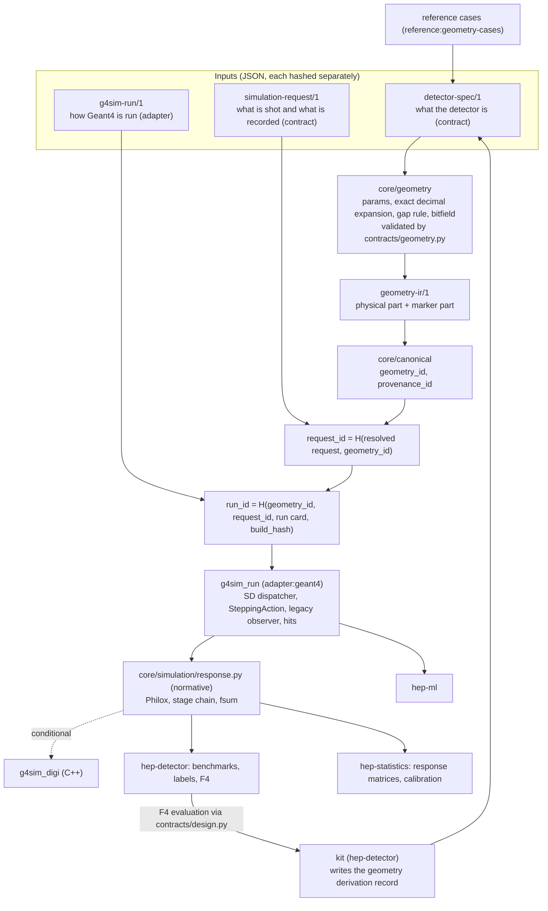
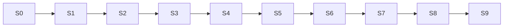

# g4sim: task specification and execution protocol

| Field | Content |
| --- | --- |
| Document type | **Task document for Claude.** Part A says how to execute the work on your own; Part B is the frozen specification of what to build. It ships in a package with two example studies and the Chinese original of Part B (Section E12); hand over the whole package |
| Version | Final edition of 2026-11-04. Part B's content is that of plan version 11 (English translation, checked against the Chinese source), with addendum 11.1 of 2026-11-06 (`g4sim-addendum-11.1.md`: GB11, GB12, GB17, GB19, GB20, GB21); Part A is new |
| Applies to | hep-research plugin 0.54.0; `adapters/geant4` 0.6.0, `adapters/detector-simulation` 0.4.0, `skills/hep-detector`; Geant4 11.4.3 |
| Status | Architecture frozen; awaiting maintainer approval (phase S0). Only design errors are corrected: internal contradictions, phase-dependency gaps, errors in statistical design, and a target behavior falsified by a prototype gate (Part B, Section 23) |
| Hard requirement | **All work runs in an isolated git worktree** (Section E2). Work done outside one does not count toward any gate |
| Paths | Unless stated otherwise, relative to the plugin root; Geant4 paths relative to the root of the v11.4.3 source tree |

---

## How to use this document

- **Part A (Sections E1–E12)**: the execution protocol. It covers how to start or resume, the worktree rule, the loop you run for every phase, where you must stop and ask a human, how to report, and how to use the bundled examples. Follow it literally.
- **Part B (the reading guide, Sections 0–24 and Appendices A–C)**: the specification. It covers what to build, the checks and gates each phase must pass, and the decisions already made. Part B is frozen. Do not edit it while implementing, except through the falsification procedure of Section 23 or a design-error fix that a human has approved (Section E7).
- "Section n" with a number refers to Part B; "Section En" refers to Part A.
- When Part A and Part B seem to disagree, Part B decides **what** is built and judged, and Part A decides **how** the work is carried out. If the disagreement is real, stop and report it (Section E7).

---

## Part A — Execution protocol

### E1. Your role and the goal

You are implementing g4sim in the hep-research plugin repository, phase by phase, from S0 to S9 (Section 19). A phase is **done** only when every gate in its entry in Section 19.2 is recorded as passed (or, where Section 19.2 allows it, as a gap) in a gate record, inside its worktree, with evidence. Running code is not the goal; passing the pre-registered gates is.

Work autonomously inside a phase: make routine engineering decisions yourself and record them (Section E4, step 9). Stop only at the points listed in Section E7.

Before writing code in a phase, load the hep-research skills that cover its work, and follow them:

| Work | Skill |
| --- | --- |
| Python and C++ code, CMake, builds, run manifests, hashing, worktree mechanics | `hep-research:hep-computing` |
| Geant4 behavior, scorers, detector response, kits, study protocol, F4 | `hep-research:hep-detector` |
| Equivalence tests (TOST), power and sample-size calculations, Fisher tests, conservation checks | `hep-research:hep-statistics` |
| Recorded reviews (T2 design under R2, Section 18; G5 review requests) | `hep-research:hep-review` |
| Verifying any number taken from a publication (reference cases, kit benchmarks, Philox/PTRS/BTPE references) | `hep-research:hep-citations` |

### E2. Isolated worktree (required)

Every phase runs in its own isolated git worktree. You never edit, build or run anything for g4sim in the main checkout.

1. **Create** the worktree from the up-to-date default branch. If the previous phase's branch has not been merged and a human said to build on it (Section E3, step 5), create it from that branch instead:

   ```bash
   cd <repo-root>                         # the main checkout; read-only for g4sim work
   git fetch origin
   BASE=$(git symbolic-ref --short refs/remotes/origin/HEAD)      # e.g. origin/main; or: g4sim/S<n-1>
   git worktree add ../hep-research-g4sim-S<n> -b g4sim/S<n> "$BASE"
   cd ../hep-research-g4sim-S<n>
   ```

   If the plugin root is a subdirectory of the repository, Part B's paths are relative to that subdirectory inside the worktree. If the worktree or branch already exists, enter it instead of creating it again.

2. **Verify before every work session.** All three must hold, otherwise stop:

   ```bash
   git rev-parse --show-toplevel        # must end in hep-research-g4sim-S<n>
   git rev-parse --abbrev-ref HEAD      # must be g4sim/S<n>
   git worktree list                    # must show this path as a separate worktree, not the main one
   ```

3. **Keep everything inside it.** Build directories, re-acquisition builds (Section 7.4), regenerated baselines, prototype programs (`adapters/geant4/tests/g4proto/`), trial runs, test runs and their outputs all live under the worktree. Large run outputs that must not be committed go under `<worktree>/.g4sim-work/` (add it to `.git/info/exclude`). Old program sources at a recorded version are extracted into the worktree with `git archive <commit> | tar -x -C .g4sim-work/reacq/<run-id>`; do not create a second worktree for them. The only exception is reading external inputs: installed Geant4, datasets, recorded run outputs, the task package (Section E12) and user-supplied material. Read these where they are; do not modify them.
4. **Never modify** the main checkout, the old executables in the plugin, recorded run outputs or the Geant4 installation (Sections 7.4, 18).
5. **Commit** inside the worktree. Use small commits whose messages begin `g4sim S<n>:`. Do not push, open pull requests or merge unless a human asked you to (Section E7). At the end of the phase the branch is handed over for review.
6. **Gate records are valid only if produced in the phase's worktree.** The gate record states the worktree path, the branch and the commit SHA at which every gate was evaluated.
7. **Clean-up** happens only after the branch is merged, and only when a human asks: `git worktree remove ../hep-research-g4sim-S<n>`.

### E3. Start or resume

Do this at the start of every session.

1. Locate the task package (the folder containing this document and `MANIFEST.sha256`; it lives outside the repository). Check it with `sha256sum -c MANIFEST.sha256` (on macOS: `shasum -a 256 -c MANIFEST.sha256`). Stop if any file fails.
2. Find the status file `docs/dev/geant4-architecture/g4sim-status.json` on the branch of the newest phase worktree (`git worktree list`), or in the main checkout if no phase worktree exists. Reading the main checkout is allowed; writing is not. If the file does not exist anywhere, you are at the start: the current phase is S0 and nothing is done.
3. Its format (create it in S0):

   ```json
   {"schema": "g4sim-status/1",
    "phases": {"S0": {"state": "not-started | in-progress | blocked | gates-recorded | partially-complete | merged",
                      "worktree": "../hep-research-g4sim-S0", "branch": "g4sim/S0",
                      "task_card_sha256": "…", "gate_record": "docs/dev/geant4-architecture/g4sim-gates/S0.md",
                      "blocked_on": ["E7 item, with what is needed"]}},
    "gb": {"GB1": "unconfirmed | confirmed | falsified"},
    "updated": "ISO-8601 time"}
   ```

4. The **current phase** is the lowest phase whose state is not `merged`. Then:
   - `not-started` or `in-progress`: continue the phase loop (Section E4).
   - `blocked`: check whether the blocking item has been resolved, for example by a recorded approval or supplied material. If it has, set the state back to `in-progress` and continue; if not, report again and stop.
   - `gates-recorded` or `partially-complete`: the phase is waiting for review and merge. Report and stop, unless step 5 lets you start the next phase.
5. You may start phase S(n+1) only if **both** of these hold:
   - Phase S(n) is `merged`; or it is `gates-recorded` or `partially-complete` (the latter under the rule in Section 19.2) **and** a human has said to continue on top of its unmerged branch.
   - The task card of S(n+1) is registered (Section E4, step 4).
6. Update the status file whenever a state changes, and commit it in the phase's worktree. A phase becomes `merged` only when a human tells you its branch was merged.

### E4. The phase loop

Run these steps, in order, for every phase S<n>. Steps marked **STOP** end the session with a report if their condition holds.

1. **Worktree.** Create or enter the phase's worktree and verify it (Section E2).
2. **Collect the phase's scope from Part B.** Build a checklist in the task card from:
   - the phase's entry in Section 19.2: content, gates, versions;
   - every row of Section 15.1 whose phase column is S<n> (these are "this phase's negative tests");
   - every GB in Section 23 whose phase is S<n> (S1–S3 only; "this phase's prototype gates");
   - every row of Appendix B whose phase includes S<n> (files to add or modify);
   - every item in Section 22 due "before S<n>" or "S<n>". Items of type **approval** or **material** are a person's: **STOP** if any is missing (Section E7). Items of type **verification**, **design** or **prototype tests** whose owner is a plugin skill (hep-computing, hep-detector, hep-citations) or "verified from run, build or installation records" are your work in this phase: do them with the matching skill and record the result in the task card. Items owned by a person or role (the maintainer, the custodian, a stewardship or component owner, the user) are theirs; you may prepare the evidence, but **STOP** until they confirm.
3. **Preconditions.** Every GB that the phase's content depends on and that belongs to an earlier phase must be `confirmed` in the status file. Every module the phase uses must already exist (Section 19.1). **STOP** if not: this is a phase-dependency gap.
4. **Task card and pre-registration.** Write or refresh `docs/dev/geant4-architecture/g4sim-tasks/S<n>.md` (S0 drafts all of them; the format is in Section E5). It must pass `lint_task.py --repo <worktree>`. Commit it, compute its SHA-256 and record that in `docs/dev/geant4-architecture/g4sim-task-registry.json` with the time, then commit the registry. A card already registered in S0 that you change must be registered again. **This must happen before any run whose result a threshold will judge**; a registration later than such a run means the threshold was not fixed in advance (Section 19.2). If a value depends on a trial run, register in two steps as Section 19.2 requires: first the trial run and the rule, then the computed values before the test run starts.
5. **Implement** the phase's content: the Appendix B rows and the Section 19.2 content list. Keep to the layering rules (Section 5.2) and the six required items per module (Section 15.4). Do not add features that belong to a later phase.
6. **Prototype gates** (S1–S3). Implement and run each GB prototype under `adapters/geant4/tests/g4proto/`, on E2 and E5 (Section 23; items needing a dataset run only where the installation record shows it). If an environment is unavailable, follow Section E7, item 7. Run the prototypes that the phase's own content depends on (for example GB4 and GB10 in S1) before implementing that content. Record each result: criterion, observed value, environment, Geant4 version. Set each GB to `confirmed` or `falsified` in the status file. **STOP** on any falsification, except GB2, which only reclassifies a run as T2 (Section 23).
7. **Negative tests and checks.** For every Section 15.1 row of this phase, add the negative test and show that the corresponding check catches it. Run the common checks of Section 19.2 (`run_all_checks.py`, `validate.py --strict` and `dependencies.py` on every study record, `check_wiring.py`, `check_layering.py`) and the full existing test suite.
8. **Gates.** Evaluate every gate of the phase exactly as pre-registered. Write the gate record (format in Section E6). If a gate fails, do not loosen its threshold and do not rerun with a different design to make it pass. **STOP** and report instead. Re-registering a threshold needs a stated reason and a human decision (Section E7).
9. **Decisions made during execution.** Append to the task card's "Execution log" every non-trivial choice you made that Part B does not dictate, for example a library choice, an internal file layout or a tolerance left to the task card. Give each a one-line reason. None of them may contradict Part B.
10. **Versions and changelog.** Apply the version bumps listed for the phase (Sections 15.5, 19.2) and add the changelog entry. Adapter version numbers are assigned in merge order at merge time (Section 15.5), so write them as proposed values and say so in the report. Update the status file to `gates-recorded`, or to `partially-complete` with the gap listed.
11. **Hand-over.** Make a final commit in the worktree and write the phase report (Section E8). Then stop. Merging, and starting the next phase on an unmerged branch, need a human go-ahead.

### E5. Task card format

`docs/dev/geant4-architecture/g4sim-tasks/S<n>.md` contains these sections, in this order:

1. **Goal**: one paragraph, taken from Section 19.2.
2. **Scope checklist**: the items collected in Section E4, step 2, each with its Part B reference and a checkbox.
3. **Deliverables**: files to add or modify. Files created in this phase are referenced only here or in lines containing "create", "add" or "new", so that `lint_task.py` accepts them before they exist.
4. **To-verify list**: the GBs this phase confirms, and the GBs it depends on together with their current status (Section 19.2).
5. **Thresholds and test designs**: every gate threshold, tolerance, α, margin, power target, number of events and trial-run rule, each fixed before execution. Defaults come from Part B and may be tightened but never loosened.
6. **Environments**: E2 and E5, with what each has installed (datasets, features), taken from the installation records.
7. **Risks and stop points** specific to the phase.
8. **Execution log**: filled in during the phase (Section E4, step 9).

### E6. Gate record format

`docs/dev/geant4-architecture/g4sim-gates/S<n>.md` contains:

- a header: phase; worktree path; branch; commit SHA; task-card SHA-256 as registered (it must equal the registry entry); environments; Geant4 version; date.
- a table with one row per gate: gate number and text (from Section 19.2); threshold as registered; observed result; verdict (`pass`, `fail` or `gap`); evidence (file path, log, test name).
- "This phase's negative tests": one row per Section 15.1 row, each recording that the negative test was caught.
- "This phase's prototype gates" (S1–S3): one row per GB, with its verdict.
- "Accounting terms that cannot be detected", if any, each with the pre-registered reason (Section 19.2).
- the list of open items carried to the next phase.

A gate counts only if its evidence is reproducible from the recorded commit inside the worktree.

### E7. When you must stop and ask a human

Stop, write the report (Section E8) with the item marked **BLOCKED**, set the phase to `blocked` in the status file, and do not work around the item, in each of these cases:

1. **Approvals** that Part B assigns to a person: every decision of Section 20 (S0); stewards; the approval items of Section 22; the custodian's re-evaluation of qualification at each release. You may draft the request and the material it needs. You may not decide an approval yourself. When the person gives it explicitly, record it in `docs/dev/geant4-architecture/g4sim-approvals.md`: the item, the person, the date, and their words or a link to where they gave it. Never infer an approval from silence or from a related remark.
2. **G5 confirmation** (Section 1). It must come from a reviewer who is not you. Prepare the code and a review request (`hep-research:hep-review`), then wait.
3. **Missing external material or consent**, for example a usable reference output, published reference data, or the user's consent to add a ProbeV2 call to `zdcsim.cc` (S3; the file itself is supplied, Section E12). If Section 19.2 allows a gap for it, record the gap and continue as partially complete. If Part B defines an alternative for a refusal, use it once the person has answered; for `zdcsim.cc`, a refusal means gate 1 uses the analytic material budget. Otherwise stop.
4. **A falsified target behavior** (Section 23). Follow the falsification procedure up to drafting the addendum, then stop for its targeted review.
5. **A failed gate**, or a threshold that cannot be met as registered, for example no feasible number of events (Section 8.9).
6. **A real contradiction or gap in Part B**, for example two passages that disagree, a phase needing something only a later phase delivers, or a gate that cannot be judged. Report it with the section numbers. Do not fix the design on your own.
7. **Missing environment or installation**: E2 or E5 is not available, or a required dataset or feature is missing. Record which gates could not be evaluated where.
8. **Anything outside the worktree**: pushing, merging, opening pull requests, deleting branches or worktrees, modifying the main checkout, old executables, recorded outputs or installations.
9. **Anything irreversible or ambiguous** that the rules above do not settle.

Everything else is yours to decide. Decide it, record it in the execution log, and keep going.

### E8. Reporting

At the end of each session or phase, or when you stop under Section E7, write a short report in the conversation, and the same text at the end of the task card's execution log. It contains:

- the phase and its state; worktree path, branch and last commit;
- the gates passed, failed and recorded as gaps (link the gate record);
- the GBs confirmed or falsified in this session;
- the blocking items, if any: exactly what is needed and from whom;
- the next action when unblocked.

Do not recap every step. The task card, the gate record and the commits are the detailed record.

### E9. Phase S0 in practice

S0 is the first phase you run, and most of it is prepared for humans to decide.

1. Create worktree `g4sim/S0` (Section E2).
2. Copy this document unchanged into the repository as `docs/dev/geant4-architecture/g4sim-task.md`, and the Chinese original of Part B as `docs/dev/geant4-architecture/g4sim-task.zh.md`; record both SHA-256 values in the S0 task card. Do not copy the examples.
3. Create `g4sim-status.json`, `g4sim-task-registry.json`, `g4sim-approvals.md`, and the directories `g4sim-tasks/` and `g4sim-gates/` under `docs/dev/geant4-architecture/`.
4. Add Part 7 to `geant4-program.md` and its English version `.en.md`: a summary of this plan that points to `g4sim-task.md`, kept in sync in both languages.
5. Draft the task cards S0–S9 (Section E5). Thresholds that depend on later trial runs are written as rules, not values.
6. Run `lint_task.py --repo <worktree>` on every card, then register each card's SHA-256.
7. Bump the plugin minor version and add the changelog entry (Section 19.2, S0).
8. Prepare the approval packet in `g4sim-approvals.md`: every decision of Section 20 (M1–M12, Q1–Q5, D1–D20) and the S0 items of Section 22, as a checklist for the maintainer, each with an empty approval field.
9. **STOP** (Section E7, item 1) and report. S0's gates pass only once the approvals are recorded.

### E10. Rules that hold in every phase

- **Thresholds**: never loosen a threshold or tolerance after registration. Never choose a threshold after seeing the result of the run it judges.
- **Trial runs and test runs**: a trial run is never reused as a test run (Section 8.9, Section 19.2).
- **Part B is frozen**: change it only through Section E7, items 4 and 6.
- **Old programs** are never modified. Re-acquisition builds modify copies only, in their own build directory inside the worktree (Section 7.4).
- **Numbers from publications** are used only after verification with `hep-research:hep-citations` (Section 13.4).
- **Validation is not confirmation**: never mark a reference case `validated-in-scope` unless Section 13.3 holds.
- **Evidence over assertion**: every claim in a gate record points to a file, test or log in the worktree.

### E11. Completion

The task is complete when S0–S9 are all `merged`, or `partially-complete` with every gap listed. S8's conditional items are built only if their conditions hold, and S9 is started only if research needs it (Section 17); otherwise record each one as "not triggered" with a reason. Finish with a final report that lists:

- each phase's state;
- every GB and its status;
- every gap carried;
- every open item of Section 22 and the reviewers' open suggestions (Appendix C).

### E12. Bundled examples

This document ships in a package with two existing studies by the user. They are **external, read-only inputs**: test material and comparison baselines, not part of the plugin and not specifications.

**Package layout**:

```text
g4sim-task/
  g4sim_task.md                 this document
  MANIFEST.sha256               SHA-256 of every file in the package
  g4sim_plan.zh.md              Chinese original of Part B (plan version 11, consolidated edition)
  examples/
    README.md                   short index of the two examples
    zdc-ecal-study/             ZDC ECAL study (git-tracked files at commit a773fe6)
    ams02-rich-replica/         AMS-02 RICH replica (synthetic)
```

`g4sim_plan.zh.md` is the source Part B was translated from. It lacks Part B's few cross-references to Part A (the reading guide, the isolated-worktree rule in Section 19.2, the `zdcsim.cc` row of Section 22 and the new Appendix B rows). Where the two differ, Part B governs; report any difference in substance (Section E7, item 6).

**What was left out of the package**: all ROOT files (`*.root`, about 3.8 GB of event output), `.venv/`, `.git/`, `build/` trees, `__pycache__/`, `.pytest_cache/` and LaTeX intermediates. In `zdc-ecal-study`, the per-run `moments.npz` and log files were also left out, because its `.gitignore` excludes them. Run manifests, configurations, results JSON, figures, reports and source code are all kept. To re-analyse event-level outputs, rerun the simulation as described in each example's README.

**How to use them**:

1. Treat them as external inputs (Section E2, item 3): read them where they are in the package. Before you build or run anything from them, copy what you need into the phase's worktree under `.g4sim-work/examples/` (builds write files), and never commit them to the plugin. Their code has no stated licence (ZDC README, Section 9), and the ZDC slides belong to their authors. Do not copy their code into the plugin; write new code against Part B.
2. Record the SHA-256 of every example file you use in the task card and the gate record (`MANIFEST.sha256` gives them).
3. **Their numbers are not independent references.** Both are Geant4 simulations, labelled `simulated-unvalidated` or `projection` (ZDC) and `synthetic` (RICH). Comparing g4sim with them is a **comparison with another simulation**: a regression and consistency check, not validation and not confirmation (Section 3, principle 10; Section 13.3). Reference cases still take their numbers from cited claims verified with `hep-research:hep-citations` (Section 13).

**`examples/zdc-ecal-study`**: Geant4 simulation, digitization, reconstruction and validation of the PbWO₄ ZDC ECAL prototypes (2nd and 3rd, both 6×6) and of the final EIC ZDC (ECAL 20×20 + 64-layer HCAL). The status and limitations are in its `README.md` and `STATUS.md`. Uses in this task:

| Use | Files | Phase | Notes |
| --- | --- | --- | --- |
| The `zdcsim.cc` baseline of S3 (Section 19.2, S3 comparison baseline; Section 22 "Supplying `zdcsim.cc`") | `sim/zdcsim.cc` (550 lines, SHA-256 `28018224c1419a87e0da7f6b24b3557d93b878269f32f8d5aaedecf0d51ec203`), `sim/CMakeLists.txt`, the geometry and sample YAML it reads | S3 | Material supplied. Register it as `user-supplied` with this path and hash. **Adding a ProbeV2 call to it, even in a separate build directory, needs the user's explicit consent (Section 19.2, S3); ask at the start of S3 (Section E7).** Without consent, gate 1 uses the analytic material budget |
| The three ZDC geometries of GL1 (Section 2.1): the 2nd prototype, the 3rd prototype and the final ZDC | `config/geometry/prototype_v2.yaml`, `prototype_v3.yaml`, `zdc_final.yaml` (variants `*_L*.yaml`, `prototype_v3_clean*.yaml`) | S3 (prototypes), S5 (`calorimeter` kit), S7 if a shape needs it | Express each as `detector-spec/1` with `source_of_facts` taken from the YAML comments (`assumption`, slide numbers). Section 6.6 is only illustrative: its main dimensions match `prototype_v3.yaml` (crystal 20×20×53 mm, ESR 0.065 mm, gap 0.2 mm, 4×4 SiPMs), but details differ (for example the YAML's SiPM pitch is 5 mm, and it adds the PCB and the BM3–BM5 planes); the YAML governs. Any construct that cannot be expressed is reported as a core-module requirement (Section 13.2), never patched with a special case |
| The synthetic ZDC example of Appendix B (`examples/`, S3) | Same geometries; `config/samples/*.yaml` for sources | S3 | Write a new example from them. Do not copy the study |
| Equivalence test of S3 gate 3 | Run `zdcsim.cc` and g4sim with the same physics list (`FTFP_BERT_EMZ`; production cut 0.7 mm) and source; independent seeds | S3 | Section 19.2, S3, gate 3. The study's environment has no G4NDL, so `QGSP_BERT_HP` was not available there; check E2 and E5 before choosing any HP list |
| Response-pipeline cross-check | `digi/` (SiPM, H2GCROC, CITIROC), `config/digitization/*.yaml` | S4 | Reference for stage 3–4 parameters and for a consistency comparison only; the normative response is `core/simulation` (Section 10) |
| Expected values for comparison | `results/*.json`, `runs/*/manifest.json`, `report/`, `figures/` | S3, S5 | Comparison values, always reported with the study's status labels |

**`examples/ams02-rich-replica`**: a standalone Geant4 replica of the AMS-02 RICH, with aerogel and NaF radiators, a conical mirror and 680 PMTs. It was built from public parameters (`reference/AMS02_G4_geometry_spec.md`, itself marked "unvalidated"), uses `FTFP_BERT` + `G4OpticalPhysics`, and includes digitization, three reconstruction methods, calibration on pseudo-data with hidden offsets, and an event display. Its status is `synthetic`: it contains no AMS Offline geometry and no flight data, so it may be used under the public-profile rule (Section 21, last row). Uses in this task:

| Use | Files | Phase | Notes |
| --- | --- | --- | --- |
| Expressibility test for optical detectors (GL1-style) | `sim/rich_sim.cc` (488 lines, SHA-256 `128ecf26a6d21853951796c097d5df94102a1bd140db8f2e90e6432341841b36`), `config/rich_params.cfg` (42 parameters tagged spec, assumed or tuned) | S7 | Express the replica as `detector-spec/1` + `simulation-request/1` + `g4sim-run/1`, using `cone` for the mirror (S7), `grid` with `clip` or `absent` for the aerogel and NaF tiles and for the PMT plane around the central hole (S3), `optical_scope` with an optical surface for the mirror, and photon hits. The 32 truncated aerogel tiles may need a construct outside the shape list (Section 2.2 excludes arbitrary CSG). Record that as a core-module requirement (Section 13.2) rather than approximating silently |
| Optical-physics and Cherenkov gates | Same | S7 | S7 gate 2 (Cherenkov angle vs cos θ = 1/(nβ)) can use the replica's radiators; `photon_detected` and photon hits (Section 9) are compared with the replica's photon records where g4sim records the same information; the replica's extra flags (mirror-reflected, Rayleigh-scattered) are truth information g4sim does not promise |
| Cherenkov handling in efficiency maps | Same | S7 | Efficiency maps do not apply to Cherenkov light (Section 10.4); this example must use option (a), full optical tracking |
| Comparison values | `results/results.json`, `results/table_highbeta.md`, `RESULTS.md`, `RICH_replica_report.pdf` | S7 | For example the photoelectron yield at Z = 1, β ≈ 1 (11.5, the one tuned quantity). These are comparisons with another simulation, never `validated-in-scope` |
| AMS-02 RICH reference case (Section 13.4, S7) | `reference/AMS02_G4_geometry_spec.md` | S7 | Use it only as a pointer to sources. Every number must be re-verified with `hep-research:hep-citations` before it enters `reference:geometry-cases` |

---

## Part B — Specification (frozen)

## Reading guide

**What Part B is**: the complete design, with its implementation phases, of a new "g4sim" component of the hep-research plugin. Its purpose is that a research detector can be simulated with Geant4, digitized through a response model, validated, and connected to the existing design loop (F4) by writing JSON specifications only, without writing C++. It is a design document; no implementation code exists yet.

**Read first when taking over**:

1. Section 0 (one-page summary) and Section 1 (glossary).
2. Section 19 (phases and gates): the work proceeds in the order S0 to S9; each phase has its content, its gates and its version bumps.
3. Section 23 (target behaviors GB1–GB24): the Geant4 behaviors the design relies on but that are not yet confirmed, and the prototype tests that confirm them.
4. Section 20 (decision record): the decisions to be approved in S0.
5. Section 22 (items awaiting approval or verification): what is still undecided or unverified.

**What each section does**:

| Section | Content |
| --- | --- |
| 0–5 | Summary, glossary, goals and non-goals, design principles, mapping to the current plugin, architecture overview and layering |
| 6 | The three input specifications: `detector-spec/1`, `simulation-request/1`, `g4sim-run/1` |
| 7 | Geometry IR, identities (`geometry_id` and others), numerics and geometric legality, legacy mode |
| 8–9 | Execution (`g4sim_run`), energy accounting and conservation, scorers and hits |
| 10 | Response pipeline: random numbers (Philox), summation, scintillation and light collection |
| 11–14 | Physics configuration, kits, reference cases, design loop and F4 |
| 15 | Checks and negative tests, listed by phase |
| 16–18 | Scale, conditions and alignment, compatibility and regression (T1, T2) |
| 19 | Phases and gates |
| 20–22 | Decisions, risks, items awaiting approval or verification |
| 23 | Target behaviors and prototype gates |
| 24 | Scope of later document reviews |
| Appendices A–C | Assessment summary, file and module list, review history |

**Conventions to keep in mind while reading**:

- **A "target behavior" is not a confirmed fact.** Wherever the text says "per target behavior GBn" or "(GBn, confirmed in Sx)", the statement holds only once the corresponding prototype in Section 23 has passed. If a prototype falsifies it, the procedure in Section 23 applies; the design must not be rewritten ad hoc.
- **Two kinds of checks.** check-spec (in the adapter) holds only checks that concern Geant4 behavior; checks of the response pipeline that have nothing to do with Geant4 are "response checks" (in `core/simulation`); geometric legality is computed by `core/geometry` and judged by `contracts/geometry.py` (Section 5.2).
- **T1 and T2.** Regression of old results has two levels. T1 requires bit-identical results (legacy block with `source: probe`); T2 uses a joint equivalence test (`source: translated`). Which class each recorded run belongs to is decided by the inventory table produced in S1 (Section 7.4).
- **All thresholds are fixed before execution**, which is guaranteed by pre-registering the task cards (start of Section 19.2). Most numbers in this document are defaults; a task card may tighten them but never loosen them.
- **Labels are local to this plan.** S0–S9, T1, T2 and GB1–GB24 are unrelated to identically named labels in other plugin documents (Section 1).

**If you are going to implement it**: follow Part A. Start with S0 (Sections 19.2 and E9): obtain approval of the decisions in Section 20, write the task card of every phase, and pre-register them. Then proceed phase by phase in isolated worktrees (Section E2); each phase may use only modules delivered by earlier phases and target behaviors already confirmed.

---

## 0. One-page summary

**Goal**: a research detector of moderate complexity can be simulated, digitized, validated and connected to the design loop by writing specifications only, without C++.

- Detector types covered: calorimeters, trackers, TOF, TRD, RICH, vetoes, and combinations of them.
- Detectors of the large experiments (CMS, LHCb, ePIC, AMS-02 and others) serve only as design references and coverage tests; g4sim does not interface with their software.

**Core of the architecture**:

1. **Three inputs, each hashed separately**
   - `detector-spec/1` (a contract): what the detector is.
   - `simulation-request/1` (a contract): what is shot at it and what is recorded.
   - `g4sim-run/1` (owned by the adapter): how Geant4 is run.
   - All three are JSON.
2. **A single geometry IR**
   - `core/geometry` expands the detector-spec into `geometry-ir/1`; the C++ code reads only the IR.
   - All lengths and angles are computed with exact decimal arithmetic: Python `decimal`, 34 significant digits, round-half-even. This arithmetic gives the same result on every platform, so no quantization is needed.
   - Geometric legality is guaranteed by the gap rule: two faces either coincide exactly or are at least 1×10⁻⁶ mm apart (1000 times Geant4's default surface tolerance).
3. **Identities**
   - `geometry_id` is the hash of the physical part of the IR; the physical part includes the coordinate frames and, for every logical volume, the region and field it actually belongs to.
   - Tags and provenance do not enter `geometry_id`. Physics requirements selected by tags in the detector-spec are expanded into explicit lists of logical templates before they are written into the physical part; so changing only tags, while the selected objects stay the same, leaves `geometry_id` unchanged.
   - The hash input of `request_id` includes `geometry_id`.
   - Normalization and hashing for identities live in a new package `core/canonical`: standard library only, steward hep-computing.
4. **A common language**: cellIDs plus four kinds of hits. Differences between detector types are confined to hep-detector's kits and the parameters of the response pipeline; there is no branching on detector type at run time.
5. **The response is defined by the Python implementation**
   - The integer layer of Philox4x32-10, and the uniform variates constructed from integers, are bit-identical in every language and on every platform.
   - Within one implementation, results do not depend on processing order or on parallel partitioning; chunks pass exact partial sums to each other and round only once at the end.
   - Summation uses the same correctly rounded algorithm as CPython's `math.fsum`.
   - Sampled values that go through transcendental functions agree between Python and C++ only within a declared tolerance.
6. **Old results can be reproduced**
   - Legacy mode ports the observable code of the two old programs unchanged into a legacy observer. For T1-class runs, positions, materials and the physics process list come from the ProbeV2 record of a re-acquisition build; for T2-class runs they are converted by the translator from the old specification (Section 7.4). Energy accounting is the same as in the old programs. The aim is bit-identical reproduction of T1-class runs; this rests on the premises in Section 8.5 and on target behaviors GB1, GB2, GB6, GB7, GB18 and GB22, confirmed by the prototype gates of S1 and S2.
   - New specifications use the new scorers and separated accounting.

**Integration**: g4sim follows the plugin's existing rules: the layering direction and inclusion rules (`docs/architecture.md`); the study protocol's "validation is not confirmation" and its Sections 1, 5 and 6; the status vocabulary; the G5 gate of the Geant4 program; isolated worktrees (every phase runs in its own git worktree, Section E2); bilingual (Chinese and English) documents.

**Phases**: S0 to S9, with linear dependencies. Every phase:

- lists the modules it uses, all of them delivered by earlier phases;
- gives gate thresholds that can be judged objectively and are fixed before execution;
- lists the version bump of every affected component;
- has a task card with a "to-verify list" of the target behaviors that the phase confirms by prototype (Section 23).

**Review**: the architecture is frozen. Later document reviews examine only internal consistency, phase feasibility and the statistical design; Geant4 behavior is no longer judged by document review but verified by the prototype gates of S1 to S3 (Section 24).

---

## 1. Glossary

| Term | Definition |
| --- | --- |
| detector-spec | `detector-spec/1`: the description of the detector itself, including geometry, materials, readout, magnetic field and physics requirements. It states requirements only, never Geant4 numerical settings |
| simulation-request | `simulation-request/1`: source, reference planes, scorers (with time windows and apportioning thresholds), truth-keeping rules |
| run card | `g4sim-run/1`: physics list, cuts, step-limit values, XTR radiator class, kill policy, accounting mode, field integration, number of events, seeds, threads, chunks |
| IR | `geometry-ir/1`: the resolved intermediate representation of the geometry, split into a physical part and a marker part |
| exact decimal arithmetic | Python `decimal` with 34 significant digits and round-half-even; trigonometric functions are evaluated with 40 digits and then rounded to 34; the algorithms are written down in `core/geometry` |
| arithmetic floor ε | 1×10⁻²⁰ mm. Two faces whose exact difference is less than ε are treated as the same face; this absorbs only the rounding of the 34-digit arithmetic itself, for example 1/3 + 1/3 + 1/3 giving 0.999…9 |
| minimum gap c | 1×10⁻⁶ mm. Two faces that do not coincide must be at least c apart |
| template | A G4 logical volume together with its child placements; its dimensions do not depend on where it is placed |
| placement | A rule that places a template inside a mother template |
| modifier | Syntactic sugar applied to a placement |
| segmentation | Division of a volume into readout cells in its local coordinates, without placing physical volumes |
| cellID | The integer ID of a readout cell, encoded by the bitfield of `readout-encoding/1`; at most 64 bits in total. Within one placement the copy-number fields total at most 31 bits (a G4 copy number is a signed 32-bit integer, and multiple indices are bit-packed, Section 6.2.6); a virtual-segmentation field has at most 53 bits |
| visible energy | The deposit after the per-step Birks correction; scorer quantity `edep_visible` |
| integer layer | The integer words output by Philox, and the uniform variates constructed from them by integer arithmetic only |
| accounting mode | `legacy`: the same as the old programs, handled by the legacy observer; `separated`: the energy of killed particles is booked separately and not counted as deposit |
| unreleased energy | The energy that a killed unstable particle would still have released had it continued to decay to stable particles according to Geant4's decay tables (the Q value of the decay chain); Section 8.4 |
| energy equivalent E_eq | The energy a particle stands for in the accounting: E_eq = kinetic energy + U (the symbol ε is not used, since ε is the arithmetic floor). U(e⁺) = 2m_e c²; for an unstable particle U is its unreleased energy (which already includes 2m_e c² for every e⁺ in the chain); for every other particle U = 0. Incident energy, per-face outflow, world escape and killed energy all use E_eq, and each particle's U is counted only once (Section 8.4) |
| termination class | When a track ends it falls into exactly one class: physical termination, world escape, killed, or optical photon. Only "killed" enters the killed-energy terms; optical photons enter no energy identity (Section 8.4) |
| target behavior GBn | A Geant4 behavior the design relies on that has not yet been confirmed by prototype; Section 23 lists, for each one, where it is relied on, its prototype test and its phase |
| Philox output group | The four 32-bit words produced by one call of Philox4x32-10, which make two uniform variates (Section 10.2) |
| chunk | The run card's `chunk`: the number of events in one parallel work unit. Chunks enter neither the Philox key nor the counter, so results do not depend on how a run is chunked. A chunk is not the same thing as the study spec's `blocks.K` (the number of batch-means blocks in the summary, K ≥ 16): g4sim summaries always use the `blocks.K` declared in the study spec, and the run card no longer has a `blocks` field |
| volume ID | An integer, unique in the whole geometry, for every placed volume (touchable), composed of the copy numbers of each level multiplied by the IR's strides, in the same way as a cellID; written into the physical part of the IR from S1 on (Section 7.1). The copy-number widths of all levels total at most 64 bits (the volume ID occupies two 32-bit counter words), and every stride lies within the canonical integer limit ±(2⁵³ − 1); `contracts/geometry.py` rejects anything beyond these limits |
| Birks variable x | The quantity by which a step's deposit is divided as 1 + k_B x in `G4EmSaturation`; its definition depends on the kind of step (Section 8.8) |
| geometry kind | The optional field `geometry_kind` of a design candidate; it decides which design-geometry mapping file the design loop uses; the default is `layered-spectrometer` (Section 14.3) |
| `run_id` | In this document `run_id` means the execution identity of g4sim (Section 7.2); the existing execution identity of the detector-simulation adapter is always written "detsim run_id" |
| legacy observer | The observable code ported unchanged from the `Actions.cc` files of `layered_sim` and `element_sim`, used only in legacy mode; the old-spec information it needs (role, mother, calorimeter index) is kept in the legacy block of the IR's physical part |
| kit | A detector-type generator owned by hep-detector; it outputs a detector-spec and a geometry derivation record |
| reference case | A representative subsystem reconstructed from public claims; its comparison results are recorded as "comparison with cited values" |
| `zdcsim.cc` | The user's own ZDC ECAL study program (about 550 lines of C++). It is not in the plugin; it is material supplied by the user, and S3 uses it as a comparison baseline (Section 19.2) |
| decision D0 | An existing decision of the Geant4 program (`docs/dev/geant4-architecture/geant4-program.md` §P.7.1) on how a detector-level Geant4 study becomes F4. This plan does not change it |
| GL1 to GL6 | Labels of this plan's goals (Section 2.1) |
| G5 | A gate of the Geant4 program: a statement that new C++ code is written against the Geant4 API without copying or adapting any example code, confirmed by a reviewer in a VALIDATION entry. It is a different thing from the identically named live test in `docs/architecture.md` |
| E2, E5 | Execution environments defined in `docs/capability-matrix.md`. E2: macOS arm64 with a self-built Geant4 11.4.3. E5: RHEL 9 x86_64 with conda-forge Geant4 11.4.3. The datasets and features actually installed in each (for example G4NDL, GDML) are taken from the installation records, verified in S1 and written into the task card; `capability-matrix.md` records no difference between the two environments for datasets such as G4NDL or GDML, so none may be assumed |
| T1, T2 | The two regression levels. T1 requires bit-identical results; T2 uses a joint equivalence test declared in advance (Section 18) |
| scope of labels | This document's S0 to S9 (phases) and T1, T2 (regression levels) are valid only within this plan and are unrelated to the capability stages S0–S4 and threat tiers T1–T6 of `docs/protected-data-architecture.md`; for G5 see above |
| L1, L2, L3 | Levels of detail of a reference case: L1 up to the material budget; L2 up to the readout segmentation; L3 up to the response |

---

## 2. Goals, scope and non-goals

### 2.1 Goals and criteria

| Label | Goal | Criterion |
| --- | --- | --- |
| GL1 | Research geometries need no C++ | The three ZDC geometries, an AMS-like spectrometer segment and a cosmic-ray source are all expressed by specifications only |
| GL2 | Old results can be reproduced | For J14, J15, the TestEm3 and TestEm5 mirrors and the recorded runs of the design search, per the inventory table of Section 7.4: T1-class runs pass T1 in legacy mode, T2-class runs pass T2, and "not regressable" runs are listed one by one with reasons |
| GL3 | Every number is traceable | Every numerical value leads, via a JSON Pointer, to its `source_of_facts` |
| GL4 | Every output can be checked independently | Every module has at least one negative test that the corresponding check catches |
| GL5 | Calibration of simulation parameters is supported | Sources output an analytic density (R layer); scorers and the response output the intermediate quantities needed for re-digitization, including deposits classified so that the Birks constant can be changed afterwards (D layer); `scan` generates design points (S layer) |
| GL6 | Scale | 10⁵ placements and 10⁶ virtual readout cells; the budget is written down in S1 and checked in S2 and S8 |


### 2.2 Non-goals

- Interfacing or interoperating with experiment software such as CMSSW, Gauss, npsim or the official AMS simulation.
- Fully reproducing any experiment's official simulation.
- Time-dependent geometry, pile-up and event overlay. These belong to the digitization layer; this plan only reserves an interface for them.
- Arbitrary CSG and Boolean solids.
- Non-uniform materials.
- First-principles simulation of electric fields, drift and electronics.
- Reconstruction algorithms themselves.
- Wrapping DD4hep.
- Direction-dependent light-collection efficiency maps (Section 10.4).
- Sensor simulation with bias, electric field and doping. This belongs to detector-simulation; its Allpix² backend already has the `allpix.pixel-charge` capability (adapter 0.4.0, `docs/capability-matrix.md`).
- YAML or TOML as authoring formats. Specifications are accepted only as JSON (Section 6.5).

---

## 3. Design principles

1. **A specification describes matter, readout and requests, not detector types.** Tags are used only for selection and do not themselves enter `geometry_id`; the result of the selection (the expanded list of templates) does.
2. **Matter and readout are separate.** The geometry contains only matter that actually exists; readout cells can be physical volumes or virtual segmentation.
3. **Single source of truth.** Repeated numbers are derived from `params`; cellIDs, the address map, the event display and GDML are all derived from the IR.
4. **No implicit corrections and no implicit overlaps.**
   - Lengths and angles come from exact decimal arithmetic.
   - Legality is checked by the gap rule: two faces either coincide or are at least c apart; a daughter volume must lie inside its mother.
   - Any violation is an error.
5. **Identity depends only on physical content.**
   - `geometry_id` covers the physical part of the IR.
   - Tags and provenance enter `provenance_id`.
   - The hash input of `request_id` includes `geometry_id`.
6. **The scope of determinism is stated explicitly.**
   - Geant4 execution: new specifications always use per-event seeding (`per-event`), merged in event-ID order, so serial and MT runs are bit-identical. Legacy mode additionally supports the old programs' `stream` mode, used only to reproduce runs recorded with it.
   - Response: three levels of guarantee (Section 10.2).
7. **A source must declare its density type.** An `analytic` source outputs an analytic density; an `external` source is rejected by the calibration workflow.
8. **A module without checks cannot be registered.** Every module must deliver all six required items (Section 15.4).
9. **The old programs are special cases of the new one.** The aim of legacy mode is to produce the same volume tree, double-precision positions, physics process list, observables and accounting as the old programs; this is confirmed by the prototype gates of S1 and S2 (Section 23).
10. **Validation is not confirmation.**
    - The adapter only shows that the implementation is correct; physical performance is judged by hep-detector under the study protocol.
    - Confirmation requires an independent reference and a negative control (protocol Sections 1 and 5).

---

## 4. Current state and reuse (plugin 0.54.0)

| Existing component | Current state | Role in the new architecture |
| --- | --- | --- |
| `adapters/geant4`: `layered_sim` | Specification-driven; observables include `edep_<name>_MeV`, `chlen_<name>_mm`, `plen_<name>_mm`, escape broken down by particle species, `killed_booked`, `killed_unbooked`, `killed_eplus`, the fate of the primary and secondary counts; per-face leakage is classified by the post-step x position when a particle leaves the world (`Actions.cc` lines 261–273) | Becomes a preset of `g4sim_run`; the observable code is ported unchanged into the legacy observer |
| `adapters/geant4`: `element_sim` | Specification-driven; per-face leakage is the net outflow from the envelope, with no subtraction when the primary first enters the envelope (`Actions.cc` lines 360–380) | Same as above |
| Common to both old programs | Two seeding modes: `stream` (the default of `layered_sim`, used by J14's recorded runs, `geant4-program.md` §A1.4, §A2.2) and `per-event`; only `per-event` has been verified bit-identical between serial and MT (1, 2, 4 threads), while in `stream` mode different thread counts and splits give different events; the SteppingAction assigns a step by its pre-step touchable. Neither is compiled with `-ffp-contract=off` (only `simreco` is), so whether position arithmetic is contracted into FMA depends on the compiler | The recorded runs are the T1 baselines; legacy mode takes the double positions written back by the old programs directly, so their floating-point arithmetic need not be reproduced in Python (Section 7.4) |
| `adapters/geant4/assets/g4sim/` | Shared headers for seeding, hashing, summary, observables, materials, physics and probes | Basis of the new program; adds IR reading, `Readout.hh`, `Philox.hh`, the SD dispatcher, `KillProcess`, the legacy observer, hit output |
| `geant4_run.py`, `geant4_verify.py`, `geant4_build.py register` | Execution, checks, installation records | Dispatch old and new specifications by the `schema` field; checks generalized to arbitrary IR; available modules decided by installed features and datasets |
| `simroot`, `simreco` | Read event files; digitization and reconstruction that need no Geant4 | simroot reads the new hit files; simreco's strip digitization is registered as an implementation of response stage 5 |
| `adapters/detector-simulation` | Garfield++ backend: one-dimensional gas-table queries, giving the electron drift velocity at B = 0 (`garfield.gas-table-query`). The Allpix² backend has `allpix.pixel-charge` 1.0.0 (tested-in-declared-environment) | Garfield++'s drift-velocity tables can be an input to response stage 2; whether charge-sharing tables can be supplied by `allpix.pixel-charge` is verified before S4, and only if it cannot does that adapter need a new capability |
| `core/provider/hashing.py` | `canonical_json`, `canonical_sha256`, and the provider protocol's point hash (`point_key`, `point_hash_object`, `point_hash`) | The implementations of `canonical_json` and `canonical_sha256` move into `core/canonical`, and this file re-exports them; the point-hash functions stay in this file unchanged |
| `core/protected/revocation_log.py`, `contracts/recipe_semantics.py`, `contracts/release_manifest.py` | Each has its own implementation of `canonical_sha256`, byte-identical to the row above; `contracts/design.py` also imports it from `contracts/release_manifest.py`. `revocation_log.py` is core code under protected use; `release_manifest.py` is a custodian tool; `recipe_semantics.py` is an advisory agent tool | Not modified; agreement is only confirmed by equivalence tests; the import in `design.py` also stays unchanged. Not modifying them serves only to narrow the change set and the review surface: the qualification record binds the code identity of the whole release bundle, which any change in any phase alters (Section 21) |
| `adapters/detector-simulation/assets/detsim_canonical.py` | Imports hashing from `contracts/recipe_semantics` and `core/provider/hashing`; has its own `check_hash_scope`, `normalize_decimal`, `load_json_strict` | The three own functions move into `core/canonical`; it imports from `core/canonical` instead; detsim's read path, plan_digest and detsim run_id are unchanged |
| `core/simulation` (steward: hep-detector) | Seed hashing, summary, analytic helix | Extended with Philox, hit closure, response, source density |
| `contracts/design.py` | The F4 check always reads `rules/design_geometry.json` (`GEOMETRY_FILE`, lines 78, 995, 1051) and recomputes `parameter_digest` from its layered-spectrometer fields; it requires the study record's `input_manifest` to contain the file referenced by `geometry_ref` and its SHA-256 | Selects the mapping file by the design candidate's `geometry_kind`; when it is absent the behavior is exactly as now (Section 14) |
| The `geometry` and `f4` subcommands of `skills/hep-detector/scripts/evaluate_design.py` | Both read the same `GEOMETRY_FILE`: `geometry` (from line 521, read at line 530) writes the design geometry file (parameters, `parameter_digest`, figure of merit and denominator); `f4` (from line 558, read at line 629) reads the mapping's `figures_of_merit` and recomputes `parameter_digest` | Both subcommands select the mapping file with the same selection function as `design.py` (Section 14.3) |
| `contracts/schemas/ext_design_candidate.json` | Design candidate; top-level `additionalProperties: false`, no geometry-kind field | Adds optional fields `geometry_kind`, `geometry_id`, `geometry_derivation_ref` (Section 14.3) |
| `contracts/rules/design_geometry.json` and `contracts/schemas/design_geometry.json` | Mapping for a single geometry (`geometry: layered-spectrometer`); the schema requires `mapping_version`, `geometry`, `fields`, `figures_of_merit`, has top-level `additionalProperties: false`, and `mapping_version` may only be 1.0.0 or 1.1.0 | Becomes "one mapping per geometry kind": the existing file is kept as the layered-spectrometer mapping, and each new geometry kind has its own file; the schema adds a 1.2.0 form via `oneOf`, whose only new field is the required `kit` (Section 14) |
| hep-detector: study protocol, `check_geant4_study.py`, `geant4_benchmarks.py`, `geant4-physics-rules.json`, `geant4-study-spec.schema.json` | Study specification, convergence gates, confirmation ladder, physics rules, labels, F4 | The rule engine reads the three specifications instead; the study spec adds `physics.g4sim`; kit benchmarks are added. The physics-list → required-datasets table goes into contracts (`contracts/rules/geant4_datasets.json`, content maintained by hep-detector), because the adapter also reads it |
| `profiles/reference/detector-atlas`, `profiles/experiments/eic`, `ams-02` | Sourced claims | Sources of the numbers for reference cases |
| `docs/dev/frontend-electronics` (the FE series) | Front-end electronics plan; FE1–FE4 are hep-detector scripts | An implementation of response stage 4. core does not import skills: the pipeline writes an intermediate file between stages 3 and 4 (the stage hand-off format of `response-pipeline/1`), FE4 reads it and writes back, and core reads that back and continues; FE4 is rewired to this file interface |
| `zdcsim.cc` (supplied by the user) | The user's ZDC ECAL study program, not in the plugin | Comparison baseline of S3; registered as user-supplied material (Section 19.2) |

Dependency constraints:

- `core` and `contracts` may depend on the standard library, numpy, scipy, matplotlib and sympy.
- The exact-decimal parts of `core/canonical` and `core/geometry` deliberately use only the standard library.
- Skills cannot be imported by contracts or adapters.

---

## 5. Architecture overview

### 5.1 Data flow



### 5.2 Layer placement

| Layer | May depend on | Added or modified |
| --- | --- | --- |
| `core/` | standard library, numpy, scipy, matplotlib, sympy | Adds `core/canonical` (steward: hep-computing; standard library only); adds `core/geometry` (steward: hep-detector); extends `core/simulation`, `core/constants/data` |
| `contracts/` | core | Adds schemas, `contracts/geometry.py`, `rules/geant4_datasets.json`; modifies `design.py`, `schemas/design_geometry.json`, `schemas/ext_design_candidate.json`; adds a mapping file per geometry kind |
| `adapters/geant4` | core, contracts | Adds `g4sim_run`, the run card schema, the translator, the legacy observer, `g4sim/ProbeV2.hh`, check-spec; extends verify and simroot (the current `SimProbe.hh` is not modified) |
| `adapters/detector-simulation` | core, contracts | `detsim_canonical.py` imports from `core/canonical` instead |
| `skills/hep-detector` | core, contracts | Adds kit data and `g4kit.py` (writes the geometry derivation record); modifies the study spec, rule engine, benchmarks, protocol, `evaluate_design.py` |
| `profiles/reference/geometry-cases` | core, contracts, declared profiles | New |

**Hand-offs**: there are no disallowed imports between skills, adapters and contracts. Kits hand off through specification files and derivation-record files, and `contracts/design.py` reads only those files. Data the adapter needs (for example the dataset table) is placed in contracts.

**Ownership of checks**:

- `core/geometry`: pure geometric computation, including expansion, the computations of the gap rule and containment, bitfield derivation, material budget.
- `contracts/geometry.py`: schema, units and claim resolution for specifications and IR, and judging geometric legality by calling the computations of `core/geometry`.
- The adapter's check-spec: only checks related to Geant4 behavior, for example the semantics of PAI requests, time cuts, XTR, restrictions of the accounting mode.
- The response checks of `core/simulation`: checks of the response pipeline that have nothing to do with Geant4, for example that Philox keys are pairwise distinct, sub-index limits, first_event + number of events ≤ 2³², and that materials with r < 0.15 or r > 1 have a validation run. They read values from the run card and the IR, but they are not Geant4 behavior, so they are not in check-spec. All "response checks" in Sections 10.2 and 10.3 are of this kind.

**Placement rules**:

- General computation with at least two top-level users → core.
- Cross-component hand-off formats → contracts.
- Running Geant4 or external programs → adapters.
- Knowledge of detector types and physics judgments → hep-detector.
- Experiment-specific content → profiles.

---

## 6. The three input specifications

### 6.1 Criterion for the split

If changing a field leaves the detector itself unchanged, the field does not belong in the detector-spec. By this criterion:

- Step-limit values, time cuts, production cuts, field-integration accuracy and Geant4 model choices (for example PAI or PAIphoton, the XTR radiator class) all go in the run card.
- The detector-spec states requirements only, never Geant4 settings. Physical parameters of the detector itself belong in the detector-spec, for example a TRD radiator's foil thickness, gap and number of foils, the radiator's structure (a regular foil stack, or a radiator of irregular thickness such as fibres or foam), or a material's Birks constant.
- Taking XTR as an example: whether the radiator is regular or irregular is a property of the detector itself and goes in the detector-spec; which Geant4 radiator class simulates it is a Geant4 model choice and goes in the run card. check-spec confirms that the two are compatible (Section 11).

| Block | `detector-spec/1` | `simulation-request/1` | `g4sim-run/1` |
| --- | --- | --- | --- |
| Owner | contract | contract | owned by adapter:geant4 |
| Content | `params`, materials, coordinate frames, templates and placements, readout, magnetic field, physics requirements (without Geant4 settings) | Source, reference planes, scorers (including `time_window_ns`, the short-step fraction for apportioning and the stiffness threshold on the sagitta), truth-keeping rules | Physics list and EM options, extra constructors, the PAI list, per-region cuts and step-limit values, kill policy, accounting mode, field integration, number of events, seeds, threads, chunks |
| Identity | `geometry_id`, `provenance_id` | `request_id` | Folded into `run_id` |
| Written by | user, kit, translator | user, study template, translator | user, translator |

### 6.2 detector-spec/1

#### 6.2.1 Shapes

| Shape | Parameters (full lengths, in mm) | Phase |
| --- | --- | --- |
| `box` | `size_mm` (x, y, z) | S1 |
| `trd` | Widths at both ends, length | S3 |
| `tube` | rmin, rmax, length, φ range | S3 |
| `polygon_prism` | Number of sides, circumradius, length (the expander converts to the apothem of `G4Polyhedra`, GB23) | S3 |
| `cone`, `sphere_section`, `polycone`, `polyhedra` | Parameters of the corresponding G4 shape; radii of `polyhedra` as for `polygon_prism`: the specification gives the circumradius and the expander converts to the apothem (GB23) | S7 |

Specifications always give full lengths; the expander converts them to G4 half-lengths.

#### 6.2.2 Templates and placements

Templates are available from S1, including template declarations, daughter placement lists and nesting.

| Placement | Parameters | Indices | Phase |
| --- | --- | --- | --- |
| `single` | Centre, rotation (S1 and S2 accept only multiples of 90 degrees; arbitrary angles open in S3 together with the checks for rotated placements) | none | S1 |
| `linear` | count, pitch vector, start | n | S1 |
| `stack` | Axis, start face, sequence (templates or `spacer_mm`), repeat | layer | S1 |
| `grid` | n = (nx, ny[, nz]), pitch, grid centre, and optional `stagger` | i, j[, k] | S3 |
| `ring` | n_φ, radius, φ₀, orientation (radial or fixed), tilt, radial staggering | φ | S3 |
| `explicit` | List of positions, or a CSV (with its hash recorded) | n | S3 |

The position parameter of `grid` is the centre of the whole grid, not of its first cell.

#### 6.2.3 Modifiers

| Modifier | Content | Phase |
| --- | --- | --- |
| `shell` | Syntactic sugar: generates a wrapper template (crystal plus wrapping layer, offsets determined by the active faces), with the crystal placed inside the wrapper. Insufficient space is an error | S3 |
| `clip` | Decides which cells to discard by whether the cell centre lies inside an envelope (`centre_inside`) or the cell lies fully inside it (`fully_inside`). It is not called `select`, to avoid confusion with the tag selection `select` of scorers and physics requirements | S3 |
| `absent` | Removes, by index, cells that do not physically exist; removed indices are kept as vacant numbers | S3 |

#### 6.2.4 Template semantics

- A template's dimensions are determined by `params` alone and do not depend on where it is placed, so one template corresponds to exactly one G4 solid.
- Daughter volumes appear in every copy of the mother template, and every copy has the same content.
- Copies that are physically different are declared as different templates; differences that are only in readout are handled in the readout layer with cellID masks.
- Readout associations come directly from the nesting structure.

#### 6.2.5 Coordinate frames and rotations

- Placement coordinates default to the mother template's local frame; `frames` can name coordinate frames.
- Sources and reference planes must state which frame they use. Resolved frames are written into the physical part of the IR.
- Rotations:
  - Specifications always use active rotations (ZYX Euler angles or axis plus angle); the expander converts them to the passive matrices G4PVPlacement needs, with a round-trip test.
  - Rotations by multiples of 90 degrees use exact integer matrices.
  - For other angles, sin and cos are computed with 40-digit exact decimal arithmetic and then rounded to 34 digits.

#### 6.2.6 Readout and segmentation

- **Bitfield**: each readout system declares one bitfield, at most 64 bits in total. Fields made of copy numbers have at most 31 bits, because a G4 copy number is a signed 32-bit integer; a virtual-segmentation field has at most 53 bits.
- **Computing the cellID**: each placement's copy number in G4 is its local indices packed bitwise: for a multi-index placement (for example the i, j[, k] of `grid`), copy number = i + 2^{w_i}·j + 2^{w_i + w_j}·k, where w is each index's field width in the bitfield; for a single-index placement it is the index itself. So the field widths of one placement must total ≤ 31 (a G4 copy number is a signed 32-bit integer). At run time the cellID is composed of each level's copy number multiplied by a precomputed stride; because copy numbers are already packed by field width, the decoded field dictionary equals the actual indices.
- **Segmentation types** (all available in S3): `none`, `along_axis`, `cartesian_xy`, `cartesian_xyz`, `polar`.

#### 6.2.7 Materials

- NIST names, or a custom elemental composition and density.
- Ionization parameters: Birks constant, mean excitation energy.
- Optical properties:
  - Refractive index, absorption length.
  - Rayleigh scattering length.
  - Mie parameters (optional).
  - Scintillation: yield, `RESOLUTIONSCALE`, and for each component (at most three) its yield fraction, spectrum, rise time and decay time.
  - WLS: absorption length, emission spectrum, time constant.
- Optical surfaces: model, finish, reflectivity, detection efficiency.
- Every numerical value carries a `source_of_facts`.

#### 6.2.8 Magnetic field

- Uniform field regions (S3) or field maps (S7, with the hash recorded), attached to templates. Integration parameters go in the run card.
- **Target behavior GB3**: `G4LogicalVolume::SetFieldManager` passes the field only to daughter logicals that do not yet have one (basis: `source/geometry/management/src/G4LogicalVolume.cc` lines 264–279). If so, a template shared by two different mothers keeps the field set first, and the result depends on the order of the calls. The design of the rules below does not depend on whether this propagation rule holds: the builder sets every logical explicitly, and the S2 prototype gate confirms that the result of explicit setting does not depend on call order.
- **This plan's rules**:
  - `contracts/geometry.py` computes, for every logical, the field it actually belongs to: the field it declares itself, or the one inherited from its mother. "No field" is also a value. The result is written into the physical part of the IR.
  - If the same template inherits different values through different mothers (including a field in one place and no field in another), and it declares no field itself, it is rejected.
  - **How the builder sets fields**: the builder first builds the whole logical tree, then walks it in pre-order (mother before daughters) and calls `SetFieldManager(fm, false)` exactly once, explicitly, for every logical, where `fm` is the field the IR specifies; "no field" uses a field manager whose detector field is nullptr, not a uniform field with B = 0, because the latter would send charged particles down the `G4PropagatorInField` path and change the step sequence. Because every daughter logical is explicitly overwritten later, neither Geant4's propagation rule nor the call order is expected to affect the final result (GB3, confirmed in S2).
  - **MT**: field managers are thread-local, so this setting is done once in `ConstructSDandField` on the master and once on each worker.
  - **Legacy mode**: keeps the old programs' way of assigning field managers and does not apply the rules above; S2 confirms by write-back comparison that it is the same as in the old programs.
  - **Run-time verification**: the volume-tree write-back outputs each logical's field-manager identity and region name, and `geant4_verify.py tree` compares it with the IR. The probe records only on the master, so S2 additionally uses a test hook on each worker to write back the field-manager assignment and compares it with the master's record.

#### 6.2.9 Physics requirements

Only requirements are declared, never numerical settings:

| Requirement | Required fields | check-spec check |
| --- | --- | --- |
| `thin_layer_ionisation` | region, list of particles | The run card has exactly one PAI request (model `PAI` or `PAIphoton`) for each (region, ionization process name); the requirement is judged on the actual particle set below; check-spec checks according to the PAI semantics below |
| `transition_radiation` | Radiator envelope template, radiator structure (`regular` or `irregular`), foil material, gas material, foil thickness, gap, number of foils; `irregular` additionally needs distribution parameters for foil thickness and gap | The XTR consistency rules of Section 11; the Geant4 radiator class is written in the run card, not here |
| `optical_scope` | List of templates allowed to produce optical photons | Target behavior GB16: `G4OpticalPhysics` is global and has no per-region switch. Accordingly the scope is implemented as follows: only templates within the scope may have materials with optical property tables; once an optical photon enters a volume outside the scope, `KillProcess` kills it and books it. Materials are shared by name, so a material that needs optical properties within the scope must be a separately named material (for example `AIR_optical`); a `spacer_mm` in a stack uses the mother's material, so a gap that needs optical properties within the scope must be written as a gap volume with a material (`{"spacer_mm": ..., "material": ...}`). check-spec rejects the use of materials with optical properties outside the scope, and its error message explains these two ways of writing it. `G4OpticalParameters::SetActiveVolume` can switch certain optical production processes by volume name; the GB16 prototype in S3 evaluates whether it can replace or complement this approach, and the result affects only the implementation, not the `optical_scope` specification. The energy of optical photons enters neither conservation nor the energy balance (Section 8.4) |
| `birks` | Material | A scorer must provide `edep_visible` or `edep_by_dedx_class` |
| `step_limit` | region | The run card must provide a limit value |
| `fast_sim_envelope` | Envelope template | S8 |

**PAI semantics** (target behaviors GB11 and GB12 as restated by addendum 11.1, confirmed by prototype in S3). In Geant4 11.4.3 `G4EmParameters::AddPAIModel` has no effect through the EM constructors: `ActivatePAI` (`G4EmModelActivator.cc`) runs in `ConstructProcess` and skips every process whose `IsIonisationProcess()` is false, a flag set only later in `PreparePhysicsTable`. So g4sim does not use it. A g4sim physics constructor, registered after the EM constructor, reads the run card's PAI list and adds the models itself with `AddEmModel`, keeping the mapping and the rules below; the mapping, the limits and the low-energy models follow `ActivatePAI`'s code. If a prototype falsifies any of them, the procedure of Section 23 applies:

- g4sim's constructor decides which process name to apply by the **identity of the requested particle**, not by which ionization process that particle actually uses: e⁻, e⁺ → `eIoni`; μ⁺, μ⁻ → `muIoni`; `GenericIon` → `ionIoni`; any other particle → `hIoni`. The particle `all` applies to all four processes. Once applied, the setting acts on every particle that carries a process of that name.
- So check-spec computes the process name of each request by the mapping above, and the **actual particle set** is every particle carrying an ionization process of that name. The actual set is written into the effective config; a requirement is satisfied when "every declared particle's own ionization process name equals the name some request maps to".
- When the requested particle's own ionization process differs from the name it maps to (for example an alpha that, in the standard constructors, uses `ionIoni` but is not `GenericIon`, is mapped to `hIoni` and itself gets no PAI), check-spec rejects the request. Deriving the set from "particles sharing the same process name" would wrongly let such a request pass, so it is not used.
- A particle's ionization process name is taken from the effective config after initialization; check-spec does not assume it.
- For the selected process and region, g4sim's constructor adds, with `AddEmModel`, a low-energy model below PAI's lower limit and then the PAI model, with the limits and low-energy models of `ActivatePAI` (110 eV for `eIoni`, 5 keV for `muIoni`, 50 keV otherwise; Møller–Bhabha for `eIoni`, Lindhard–Sørensen for `ionIoni`, Bragg otherwise; `G4IonFluctuations` for `ionIoni`, `G4UniversalFluctuation` otherwise). It calls neither `SetEmModel` nor `SetFluctModel`, so the models outside the region stay as the EM constructor set them; re-running `G4EmModelActivator` would replace them for the whole process, for example `MuBetheBloch` by `BetheBloch` (addendum 11.1). The models are never assumed: they are read back from Geant4 into the effective config:
  - The effective config outputs, for each ionization process in each region, the model and fluctuation model actually used.
  - The "non-PAI vs PAI" comparison of Section 11 must confirm in the effective config that the two runs use the same models outside the PAI region; a difference outside the region is an error (GB12), and `g4sim_run.py simulate` refuses to run.
- Requests that g4sim's constructor would act on wrongly are always rejected by check-spec, which is their only guard:
  - The particle name or region name cannot be resolved. The constructor has no guard of its own; check-spec checks against the Geant4 particle table and the IR's region names.
  - The particle has none of the four ionization processes above.
  - Two or more requests in the same region that map to the same process name, whether with the same or different models (for example one for e⁻ and one for e⁺, both mapping to `eIoni`). Each request adds its models to the same-named process, so two requests would leave that process with two sets of models in the region.
  - Mixing `all` and individual-particle requests in the same region. `all` already covers the four processes, so the individual request would add a second set of models to its process.
  - Apart from these rejections, check-spec computes the finally effective (region, particle, model) and writes it into the effective config.
  - A region name that is the empty string, `world` or `World`. These do not name a region of the IR; check-spec requires the region to be written explicitly.

#### 6.2.10 Region rules

- A region selection must cover whole logical volumes.
- A daughter volume inherits its mother's region unless the daughter is itself the root of another region (target behavior GB4, confirmed in S1).
- `contracts/geometry.py` computes, for every logical, the region it actually belongs to and writes it into the physical part of the IR; "default region" is also a value. If the same template falls into two different values through different mothers, it is rejected.
- The volume-tree write-back outputs each logical's region name, which is compared with the IR (Section 6.2.8).
- A scorer may select only some copies, filtered at run time by a cellID mask; regions and fields cannot do this.

### 6.3 simulation-request/1

**Source**:

| Sub-block | Options |
| --- | --- |
| `particle` | A single particle; ions (Z, A; energy may be given as kinetic energy per nucleon). A π⁰ is set directly as the primary and left to Geant4 to decay |
| `energy` | `mono`, `uniform`, `log_uniform`, `power_law`, `gaussian` (must declare a truncation), `list`, `cycle` |
| `position` | `point`, `box_uniform`, `disk_uniform`, `gaussian_spot`, `sphere_surface` |
| `direction` | `fixed`, `cone`, `from_point`, `isotropic`, `cosine_law` |
| `frame` | Required: `world` or a named frame |
| `density` | Required: `analytic` (S3) or `external` (HepMC3 or a text event file, S4) |

**Other blocks**:

- **Reference planes** (S4, together with truth keeping): record the position, direction and energy of the primary at its first crossing; the frame must be stated.
- **Scorers**: Section 9.1. Every scorer may declare a `time_window_ns`; when using `apportion`, it also declares the short-step fraction f and the stiffness threshold on the sagitta (Section 8.7).
- **Truth-keeping rules**: Section 9.3.
- **Resolution**: at resolution time, `select` is expanded into an explicit list of logical templates and a cellID mask and written into the resolved request. So when only tags change, `request_id` changes if the selected objects change, and does not change if they stay the same.

### 6.4 g4sim-run/1

| Block | Content |
| --- | --- |
| `physics` | Reference list and EM option; extra constructors (XTR, optical, step limit); PAI list, built by g4sim's PAI constructor (Section 6.2.9), each entry being (region, particle, model `PAI` or `PAIphoton`); one XTR setting (radiator class, Section 11) for each `transition_radiation` requirement; per-region production cuts and maximum step |
| `kill_policy` | Minimum kinetic energy, time cut (for performance), killing secondaries. In `separated` mode this is implemented by `KillProcess`; `G4UserLimits` may set only the maximum step. Per target behavior GB7, its other fields (minimum kinetic energy, maximum time, maximum track length, minimum range) would book the killed energy as deposit via the `G4UserSpecialCuts` attached by `G4StepLimiterPhysics`, so check-spec rejects them (Section 8.4) |
| `accounting` | `legacy` or `separated` (Section 8.4) |
| `field_integration` | Stepper, driver, delta chord, delta one step, epsilon min/max, looper time limit |
| `run` | Number of events, first_event, `chunk` (the number of events per parallel work unit), logical_run_seed, `seeding` (new specifications allow only `per-event`; legacy mode may use `stream`, in which case the thread count, `chunk` and scheduling must be the same as recorded for the reference run), `mode` (`serial`, `mt`, or, from S2, `geometry-check`: after initialization run one geantino event to trigger the probe, outputting only the volume-tree write-back and the effective config), threads; subject to first_event + number of events ≤ 2³² (Section 10.2). The number of batch-means blocks in the summary is taken from the study spec's `blocks.K` (≥ 16), not from the run card; the run card has no `blocks` field, to avoid confusion with the study spec's `blocks.K` |

### 6.5 Authoring format and numbers

1. **Only JSON is accepted.**
2. **Reading procedure**, carried out by `core/canonical.load_spec_json`:
   1. Parse the JSON, rejecting duplicate keys and NaN. Floating-point numbers are read with `parse_float=Decimal`, preserving the literal.
   2. Normalize by a field-type table, so that the same value gives the same result however it is written. The type table is passed in by the caller: `contracts/geometry.py` generates it from the schema and then calls `load_spec_json`, so `core/canonical` does not import contracts and the layering direction is preserved.
      - **Integer fields** (counts, indices, bitfield widths, numbers of events, seeds): the value must be an integer within ±(2⁵³ − 1); it is kept as an integer. A form such as `6.0` is converted to an integer if its value is integral; otherwise it is rejected.
      - **Quantity fields** (lengths, energies, densities, etc.): whether written as an integer, a decimal or a string, always converted to a normalized decimal/1 string; so `53`, `53.0` and `"53"` give the same string.
      - Numbers with no declared type are always rejected.
   3. Only after normalization is the value handed to `check_hash_scope` and the rest of the flow. So in the normal flow `check_hash_scope` never sees a Decimal or float object; a Decimal that bypasses the reading procedure and goes straight to hashing is rejected by `check_hash_scope` as an unsupported type.
   4. detsim keeps its own `load_json_strict` read path, so plan_digest and detsim run_id are unaffected.
3. **String grammar**:
   - A string matching the decimal/1 input grammar `^[+-]?(0|[1-9][0-9]*)(\.[0-9]+)?([eE][+-]?[0-9]+)?$` is a numeric literal.
   - Any other string is a `params` expression; identifiers are `[a-z_][a-z0-9_]*`.
   - Numeric literals begin with a digit or a sign, identifiers with a lower-case letter or underscore, so the two do not overlap.
4. **`params`**: only safe arithmetic is allowed, evaluated with exact decimal arithmetic. Derived values inherit the `source_of_facts` of their inputs, and the derivation expression is recorded.
5. **Units**: indicated by the key-name suffix.
6. **`source_of_facts`**: maps, by JSON Pointer, to a source label or claim id.

### 6.6 Example: ZDC generation-3 prototype (illustrative structure; numbers not confirmed)

`detector-spec.json`:

```json
{"schema": "detector-spec/1",
 "params": {"w": "20.0", "l": "53.0", "esr": "0.065", "gap": "0.2", "wrap": "w + 2*esr", "pitch": "wrap + gap",
            "sipm_w": "3.0", "sipm_t": "0.5", "sipm_air": "0.25", "cell_l": "l + esr + sipm_air + sipm_t"},
 "materials": {"ESR": {"composition": {"...": "..."}, "density_g_cm3": "...", "facts": "assumed"},
               "PbWO4_scint": {"base": "G4_PbWO4", "ionisation": {"birks_mm_per_MeV": "...", "facts": "assumed"}}},
 "templates": {
   "crystal": {"solid": {"box": {"size_mm": ["w", "w", "l"]}}, "material": "PbWO4_scint", "tags": ["active", "crystal"],
               "modifiers": [{"shell": {"material": "ESR", "thickness_mm": "esr", "faces": ["sides", "front"]}}]},
   "sipm": {"solid": {"box": {"size_mm": ["sipm_w", "sipm_w", "sipm_t"]}}, "material": "G4_Si", "tags": ["readout"]},
   "sipm_layer": {"solid": {"box": {"size_mm": ["wrap", "wrap", "sipm_t"]}}, "material": "G4_AIR",
                  "children": [{"template": "sipm", "placement": {"grid": {"n": [4, 4], "pitch_mm": ["wrap/4", "wrap/4"],
                                "centre_mm": [0, 0, 0], "index": ["s_i", "s_j"]}}}]},
   "cell": {"solid": {"box": {"size_mm": ["pitch", "pitch", "cell_l"]}}, "material": "G4_AIR",
            "children": [{"placement": {"stack": {"axis": "z", "from": "-z",
                          "sequence": ["crystal", {"spacer_mm": "sipm_air"}, "sipm_layer"]}}}]}},
 "world": {"material": "G4_AIR", "size_mm": [800, 800, 2400],
           "children": [{"template": "cell", "placement": {"grid": {"n": [6, 6], "pitch_mm": ["pitch", "pitch"],
                         "centre_mm": [0, 0, 0], "index": ["i", "j"]}}}]},
 "frames": {"beam": {"in": "world", "origin_mm": [0, 0, -700]}},
 "readout": {"ecal": {"fields": {"i": 3, "j": 3, "s_i": 2, "s_j": 2, "z": 6}}},
 "physics_requirements": [{"need": "birks", "select": {"tags": ["crystal"]}}]}
```

`request.json`:

```json
{"schema": "simulation-request/1",
 "source": {"density": "analytic", "particle": "e+",
            "energy": {"gaussian": {"mean_MeV": "492", "rel_sigma": "0.03", "truncate_MeV": ["0", null]}},
            "position": {"box_uniform": {"frame": "beam", "centre_mm": ["30.5", "-10.2", "0"], "size_mm": ["30", "30", "0"]}},
            "direction": {"fixed": {"frame": "beam", "vector": [0, 0, 1]}}},
 "reference_planes": [{"name": "crystal_face", "frame": "world", "z_mm": "-cell_l/2 - 0.1"}],
 "scorers": [{"name": "crystal_dz", "readout": "ecal", "select": {"tags": ["crystal"]}, "quantity": "edep_visible",
              "segmentation": {"along_axis": {"axis": "z", "width_mm": "1"}}, "split": "apportion",
              "time_window_ns": ["0", "100"], "level": "column"}],
 "truth": {"keep": ["primary", "decay_products", {"crossing": "crystal_face"}]}}
```

`run.json`:

```json
{"schema": "g4sim-run/1",
 "physics": {"reference_list": "FTFP_BERT", "em_option": "option4", "cuts_mm": {"default": "0.7"}},
 "kill_policy": {"time_cut_ns": "1000"},
 "accounting": "separated",
 "field_integration": null,
 "run": {"events": 10000, "first_event": 0, "logical_run_seed": 12345, "mode": "mt", "threads": 4, "chunk": 1000}}
```

Result after expansion:

- 36 cells. Each cell holds one wrapped crystal and 16 SiPMs, 576 SiPMs in total.
- Gap pitch − wrap = 20.33 − 20.13 = 0.2 mm ≥ c.
- The three segments of the stack inside a cell abut, with total length 53.065 + 0.25 + 0.5 = 53.815 mm, equal to `cell_l`.
- `crystal_dz` selects the crystal itself (53 mm long), not the cell, so there are 53 depth bins of 1 mm, and 6 bits for the z field are enough.
- This example does not enable optical physics. To simulate light transport from the crystal to the SiPMs, the 0.25 mm air gap must be rewritten as a gap volume with an optical material (`optical_scope` of Section 6.2.9).
- The time cut of 1000 ns is later than the end of the scorer's time window, 100 ns, so it passes the cross-check of Section 8.6.

---

## 7. Geometry IR and identities

### 7.1 Content of the IR

**Physical part** (determines `geometry_id`):

- Logical template table: shape and dimensions, material reference, physics requirements (those selected by tags expanded into explicit template lists), the region and field actually belonged to.
- Placement tree: the centre and rotation of each daughter placement in the mother's local frame, as exact decimal strings; also parent–child relations, placement order, copy numbers.
- Coordinate frames: resolved transformations.
- Readout: bitfield, field mapping, strides.
- Composition of volume IDs: the stride of each level's copy number, composed in the same way as a cellID; only strides are stored, volumes are not listed one by one.
- Material definitions, including numerical properties.
- Numerical information: arithmetic precision, rounding mode, ε, c, decimal/1 version.
- Legacy block (legacy mode only): the source `source` (`probe` or `translated`); the seeding mode (`stream` or `per-event`); positions; materials (density, mass fractions, state, temperature, pressure, mean excitation energy); per-region production cuts and `G4UserLimits`; the role, mother and calorimeter index from the old specification that the legacy observer needs; the old program's ordered physics process list. With `source: probe` these are all doubles from the re-acquisition record; with `source: translated` they are converted by the translator (Section 7.4).

**Marker part** (determines `provenance_id`): tags, the `source_of_facts` map, source references for materials and numbers, derivation expressions.

The C++ code reads only the IR and does no accumulation or derivation.

**The field set of the IR's physical part is finalized in S1**, including the region and field actually belonged to and the strides of volume IDs. Later phases add only module kinds (new shapes, placements, modifiers) and optional fields (for example optional material properties, the `fast_sim_envelope` requirement); the way a placement is implemented (assembly, under the condition of GB20) is not in the IR but in the run card's `placement_impl` (S8), because per GB20 it does not change physical content. The physical part of an existing specification after expansion does not change as phases advance, so golden files and `geometry_id` values from S1 on stay unchanged in later phases.

### 7.2 Identities

| Identity | Hash input | Use |
| --- | --- | --- |
| `geometry_id` | Physical part of the IR | Identity binding of F4; identity of a design candidate |
| `provenance_id` | Marker part of the IR | Traceability when sources or tags change, without invalidating F4 |
| `request_id` | The resolved simulation-request, and `geometry_id` | Identity of a study |
| `run_id` | `geometry_id`, `request_id`, run card, `build_hash` | Identity of a computational-run |

Notes:

- `geometry_id` records only the names of NIST materials; differences in NIST values between Geant4 versions are covered by `build_hash`.
- Tags themselves do not enter `geometry_id` or `request_id` (they belong to the marker part of the IR and enter `provenance_id`); what enters the first two identities is the expanded result of the selection. So:
  - If only tags change, and the objects selected by the detector-spec's physics requirements and by the request's scorers stay the same, neither `geometry_id` nor `request_id` changes.
  - If changing tags changes the objects a physics requirement selects, `geometry_id` changes, because the physics requirements in the IR's physical part are expanded template lists (Section 7.1).
  - If changing tags changes the objects a scorer selects, `request_id` changes, because the resolved request contains the expanded selection lists (Section 6.3).
- All identities are computed with `core/canonical.canonical_sha256`, with `check_hash_scope` run first. `check_hash_scope` is a separate function called explicitly by the caller computing an identity; `canonical_sha256` itself does **not** contain it, so the `canonical_sha256` re-exported by `core/provider/hashing.py` behaves as now, and provider point hashes whose transport fields contain floats are unaffected (S1 gate 1).

### 7.3 Numerics and geometric legality

1. **Exact decimal arithmetic**
   - All lengths and angles are computed with Python `decimal`: 34 significant digits, round-half-even; the algorithms for trigonometric functions are written in `core/geometry`, computed with 40 digits and then rounded.
   - Python `decimal` follows the decimal arithmetic specification of IEEE 754-2008, so results do not depend on platform and `geometry_id` is the same on E2 and E5.
   - No quantization: centres and dimensions are written as decimal/1 strings directly from the computed results.
2. **Template dimensions are computed once**: they do not depend on placement, so one template corresponds to one solid.
3. **Placement positions in stack and grid**: obtained by exact accumulation, in order, from template dimensions and pitch. Adjacent faces are computed from the same exact value, so they coincide.
4. **Arithmetic floor ε**: two faces whose exact difference is less than ε = 1×10⁻²⁰ mm are treated as the same face. This absorbs only the rounding of the 34-digit arithmetic itself, for example 1/3 + 1/3 + 1/3 giving 0.999…9 instead of 1.
5. **Gap rule**: computed by `core/geometry` on exact values and judged by `contracts/geometry.py` (Section 5.2).
   - A daughter volume must lie inside its mother: coinciding with the mother's faces is allowed; if not coinciding, the distance must be ≥ c.
   - Sibling volumes must not overlap: coinciding faces are allowed; if not coinciding, the distance must be ≥ c.
   - A distance greater than 0 but less than c (for example 1.1×10⁻⁷ mm) is always an error. Such a gap has no physical meaning but falls near numerical tolerances and causes unreliable navigation.
6. **Rotated placements**:
   - Rotations by multiples of 90 degrees are exact, and the checks above apply.
   - Other angles: sin and cos are computed with 40 digits and rounded to 34. The check depends on the shape:
     - **Planar shapes** (box, trd, polygon_prism, polyhedra): checked in two steps. (1) **No overlap**: a separating-axis test for convex polyhedra using the actual vertices, face normals and edges (face normals and cross products of edges are all candidate axes); the interiors are judged disjoint only if the projection gap on at least one axis is ≥ −ε. The separating-axis test answers only "do they overlap" and does not give the true distance, so it is not used to judge the gap. (2) **Gap**: compute with exact decimal arithmetic the true minimum distance δ between the two convex polyhedra (the convex-polyhedron distance problem, iterating GJK until the duality gap is < ε), and require δ < ε (touching, consistent with the glossary's "less than ε is treated as the same face") or δ ≥ c. It cannot be judged by "touching or at least c apart on some axis": that would let through configurations whose true distance lies in (ε, c), and would wrongly reject configurations whose true distance is ≥ c.
     - **Curved shapes** (tube, cone, sphere_section, polycone): only rotations "about their own symmetry axis" are accepted. This covers rings composed of φ segments. The check is done analytically in cylindrical coordinates: for two φ segments whose r and z ranges overlap, their φ boundaries either coincide within ε or have minimum distance r_min · sin(Δφ) ≥ c (Δφ < 90°). Segments with r_min = 0 are accepted only with coinciding boundaries.
     - **Other cases** (curved shapes rotated about other axes): a conservative check with circumscribed polyhedra, passing if they are at least c apart; otherwise rejected, with a message saying that it cannot be judged exactly and suggesting an analytically checkable placement instead.
   - In a ring, if adjacent copies are designed to touch, their shared face is computed from the same exact value of the angle 360k/n and coincides within ε.
   - Finally G4's `/geometry/test/run` is also run.
7. **Conversion to double and G4's tolerance**
   - Target behavior GB10: G4's default surface tolerance is 1×10⁻⁹ mm (basis: `source/global/management/src/G4GeometryTolerance.cc` line 48), and navigation uses half of it, 5×10⁻¹⁰ mm, when deciding Inside; navigation transforms coordinates level by level along the placement chain, with an error of about 1 ulp for a translation-only level and at most about 9 ulp for a level with an arbitrary rotation (the kᵢ below). Confirmed by prototype in S1.
   - There are two sources of error: the representation error of converting a decimal string to double (at most 0.5 ulp per coordinate), and the error of the level-by-level coordinate transformations along the placement chain during navigation (per GB10, about 1 ulp for a translation level and at most about 9 ulp for a rotation level).
   - **Rule**: `core/geometry` computes for each placement chain an error bound B (whether it qualifies is judged by `contracts/geometry.py`, the same ownership as the gap rule) = (1 + Σᵢ kᵢ) · ulp(X), where the sum runs over every level of the placement chain and X is the maximum absolute value of the coordinates on the chain (including solid half-lengths); kᵢ is the error coefficient of level i's coordinate transformation: kᵢ = 1 for a translation-only level and kᵢ = 10 for a level with an arbitrary rotation (rounding of three multiplications and two additions, plus the 0.5 ulp rounding of the rotation-matrix elements themselves amplified by a lever of about 2√3·X, about 9 ulp in total, taken as 10). A rotation by a multiple of 90 degrees is an exact integer matrix, so kᵢ = 1. The bound (d + 1)·ulp(X), which counts only 1 ulp per level, is not an upper bound for levels with rotations. B ≤ 1×10⁻¹⁰ mm is required, that is one fifth of the half tolerance; otherwise the placement is rejected with a suggestion to rearrange it in a local coordinate frame.
   - Example: at X = 2×10⁴ mm, ulp(X) ≈ 3.6×10⁻¹² mm; with translations only, any d ≤ 26 satisfies the requirement, and with a rotation on every level, d ≤ 2 does. At X = 1×10⁶ mm, ulp(X) ≈ 1.2×10⁻¹⁰ mm, which fails even for d = 0, so volumes this far away must be placed in a local mother.
   - c = 1×10⁻⁶ mm is four orders of magnitude larger than the bound on B, so two faces the gap rule judges to be "apart" are not treated as touching by G4 in double precision.
   - Per GB10, `G4GeometryTolerance::SetSurfaceTolerance` changes the tolerance to "largest world extent × 10⁻¹¹" (basis: same file, line 96). `g4sim_run` does not call it and records the actual tolerance in the effective config; check-spec rejects any setting that would call it.
8. **Minimum feature**: a minimum feature below 10c is an error.

### 7.4 Legacy mode

Legacy mode is set by the translator when it translates an old specification, and is written into the physical part of the IR. It is used for regression of the T1-class and T2-class runs in the inventory table. The legacy block has a field `source`:

- `probe`: T1 class. Positions, materials, cuts, user limits, fields, regions and the process list all come from a re-acquisition record that has passed the reproduction check; the aim is bit-identical reproduction.
- `translated`: T2 class (the re-acquisition build cannot be built, the reproduction check fails, an existing probe record disagrees with the re-acquisition record, or GB22 does not hold for the run: the master cannot see the field manager, so the field assignment cannot be taken from the re-acquisition record). These values are converted by the translator from the decimal values of the old specification, and the process list is taken from the physics list the old specification names; the legacy observer and `legacy` accounting are used as usual, so the output columns are the same as in the reference output, and the T2 test of Section 18 can be done column by column. These runs are not expected to be bit-identical.

- **Positions and dimensions**:
  - T1-class runs take the geometry tree recorded by the old program itself (the ProbeV2 record of the re-acquisition build prevails, see below; for T2 see `source: translated` at the start of this section): the old programs' effective-config probe (`adapters/geant4/assets/g4sim/SimProbe.hh`, since adapter 0.2.0) records, after the geometry is closed, the position, rotation and solid parameters of every placement from `G4PhysicalVolumeStore`, written in Python's `float.hex()` format. The translator writes these doubles into the IR's legacy block (also as `float.hex()` strings), and `g4sim_run` reads them back to obtain the same doubles.
  - Target behavior GB1: the values the probe writes are bit-identical to the doubles Geant4 uses at run time, and the probe consumes no random numbers. Confirmed by prototype in S1.
  - This way the old programs' floating-point arithmetic need not be reproduced in Python, so FMA contraction, libm differences and Python versions do not affect the result.
  - **Materials, cuts and step limits**: the old programs build materials from the specification's numbers via MiniJson and `BuildMaterial`, and set cuts and `G4UserLimits` by multiplying by units. If the new path rebuilt them from decimal/1 strings, the same doubles could not be guaranteed. So these values too are taken from the probe's `float.hex()` record (the probe already records material density, mass fractions and user limits, `SimProbe.hh` lines 138–153, 218–227) and written into the legacy block; the builder builds materials directly from these doubles (constructed from mass fractions, density, state, temperature, pressure and mean excitation energy, with G4Material computing the derived quantities, GB18) and sets cuts and limits. T1-class runs take them from the re-acquisition build's ProbeV2 record (see below); T2-class runs have them converted by the translator.
- **Re-acquisition build and inventory** (all regression targets use the same kind of re-acquisition build, and the results go into a single inventory table):
  - The current probe has no complete ordered process list, and cuts are not always recorded; runs before adapter 0.2.0 have no probe record at all. So every recorded run listed as a regression target obtains a complete legacy record through a **re-acquisition build**:
    - In a separate build directory, starting from the old program's source version recorded for that run, add ProbeV2 (`adapters/geant4/assets/g4sim/ProbeV2.hh`, new in S1) and the shared headers it depends on (the `float.hex()` formatter of `SimHash.hh` and others), and add one call line in the master's `BeginOfRunAction`. ProbeV2 records the geometry tree, materials (including state, temperature, pressure, mean excitation energy, and derived quantities such as radiation length, nuclear interaction length and electron density), cuts, user limits, the field and region of each logical, and each particle's ordered process list.
    - Source before adapter 0.2.0 has no `g4sim/` shared headers and no probe call site, so this is a modification of the old source; the modification exists only in the re-acquisition build directory, and the old programs and old executables in the plugin are unchanged.
    - Built with the compiler, flags and Geant4 installation recorded for the run.
  - The re-acquisition build and the original build are different binaries, and adding the probe may change code generation. So the re-acquisition build's record is adopted only after it passes the **reproduction check** (target behavior GB2): rerun with the same seed and number of events, and the output must be bit-identical to the reference output. The rerun must execute `/run/beamOn` with events: the probe records only in the master's `BeginOfRunAction`, after the geometry is closed; running only `/run/initialize` gives no run, and the probe writes `recorded: false`; `/run/beamOn 0` returns before `BeginOfRunAction`, so the probe does not run (`geant4-program.md` §A2.4). The reproduction check also confirms that the probe does not change the random-number sequence.
  - For runs that already have a probe record (since adapter 0.2.0), the geometry, materials and user limits recorded by the re-acquisition build must be bit-identical to the existing record.
  - **Reference output**: the reproduction check and the T1 comparison are against the run's existing output: the per-event column file, the `simulation-summary/1`, or both. The comparison scope is written into the inventory table; for runs with only a summary, T1 covers only the summary. Some runs have no usable version of even a summary (for example J14's 5 runs have only reduced CSVs whose hashes do not match the run record, `geant4-program.md` §A1.13 and the residual limitations of A1). Such runs obtain a reference output by a **regenerated baseline**: rebuild the **unmodified** old program with the recorded source, compiler, flags and Geant4 installation, and rerun with the same seed; the output is marked `regenerated`. The regenerated baseline must agree with whatever values or hashes in the run record can still be compared; otherwise the run is listed as "not regressable".
  - **Inventory table** (delivered in S1): each recorded run listed in GL2 falls into exactly one of the following classes, with the reason and comparison scope recorded:

    | Class | Condition | Regression |
    | --- | --- | --- |
    | T1 (recorded baseline) | An existing reference output exists; the re-acquisition build passes the reproduction check; an existing probe record (if any) agrees with the re-acquisition record; GB22 holds for the run | T1, against the existing output |
    | T1 (regenerated baseline) | No usable reference output; the regenerated baseline succeeds; the re-acquisition build passes the reproduction check against the regenerated baseline | T1, against the `regenerated` output; GL2's conclusion for these runs notes that the baseline is regenerated |
    | T2 | A reference output exists (existing or regenerated), but the re-acquisition build cannot be built, the reproduction check fails, an existing probe record disagrees with the re-acquisition record, or GB22 does not hold for the run | T2 (Section 18), against the reference output |
    | Not regressable | The source, compiler, flags or Geant4 installation were not recorded or no longer exist, and there is neither a usable reference output nor a way to regenerate one | Not regressed; GL2's criterion excludes these runs and lists them one by one |

  - The inventory, re-acquisition builds and regenerated baselines are all completed in S1; the computational cost of the reruns is estimated in the S1 task card.
- Legacy mode does not apply the gap rule, because the old geometries were validated with G4's overlap test.
- **Observables**:
  - The observable code of `layered_sim` and `element_sim` is ported unchanged from their respective `Actions.cc` into the legacy observer, including:
    - `layered_sim`'s per-face leakage by world-escape position.
    - `element_sim`'s net outflow from the envelope, and the exception of not subtracting the primary's first entry.
    - All columns and their names.
  - The role, mother and calorimeter index the legacy observer needs are placed in the legacy block of the IR's physical part, so they change `geometry_id`.
  - The column list follows the reference output: `column_map.json` when there is one; otherwise (for example J14) the column names of the reference output's column file, and when there is only a summary, the summary's list of observables. The S2 gate requires every column to be produced by the legacy observer under the same name.
- **Physics processes**: the physics constructors and processes legacy mode registers, and their registration order, are exactly the same as in the old programs. The current probe records only hadronic processes, general processes and bias wrappers (`SimProbe.hh` lines 403–440), not each particle's complete ordered process list, so the recorded effective config is not enough to define this list. For T1-class runs (`source: probe`) the list is taken from the re-acquisition build's ProbeV2 record and adopted only after the reproduction check passes; for T2-class runs (`source: translated`) the list is built from the physics list the old specification names; the old executables themselves are not modified. `KillProcess` is not registered, and neither are step limits or other discrete processes the old programs did not have, because every extra discrete process is expected to consume extra random numbers and change the step sequence (target behavior GB6, confirmed in S2). The old program's process list is written into the legacy block and compared against the effective config in S2.
- **Accounting**: `accounting: legacy` (Section 8.4).
- **Seeding mode**: the legacy block records the old run's seeding mode (`stream` or `per-event`), obtained by the translator from the old specification; this is the only source, and the run card's `seeding` must be the same, otherwise check-spec rejects it. Runs in `stream` mode are rerun with the thread count, `chunk` and scheduling recorded for the reference run; the cross-thread bit-identity of S2 gate 6 applies only to `per-event`.
- **Verification**: `g4sim_run` writes back the placed geometry tree with the same probe; T1-class runs are compared bit by bit with the re-acquisition build's ProbeV2 record; for T2-class runs (`source: translated`) only structure and materials are compared, with positions within a declared tolerance.

### 7.5 Representation of cellIDs in hashed documents

- In documents that are hashed, a cellID is written as a field dictionary.
- A single field has at most 53 bits (a field made of copy numbers has at most 31), so field values never exceed canonical/1's integer limit.
- Hit files and Philox counters use native uint64.

### 7.6 Staleness rules

| Change | Consequence |
| --- | --- |
| `geometry_id` | The F4 evaluation becomes invalid |
| `provenance_id` | Not invalidated; prompts reconfirmation of sources |
| `request_id` or the run card | Under the existing rules, the study record decides whether the quantities the evaluation read are affected |

---

## 8. Execution: g4sim_run

### 8.1 Inputs and building the tree

- Reads the IR, the simulation-request and the run card; the identities of all three are recorded in the effective config.
- Builds the volume tree from the IR, then writes back the placed volume tree with `g4sim/ProbeV2.hh` (new in S1, shared with the re-acquisition build; the current `SimProbe.hh` is not modified and the old programs still use it). ProbeV2 records what the current SimProbe does not: each particle's complete ordered process list, derived material quantities, and the solid parameters of every supported shape (the current SimProbe decodes only box, tubs and trd). Shape decoding is extended as shapes are phased in: S1 for box and the shapes the old programs use, S3 adds trd, tube and polygon_prism, S7 adds cone, sphere_section, polycone and polyhedra. The write-back includes position, rotation, material, copy number, mass, and each logical's field manager and region name; doubles are output in `float.hex()` format and handed to `geant4_verify.py tree` for comparison with the IR. The current `SimProbe.hh` already outputs a field block and region name for each logical (lines 286–293), and ProbeV2 keeps that part.

### 8.2 SD dispatcher

- Each selected logical volume carries exactly one SD, because a G4 logical volume can carry only one SD (target behavior GB5, confirmed in S2).
- This SD dispatches each step to all volume scorers that select the logical, applying cellID masks and time windows.
- The implementation can use `G4MultiSensitiveDetector` (`source/digits_hits/detector/include/G4MultiSensitiveDetector.hh`) or an own dispatcher.

### 8.3 SteppingAction and legacy observer

For **new specifications**, the SteppingAction is responsible for:

1. Total deposit over all volumes.
2. World escape.
3. Boundary-event scorers: `n_crossings`, `crossing_kinematics`, `energy_out_by_face`. Whether the pre-step and post-step points are inside the envelope is decided by table lookup of the IR's volume IDs (Section 7.1).
4. Per-face leakage:
   - **Outflow**: pre-step inside the envelope, post-step outside, booked as outflow through that face.
   - **Backflow**: when a particle that once flowed out of the envelope re-enters, it is subtracted from that face's outflow, giving the net outflow.
   - **Incidence**: a particle produced outside the envelope and entering it for the first time (the primary, or a secondary produced outside the envelope) is booked in a separate "incident" column and not subtracted from the outflow. This differs from `element_sim`: `element_sim` exempts only the primary's first entry from subtraction, and subtracts secondaries produced outside the envelope as backflow when they enter (`element_sim/Actions.cc` lines 368–379). Legacy mode keeps `element_sim`'s rule; new specifications use the rule here.
   - **Energy**: incidence, outflow and backflow always book the energy equivalent E_eq (glossary). So an e⁺ entering the envelope and an e⁺ leaving it both carry 2m_e c², and when one annihilates inside the envelope, the deposit of the annihilation photons cancels the incident 2m_e c².
5. Termination classes and accounting of killed particles (Section 8.4): the SteppingAction determines each track's termination class when it ends, and only the "killed" class is recorded through the accounting interface with its reason. Physical termination and world escape do not enter the killed-energy terms.

Per target behavior GB5, an SD sees only steps whose pre-step point is inside its own logical, so boundary-event scorers must be in the SteppingAction.

In **legacy mode**, the SteppingAction calls the legacy observer of the corresponding old program instead, whose algorithms and columns are exactly those of the old program (Section 7.4).

### 8.4 Accounting modes

| Mode | Use | Energy of killed particles | Kill mechanism |
| --- | --- | --- | --- |
| `legacy` | Translated old specifications, T1 regression | Same as the old programs: per target behavior GB7, `G4UserSpecialCuts` books the killed particle's kinetic energy as local deposit before killing it (basis: `source/physics_lists/constructors/limiters/src/G4UserSpecialCuts.cc` lines 147–148), so it is included in `edep`; the kinetic energy of secondaries killed by the StackingAction goes into `killed_unbooked` and is not in `edep`; killed e⁺ go into `killed_eplus`; other columns are produced by the legacy observer | The old programs' mechanism, with nothing added or removed |
| `separated` | Default for new specifications | Not counted as deposit, booked separately; can be separated exactly from the same step's continuous loss | An own `KillProcess`; when the StackingAction kills secondaries, they are recorded through the same accounting interface; loopers killed by transportation are recorded by the SteppingAction (termination classes below) |

**Termination classes**: when a track ends it falls into exactly one of the following classes (the way of deciding is target behavior GB8, confirmed by prototype in S2).

| Class | Includes | Where it is booked |
| --- | --- | --- |
| Physical termination | Decay, inelastic reactions, photoelectric absorption, annihilation, at-rest processes after stopping, stable particles whose kinetic energy drops to 0 | No killed energy; its energy is carried by the secondaries and local deposits |
| World escape | The post-step point's step status is the world boundary | World-escape term (energy equivalent) |
| Killed | (a) `KillProcess`; (b) secondaries killed by the StackingAction; (c) loopers killed by transportation; (d) `G4UserSpecialCuts` (appears only in legacy mode) | Killed-energy terms, broken down by (a)–(d) |
| Optical photon (S7) | All tracks of `G4OpticalPhoton`, however they end (absorbed, detected, escaped, killed by `KillProcess`) | Booked only in the optical-photon terms (numbers produced and detected, numbers and energy by fate); they enter neither the conservation residual, the energy balance, the killed energy nor the outflow |

- **Phase of optical photons**: this class depends on GB16 (confirmed in S3), and optical physics is delivered only in S7, so this class is implemented in S7. Runs in S2 to S6 do not enable optical physics; check-spec rejects run cards that enable optical physics before S7, so no optical photons appear in that period.
- **Optical photons do not enter the energy accounting**: per target behavior GB16, when `G4Scintillation` and Cherenkov produce optical photons, the photon energy is not subtracted from the parent's kinetic energy or deposit, so photon energy appears in addition. If they were booked as ordinary particles, their energy would be counted a second time as killed kinetic energy or outflow; at a yield of 10⁴ photons/MeV and a few eV per photon this is a few per cent of the deposit. So optical photons form a separate class excluded from all identities; any deposit they leave in material is also booked in the optical-photon terms and subtracted from the total deposit used for conservation.

- Per target behavior GB8, transportation also sets `fStopAndKill` for tracks that escape the world, and tracks that terminate physically also carry `fStopAndKill`. So "the track status is `fStopAndKill`" cannot be used to decide that a track was killed; the decision must follow the sources in the table above. Deciding by track status would book world escapes and physical terminations a second time as killed energy.
- For class (d) the kinetic energy has already been booked into `edep` by `G4UserSpecialCuts` (GB7), so its killed kinetic energy is booked as 0 and only the unreleased energy is booked; otherwise the same kinetic energy would be counted once in the deposit and once in the killed energy.
- Class (b) tracks are never tracked, and the StackingAction records them directly when killing them. All other tracks are classified by the SteppingAction when they end, which checks that each gets exactly one class; if 0 or more than 1, the event is flagged as an accounting error and counted, and the count must be 0 (negative test of Section 15.1).

**Restrictions of `separated` mode**:

- Per target behavior GB7, `G4StepLimiterPhysics` attaches `G4UserSpecialCuts` to every particle (basis: `source/physics_lists/constructors/limiters/src/G4StepLimiterPhysics.cc` lines 80–81). As soon as `G4UserLimits` sets a minimum kinetic energy, maximum time, maximum track length or minimum range, the killed energy is booked as local deposit.
- So in `separated` mode `G4UserLimits` may set only the maximum step; all other cuts are implemented by `kill_policy` via `KillProcess`. check-spec rejects run cards that violate this rule, with a negative test.

**Killed-energy terms** (used by the conservation columns of both modes):

- Each killed particle books its energy equivalent E_eq = kinetic energy + U, split into two terms and broken down by (a)–(d):
  - **Killed kinetic energy**: (a)–(c) book the kinetic energy; (d) books 0 (reason above).
  - **Residual energy U**: 2m_e c² for e⁺ (the study protocol's convention); the unreleased energy for unstable particles; 0 otherwise.
- **Unreleased energy**: a killed unstable particle no longer decays, so the energy its decay would have released never appears. It is defined as follows:
  - Unreleased energy = the expected Q value of the whole decay chain from the particle to stable particles according to Geant4's decay tables (branches weighted by branching ratio), plus 2m_e c² for every e⁺ in the chain. If the killed particle is itself an e⁺, its 2m_e c² appears only in U(e⁺) above and is not added again in any decay chain.
  - Only decays that this run's physics list would actually execute are counted. For example, without radioactive-decay physics the unreleased energy of nuclei is 0.
  - Typical values by particle species: μ, π and K close to their rest energies; the neutron about 0.78 MeV (n → p e⁻ ν̄); a hyperon the Q value of its decay to nucleons; a radioactive nucleus the Q value of its decay chain; stable particles 0.
  - The value for each species is computed at initialization from Geant4's decay tables (target behavior GB9) and written into the effective config. The table is built in S2, because the conservation columns of legacy mode also need it: unstable particles killed by `G4UserSpecialCuts` likewise no longer decay.
- Conservation residual = incident energy equivalent − total deposit − world escape (energy equivalent) − killed kinetic energy − sum of residual energies U. Each portion of energy appears in exactly one term.

### 8.5 Premises of T1

- In legacy mode:
  - Positions are taken from the old programs' write-back.
  - The physics process list and registration order are the same as in the old programs.
  - Accounting is `legacy`, and observables come from the legacy observer (Section 7.4).
- A step is assigned to a volume by the touchable of its pre-step point, as in both old programs.
- In MT merging, sums are taken only after sorting by event ID.
- The ported legacy observer and source generator contain operations of the form a·b + c (for example 2m_e·w for e⁺, xEdge in the face decision, the gun position, unit() of the direction), and whether they are contracted into FMA depends on compilation. So the legacy observer and legacy source are placed in separate compilation units, built with the compiler and flags recorded for the old program; the gun position and direction are generated with the same operations as in the old program. This premise is verified by T1 itself.
- S2 compares the process list and registration order against the effective config, as a precheck for T1.
- That these premises are enough to obtain bit-identical results is an inference built on target behaviors GB1, GB2, GB6, GB7, GB18 and GB22; T1 itself (S2 gate) is its prototype test. Runs whose re-acquisition build fails are classed as T2 or not regressable according to the inventory table of Section 7.4.

### 8.6 Cross-check of time cuts and time windows

- check-spec requires the run card's time cut to be no earlier than the latest end of all scorers' `time_window_ns`; otherwise it rejects, with a negative test.
- A time window set only for readout is applied on the scorer side and kills no particles.

### 8.7 Allocation of deposits to segmentation bins

- **Allocation by step length**: let ℓ be the step length and w the bin width in the direction the step crosses.
  - If ℓ ≤ f·w, the deposit is booked at the post-step point. f is the scorer's declared `apportion_short_step_fraction`, default 0.1.
  - For charged-particle steps with ℓ > f·w, the default is to apportion the deposit in proportion to length among the bins crossed by the line from the pre-step to the post-step point (`apportion`); the midpoint may be chosen instead (`midpoint`).
  - Deposits of neutral particles are local deposits at the interaction point and are always booked at the post-step point.
  - This rule controls the error directly through the step length and does not depend on the particle's range or stiffness. For example, an electron of about 10 MeV has a non-negligible path in PbWO4, and its long steps are apportioned; the placement error of short steps does not exceed f·w.
- **Condition in a magnetic field**:
  - The controlling quantity is the sagitta of the whole step, s ≈ ℓ²/(8R), with radius of curvature R = p/(0.3 Z B) (p in GeV/c, B in T, R in m, Z the charge number, applicable to ions).
  - For apportioned steps, s must not exceed 10% of the bin width. For particles whose rigidity is at least the scorer's declared threshold `chord_min_rigidity_GV`, this is enforced through the maximum step; the default threshold is the rigidity for which R equals 10 bin widths. For particles below the threshold, steps are limited by the EM step function and multiple scattering, the sagitta is computed from the SD's actual (ℓ, R), and the fraction of steps exceeding the condition is written into `column_map.json`.
- **Other approximations**:
  - The run card's delta chord constrains only the chords of the integrator's internal segments, not the whole step.
  - Without a magnetic field, multiple scattering also makes the true path deviate from the line between the pre-step and post-step points.
  - A charged particle's local deposit at the end of a step cannot be separated from its continuous loss.
- **Sensitivity test**:
  - A charged particle's step can be determined by the user's maximum step, the EM step function or the multiple-scattering step limit. `G4StepLimiterPhysics` attaches step limitation to all charged particles (including e±), so a maximum step shorter than the EM limit also constrains e±.
  - So the sensitivity test changes all of the following at once: maximum step halved; `dRoverRange` and `finalRange` of all four EM step-function groups (e±, μ and hadrons, light ions, ions) halved; the multiple-scattering range factor (two groups, e± and μ/hadrons) halved; f halved. The change in observables must be within a declared tolerance (S3 gate).
  - Target behavior GB14: these EM parameters are reset by `G4EmParameters::SetDefaults`, so they must be set after the EM constructor and before `/run/initialize`; the effective config reads back the values actually in effect, and execution is refused if they differ from the run card.
  - Negative control: force every charged-particle deposit to be booked at the post-step point; the sensitivity test must detect this change.

### 8.8 Birks

- `edep_visible` is computed step by step in the SD with `G4EmSaturation::VisibleEnergyDepositionAtAStep` (`source/processes/electromagnetic/utils/include/G4EmSaturation.hh` line 97).
- Target behavior GB13 (confirmed in S3; basis: `source/processes/electromagnetic/utils/src/G4EmSaturation.cc` lines 79–135): `G4EmSaturation` treats a step according to its kind:
  - Deposit ≤ 0: visible energy is 0.
  - Step length 0: no correction; visible energy equals the deposit.
  - Photon steps (local deposits from atomic relaxation): divided by 1 + k_B · E/R_e(E), where R_e is the range of an electron of the same energy.
  - Charged particles: the deposit is split into an ionizing part (total deposit minus non-ionizing deposit) and a non-ionizing part. The ionizing part is divided by 1 + k_B · (ionizing part / step length).
  - Neutral hadrons (charge 0), or non-ionizing deposit larger than the total deposit: the whole deposit is treated as the non-ionizing part.
  - Non-ionizing part: divided by 1 + k_B · (non-ionizing part / R_p). R_p is the proton range evaluated at the energy "non-ionizing part × massFactor", divided by effCharge; massFactor and effCharge are computed per material.
- So every case has the form "deposit / (1 + k_B x)", with only the definition of x differing; x is the Birks variable of the glossary.
- **massFactor and effCharge**: `G4EmSaturation` computes these two quantities only for materials with k_B > 0, leaving 1.0 for other materials, and they are private static, so an SD cannot get them. So g4sim computes massFactor and effCharge for every material itself using `G4EmSaturation`'s formulas (whether or not k_B is 0) and writes them into the effective config; for materials with k_B > 0, the GB13 prototype confirms agreement with Geant4's results.
- **Built-in Birks constants**: when a material's Birks constant is 0 and its name is in Geant4's built-in table, `G4EmSaturation` silently sets a Birks constant; that value has no `source_of_facts`, violating GL3. So every material selected by `edep_visible` or `edep_by_dedx_class` must have its Birks constant declared explicitly in the detector-spec (it may be 0, with a source); after initialization `g4sim_run` reads back the Birks constant each material actually uses, writes it into the effective config, and refuses to run if it differs from the detector-spec. Studies that need to change the Birks constant afterwards use `edep_by_dedx_class`, classified by x (Section 9.1).

### 8.9 Energy conservation

- **Conservation columns**: built in and impossible to switch off, comprising the incident energy equivalent, total deposit (minus the optical-photon part), world escape (energy equivalent, broken down by particle species, with neutrinos as a separate term), killed kinetic energy, the residual energy U of killed particles (split into unreleased energy and the 2m_e c² of killed e⁺), and the conservation residual. The residual can be recomputed from these columns alone.
- **Pure EM**: the tolerance is fixed in advance in the task card.
- **With hadronic physics**:
  - The conservation check with hadronic physics is split into two checks with different purposes. A relative check alone is not enough: the three runs differ only in seed, so an accounting defect in the code appears in all three runs and is absorbed by q, and the relative check's rejection rate for such a common-mode defect equals only α (about 0.03 in simulation); hence there is also an absolute check.
  - **Absolute check (detects common-mode accounting defects)**:
    - Statistics: the 99.9% quantile q̂ of |r| in the calibration run, and the mean per-event residual r̄.
    - Criterion: the one-sided 95% upper confidence bound of q̂ ≤ q_max, and the 95% confidence interval of |r̄| lies within ±r_max. q_max and r_max are absolute limits, determined by the energy sources not accounted for in the physics list (changes in nuclear binding energy, other known non-conserving terms), not estimated from the run under test; they are written into the task card **before the first phase that uses them starts**: for legacy mode's physics lists before S2 starts, for physics lists newly added in `separated` mode before S3 starts. The upper confidence bound of the quantile is computed by the binomial method on order statistics; it exists only for N ≥ 2995 (1 − 0.999^N ≥ 0.95), so for N < 2995 the check is not defined, and the calibration run has at least 2995 events.
    - This is an equivalence-type criterion of "pass only if shown to be within bounds", so the number of events is determined by the **probability that a correct program passes**, not by the negative control (the number of events cannot be derived from the negative control: the failure probability under a defect does not increase with N). First, an independent trial run estimates, for the correct program, p_max = P(|r| > q_max), the true mean residual |μ_r| and the per-event residual standard deviation σ_r (all three taken at their 95% upper confidence bounds; for hadronic runs μ_r is generally not 0 because of unaccounted terms such as nuclear binding energy); then the smallest N (≥ 2995) is taken such that the joint probability of "the upper confidence bound of q̂ ≤ q_max and the confidence interval of r̄ lies within ±r_max" is ≥ 0.9. The two criteria come from the same events and are dependent; the joint probability is computed by resampling simulation from the trial run's empirical distribution; without simulation, the lower bound P(A∩B) ≥ P(A) + P(B) − 1 is used. The probability of the former is P(Bin(N, p_max) ≤ N − k(N)), where k(N) is the index of the order statistic used for the upper confidence bound. The trial run is not reused for the check.
    - Negative control: confirm that switching off each accounting term in common mode shifts q or |r̄| beyond q_max or r_max. Concretely, switch off that term in the calibration run; with the N derived above, the absolute check must fail with probability ≥ 0.9. If a term causes a shift smaller than the limit, a defect in that term cannot be detected under this limit. This must be written into the task card before execution, based on the trial run, with a reason (for example that the term's magnitude is below physically unavoidable non-conservation); the term is not regarded as detected, and the gate is handled under "accounting terms that cannot be detected" in Section 19.2. If no N gives the correct program a pass probability ≥ 0.9 (for example the trial run's q is already close to q_max), the check design is invalid and the gate does not pass; q_max and r_max can be changed only through review of a new task card, never relaxed during execution. (The uncertainty of the trial-run estimates is handled by substituting the upper confidence bounds as above.)
    - Pure-EM runs also use this absolute check, with q_max and r_max fixed in the task card.
  - **Relative check (detects differences between runs)**:
    - Purpose: whether, with the same code and the same settings, the run under test and the reference run differ in ways they should not (for example differences caused by non-determinism, chunking or threads). It does not detect common-mode accounting defects, and this document no longer treats it as a countermeasure for accounting defects.
    - Statistic and test: q is taken as the 99.9% quantile of the calibration run; the reference run and the run under test each count the events exceeding q, and these are compared with a one-sided Fisher exact test at a nominal false-positive rate of 0.05. Under the null hypothesis the exceedance probabilities of both samples are determined by the same q, so the sampling uncertainty of q does not inflate the false-positive rate.
    - Negative control: switch off one accounting term in the run under test only; the relative check must fail with probability ≥ 0.9; this measures exactly "the difference between two runs", consistent with the relative check's purpose. The numbers of events of the reference run and the run under test are derived from this: q̂ is the calibration run's empirical quantile, so the reference run's actual exceedance probability p₀ = P(|r| > q̂) is itself random (with a 2995-event calibration run, the standard deviation of p₀ is about 0.0006) and cannot be fixed at 0.001. So, at the fixed q̂, an independent trial run estimates both the correct program's p₀ (taken at its 95% upper confidence bound) and p₁ with each accounting term switched off in turn (taken at its 95% lower confidence bound), and the number of events per run is found from the power of the one-sided Fisher exact test (computed exactly or by simulation, not by normal approximation), taking the largest over all terms; the power of the Fisher exact test is saw-toothed in n, so the "required number of events" is defined as the smallest n such that the power at n and at every larger number of events is ≥ 0.9; the trial run is not reused for the check. The required number of events is very sensitive to p₀ and p₁ (for p₀ = 0.001 and p₁ = 0.002 the Fisher exact test needs about 2.8×10⁴; the normal approximation's 2.6×10⁴ has a power of only 0.887); terms that exceed the budget are written into the task card before execution with a reason, and handled as "accounting terms that cannot be detected" for the absolute check.
  - The three runs use different seeds and are treated as independent samples.
- **Negative controls in the two accounting modes**:
  - `separated` mode: switch off the accounting of killed energy.
  - `legacy` mode: the killed kinetic energy of class (d) (`G4UserSpecialCuts`) is already booked as 0 (the kinetic energy is in `edep`), so switching off its kinetic-energy term does not change the residual and cannot serve as a negative control; its residual-energy U term does change the residual, but by an amount that depends on the physics list, so it is included only if the trial run shows it to be detectable. The main negative control is switching off `killed_unbooked` (which requires secondary killing to be enabled) or the accounting of world escape.
- **Conservation columns in legacy mode**:
  - The legacy observer produces only the old columns, without unreleased energy.
  - So in legacy mode g4sim additionally writes the built-in conservation columns to a separate file and does not put them into the old columns, so they do not affect T1.
  - Killed particles are identified by the termination classes of Section 8.4, not by track status. Class (d), killed by `G4UserSpecialCuts`, books only the residual energy U; its kinetic energy is already in `edep`.
  - The unreleased-energy table is built in S2 (Section 8.4), so the legacy conservation check in S2 already includes it.

### 8.10 Other

- **Output**: `simulation-summary`, `simulation-columns`, effective config, computational-run (`extension.geometry` records the three identities and the installed features; `input_manifest` contains the design geometry file and its SHA-256, Section 14); from S4 on, `simulation-hits/1` is also output.
- **Installation control**: per `contracts/rules/geant4_datasets.json` (physics list → required datasets, content maintained by hep-detector).
- **probe**: exports the material table Geant4 actually uses, cross-checked with `core/constants`.
- **Authorization**: `g4sim_run`, `KillProcess` and the port of the legacy observer all need G5 confirmation. The legacy observer port is of the plugin's own code, not of Geant4 examples.

---

## 9. Recording: scorers and hits

### 9.1 Scorers

Each scorer consists of these fields: `name`, `readout`, `select`, `quantity`, `segmentation`, `split`, `apportion_short_step_fraction`, `chord_min_rigidity_GV`, `time_window_ns`, `level`.

| Type | Physical quantity | Available segmentation | Where it runs | Closure check |
| --- | --- | --- | --- | --- |
| Additive | `edep`, `edep_visible`, `edep_charged`, `edep_nonionizing`, `track_length`; `edep_visible_ly_split` (S4, Section 10.3) | All | SD | \|a − b\| ≤ n × 2⁻⁵² × Σ\|xᵢ\| (n the number of summands, Σ\|xᵢ\| the sum of their absolute values); the maximum residual is reported |
| Additive (classified) | `edep_by_dedx_class` | All | SD | The sum of `edep` over classes equals `edep`, with the same tolerance; reweighting with the nominal Birks constant must reproduce `edep_visible` within the error bound |
| Boundary event | `n_crossings`, `crossing_kinematics`, `energy_out_by_face`, `photon_detected` | `none`, `cartesian_xy` | SteppingAction (`photon_detected` at optical surfaces) | Count conservation; energy balance: incidence (energy equivalent) = deposit inside the envelope + sum of per-face net outflows (energy equivalent) + killed kinetic energy inside the envelope + residual energy U of particles killed inside the envelope (tolerance fixed in advance). Every term is computed by the termination classes and energy equivalents of Section 8.4, each portion of energy appearing only once; optical photons enter none of the terms. This is an identity independent of the definition of outflow |
| First | `time_first`, `first_entry_kinematics` | `none` | SD | Not applicable |

**Definition of `edep_by_dedx_class`**:

- Each step's deposit is split by the four cases of Section 8.8 into at most two parts (the ionizing part and the non-ionizing part), each with its own Birks variable x:
  - Ionizing part of a charged particle: x = ionizing part / step length.
  - Non-ionizing part: x = non-ionizing part / (R_p / effCharge), with R_p obtained from `G4LossTableManager::GetRange` at the energy "non-ionizing part × massFactor"; massFactor and effCharge are computed by g4sim itself (Section 8.8).
  - Photon steps: x = E / R_e(E).
  - Step length 0: x = 0.
- Each part is classified by (kind, log x), and the deposit sum is recorded. x does not depend on k_B; because massFactor and effCharge are computed by g4sim itself, it is computed even when the material's Birks constant is 0.

**Changing the Birks constant afterwards**:

- Each class is reweighted by its representative value. For a class covering [a, b], the relative error of the visible weight w(x) = 1/(1 + k_B x) is bounded by k_B(b − a)/(1 + k_B a). This bound is written into `column_map.json`.
- Because all four cases are covered, every deposit can be reweighted.

**Recording levels**: `column` (S3), `event_file` (sparse (cellID, value), S4, delivered with the hit file), `moments` (linear quantities only, S4).

**Columns of the old programs**: produced unchanged by the legacy observer, not via scorers (Section 7.4). If a new specification wants to express the same quantities, the correspondence is:

- `layered_sim`'s `edep_<name>_MeV` equals `{quantity: edep, segmentation: none, level: column}`.
- `chlen_<name>_mm` equals `track_length` of charged particles.
- `plen_<name>_mm` equals `track_length` restricted to the primary.
- `element_sim`'s plane crossings equal `crossing_kinematics`.

These correspondences are only a reference for writing new specifications; T1 does not depend on them.

### 9.2 Hits

| Type | Main fields | Used for |
| --- | --- | --- |
| MCParticle | PDG, production point, end point, momentum, parent–child relations, simulation status, `ancestor_pruned` | All |
| Tracker hit | cellID, position, momentum, deposit, time, path length, owning MC particle | Trackers, TOF, TRD, muon, veto |
| Calorimeter hit | cellID, position, total deposit, list of contributions (particle, deposit, time, step position) | Calorimeters |
| Photon hit | cellID, position, wavelength, time, the charged particle that produced it | RICH, DIRC, optical mapping |

The hit file is a sparse ROOT file written by Geant4's built-in g4tools; simroot reads it and outputs column-format files.

### 9.3 Truth keeping and attribution

- **Keeping rules**: the primary, decay products, particles produced in the tracking region above an energy threshold, particles crossing a designated reference plane. Particles inside showers are not kept by default.
- **Attribution**:
  - Deposits and hits from particles that are not kept are attributed to the nearest kept ancestor.
  - After pruning, an MCParticle's parent–child relations point to the nearest kept ancestor, and `ancestor_pruned` is set to true.
  - Contribution lists may be aggregated by (particle, time bin).

---

## 10. Response pipeline

### 10.1 Stages and sources

| Stage | Options | Source |
| --- | --- | --- |
| 1 Quantum production | Ionization carriers (W value, Fano factor); scintillation (with visible energy as input; the aim for photon-number fluctuations is to match Geant4, Section 10.3, GB15); optional extra yield variation; Cherenkov; TR photons | New |
| 2 Transport | Drift and diffusion; charge sharing; attenuation along strips and effective speed of light; light-collection efficiency maps (per scintillation component, including the arrival-time distribution) | Garfield++ drift-velocity tables (referenced by detsim run_id); charge-sharing tables preferably from `allpix.pixel-charge` (verified before S4); efficiency maps produced by the mapping runs of Section 10.4 |
| 3 Sensor | QE or PDE(λ), gain and excess noise, SiPM saturation, dark counts | New |
| 4 Electronics | Noise, threshold, shaping, ADC, TDC, ToT, time walk | The normative implementation built into core; or the FE series (hep-detector scripts) connected through the stage hand-off file, which core does not import |
| 5 Readout | Zero suppression, clustering, crosstalk, dead-channel masks, background overlay | simreco's strip digitization registered as `simreco-strip`; it is a C++ program of the adapter, connected through the same file hand-off as stage 4, and core does not import it |

Every parameter must carry a `source_of_facts`; otherwise execution is refused.

### 10.2 Numerics and determinism

**Integer layer: Philox4x32-10**

There are two kinds of random streams, with different key definitions.

| Stream | Hash input of the key (2 × 32 bits) | Counter words 1 and 2 |
| --- | --- | --- |
| Channel stream (noise, threshold, Poisson, etc.) | `"g4sim-rng/1\0channel"`, run logical seed, readout system name, stage name, replica number | Low and high 32 bits of the cellID |
| Volume stream (quantities shared across readout systems, such as the number of scintillation photons) | `"g4sim-rng/1\0volume"`, run logical seed, stage name, replica number | Low and high 32 bits of the volume ID (specified by the IR, unique in the whole geometry) |

- The key is the first 64 bits of SHA-256; the hash input is normalized with canonical/1.
- Counter fields shared by both kinds of stream:
  - **Word 0**: global event number = first_event + event ID; the response checks require first_event + number of events ≤ 2³².
  - **Word 3**: the high 16 bits are the sub-index and the low 16 bits are the Philox output-group index (see "Counter word 3" below). This is the only layout of word 3.
- The run card's chunking (`chunk`) only determines how events are split for parallel execution; it enters neither the key nor the counter, so sampling results do not depend on how a run is chunked.
- Different readout systems get different channel streams even when their cellID integers are the same.
- Different readout systems reading the same scintillating volume share the same volume stream.
- The hash inputs of the two kinds of stream begin with different prefixes, so the hash inputs always differ; but keys truncated to 64 bits can still collide. The real guarantee comes from the response checks: within one study, they confirm that all keys are pairwise distinct, and execution is refused if any coincide.
- The number of keys is only (number of readout systems × number of stages × number of replicas) plus (number of stages × number of replicas), because cellIDs and volume IDs are in the counter, not in the key. For example, with 10 readout systems, 5 stages and 100 replicas there are about 5500 keys, with collision probability about n²/2⁶⁵ ≈ 8×10⁻¹³.

**Counter word 3**:

- Split in two halves: the high 16 bits are the sub-index and the low 16 bits are the Philox output-group index.
- Sub-index: in volume streams it is the index of the segmentation bin, so a volume has at most 2¹⁶ bins, and the response checks reject more; in channel streams it is 0.
- **Sub-stream**: one (key, event, channel or volume, sub-index) is called a sub-stream; it has 2¹⁶ output groups, 2¹⁷ uniform variates in total.
- **Consumption rules**:
  - Draws within a sub-stream are made in the fixed order written down in `response-pipeline/1` (for example the successive conditional binomials of a multinomial in channel order).
  - Each draw starts taking uniform variates from a new output group; the remaining uniform variates of a used output group are discarded and not given to the next draw.
  - Each attempt of a rejection sampler (PTRS, BTPE) likewise starts from a new output group; an attempt that needs more than 2 uniform variates uses several consecutive output groups.
  - So the result of a draw depends only on its sub-stream and the draws before it in that sub-stream, not on the processing order of other bins, channels or chunks. Across languages, a single boundary disagreement within a sub-stream shifts the subsequent draws; the scope of the guarantee is given in the determinism table below.
- An error is raised when the output-group index reaches 2¹⁶ (the low 16 bits can represent only 0 to 2¹⁶ − 1). The maximum number of draws per sub-stream and the distribution of the number of attempts of rejection samplers are written down in `response-pipeline/1` in S4, with an upper bound on the probability of this error; the bound is written into the S4 task card.

**Uniform variates**:

- Each Philox output group has four 32-bit words x₀, x₁, x₂, x₃, which form two 64-bit integers a = x₀·2³² + x₁ and b = x₂·2³² + x₃.
- Take the high 52 bits of each 64-bit integer, written k, with 0 ≤ k < 2⁵².
- u = (k + 0.5) × 2⁻⁵², so the minimum of u is 2⁻⁵³ and the maximum is 1 − 2⁻⁵³, strictly inside (0, 1).
- Each output group produces 2 uniform variates, a first and then b.

**Sampling algorithms** (specified in `response-pipeline/1`, written down in S4 with the original literature):

- Gaussian: Box–Muller, using only one output.
- Exponential: −ln u.
- Poisson: inverse transform for means below 30, otherwise PTRS.
- Binomial: inverse transform when number of trials × probability is below 30, otherwise BTPE; the multinomial is implemented as successive conditional binomials.
- Gamma: used only for the optional extra yield variation (Section 10.3).

**Scope of determinism**:

| Level | Guarantee | Verification |
| --- | --- | --- |
| Integer layer and uniform variates | Bit-identical across languages and platforms | Known-answer vectors; Python vs C++ comparison |
| Within one implementation | Bit-identical regardless of processing order and parallel partitioning | Rerun with shuffled order; rerun with a different number of chunks |
| Sampled values across languages | Continuous values: relative difference ≤ the declared ulp tolerance. Discrete values: must be identical, except where a uniform variate falls within a declared distance of a decision boundary. If one accept/reject decision of a rejection sampler differs because of a boundary, the output groups of all subsequent draws in that sub-stream shift, so **draws after the first boundary disagreement in a sub-stream are not guaranteed**; sampled values also propagate to other sub-streams through data dependencies (for example the photon number from a volume stream determines N_pe,c, which then becomes a parameter of draws in a channel stream), so any downstream draw whose input depends on a boundary disagreement (the transitive closure of data dependency) is not guaranteed either | Report the fraction of disagreements on a shared fixture; trace each disagreement along data dependencies back to its root and confirm that every root is a draw within a boundary; report the number of affected sub-streams |

**Summation**:

- Always uses the algorithm of CPython's `math.fsum`, including the half-ulp correction step after the Shewchuk partial sums; C++ must copy this step exactly.
- **Merging chunks**: chunks do not first round to double; they output a list of Shewchuk partial sums (an exact representation of the chunk's sum). Merging concatenates all lists and does one more fsum, so there is only the final rounding, and the result is bit-identical to a single run. If each chunk first computed a double and then the doubles were merged, there would be double rounding: for the two chunks [2⁵³, 1] and [2⁻⁸⁰], rounding first and then merging gives 9007199254740992, while the correct result is 9007199254740994. Both of these examples are test vectors.
- **Overflow**: when an intermediate partial sum of CPython's fsum overflows, the result depends on order (it may raise OverflowError or return a finite value). So every summand must be finite with absolute value ≤ 1×10²⁹⁰, and the number of summands is at most 2⁴⁸. Within this range every partial sum is far below the double maximum, and the result does not depend on order. Values outside it are an error. The quantities this plan sums (energies in MeV, photon numbers) are all far within range.
- Test vectors include [2⁵³, 1, 2⁻⁸⁰], whose correct result is 9007199254740994.

### 10.3 Digitization formulas

The fluctuation model for the number of scintillation photons targets Geant4's `G4Scintillation`, so that full optical runs and the efficiency-map method can be compared with the same parameters.

**What Geant4 does** (target behavior GB15, confirmed by prototype in S3; basis: `source/processes/electromagnetic/xrays/src/G4Scintillation.cc` lines 300–351, 395–466):

- The mean number of photons per step is μ_s = LY × E. E is the visible energy only if `G4Scintillation` has `G4EmSaturation` attached; otherwise E is the total deposit (`fEmSaturation` defaults to nullptr). With `ScintillationByParticleType` enabled, per-particle-species yields are used instead and no Birks correction is applied.
- For μ_s > 10, the number of photons is drawn from a Gaussian with mean μ_s and width r·√μ_s and rounded to the nearest integer, where r is the material's `RESOLUTIONSCALE`.
- For μ_s ≤ 10, it is drawn from Poisson(μ_s), and r has no effect.
- No photons are produced when the number is ≤ 0.
- With several scintillation components, each step's photons are split among the components by deterministic integer truncation: with two components n₁ = int(y₁/Σy · N), n₂ = N − n₁; with three components each of the three is truncated separately, losing at most 2 photons per step. There is no fluctuation in the split between components.

**Premise of this plan**: for every full optical run to be compared with the efficiency-map method, `g4sim_run` attaches `G4EmSaturation` to `G4Scintillation` and disables `ScintillationByParticleType`; both are written into the effective config and confirmed by check-spec. Only then is Geant4's μ_s computed from visible energy as in this plan.

**This plan's formulas**:

1. The SD records two visible energies for each segmentation bin b: E^L_b, the sum over steps with μ_s > 10 at the nominal LY, and E^S_b, the sum over the remaining steps; it also records n^L_b, the number of steps in the bin with μ_s > 10. This is the scorer quantity `edep_visible_ly_split` (additive; closure check: E^L_b + E^S_b equals the same bin's `edep_visible`), added in S4. It needs the material's scintillation yield and `RESOLUTIONSCALE`, and these two material fields are also added to `detector-spec/1` in S4; the other optical properties (refractive index, spectra, surfaces, etc.) remain in S7.
2. At digitization, the bin's photon number N_b is drawn from the volume stream:
   - Mean μ_b = LY · (E^L_b + E^S_b).
   - Variance v_b = r² · LY · E^L_b + LY · E^S_b + n^L_b / 12. The last term is the variance Geant4 adds by rounding each Gaussian-regime step separately (about 1/12 each time). It is not negligible when r is small (at r = 0.1, μ_s = 50: 0.58 vs 0.50).
   - **Range of validity**: for 0.15 ≤ r ≤ 1, the formula above agrees with the mean and variance of Geant4's step-by-step sampling up to below leading order (confirmed by GB15). Reason for the lower limit: n^L/12 is an approximation of "rounding variance about 1/12", valid only if the width r√μ_s of each Gaussian-regime step is not too small. With μ_s > 10, r ≥ 0.15 guarantees r²μ_s > 0.2; at r²μ_s = 0.2, the relative deviation of a single step's variance lies within ±6% depending on the fractional part of μ_s, averaging about −7×10⁻⁵ over the fractional part. At r²μ_s = 0.1 (r = 0.1), the per-step deviation can reach ±38%, averaging about −0.5%, so the lower limit is 0.15. For r < 0.15 the rounding becomes nearly deterministic (at r = 0.02, μ_s ≈ 12: actual 0.040, formula 0.088); as for r > 1, it is marked as an approximation and a validation run is required. For r > 1, Geant4 truncates at 0 step by step, which changes the mean and variance (at r = 3, μ_s = 11: mean about 11.67 vs 11), so the formula is only an approximation; the response checks require such materials to have a validation run as in Section 10.4, and mark them as approximate.
   - For μ_b ≤ 10, draw Poisson(μ_b); otherwise draw a Gaussian with mean μ_b and width √(v_b − 1/12), round to the nearest integer, and take 0 if below 0. The rounding itself adds about 1/12 of variance again, so the width first subtracts it, and only then does the variance after rounding equal v_b (drawing with √v_b would count 1/12 twice: for a single-step bin at r = 0.1, μ = 50, 0.667 vs 0.583). For μ_b > 10, v_b − 1/12 > 0: v_b − 1/12 = r²·LY·E^L + LY·E^S + (n^L_b − 1)/12; if n^L_b ≥ 1, all three terms are ≥ 0 and r²·LY·E^L > 0; if n^L_b = 0, v_b = μ_b > 10.
3. The N_b photons are distributed by a multinomial among the channels and "not detected": channel c has probability ε_c(x_b) (the efficiency-map format `efficiency-map/1` is written down in S4; the S4 implementation and gates use analytic synthetic efficiency maps, for example a uniform or linear ε_c, since efficiency maps produced by the mapping runs of Section 10.4 exist only from S7), and "not detected" has probability 1 − Σ_c ε_c(x_b).
4. Each channel's number of photoelectrons N_pe,c is the sum of the photons it receives from all bins.

**Notes**:

- The photons of one bin follow a multinomial among the channels, so the channels automatically carry the correct correlations; all readout systems of the same volume share the same volume-stream draws.
- When μ_b ≤ 10 for every bin and the optional extra yield variation is off, N_b is Poisson and each channel's N_pe,c is an independent Poisson, independent of r. With the extra yield variation on, the same (event, scintillating volume) shares one Gamma factor, N_b is a Poisson–Gamma mixture, and the channels are positively correlated (Cov = μ_c μ_c′ σ_G²). Note that the condition is on the bin's μ_b, not on steps: when a bin's μ_b > 10, the formula draws a Gaussian even if every step is in the Poisson regime.
- When the digitization LY differs from the nominal LY, the split into E^L and E^S is only approximate, and the split error is written into `column_map.json`. Validation runs always use the nominal LY.
- **Optional extra yield variation**: stage 1 may declare a Gamma factor with mean 1, drawn once per (event, scintillating volume) and multiplied into all μ_b, to represent non-proportionality or calibration uncertainty. Geant4 has no corresponding mechanism, so it must be off in the validation comparison of Section 10.4.

### 10.4 Light-collection efficiency maps

**Scope**: efficiency maps apply only to isotropic emission, that is, scintillation light.

**Cherenkov light**:

- The first version has two options:
  - (a) The Cherenkov component is handled by full optical tracking, and the scintillation component by efficiency maps.
  - (b) The Cherenkov component is declared negligible, and a validation run shows that it is below the declared precision.
- L3 of a reference case must choose one of the two explicitly.

**Scintillation components**:

- Per target behavior GB15, Geant4 allows at most three scintillation components, each with its own emission spectrum and decay time (Section 6.2.7). Collection efficiency depends on wavelength, so each component gets its own efficiency map; if the components are declared to have the same emission spectrum, they may share one map, which the response checks confirm by comparing the material's spectral tables (Section 5.2).
- At digitization, a bin's photons are first distributed among the components by a multinomial with the components' yield fractions, then among the channels by that component's efficiency map.
- **Known difference from Geant4**: Geant4 splits components by deterministic truncation step by step (Section 10.3), whereas this plan splits by a multinomial at bin level. With two components this plan has an extra variance of N·f₁·f₂·(ε₁ − ε₂)²; with three components Geant4 loses at most 2 photons per step, which is a significant loss of the mean when μ_s is small (about 20% for Poisson(5) steps). This plan does not reproduce the truncation and lists it as a known model difference: its size is quantified by the GB15 prototype and written into `column_map.json`; the validation runs of Section 10.4 use only single-component materials.

**Procedure**:

1. **Mapping run**: on a local (x, y, z) grid, each grid point emits, for each component, its own independent set of isotropic photons. For each grid cell it outputs:
   - The number of detections k_c per channel and the number emitted n
   - The arrival-time distribution (transit time of photons from the emission point to detection)
   - Hashes of the materials and surfaces used
2. **Production run**: optical physics off, other physics per the run card. The dimensions of the segmentation must match the efficiency map.
   - When only `along_axis` segmentation is used, the efficiency map must first pass a "transverse uniformity" check.
3. **Digitization**: the formulas of Section 10.3. For each detected photon, time = step time + emission delay + transit time. The emission delay is drawn from that component's rise and decay times; the transit time from the arrival-time distribution. The two are added independently, which equals the convolution of the two distributions.
4. **Validation run**: a small number of events with full optical tracking, comparing the mean and width of the number of photoelectrons. The comparison must satisfy the following conditions:
   - Compared by check-spec (Geant4 settings): the full optical run's `RESOLUTIONSCALE` equals the r of Section 10.3; `G4Scintillation` has `G4EmSaturation` attached and `ScintillationByParticleType` is off.
   - Compared by the response checks (response-pipeline settings): the digitization LY equals the nominal LY; the optional extra yield variation is off; the material has a single scintillation component (for the multi-component difference see the known difference above).

**Statistical error of the efficiency map itself**:

- Photon samples of different grid points are independent; within a grid point, the channels and "not detected" come from the same set of photons, so their joint distribution is multinomial and the channels are negatively correlated.
- So for each grid point the efficiency vector (ε_1, …, ε_C, not detected) is drawn from a Dirichlet distribution with parameters (k_1 + ½, …, k_C + ½, n − Σk + ½), the posterior under the Jeffreys prior. This preserves the correlations between channels; grid points with k = 0 or k = n also get non-zero variance.
- At least 100 replicas are produced, as a systematic variation of the response, entered as nuisances in hep-statistics.

**Known limitation**: non-proportionality of the scintillation yield is only listed as a limitation in the first version; the optional extra yield variation can represent it roughly.

### 10.5 C++ acceleration (conditional)

S4 writes down a throughput budget. Only if the Python implementation cannot meet the budget is `g4sim_digi` built, verified at the three levels of Section 10.2.

---

## 11. Physics configuration

| Requirement (detector-spec) | Geant4 implementation (run card) | Rules |
| --- | --- | --- |
| `thin_layer_ionisation` | g4sim's PAI constructor (Section 6.2.9), from the run card's list of (region, particle, `PAI` or `PAIphoton`) | The PAI semantics checks of Section 6.2.9; under the protocol's thin-layer rule, compare results without and with PAI on thin-layer EM observables, and confirm through the effective config that both use the same models outside the PAI region |
| `transition_radiation` | The run card specifies an XTR radiator class for each requirement. Target behavior GB17: Geant4 constructs the radiator from a single envelope logical volume, with foil material, gas material, foil thickness, gap and number of foils as inputs (basis: `source/processes/electromagnetic/xrays/include/G4VXTRenergyLoss.hh` lines 61–64) | See the XTR consistency rules below |
| `optical_scope` | G4OpticalPhysics (global); scope limited by the materials' optical property tables and `KillProcess` | Section 6.2.9 |
| `birks` | `G4EmSaturation`, computed step by step in the SD | Section 8.8 |
| `step_limit` | G4StepLimiterPhysics, with the maximum step in the run card; in `separated` mode `G4UserLimits` allows only the maximum step | Sections 8.4, 8.7 |
| Hadronic | Reference list; required datasets controlled by `contracts/rules/geant4_datasets.json` | Section 8.10 |
| `fast_sim_envelope` | G4VFastSimulationModel etc. | S8 |

**XTR consistency rules** (checked by check-spec):

1. No daughter volume may be placed inside the envelope.
2. The envelope material must be the equivalent mixture of foil and gas in proportion to their volumes, computed by `core/geometry`.
3. The envelope's thickness d along the radiation direction must satisfy n(t + g) − g ≤ d ≤ n(t + g), where n is the number of foils, t the foil thickness and g the gap.
4. XTR is attached by an extra constructor in the run card.
5. **Ownership and compatibility**: the detector-spec gives the radiator structure (`regular` or `irregular`) and its physical parameters; the run card gives the Geant4 radiator class. check-spec confirms that the two are compatible using the adapter's own table `adapters/geant4/assets/xtr_radiators.json` (produced in S3 by the GB17 prototype); for example `regular` corresponds to classes for regular foil stacks (such as `G4RegularXTRadiator`, `G4TransparentRegXTRadiator`), and `irregular` to classes with Gamma-distributed thicknesses (such as `G4GammaXTRadiator`). The table's content is Geant4 behavior, listed as GB17, produced by the S3 prototype and delivered in S3; the XTR feature itself is delivered in S7. `G4StrawTubeXTRadiator` has no foil count and no structure in the table, so check-spec rejects it (addendum 11.1). Incompatibility is rejected, with a negative test.
6. The model kind appears only in the run card; the detector-spec's `transition_radiation` no longer has a "model kind" field.

**Model uncertainty**:

- Following protocol Section 6, first confirm that the two physics lists really use different models for the particle and energy range concerned; the confirmation is written into the study record.
- Only when the models differ can the difference between the two be taken as an estimate of model uncertainty.

**Rule engine**:

- The physics rules of `check_geant4_study.py` read the three specifications instead.
- The convergence gate uses `scan` to scan the per-region cut values and step-limit values in the run card.

---

## 12. Kits (hep-detector)

**Rules**:

- Kits are stored as data in `skills/hep-detector/assets/g4kits/<kit>.json`.
- `skills/hep-detector/scripts/g4kit.py` calls `core/geometry` and outputs a detector-spec and a geometry derivation record (Section 14).
- A kit cannot add run-time functionality.
- A kit gives no default values for physical parameters, only geometric defaults.

| Kit | Modules needed | Phase |
| --- | --- | --- |
| `calorimeter` | box, trd, grid, stack, shell, `along_axis` segmentation | S5 |
| `planes_tracker` | box, stack, `cartesian_xy` segmentation | S5 |
| `tof` | box, linear, grid | S5 |
| `barrel_tracker` | ring (tilt, staggering), PAI requirement | S7 |
| `endcap_disks` | trd, ring | S7 |
| `trd` | XTR envelope, stack, linear, tube, and the `thin_layer_ionisation` requirement for the drift gas | S7 |
| `cherenkov` | sphere_section, cone, `optical_scope` | S7 |
| `shell_veto` | tube, ring | S7 |

---

## 13. Reference cases

### 13.1 Placement

`profiles/reference/geometry-cases` is a reference profile. It only cites claims from other profiles and stores no claims itself.

```text
profiles/reference/geometry-cases/
  profile.json          # kind: reference; depends_on: reference:detector-atlas, and the experiment profiles needed
  index.md
  cases/<case-id>/
    detector-spec.json  # the source_of_facts of every value is a claim id
    request.json
    case.json           # level of detail, cited claims, independence of reference values, tolerances, expected validation quantities, corresponding kit, label text
  tests/
  coverage.json
```

### 13.2 Rules

- **Sources of values**: `contracts/geometry.py` checks that every `source_of_facts` resolves to a claim in some profile depended on.
- **ePIC**: claims are first added under the eic profile's source policy.
- **AMS-02**: only the public `experiment:ams-02` is used.
- **Label**: every case carries the text "an approximate reconstruction from the cited claims, not the experiment's geometry".
- **When a case cannot be expressed**: it is listed as a requirement on core modules; no special cases are written into the case.

### 13.3 Status

- The comparison result of each case is recorded as "comparison with cited values"; this is validation and does not constitute confirmation.
- A case is marked `validated-in-scope` (protocol Sections 1 and 5) only if both of the following hold:
  - **Independent reference values**: the reference values do not come from Geant4; `case.json` must record the result of this verification.
  - **A negative control**: it is shown that a change of the declared size is detectable at the declared tolerance; the detection limit must be stated.

### 13.4 Cases and phases

| Reference experiment | Subsystem | Phase and level of detail |
| --- | --- | --- |
| CMS | PbWO4 ECAL crystals | S6 to L1; L2 and L3 in S7 (S7 provides optics and efficiency maps), and L3 must choose how Cherenkov is handled |
| ePIC | Far-forward ZDC | S6 to L2 |
| AMS-02 | TOF | S6 to L1 |
| CMS | Barrel pixel tracker, endcap muon chambers | S7 |
| LHCb | RICH, SciFi | S7 |
| ePIC | DIRC, dRICH, AC-LGAD TOF | S7 |
| AMS-02 | TRD, silicon tracker in the permanent magnet, RICH, sampling ECAL | S7 |

Every number may be used only after it has been verified with hep-citations and written into the ledger.

---

## 14. Design loop, study spec and F4

### 14.1 Study spec

Under `physics` in `geant4-study-spec/1`, a property `g4sim` is added, and a third form `{"required": ["g4sim"]}` is added to `physics`'s `oneOf`, making one of three alternatives together with `layered_sim_spec` and `element_sim_spec`. The existing required field `justification` and the optional `ui_order` are unchanged. This is additive, and old study specs are unaffected.

```json
"physics": {
  "justification": [{"choice": "FTFP_BERT option4", "reason": "…", "source": "…"}],
  "g4sim": {
    "detector_spec":      {"path": "detector-spec.json", "sha256": "…"},
    "simulation_request": {"path": "request.json",       "sha256": "…"},
    "run_card":           {"path": "run.json",           "sha256": "…"},
    "geometry_id": "…", "request_id": "…"}}
```

`check_geant4_study.py` recomputes the hashes of the three files and the two identities, and compares them with the computational-run.

### 14.2 Geometry derivation record

- A kit is executed by `g4kit.py` (a skill), which writes a geometry derivation record (schema `geometry-derivation/1`, in contracts) containing:
  - The hash of the design geometry file referenced by `geometry_ref`
  - The geometry kind
  - The kit's name, version and hash
  - The hash of the detector-spec produced
  - `geometry_id`
- `contracts/design.py` only reads files and compares hashes; it does not call the kit.

### 14.3 F4 binding and design-geometry mapping

`contracts/design.py` and the `geometry` and `f4` subcommands of `evaluate_design.py` currently all read the same fixed mapping `rules/design_geometry.json` (layered-spectrometer), and design candidates have no field indicating the geometry kind. Adding geometry kinds therefore requires modifying two existing schemas, adding one schema (`geometry-derivation/1`) and modifying two programs (the two subcommands of `evaluate_design.py`); it is not purely additive. The modifications are as follows, fully compatible with the existing layered-spectrometer path:

1. **Geometry kind of a design candidate** (`contracts/schemas/ext_design_candidate.json`)
   - Adds an optional field `geometry_kind` (a string matching `^[a-z0-9][a-z0-9-]{0,63}$`). When absent it is taken to be `layered-spectrometer`, so existing candidates need no modification.
   - A candidate with `derived_from` inherits the base candidate's `geometry_kind`; `overrides` cannot change it.
2. **One mapping file per geometry kind**
   - The existing `rules/design_geometry.json` is kept and remains the layered-spectrometer mapping, with its content and `mapping_version` 1.1.0 unchanged.
   - New geometry kinds go in `rules/design_geometry/<kind>.json` with `mapping_version` 1.2.0, and the `geometry` field in the file must equal the kind in the file name.
3. **Modification of the mapping schema** (`contracts/schemas/design_geometry.json`)
   - The existing schema requires `mapping_version`, `geometry`, `fields` and `figures_of_merit`, with top-level `additionalProperties: false`. The only new field in version 1.2.0 is the required `kit` (the name and version of the kit that produces this geometry).
   - `contracts/schema.py` supports `oneOf` and `const` but not `if`/`then`. So the top level becomes a `oneOf` of two forms:
     - Form one: `mapping_version` is 1.0.0 or 1.1.0 and `kit` is not allowed; otherwise exactly the same as the current schema.
     - Form two: `mapping_version` is `const` 1.2.0 and `kit` is required; other fields the same.
   - The two forms are mutually exclusive in `mapping_version`, so every file matches exactly one form.
4. **Function selecting the mapping file**
   - Adds `geometry_mapping(kind)` to `contracts/design.py`: `layered-spectrometer` returns the existing file; other kinds return `rules/design_geometry/<kind>.json`; a missing file is an error `design.geometry_kind_unknown`.
   - The F4 check of `design.py` (currently lines 995, 1051) and `geometry` (currently line 530) and `f4` (currently line 629) of `evaluate_design.py` all call this function instead, selecting the mapping file by the candidate's `geometry_kind`.
   - The design geometry file written by `evaluate_design.py geometry` adds `geometry_kind`; `design.py` compares it with the candidate's value.
   - `parameter_digest` is recomputed using the `fields` of the selected mapping file.
   - The import of `canonical_sha256` in `design.py` is unchanged.
5. **Other optional fields**: design candidates additionally get the optional fields `geometry_id` and `geometry_derivation_ref`. When they are present, `design.py` additionally confirms:
   1. The design-geometry-file hash and geometry kind in the derivation record equal the hash of the file `design.py` actually read and the candidate's `geometry_kind`.
   2. `geometry_id` agrees everywhere: the derivation record, the design candidate, the study spec's `physics.g4sim.geometry_id` and the computational-run's `extension.geometry.geometry_id`.
6. **`input_manifest`**: for study records on the g4sim path, `input_manifest` must contain the design geometry file referenced by `geometry_ref` and its SHA-256, to satisfy `design.py`'s existing input-list check. The three specification files are also listed in `input_manifest`.
7. **Versions**: these are all backward-compatible modifications, a minor version bump of contracts (S5); `evaluate_design.py` belongs to hep-detector; hep-detector has no version number of its own, and its changes follow the plugin version (`docs/architecture.md` Section 5; `geant4-program.md` §A.7). Decision D0 and the definition of fidelity are unchanged.
8. **Regression gates**:
   - J15's candidates rerun through the new path must give exactly the same evaluation.
   - Existing layered-spectrometer candidates (without `geometry_kind`) give exactly the same design geometry file, `parameter_digest` and verdict with the modified `design.py` and `evaluate_design.py` (both the `geometry` and `f4` subcommands).

---

## 15. Checks and validation

### 15.1 List of checks

The "Phase" column is the phase from which the check and its negative test take effect; the gate of that phase requires the negative tests of all its rows to be caught (Section 19.2). Prototype tests of target behaviors are listed separately in Section 23, not in this table.

| Phase | Layer | Check | Negative test |
| --- | --- | --- | --- |
| S1 | Specification | Schema, units, `params`, coordinate frames, claim resolution | An illegal combination; an unresolvable claim |
| S1 | Specification | Reading procedure: normalization by schema type; different forms of a quantity field give the same string; hashing only after normalization | `53` and `53.0` in a quantity field must give the same hash; `6.5` in an integer field must be rejected; a Decimal handed straight to hashing, bypassing the reading procedure, must be rejected by `check_hash_scope` |
| S1 | Specification | Bitfield: copy-number fields ≤ 31 bits, virtual-segmentation fields ≤ 53 bits (all S1 placements are single-index) | A 32-bit copy-number field; a 55-bit segmentation field |
| S1 | IR | Gap rule and containment (exact decimal; box placements) | (1) Two faces 1.1×10⁻⁷ mm apart must be an error; (2) a daughter face 1×10⁻⁷ mm outside its mother must be an error |
| S1 | IR | Template dimensions independent of position | The same template placed at different positions must give the same solid |
| S1 | IR | Double-precision error bound B ≤ 1×10⁻¹⁰ mm (S1 has only translations and rotations by multiples of 90 degrees, kᵢ = 1); minimum feature; rotations that are not multiples of 90 degrees are always rejected before S3 | A placement at coordinate 1×10⁶ mm; below the minimum feature; a `single` placement rotated by 30° must be rejected in S1 |
| S2 | Specification | check-spec rejects settings that would call `SetSurfaceTolerance` (check-spec is created in S2 together with `g4sim_run`) | Calling `SetSurfaceTolerance` |
| S2 | Specification | Before S7, check-spec rejects run cards that enable optical physics (an extra constructor including optics) | Adding an optical constructor to an S2 run card must be rejected |
| S1 | IR | cellIDs unique with enough bits; volume IDs unique, total width ≤ 64 bits, strides ≤ 2⁵³ − 1 | One bit too few; two placement levels sharing a stride; a placement chain whose level widths total 65 bits |
| S1 | IR | Region and field actually belonged to (written into the IR from S1); conflicts (including field vs no field) rejected | The same template placed in a mother with a field and a mother without; the same template falling into different regions through two mothers |
| S1 | IR | Material budget (computed analytically along rays) | One layer's material swapped |
| S1 | Identity | Changing `frames` changes `geometry_id`; changing only tags with the same selected objects changes neither identity; changing tags so that a physics requirement's selection changes changes `geometry_id`; so that a scorer's selection changes changes `request_id` | Putting tags into the physical part; writing a physics requirement into the physical part as tags (instead of an expanded list) |
| S1 | Translation | The legacy block, taken from the old program's write-back, round-trips to the original file | Changing one position by 1 ulp |
| S1 | Translation | Inventory table: every recorded run belongs to exactly one of the four classes of Section 7.4, with the comparison scope recorded | A run left unclassified; a summary-only run marked as covering the column file; a reproduction check of a re-acquisition build using a different seed |
| S1 | Translation | Reproduction check of the re-acquisition build: output bit-identical to the reference output; existing probe record agrees with the re-acquisition record; regenerated baseline agrees with the comparable values of the run record | One extra random-number call in the re-acquisition build must make the reproduction check fail; changing an existing probe record by 1 ulp must make the agreement check fail |
| S1 | canonical | `core/canonical` and the three unmodified implementations are byte-identical on a fixed input set; provider point hash unchanged | Changing the separator of one of the implementations |
| S2 | Run time | The placed volume tree equals the IR, including each logical's field and region; doubles bit-identical in legacy mode | Changing the builder's rotation convention; changing field setting to set only the mother |
| S2 | Run time | The legacy observer produces all columns of the recorded runs | Deleting a column |
| S2 | Run time | Legacy mode's process list and registration order equal the old program's | Registering one extra step-limit process |
| S2 | Run time | G4 overlap test | Same as the IR layer |
| S2 | Run time | probe material table vs `core/constants` | Swapping an elemental constant |
| S2 | Run time | Installation and dataset control | Requiring a dataset the installation does not have |
| S2 | Output | Energy conservation (legacy): absolute and relative checks (Section 8.9); the accounting term switched off is `killed_unbooked` or world escape | Absolute check: switching the term off in common mode in the calibration run must fail with detection rate ≥ 0.9; relative check: switching it off only in the run under test must fail with detection rate ≥ 0.9 |
| S2 | Output | Mirrors (the existing TestEm3 and TestEm5 mirrors) | The existing negative tests of the mirrors |
| S2 | Output | Termination classes: each track has exactly one class; world escape and physical termination do not enter killed energy; class (d) killed kinetic energy is 0 | Classifying every `fStopAndKill` as killed (world escapes and decays are double-booked; the accounting-error count must be > 0 and the conservation check must fail); booking class (d) kinetic energy as killed kinetic energy too |
| S2 | Output | Unreleased-energy table: only decays the run executes are counted; the values for a fixed particle list (n, μ±, π±, K±, Λ) agree with reference values computed independently from PDG masses | Changing the neutron's value to its rest energy; a non-zero value for nuclei in a run without radioactive-decay physics |
| S3 | Specification | Scorer type combinations; source density type; time cut no earlier than scorer time windows | An illegal combination; a cut earlier than a time window |
| S3 | Specification | PAI semantics: process mapping by requested particle identity, actual particle set, name resolution, one request per (region, process name), no mixing of `all` with individual particles, explicit region name | Writing `PAIphot`; omitting a particle; in one region, e⁻ with PAI and e⁺ with PAIphoton; in one region, one request each for e⁻ and e⁺ with the same model; requesting alpha (mapped to `hIoni`, itself getting no PAI); mixing `all` and `proton` in one region; writing the region as `world`; a run whose PAI changes a model outside its region |
| S3 | Specification | In `separated` mode, `G4UserLimits` allows only the maximum step | Setting a minimum kinetic energy |
| S3 | Specification | Copy numbers of multi-index placements (`grid`) bit-packed by field width; the field widths of one placement total ≤ 31 bits | Fields i:11, j:11, k:11 for a three-dimensional grid (total 33); a 6×6 grid numbering copy numbers as i + 6j, whose decoded field dictionary does not match the indices and must be caught |
| S3 | IR | Rotated placements: planar shapes judged non-overlapping by separating axes and gaps by the true minimum distance; curved shapes checked analytically in cylindrical coordinates; error bound computed per level according to whether it carries a rotation | (0) Two counterexamples: two boxes rotated by 30° in the same sense, touching on one axis and 5×10⁻⁷ mm apart on another, must be an error; two rhombic prisms with opposed vertices at true distance 1.2×10⁻⁶ mm must pass; (1) a ring of 12 abutting trds must pass; (2) rotating one of them by 1×10⁻⁹ rad to create an overlap must be an error; (3) a tube rotated about a non-symmetry axis whose circumscribed polyhedra intersect must be rejected |
| S3 | Output | Scorer closure | Deliberately dropping one bin |
| S3 | Output | Closure of reweighting `edep_by_dedx_class` (including non-ionizing parts and photon steps); selected materials' Birks constants declared explicitly and read back consistently at run time | Putting the non-ionizing part into an ionizing class; requesting `edep_visible` with a built-in material whose Birks constant is 0 (Geant4 silently sets a constant) |
| S3 | Output | Per-face net outflow and the energy-balance identity (all in energy equivalents) | Removing the backflow subtraction; subtracting incidence from outflow; booking an incident e⁺ with kinetic energy only, without 2m_e c² |
| S3 | Output | Energy conservation (separated): unreleased energy computed from decay tables; absolute and relative checks (Section 8.9), the accounting term switched off being killed energy | The absolute check with the term switched off in common mode in the calibration run, and the relative check with it switched off only in the run under test, must both fail with detection rate ≥ 0.9; changing the neutron's unreleased energy to its rest energy must make the residual check of a hadronic run fail |
| S3 | Output | Segmentation allocation: sensitivity test; EM parameters read back equal to settings | Forcing all charged-particle deposits to the post-step point must be detected; setting the step function before the EM constructor gives a read-back value different from the setting and must be rejected |
| S3 | Output | Magnetic field | Flipping the sign of the field strength |
| S3 | Output | Source density (`source-density/1`; source distributions created in S3) | Wrong distribution parameters |
| S4 | Specification | first_event + number of events ≤ 2³²; Philox keys pairwise distinct within a study | Exceeding the limit; two readout systems with the same name |
| S4 | Response | The three levels of determinism; chunk merging passes partial sums | Switching to a stateful generator; switching to sequential summation; switching to rounding each chunk before merging |
| S4 | Response | Endpoints of uniform variates and word order | Switching to a formula that can produce 1.0; swapping x₀ and x₁ |
| S4 | Response | fsum agrees with CPython; range of summands | Removing the final correction step; including a summand of 1×10³⁰⁰ |
| S4 | Response | Volume streams shared between readout systems; photons distributed among channels by a multinomial | Switching to channel-stream sampling; switching to independent Poisson per channel |
| S4 | Response | Layout of counter word 3: each draw starts from a new output group; fixed order within a sub-stream; chunks do not enter the counter | Letting two draws share an output group; writing the chunk index into word 3 (the output then changes when the number of chunks changes, and this must be caught); a segmentation with sub-index ≥ 2¹⁶ must be rejected by the response checks |
| S4 | Output | Closure of `edep_visible_ly_split`: E^L + E^S equals `edep_visible`; n^L equals the number of steps with μ_s > 10; the material's scintillation yield and `RESOLUTIONSCALE` | Putting a step with μ_s = 10 into E^L; requesting this quantity for a material without a scintillation yield |
| S7 | Specification | `optical_scope`: no materials with optical properties outside the scope | A material with optical properties outside the scope; a spacer within the scope with no material |
| S7 | IR | XTR consistency; the radiator structure compatible with the run card's radiator class | A foil placed inside the envelope; a wrong envelope thickness; an `irregular` requirement paired with a regular-foil-stack class; a model kind written in the detector-spec; `G4StrawTubeXTRadiator`, which has no foil count |
| S7 | Response | Efficiency maps: one map per component; conditions of the validation run (Section 10.4) | Two components with different emission spectra sharing one map; a validation run whose `RESOLUTIONSCALE` differs from r |
| S7 | Output | Optics | A wrong refractive index |
| S7 | IR | Expansion, gap and rotation checks of the new shapes (cone, sphere_section, polycone, polyhedra); hash and attachment of field maps | For each shape, a specification with a parameter out of range; a polyhedra with the circumradius mistaken for the apothem; a field-map file with a mismatched hash |
| S8 | Specification | logical-level checks; `placement_impl`; the `fast_sim_envelope` requirement | Two logicals sharing a name; specifying `replica` or `parameterised`, which addendum 11.1 removes; `assembly` for a placement whose template has daughters of its own, because the imprint removes that template's level from the copy chain; a daughter volume inside the envelope |
| S9 | Specification | Alignment overlay layers, condition snapshots | An overlay referencing a non-existent placement; condition snapshots with overlapping IOVs |
| S4 | Specification | `external` sources; reference planes | An `external` source used by the calibration workflow must be rejected; a reference plane without a coordinate frame |
| S7 | Specification | After the rejection of optical physics is lifted, run cards with an optical constructor and a legal `optical_scope` are accepted | Enabling optical physics while the optical-photon class is not enabled must be rejected |
| S7 | Output | Optical photons form a separate class and enter neither conservation nor energy balance | Booking optical photons killed by `KillProcess` outside the scope as killed kinetic energy must make the conservation check of a run with optical physics fail |

### 15.2 Tests of the expander

- **Property tests**: randomly generate legal specifications and check the following invariants:
  - cellIDs are unique.
  - Daughter volumes lie inside their mothers.
  - Translation round-trips.
  - All faces satisfy the gap rule.
  - Expanding the same specification repeatedly gives exactly the same result.
- **Golden-file tests**: the IR of every preset, kit example and reference case is stored as a golden file.
- **Cross-platform**: the same specification gives the same `geometry_id` on E2 and E5.
- **Identity**: changing `frames` must change `geometry_id`; changing only tags, with all selected objects unchanged, must not change `geometry_id`.

### 15.3 Kit benchmarks

| Kit | Benchmark | Type of reference source |
| --- | --- | --- |
| calorimeter | Linearity, energy resolution, longitudinal and transverse shapes, sampling fraction | Beam-test data |
| tracker | Material budget, hit efficiency, residuals vs momentum | Public material-budget maps |
| tof | Time resolution vs position | Beam-test data |
| trd | TR yield vs γ, e/p rejection | Beam-test data |
| cherenkov | Cherenkov angle, photoelectrons per ring | Analytic cos θ = 1/(nβ) and beam tests |
| shell_veto | Efficiency vs incidence position | Beam tests or cosmic rays |

Reference data must be verified with hep-citations; when two physics lists are used, first confirm per Section 11 that the models really differ.

### 15.4 Module contract and registration

- **Six required items**: every shape, placement, modifier, segmentation, physical quantity, source distribution or response stage must deliver all of:
  1. Schema fragment
  2. Normalization
  3. Expansion or density
  4. Checks
  5. C++ builder (if there is a run-time part)
  6. A minimal example and at least one negative test
- **Registry**: static, one on the Python side and one on the C++ side, confirmed identical by a consistency test.
- **`core/provider` is not reused**: it is a run-time registration mechanism specific to cr-provider/1.

### 15.5 Versioning rules

- Any new schema, or any new field in a contract, bumps the minor version of contracts; this plan makes no change to the semantics of existing fields.
- core, contracts and adapters each bump their own minor version in any phase in which they are modified. Skills such as hep-detector have no version number of their own; their changes follow the plugin version and are listed in the changelog (`docs/architecture.md` Section 5).
- Each profile bumps its version in any phase in which it is modified (for example geometry-cases in S6 and S7).
- The plugin (`.claude-plugin/plugin.json`) is managed by the SemVer rules of `docs/architecture.md`: each phase's merge bumps at least the minor version, and the changelog lists every component version bumped in that phase.
- Adapter version numbers are assigned in merge order at merge time.
- The IR has its own version number (`geometry-ir/1.x`), which does not enter `geometry_id`; every phase that adds anything to the IR schema (module kinds or optional fields) bumps its minor version: S3 (shapes, placements, modifiers), S4 (optional scintillation fields of materials), S7 (shapes, optical properties, field maps), S8 (`fast_sim_envelope`); the C++ code refuses to read IR versions it does not recognize.

---

## 16. Scale and performance

- **Number of placements**: research prototypes have 10² to 10⁴; reference cases scaled up to full subsystems may have 10⁶ touchables.
- **Checks**: overlaps are checked per logical, and cellID uniqueness is inferred from field ranges; complexity is O(logical).
- **Placement optimization**: assembly is an implementation option in the run card (`placement_impl`), not in the IR, and with a `SetCopyNo` pass over the imprints it does not change the semantics of cellIDs, for a placement whose template has no daughters of its own (GB20). Replica and parameterised are not offered: they change histories (addendum 11.1).
- **Navigation**: tune smart-voxel parameters.
- **Physics cost**: PAI and optics are used only within the declared scope; calorimeters can use fast simulation (S8).
- **Parallelism**: reuses partition, reduce and batch-schedulers; chunks pass exact partial sums to each other (Section 10.2), and the merged result must be bit-identical to a single run.
- **Performance budget document**: delivered in S1; the gates of S2 and S8 are judged against it. It includes at least:
  - Construction time and memory for 10⁵ placements
  - Scorer overhead at 10³ steps per event
  - MT merge time
  - check-spec time for 10⁶ touchables

  S4 additionally writes down the throughput of the response pipeline.

---

## 17. Conditions and alignment

Scheduled in S9, started only if research needs it.

- **Condition snapshots**: versioned JSON tables indexed by IOV; cellIDs are represented as field dictionaries.
- **Conditions that change the geometry** (alignment, thermal deformation): overlay layers on the detector-spec, producing a new `geometry_id` when applied.
- **Conditions that do not change the geometry** (dead channels, gains, temperatures, thresholds): enter only the response layer.
- **Time dependence**: events may carry timestamps, and the response layer looks up conditions by time.

---

## 18. Compatibility, migration and regression

1. **Legacy mode**: the translator writes the legacy values into the IR's legacy block (from the re-acquisition record for T1-class runs, converted from the old specification for T2-class runs, Section 7.4), sets `accounting: legacy`, uses the unchanged-ported legacy observer, and registers the same physics processes as the old program (Sections 7.4, 8.4, 8.5).
2. **Volume-tree write-back comparison** (S2): T1-class runs are compared bit by bit with the `float.hex()` of the re-acquisition record; for T2-class runs structure, materials and copy numbers are compared, with positions within a tolerance fixed in advance in the S2 task card.
3. **Translator** (S1):
   - Splits `layered_sim.spec/1` and `element_sim.spec/1` into the three specifications.
   - Round-trips, that is, merging the three back gives the original file.
   - Kept permanently.
4. **Regression levels**:

   | Level | Applies to | Criterion |
   | --- | --- | --- |
   | T1 | Legacy mode, same build | Bit-identical |
   | T2 | Runs whose volume tree, observables or accounting must change; runs after a Geant4 version update; T2-class runs in the inventory table of Section 7.4 (executed with a `source: translated` legacy block) | Joint equivalence test |

5. **Design of T2**: the following are fixed in advance in the task card and recorded with hep-review R2.
   - **Decision rule**: by default "equivalent only if all K observables are equivalent" (intersection–union). This rule already controls the error rate at uncorrected α, so no multiple-comparison correction is applied. FWER correction is used only when equivalence is claimed for individual observables separately.
   - **Per observable**: equivalence margin and α.
   - **Joint power**: the probability that all K tests pass together is ≥ 0.9.
     - By default power is computed at a true difference of 0, and each test's power is set to 0.9^(1/K) (Šidák). This is conservative at a true difference of 0.
     - If power is computed at a non-zero assumed true difference, each test's power is instead ≥ 1 − 0.1/K (Bonferroni), or the joint power is computed directly from the known correlation structure.
     - The sample size is derived from this.
   - **Method of estimating variance**.
   - **Pairing of old and new runs**: by default different seeds, treated as independent samples; if the same seeds are used, the treatment of the correlation must be declared.
6. **Dual-track period**: the old executables are removed in the release cycle after T1 passes.
7. **Downstream**: `simreco` resolves column names from `column_map.json` instead. Design search: the existing layered-spectrometer keeps its current realization and `from-geometry` path (outputting `element_sim.spec/1`, run in legacy mode through the translator) and is not rerouted through a kit, so the results of J15 and existing candidates are unchanged; for new geometry kinds, `evaluate_design.py search` (a skill) first calls `g4kit.py` to write the detector-spec and derivation record, then passes the file paths to a new subcommand of `geant4_run.py` for execution. The adapter only reads files and does not import skills.

---

## 19. Phases and gates

### 19.1 Dependencies



Dependencies are linear. The modules each phase uses are all delivered by earlier phases.

### 19.2 Content and gates of each phase

All thresholds are written in the task cards and fixed before execution. `lint_task.py` checks only the structure of a task card (sections, placeholders, referenced paths), not the content of thresholds or when they were fixed, so "fixed before execution" is guaranteed separately by **pre-registration**: each task card (including thresholds, to-verify list, tolerances and numbers of events fixed in advance) is committed to git before the phase starts executing, and its SHA-256 is recorded in `docs/dev/geant4-architecture/g4sim-task-registry.json`; gate records cite the registered hash, and the hash of the task card at execution must be the same. When a threshold needs to change, a new version is registered first, with the reason, and only then executed; if registration is later than the start of any relevant run, the threshold is regarded as not fixed in advance and the gate does not pass. "Relevant run" means a run whose result is judged by that threshold (the run used for the test), not a trial run. Values determined by trial runs (for example the grouping and K of S3 gate 3, and the N, p_max, σ_r, μ_r, p₀, p₁ of Section 8.9, and accounting terms that cannot be detected) are registered in two steps: before the trial run, register the trial run itself and the rule for "how values are determined from the trial results"; after the trial run and before the run used for the test starts, register the values computed by that rule. If the values do not agree with the pre-registered rule, the gate does not pass.

**Isolated worktree**: every phase is executed in its own isolated git worktree (Part A, Section E2); a gate record produced outside the phase's worktree is invalid.

**Common checks for every phase**: the per-stage checks prescribed by `geant4-program.md` §A.8 (`run_all_checks.py`, `validate.py --strict` and `dependencies.py` for every study record, `check_wiring.py`, `check_layering.py`, etc.) apply to every phase of this plan; every phase's gates include them, and they are not listed phase by phase below.

**Partial completion**: only one kind of gate may be recorded as a "gap" rather than a failure: the required external reference (user-supplied material, or public data that can be adopted as a criterion) does not exist. In that case the phase is marked "partially complete" and the next phase may start, but claims that depend on that gate (for example `validated-in-scope` for a reference case, agreement with `zdcsim.cc`) cannot be made, and the gap is listed in the changelog and in the next phase's task card. If any other gate fails, the next phase does not start (the falsification procedure of Section 23 has its own provisions).

**Accounting terms that cannot be detected**: in the negative control of the absolute check of Section 8.9, if an accounting term causes a shift smaller than the limit, that row's negative test is excluded from "this phase's negative tests" only if it was written into the task card before execution, based on a trial run, with a reason; if it is discovered only during execution, the gate does not pass. Every phase's gates include "for every row of Section 15.1 whose phase is this phase, the negative test is caught"; this is called "this phase's negative tests" below.

The gates of S1 to S3 additionally include "for every target behavior of Section 23 whose phase is this phase, the prototype test has been executed and its result recorded"; this is called "this phase's prototype gates" below. Every task card has a **to-verify list**: the GB numbers to be confirmed in this phase, and the GB numbers this phase's content depends on but that were confirmed in earlier phases (the latter must already be marked "confirmed"). Task cards from S4 on list only the GBs they depend on, all of which must be confirmed before the end of S3.

**S0: Decisions and documents**

- **Content**:
  - Every decision in Section 20 approved by the maintainer.
  - Part 7 added to `geant4-program.md`, kept in sync in Chinese and English.
  - One task card per stage.
- **Gates**:
  - The approval record exists.
  - Every task card passes `lint_task.py --repo <plugin root>`; files created only in later phases are referenced only in the Deliverables section or in lines containing "create/add/new" (`lint_task.py` does not require such paths to exist in these two cases).
  - `g4sim-task-registry.json` records the SHA-256 of every task card written in S0.
- **Versions**: plugin minor version (changes to `geant4-program.md` and its English version).

**S1: Identities, specifications, geometry foundations and the translator**

- **Content**:
  - Two new core packages, and their entries in `core/OWNERS.json`:
    - `core/canonical`: containing `canonical_json`, `canonical_sha256`, `check_hash_scope`, `normalize_decimal`, `load_json_strict`, `load_spec_json`.
    - `core/geometry`: containing `params`, exact decimal arithmetic, templates, and `box`, `single`, `linear`, `stack`, the gap rule, the double-precision error bound, `bitfield`, the strides of volume IDs, `overlap`, `material`, `gdml` export, the module table.
    - Computation of the region and field each logical actually belongs to, with conflict checks (Sections 6.2.8, 6.2.10). It is in S1 because S2's gates compare it with the run-time write-back, and because it is part of the IR's physical part.
  - The elemental-constant table in `core/constants/data/`, with sources.
  - `core/provider/hashing.py`: `canonical_json` and `canonical_sha256` become re-exports; the point-hash functions stay as they are.
  - detsim imports from `core/canonical` instead.
  - Equivalence tests for the three unmodified implementations.
  - contracts:
    - New schemas for `detector-spec/1`, `simulation-request/1`, `geometry-ir/1`, `readout-encoding/1`.
    - New `contracts/geometry.py`.
  - `adapters/geant4`:
    - The `g4sim-run/1` schema. The translator outputs run cards, so the schema is in S1.
    - The translator, including the legacy block. For T1-class legacy IR, each logical's field and region come from the re-acquisition build's ProbeV2 record; for T2 class they are determined by the translator from the old specification (Section 7.4); S2 compares them with `g4sim_run`'s write-back.
    - ProbeV2 (`g4sim/ProbeV2.hh`), the inventory table, the re-acquisition build and reproduction check of every regression-target run, and regenerated baselines where needed (Section 7.4).
  - The performance budget document.
  - This phase's prototypes: GB1, GB2, GB4, GB10, GB22 (Section 23). GB4 and GB10 are dependencies of S1 itself: the actual region assignment and the double-precision error bound are written into the IR or checked in S1, and the IR's physical part is frozen from S1 (D20), so these two must be confirmed in S1.
- **Gates**:
  1. All committed hashes recompute identically: release manifest, revocation fixtures, detsim plans and detsim run_ids, provider point hashes.
  2. The equivalence tests pass.
  3. All detector-simulation tests pass.
  4. Every recorded old specification round-trips through the translator to the original file; the legacy block of every T1-class run equals the re-acquisition build's ProbeV2 record (Section 7.4).
  5. The inventory table covers every recorded run listed in GL2, each run belonging to exactly one of the four classes of Section 7.4, with reasons and comparison scope. Every T1-class run's legacy block (`source: probe`) corresponds to a re-acquisition record that passed the reproduction check, with the probe reporting an unchanged random-number state; every T2-class run's legacy block (`source: translated`) has passed the translator round-trip check, with the reason it is T2 recorded.
  6. Golden files give the same `geometry_id` on E2 and E5.
  7. This phase's negative tests.
  8. This phase's prototype gates (GB1, GB2, GB4, GB10, GB22).
  9. `check_layering.py` (including steward checks) passes.
  10. G5 confirmation of `ProbeV2.hh` and the prototype test programs for GB1, GB2, GB4, GB10, GB22.
- **Versions**:
  - Minor version bumps for core, contracts, adapters/geant4 (run card schema, translator) and adapters/detector-simulation (import change).
  - Plugin minor version.

**S2: g4sim_run and regression**

- **Content**:
  - The old feature set of `g4sim_run`:
    - Volume-tree write-back (using S1's ProbeV2, plus a worker-side hook writing back field-manager assignments).
    - A builder that sets fields explicitly in pre-order.
    - Geometry-check mode: in S2 the IR of a new specification can be executed only with `run.mode: geometry-check`, running one geantino event after initialization to trigger the probe and outputting only the volume-tree write-back and the effective config, without needing an accounting mode or scorers (`separated` accounting and scorers are in S3). S2's negative tests of the field builder are executed in this mode.
    - SD dispatcher, SteppingAction, legacy observer (ported unchanged from the two `Actions.cc`), `legacy` accounting, the same process list as the old programs.
    - Determination of termination classes (the three classes physical termination, world escape and killed of Section 8.4; the optical-photon class in S7), and the unreleased-energy table (S2's legacy conservation columns already need it).
    - Deterministic merging.
    - Output columns, summary, effective config and the separate conservation file of legacy mode; hit files and the recording levels `event_file` and `moments` are scheduled in S4.
    - Installation and dataset control, and `contracts/rules/geant4_datasets.json`.
    - check-spec (checks of Geant4 behavior) is created together with `g4sim_run`; S2 first includes the rejection of `SetSurfaceTolerance`, the consistency of the run card's `seeding` with the legacy block, and the rejection of optical physics before S7 (the optical-photon class of Section 8.4 is implemented only in S7, so this rejection must take effect in the first phase that executes Geant4); S3 and S7 extend it (Appendix B).
    - probe material table.
  - `extension.geometry` of the computational-run.
  - The study spec's `physics.g4sim`; the rule engine reads the three specifications instead.
  - This phase's prototypes: GB3, GB5 to GB9, GB18 (Section 23).
- **Gates**:
  1. T1-class legacy runs: volume tree and doubles bit-identical to the re-acquisition record. T2-class legacy runs: same structure, materials and copy numbers, positions within a tolerance fixed in advance in the task card. Both classes require every logical's field and region to equal the IR.
  2. Every column of the column list defined in Section 7.4 (`column_map.json` when there is one, otherwise the reference output's column names or the summary's list of observables) is produced by the legacy observer under the same name.
  3. T1 class: the process list and registration order in the effective config equal the old program's list from the re-acquisition record. T2 class: they equal the list built from the old specification's physics list (Section 7.4).
  4. All T1-class runs in the inventory table (recorded and regenerated baselines) pass T1, with comparison scope per the inventory table; T2-class runs are tested by the T2 design of Section 18; "not regressable" runs are listed in the gate record.
  5. J14's rule verdicts are exactly the same.
  6. Runs with `per-event` seeding are bit-identical in MT with 1, 2 and 4 threads; legacy runs with `stream` seeding are reproduced bit by bit with the reference run's thread count and scheduling (included in gate 4).
  7. Within the numbers of the performance budget document.
  8. This phase's negative tests.
  9. This phase's prototype gates (GB3, GB5 to GB9, GB18).
  10. G5 confirmation.
- **Versions**:
  - adapters/geant4 minor version.
  - contracts minor version (computational-run fields, dataset table).
  - The changes to hep-detector's study spec and rule engine follow the plugin version (hep-detector has no version number of its own).
  - Plugin minor version.

**S3: Extensions of geometry, readout and sources**

- **Content**:
  - Geometry:
    - Placements: `grid` (including `stagger`), `ring`, `explicit`.
    - Modifiers: `shell`, `clip`, `absent`.
    - Shapes: `trd`, `tube`, `polygon_prism`.
    - ProbeV2 shape decoding adds trd, tube and polygon_prism.
    - Checks for rotated placements: planar shapes judged non-overlapping by separating axes and gaps by the true minimum distance from exact-decimal GJK; curved shapes analytically in cylindrical coordinates.
  - Readout and segmentation:
    - Segmentation types.
    - Physical quantities: `edep`, `edep_visible`, `edep_by_dedx_class`.
    - The step-length rule for allocating deposits, and the sensitivity test.
  - Execution:
    - `separated` accounting, `KillProcess`, the restriction on `G4UserLimits` (termination classes and the unreleased-energy table are already in S2).
    - Boundary-event scorers and the energy-balance identity.
    - PAI semantics checks, g4sim's PAI constructor, and model output in the effective config.
    - Cross-check of time cuts and time windows.
  - Sources: source distributions and `source-density/1`.
  - Example: a synthetic ZDC example.
  - This phase's prototypes: GB11 to GB17, GB19 to GB21, GB23, GB24 (Section 23). Of these, the features to which GB15 (scintillation), GB16 (optics), GB17 (XTR), GB19 and GB20 (fast-simulation hooks and the assembly placement implementation) belong are delivered only in S4, S7 and S8; their prototypes are small standalone Geant4 test programs run early in S3, so that no unconfirmed Geant4 behavior remains when S4 and S7 start.
- **Comparison baseline**:
  - `zdcsim.cc` is registered as user-supplied material: the task card records its path, SHA-256 and build record, and adds a `user-supplied` label.
  - **Obtaining the volume tree**: `zdcsim.cc` has no probe. With the user's consent, a ProbeV2 call is added to it in a separate build directory (as in the re-acquisition build of Section 7.4), obtaining a volume tree recorded in `float.hex()`; the modification exists only in that build directory. Volumes on the two sides are matched by "logical names along the mother path plus copy number", and the matching table is written into the task card; volumes that cannot be matched are listed and make gate 1 fail. If the user does not consent to the modification, gate 1 uses the analytic material budget of the next point instead.
  - If the user does not supply it, gate 1 instead compares with the IR's own analytic material budget; gate 3 has no usable reference sample, which is recorded as a gap in the gate, and S3 is marked partially complete.
- **Gates** (default thresholds):
  1. Comparison with `zdcsim.cc`'s volume tree: every placed volume's position differs by ≤ 1×10⁻⁶ mm, materials are the same, and the relative difference of mass is ≤ 1×10⁻⁹.
  2. Along declared rays, x/X₀ from analytic computation in Python and from a Geant4 geantino scan differ by ≤ 1×10⁻³ (relative).
  3. Equivalence test of the mean deposit per crystal, designed as follows:
     - **What is compared**: g4sim and `zdcsim.cc`, both with the same physics list, cuts, kill settings and source; g4sim's accounting mode is chosen to have the same semantics as `zdcsim.cc`, written into the task card. The two use different seeds and are treated as independent samples.
     - **Observables**: each crystal whose reference mean deposit is ≥ 1% of the beam energy is its own observable; the deposits of the remaining peripheral crystals are summed into one combined observable. K is the number of observables. The grouping (and hence K) is determined by an independent trial run and written into the task card before the test, not determined from the test samples. This keeps the large relative widths of peripheral crystals from making the required number of events infeasible.
     - **Statistic**: the log ratio of the two sample means; its variance computed by the delta method from each sample's per-event sample variance.
     - **Equivalence margin**: |log ratio| ≤ ln 1.005, symmetric; a TOST at α = 0.05 for each observable.
     - **Decision rule**: passes only if all K observables are equivalent (the intersection–union rule of Section 18).
     - **Power**: computed at a true difference of 0, each test's power 0.9^(1/K) (Šidák), joint power ≥ 0.9. This computation assumes approximately normal estimators and symmetric margins. The required number of events is derived after estimating the variances from an independent trial run; the trial run is not reused for the test.
  4. Sensitivity test (Section 8.7): the change in observables is ≤ the declared tolerance, and the negative control is detected.
  5. This phase's negative tests.
  6. This phase's prototype gates (GB11 to GB17, GB19 to GB21, GB23, GB24).
  7. G5 confirmation of `KillProcess`, the extension of ProbeV2's shape decoding, and the prototype test programs.
- **Versions**:
  - core minor version (`core/geometry`, `core/simulation`).
  - adapters/geant4 minor version.
  - contracts minor version (`source-density/1`, shapes, segmentation, physical quantities; IR minor version).
  - Plugin minor version.

**S4: Hits and response**

- **Content**:
  - contracts: `simulation-hits/1`, `response-pipeline/1` (including the stage hand-off format), `efficiency-map/1`.
  - `core/simulation/hits.py`, and hit output from `g4sim_run` (hit output of `G4MultiSensitiveDetector` or the own dispatcher).
  - Reading of `external` sources (HepMC3 or text event files): HepMC3 is a new installation dependency, controlled by the installation record; without it check-spec rejects with an explanation; text event files need no extra dependency. The calibration workflow rejects `external` sources (Section 3, principle 7).
  - Reference planes: record the position, direction and energy of the primary at its first crossing (Section 6.3), delivered together with truth keeping.
  - Truth keeping and attribution (Section 9.3), first-type scorers (`time_first`, `first_entry_kinematics`), and the remaining additive quantities (`edep_charged`, `edep_nonionizing`, `track_length`).
  - `simreco` reads, via `simroot`, the column files converted from `simulation-hits/1`, so that g4sim hits can be reconstructed; this is a prerequisite for D0 condition 3 (reco-closure) and for the S5 tracker kit benchmark (residuals vs momentum).
  - The parts of the scintillation formula needed on the simulation side:
    - New optional material fields in `detector-spec/1`: scintillation yield and `RESOLUTIONSCALE` (each with a `source_of_facts`). Optional fields do not affect the `geometry_id` of existing specifications.
    - The scorer quantity `edep_visible_ly_split` (Section 10.3).
  - Random numbers: `rng.py` and `Philox.hh`, including channel streams and volume streams (with the volume IDs written into the IR from S1 as the counter), the layout and consumption rules of counter word 3, and the uniform-variate formula.
  - Sampling: Gaussian, exponential, Poisson (inverse transform and PTRS), binomial (inverse transform and BTPE), multinomial, Gamma.
  - Summation: fsum equivalent to CPython's, and merging of partial sums between chunks.
  - Response:
    - `response.py`, including the scintillation formula of Section 10.3.
    - Registration of `simreco-strip`.
    - The FE4 interface.
    - References to Garfield++ tables.
  - Throughput budget.
- **Gates**:
  1. Philox passes the known-answer vectors.
  2. Tests of the endpoints of uniform variates and word order pass.
  3. Output is bit-identical after shuffling order and changing the number of chunks.
  4. The test vectors of fsum and partial-sum merging pass.
  5. Two readout systems using the same cellID get different channel streams.
  6. Two readout systems reading the same volume get the same photon-number draws.
  7. The scintillation formula at r = 1 and r = 0.5 is equivalent in mean and variance to the analytic expressions of Section 10.3 (TOST, α = 0.05; mean ±0.5%, variance ±3%; all tests must pass, joint power ≥ 0.9 per Section 18, each test 0.9^(1/K), K written into the task card, sample size derived from this); the input E^L and E^S come from `g4sim_run`'s `edep_visible_ly_split`, not from a hand-written fixture.
  8. Hit files read back through simroot agree with the scorer sums.
  9. J15 results unchanged.
  10. This phase's negative tests.
  11. G5 confirmation of `Philox.hh` and hit output.
- **Versions**: minor versions of core, adapters/geant4 and contracts (including the IR minor version: optional scintillation fields of materials); plugin minor version (rewiring FE4 to the stage hand-off file belongs to hep-detector and follows the plugin version).

**S5: Kits and the design loop**

- **Content**:
  - Kits: calorimeter, planes_tracker, tof.
  - `g4kit.py` and the `geometry-derivation/1` schema.
  - Physics-requirement checks.
  - Design search for new geometry kinds: `evaluate_design.py search` calls `g4kit.py` to write specification files, which `geant4_run.py` receives by file path (Section 18, point 7); layered-spectrometer keeps its current path.
  - The modifications of Section 14.3: `geometry_kind` of design candidates, the `oneOf` of the mapping schema, `geometry_mapping(kind)`, the modifications of `design.py` and `evaluate_design.py`, new mapping files.
  - Kit benchmarks.
  - Revisions of study protocol Sections 2, 4 and 5 (kit benchmarks, model confirmation, independence of reference values).
  - Confirm whether, when study records on the g4sim path go through `validate_artifact(strict=True)` of `contracts/design.py`, the upgrade rules of `contracts/validate.py` and D0's per-class scope model need modification; if so, modify them in this phase and bump the contracts minor version.
  - Apply D0's four F4 qualification conditions to the g4sim path: geantino material scan (S1's material budget and S3 gate 2), field comparison by field-configuration hash (the field in the IR's physical part), reco-closure (S4's `simreco` connected to hits), tracking reference; and the modifications `check_geant4_study.py label --upgrade` needs according to the verification results of Section 22. Decision D0 itself is unchanged.
- **Gates**:
  1. J15's evaluation is exactly the same with the modified `design.py` and `evaluate_design.py` (layered-spectrometer takes the retained current path).
  2. Existing layered-spectrometer candidates give exactly the same design geometry file, `parameter_digest`, specification files and verdict with the modified `design.py` and `evaluate_design.py` (`geometry`, `f4`, and the `search` path via `from-geometry`).
  3. When a derivation record is tampered with, `design.py` rejects (negative test).
  4. When a candidate's `geometry_kind` does not match the kind of the design geometry file, `design.py` rejects (negative test).
  5. Every benchmark using two physics lists has a model-confirmation record.
  6. Every benchmark's negative control is detected.
  7. End to end: a synthetic study generated by a kit and executed through `g4sim_run` obtains an F4 evaluation through `check_geant4_study.py` and `design.py`, with all four D0 conditions judged from the records; corrupting the input of one condition (for example a mismatched field hash) must make `design.py` reject.
  8. Design search for new geometry kinds: a synthetic design space for an S5 kit (for example calorimeter) completes one search through `evaluate_design.py search` → `g4kit.py` → `geant4_run.py`, every candidate having a derivation record, specification-file hashes and a computational-run; changing one byte of a specification file written by `g4kit.py` must make `geant4_run.py` reject on hash mismatch.
- **Versions**: minor versions of contracts and adapters/geant4 (`geant4_run.py` adds a subcommand that runs from detector-spec files); plugin minor version (hep-detector's changes follow the plugin version); the hep-detector script count in `docs/capability-matrix.md` is updated for `g4kit.py`.

**S6: First reference cases**

- **Content**:
  - Add `reference:geometry-cases`.
  - Three cases: CMS ECAL (L1), ePIC ZDC (L2), AMS-02 TOF (L1).
  - Claims added to the eic profile.
- **Gates**:
  1. Each case's residuals are within tolerance; tolerances are written into the task card and fixed before S6 starts, `case.json` only copies the task card's values, and the gate does not pass if the two differ.
  2. Every case records the result of verifying the independence of its reference values.
  3. A case is marked `validated-in-scope` only when the conditions of Section 13.3 hold.
  4. In `coverage.json`, every module used by the S6 cases is covered by at least one case.
- **Versions**:
  - geometry-cases profile 0.1.0.
  - eic profile minor version.
  - Plugin minor version.

**S7: Optics, transition radiation and the remaining shapes**

- **Content**:
  - Shapes: `cone`, `sphere_section`, `polycone`, `polyhedra`.
  - Field maps (Section 6.2.8): reading, hashing and attachment; the AMS-02 tracker in the permanent magnet case needs them.
  - Lift the rejection of optical physics in place since S2 (check-spec), enabling at the same time the optical-photon class of Section 8.4.
  - ProbeV2 shape decoding adds cone, sphere_section, polycone and polyhedra, and write-back of optical surfaces.
  - Optics:
    - Optical properties, including Rayleigh and WLS (scintillation yield and `RESOLUTIONSCALE` are already in S4).
    - `optical_scope`, including how materials and gap volumes within the scope are written.
    - Efficiency-map workflow: one map per scintillation component, arrival-time distributions, Dirichlet bootstrap replicas, transverse-uniformity check.
    - Handling of Cherenkov.
  - XTR consistency rules, and use of the radiator-class table `adapters/geant4/assets/xtr_radiators.json` delivered in S3.
  - The remaining kits.
  - S7's cases, including L2 and L3 of CMS ECAL.
- **Gates**:
  1. The escape fraction of a simple block is equivalent to the analytic value: TOST, α = 0.05, margin ±1% (relative), power 0.9, sample size derived from this.
  2. The Cherenkov angle is equivalent to cos θ = 1/(nβ): TOST, α = 0.05, margin ±0.5 mrad, power 0.9, sample size derived from this.
  3. TR yield vs sourced data: for each data point, a TOST decides whether the relative difference lies within the relative margin Δ fixed in advance in the task card (α = 0.05); joint power ≥ 0.9 per Section 18 (K being the number of points included). Point-wise power is limited by the data uncertainty and cannot be raised by more events, so only points satisfying Δ ≥ (z_α + z_{(1+π)/2})·σ_c are included in the equivalence criterion, where σ_c combines the data uncertainty and the simulation's statistical error and π = 0.9^(1/K); points that do not satisfy it are listed for information only. The number of simulated events is such that every included point satisfies this condition. If no point can be included, gate 3 is recorded as a gap and S7 is marked partially complete.
  4. Efficiency-map validation run: the mean and width of the number of photoelectrons, tested by a joint TOST; power computed per Section 18; the validation run satisfies the conditions of Section 10.4. Default margins: mean number of photoelectrons ±1%, width ±5% (relative), α = 0.05; the TOST standard error includes the statistical error of the efficiency map itself (the variance between Dirichlet replicas, which does not shrink with the number of validation events); joint power ≥ 0.9 per Section 18, with the number of events derived from this. If the efficiency-map error alone already keeps the power below 0.9, first increase the number of photons in the mapping run; the margins are not relaxed.
  5. This phase's negative tests.
  6. G5 confirmation of the builders for optics, XTR, field maps and the new shapes, the extension of ProbeV2, and the handling of optical photons by `KillProcess`.
- **Versions**: minor versions of core, adapters/geant4 and contracts (including the IR minor version); geometry-cases profile minor version; plugin minor version (hep-detector's changes follow the plugin version).

**S8: Scale and conditional items**

- **Content**:
  - logical-level checks; the run card's `placement_impl` (assembly).
  - Fast-simulation hooks: the `fast_sim_envelope` envelope and the `G4VFastSimulationModel` interface. This plan delivers only the hooks; the substitute models themselves are validated separately, under hep-ml's protocol, by the studies that use them, and are not part of this plan's gates.
  - Conditional items:
    - `g4sim_digi`: built only if Python cannot meet the throughput budget.
    - GDML import: built only if a reference case needs it and the installation has the GDML feature.
- **Gates**:
  1. Within the 10⁶-touchable numbers of the performance budget document.
  2. If `g4sim_digi` is built: judged by the determinism table of Section 10.2, continuous values are within the declared ulp tolerance; every discrete disagreement, traced along data dependencies, has as its root a draw within a decision boundary; the number of affected sub-streams is reported.
  3. A run with no `fast_sim_envelope` attaches no fast-simulation process. With a fast-simulation model attached that never triggers, the mean deposit of each observable is equivalent to having no hook, not bit-identical: with the same seeds, a paired TOST on the per-event differences of each observable, grouped as in S3 gate 3, α = 0.05, margin ln 1.005 of the mean, passing only if all pass, with the number of events and the power derived in the S8 task card under Section 18. In the S3 prototype, with the process attached to all particles, `G4FastSimulationManagerProcess` changed about 1% of histories (GB19); with a test model attached that kills particles at the envelope entrance and books their energy as deposit, the total deposit inside the envelope equals the incident energy (tolerance as in the closure check of Section 9.1).
  4. This phase's negative tests.
  5. G5 confirmation of the fast-simulation hooks, the builder of `placement_impl` and (if built) `g4sim_digi`.
- **Versions**: minor versions of core, contracts (the `fast_sim_envelope` requirement; IR minor version) and adapters/geant4 (the run card's `placement_impl`); plugin minor version.

**S9: Conditions and alignment**

- **Content**: condition snapshots and alignment overlay layers.
- **Gates**:
  1. Two IRs differing only by an alignment overlay have different `geometry_id`.
  2. The placements listed by the diff tool are exactly those overlaid.
  3. This phase's negative tests.
- **Versions**: minor versions of core and contracts; plugin minor version.

---

## 20. Decision record

S0 approves every decision in the table below.

| # | Decision | Resolution |
| --- | --- | --- |
| M1 | Ownership of specifications | Three specifications; Geant4 numerical settings and model choices (including the PAI model and the XTR radiator class) always go in the run card; the detector-spec gives only requirements and the physical parameters of the detector itself (including the radiator structure) |
| M2 | `core/geometry` and ownership of checks | New, holding only pure computation (including the computations of the gap rule and containment); steward is hep-detector; `contracts/geometry.py` validates specifications and IR and calls `core/geometry` to judge geometric legality; the adapter's check-spec holds only checks related to Geant4 behavior |
| M3 | Identities | `core/canonical` (steward hep-computing, standard library only); the IR is split into a physical part and a marker part; coordinate frames, the region and field actually belonged to, and the legacy block are in the physical part; tags are not; the resolved request contains the expanded selection lists |
| M4 | simreco and FE4 | simreco is not split; Python is normative; C++ is added conditionally |
| M5 | Placement of reference cases | Gathered in `reference:geometry-cases`; claims stay in their original sources |
| M6 | Status of reference cases | Marked `validated-in-scope` only when both an independent reference and a negative control hold |
| M7 | Module registration | Static registries plus a consistency test |
| M8 | Names and retirement | `g4sim_run`; old executables removed in the release cycle after T1 passes; the translator is kept permanently |
| M9 | GDML | Export in pure Python; import conditional |
| M10 | Material constants | A core table with sources; cross-checked with the probe |
| M11 | Physics requirements | PAI checked by the actual semantics of process names; XTR consistency rules and compatibility check of radiator structure/class; actual assignment of regions and fields ("none" being a value too), set explicitly by the builder in pre-order and verified by run-time write-back; optics expressed by `optical_scope`, with separately named materials within the scope |
| M12 | Implementation documents | Part 7 of `geant4-program.md`; one task card per stage |
| Q1 | Numerics and geometric legality | Exact decimal arithmetic (34 digits, round-half-even), no quantization; ε = 1×10⁻²⁰ mm; c = 1×10⁻⁶ mm; template dimensions independent of position; for rotated placements, planar shapes judged non-overlapping by separating axes and gaps by the true GJK minimum distance, curved shapes checked analytically in cylindrical coordinates; double-precision error bound B ≤ 1×10⁻¹⁰ mm; `SetSurfaceTolerance` is not called |
| Q2 | canonical consolidation | Only `core/provider/hashing.py` (moving out only the canonical functions, the point hash staying in the original file) and detsim are modified; the other three implementations are untouched, with equivalence tests added |
| Q3 | Study spec | `physics.g4sim` as the third form of the `oneOf`; `justification` remains required; the rule engine reads the three specifications instead |
| Q4 | Random numbers and summation | Philox4x32-10; channel streams and volume streams; counter word 3 split into sub-index and Philox output-group index, each draw starting from a new output group, chunks not entering the counter; 52-bit uniform variates and a fixed word order; three levels of determinism; fsum equivalent to CPython's, partial sums passed between chunks, bounded range of summands |
| Q5 | Allpix² | This plan develops no new Allpix² backend; the existing `allpix.pixel-charge` may be the source of charge-sharing tables for response stage 2, with its suitability verified before S4 |
| D1 | Authoring format | JSON only; after reading, normalized by schema type: integer fields stay integers, quantity fields are always converted to decimal/1 strings |
| D2 | Representation of cellIDs | Written as field dictionaries in hashed documents; copy-number fields ≤ 31 bits, virtual-segmentation fields ≤ 53 bits |
| D3 | Conditions and alignment | Scheduled in S9 |
| D4 | Design loop | `geometry_ref` kept; design candidates gain an optional `geometry_kind`; one mapping file per geometry kind; the mapping schema distinguishes versions by `oneOf`; `design.py` and `evaluate_design.py` share `geometry_mapping(kind)`; the skill writes the geometry derivation record; `design.py` only compares hashes |
| D5 | Birks | Computed step by step in the SD; the Birks variable x defined by the four cases of `G4EmSaturation`, with massFactor and effCharge computed by g4sim itself; every deposit can be reweighted afterwards, with the error bound stated; selected materials must declare their Birks constants explicitly, read back and compared at run time, rejecting constants silently set by Geant4 |
| D6 | Deposit allocation | Booked at the post-step point or apportioned according to the ratio of step length to bin width (f, default 0.1); neutral particles booked at the post-step point; the sagitta condition includes the charge number; the sensitivity test changes the maximum step, the four EM step-function groups, the multiple-scattering range factors and f together, with a negative control; EM parameters set after the EM constructor and confirmed by read-back |
| D7 | Accounting | Two modes, `legacy` and `separated`; each track has exactly one termination class (physical termination, world escape, killed; from S7 also optical photon), only the killed class enters killed energy, and optical photons enter no energy identity; all energy terms use the energy equivalent E_eq, each particle's U counted only once; kinetic energy killed by `G4UserSpecialCuts` is already in the deposit and is not booked again as killed kinetic energy; the unreleased-energy table is built in S2; `separated` uses `KillProcess`, and `G4UserLimits` allows only the maximum step |
| D8 | SD, SteppingAction and legacy observer | Quantities inside volumes use the SD dispatcher; boundary events use the SteppingAction, with incidence recorded separately; legacy mode uses the unchanged-ported legacy observer |
| D9 | Efficiency maps | Used only for scintillation light; one map per scintillation component; time is the sum of emission delay and transit time; efficiency-map errors propagated by Dirichlet (Jeffreys) replicas; validation compares mean and width, with the Geant4 settings among its conditions confirmed by check-spec and the response-pipeline settings (including single-component materials only) confirmed by the response checks; the difference from Geant4 in multi-component splitting is listed as a known difference |
| D10 | Fluctuation of scintillation photon numbers | Targets Geant4's model (GB15): split into a Poisson regime and a Gaussian regime by the nominal LY, Gaussian-regime width r·√μ, variance plus n^L/12 from per-step rounding; valid for 0.15 ≤ r ≤ 1, only approximate outside that range and requiring a validation run; full optical runs attach `G4EmSaturation`; photons distributed among channels by a multinomial; drawn from the volume stream and shared between readout systems; the optional extra yield variation (a Gamma with mean 1) is off in validation comparisons |
| D11 | Truth attribution | To the nearest kept ancestor |
| D12 | T2 | Intersection–union decision rule; joint power computed at a true difference of 0 (Šidák), otherwise Bonferroni; pairing declared in advance |
| D13 | Legacy mode | The legacy block has two sources: for T1 class (`source: probe`), positions, materials, cuts, user limits, fields, regions and the ordered process list come from the re-acquisition build's ProbeV2 record (`float.hex()`, GB1), adopted only after the reproduction check passes; for T2 class (`source: translated`) they are converted by the translator from the old specification and tested by T2; without a reference output, a baseline is regenerated with the unmodified old program; each run is classed as T1, T2 or not regressable by the inventory table; the physics process list and registration order are the same as in the old program; observables and accounting are the same as in the old program; the information the legacy observer needs is in the IR's physical part |
| D14 | Versions | Per Section 15.5; each phase names the affected components, including profiles and the plugin |
| D15 | Comparison baseline | `zdcsim.cc` registered as user-supplied material; if not supplied, gate 1 is replaced by the analytic material budget and gate 3 is recorded as a gap |
| D16 | Conservation checks | Two checks: the absolute check compares the calibration run's quantile and mean residual with absolute limits q_max and r_max fixed in advance, its negative control switches accounting off in common mode in the calibration run, and it detects common-mode accounting defects; the relative check compares the reference run and the run under test with a Fisher exact test and detects only differences between runs; the three runs use independent seeds |
| D17 | Labels | This plan's S0–S9 and T1, T2 are valid only within this plan and unrelated to the identically named labels of `protected-data-architecture.md` |
| D18 | Geant4 behavior | The Geant4 behaviors the design relies on are always written as target behaviors GB1–GB24 and confirmed by prototype tests in S1 to S3; when a prototype falsifies one, the procedure of Section 23 applies; they are no longer judged by document review |
| D19 | Freeze and review scope | The architecture is frozen; from now on only internal contradictions, phase-dependency gaps, errors in statistical design and designs falsified by prototypes are corrected; the next review round covers only O1, O5 and O6 (Section 24) |
| D20 | IR physical part | The field set is finalized in S1 (including regions and fields, and the strides of volume IDs); later phases add only module kinds and optional fields, and the `geometry_id` of existing specifications does not change as phases advance; the placement implementation is in the run card, not the IR; the IR version number does not enter `geometry_id`, and any addition to the IR schema bumps its minor version (S3, S4, S7, S8) |

---

## 21. Risks

| Risk | Impact | Countermeasure |
| --- | --- | --- |
| Recorded runs have no probe record, process list or reference output | The legacy record or T1 baseline cannot be obtained | Every regression target obtains a complete record through a re-acquisition build that passes the reproduction check; baselines are regenerated where there is no reference output; runs are classed as T1, T2 or not regressable by the inventory table (Section 7.4) |
| A prototype falsifies a target behavior | Designs that depend on it do not hold | The procedure of Section 23: stop at that phase's gate, modify only the passages that depend on that GB, and do a targeted review of only those passages |
| Double counting | Conservation checks masked or giving false alarms | Termination classes are mutually exclusive and each track has exactly one; the energy equivalent unifies the residual energy of e⁺ and unstable particles; S2's negative tests |
| Incomplete port of the legacy observer | T1 fails | The column list defined in Section 7.4 is used as the complete list |
| Legacy mode's process list differs from the old program's | Random-number consumption changes and T1 fails | S2 compares the process list and registration order against the effective config |
| The gap rule rejects old-style near-contact designs | Users must modify their specifications | The error message names the two faces and their distance; legacy mode is unaffected |
| Curved shapes rotated about a non-symmetry axis cannot be judged exactly | Legal designs may be rejected | Accepted if the conservative check passes; otherwise the reason is given and an analytically checkable placement is suggested |
| `core/geometry` becomes a dumping ground | Violates the inclusion rules | OWNERS lists its users and non-goals |
| Kits swell back into a role catalogue | Type branching appears at run time | Kits can only produce specifications |
| Insufficient data for a reference case, or non-independent reference values | The case cannot be reconstructed, or a comparison is mistaken for confirmation | Declare the level of detail; establish independence in `case.json` |
| Cross-language sampled values disagree | Bit-identical reproduction impossible | Only the integer layer is guaranteed bit-identical; sampled values are verified by the tolerance and boundary rules |
| Approximation in deposit allocation | Bias in longitudinal distributions | The step-length rule, the sagitta condition, the sensitivity test and its negative control |
| PAI changes default models outside the region | The "non-PAI vs PAI" comparison mixes in other differences | g4sim's constructor leaves them alone (GB12); the effective config outputs each process's model in each region, and a difference outside the region is an error |
| Unreleased energy depends on decay tables | Errors in decay tables affect the conservation residual | Values written into the effective config; negative tests with hadronic runs |
| Efficiency maps used for Cherenkov-dominated crystals | Bias in light collection | Option (a) or (b) of Section 10.4 must be chosen explicitly |
| The tolerance of hadronic conservation absorbs accounting errors | Errors go undetected | The absolute check judges against absolute limits fixed in advance, with a negative control that switches accounting off in common mode and a detection rate ≥ 0.9; the relative check is used only for differences between runs (Section 8.9) |
| Modifications of `design.py` affect existing design verdicts | F4 results change | Design geometry files and verdicts of existing candidates must be exactly the same (S5 gates) |
| Every phase's modifications change the plugin's code identity | Qualification records of protected mode become invalid | Per `protected-data-architecture.md`, the code identity is a digest of the whole release bundle; qualification is re-evaluated at every release from S0 to S9, listed in each phase's task card; the three unmodified implementations only narrow S1's change set and do not exempt it from re-evaluation |
| Geant4 version update | T1 invalidated | Reclassified as T2 |
| Conflict between the FE plan and this plan | Difficult merges | Only FE4 is required to change interface |
| Asymmetric features between E2 and E5 | The same specification behaves differently in different environments | check-spec rejects explicitly, with an explanation, based on the installation record |
| AMS-02 private requirements pulled into the plugin | Violates profile rules | Only the public profile is used |

---

## 22. Items awaiting approval or verification

| Item | Type | Responsible | When |
| --- | --- | --- | --- |
| All decisions in Section 20 | Approval | Maintainer | S0 |
| Stewards of the two new core packages | Approval | Maintainer and the two stewards | S0 |
| Adding `physics.g4sim` to the study spec; rule engine reading the three specifications | Approval | Owner of the study protocol | Before S2 |
| Modifications of design candidates, the mapping schema, `design.py` and `evaluate_design.py` | Approval | Owner of the design loop | Before S5 |
| Adding `extension.geometry` to `contracts/schemas/ext_computational_run.json` | Approval | hep-computing (owner of the computational-run schema, `geant4-program.md` §A.7) | Before S2 |
| Rewiring FE4 to the response pipeline | Approval | Owner of the FE plan | Before S4 |
| `detsim_canonical.py` importing from core | Approval | Owner of detector-simulation | S1 |
| Re-evaluation of qualification at every phase's release | Approval | Custodian | At every release from S0 to S9 |
| Supplying `zdcsim.cc` | Material | User | Supplied: `examples/zdc-ecal-study/sim/zdcsim.cc` in the task package (Section E12); consent to add a ProbeV2 call is still to be asked at the start of S3 |
| Content of the physics-list → required-datasets table | Verification | hep-detector | Before S2 |
| For every recorded run listed in GL2: adapter version, existing files (probe record, `column_map.json`, column file, summary), source version, compiler, flags and Geant4 installation | Verification | Verified from run records and build records, results written into the inventory table | S1 |
| Target behaviors GB1–GB24 | Prototype tests | The to-verify list of each phase's task card | S1–S3 (Section 23) |
| Whether detsim's `canonical_bytes` cross-check becomes a self-comparison once both sides import from `core/canonical`, and how its independence is preserved | Verification | hep-computing | Before S1 |
| Whether sampled values in the Python normative implementation that go through transcendental functions (Box–Muller, inverse-transform Poisson, PTRS) are bit-identical between E2 (macOS libm) and E5 (glibc); if not, declare cross-platform tolerances and boundary rules | Verification | hep-computing | Before S4 |
| Compile-flag constraints on the C++ fsum and Philox implementations (no `-ffast-math`, no reassociation), and how C++ obtains key hash inputs byte-identical to canonical/1 | Verification | hep-computing | Before S4 |
| The sub-streams used for time sampling of each detected photon (emission delay, transit time); the number of detected photons in a bin may exceed one sub-stream's 2¹⁶ output groups | Design | hep-detector | Before S4, written down in `response-pipeline/1` |
| The sub-stream used by the optional extra yield variation (Gamma factor; once per event and scintillating volume) | Design | hep-detector | Before S4, written down in `response-pipeline/1` |
| The Geant4 datasets and features actually installed on E2 and E5 (G4NDL, GDML, etc.) | Verification | Verified from installation records, written into the S1 task card | S1 |
| How D0's four F4 qualification conditions apply to studies on the g4sim path, and the modifications `check_geant4_study.py label --upgrade` needs; the results are implemented in S5 and verified by S5 gate 7 | Verification | hep-detector | Verified before S2, implemented in S5 |
| Whether the new entry points (`g4sim_run`, check-spec, `g4kit.py`, `contracts/geometry.py`) need to be wired to the `core/protected` guard when a project declares an `agent_policy` (`protected-data-architecture.md` §6.3); if so, each entry point is wired in the phase that delivers it (`contracts/geometry.py` S1, `g4sim_run` and check-spec S2, `g4kit.py` S5), and that phase's gates add "entry-point tests under protected mode" | Verification | Custodian | Verified before S1, implemented in each phase |
| The absolute limits q_max and r_max of Section 8.9: the size of unaccounted terms such as nuclear binding energy in hadronic runs, and whether particles whose energy equivalent includes unreleased energy (for example escaping neutrons) cause a systematic residual | Design | hep-detector | Written into the task card before S2 starts for legacy physics lists, before S3 starts for the rest |
| The original Philox paper and known-answer vectors; original literature for PTRS, BTPE and Gamma sampling | Verification | hep-citations | Before S4 |
| Cited values of the reference cases, and whether they are independent | Verification | hep-citations | Before S6 |
| Whether `allpix.pixel-charge` can supply charge-sharing tables for response stage 2 | Verification | Owner of detector-simulation | Before S4 |
| If `allpix.pixel-charge` is not suitable: add a charge-sharing capability, delivered in S4, adding a minor version bump of adapters/detector-simulation to S4's version list; if not needed, S4 does not modify detector-simulation | Approval | Owner of detector-simulation | Before S4 |

Reading source code is not confirmation: Geant4 behaviors are always listed as target behaviors in Section 23 and confirmed by prototype gates.

---

## 23. Target behaviors and prototype gates

This section lists the Geant4 behaviors the design relies on that are not yet confirmed; since addendum 11.1, GB11 and GB12 describe g4sim's own constructor, built because the Geant4 behavior failed. "Basis" only points to locations in the source code; whether a behavior holds is decided by the result of its prototype test. Each prototype test is a small Geant4 test program in the adapter or a test configuration of `g4sim_run`, placed in `adapters/geant4/tests/g4proto/` and run on E2 and E5 (items needing a particular dataset run only in environments whose installation record shows that dataset). Criteria are fixed in the task card before execution; the criteria in the table below are defaults.

| GB | Target behavior | Basis | Where this document relies on it (including entries of the glossary in Section 1 and of the decision record in Section 20 that depend on it) | Prototype test and default criterion | Phase |
| --- | --- | --- | --- | --- | --- |
| GB1 | The positions, rotations and solid parameters the probe writes after the geometry is closed are bit-identical to the doubles used at run time; the probe consumes no random numbers | `SimProbe.hh` (runs that already have probe records); `g4sim/ProbeV2.hh` (re-acquisition builds and `g4sim_run`) | 0, 7.1, 7.4, 8.1, 8.5, 18, 19.2 S1/S2, 20 D13 | For the geometries of both old programs, read the doubles of `G4PhysicalVolumeStore` directly with a test hook and compare bit by bit with the probe's `float.hex()` record, with 0 disagreements; compare the random-number state before and after the probe with `G4Random::saveFullState`, which must be the same; running only `/run/initialize` writes `recorded: false`, and with `/run/beamOn 0` the probe does not run | S1 |
| GB2 | The output of the re-acquisition build (old source plus probe) is the same as the original build's | None; this is an empirical fact per run | 0, 7.4, 8.5, 19.2 S1, 20 D13 | The reproduction check of Section 7.4, executed run by run. The only consequence of falsification is that the run is reclassified as T2; it does not trigger a design change | S1 |
| GB3 | `SetFieldManager` propagates only to daughter logicals without a field; after the builder sets fields explicitly in pre-order, each logical's field equals the IR, independent of call order; field managers are thread-local; a manager whose detector field is nullptr does not go through `G4PropagatorInField` | `G4LogicalVolume.cc` 264–279 | 6.2.8, 19.2 S2, 20 M11 | One template placed under both a mother with a field and a mother without; built once in forward and once in reverse order, the written-back field managers both equal the IR; setting only the mother differs from the IR in at least one order (confirming that the propagation rule really exists); after a charged particle is transported by `G4Transportation` through both places, the radius of curvature fitted from the trajectory differs from p/(0.3 Z B) by ≤ 1×10⁻³ (relative), and the trajectory in the field-free place is straight (deviation ≤ 1×10⁻⁹ mm); in MT, every worker's write-back equals the master's; in a field-free volume, the step sequences with a nullptr manager and with no manager at all are bit-identical | S2 |
| GB4 | A daughter logical inherits its mother's region unless it is the root of another region | `G4Region`, `G4RegionStore` | 6.2.10, 7.1, 19.2 S1, 20 M11, D20 | A geometry with three levels of nesting and two regions; the region name written back for each logical equals the IR | S1 |
| GB5 | A logical can carry only one SD; an SD receives only steps whose pre-step point is inside its own logical; `G4MultiSensitiveDetector` passes each step to every child SD | `G4MultiSensitiveDetector.hh` | 8.2, 8.3, 20 D8, 19.2 S2 | Steps counted by the SteppingAction by pre-step volume equal, event by event, the numbers of steps the SDs receive; with two child SDs on the same logical, both receive the same number of steps | S2 |
| GB6 | With the same list and registration order of physics constructors and processes, random-number consumption and step sequences are the same; one extra discrete process changes them | No single location | 0, 7.4, 8.5, 20 D13, 19.2 S2 | Confirmed by the T1 of the S2 gates itself; negative: registering one extra step-limit process in legacy mode changes the output of at least one event | S2 |
| GB7 | `G4StepLimiterPhysics` attaches `G4UserSpecialCuts` to every particle, which books the killed particle's kinetic energy as local deposit; it also attaches `G4StepLimiter` to all charged particles (including e±), so a maximum step shorter than the EM limit also constrains e± | `G4StepLimiterPhysics.cc` 80–81; `G4UserSpecialCuts.cc` 147–148 | 0, 6.4, 8.4, 8.5, 8.7, 8.9, 11, 20 D6, D7, 19.2 S2 | Every particle's process list in the effective config contains `G4UserSpecialCuts`; with a minimum kinetic energy set, the sum of the kinetic energies of tracks it kills equals the sum of those steps' deposits (relative difference ≤ 1×10⁻¹²); with the maximum step set to one tenth of the EM limit, every e± step length is ≤ the maximum step | S2 |
| GB8 | Termination classes can be decided mutually exclusively by source: a world escape's post-step status is the world boundary; loopers killed by transportation can be identified, and their kinetic energy is not booked as deposit; every other `fStopAndKill` is a physical termination | `G4Transportation`, `G4CoupledTransportation` | 1, 8.3, 8.4, 8.9, 9.1, 20 D7, 19.2 S2 | A run with hadronic physics, a magnetic field and a deliberately lowered looper threshold: every track has exactly one class (accounting-error count 0); loopers' killed kinetic energy > 0 and not in the deposit; per-event conservation residual of a pure-EM run ≤ the task card's tolerance | S2 |
| GB9 | The unreleased energy of unstable particles can be computed at initialization from Geant4's decay tables, including only decays the run executes | `G4DecayTable`, `G4ParticleDefinition` | 1, 8.4, 8.9, 20 D7, 19.2 S2 | The values for a fixed particle list (n, μ±, π±, K±, Λ) differ from reference values computed independently from PDG masses by ≤ 1×10⁻⁶ (relative); without radioactive decay in the physics list, the value for nuclei is 0 | S2 |
| GB10 | Default surface tolerance 1×10⁻⁹ mm, with Inside using half of it; `SetSurfaceTolerance` changes it to largest world extent × 10⁻¹¹; coordinate-transformation error along the placement chain: about 1 ulp for a translation level, at most about 9 ulp for a level with an arbitrary rotation | `G4GeometryTolerance.cc` 48, 96 | 7.3, 20 Q1, 19.2 S1 | Read out the run-time tolerance; build two placement chains at X = 2×10⁴ mm (translation only, d = 26; arbitrary rotation on every level, d = 2), with two faces c apart at the end of each chain: the measured errors of sampled points transformed through all levels are all ≤ the B of Section 7.3; a geantino crossing each gap in turn has a number of steps equal to the expected number of volume crossings, with no stuck tracks | S1 |
| GB11 | (Addendum 11.1) g4sim's PAI constructor maps the process name by the requested particle's identity (e± → `eIoni`, μ± → `muIoni`, `GenericIon` → `ionIoni`, others → `hIoni`) and acts on all particles carrying that name; repeated requests for the same name add duplicate models. `AddPAIModel` through the EM constructors adds nothing in Geant4 11.4.3 | `G4EmModelActivator.cc` 404–515; `G4VEnergyLossProcess.cc` 221 | 6.2.9, 11, 20 M11, 19.2 S3 | For the forms of PAI request listed in the prototype, and for one request each for e⁻ and e⁺, the particles carrying a PAI model in each region after initialization are exactly those check-spec predicts; when alpha is requested, alpha's own ionization process does not get PAI; one request each for e⁻ and e⁺ with the same model leaves `eIoni` with two sets of models in the region | S3 |
| GB12 | (Addendum 11.1) g4sim's PAI constructor leaves the models and fluctuation models outside the PAI region unchanged | `G4VEnergyLossProcess.cc` | 6.2.9, 11, 20 M11, 19.2 S3 | The same runs as GB11; the models and fluctuation models outside the PAI region equal those of a run without PAI | S3 |
| GB13 | The four treatments of `G4EmSaturation` by step kind and the definition of the Birks variable x; the formulas of massFactor and effCharge; built-in materials with a Birks constant of 0 have a constant silently set | `G4EmSaturation.cc` 79–135, 196–232 | 8.8, 9.1, 20 D5, 19.2 S3 | For steps of e⁻, μ, p, α, n and γ, the visible energy computed with the x of Section 8.8 (with massFactor and effCharge computed by g4sim itself) differs from the result of `VisibleEnergyDepositionAtAStep` by ≤ 1×10⁻¹² (relative) step by step; for a built-in material with a Birks constant of 0, the constant read back is not 0 and `g4sim_run` refuses to run | S3 |
| GB14 | The EM step functions and multiple-scattering range factors are reset by `G4EmParameters::SetDefaults`; they take effect only if set after the EM constructor and before `/run/initialize` | `G4EmExtraParameters.cc` 69–83; `G4EmParameters.cc` 109–116, 160–161 | 8.7, 20 D6, 19.2 S3 | Set halved values of the four step-function groups and two range-factor groups at the time given in Section 8.7; the values read back in the effective config equal the settings; when set before the EM constructor, the values read back are the defaults (confirming that the reset really exists) | S3 |
| GB15 | `G4Scintillation`: with `G4EmSaturation` attached, the mean per step is μ_s = LY × visible energy; Poisson for μ_s ≤ 10, otherwise a Gaussian of width r√μ_s, rounded; multiple components split by per-step truncation; at most three components | `G4Scintillation.cc` 300–351, 395–466 | 10.1, 10.3, 10.4, 20 D9, D10, 19.2 S3 | A block of a single material, recording each step's μ_s and number of photons produced; one set each at r = 1 and r = 2, binned by μ_s (statistics built from per-step residuals: d₁ = n − m(μ_s) tests the mean, d₂ = (n − m(μ_s))² − v(μ_s) tests the variance, where m and v are the exact conditional moments of the target behavior at that step's μ_s; this way the spread of μ_s within a bin does not leak into the variance, and the margins are converted to absolute amounts using the bin averages of m and v); in the Poisson regime and the Gaussian regime separately, equivalence tests (TOST, α = 0.05) compare the mean and variance of the photon number with the exact moments of the target behavior: the Poisson regime uses the moments of Poisson(μ_s); the Gaussian regime uses the exact moments of "a Gaussian with mean μ_s and width r√μ_s, rounded, with ≤ 0 taken as 0", computed by numerical summation (at r = 2 and μ_s near 10, the truncation raises the mean by about 1.5% and lowers the variance by about 9%, so the untruncated μ_s and r²μ_s cannot be used); relative margin ±0.5% for the mean, ±3% for the variance; all tests must pass, so joint power ≥ 0.9 per Section 18, each test's power 0.9^(1/K), K being the total number of tests over r × regime × moment × μ_s bin, written into the task card, with the sample size derived from this (margins are defaults; the task card may tighten but not loosen them); without `G4EmSaturation`, μ_s follows the total deposit rather than the visible energy; one set each for two-component and three-component materials, quantifying the differences in mean and variance between this plan's multinomial split and Geant4's truncating split, written into the task card; one set each at r = 0.15, 1 and 3, comparing with the same equivalence tests the bin-level formula of Section 10.3 (here the thing compared is itself an approximation and the true difference is not 0, so per Section 18 each test uses the Bonferroni 1 − 0.1/K or the joint power is computed directly; each test's assumed true difference is precomputed in the task card from the exact per-step moments of the target behavior and the prototype's μ_s distribution, and substituted into the TOST power at a non-zero true difference to find the sample size; if the expected true difference is close to the margin, the passing requirement for that r is judged infeasible before execution and written into the task card, and the lower limit of the range of validity in Section 10.3 (together with Section 5.2 and D10) is changed to the smallest r for which the passing requirement is feasible, this r replacing 0.15 as the set that "must pass" below; margins are not relaxed) (including the width √(v_b − 1/12)) with Geant4's per-step sampling: the lower-limit set (by default r = 0.15, or the value re-set before execution as above) and r = 1 must pass, otherwise GB15 is falsified; only a set judged feasible before execution that then fails counts as falsification; the result at r = 3 is recorded as the size of the approximation's deviation | S3 |
| GB16 | Materials without optical properties produce no optical photons; `KillProcess` can kill optical photons entering volumes outside the scope; producing optical photons does not subtract energy from the parent; the range of action of `G4OpticalParameters::SetActiveVolume` | `G4OpticalPhysics`; `G4Scintillation.cc` 258–531; `G4OpticalParameters.hh` 77–81, 194–196 | 1, 6.2.9, 8.4, 8.9, 9.1, 11, 20 M11, D7, 19.2 S3 | One scintillator inside and one outside the scope: optical photons are produced only in materials with optical properties; the number of optical-photon steps in volumes outside the scope is 0; in steps that produce optical photons, the parent's energy change equals the step's deposit plus the energy of non-optical secondaries, without the photon energy; record whether `SetActiveVolume` can restrict the production of scintillation and Cherenkov light by volume | S3 |
| GB17 | An XTR radiator is constructed from a single envelope logical and the foil, gas, foil thickness, gap and number of foils; each XTR radiator class of Geant4 11.4.3 and the radiator structure (`regular` or `irregular`) it corresponds to | `G4VXTRenergyLoss.hh` 61–64 | 6.2.9, 11, 20 M1, M11, 19.2 S3 | Build one envelope for each candidate class listed in the S3 task card (all XTR radiator classes of Geant4 11.4.3, of which `G4StrawTubeXTRadiator` has no foil count and no structure; addendum 11.1); the prototype results determine the content of `xtr_radiators.json`, which is delivered in S3: for particles of high γ crossing it, TR photons are produced only inside the envelope or on its surface (addendum 11.1), with mean yield > 0; for particles below threshold, with the number of events declared in the task card, the 95% upper limit of the TR photon yield per particle is below 1% of the mean yield for high-γ particles; the number of events is derived from this | S3 |
| GB18 | When materials are rebuilt from the re-acquisition record's mass fractions, density, state, temperature, pressure, mean excitation energy and elements (Z, A) (without isotopic composition), the material constants, cross-section tables and random-number consumption derived by Geant4 are the same as in the old program | `SimProbe.hh` 138–153 | 0, 7.4, 8.5, 20 D13, 19.2 S2 | After rebuilding materials from the re-acquisition record (density, mass fractions, state, temperature, pressure, mean excitation energy and elements), the material table and derived quantities (radiation length, nuclear interaction length, electron density) in the effective config equal the derived quantities recorded by the re-acquisition build's ProbeV2 (ProbeV2 records these derived quantities; the old SimProbe does not); T1 itself is the final confirmation | S2 |
| GB19 | (Addendum 11.1) Attaching a `G4VFastSimulationModel` that never triggers changes some histories in the S3 prototype, with `G4FastSimulationManagerProcess` attached to all particles, but not the mean of per-event total deposit | `G4FastSimulationManagerProcess` | 19.2 S8, 19.2 S3 | Small prototype: with the same seeds, the per-event differences of total deposit with and without the hook pass a paired TOST at α = 0.05 with margin ln 1.005 of the mean | S3 |
| GB20 | (Addendum 11.1) Assembly, with a `SetCopyNo` pass over the imprints, gives the same navigation results and copy numbers as ordinary placements, and does not change cellIDs or observables, for a placement whose template has no daughters of its own. Replica and parameterised do not, and are not offered | `G4AssemblyVolume` | 7.1, 16, 19.2 S8, 20 D20, 19.2 S3 | Small prototype: the same geometry run once with each implementation; the written-back copy numbers and the per-event scorer output are bit-identical, for assembly | S3 |
| GB21 | When the own `KillProcess` kills a particle, the killed kinetic energy can be separated exactly from the same step's continuous loss (`KillProcess`, as a discrete process, defines the step, and the continuous loss is booked before the kill) | No single location | 8.4, 20 D7, 19.2 S3 | Small prototype: in a step with both continuous loss and a kill, the step's deposit equals the continuous loss and the killed kinetic energy equals the kinetic energy before the kill, and their sum equals the pre-step kinetic energy minus the energy of post-step secondaries (relative difference ≤ 1×10⁻¹² for the killed energy and the sum; the deposit, which can only be compared through kinetic energies, within 1×10⁻¹² of the continuous loss or within 4 ulp of the pre-step kinetic energy, addendum 11.1) | S3 |
| GB23 | rOuter of `G4Polyhedra` is the distance from the centre to the side faces (the apothem), not the circumradius; the expander of `polygon_prism` converts the specification's circumradius R to R·cos(π/n) | `G4Polyhedra` | 6.2.1, 7.3, 15.1, 19.2 S3 | Small prototype: prisms with n = 6 and 8, sampling points with `Inside()` near the vertices and the midpoints of side faces; the verdicts agree with the exact geometry parameterized by the circumradius | S3 |
| GB24 | `G4VSolid::GetCubicVolume` for box, trd, tube and polygon_prism returns the analytic value (not a Monte Carlo estimate) | `G4VSolid`, the individual shape classes | 19.2 S3, 19.2 S3 gate 1 | Small prototype: three parameter sets per shape; `GetCubicVolume` differs from Python's analytic volume by ≤ 1×10⁻¹² (relative); for shapes where it does not hold, the mass in S3 gate 1 is computed instead by Python from the solid parameters | S3 |
| GB22 | The old programs in MT have a RunAction on the master (`BuildForMaster`), so the probe can be called in the master's `BeginOfRunAction`; the master can see each logical's field manager | `geant4-program.md` §A2.4 | 7.4, 8.5, 19.2 S1, 20 D13 | Run a re-acquisition build built for MT once: the probe runs on the master, and no logical's field record is `declared` (the marker of `geant4-program.md` §A2.4). Runs for which this does not hold cannot reproduce the field assignment with T1: the inventory table lists them as T2 (`source: translated`, with fields determined by the old specification), with the reason recorded | S1 |

**Handling falsification**:

1. When a prototype result does not match the target behavior, the GB is marked "falsified", and the prototype output is archived together with the Geant4 version. GB2 is an exception, affecting only individual runs as stated in the table above.
2. That phase's gate does not pass; the next phase does not start.
3. Modify the passages listed in the "Where this document relies on it" column; in addition, search the full text (including the glossary and the decision record) for the GB's number and for key words of the target behavior, modify every hit as well and list it in the addendum, so that an omission in the dependency column does not create new contradictions. Other passages are not modified; the result is published as an addendum to the current version (for example version 11.x).
4. The addendum gets only a targeted review: the scope is the modified passages and their consistency with the full text (O1); no other facet is reopened.
5. The to-verify lists of later task cards that depend on the GB are updated accordingly.

**Geant4 version**: confirmation of the GBs is bound to Geant4 11.4.3. When Geant4 is upgraded, in addition to the T2 of Section 18, the prototypes of all GBs are rerun.

---

## 24. Scope of later document reviews

The architecture is frozen (decision D19). Later document reviews cover only the following three facets (O1, O5 and O6 keep the obligation codes of the review records):

| Facet | What is reviewed | Main sections |
| --- | --- | --- |
| O1 Internal consistency | Whether the same thing has consistent definitions, ownership and values in different sections: the glossary, the split between the three specifications, accounting and energy equivalents, the counter layout, the hash inputs of identities, the ownership of checks, the decision record vs the body | 1, 6, 7, 8.3–8.9, 9.1, 10.2, 11, 20 |
| O5 Statistical design | Conservation checks and negative controls, the TOST of S3 gate 3, the joint test of T2, the Dirichlet replicas of efficiency maps, S7 gate 4, the variance of the scintillation formula, the upper bound on the probability of output-group exhaustion, the statistical tests in the prototype criteria of Section 23 | 8.9, 10.2, 10.3, 10.4, 18, 19.2, 23 |
| O6 Phase feasibility | Whether the modules, data and target behaviors each phase uses are all delivered or confirmed by earlier phases; whether gates can be judged objectively; whether version bumps are complete | 15.1, 19, 23, Appendix B |

**Out of scope**:

- **O4 Geant4 behavior**: verified instead by the prototype gates of Section 23. If a reviewer thinks a design relies on a Geant4 behavior not listed in Section 23, it is recorded as a "GB candidate", which the author adds to Section 23 with a phase scheduled for its prototype; this does not count as a design finding. If a reviewer thinks a listed target behavior does not itself hold, it is likewise recorded as a suggestion for that GB's prototype test, without requiring a document change.
- **O2 (consistency with the current state of the repo) and O3 (numerics and determinism)**: converged in earlier reviews and no longer open. If a comment actually points out that two passages contradict each other, it is filed under O1.

**Acceptance conditions for findings**: every finding must fall under one of the following, and name the section:

1. Two or more passages contradict each other (O1).
2. A phase uses a module, data or target behavior delivered only by a later phase, or a gate cannot be judged (O6).
3. An error in statistical design: the error rate or power of a test is not controlled, a statistic is inconsistent with its negative control, or a sample-size derivation is missing inputs (O5).

**Review materials**: this document, and the repo files O6 needs. Response documents (`g4sim_plan_v<n>_changes.md`) list the previous round's findings and count as other evaluations; they are not included in the materials of a new independent review round, are used only in reviews that verify corrections, and are marked as such in the record. Geant4 source code is no longer included in review materials.

---

## Appendix A: Summary of the six-facet assessment

| Facet | Conclusion |
| --- | --- |
| Soundness | Division of labor and layering are consistent; data the adapter needs is in contracts; contracts only read files and compare hashes; modifications of the design loop are backward compatible, with their scope listed in full |
| Correctness | Exact decimal arithmetic and the gap rule; checks of rotated placements exact or conservative depending on shape; an explicit bound on double-precision error; legacy positions taken directly from the old programs; fields and regions set explicitly by the builder and verified by write-back; mutually exclusive termination classes and unified energy equivalents in accounting; the Geant4 behaviors that PAI, Birks, scintillation fluctuations and accounting rely on are listed as target behaviors and confirmed by the prototype gates of S1 to S3 |
| Flexibility | The boundaries between the three specifications follow one criterion; a new detector type is one kit file and one mapping file, plus any necessary core modules |
| Efficiency | The integer layer can be vectorized; correctly rounded summation needs no sorting, and merging chunks only concatenates partial sums; C++ is added only when needed |
| Generality | Optical properties include Rayleigh and WLS; multiple scintillation components; complete requirement formats for XTR, PAI and optical scope; efficiency maps for Cherenkov listed as an explicit limitation |
| Applicability | Phase dependencies are linear; each phase lists its required modules, gates, negative tests, prototype gates and versions; all Geant4 behaviors are confirmed before the end of S3; external comparison baselines have a registration procedure and gap handling |

## Appendix B: File and module list

| Location | Added or modified | Content | Phase |
| --- | --- | --- | --- |
| `core/canonical/` | Added | `canonical_json`, `canonical_sha256`, `check_hash_scope`, `normalize_decimal`, `load_json_strict`, `load_spec_json` | S1 |
| `core/provider/hashing.py` | Modified | canonical functions become re-exports; point-hash functions unchanged | S1 |
| `core/protected/revocation_log.py`, `contracts/recipe_semantics.py`, `contracts/release_manifest.py` | Untouched | Agreement confirmed by equivalence tests | S1 |
| `core/geometry/` | Added | `params`, exact decimal and trigonometric functions, templates, `expand`, the gap rule, the double-precision error bound, `bitfield`, strides of volume IDs, `segmentation`, `overlap` (non-overlap by separating axes, gaps by exact-decimal GJK, cylindrical-coordinate analysis), `material`, `gdml`, `modules`, XTR mixture computation | S1, S3, S7 |
| `core/simulation/` | Modified | `source_density.py` (S3); `rng.py`, `hits.py`, `response.py`, Philox key derivation in `seeds.py` (S4) | S3, S4 |
| `core/constants/data/` | Modified | Elemental-constant table, with sources | S1 |
| `core/OWNERS.json` | Modified | Stewards, users and non-goals of the two new packages | S1 |
| `contracts/schemas/` | Added | `detector_spec`, `simulation_request`, `geometry_ir`, `readout_encoding` (S1); `source_density` (S3); `simulation_hits`, `response_pipeline` (including the stage hand-off format), `efficiency_map`, the `external` source and reference planes of `simulation_request`, and the optional scintillation-yield and `RESOLUTIONSCALE` fields of `detector_spec` materials (S4); `geometry_derivation` (S5) | Various phases |
| `contracts/schemas/design_geometry.json` | Modified | Top level becomes a `oneOf` of two forms; 1.2.0 requires `kit` | S5 |
| `contracts/schemas/ext_design_candidate.json` | Modified | Optional fields `geometry_kind`, `geometry_id`, `geometry_derivation_ref` | S5 |
| `contracts/rules/design_geometry/` | Added | Mapping files for new geometry kinds | S5 |
| `contracts/rules/geant4_datasets.json` | Added | Physics list → required datasets, content maintained by hep-detector | S2 |
| `contracts/geometry.py` | Added | Validation of specifications and IR, claim-resolution checks, actual assignment of regions and fields (S1); validation of extension modules such as rotated placements (S3) | S1, S3 |
| `contracts/design.py` | Modified | `geometry_mapping(kind)`; mapping file selected by `geometry_kind`; optional `geometry_id` consistency check | S5 |
| `contracts/schemas/ext_computational_run.json` | Modified | `extension.geometry` | S2 |
| `adapters/geant4/assets/g4sim_run.schema.json` | Added | `g4sim-run/1`, including `seeding` | S1 |
| `adapters/geant4/assets/g4sim_translate.py` | Added | Translator (including the legacy block) | S1 |
| `adapters/geant4/assets/g4sim_run/` | Added | New program; S3 adds the run of a new specification and g4sim's PAI constructor | S2, S3 |
| `adapters/geant4/assets/g4sim/` | Modified | IR reading, `Readout.hh`, SD dispatcher, legacy observer, builder of fields and regions, termination classes, unreleased-energy table (S2); `KillProcess` (S3); `Philox.hh`, hit output, `edep_visible_ly_split` (S4) | S2, S3, S4 |
| `adapters/geant4/assets/` (check-spec) | Added, extended | S2: `SetSurfaceTolerance`, consistency of `seeding` with the legacy block, rejection of optical physics before S7; S3: PAI semantics, time-cut cross-check, the `G4UserLimits` restriction of `separated`, accounting mode; S7: XTR compatibility, `optical_scope`, lifting the rejection of optical physics | S2, S3, S7 |
| `adapters/geant4/assets/simreco/` | Modified | Reads, via `simroot`, the column files converted from `simulation-hits/1`; `simreco-strip` connected to the response pipeline through the stage hand-off file | S4 |
| `skills/hep-detector/scripts/` (FE series) | Modified | FE4 rewired to the response pipeline's stage hand-off file | S4 |
| `contracts/schemas/detector_spec.json` (field maps), `adapters/geant4/assets/g4sim/` (reading and attaching field maps) | Modified | Field maps: hash recorded, read, attached to templates | S7 |
| `adapters/geant4/assets/g4sim/` (`external` sources, reference planes) | Modified | Reading of HepMC3 and text event files; crossing records of reference planes | S4 |
| `adapters/geant4/assets/g4sim/ProbeV2.hh` | Added, extended | ProbeV2 shared by the re-acquisition build and `g4sim_run` (geometry, materials and derived quantities, cuts, user limits, fields, regions, ordered process lists); shape decoding: S1 for box and the shapes the old programs use, S3 adds trd, tube and polygon_prism, S7 adds cone, sphere_section, polycone, polyhedra and optical surfaces | S1, S3, S7 |
| `adapters/geant4/assets/` | Modified | `geant4_run.py` (dispatch by schema, S2; a subcommand running from detector-spec files, S5), `geant4_verify.py` (write-back comparison of fields and regions), simroot (S4); the current `SimProbe.hh` is not modified | S2, S4, S5 |
| `adapters/detector-simulation/assets/detsim_canonical.py` | Modified | Imports from `core/canonical` | S1 |
| `adapters/geant4/assets/xtr_radiators.json` | Added | Table of XTR radiator classes and structures, content determined by the GB17 prototype | S3 |
| `adapters/geant4/tests/g4proto/` | Added | Prototype test programs and configurations for target behaviors GB1–GB24 | S1–S3 |
| `skills/hep-detector/assets/g4kits/`, `scripts/g4kit.py` | Added | Kits and derivation records | S5 |
| `docs/capability-matrix.md` | Modified | hep-detector script count (adding `g4kit.py`) | S5 |
| `skills/hep-detector/scripts/evaluate_design.py` | Modified | Mapping file selected via `geometry_mapping(kind)`; design geometry file gains `geometry_kind` | S5 |
| `skills/hep-detector/scripts/design_search_lib/` | Modified | Geant4 refinement for new geometry kinds via `g4kit.py` and the new subcommand of `geant4_run.py`; layered-spectrometer keeps the current `Geant4Values` path | S5 |
| `docs/dev/geant4-architecture/g4sim-task-registry.json` | Added | Pre-registration of task cards (SHA-256 and time of registration) | From S0, every phase |
| `docs/dev/geant4-architecture/g4sim-tasks/S<n>.md` | Added | Task card of each phase (format: Section E5) | S0 drafts all; refreshed each phase |
| `docs/dev/geant4-architecture/g4sim-gates/S<n>.md` | Added | Gate record of each phase (format: Section E6) | Every phase |
| `docs/dev/geant4-architecture/g4sim-status.json` | Added | Execution state for starting and resuming (format: Section E3) | From S0, every phase |
| `docs/dev/geant4-architecture/g4sim-approvals.md` | Added | Approval packet and recorded approvals (Section E7, item 1) | From S0 |
| `docs/dev/geant4-architecture/g4sim-task.md`, `g4sim-task.zh.md` | Added | This task document, and the Chinese original of Part B, copied unchanged (Section E9); the English carries addendum 11.1 and governs, the Chinese stays frozen at plan version 11 | S0 |
| `skills/hep-detector/assets/geant4-study-spec.schema.json`, `scripts/check_geant4_study.py`, `assets/geant4-physics-rules.json`, `scripts/geant4_benchmarks.py`, `references/geant4-study-protocol.md` | Modified | `physics.g4sim`, rule engine (S2); kit benchmarks and protocol Sections 2, 4, 5 (S5) | S2, S5 |
| `profiles/reference/geometry-cases/` | Added | Reference cases | S6, S7 |
| `contracts/schemas/detector_spec.json`, `geometry_ir.json` | Modified | The `fast_sim_envelope` requirement; IR minor version | S8 |
| `adapters/geant4/assets/g4sim_run.schema.json` | Modified | `mode: geometry-check` (S2), `placement_impl` (S8); `seeding` has been in the schema since S1, because S1's translator outputs it for old runs in `stream` mode | S2, S8 |
| `adapters/geant4/assets/g4sim/` | Modified | Fast-simulation hooks, the builder for `placement_impl` (assembly); the conditional item `g4sim_digi` | S8 |
| `core/geometry/`, `contracts/schemas/` | Modified | Schemas for alignment overlay layers and condition snapshots | S9 |
| `core/simulation/` | Modified | Time-based lookup of conditions | S9 |
| `profiles/experiments/eic/` | Modified | ePIC claims added | S6 |
| `examples/` | Added | Synthetic ZDC example | S3 |
| `docs/dev/geant4-architecture/geant4-program.md`, `.en.md` | Modified | Part 7 | S0 |
| `.claude-plugin/plugin.json`, changelog | Modified | Plugin version bumped every phase | Every phase |
| `tests/` | Added | Module-table consistency, hash regression, equivalence tests, Philox known-answer vectors, shuffled order and chunking, cross-platform identity, gap rule and rotated placements, fsum and partial-sum merging, completeness of legacy columns, write-back of fields and regions | Every phase |
| (user-supplied) `zdcsim.cc` | External material | Comparison baseline of S3 | S3 |

## Appendix C: Review history

This plan went through several rounds of hep-review R2 independent review (reviewers worked in fresh contexts, were not the author, and submissions were bound by SHA-256). The review records are in the hep-review store; the export file and last checkpoint of each context are listed in the table below, and are used with `review.py import` and `review.py start --checkpoint` when a review is continued.

| Round | Version reviewed | Context | Facets | Findings (major) | Tier achieved |
| --- | --- | --- | --- | --- | --- |
| 1–5 | Versions 1–5 | `g4sim-plan-r2` | O1–O6 | 51 (17) in round 5 | See that record's report |
| 6 | Version 6 | `g4sim-plan-r3` | O1, O5, O6 | 26 (6) | Reported as R2; but the materials for O1 and O6 included the version-6 response document (listing the previous round's findings), which the record did not register, so "has not seen other evaluations" did not actually hold |
| 7 | Version 7 | `g4sim-plan-r3` | O1, O5, O6 | 27 (8) | Projected as R1 (a problem in the record's setup; the submissions themselves are complete) |
| 8 | Version 8 | `g4sim-plan-r4` | O1, O5, O6 | 23 (4) | R2 |
| 9 | Version 9 | `g4sim-plan-r5` | O1, O5, O6, plus a check of the GB dependency column | 29 (7) | R2 |
| Verification | Version 10 | `g4sim-plan-r6` | Corrections of the 29 round-9 findings | 24 fixed, 5 partially fixed; plus 3 inconsistencies introduced by the fixes and 1 out-of-scope inconsistency, 9 minor items in total | R1 (by design, the verifier read the previous round's evaluation) |

**Facet codes**: O1 internal consistency; O2 consistency with the current state of the repo; O3 numerics and determinism; O4 Geant4 behavior; O5 statistical design; O6 phase feasibility. From round 6 on, O4 is handled by the prototype gates of Section 23, and O2 and O3 are no longer open.

**Current status**:

- The 9 minor items raised in the verification round were fixed in version 11; these fixes themselves have not been reviewed again.
- Last checkpoint: `hep-review checkpoint: context=g4sim-plan-r6 segment=seg-1 seq=12 digest=1d2d116ef291c7c70f52c1d3188e6aa3c3a036446dfb0dde8828b5b78b098feb`.
- Suggestions raised by reviewers but not yet handled:
  - Whether volume-stream draws can be shared when different readout systems of the same scintillating volume have different segmentations.
  - Whether the definitions of K and π in S7 gate 3 are circular.
  - The upper bound on the probability of output-group exhaustion in S4, and the power assumptions of S7 gate 4 and GB17.
  - These suggestions and the verification items of Section 22 should be handled before the corresponding phases.

**Material rules for later reviews**: an independent review gives the reviewer only this document and the repo files O6 needs. Response documents and the previous round's submissions count as other evaluations; they are used only in verifying corrections and are registered in the record with `supply --contains-evaluation`.
