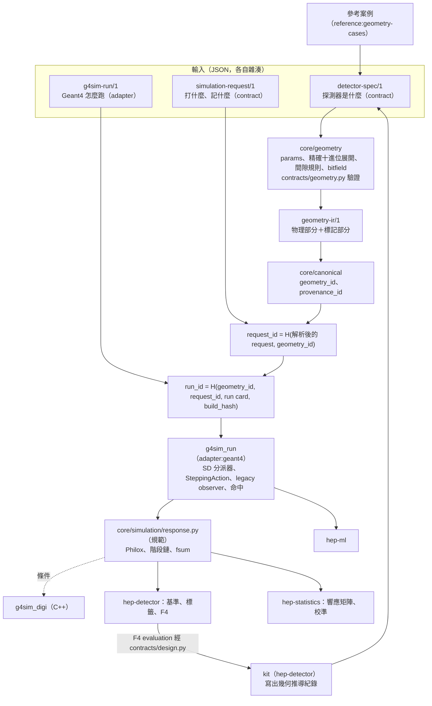
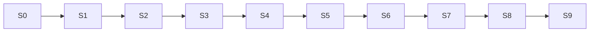

# g4sim 通用模擬架構與 hep-research 整合：定案規劃

| 欄位 | 內容 |
| --- | --- |
| 版本 | 2026-11-04 彙整版。內容等同第 11 版，刪除了正文中的版本沿革說明，並加上文件開頭的閱讀說明與附錄 C 的審查歷程。本文件自成一體，不需要參照任何先前的版本或回應文件 |
| 對象 | hep-research plugin 0.54.0；`adapters/geant4` 0.6.0、`adapters/detector-simulation` 0.4.0、`skills/hep-detector`；Geant4 11.4.3 |
| 狀態 | 架構凍結，待維護者核准（第 19 節 S0）。只接受設計錯誤的修正：內部矛盾、分期依賴缺口、統計設計錯誤，以及原型閘門否證了某項目標行為（第 23 節） |
| 路徑 | 除非另外說明，皆相對於 plugin 根目錄；Geant4 路徑相對於 v11.4.3 原始碼根目錄 |
| Geant4 行為 | 本文凡依賴 Geant4 行為之處，都寫成**目標行為**並編號 GB1 到 GB24（第 23 節），在 S1 到 S3 以原型測試確認。引用的原始碼路徑與行號只說明依據，不代表行為已確認 |

---

## 閱讀說明

**這份文件是什麼**：hep-research plugin 新增「g4sim」的完整設計與實作分期。目的是讓研究探測器只寫 JSON 規格、不寫 C++，就能跑 Geant4 模擬、數位化響應、做驗證，並接上既有的設計迴圈（F4）。它是設計文件，還沒有任何實作程式碼。

**接手時先讀**：

1. 第 0 節（一頁摘要）與第 1 節（名詞表）。
2. 第 19 節（分期與閘門）：工作依 S0 到 S9 的順序進行，每一期有內容、閘門與版本提升。
3. 第 23 節（目標行為 GB1–GB24）：設計所依賴、但尚未確認的 Geant4 行為，以及確認它們的原型測試。
4. 第 20 節（決策紀錄）：S0 要核准的決策。
5. 第 22 節（待核准與待查證事項）：還沒決定或還沒查證的事。

**各節的角色**：

| 節 | 內容 |
| --- | --- |
| 0–5 | 摘要、名詞、目標與非目標、設計原則、與 plugin 現況的對應、架構總覽與分層 |
| 6 | 三份輸入規格：`detector-spec/1`、`simulation-request/1`、`g4sim-run/1` |
| 7 | 幾何 IR、身分（`geometry_id` 等）、數值與幾何合法性、legacy 模式 |
| 8–9 | 執行（`g4sim_run`）、記帳與守恆、scorer 與命中 |
| 10 | 響應管線：亂數（Philox）、加總、閃爍與光收集 |
| 11–14 | 物理配置、kit、參考案例、設計迴圈與 F4 |
| 15 | 檢查與負向測試一覽（依期別） |
| 16–18 | 規模、條件與對準、相容與回歸（T1、T2） |
| 19 | 分期與閘門 |
| 20–22 | 決策、風險、待核准與待查證事項 |
| 23 | 目標行為與原型閘門 |
| 24 | 後續文件審查的範圍 |
| 附錄 A–C | 評估摘要、檔案與模組清單、審查歷程 |

**閱讀時要注意的約定**：

- **「目標行為」不是已確認的事實**：寫成「依目標行為 GBn」或「（GBn，Sx 確認）」的地方，都要等第 23 節的原型通過才算成立。原型否證時依第 23 節的程序處理，不能自行改寫設計。
- **兩種檢查**：check-spec 只放與 Geant4 行為相關的檢查（adapter）；與 Geant4 無關的響應管線檢查是「響應檢查」（`core/simulation`）；幾何的合法性由 `core/geometry` 計算、`contracts/geometry.py` 判定（第 5.2 節）。
- **T1 與 T2**：舊結果的回歸分兩級。T1 要求逐位元相同（legacy 區塊 `source: probe`）；T2 用聯合等價檢定（`source: translated`）。每個已記錄的 run 歸入哪一類，由 S1 的盤點表決定（第 7.4 節）。
- **門檻都在執行前固定**：以任務卡的預先登錄保證（第 19.2 節開頭）。本文給的數值多是預設值，任務卡可以收緊、不能放寬。
- **代號只在本計畫內有效**：S0–S9、T1、T2、GB1–GB24 與 plugin 其他文件中的同名代號無關（第 1 節）。

**如果你要動手做**：先做 S0（第 19.2 節）：取得第 20 節決策的核准，寫出每一期的任務卡並預先登錄。之後依期別進行，每一期只能使用更早的期已提供的模組與已確認的目標行為。

---

## 0. 一頁摘要

**目標**：中等複雜度的研究探測器只寫規格、不寫 C++，就能完成模擬、響應、驗證，並接上設計迴圈。

- 涵蓋的探測器類型：量能器、tracker、TOF、TRD、RICH、veto，以及它們的組合。
- 各實驗（CMS、LHCb、ePIC、AMS-02 等）的探測器只作為設計參考與覆蓋測試，不與它們的軟體對接。

**架構核心**：

1. **三份輸入，各自雜湊**
   - `detector-spec/1`（contract）：探測器是什麼。
   - `simulation-request/1`（contract）：打什麼、記什麼。
   - `g4sim-run/1`（adapter 自有）：Geant4 怎麼跑。
   - 三份都是 JSON。
2. **單一幾何 IR**
   - `core/geometry` 把 detector-spec 展開成 `geometry-ir/1`；C++ 只讀 IR。
   - 所有長度與角度都以精確十進位運算計算：Python `decimal`，34 位有效數字，round-half-even。這套運算在任何平台上都得到相同的結果，所以不需要量化。
   - 幾何的合法性由間隙規則保證：兩個面要嘛完全重合，要嘛至少相隔 1×10⁻⁶ mm（Geant4 預設表面容差的 1000 倍）。
3. **身分**
   - `geometry_id` 是 IR 物理部分的雜湊；物理部分包括座標系，以及每個 logical 實際所屬的 region 與場。
   - 標籤與來源不進入 `geometry_id`。detector-spec 中以標籤選取的物理需求，展開成明確的 logical 模板清單後寫入物理部分；所以只改標籤而選取對象不變時，`geometry_id` 不變。
   - `request_id` 的雜湊輸入包含 `geometry_id`。
   - 計算身分用的正規化與雜湊，集中在新的 `core/canonical`：只用標準函式庫，steward 是 hep-computing。
4. **共同語言**：cellID 加上四種命中。探測器類型的差異收在 hep-detector 的 kit 與響應管線的參數；執行期沒有類型分支。
5. **響應以 Python 為準**
   - Philox4x32-10 的整數層，以及由整數構造的均勻數，在任何語言、任何平台都逐位元一致。
   - 同一個實作內，結果與處理順序及平行切分無關；分塊之間傳遞精確部分和，只在最後捨入一次。
   - 加總採用與 CPython `math.fsum` 相同的正確捨入演算法。
   - 經過超越函數的抽樣值，在 Python 與 C++ 之間只保證在宣告容差內一致。
6. **舊結果可重現**
   - legacy 模式把兩個舊程式的觀測量程式碼原樣移植成 legacy observer；T1 類 run 的位置、材料與物理過程清單取自補取建置的 ProbeV2 紀錄，T2 類 run 由轉譯器從舊規格換算（第 7.4 節）；記帳方式與舊程式相同。目標是 T1 類 run 逐位元重現；這依賴第 8.5 節的前提與目標行為 GB1、GB2、GB6、GB7、GB18、GB22，由 S1、S2 的原型閘門確認。
   - 新規格使用新的 scorer 與分離式記帳。

**整合方式**：沿用 plugin 既有的規則：分層方向與收錄規則（`docs/architecture.md`）、study protocol 的「驗證不是確認」與第 1、5、6 節、狀態詞彙、Geant4 計畫的 G5 閘門、獨立 worktree、中英雙語文件。

**分期**：S0 到 S9，依賴是線性的。每一期都：

- 列出它用到的模組，這些模組都由前面的階段提供。
- 給出可以客觀判定的閘門門檻，並在執行前固定。
- 列出每個受影響元件的版本提升。
- 任務卡附「待驗證清單」，列出這一期要以原型確認的目標行為（第 23 節）。

**審查方式**：架構已凍結。之後的文件審查只審內部一致性、分期可行性與統計設計；Geant4 的行為不再以文件審查判定，改由 S1 到 S3 的原型閘門驗證（第 24 節）。

---

## 1. 名詞表

| 名詞 | 定義 |
| --- | --- |
| detector-spec | `detector-spec/1`：探測器本身的描述，包括幾何、材料、讀出、磁場、物理需求；只寫需求，不寫 Geant4 的數值設定 |
| simulation-request | `simulation-request/1`：源、參考面、scorer（含時間窗與分攤門檻）、真值保存規則 |
| run card | `g4sim-run/1`：物理清單、cut、步長限制值、XTR 輻射體類別、殺粒子政策、記帳模式、磁場積分、事件數、種子、執行緒、分塊 |
| IR | `geometry-ir/1`：解析後的幾何中間表示，分成物理部分與標記部分 |
| 精確十進位運算 | Python `decimal`，有效數字 34 位，round-half-even；三角函數以 40 位計算後再捨入到 34 位，演算法寫在 `core/geometry` 中 |
| 算術下限 ε | 1×10⁻²⁰ mm。兩個面的精確差小於 ε 時，視為同一個面；這只吸收 34 位運算本身的捨入，例如 1/3 + 1/3 + 1/3 得到 0.999…9 |
| 最小間隙 c | 1×10⁻⁶ mm。兩個面若不重合，間距必須 ≥ c |
| 模板 | 一個 G4 logical volume 加上它的子擺放；尺寸與擺放位置無關 |
| 擺放 | 模板放進母模板的規則 |
| 修飾 | 加在擺放上的語法糖 |
| 分段 | 在體積本地座標中切分讀出格，不放實體體積 |
| cellID | 讀出格的整數 ID，由 `readout-encoding/1` 的 bitfield 編碼；總長最多 64 位元。同一個擺放的 copy number 欄位寬度總和最多 31 位元（G4 的 copy number 是 32 位元有號整數，多索引按位元打包，第 6.2.6 節），虛擬分段欄位最多 53 位元 |
| 可見能量 | 逐 step 經 Birks 修正後的沉積；scorer 物理量 `edep_visible` |
| 整數層 | Philox 輸出的整數字，以及只用整數運算構造的均勻數 |
| 記帳模式 | `legacy`：與舊程式相同，由 legacy observer 處理；`separated`：被殺粒子的能量另外記帳，不算成沉積 |
| 未釋放能量 | 被殺的不穩定粒子若依 Geant4 的衰變表繼續衰變到穩定粒子，會再釋放的能量（衰變鏈的 Q 值）；第 8.4 節 |
| 能量當量 E_eq | 記帳時一個粒子代表的能量：E_eq = 動能 + U（不用 ε，ε 已是算術下限）。U(e⁺) = 2m_e c²；不穩定粒子的 U 是它的未釋放能量（已含鏈中每個 e⁺ 的 2m_e c²）；其他粒子 U = 0。入射、分面流出、世界逸出與被殺能量一律使用 E_eq，每個粒子的 U 只計一次（第 8.4 節） |
| 終止類別 | 每個 track 結束時恰好歸入一類：物理終止、世界逸出、被殺、光學光子。只有「被殺」進入被殺能量項；光學光子不進入任何能量恆等式（第 8.4 節） |
| 目標行為 GBn | 設計所依賴、但尚未以原型確認的 Geant4 行為；第 23 節列出每一項的依賴處、原型測試與期別 |
| Philox 輸出組 | Philox4x32-10 一次呼叫輸出的四個 32 位元字，構成 2 個均勻數（第 10.2 節） |
| 分塊 | run card 的 `chunk`：每個平行工作單位的事件數。分塊不進入 Philox 的 key 或 counter，所以結果與分塊方式無關。它與 study spec 的 `blocks.K`（summary 的 batch-means 區塊數，K ≥ 16）是不同的東西：g4sim 的 summary 一律使用 study spec 宣告的 `blocks.K`，run card 不再有 `blocks` 欄位 |
| 體積 ID | 每個放置後的體積（touchable）在整個幾何中唯一的整數，由各層 copy number 乘上 IR 的 stride 組成，與 cellID 的組法相同；S1 起寫入 IR 的物理部分（第 7.1 節）。各層 copy number 的位元寬度總和 ≤ 64（體積 ID 放進 counter 的兩個 32 位元字），每個 stride 都在 canonical 整數上限 ±(2⁵³ − 1) 內；超出時 `contracts/geometry.py` 拒絕 |
| Birks 變數 x | 一個 step 的沉積在 `G4EmSaturation` 中被除以 1 + k_B x 的那個量；依 step 的種類定義（第 8.8 節） |
| 幾何種類 | 設計候選的選用欄位 `geometry_kind`；決定設計迴圈使用哪一份設計幾何映射檔；缺省為 `layered-spectrometer`（第 14.3 節） |
| `run_id` | 本文的 `run_id` 指 g4sim 的執行身分（第 7.2 節）；detector-simulation adapter 既有的執行身分一律寫成「detsim run_id」 |
| legacy observer | 從 `layered_sim` 與 `element_sim` 的 `Actions.cc` 原樣移植的觀測量程式碼，只在 legacy 模式下使用；它需要的舊規格資訊（role、mother、量能器索引）放在 IR 物理部分的 legacy 區塊 |
| kit | hep-detector 擁有的探測器類型產生器，輸出 detector-spec 與幾何推導紀錄 |
| 參考案例 | 依公開 claim 重建的代表性子系統；比對結果記為「與引用值的比較」 |
| `zdcsim.cc` | 使用者自己的 ZDC ECAL 研究程式（約 550 行 C++），不在 plugin 中，屬於使用者提供的材料；S3 以它作為比對基準（第 19.2 節） |
| 決策 D0 | Geant4 計畫（`docs/dev/geant4-architecture/geant4-program.md` §P.7.1）既有的決策：偵測器層級的 Geant4 研究如何成為 F4。本計畫不修改它 |
| GL1 至 GL6 | 本計畫的目標代號（第 2.1 節） |
| G5 | Geant4 計畫的閘門：聲明新的 C++ 程式依 Geant4 API 撰寫、未複製或改寫任何範例程式碼，由審查者在 VALIDATION 條目中確認。與 `docs/architecture.md` 中同名的 live test 是不同的東西 |
| E2、E5 | `docs/capability-matrix.md` 定義的執行環境。E2：macOS arm64，Geant4 11.4.3 自建。E5：RHEL 9 x86_64，conda-forge 的 Geant4 11.4.3。兩者實際安裝的資料集與功能（例如 G4NDL、GDML）以安裝記錄為準，S1 查證並寫入任務卡；`capability-matrix.md` 沒有記載 G4NDL、GDML 等資料集在兩個環境的差異，不得預設 |
| T1、T2 | 回歸的兩級。T1 要求逐位元相同；T2 使用事先宣告的聯合等價檢定（第 18 節） |
| 代號的範圍 | 本文的 S0 到 S9（分期）與 T1、T2（回歸等級）只在本計畫內有效，與 `docs/protected-data-architecture.md` 的能力階段 S0–S4、威脅層 T1–T6 無關；G5 的區分見上 |
| L1、L2、L3 | 參考案例的細節層級：L1 到材料量；L2 到讀出分段；L3 到響應 |

---

## 2. 目標、範圍與非目標

### 2.1 目標與判準

| 代號 | 目標 | 判準 |
| --- | --- | --- |
| GL1 | 研究幾何不寫 C++ | ZDC 的三種幾何、AMS 類磁譜儀片段與宇宙線源，都只用規格表達 |
| GL2 | 舊結果可以重現 | J14、J15、TestEm3 與 TestEm5 鏡像、設計搜尋的已記錄 run，依第 7.4 節的盤點表：T1 類在 legacy 模式下通過 T1，T2 類通過 T2，「無法回歸」類逐一列出並說明原因 |
| GL3 | 每個數字可溯源 | 每個數值都能經 JSON Pointer 找到 `source_of_facts` |
| GL4 | 每個輸出都能獨立檢查 | 每個模組至少有一個負向測試，會被對應的檢查攔下 |
| GL5 | 支援模擬參數校準 | 源輸出解析密度（R 層）；scorer 與響應輸出重數位化所需的中間量，包括可以事後改變 Birks 常數的分類沉積（D 層）；`scan` 產生設計點（S 層） |
| GL6 | 規模 | 10⁵ 個擺放、10⁶ 個虛擬讀出格；預算在 S1 寫成文件，在 S2 與 S8 檢查 |

### 2.2 非目標

- 與 CMSSW、Gauss、npsim、AMS 官方模擬等實驗軟體對接或互通。
- 完整重現任何實驗的正式模擬。
- 時間相依的幾何、堆積與事件疊加。這些屬於數位化層，本計畫只預留介面。
- 任意 CSG 與布林實體。
- 非均勻材料。
- 電場、漂移與電子學的第一原理模擬。
- 重建演算法本身。
- 包裝 DD4hep。
- 方向相依的光收集效率圖（第 10.4 節）。
- 偏壓、電場與摻雜的感測器模擬。這屬於 detector-simulation 的範圍；它的 Allpix² 後端已有 `allpix.pixel-charge` capability（adapter 0.4.0，`docs/capability-matrix.md`）。
- YAML 或 TOML 撰寫格式。規格只接受 JSON（第 6.5 節）。

---

## 3. 設計原則

1. **規格描述物質、讀出與請求，不描述探測器種類。** 標籤只用來選取，本身不進入 `geometry_id`；選取的結果（展開後的模板清單）才進入。
2. **物質與讀出分離。** 幾何只放實際存在的物質；讀出格可以是實體，也可以是虛擬分段。
3. **單一事實來源。** 重複的數由 `params` 推導；cellID、address map、event display、GDML 都由 IR 衍生。
4. **不做隱式修正，也不產生隱式重疊。**
   - 長度與角度以精確十進位運算得到。
   - 合法性由間隙規則檢查：兩個面要嘛重合，要嘛相隔至少 c；子體積必須在母體內。
   - 任何違反都報錯。
5. **身分只取決於物理內容。**
   - `geometry_id` 涵蓋 IR 的物理部分。
   - 標籤與來源進入 `provenance_id`。
   - `request_id` 的雜湊輸入包含 `geometry_id`。
6. **決定性的範圍要寫清楚。**
   - Geant4 執行：新規格一律使用逐事件種子（`per-event`），依事件 ID 排序後合併，serial 與 MT 逐位元相同。legacy 模式另支援舊程式的 `stream` 模式，只用於重現以它錄製的 run。
   - 響應：使用三層保證（第 10.2 節）。
7. **源要宣告密度型別。** `analytic` 源輸出解析密度；`external` 源會被校準流程拒收。
8. **沒有檢查的模組不能註冊。** 每個模組必須交齊六項必交內容（第 15.4 節）。
9. **舊程式是新程式的特例。** legacy 模式的目標是產生與舊程式相同的體積樹、雙精度位置、物理過程清單、觀測量與記帳方式；由 S1、S2 的原型閘門確認（第 23 節）。
10. **驗證不是確認。**
    - adapter 只證明實作正確；物理表現由 hep-detector 依 study protocol 判定。
    - 確認需要獨立參考與負向控制（protocol 第 1、5 節）。

---

## 4. 現況與重用（plugin 0.54.0）

| 既有元件 | 現況 | 在新架構中的角色 |
| --- | --- | --- |
| `adapters/geant4`：`layered_sim` | 規格驅動；觀測量包括 `edep_<name>_MeV`、`chlen_<name>_mm`、`plen_<name>_mm`、依粒子種類分項的逸出、`killed_booked`、`killed_unbooked`、`killed_eplus`、主粒子結局與次級粒子計數；分面洩漏依粒子離開 world 時 post-step 的 x 位置分類（`Actions.cc` 第 261–273 行） | 變成 `g4sim_run` 的一個 preset；觀測量程式碼原樣移植成 legacy observer |
| `adapters/geant4`：`element_sim` | 規格驅動；分面洩漏是包絡的淨流出，主粒子第一次進入包絡時不扣除（`Actions.cc` 第 360–380 行） | 同上 |
| 兩個舊程式的共通點 | 兩種種子模式：`stream`（`layered_sim` 的預設，J14 的已記錄 run 使用，`geant4-program.md` §A1.4、§A2.2）與 `per-event`；只有 `per-event` 已驗證 serial 與 MT（1、2、4 執行緒）逐位元相同，`stream` 模式下不同的執行緒數與切法會得到不同的事件；SteppingAction 依 pre-step 的 touchable 歸屬 step。編譯時都沒有設定 `-ffp-contract=off`（只有 `simreco` 有設定），所以位置運算是否被合併成 FMA 取決於編譯器 | 已記錄的 run 是 T1 的基準；legacy 模式直接取用舊程式回寫的 double 位置，因此不需要在 Python 中重現它們的浮點運算（第 7.4 節） |
| `adapters/geant4/assets/g4sim/` | 種子、雜湊、summary、觀測量、材料、物理、探針的共用標頭 | 新程式的基礎；新增 IR 讀取、`Readout.hh`、`Philox.hh`、SD 分派器、`KillProcess`、legacy observer、命中寫出 |
| `geant4_run.py`、`geant4_verify.py`、`geant4_build.py register` | 執行、檢查、安裝記錄 | 依 `schema` 欄位分派新舊規格；檢查推廣到任意 IR；依安裝功能與資料集決定可用模組 |
| `simroot`、`simreco` | 讀事件檔；不需要 Geant4 的數位化與重建 | simroot 讀新的命中檔；simreco 的 strip 數位化登記為響應第 5 階段的一個實作 |
| `adapters/detector-simulation` | Garfield++ 後端：一維氣體表查詢，可以取得 B = 0 時的電子漂移速度（`garfield.gas-table-query`）。Allpix² 後端有 `allpix.pixel-charge` 1.0.0（tested-in-declared-environment） | Garfield++ 的漂移速度表可作為響應第 2 階段的輸入；電荷分享表是否能由 `allpix.pixel-charge` 提供，在 S4 之前查證，不能時才需要該 adapter 新增 capability |
| `core/provider/hashing.py` | `canonical_json`、`canonical_sha256`，以及 provider 協定的 point hash（`point_key`、`point_hash_object`、`point_hash`） | `canonical_json` 與 `canonical_sha256` 的實作搬入 `core/canonical`，本檔改為重新匯出；point hash 函式留在本檔，維持原樣 |
| `core/protected/revocation_log.py`、`contracts/recipe_semantics.py`、`contracts/release_manifest.py` | 各自實作的 `canonical_sha256`，與上一列位元組一致；`contracts/design.py` 也從 `contracts/release_manifest.py` 匯入它。`revocation_log.py` 屬於受保護使用的 core 程式；`release_manifest.py` 是 custodian 工具；`recipe_semantics.py` 是 advisory 的 agent 工具 | 不修改，只以等價測試確認一致；`design.py` 的匯入也維持不變。不修改的目的只是縮小變更範圍與審查面：qualification record 綁定的是整個 release bundle 的 code identity，每一期的任何修改都會使它改變（第 21 節） |
| `adapters/detector-simulation/assets/detsim_canonical.py` | 從 `contracts/recipe_semantics` 與 `core/provider/hashing` 匯入雜湊；自有 `check_hash_scope`、`normalize_decimal`、`load_json_strict` | 三個自有函式搬入 `core/canonical`；改為從 `core/canonical` 匯入；detsim 的讀取路徑與 plan_digest、run_id 不變 |
| `core/simulation`（steward：hep-detector） | 種子雜湊、summary、解析螺旋線 | 擴充 Philox、命中封閉、響應、源密度 |
| `contracts/design.py` | F4 檢查固定讀取 `rules/design_geometry.json`（`GEOMETRY_FILE`，第 78、995、1051 行），以其中 layered-spectrometer 的欄位重算 `parameter_digest`；要求 study 記錄的 `input_manifest` 含有 `geometry_ref` 指向的檔案與它的 SHA-256 | 依設計候選的 `geometry_kind` 選擇映射檔；缺省時行為與現在完全相同（第 14 節） |
| `skills/hep-detector/scripts/evaluate_design.py` 的 `geometry` 與 `f4` 子命令 | 兩者都讀取同一份 `GEOMETRY_FILE`：`geometry`（第 521 行起，讀取在第 530 行）寫出設計幾何檔（參數、`parameter_digest`、figure of merit 與分母）；`f4`（第 558 行起，讀取在第 629 行）讀映射表的 `figures_of_merit` 並重算 `parameter_digest` | 兩個子命令都與 `design.py` 用同一個選擇函式選擇映射檔（第 14.3 節） |
| `contracts/schemas/ext_design_candidate.json` | 設計候選；頂層 `additionalProperties: false`，沒有幾何種類欄位 | 新增選用欄位 `geometry_kind`、`geometry_id`、`geometry_derivation_ref`（第 14.3 節） |
| `contracts/rules/design_geometry.json` 與 `contracts/schemas/design_geometry.json` | 單一幾何（`geometry: layered-spectrometer`）的映射表；schema 必填 `mapping_version`、`geometry`、`fields`、`figures_of_merit`，頂層 `additionalProperties: false`，`mapping_version` 只能是 1.0.0 或 1.1.0 | 改為「每種幾何一個映射表」：既有檔案保留為 layered-spectrometer 的映射，新的幾何種類各自一個檔案；schema 以 `oneOf` 新增 1.2.0 的形式，唯一新增的欄位是必填的 `kit`（第 14 節） |
| hep-detector：study protocol、`check_geant4_study.py`、`geant4_benchmarks.py`、`geant4-physics-rules.json`、`geant4-study-spec.schema.json` | study 規格、收斂閘門、確認階梯、物理規則、標籤、F4 | 規則引擎改讀三份規格；study spec 新增 `physics.g4sim`；新增 kit 基準。物理清單 → 所需資料集對照表放在 contracts（`contracts/rules/geant4_datasets.json`，內容由 hep-detector 維護），因為 adapter 也要讀它 |
| `profiles/reference/detector-atlas`、`profiles/experiments/eic`、`ams-02` | 來源化的 claim | 參考案例的數字來源 |
| `docs/dev/frontend-electronics`（FE 系列） | 前端電子學計畫；FE1–FE4 是 hep-detector 的腳本 | 響應第 4 階段的一個實作。core 不匯入 skill：管線在第 3 與第 4 階段之間寫出中間檔（`response-pipeline/1` 的階段交接格式），FE4 讀取後寫回，由 core 讀回接續；FE4 改接這個檔案介面 |
| `zdcsim.cc`（使用者提供） | 使用者的 ZDC ECAL 研究程式，不在 plugin 中 | S3 的比對基準；以使用者提供的材料登記（第 19.2 節） |

依賴限制：

- `core` 與 `contracts` 可以依賴標準函式庫、numpy、scipy、matplotlib、sympy。
- `core/canonical` 與 `core/geometry` 的精確十進位部分刻意只用標準函式庫。
- skill 不能被 contracts 或 adapter 匯入。

---

## 5. 架構總覽

### 5.1 資料流



### 5.2 分層放置

| 層 | 可依賴 | 新增或修改 |
| --- | --- | --- |
| `core/` | 標準函式庫、numpy、scipy、matplotlib、sympy | 新增 `core/canonical`（steward：hep-computing；只用標準函式庫）；新增 `core/geometry`（steward：hep-detector）；擴充 `core/simulation`、`core/constants/data` |
| `contracts/` | core | 新增 schema、`contracts/geometry.py`、`rules/geant4_datasets.json`；修改 `design.py`、`schemas/design_geometry.json`、`schemas/ext_design_candidate.json`；新增各幾何種類的映射檔 |
| `adapters/geant4` | core、contracts | 新增 `g4sim_run`、run card schema、轉譯器、legacy observer、`g4sim/ProbeV2.hh`、check-spec；擴充 verify、simroot（現行 `SimProbe.hh` 不修改） |
| `adapters/detector-simulation` | core、contracts | `detsim_canonical.py` 改為從 `core/canonical` 匯入 |
| `skills/hep-detector` | core、contracts | 新增 kit 資料與 `g4kit.py`（寫出幾何推導紀錄）；修改 study spec、規則引擎、基準、protocol、`evaluate_design.py` |
| `profiles/reference/geometry-cases` | core、contracts、宣告的 profile | 新增 |

**交接方式**：skill、adapter、contracts 之間沒有不允許的 import。kit 以規格檔與推導紀錄檔交接，`contracts/design.py` 只讀這些檔案。adapter 需要的資料（例如資料集對照表）都放在 contracts。

**檢查的歸屬**：

- `core/geometry`：幾何的純計算，包括展開、間隙規則與包含的計算、bitfield 推導、材料量。
- `contracts/geometry.py`：規格與 IR 的 schema、單位、claim 解析，並呼叫 `core/geometry` 的計算判定幾何合法性。
- adapter 的 check-spec：只放與 Geant4 行為相關的檢查，例如 PAI 合併語意、時間截斷、XTR、記帳模式的限制。
- `core/simulation` 的響應檢查：與 Geant4 無關的響應管線檢查，例如 Philox key 互不相同、子索引上限、first_event + 事件數 ≤ 2³²、r < 0.15 或 r > 1 的材料必須有驗證 run。它們讀取 run card 與 IR 的值，但不屬於 Geant4 行為，所以不放在 check-spec。第 10.2、10.3 節所稱的「響應檢查」都是這一類。

**放置規則**：

- 通用計算、而且有兩個以上的頂層使用者 → core。
- 跨元件的交接格式 → contracts。
- 執行 Geant4 或外部程式 → adapters。
- 探測器類型的知識與物理判定 → hep-detector。
- 特定實驗的內容 → profiles。

---

## 6. 三份輸入規格

### 6.1 劃分判準

一個欄位改變時，如果探測器本身沒有改變，它就不屬於 detector-spec。依這條判準：

- 步長限制值、時間截斷、production cut、磁場積分精度，以及 Geant4 的模型選擇（例如 PAI 或 PAIphoton、XTR 的輻射體類別），都放在 run card。
- detector-spec 只宣告需求，不寫 Geant4 的設定。探測器本身的物理參數屬於 detector-spec，例如 TRD 輻射體的箔厚、間隙、箔數、輻射體的結構（規則的箔堆疊，或纖維、泡棉這類厚度不規則的輻射體），或材料的 Birks 常數。
- 以 XTR 為例：輻射體是規則還是不規則，是探測器本身的性質，寫在 detector-spec；用哪一個 Geant4 輻射體類別來模擬它，是 Geant4 的模型選擇，寫在 run card。check-spec 確認兩者相容（第 11 節）。

| 區塊 | `detector-spec/1` | `simulation-request/1` | `g4sim-run/1` |
| --- | --- | --- | --- |
| 歸屬 | contract | contract | adapter:geant4 自有 |
| 內容 | `params`、材料、座標系、模板與擺放、讀出、磁場、物理需求（不含 Geant4 設定） | 源、參考面、scorer（含 `time_window_ns`、分攤的短 step 比例與弦高的剛度門檻）、真值保存規則 | 物理清單與 EM 選項、附加 constructor、`AddPAIModel` 清單、各 region 的 cut 與步長限制值、殺粒子政策、記帳模式、磁場積分、事件數、種子、執行緒、分塊 |
| 身分 | `geometry_id`、`provenance_id` | `request_id` | 併入 `run_id` |
| 寫出者 | 使用者、kit、轉譯器 | 使用者、study 範本、轉譯器 | 使用者、轉譯器 |

### 6.2 detector-spec/1

#### 6.2.1 形狀

| 形狀 | 參數（全長，單位 mm） | 期 |
| --- | --- | --- |
| `box` | `size_mm` (x, y, z) | S1 |
| `trd` | 兩端的寬度、長度 | S3 |
| `tube` | rmin、rmax、長度、φ 範圍 | S3 |
| `polygon_prism` | 邊數、外接半徑、長度（展開器換算成 `G4Polyhedra` 的切距，GB23） | S3 |
| `cone`、`sphere_section`、`polycone`、`polyhedra` | 依 G4 對應形狀的參數；`polyhedra` 的半徑與 `polygon_prism` 相同，規格寫外接半徑，展開器換算成切距（GB23） | S7 |

規格一律寫全長，由展開器換算成 G4 的半長。

#### 6.2.2 模板與擺放

模板在 S1 就提供，包括模板宣告、子擺放清單與巢狀。

| 擺放 | 參數 | 索引 | 期 |
| --- | --- | --- | --- |
| `single` | 中心、旋轉（S1、S2 只接受 90 度整數倍；任意角度在 S3 隨旋轉擺放的檢查開放） | 無 | S1 |
| `linear` | count、pitch 向量、起點 | n | S1 |
| `stack` | 軸、起始面、序列（模板或 `spacer_mm`）、repeat | layer | S1 |
| `grid` | n = (nx, ny[, nz])、pitch、格點中心，以及選用的 `stagger` | i, j[, k] | S3 |
| `ring` | n_φ、半徑、φ₀、朝向（徑向或固定）、傾角、徑向交錯 | φ | S3 |
| `explicit` | 位置清單，或 CSV（記錄雜湊） | n | S3 |

`grid` 的位置參數指整個格點的中心，不是第一格。

#### 6.2.3 修飾

| 修飾 | 內容 | 期 |
| --- | --- | --- |
| `shell` | 語法糖：產生一個 wrapper 模板（晶體加上包覆層，依作用面決定偏移），晶體放在 wrapper 裡。空間不夠時報錯 | S3 |
| `clip` | 依格子中心是否在包絡內（`centre_inside`），或格子是否完全在包絡內（`fully_inside`），決定丟棄哪些格子。不叫 `select`，以免與 scorer 和物理需求的標籤選取 `select` 混淆 | S3 |
| `absent` | 依索引移除物理上不存在的格子；被移除的索引保留空號 | S3 |

#### 6.2.4 模板語意

- 模板的尺寸只由 `params` 決定，與擺放位置無關，所以一個模板只對應一個 G4 solid。
- 子體積出現在母模板的每一個複本裡，而且每個複本的內容相同。
- 物理上真的不同的複本，宣告成不同的模板；只是讀出上的差異，在讀出層以 cellID 遮罩處理。
- 讀出關聯直接來自巢狀結構。

#### 6.2.5 座標系與旋轉

- 擺放座標預設是母模板的本地座標；`frames` 可以命名座標系。
- 源與參考面必須寫明所用的座標系。座標系解析後寫入 IR 的物理部分。
- 旋轉：
  - 規格一律使用 active rotation（ZYX 歐拉角或軸加角），由展開器換算成 G4PVPlacement 需要的 passive 矩陣，並做往返測試。
  - 90 度整數倍的旋轉使用精確整數矩陣。
  - 其他角度的 sin 與 cos，以 40 位精確十進位計算後再捨入到 34 位。

#### 6.2.6 讀出與分段

- **bitfield**：每個讀出系統宣告一個 bitfield；總長最多 64 位元。由 copy number 組成的欄位最多 31 位元，因為 G4 的 copy number 是 32 位元有號整數；虛擬分段欄位最多 53 位元。
- **cellID 的計算**：每個擺放在 G4 中的 copy number 是它的本地索引按位元打包的結果：多索引擺放（例如 `grid` 的 i、j[, k]）的 copy number = i + 2^{w_i}·j + 2^{w_i + w_j}·k，w 是各索引在 bitfield 中的欄位寬度；單索引擺放就是索引本身。所以同一個擺放的各欄位寬度總和必須 ≤ 31（G4 的 copy number 是 32 位元有號整數）。執行期由各層 copy number 乘上預先算好的 stride 組成 cellID；因為 copy number 已按欄位寬度打包，解碼後的欄位字典等於實際索引。
- **分段型別**（全部在 S3 提供）：`none`、`along_axis`、`cartesian_xy`、`cartesian_xyz`、`polar`。

#### 6.2.7 材料

- NIST 名稱，或自訂元素組成與密度。
- 電離參數：Birks 常數、平均激發能。
- 光學性質：
  - 折射率、吸收長度。
  - Rayleigh 散射長度。
  - Mie 參數（選用）。
  - 閃爍：產額、`RESOLUTIONSCALE`，以及各成分（最多三個）的產額比例、能譜、上升時間與衰減時間。
  - WLS：吸收長度、發射譜、時間常數。
- 光學表面：模型、拋光度、反射率、偵測效率。
- 每個數值都附 `source_of_facts`。

#### 6.2.8 磁場

- 均勻場區（S3）或場圖（S7，記錄雜湊），掛在模板上。積分參數寫在 run card。
- **目標行為 GB3**：`G4LogicalVolume::SetFieldManager` 只把場傳給還沒有場的子 logical（依據：`source/geometry/management/src/G4LogicalVolume.cc` 第 264–279 行）。若如此，一個由兩個不同的母體共用的模板，會留下先設定的那個場，結果取決於設定順序。下列規則的設計不依賴這個傳遞規則是否成立：builder 對每個 logical 都明確設定；S2 的原型閘門確認明確設定的結果與呼叫順序無關。
- **本計畫的規則**：
  - `contracts/geometry.py` 為每個 logical 計算它實際所屬的場：自己宣告的場，或繼承自母體的場。「沒有場」也是一種值。結果寫入 IR 的物理部分。
  - 同一模板若經由不同的母體繼承到不同的值（包括一處有場、一處沒有場），而它本身沒有宣告場，就拒絕。
  - **builder 的設定方式**：builder 先建好整棵 logical 樹，再以前序（母體在前、子體在後）走訪，為每個 logical 明確呼叫一次 `SetFieldManager(fm, false)`，`fm` 是 IR 指定的場；「沒有場」使用一個 detector field 為 nullptr 的 field manager，不使用 B = 0 的均勻場，因為後者會讓帶電粒子走 `G4PropagatorInField` 的路徑而改變 step 序列。因為每個子 logical 稍後都會被明確覆寫，預期 Geant4 的傳遞規則與呼叫順序都不會影響最後結果（GB3，S2 確認）。
  - **MT**：field manager 是 thread-local 的，所以這個設定在 master 與每個 worker 的 `ConstructSDandField` 中各做一次。
  - **legacy 模式**：保留舊程式的 field manager 指派方式，不套用上述規則；S2 以回寫比對確認與舊程式相同。
  - **執行期驗證**：體積樹回寫輸出每個 logical 的 field manager 識別與 region 名稱，`geant4_verify.py tree` 與 IR 比對。probe 只在 master 上記錄，所以 S2 另以測試掛點在每個 worker 回寫 field manager 的指派，與 master 的紀錄比對。

#### 6.2.9 物理需求

只宣告需求，不寫數值：

| 需求 | 必填欄位 | check-spec 的檢查 |
| --- | --- | --- |
| `thin_layer_ionisation` | region、粒子清單 | run card 對每個（region、電離 process 名稱）只寫一筆 PAI 請求（模型 `PAI` 或 `PAIphoton`）；需求以下方的實際粒子集合判定；check-spec 依下方的 PAI 語意檢查 |
| `transition_radiation` | 輻射體包絡模板、輻射體結構（`regular` 或 `irregular`）、箔材料、氣體材料、箔厚、間隙、箔數；`irregular` 另需箔厚與間隙的分佈參數 | 第 11 節的 XTR 一致性規則；Geant4 的輻射體類別寫在 run card，不寫在這裡 |
| `optical_scope` | 允許產生光學光子的模板清單 | 目標行為 GB16：`G4OpticalPhysics` 是全域的，沒有依 region 開關的介面。依此，範圍的實作方式是：只有範圍內的模板，其材料才可以帶光學性質表；光學光子一旦進入範圍外的體積，就由 `KillProcess` 殺掉並記帳。材料以名稱共用，所以範圍內需要光學性質的材料必須是另外命名的材料（例如 `AIR_optical`）；stack 中的 `spacer_mm` 使用母體材料，範圍內需要光學性質的間隙必須寫成帶材料的間隙體積（`{"spacer_mm": ..., "material": ...}`）。check-spec 拒絕在範圍外使用帶光學性質的材料，並在錯誤訊息中說明這兩種寫法。`G4OpticalParameters::SetActiveVolume` 可以依體積名稱開關某些光學產生過程；S3 的 GB16 原型評估它能否取代或補充這個作法，評估結果只影響實作，不改變 `optical_scope` 的規格。光學光子的能量不進入守恆與能量平衡（第 8.4 節） |
| `birks` | 材料 | scorer 必須提供 `edep_visible` 或 `edep_by_dedx_class` |
| `step_limit` | region | run card 必須提供限制值 |
| `fast_sim_envelope` | 包絡模板 | S8 |

**PAI 語意**（目標行為 GB11 與 GB12，S3 以原型確認；依據：`source/physics_lists/constructors/electromagnetic/src/G4EmModelActivator.cc` 的 `ActivatePAI`，第 404–515 行；以及 `source/processes/electromagnetic/utils/src/G4EmExtraParameters.cc` 的 `AddPAIModel` 與 `CheckRegion`，第 101–105、222–247 行）。下列各點是設計所依據的預期行為；check-spec 的規則依它們寫成，原型否證任何一點時，回到第 23 節的處理程序：

- `ActivatePAI` 依**請求的粒子身分**決定要套用的 process 名稱，不看該粒子自己實際使用哪一個電離 process：e⁻、e⁺ → `eIoni`；μ⁺、μ⁻ → `muIoni`；`GenericIon` → `ionIoni`；其他任何粒子 → `hIoni`。粒子 `all` 套用到這四種 process。套用時作用到所有掛著該名稱 process 的粒子。
- 所以 check-spec 依上述映射計算每筆請求的 process 名稱，**實際的粒子集合**是所有掛著這個名稱的電離 process 的粒子。實際集合寫入 effective config；需求的滿足條件是「宣告的每個粒子，它自己的電離 process 名稱等於某筆請求映射到的名稱」。
- 請求的粒子自己的電離 process 與映射到的名稱不同時（例如在標準 constructor 中使用 `ionIoni`、但不是 `GenericIon` 的 alpha，會被映射到 `hIoni`，自己卻得不到 PAI），check-spec 拒絕。以「共用同一 process 名稱的粒子」推導會錯誤放行這種請求，所以不採用。
- 粒子的電離 process 名稱取自初始化後的 effective config，不由 check-spec 自行假設。
- `ActivatePAI` 對被選中的 process 呼叫 `SetEmModel` 與 `SetFluctModel`，預期為它設定 world 的預設模型（`eIoni` 為 Møller–Bhabha 加 `G4UniversalFluctuation`；`hIoni` 為 Bragg 與 Bethe–Bloch 加 `G4UniversalFluctuation`；`ionIoni` 為 Lindhard–Sørensen 加 `G4IonFluctuations`），再為 region 加上低能模型與 PAI。`SetEmModel` 只依指標去重後附加，所以 EM constructor 先前設定的模型是否仍是 world 預設，不能由文件推定（GB12）。這些設定作用於整個 process，不只在 region 內。所以實際模型一律以 effective config 為準：
  - effective config 輸出每個電離 process 在每個 region 實際使用的模型與漲落模型。
  - 第 11 節的「非 PAI 對 PAI」比較，必須在 effective config 中確認兩個 run 在 PAI region 之外使用相同的模型；不同時，比較只限於 PAI region 內的觀測量，並記錄這項差異。
- 會被 Geant4 靜默忽略或合併的請求，check-spec 一律拒絕：
  - 粒子名或 region 名解析不到。Geant4 只印 WARNING 後跳過；check-spec 以 Geant4 粒子表與 IR 的 region 名檢查。
  - 粒子沒有上述四種電離 process。
  - 同一 region 中，映射到同一個 process 名稱的兩筆以上請求，不論模型相同或不同（例如 e⁻ 與 e⁺ 各一筆，兩者都映射到 `eIoni`）。`AddPAIModel` 只合併相同粒子或 `all` 的請求，所以相同模型的兩筆請求會保留成兩筆，`ActivatePAI` 對每一筆都把模型加到同名 process 上，使該 process 在 region 中有兩組相同的模型。
  - 同一 region 混用 `all` 與個別粒子的請求。依 `AddPAIModel` 的合併規則，`all` 會改寫該 region 的第一筆請求，而已有 `all` 時，後來的個別粒子請求只會改寫 `all` 的模型，結果取決於請求順序。
  - check-spec 依 Geant4 的合併規則計算最後生效的（region、粒子、模型），寫入 effective config。
  - region 名為空字串、`world` 或 `World`。Geant4 會把它們映射到 world 的預設 region，check-spec 要求明確寫出 region。

#### 6.2.10 region 規則

- region 的選取必須涵蓋完整的 logical volume。
- 子體積會繼承母體所屬的 region，除非該子體積本身是另一個 region 的根（目標行為 GB4，S1 確認）。
- `contracts/geometry.py` 為每個 logical 計算它實際所屬的 region，寫入 IR 的物理部分；「預設 region」也是一種值。若同一模板經由不同的母體落入兩個不同的值，就拒絕。
- 體積樹回寫輸出每個 logical 的 region 名稱，與 IR 比對（第 6.2.8 節）。
- scorer 可以只選部分複本，執行期以 cellID 遮罩過濾；region 與場不可以這樣做。

### 6.3 simulation-request/1

**源**：

| 子區塊 | 選項 |
| --- | --- |
| `particle` | 單一粒子；離子（Z、A，能量可以用每核子動能）。π⁰ 直接設為主粒子，交給 Geant4 衰變 |
| `energy` | `mono`、`uniform`、`log_uniform`、`power_law`、`gaussian`（必須宣告截斷）、`list`、`cycle` |
| `position` | `point`、`box_uniform`、`disk_uniform`、`gaussian_spot`、`sphere_surface` |
| `direction` | `fixed`、`cone`、`from_point`、`isotropic`、`cosine_law` |
| `frame` | 必填：`world` 或命名座標系 |
| `density` | 必填：`analytic`（S3）或 `external`（HepMC3 或文字事件檔，S4） |

**其餘區塊**：

- **參考面**（S4，與真值保存一起）：記錄主粒子第一次穿越時的位置、方向與能量；必須寫明座標系。
- **scorer**：第 9.1 節。每個 scorer 都可以宣告 `time_window_ns`；使用 `apportion` 分攤時，也宣告短 step 比例 f 與弦高的剛度門檻（第 8.7 節）。
- **真值保存規則**：第 9.3 節。
- **解析**：`select` 在解析時展開成明確的 logical 模板清單與 cellID 遮罩，寫入解析後的 request。所以只改標籤時，若選到的對象改變，`request_id` 會改變；選取對象不變時則不變。

### 6.4 g4sim-run/1

| 區塊 | 內容 |
| --- | --- |
| `physics` | reference list 與 EM 選項；附加 constructor（XTR、光學、步長限制）；PAI 清單，每筆為（region、粒子、模型 `PAI` 或 `PAIphoton`）；每個 `transition_radiation` 需求對應一筆 XTR 設定（輻射體類別，第 11 節）；各 region 的 production cut 與最大步長 |
| `kill_policy` | 最低動能、時間截斷（效能用途）、殺次級粒子。`separated` 模式下由 `KillProcess` 實作；`G4UserLimits` 只能設定最大步長。依目標行為 GB7，其他欄位（最低動能、最大時間、最大徑長、最小射程）會經由 `G4StepLimiterPhysics` 掛上的 `G4UserSpecialCuts` 把被殺能量記為沉積，所以 check-spec 拒絕（第 8.4 節） |
| `accounting` | `legacy` 或 `separated`（第 8.4 節） |
| `field_integration` | 步進器、驅動器、delta chord、delta one step、epsilon min／max、looper 時間上限 |
| `run` | 事件數、first_event、`chunk`（分塊：每個平行工作單位的事件數）、logical_run_seed、`seeding`（新規格只允許 `per-event`；legacy 模式可為 `stream`，此時執行緒數、`chunk` 與排程必須與參考 run 的紀錄相同）、`mode`（`serial`、`mt`，或 S2 起的 `geometry-check`：初始化後跑一個 geantino 事件觸發 probe，只輸出體積樹回寫與 effective config）、執行緒；並受 first_event + 事件數 ≤ 2³² 的限制（第 10.2 節）。summary 的 batch-means 區塊數取自 study spec 的 `blocks.K`（≥ 16），不在 run card；run card 沒有 `blocks` 欄位，以免與 study spec 的 `blocks.K` 混淆 |

### 6.5 撰寫格式與數值

1. **只接受 JSON。**
2. **讀取流程**，由 `core/canonical.load_spec_json` 完成：
   1. 解析 JSON，同時拒絕重複鍵與 NaN。浮點數以 `parse_float=Decimal` 讀取，保留字面值。
   2. 依欄位型別表正規化，同一個值不論怎麼寫，都得到相同的結果。型別表由呼叫端傳入：`contracts/geometry.py` 從 schema 產生型別表後呼叫 `load_spec_json`，所以 `core/canonical` 不匯入 contracts，分層方向不變。
      - **整數欄位**（計數、索引、bitfield 寬度、事件數、種子）：值必須是整數，且在 ±(2⁵³ − 1) 內；保留為整數。`6.0` 這類寫法若數值是整數，轉成整數；不是整數就拒絕。
      - **量值欄位**（長度、能量、密度等）：不論寫成整數、小數還是字串，一律轉成 decimal/1 正規化字串；所以 `53`、`53.0` 與 `"53"` 得到相同的字串。
      - 沒有宣告型別的數值一律拒絕。
   3. 正規化完成後，才交給 `check_hash_scope` 與後續流程。所以正常流程中，`check_hash_scope` 永遠不會看到 Decimal 或 float 物件；繞過讀取流程、直接交給雜湊的 Decimal，會被 `check_hash_scope` 以不支援的型別拒絕。
   4. detsim 沿用它原本的 `load_json_strict` 讀取路徑，plan_digest 與 detsim run_id 不受影響。
3. **字串的文法**：
   - 符合 decimal/1 輸入文法 `^[+-]?(0|[1-9][0-9]*)(\.[0-9]+)?([eE][+-]?[0-9]+)?$` 的字串，是數值字面值。
   - 其他字串是 `params` 運算式；識別字是 `[a-z_][a-z0-9_]*`。
   - 數值字面值以數字或正負號開頭，識別字以小寫字母或底線開頭，兩者不重疊。
4. **`params`**：只允許安全的算術，以精確十進位運算求值。推導值繼承輸入值的 `source_of_facts`，並記錄推導式。
5. **單位**：由鍵名後綴表示。
6. **`source_of_facts`**：以 JSON Pointer 對應到來源標籤或 claim id。

### 6.6 範例：ZDC 第 3 代原型（示意結構，數字未經確認）

`detector-spec.json`：

```json
{"schema": "detector-spec/1",
 "params": {"w": "20.0", "l": "53.0", "esr": "0.065", "gap": "0.2", "wrap": "w + 2*esr", "pitch": "wrap + gap",
            "sipm_w": "3.0", "sipm_t": "0.5", "sipm_air": "0.25", "cell_l": "l + esr + sipm_air + sipm_t"},
 "materials": {"ESR": {"composition": {"...": "..."}, "density_g_cm3": "...", "facts": "assumed"},
               "PbWO4_scint": {"base": "G4_PbWO4", "ionisation": {"birks_mm_per_MeV": "...", "facts": "assumed"}}},
 "templates": {
   "crystal": {"solid": {"box": {"size_mm": ["w", "w", "l"]}}, "material": "PbWO4_scint", "tags": ["active", "crystal"],
               "modifiers": [{"shell": {"material": "ESR", "thickness_mm": "esr", "faces": ["sides", "front"]}}]},
   "sipm": {"solid": {"box": {"size_mm": ["sipm_w", "sipm_w", "sipm_t"]}}, "material": "G4_Si", "tags": ["readout"]},
   "sipm_layer": {"solid": {"box": {"size_mm": ["wrap", "wrap", "sipm_t"]}}, "material": "G4_AIR",
                  "children": [{"template": "sipm", "placement": {"grid": {"n": [4, 4], "pitch_mm": ["wrap/4", "wrap/4"],
                                "centre_mm": [0, 0, 0], "index": ["s_i", "s_j"]}}}]},
   "cell": {"solid": {"box": {"size_mm": ["pitch", "pitch", "cell_l"]}}, "material": "G4_AIR",
            "children": [{"placement": {"stack": {"axis": "z", "from": "-z",
                          "sequence": ["crystal", {"spacer_mm": "sipm_air"}, "sipm_layer"]}}}]}},
 "world": {"material": "G4_AIR", "size_mm": [800, 800, 2400],
           "children": [{"template": "cell", "placement": {"grid": {"n": [6, 6], "pitch_mm": ["pitch", "pitch"],
                         "centre_mm": [0, 0, 0], "index": ["i", "j"]}}}]},
 "frames": {"beam": {"in": "world", "origin_mm": [0, 0, -700]}},
 "readout": {"ecal": {"fields": {"i": 3, "j": 3, "s_i": 2, "s_j": 2, "z": 6}}},
 "physics_requirements": [{"need": "birks", "select": {"tags": ["crystal"]}}]}
```

`request.json`：

```json
{"schema": "simulation-request/1",
 "source": {"density": "analytic", "particle": "e+",
            "energy": {"gaussian": {"mean_MeV": "492", "rel_sigma": "0.03", "truncate_MeV": ["0", null]}},
            "position": {"box_uniform": {"frame": "beam", "centre_mm": ["30.5", "-10.2", "0"], "size_mm": ["30", "30", "0"]}},
            "direction": {"fixed": {"frame": "beam", "vector": [0, 0, 1]}}},
 "reference_planes": [{"name": "crystal_face", "frame": "world", "z_mm": "-cell_l/2 - 0.1"}],
 "scorers": [{"name": "crystal_dz", "readout": "ecal", "select": {"tags": ["crystal"]}, "quantity": "edep_visible",
              "segmentation": {"along_axis": {"axis": "z", "width_mm": "1"}}, "split": "apportion",
              "time_window_ns": ["0", "100"], "level": "column"}],
 "truth": {"keep": ["primary", "decay_products", {"crossing": "crystal_face"}]}}
```

`run.json`：

```json
{"schema": "g4sim-run/1",
 "physics": {"reference_list": "FTFP_BERT", "em_option": "option4", "cuts_mm": {"default": "0.7"}},
 "kill_policy": {"time_cut_ns": "1000"},
 "accounting": "separated",
 "field_integration": null,
 "run": {"events": 10000, "first_event": 0, "logical_run_seed": 12345, "mode": "mt", "threads": 4, "chunk": 1000}}
```

展開後的結果：

- 36 個 cell。每個 cell 內有 1 顆包覆晶體與 16 顆 SiPM，共 576 顆 SiPM。
- 間隙 pitch − wrap = 20.33 − 20.13 = 0.2 mm ≥ c。
- cell 內的 stack 三段相接，總長 53.065 + 0.25 + 0.5 = 53.815 mm，等於 `cell_l`。
- `crystal_dz` 選取的是晶體本身（長 53 mm），不是 cell，所以 1 mm 的深度箱共 53 個，z 欄位的 6 個位元足夠。
- 本例不開光學物理。若要模擬晶體到 SiPM 的光傳輸，0.25 mm 的空氣隙要改寫成帶光學材料的間隙體積（第 6.2.9 節的 `optical_scope`）。
- 時間截斷 1000 ns 晚於 scorer 時間窗的結束 100 ns，通過第 8.6 節的交叉檢查。

---

## 7. 幾何 IR 與身分

### 7.1 IR 的內容

**物理部分**（決定 `geometry_id`）：

- logical 模板表：形狀與尺寸、材料參照、物理需求（以標籤選取者展開成明確的模板清單）、實際所屬的 region 與場。
- 擺放樹：每個子擺放在母體本地座標中的中心與旋轉，以精確十進位字串表示；另有母子關係、擺放順序、copy number。
- 座標系：解析後的轉換。
- 讀出：bitfield、欄位對應、stride。
- 體積 ID 的組法：每層 copy number 的 stride，與 cellID 的組法相同；只存 stride，不逐一列出體積。
- 材料定義，包括數值性質。
- 數值資訊：運算精度、捨入方式、ε、c、decimal/1 版本。
- legacy 區塊（只在 legacy 模式）：來源 `source`（`probe` 或 `translated`）；種子模式（`stream` 或 `per-event`）；位置；材料（密度、質量分率、state、溫度、壓力、平均激發能）；各 region 的 production cut 與 `G4UserLimits`；舊規格中 legacy observer 需要的 role、mother 與量能器索引；舊程式依序的物理過程清單。`source: probe` 時這些都是補取紀錄的 double；`source: translated` 時由轉譯器換算（第 7.4 節）。

**標記部分**（決定 `provenance_id`）：標籤、`source_of_facts` 對應表、材料與數值的來源參照、推導式。

C++ 只讀 IR，不做任何累加或推導。

**IR 物理部分的欄位集在 S1 定案**，包括實際所屬的 region 與場、體積 ID 的 stride。後期只新增模組種類（新形狀、新擺放、新修飾）與選用欄位（例如選用的材料性質、`fast_sim_envelope` 需求）；擺放的實作方式（replica、parameterised、assembly）不在 IR，而是 run card 的 `placement_impl`（S8），因為依 GB20 它不改變物理內容；既有規格展開後的物理部分不因分期推進而改變，所以 S1 起的金檔與 `geometry_id` 在後續各期保持不變。

### 7.2 身分

| 身分 | 雜湊輸入 | 用途 |
| --- | --- | --- |
| `geometry_id` | IR 的物理部分 | F4 的身分綁定；設計候選的身分 |
| `provenance_id` | IR 的標記部分 | 來源或標籤改變時可以追查，但不讓 F4 失效 |
| `request_id` | 解析後的 simulation-request，以及 `geometry_id` | study 的身分 |
| `run_id` | `geometry_id`、`request_id`、run card、`build_hash` | computational-run 的身分 |

說明：

- `geometry_id` 只記錄 NIST 材料的名稱；Geant4 版本之間的 NIST 數值差異由 `build_hash` 涵蓋。
- 標籤本身不進入 `geometry_id` 與 `request_id`（它屬於 IR 的標記部分，進入 `provenance_id`）；進入前兩個身分的是選取展開後的結果。所以：
  - 只改標籤，而且 detector-spec 的物理需求與 request 的 scorer 選到的對象都不變時，`geometry_id` 與 `request_id` 都不變。
  - 改標籤使物理需求選到的對象改變時，`geometry_id` 改變，因為 IR 物理部分的物理需求是展開後的模板清單（第 7.1 節）。
  - 改標籤使 scorer 選到的對象改變時，`request_id` 改變，因為解析後的 request 含展開後的選取清單（第 6.3 節）。
- 所有身分都由 `core/canonical.canonical_sha256` 計算；計算前先執行 `check_hash_scope`。`check_hash_scope` 是獨立的函式，由計算身分的呼叫端明確呼叫，`canonical_sha256` 本身**不**內含它，所以 `core/provider/hashing.py` 重新匯出的 `canonical_sha256` 行為與現在相同，provider point hash 的 transport 欄位含 float 時不受影響（S1 閘門 1）。

### 7.3 數值與幾何合法性

1. **精確十進位運算**
   - 所有長度與角度都以 Python `decimal` 計算：34 位有效數字，round-half-even；三角函數的演算法寫在 `core/geometry` 中，以 40 位計算後再捨入。
   - Python `decimal` 遵循 IEEE 754-2008 的十進位運算規範，結果與平台無關，所以 `geometry_id` 在 E2 與 E5 上相同。
   - 不做量化：中心與尺寸直接以運算結果寫成 decimal/1 字串。
2. **模板尺寸只算一次**：與擺放位置無關，所以一個模板只對應一個 solid。
3. **stack 與 grid 的擺放位置**：由模板尺寸與 pitch 依序以精確運算累加得到。相鄰面由同一個精確值算出，所以它們重合。
4. **算術下限 ε**：兩個面的精確差小於 ε = 1×10⁻²⁰ mm 時，視為同一個面。這只吸收 34 位運算本身的捨入，例如 1/3 + 1/3 + 1/3 得到 0.999…9 而不是 1。
5. **間隙規則**：由 `core/geometry` 在精確值上計算、`contracts/geometry.py` 判定（第 5.2 節）。
   - 子體積必須在母體內：允許與母體的面重合；若不重合，間距必須 ≥ c。
   - 兄弟體積之間必須不重疊：允許面重合；若不重合，間距必須 ≥ c。
   - 間距大於 0 但小於 c（例如 1.1×10⁻⁷ mm），一律報錯。這種間隙沒有物理意義，卻會落在數值容差附近，造成不可靠的導航。
6. **旋轉的擺放**：
   - 90 度整數倍的旋轉是精確的，適用上述檢查。
   - 其他角度：sin 與 cos 以 40 位計算後捨入到 34 位。檢查方式依形狀而定：
     - **平面形狀**（box、trd、polygon_prism、polyhedra）：分兩步檢查。(1) **不重疊**：以實際的頂點、面法向量與邊做凸多面體的分離軸檢查（面法向量與邊的外積都列為候選軸）；至少一條軸上的投影間隙 ≥ −ε，才判為內部不相交。分離軸檢查只回答「是否重疊」，不給出真實距離，所以不用它判定間隙。(2) **間隙**：以精確十進位運算計算兩個凸多面體的真實最小距離 δ（凸多面體之間的距離問題，以 GJK 迭代到對偶間隙 < ε），要求 δ < ε（相接，與名詞表「小於 ε 視為同一個面」一致）或 δ ≥ c。不能以「某條軸上相接或相隔 ≥ c」判定：那會放過真實距離落在 (ε, c) 的配置，也會誤拒真實距離 ≥ c 的配置。
     - **曲面形狀**（tube、cone、sphere_section、polycone）：只接受「繞自身對稱軸」的旋轉。這涵蓋以 φ 分段組成的 ring。檢查在柱座標中解析進行：r 與 z 範圍重疊的兩個 φ 分段，它們的 φ 邊界要嘛在 ε 內重合，要嘛最小距離 r_min · sin(Δφ) ≥ c（Δφ < 90°）。r_min = 0 的分段只接受邊界重合。
     - **其他情形**（曲面形狀繞其他軸旋轉）：以外接多面體做保守檢查，相隔至少 c 時通過；否則拒絕，並在訊息中說明無法精確判定、建議改用可解析的擺放。
   - 在 ring 中，相鄰複本若在設計上相接，它們共用的面由同一個角度 360k/n 的精確值算出，在 ε 內重合。
   - 最後再以 G4 的 `/geometry/test/run` 檢查。
7. **轉成 double 與 G4 的容差**
   - 目標行為 GB10：G4 預設的表面容差是 1×10⁻⁹ mm（依據：`source/global/management/src/G4GeometryTolerance.cc` 第 48 行），導航判斷 Inside 時使用它的一半，5×10⁻¹⁰ mm；導航沿擺放鏈逐層做座標轉換，只有平移的層誤差約 1 ulp，帶任意旋轉的層至多約 9 ulp（下方的 kᵢ）。S1 以原型確認。
   - 誤差來源有兩個：十進位字串轉成 double 的表示誤差（每個座標至多 0.5 ulp），以及導航時沿擺放鏈逐層做座標轉換的誤差（依 GB10，平移層約 1 ulp、旋轉層至多約 9 ulp）。
   - **規則**：`core/geometry` 對每條擺放鏈計算誤差上界 B（`contracts/geometry.py` 判定是否合格，與間隙規則的歸屬相同） = (1 + Σᵢ kᵢ) · ulp(X)，其中求和遍及擺放鏈的每一層，X 是鏈上各層座標（含 solid 的半長）絕對值的最大值；kᵢ 是第 i 層座標轉換的誤差係數，只有平移的層 kᵢ = 1，帶任意旋轉的層 kᵢ = 10（三次乘法、兩次加法的捨入，加上旋轉矩陣元素本身 0.5 ulp 的捨入經約 2√3·X 槓桿放大，合計約 9 ulp，取 10）。90 度整數倍的旋轉是精確整數矩陣，kᵢ = 1。每層只計 1 ulp 的 (d + 1)·ulp(X) 對帶旋轉的層不是上界。要求 B ≤ 1×10⁻¹⁰ mm，也就是半容差的五分之一；不滿足時拒絕，並建議以局部座標系重新安排擺放。
   - 例：X = 2×10⁴ mm 時 ulp(X) ≈ 3.6×10⁻¹² mm，只有平移時 d ≤ 26 都滿足，每層都帶旋轉時 d ≤ 2 滿足；X = 1×10⁶ mm 時 ulp(X) ≈ 1.2×10⁻¹⁰ mm，即使 d = 0 也不滿足，所以這麼遠的體積必須放在局部的母體中。
   - c = 1×10⁻⁶ mm 比 B 的上限大四個數量級，所以間隙規則判為「相隔」的兩個面，在 double 中不會被 G4 視為接觸。
   - 依 GB10，`G4GeometryTolerance::SetSurfaceTolerance` 會把容差改成「world 最大尺寸 × 10⁻¹¹」（依據：同檔第 96 行）。`g4sim_run` 不呼叫它，並把實際的容差記入 effective config；check-spec 拒絕任何會呼叫它的設定。
8. **最小特徵**：最小特徵低於 10c 時報錯。

### 7.4 legacy 模式

legacy 模式由轉譯器在轉譯舊規格時設定，寫入 IR 的物理部分。它用於盤點表中 T1 類與 T2 類 run 的回歸。legacy 區塊有一個欄位 `source`：

- `probe`：T1 類。位置、材料、cut、user limits、場、region 與 process 清單都取自通過重現檢查的補取紀錄，目標是逐位元重現。
- `translated`：T2 類（補取建置無法建置、重現檢查失敗、既有 probe 紀錄與補取紀錄不一致，或 GB22 對該 run 不成立：master 看不到 field manager，場的指派無法取自補取紀錄）。這些值由轉譯器從舊規格的十進位數值換算，process 清單取自舊規格指定的物理清單；legacy observer 與 `legacy` 記帳照常使用，所以輸出的欄位與參考輸出相同，可以逐欄做第 18 節的 T2 檢定。這類 run 不期望逐位元相同。

- **位置與尺寸**：
  - T1 類直接取用舊程式自己記錄的幾何樹（以補取建置的 ProbeV2 紀錄為準，見下方；T2 類見本節開頭的 `source: translated`）：舊程式的 effective-config probe（`adapters/geant4/assets/g4sim/SimProbe.hh`，adapter 0.2.0 起）在幾何關閉後，從 `G4PhysicalVolumeStore` 記錄每個放置的位置、旋轉與 solid 參數，數值以 Python `float.hex()` 的格式寫出。轉譯器把這些 double 寫入 IR 的 legacy 區塊（同樣以 `float.hex()` 字串表示），`g4sim_run` 讀取後得到相同的 double。
  - 目標行為 GB1：probe 寫出的值與 Geant4 執行期使用的 double 逐位元相同，而且 probe 不消耗亂數。S1 以原型確認。
  - 這樣不需要在 Python 中重現舊程式的浮點運算，所以 FMA 合併、libm 的差異與 Python 版本都不影響結果。
  - **材料、cut 與步長限制**：舊程式由規格數字經 MiniJson 與 `BuildMaterial` 建材料、乘上單位設定 cut 與 `G4UserLimits`。新路徑若從 decimal/1 字串重建，不能保證得到相同的 double。所以這些值也取自 probe 的 `float.hex()` 紀錄（probe 已記錄材料密度、質量分率與 user limits，`SimProbe.hh` 第 138–153、218–227 行），寫入 legacy 區塊；builder 直接以這些 double 建材料（以質量分率、密度、state、溫度、壓力與平均激發能建構，由 G4Material 計算衍生量，GB18）並設定 cut 與限制。T1 類取自補取建置的 ProbeV2 紀錄（見下方）；T2 類由轉譯器換算。
- **補取建置與盤點**（所有回歸對象都用同一種補取建置，結果歸入同一張盤點表）：
  - 現行 probe 沒有依序的完整 process 清單，cut 也不一定都有記錄；adapter 0.2.0 之前的 run 則完全沒有 probe 紀錄。所以每一個列為回歸對象的已記錄 run，都以**補取建置**取得一份完整的 legacy 紀錄：
    - 在獨立的建置目錄中，以該 run 記錄的舊程式原始碼版本為基礎，加入 ProbeV2（`adapters/geant4/assets/g4sim/ProbeV2.hh`，S1 新增），以及它依賴的共用標頭（`SimHash.hh` 的 `float.hex()` 格式器等），並在 master 的 `BeginOfRunAction` 加上一行呼叫。ProbeV2 記錄幾何樹、材料（含 state、溫度、壓力、平均激發能，以及輻射長度、核作用長度、電子密度等衍生量）、cut、user limits、每個 logical 的 field 與 region，以及每個粒子依序的 process 清單。
    - adapter 0.2.0 之前的原始碼沒有 `g4sim/` 共用標頭，也沒有 probe 的呼叫點，所以這是對舊原始碼的修改；修改只存在於補取建置目錄中，plugin 中的舊程式與舊執行檔不變。
    - 以該 run 記錄的編譯器、旗標與 Geant4 安裝建置。
  - 補取建置與原建置是不同的二進位檔，加入 probe 可能改變程式碼生成。所以補取建置的紀錄只有在通過**重現檢查**後才採用（目標行為 GB2）：以相同的種子與事件數重跑，輸出必須與參考輸出逐位元相同。重跑必須執行有事件的 `/run/beamOn`：probe 在 master 的 `BeginOfRunAction` 中、幾何關閉後才記錄；只跑 `/run/initialize` 時沒有 run，probe 寫出 `recorded: false`；`/run/beamOn 0` 在 `BeginOfRunAction` 之前返回，probe 不執行（`geant4-program.md` §A2.4）。重現檢查同時確認 probe 不改變亂數序列。
  - 已有 probe 紀錄的 run（adapter 0.2.0 起），補取建置記錄的幾何、材料與 user limits 必須與既有紀錄逐位元相同。
  - **參考輸出**：重現檢查與 T1 比對的對象，是該 run 現存的輸出：逐事件欄位檔、`simulation-summary/1` 或兩者。比對範圍寫入盤點表；只有 summary 的 run，T1 只涵蓋 summary。部分 run 連 summary 也沒有可用的版本（例如 J14 的 5 個 run 只有雜湊對不上 run record 的縮減 CSV，`geant4-program.md` §A1.13 與 A1 的殘餘限制）。這類 run 以**重產基準**取得參考輸出：以記錄的原始碼、編譯器、旗標與 Geant4 安裝重建**未修改的**舊程式，以相同的種子重跑；輸出標為 `regenerated`。重產基準的結果必須與 run record 中仍可比對的數值或雜湊一致，否則該 run 列為「無法回歸」。
  - **盤點表**（S1 交付）：GL2 所列的每一個已記錄 run，恰好歸入下列一類並記錄原因與比對範圍：

    | 類別 | 條件 | 回歸方式 |
    | --- | --- | --- |
    | T1（已記錄基準） | 有現存的參考輸出；補取建置通過重現檢查；既有 probe 紀錄（若有）與補取紀錄一致；GB22 對該 run 成立 | T1，對現存輸出 |
    | T1（重產基準） | 沒有可用的參考輸出；重產基準成功；補取建置對重產基準通過重現檢查 | T1，對 `regenerated` 輸出；GL2 對這些 run 的結論註明基準是重產的 |
    | T2 | 有參考輸出（現存或重產），但補取建置無法建置、重現檢查失敗、既有 probe 紀錄與補取紀錄不一致，或 GB22 對該 run 不成立 | T2（第 18 節），對參考輸出 |
    | 無法回歸 | 原始碼、編譯器、旗標或 Geant4 安裝沒有記錄或已不存在，既沒有可用的參考輸出，也無法重產 | 不回歸；GL2 的判準排除這些 run 並逐一列出 |

  - 盤點、補取建置與重產基準都在 S1 完成；重跑的計算成本在 S1 任務卡中估計。
- legacy 模式不套用間隙規則，因為舊幾何以 G4 的重疊測試驗證過。
- **觀測量**：
  - `layered_sim` 與 `element_sim` 的觀測量程式碼，從各自的 `Actions.cc` 原樣移植成 legacy observer，包括：
    - `layered_sim` 依 world 逸出位置的分面洩漏。
    - `element_sim` 的包絡淨流出，以及主粒子第一次進入不扣除的例外。
    - 全部的欄位與名稱。
  - legacy observer 需要的 role、mother 與量能器索引，放在 IR 物理部分的 legacy 區塊，所以它們會改變 `geometry_id`。
  - 欄位清單以參考輸出為準：有 `column_map.json` 時用它；沒有時（例如 J14）用參考輸出欄位檔的欄名，只有 summary 時用 summary 的觀測量清單。S2 閘門要求每一個欄位都由 legacy observer 以相同名稱產生。
- **物理過程**：legacy 模式註冊的 physics constructor 與 process，以及它們的註冊順序，與舊程式完全相同。現行 probe 只記錄強子 process、general process 與 bias wrapper（`SimProbe.hh` 第 403–440 行），沒有每個粒子依序的完整 process 清單，所以已記錄的 effective config 不足以定義這份清單。T1 類（`source: probe`）的清單取自補取建置的 ProbeV2 紀錄，通過重現檢查後才採用；T2 類（`source: translated`）的清單依舊規格指定的物理清單建立；舊執行檔本身不修改。不註冊 `KillProcess`，也不註冊舊程式沒有的步長限制或其他離散過程，因為預期每多一個離散過程，都會多消耗亂數並改變 step 序列（目標行為 GB6，S2 確認）。舊程式的 process 清單寫入 legacy 區塊，S2 以 effective config 比對。
- **記帳**：`accounting: legacy`（第 8.4 節）。
- **種子模式**：legacy 區塊記錄舊 run 的種子模式（`stream` 或 `per-event`），由轉譯器從舊規格取得；這是唯一的來源，run card 的 `seeding` 必須與它相同，不同時 check-spec 拒絕。`stream` 模式的 run 以參考 run 記錄的執行緒數、`chunk` 與排程重跑；S2 閘門 6 的跨執行緒逐位元相同只適用於 `per-event`。
- **驗證**：`g4sim_run` 使用同一個 probe 回寫放置後的幾何樹，T1 類 run 與補取建置的 ProbeV2 紀錄逐位元比對；T2 類 run（`source: translated`）只比對結構與材料，位置在宣告容差內。

### 7.5 cellID 在雜湊文件中的表示

- 在會被雜湊的文件中，cellID 寫成欄位字典。
- 單一欄位最多 53 位元（由 copy number 組成的欄位最多 31 位元），所以欄位值不會超過 canonical/1 的整數上限。
- 命中檔與 Philox counter 使用原生的 uint64。

### 7.6 stale 規則

| 改變 | 後果 |
| --- | --- |
| `geometry_id` | F4 evaluation 失效 |
| `provenance_id` | 不失效；提示重新確認來源 |
| `request_id` 或 run card | 依既有規則，由 study 記錄判斷 evaluation 讀到的量是否受影響 |

---

## 8. 執行：g4sim_run

### 8.1 輸入與建樹

- 讀取 IR、simulation-request、run card；三者的身分都記入 effective config。
- 依 IR 建立體積樹，再以 `g4sim/ProbeV2.hh`（S1 新增，與補取建置共用；現行的 `SimProbe.hh` 不修改，舊程式仍使用它）回寫放置後的體積樹。ProbeV2 記錄現行 SimProbe 沒有的內容：每個粒子依序的完整 process 清單、材料衍生量，以及所有已支援形狀的 solid 參數（現行 SimProbe 只解碼 box、tubs、trd）。形狀的解碼隨形狀分期擴充：S1 為 box 與舊程式用到的形狀，S3 加上 trd、tube、polygon_prism，S7 加上 cone、sphere_section、polycone、polyhedra。回寫內容：包括位置、旋轉、材料、copy number、質量、每個 logical 的 field manager 與 region 名稱；double 以 `float.hex()` 格式輸出，交給 `geant4_verify.py tree` 與 IR 比對。現行 `SimProbe.hh` 已經為每個 logical 輸出 field 區塊與 region 名稱（第 286–293 行），ProbeV2 沿用這部分。

### 8.2 SD 分派器

- 每個被選取的 logical volume 只掛一個 SD，因為 G4 的一個 logical volume 只能掛一個 SD（目標行為 GB5，S2 確認）。
- 這個 SD 把 step 分派給所有選取該 logical 的體積內 scorer，並套用 cellID 遮罩與時間窗。
- 實作可以用 `G4MultiSensitiveDetector`（`source/digits_hits/detector/include/G4MultiSensitiveDetector.hh`），或自有的分派器。

### 8.3 SteppingAction 與 legacy observer

**新規格**下，SteppingAction 負責：

1. 全體積的總沉積。
2. 世界逸出。
3. 邊界事件 scorer：`n_crossings`、`crossing_kinematics`、`energy_out_by_face`。以 IR 的體積 ID（第 7.1 節）查表，判定 pre-step 與 post-step 是否在包絡內。
4. 分面洩漏：
   - **流出**：pre-step 在包絡內、post-step 在包絡外，記為該面的流出。
   - **回流**：曾經從包絡流出的粒子再次進入時，從該面的流出中扣除，得到淨流出。
   - **入射**：在包絡外產生、第一次進入包絡的粒子（主粒子，或在包絡外產生的次級粒子），記入單獨的「入射」欄，不從流出中扣除。這與 `element_sim` 不同：`element_sim` 只把主粒子的第一次進入排除在扣除之外，包絡外產生的次級粒子進入時當成回流扣除（`element_sim/Actions.cc` 第 368–379 行）。legacy 模式沿用 `element_sim` 的規則；新規格採用這裡的規則。
   - **能量**：入射、流出與回流一律記能量當量 E_eq（名詞表）。所以進入包絡的 e⁺ 與離開包絡的 e⁺ 都帶 2m_e c²，在包絡內湮滅時，湮滅光子的沉積與入射的 2m_e c² 相抵。
5. 終止類別與被殺粒子的記帳（第 8.4 節）：SteppingAction 在每個 track 結束時判定它的終止類別，只有「被殺」類經記帳介面記錄並標示原因。物理終止與世界逸出不進入被殺能量項。

依目標行為 GB5，SD 只看得到 pre-step 位於自己 logical 內的 step，所以邊界事件 scorer 必須放在 SteppingAction。

**legacy 模式**下，SteppingAction 改呼叫對應舊程式的 legacy observer，演算法與欄位完全沿用舊程式（第 7.4 節）。

### 8.4 記帳模式

| 模式 | 用途 | 被殺粒子的能量 | 殺粒子的機制 |
| --- | --- | --- | --- |
| `legacy` | 轉譯的舊規格，T1 回歸 | 與舊程式相同：依目標行為 GB7，`G4UserSpecialCuts` 把被殺粒子的動能記為局部沉積後才殺掉（依據：`source/physics_lists/constructors/limiters/src/G4UserSpecialCuts.cc` 第 147–148 行），所以包含在 `edep` 中；StackingAction 殺掉的次級粒子的動能記入 `killed_unbooked`，不在 `edep` 中；被殺的 e⁺ 記入 `killed_eplus`；其餘欄位由 legacy observer 產生 | 舊程式的機制，不增減 |
| `separated` | 新規格的預設 | 不算成沉積，另外記帳；與同一 step 的連續損失可以精確分開 | 自有的 `KillProcess`；StackingAction 殺次級粒子時，經由同一套記帳介面記錄；transportation 殺掉的 looper 由 SteppingAction 記錄（下方的終止類別） |

**終止類別**：每個 track 結束時恰好歸入下列一類（判定方式是目標行為 GB8，S2 以原型確認）。

| 類別 | 包括 | 記在哪裡 |
| --- | --- | --- |
| 物理終止 | 衰變、非彈性反應、光電吸收、湮滅、停止後的 at-rest 過程、動能降到 0 的穩定粒子 | 不記被殺能量；它的能量已由次級粒子與局部沉積承接 |
| 世界逸出 | post-step 的 step 狀態是 world 邊界 | 世界逸出項（能量當量） |
| 被殺 | (a) `KillProcess`；(b) StackingAction 殺掉的次級粒子；(c) transportation 殺掉的 looper；(d) `G4UserSpecialCuts`（只出現在 legacy 模式） | 被殺能量項，依 (a)–(d) 分項 |
| 光學光子（S7） | 所有 `G4OpticalPhoton` 的 track，不論如何結束（被吸收、被偵測、逸出、被 `KillProcess` 殺掉） | 只記入光學光子項（產生數、偵測數、各結局的數目與能量），不進入守恆殘差、能量平衡、被殺能量或流出 |

- **光學光子的期別**：這一類依賴 GB16（S3 確認），而光學物理在 S7 才交付，所以這一類在 S7 實作。S2 到 S6 的 run 不開光學物理；check-spec 拒絕在 S7 之前開啟光學物理的 run card，所以這段期間不會出現光學光子。
- **光學光子不進入能量記帳**：依目標行為 GB16，`G4Scintillation` 與 Cherenkov 產生光學光子時，不從母粒子的動能或沉積中扣除光子能量，所以光子能量是額外出現的。若把它們當成一般粒子記帳，它們的能量會以被殺動能或流出的形式多算一次；以產額 10⁴ 光子/MeV、每個光子數 eV 計，約為沉積的百分之幾。所以光學光子另成一類，從所有恆等式中排除；它們若在材料中留下沉積，這部分沉積也記入光學光子項，並從守恆用的總沉積中扣除。

- 依目標行為 GB8，世界逸出的 track，transportation 也會把它設為 `fStopAndKill`；物理終止的 track 也帶 `fStopAndKill`。所以「track status 是 `fStopAndKill`」不能用來判定被殺，判定必須依上表的來源。若以 track status 判定，世界逸出與物理終止會被重複記成被殺能量。
- (d) 類的動能已由 `G4UserSpecialCuts` 記入 `edep`（GB7），所以它的被殺動能記為 0，只記未釋放能量；否則同一份動能會在沉積與被殺能量中各算一次。
- (b) 類的 track 從未被追蹤，由 StackingAction 在殺除時直接記錄。其餘 track 由 SteppingAction 在 track 結束時判定，並檢查它恰好得到一個類別；為 0 或大於 1 時，事件標記為記帳錯誤並計數，計數必須為 0（第 15.1 節的負向測試）。

**`separated` 模式的限制**：

- 依目標行為 GB7，`G4StepLimiterPhysics` 會對每個粒子掛上 `G4UserSpecialCuts`（依據：`source/physics_lists/constructors/limiters/src/G4StepLimiterPhysics.cc` 第 80–81 行）。只要 `G4UserLimits` 設了最低動能、最大時間、最大徑長或最小射程，被殺的能量就會被記為局部沉積。
- 所以 `separated` 模式下，`G4UserLimits` 只允許設定最大步長；其他截斷一律由 `kill_policy` 經 `KillProcess` 實作。check-spec 拒絕違反這條規則的 run card，並附負向測試。

**被殺能量項**（兩種模式的守恆欄都使用）：

- 每個被殺粒子記它的能量當量 E_eq = 動能 + U，拆成兩項，依 (a)–(d) 分項：
  - **被殺動能**：(a)–(c) 記動能；(d) 記 0（理由見上）。
  - **剩餘能量 U**：e⁺ 為 2m_e c²（study protocol 的慣例）；不穩定粒子為未釋放能量；其他為 0。
- **未釋放能量**：被殺的不穩定粒子不再衰變，衰變本來會釋放的能量也就不會出現。定義如下：
  - 未釋放能量 = 依 Geant4 衰變表，該粒子衰變到穩定粒子的整條衰變鏈的期望 Q 值（各分支依分支比加權），再加上鏈中每個 e⁺ 的 2m_e c²。被殺粒子本身若是 e⁺，它的 2m_e c² 只出現在上一項的 U(e⁺)，不在任何衰變鏈中再加一次。
  - 只計算這個 run 的物理清單實際會執行的衰變。例如沒有放射性衰變物理時，原子核的未釋放能量為 0。
  - 依粒子種類的典型值：μ、π、K 接近它們的靜止能；中子約 0.78 MeV（n → p e⁻ ν̄）；超子是它衰變到核子的 Q 值；放射性原子核是衰變鏈的 Q 值；穩定粒子為 0。
  - 每種粒子的值在初始化時由 Geant4 的衰變表計算（目標行為 GB9），寫入 effective config。這張表在 S2 建立，因為 legacy 模式的守恆欄也需要它：`G4UserSpecialCuts` 殺掉的不穩定粒子同樣不再衰變。
- 守恆殘差 = 入射能量當量 − 總沉積 − 世界逸出（能量當量）− 被殺動能 − 剩餘能量 U 的總和。每一份能量只出現在其中一項。

### 8.5 T1 的前提

- legacy 模式下：
  - 位置取自舊程式的回寫。
  - 物理過程清單與註冊順序與舊程式相同。
  - 記帳使用 `legacy`，觀測量使用 legacy observer（第 7.4 節）。
- step 依 pre-step point 的 touchable 歸屬體積，與兩個舊程式相同。
- MT 合併時，依事件 ID 排序後才加總。
- 原樣移植的 legacy observer 與源產生器中有 a·b + c 形式的運算（例如 e⁺ 的 2m_e·w、分面判斷的 xEdge、槍的位置、方向的 unit()），是否合併成 FMA 取決於編譯。所以 legacy observer 與 legacy 源放在獨立的編譯單元，以舊程式記錄的編譯器與旗標建置；槍的位置與方向以與舊程式相同的運算產生。這條前提由 T1 本身驗證。
- S2 以 effective config 比對 process 清單與註冊順序，作為 T1 的前置檢查。
- 這些前提足以得到逐位元相同的結果，是建立在目標行為 GB1、GB2、GB6、GB7、GB18、GB22 之上的推論；T1 本身（S2 閘門）就是它的原型測試。補取建置失敗的 run，依第 7.4 節的盤點表列為 T2 或無法回歸。

### 8.6 時間截斷與時間窗的交叉檢查

- check-spec 要求 run card 的時間截斷不早於所有 scorer `time_window_ns` 的最晚結束時間；否則拒絕，並附負向測試。
- 只是為了讀出而設定的時間窗，在 scorer 端套用，不殺粒子。

### 8.7 沉積在分段中的分配

- **依 step 長度分配**：令 ℓ 為 step 的步長，w 為該 step 跨越方向上的箱寬。
  - ℓ ≤ f·w 時，沉積記在 post-step point。f 是 scorer 宣告的 `apportion_short_step_fraction`，預設 0.1。
  - ℓ > f·w 的帶電粒子 step，預設依長度比例，把沉積分攤到 pre-step 與 post-step 連線跨越的箱子（`apportion`）；也可以選擇取中點（`midpoint`）。
  - 中性粒子的沉積是在相互作用點產生的局部沉積，一律記在 post-step point。
  - 這條規則直接以 step 長度控制誤差，不依賴粒子的射程或剛度。例如約 10 MeV 的電子在 PbWO4 中路徑不短，它的長 step 會被分攤；短 step 的歸位誤差不超過 f·w。
- **磁場中的條件**：
  - 控制量是整個 step 的弦高 s ≈ ℓ²/(8R)，其中曲率半徑 R = p/(0.3 Z B)（p 以 GeV/c、B 以 T、R 以 m 計，Z 是電荷數，離子適用）。
  - 對被分攤的 step，必須讓 s 不超過箱寬的 10%。對剛度不低於 scorer 宣告門檻 `chord_min_rigidity_GV` 的粒子，以最大步長滿足這個條件；門檻預設取 R 等於 10 倍箱寬時對應的剛度。低於門檻的粒子，其 step 由 EM 的 step function 與多重散射限制，弦高以 SD 的實際 (ℓ, R) 計算；超過條件的 step 比例寫入 `column_map.json`。
- **其他近似**：
  - run card 的 delta chord 只約束積分器內部的各段弦，不約束整個 step。
  - 沒有磁場時，多重散射也會使真實路徑偏離 pre-step 與 post-step 之間的連線。
  - 帶電粒子在 step 終點的局部沉積，無法與連續損失分開。
- **敏感度測試**：
  - 帶電粒子的 step 可能由使用者的最大步長、EM 的 step function 或多重散射的步長限制決定。`G4StepLimiterPhysics` 對所有帶電粒子（含 e±）都掛上步長限制，所以最大步長短於 EM 限制時同樣約束 e±。
  - 所以敏感度測試同時改變：最大步長減半；四組 EM step function（e±、μ 與強子、輕離子、離子）的 `dRoverRange` 與 `finalRange` 都減半；多重散射的 range factor（e± 與 μ／強子兩組）減半；f 減半。觀測量的變化必須在宣告容差內（S3 閘門）。
  - 目標行為 GB14：這些 EM 參數會被 `G4EmParameters::SetDefaults` 重設，所以必須在 EM constructor 之後、`/run/initialize` 之前設定；effective config 讀回實際生效的值，與 run card 不同時拒絕執行。
  - 負向控制：把所有帶電粒子的沉積都強制記在 post-step point，敏感度測試必須偵測到這個變化。

### 8.8 Birks

- `edep_visible` 在 SD 中逐 step 以 `G4EmSaturation::VisibleEnergyDepositionAtAStep` 計算（`source/processes/electromagnetic/utils/include/G4EmSaturation.hh` 第 97 行）。
- 目標行為 GB13（S3 確認；依據：`source/processes/electromagnetic/utils/src/G4EmSaturation.cc` 第 79–135 行）：`G4EmSaturation` 依 step 的種類處理：
  - 沉積 ≤ 0：可見能量為 0。
  - 步長為 0：不修正，可見能量等於沉積。
  - 光子的 step（原子弛豫的局部沉積）：除以 1 + k_B · E/R_e(E)，R_e 是同能量電子的射程。
  - 帶電粒子：沉積拆成電離部分（總沉積減去非電離沉積）與非電離部分。電離部分除以 1 + k_B · (電離部分 / 步長)。
  - 中性強子（電荷為 0），或非電離沉積大於總沉積：整個沉積都當成非電離部分。
  - 非電離部分：除以 1 + k_B · (非電離部分 / R_p)。R_p 是在能量「非電離部分 × massFactor」上取值的質子射程，再除以 effCharge；massFactor 與 effCharge 依材料計算。
- 所以每一種情形都是「沉積 / (1 + k_B x)」的形式，只是 x 的定義不同；x 就是名詞表中的 Birks 變數。
- **massFactor 與 effCharge**：`G4EmSaturation` 只對 k_B > 0 的材料計算這兩個量，其他材料維持 1.0，而且它們是 private static，SD 取不到。所以 g4sim 依 `G4EmSaturation` 的公式自行計算每個材料的 massFactor 與 effCharge（不論 k_B 是否為 0），寫入 effective config；對 k_B > 0 的材料，GB13 的原型確認與 Geant4 的結果一致。
- **內建 Birks 常數**：材料的 Birks 常數為 0、而材料名在 Geant4 的內建表中時，`G4EmSaturation` 會靜默設定一個 Birks 常數，這個數值沒有 `source_of_facts`，違反 GL3。所以：凡是被 `edep_visible` 或 `edep_by_dedx_class` 選取的材料，detector-spec 都必須明確宣告 Birks 常數（可以是 0，附來源）；`g4sim_run` 在初始化後讀回每個材料實際使用的 Birks 常數，寫入 effective config，與 detector-spec 不同時拒絕執行。需要事後改變 Birks 常數的研究，使用依 x 分類的 `edep_by_dedx_class`（第 9.1 節）。

### 8.9 能量守恆

- **守恆欄**：內建且不可關閉，包括入射能量當量、總沉積（扣除光學光子的部分）、世界逸出（能量當量，依粒子種類分項，微中子單獨一項）、被殺動能、被殺粒子的剩餘能量 U（分成未釋放能量與被殺 e⁺ 的 2m_e c² 兩項）、守恆殘差。殘差可以只由這些欄位重算。
- **純 EM**：容差在任務卡中事先寫定。
- **含強子物理**：
  - 含強子物理的守恆檢查分成兩個目的不同的檢查。只有相對檢查是不夠的：三份 run 只有種子不同，程式碼中的記帳缺陷會同時出現在三份 run 而被 q 吸收，相對檢查對這種共模缺陷的拒絕率只等於 α（模擬約 0.03）；所以另有絕對檢查。
  - **絕對檢查（偵測共模的記帳缺陷）**：
    - 統計量：校準 run 中 |r| 的 99.9% 分位數 q̂，以及每事件殘差的平均值 r̄。
    - 判準：q̂ 的單邊 95% 上信賴界 ≤ q_max，且 |r̄| 的 95% 信賴區間落在 ±r_max 之內。q_max 與 r_max 是絕對上限，依物理清單中未計入的能量來源（原子核結合能的變化、其他已知的非守恆項）決定，不由受測 run 估計；**在第一個使用它的期開工前**寫入任務卡：legacy 模式的物理清單在 S2 開工前，`separated` 模式新增的物理清單在 S3 開工前。分位數的上信賴界以順序統計量的二項方法計算；它只在 N ≥ 2995 時存在（1 − 0.999^N ≥ 0.95），所以 N < 2995 時檢查不成立，校準 run 的事件數至少 2995。
    - 這是「證明在界內才通過」的等價型判準，所以事件數由**正確程式通過的機率**決定，不由負向控制決定（不能由負向控制推事件數：缺陷下的失敗機率不隨 N 增加）。先以一個獨立的試驗 run 估計正確程式的 p_max = P(|r| > q_max)、真平均殘差 |μ_r| 與每事件殘差的標準差 σ_r（三者都取 95% 上信賴界代入；強子 run 因原子核結合能等未計入項，μ_r 一般不為 0），再取最小的 N（≥ 2995），使「q̂ 的上信賴界 ≤ q_max，且 r̄ 的信賴區間落在 ±r_max 內」的聯合機率 ≥ 0.9。兩個判準來自同一組事件而相依，聯合機率以試驗 run 的經驗分佈重抽樣模擬計算；不模擬時，以 P(A∩B) ≥ P(A) + P(B) − 1 取下界。前者的機率是 P(Bin(N, p_max) ≤ N − k(N))，k(N) 是上信賴界所用的順序統計量序號。試驗 run 不重用於檢查。
    - 負向控制：確認每一項記帳被共模地關掉時，造成的位移使 q 或 |r̄| 超出 q_max 或 r_max。具體做法是在校準 run 中關掉該項，以上面推得的 N，絕對檢查必須以 ≥ 0.9 的機率失敗。若某一項造成的位移小於上限，表示這一項的缺陷在這個上限下偵測不到。這必須在執行前依試驗 run 寫入任務卡並說明理由（例如該項的量級低於物理上不可避免的非守恆）；這一項不視為已偵測，閘門的處理依第 19.2 節「偵測不到的記帳項」。若沒有任何 N 能使正確程式的通過機率 ≥ 0.9（例如試驗 run 的 q 已接近 q_max），檢查設計不成立，閘門不通過，q_max 與 r_max 只能經新的任務卡審查修改，不能在執行中放寬。（試驗 run 估計值的不確定度，已由上述以上信賴界代入的方式處理。）
    - 純 EM 的 run 也使用這個絕對檢查，q_max 與 r_max 在任務卡中寫定。
  - **相對檢查（偵測 run 之間的差異）**：
    - 用途：同一程式碼、同一設定下，受測 run 與參考 run 是否有不該有的差異（例如非決定性、分塊或執行緒造成的差異）。它不偵測共模的記帳缺陷，本文不再把它當成記帳缺陷的對策。
    - 統計量與檢定：q 取自校準 run 的 99.9% 分位數；參考 run 與受測 run 各自計算超過 q 的事件數，以單邊 Fisher 精確檢定比較，名義偽陽性率 0.05。兩個樣本的超過機率在虛無假設下都由同一個 q 決定，所以 q 的抽樣不確定度不會使偽陽性率膨脹。
    - 負向控制：只在受測 run 關掉一項記帳，相對檢查必須以 ≥ 0.9 的機率失敗；這量的正是「兩個 run 之間的差異」，與相對檢查的用途一致。參考 run 與受測 run 的事件數由此推得：q̂ 是校準 run 的經驗分位數，所以參考 run 的實際超過機率 p₀ = P(|r| > q̂) 本身是隨機的（校準 run 為 2995 事件時，p₀ 的標準差約 0.0006），不能固定為 0.001。所以在固定的 q̂ 下，以獨立的試驗 run 同時估計正確程式的 p₀（取 95% 上信賴界）與每一項記帳各自關掉時的 p₁（取 95% 下信賴界），以單邊 Fisher 精確檢定的檢定力（精確計算或模擬，不用常態近似）求每個 run 的事件數，取所有項目中最大者；Fisher 精確檢定的檢定力對 n 呈鋸齒狀，所以「所需事件數」定義為使 n 及其後所有事件數的檢定力都 ≥ 0.9 的最小 n；試驗 run 不重用於檢查。所需事件數對 p₀ 與 p₁ 很敏感（p₀ = 0.001、p₁ = 0.002 時，Fisher 精確檢定約需 2.8×10⁴；常態近似的 2.6×10⁴ 只有 0.887 的檢定力），超出預算的項目在執行前寫入任務卡並說明理由，處理同絕對檢查的「偵測不到的記帳項」。
  - 三份 run 使用不同的種子，視為獨立樣本。
- **兩種記帳模式的負向控制**：
  - `separated` 模式：關掉被殺能量的記帳。
  - `legacy` 模式：(d) 類（`G4UserSpecialCuts`）的被殺動能本來就記 0（動能已在 `edep` 中），所以關掉它的動能項不改變殘差，不能作為負向控制；它的剩餘能量 U 項會改變殘差，但量級依物理清單而定，只在試驗 run 顯示它可偵測時才列入。主要的負向控制是關掉 `killed_unbooked`（需要啟用殺次級粒子）或世界逸出的記帳。
- **legacy 模式的守恆欄**：
  - legacy observer 只產生舊欄位，不含未釋放能量。
  - 所以 legacy 模式下，g4sim 另外把內建的守恆欄寫到一個獨立的檔案，不放進舊欄位，因此不影響 T1。
  - 被殺粒子依第 8.4 節的終止類別判定，不依 track status。`G4UserSpecialCuts` 殺掉的 (d) 類只記剩餘能量 U，動能已在 `edep` 中。
  - 未釋放能量表在 S2 建立（第 8.4 節），所以 S2 的 legacy 守恆檢查已包含它。

### 8.10 其他

- **輸出**：`simulation-summary`、`simulation-columns`、effective config、computational-run（`extension.geometry` 記錄三個身分與安裝功能；`input_manifest` 包含設計幾何檔與它的 SHA-256，第 14 節）；從 S4 起另外輸出 `simulation-hits/1`。
- **安裝管控**：依 `contracts/rules/geant4_datasets.json`（物理清單 → 所需資料集，內容由 hep-detector 維護）。
- **probe**：匯出 Geant4 實際使用的材料表，與 `core/constants` 交叉比對。
- **授權**：`g4sim_run`、`KillProcess` 與 legacy observer 的移植都需要 G5 確認。legacy observer 移植的是 plugin 自己的程式碼，不是 Geant4 的範例。

---

## 9. 記錄：scorer 與命中

### 9.1 scorer

每個 scorer 由這些欄位組成：`name`、`readout`、`select`、`quantity`、`segmentation`、`split`、`apportion_short_step_fraction`、`chord_min_rigidity_GV`、`time_window_ns`、`level`。

| 型別 | 物理量 | 可用分段 | 執行位置 | 封閉檢查 |
| --- | --- | --- | --- | --- |
| 可加 | `edep`、`edep_visible`、`edep_charged`、`edep_nonionizing`、`track_length`；`edep_visible_ly_split`（S4，第 10.3 節） | 全部 | SD | \|a − b\| ≤ n × 2⁻⁵² × Σ\|xᵢ\|（n 是加總項數，Σ\|xᵢ\| 是各項絕對值的總和）；報告最大殘差 |
| 可加（分類） | `edep_by_dedx_class` | 全部 | SD | 各類的 `edep` 總和等於 `edep`，容差同上；以名義 Birks 常數重新加權，必須在誤差上界內重現 `edep_visible` |
| 邊界事件 | `n_crossings`、`crossing_kinematics`、`energy_out_by_face`、`photon_detected` | `none`、`cartesian_xy` | SteppingAction（`photon_detected` 在光學表面） | 計數守恆；能量平衡：入射（能量當量）= 包絡內沉積 + 分面淨流出總和（能量當量）+ 包絡內被殺動能 + 包絡內被殺粒子的剩餘能量 U（容差事先寫定）。每一項都依第 8.4 節的終止類別與能量當量計算，每份能量只出現一次；光學光子不列入任何一項。這是與流出定義獨立的恆等式 |
| 首次 | `time_first`、`first_entry_kinematics` | `none` | SD | 不適用 |

**`edep_by_dedx_class` 的定義**：

- 每個 step 的沉積，依第 8.8 節的四種情形拆成至多兩部分（電離部分與非電離部分），每部分都有它的 Birks 變數 x：
  - 帶電粒子的電離部分：x = 電離部分 / 步長。
  - 非電離部分：x = 非電離部分 / (R_p / effCharge)，R_p 由 `G4LossTableManager::GetRange` 在能量「非電離部分 × massFactor」上取得；massFactor 與 effCharge 由 g4sim 自行計算（第 8.8 節）。
  - 光子 step：x = E / R_e(E)。
  - 步長為 0：x = 0。
- 每部分依 (種類, log x) 分類，記錄沉積總和。x 與 k_B 無關；因為 massFactor 與 effCharge 由 g4sim 自行計算，材料的 Birks 常數為 0 時也照樣計算。

**事後改變 Birks 常數**：

- 每一類依代表值重新加權。對 [a, b] 範圍內的類別，可見權重 w(x) = 1/(1 + k_B x) 的相對誤差上界是 k_B(b − a)/(1 + k_B a)。這個上界寫入 `column_map.json`。
- 因為四種情形都已涵蓋，所有沉積都可以重新加權。

**記錄等級**：`column`（S3）、`event_file`（稀疏的 (cellID, 值)，S4，與命中檔一起交付）、`moments`（只用於線性量，S4）。

**舊程式的欄位**：由 legacy observer 原樣產生，不經 scorer（第 7.4 節）。新規格若要表達相同的量，對應如下：

- `layered_sim` 的 `edep_<name>_MeV` 等於 `{quantity: edep, segmentation: none, level: column}`。
- `chlen_<name>_mm` 等於帶電粒子的 `track_length`。
- `plen_<name>_mm` 等於限主粒子的 `track_length`。
- `element_sim` 的平面穿越等於 `crossing_kinematics`。

這些對應只供撰寫新規格時參考，T1 不依賴它們。

### 9.2 命中

| 類型 | 主要欄位 | 用於 |
| --- | --- | --- |
| MCParticle | PDG、產生點、終點、動量、母子關係、模擬狀態、`ancestor_pruned` | 全部 |
| 追蹤命中 | cellID、位置、動量、沉積、時間、路徑長、所屬 MC 粒子 | tracker、TOF、TRD、muon、veto |
| 量能器命中 | cellID、位置、總沉積、貢獻清單（粒子、沉積、時間、step 位置） | 量能器 |
| 光子命中 | cellID、位置、波長、時間、產生它的帶電粒子 | RICH、DIRC、光學建圖 |

命中檔是稀疏的 ROOT 檔，由 Geant4 內建的 g4tools 寫出；simroot 讀取後輸出欄位式檔案。

### 9.3 真值保存與歸屬

- **保存規則**：主粒子、衰變產物、追蹤區域內產生且超過能量閾值的粒子、穿越指定參考面的粒子。簇射內部的粒子預設不保存。
- **歸屬**：
  - 來自未保存粒子的沉積與命中，歸給最近的已保存祖先。
  - 剪枝之後，MCParticle 的母子關係指向最近的已保存祖先，並把 `ancestor_pruned` 設為 true。
  - 貢獻清單可以依（粒子、時間箱）聚合。

---

## 10. 響應管線

### 10.1 階段與來源

| 階段 | 選項 | 來源 |
| --- | --- | --- |
| 1 量子產生 | 電離載子（W 值、Fano 因子）；閃爍（以可見能量為輸入，光子數漲落的目標是與 Geant4 相同，第 10.3 節，GB15）；選用的額外產額變化；Cherenkov；TR 光子 | 新增 |
| 2 傳輸 | 漂移與擴散；電荷分享；沿條衰減與有效光速；光收集效率圖（依閃爍成分，含到達時間分佈） | Garfield++ 的漂移速度表（以 detsim run_id 引用）；電荷分享表優先取自 `allpix.pixel-charge`（S4 之前查證）；效率圖由第 10.4 節的建圖 run 產生 |
| 3 感測器 | QE 或 PDE(λ)、增益與過量雜訊、SiPM 飽和、暗計數 | 新增 |
| 4 電子學 | 雜訊、閾值、整形、ADC、TDC、ToT、時間游走 | core 內建的規範實作；或 FE 系列（hep-detector 腳本）經階段交接檔接入，core 不匯入它 |
| 5 讀出 | 零抑制、聚類、串音、壞通道遮罩、背景疊加 | simreco 的 strip 數位化登記為 `simreco-strip`；它是 adapter 的 C++ 程式，以與第 4 階段相同的檔案交接接入，core 不匯入它 |

每個參數都必須附 `source_of_facts`，否則拒絕執行。

### 10.2 數值與決定性

**整數層：Philox4x32-10**

亂數串流分兩種，key 的定義不同。

| 串流 | key（2 × 32 位元）的雜湊輸入 | counter 第 1、2 字 |
| --- | --- | --- |
| 通道串流（雜訊、閾值、Poisson 等） | `"g4sim-rng/1\0channel"`、run 邏輯種子、讀出系統名稱、階段名稱、重建複本編號 | cellID 的低 32 位元與高 32 位元 |
| 體積串流（閃爍光子數等跨讀出系統共用的量） | `"g4sim-rng/1\0volume"`、run 邏輯種子、階段名稱、重建複本編號 | 體積 ID 的低 32 位元與高 32 位元（由 IR 指定，在整個幾何中唯一） |

- key 取 SHA-256 的前 64 位元；雜湊輸入以 canonical/1 正規化。
- 兩種串流共用的 counter 欄位：
  - **第 0 字**：全域事件號 = first_event + event ID；響應檢查要求 first_event + 事件數 ≤ 2³²。
  - **第 3 字**：高 16 位元是子索引，低 16 位元是 Philox 輸出組序號（見下方「counter 第 3 字」）。這是第 3 字唯一的配置。
- run card 的分塊（`chunk`）只決定平行執行時事件如何切分，不進入 key，也不進入 counter；所以抽樣結果與分塊方式無關。
- 不同讀出系統、即使 cellID 整數相同，也會得到不同的通道串流。
- 讀取同一個閃爍體積的不同讀出系統，共用同一個體積串流。
- 兩種串流的雜湊輸入以不同的前綴開頭，所以雜湊輸入一定不同；但截斷到 64 位元的 key 仍可能碰撞。真正的保證來自響應檢查：在一次 study 內，響應檢查確認所有 key 互不相同，相同時拒絕執行。
- key 的數量只有（讀出系統數 × 階段數 × 複本數）加上（階段數 × 複本數），因為 cellID 與體積 ID 放在 counter 而不是 key 中。例如 10 個讀出系統、5 個階段、100 個複本時約 5500 個 key，碰撞機率約 n²/2⁶⁵ ≈ 8×10⁻¹³。

**counter 第 3 字**：

- 分成兩半：高 16 位元是子索引，低 16 位元是 Philox 輸出組序號。
- 子索引：體積串流中是分段箱的索引，所以一個體積最多 2¹⁶ 個箱，超過時響應檢查拒絕；通道串流中為 0。
- **子串流**：一個（key、事件、通道或體積、子索引）稱為一個子串流，有 2¹⁶ 個輸出組，共 2¹⁷ 個均勻數。
- **消耗規則**：
  - 子串流內的抽樣，依 `response-pipeline/1` 寫定的固定順序進行（例如多項分佈的各個條件二項分佈依通道順序）。
  - 每一筆抽樣從一個新的輸出組開始取均勻數，用完的輸出組中剩下的均勻數捨棄，不給下一筆抽樣。
  - 拒絕式抽樣（PTRS、BTPE）的每次嘗試，同樣從新的輸出組開始；一次嘗試需要超過 2 個均勻數時，連續使用多個輸出組。
  - 所以一筆抽樣的結果只取決於它所在的子串流與子串流中在它之前的抽樣，與其他箱、通道或分塊的處理順序無關。跨語言時，子串流內一次邊界不一致會使後續抽樣位移；保證的範圍見下方的決定性表。
- 輸出組序號達到 2¹⁶（低 16 位元只能表示 0 到 2¹⁶ − 1）時報錯。每個子串流的抽樣筆數上限與拒絕式抽樣的嘗試次數分佈，在 S4 的 `response-pipeline/1` 中寫定，並計算報錯機率的上界；上界寫入 S4 任務卡。

**均勻數**：

- Philox 每個輸出組有四個 32 位元字 x₀、x₁、x₂、x₃，組成兩個 64 位元整數 a = x₀·2³² + x₁ 與 b = x₂·2³² + x₃。
- 取每個 64 位元整數的高 52 位元，記為 k，滿足 0 ≤ k < 2⁵²。
- u = (k + 0.5) × 2⁻⁵²，所以 u 的最小值是 2⁻⁵³，最大值是 1 − 2⁻⁵³，嚴格落在 (0, 1) 內。
- 每個輸出組產生 2 個均勻數，先 a 後 b。

**抽樣演算法**（規格寫在 `response-pipeline/1`，S4 寫定，並附原始文獻）：

- 高斯分佈：Box–Muller，只取一個輸出。
- 指數分佈：−ln u。
- Poisson 分佈：平均值小於 30 時用逆變換，否則用 PTRS。
- 二項分佈：試驗數乘以機率小於 30 時用逆變換，否則用 BTPE；多項分佈以依序的條件二項分佈實作。
- Gamma 分佈：只用於選用的額外產額變化（第 10.3 節）。

**決定性的範圍**：

| 層級 | 保證 | 驗證方式 |
| --- | --- | --- |
| 整數層與均勻數 | 跨語言、跨平台逐位元一致 | 已知答案向量；Python 與 C++ 比對 |
| 同一實作內 | 與處理順序、平行切分無關，逐位元相同 | 打亂順序後重跑；改變分塊數後重跑 |
| 跨語言的抽樣值 | 連續值：相對差 ≤ 宣告的 ulp 容差。離散值：除了均勻數落在決策邊界宣告距離內的情形，必須完全相同。拒絕式抽樣的一次接受或拒絕若因邊界而不同，同一子串流中後續所有抽樣的輸出組都會位移，所以**同一子串流中第一個邊界不一致之後的抽樣不受保證**；抽樣值也會經資料依賴傳到其他子串流（例如體積串流的光子數決定 N_pe,c，再作為通道串流抽樣的參數），所以凡是輸入依賴於某個邊界不一致的下游抽樣（資料依賴的傳遞閉包），也不受保證 | 在共用 fixture 上報告不一致的比例；把每個不一致沿資料依賴追溯到根源，確認根源都是落在邊界內的抽樣；報告受影響的子串流數 |

**加總**：

- 一律使用 CPython `math.fsum` 的演算法，包括 Shewchuk 部分和之後的半 ulp 修正步驟；C++ 必須照抄這一步。
- **分塊合併**：各分塊不先捨入成 double，而是輸出 Shewchuk 部分和的清單（精確表示該分塊的總和）。合併時把所有清單串接後再做一次 fsum，所以只有最後一次捨入，結果與單次執行逐位元相同。若各分塊先算出 double 再合併，就會有雙重捨入：以 [2⁵³, 1] 與 [2⁻⁸⁰] 兩塊為例，先捨入再合併得到 9007199254740992，正確結果是 9007199254740994。這兩個例子都列為測試向量。
- **溢位**：CPython 的 fsum 在中間部分和溢位時，結果與順序有關（可能拋出 OverflowError，也可能回傳有限值）。所以加總的每一項都必須是有限值，且絕對值 ≤ 1×10²⁹⁰；項數上限 2⁴⁸。在這個範圍內，任何部分和都遠小於 double 的上限，結果與順序無關。超出時報錯。本計畫的加總對象（以 MeV 計的能量、光子數）都遠在範圍內。
- 測試向量包括 [2⁵³, 1, 2⁻⁸⁰]，正確結果是 9007199254740994。

### 10.3 數位化公式

閃爍光子數的漲落模型以 Geant4 的 `G4Scintillation` 為目標，使全光學 run 與效率圖法可以用同一個參數比較。

**Geant4 的做法**（目標行為 GB15，S3 以原型確認；依據：`source/processes/electromagnetic/xrays/src/G4Scintillation.cc` 第 300–351、395–466 行）：

- 每個 step 的平均光子數 μ_s = LY × E。只有 `G4Scintillation` 掛上 `G4EmSaturation` 時，E 才是可見能量；否則 E 是總沉積（`fEmSaturation` 預設為 nullptr）。開啟 `ScintillationByParticleType` 時改用依粒子種類的產額，且不套用 Birks 修正。
- μ_s > 10 時，光子數從平均 μ_s、寬度 r·√μ_s 的高斯分佈抽樣後四捨五入，r 是材料的 `RESOLUTIONSCALE`。
- μ_s ≤ 10 時，從 Poisson(μ_s) 抽樣，r 不起作用。
- 光子數 ≤ 0 時不產生光子。
- 多個閃爍成分時，每個 step 的光子以確定性的整數截斷分給各成分：兩個成分時 n₁ = int(y₁/Σy · N)、n₂ = N − n₁；三個成分時三者各自截斷，每個 step 最多遺失 2 個光子。成分之間沒有分配的漲落。

**本計畫的前提**：凡是要與效率圖法比較的全光學 run，`g4sim_run` 都為 `G4Scintillation` 掛上 `G4EmSaturation`，並關閉 `ScintillationByParticleType`；兩者寫入 effective config，check-spec 確認。這樣 Geant4 的 μ_s 才與本計畫一樣以可見能量計算。

**本計畫的公式**：

1. SD 對每個分段箱 b 記錄兩個可見能量：E^L_b 是名義 LY 下 μ_s > 10 的 step 的總和，E^S_b 是其餘 step 的總和；另記錄 n^L_b，箱內 μ_s > 10 的 step 數。這是 scorer 物理量 `edep_visible_ly_split`（可加型，封閉檢查：E^L_b + E^S_b 等於同箱的 `edep_visible`），在 S4 加入。它需要材料的閃爍產額與 `RESOLUTIONSCALE`，這兩個材料欄位也在 S4 加入 `detector-spec/1`；其餘光學性質（折射率、能譜、表面等）仍在 S7。
2. 數位化時，從體積串流抽樣該箱的光子數 N_b：
   - 平均 μ_b = LY · (E^L_b + E^S_b)。
   - 變異數 v_b = r² · LY · E^L_b + LY · E^S_b + n^L_b / 12。最後一項是 Geant4 在每個高斯區 step 個別取整所加的變異數（每次約 1/12）。r 小時這一項不可忽略（r = 0.1、μ_s = 50 時，0.58 對 0.50）。
   - **適用範圍**：上式在 0.15 ≤ r ≤ 1 時與 Geant4 逐 step 抽樣的平均與變異數一致到主項以下（GB15 確認）。下限的理由：n^L/12 是「取整變異數約 1/12」的近似，只有每個高斯區 step 的寬度 r√μ_s 不太小時成立。μ_s > 10 時 r ≥ 0.15 保證 r²μ_s > 0.2；在 r²μ_s = 0.2 時，單一 step 的變異數相對偏差依 μ_s 的小數部分在 ±6% 之間，對小數部分平均約 −7×10⁻⁵。r²μ_s = 0.1（r = 0.1）時逐 step 偏差可達 ±38%、平均約 −0.5%，所以下限取 0.15。r < 0.15 時取整趨於確定（r = 0.02、μ_s ≈ 12 時實際 0.040、上式 0.088），和 r > 1 一樣標成近似並要求驗證 run。r > 1 時，Geant4 逐 step 在 0 截斷，會改變平均與變異數（r = 3、μ_s = 11 時平均約 11.67 對 11），上式只是近似；響應檢查要求這種材料必須有第 10.4 節的驗證 run，並把它標成近似。
   - μ_b ≤ 10 時抽 Poisson(μ_b)；否則抽平均 μ_b、寬度 √(v_b − 1/12) 的高斯分佈，四捨五入，小於 0 時取 0。四捨五入本身會再加約 1/12 的變異數，所以寬度先扣除它，取整後的變異數才等於 v_b（若以 √v_b 抽樣，會多算一次 1/12：r = 0.1、μ = 50 的單 step 箱為 0.667 對 0.583）。μ_b > 10 時 v_b − 1/12 > 0：v_b − 1/12 = r²·LY·E^L + LY·E^S + (n^L_b − 1)/12；若 n^L_b ≥ 1，三項都 ≥ 0 且 r²·LY·E^L > 0；若 n^L_b = 0，v_b = μ_b > 10。
3. 把 N_b 個光子以多項分佈分給各通道與「未偵測」：通道 c 的機率是 ε_c(x_b)（效率圖的格式 `efficiency-map/1` 在 S4 寫定；S4 的實作與閘門使用解析的合成效率圖，例如均勻或線性的 ε_c，由第 10.4 節建圖 run 產生的效率圖在 S7 才有），未偵測的機率是 1 − Σ_c ε_c(x_b)。
4. 每個通道的光電子數 N_pe,c 是它在各箱得到的光子數總和。

**說明**：

- 同一箱的光子在通道之間是多項分佈，所以通道之間自動帶有正確的相關性；同一個體積的所有讀出系統，共用同一組體積串流的抽樣。
- 所有箱的 μ_b 都 ≤ 10、而且選用的額外產額變化關閉時，N_b 是 Poisson，各通道的 N_pe,c 就是獨立的 Poisson，與 r 無關。開啟額外產額變化時，同一（事件、閃爍體積）共用一個 Gamma 因子，N_b 是 Poisson–Gamma 混合，通道之間正相關（Cov = μ_c μ_c′ σ_G²）。注意條件是箱的 μ_b，不是 step：箱的 μ_b > 10 時，即使每個 step 都在 Poisson 區，公式也抽高斯。
- 數位化的 LY 與名義 LY 不同時，E^L 與 E^S 的切分只是近似，切分誤差寫入 `column_map.json`。驗證 run 一律使用名義 LY。
- **選用的額外產額變化**：第 1 階段可以宣告一個每（事件、閃爍體積）一次、平均值為 1 的 Gamma 因子，乘在所有 μ_b 上，用來表示非比例性或校準的不確定度。Geant4 沒有對應的機制，所以在第 10.4 節的驗證比較中它必須關閉。

### 10.4 光收集效率圖

**適用範圍**：效率圖只適用於等向發光，也就是閃爍光。

**Cherenkov 光**：

- 初版有兩種做法：
  - (a) Cherenkov 成分以全光學追蹤處理，閃爍成分用效率圖。
  - (b) 宣告 Cherenkov 成分可以忽略，並由驗證 run 證明它在宣告精度以下。
- 參考案例的 L3 必須明確選擇其中一種。

**閃爍成分**：

- 依目標行為 GB15，Geant4 允許最多三個閃爍成分，各有不同的發射譜與衰減時間（第 6.2.7 節）。收集效率依賴波長，所以每個成分各建一張效率圖；若宣告各成分的發射譜相同，可以共用一張，由響應檢查比對材料的光譜表確認（第 5.2 節）。
- 數位化時，箱的光子先依各成分的產額比例以多項分佈分配到各成分，再依該成分的效率圖分配到通道。
- **與 Geant4 的已知差異**：Geant4 以逐 step 的確定性截斷分配成分（第 10.3 節），本計畫以箱層級的多項分佈分配。兩個成分時，本計畫多出 N·f₁·f₂·(ε₁ − ε₂)² 的變異數；三個成分時，Geant4 每個 step 最多遺失 2 個光子，μ_s 小時平均值的損失顯著（Poisson(5) 的 step 約 20%）。本計畫不重現這個截斷，把它列為已知的模型差異：差異的大小由 GB15 的原型量化，寫入 `column_map.json`；第 10.4 節的驗證 run 只用單一成分的材料。

**流程**：

1. **建圖 run**：在本地 (x, y, z) 格點上，每個格點、每個成分各自發射一組獨立的等向光子。對每格輸出：
   - 每個通道的偵測數 k_c 與發射數 n
   - 到達時間分佈（光子從發射點到被偵測的傳輸時間）
   - 所用材料與表面的雜湊
2. **正式 run**：不開光學物理，其餘物理依 run card。分段的維度必須與效率圖一致。
   - 只用 `along_axis` 分段時，效率圖必須先通過「橫向均勻」檢查。
3. **數位化**：第 10.3 節的公式。每個偵測到的光子，時間 = step 時間 + 發射延遲 + 傳輸時間。發射延遲依該成分的上升與衰減時間抽樣；傳輸時間依到達時間分佈抽樣。兩者獨立相加，等於兩個分佈的摺積。
4. **驗證 run**：少量事件開全光學追蹤，比較光電子數的平均值與寬度。比較時必須滿足以下條件：
   - 由 check-spec 比對（Geant4 的設定）：全光學 run 的 `RESOLUTIONSCALE` 等於第 10.3 節的 r；`G4Scintillation` 掛上 `G4EmSaturation`，`ScintillationByParticleType` 關閉。
   - 由響應檢查比對（響應管線的設定）：數位化的 LY 等於名義 LY；選用的額外產額變化已關閉；材料只有一個閃爍成分（多成分的差異見上方的已知差異）。

**效率圖本身的統計誤差**：

- 不同格點的光子樣本彼此獨立；同一格點內，各通道與「未偵測」來自同一組光子，聯合分佈是多項分佈，通道之間負相關。
- 所以每個格點以 Dirichlet 分佈抽樣效率向量 (ε_1, …, ε_C, 未偵測)，參數為 (k_1 + ½, …, k_C + ½, n − Σk + ½)，也就是 Jeffreys 先驗下的後驗分佈。這保留了通道之間的相關性；k = 0 或 k = n 的格點也會得到非零的變異數。
- 至少產生 100 個複本，作為響應的系統變化，列入 hep-statistics 的 nuisance。

**已知限制**：閃爍產額的非比例性在初版只列為限制；選用的額外產額變化可以粗略表示它。

### 10.5 C++ 加速（條件）

S4 寫定吞吐量預算。Python 實作達不到預算時，才建立 `g4sim_digi`，並依第 10.2 節的三個層級驗證。

---

## 11. 物理配置

| 需求（detector-spec） | Geant4 實作（run card） | 規則 |
| --- | --- | --- |
| `thin_layer_ionisation` | `G4EmParameters::AddPAIModel(粒子, region, "PAI" 或 "PAIphoton")`，模型寫在 run card | 第 6.2.9 節的 PAI 語意檢查；依 protocol 的薄層規則，在薄層 EM 觀測量上比較不用 PAI 與用 PAI 的結果，並以 effective config 確認兩者在 PAI region 之外使用相同的模型 |
| `transition_radiation` | run card 為每個需求指定 XTR 輻射體類別。目標行為 GB17：Geant4 以單一包絡 logical volume 建構輻射體，輸入箔材料、氣體材料、箔厚、間隙、箔數（依據：`source/processes/electromagnetic/xrays/include/G4VXTRenergyLoss.hh` 第 61–64 行） | 見下方的 XTR 一致性規則 |
| `optical_scope` | G4OpticalPhysics（全域）；以材料光學性質表與 `KillProcess` 限定範圍 | 第 6.2.9 節 |
| `birks` | `G4EmSaturation`，在 SD 中逐 step 計算 | 第 8.8 節 |
| `step_limit` | G4StepLimiterPhysics，最大步長寫在 run card；`separated` 模式下 `G4UserLimits` 只允許最大步長 | 第 8.4、8.7 節 |
| 強子 | reference list；所需資料集依 `contracts/rules/geant4_datasets.json` 管控 | 第 8.10 節 |
| `fast_sim_envelope` | G4VFastSimulationModel 等 | S8 |

**XTR 一致性規則**（由 check-spec 檢查）：

1. 包絡內不得放置任何子體積。
2. 包絡材料必須是箔與氣體依體積比例組成的等效混合物，由 `core/geometry` 計算。
3. 包絡在輻射方向的厚度 d 必須滿足 n(t + g) − g ≤ d ≤ n(t + g)，其中 n 是箔數、t 是箔厚、g 是間隙。
4. XTR 由 run card 的附加 constructor 掛上。
5. **歸屬與相容**：detector-spec 寫輻射體結構（`regular` 或 `irregular`）與它的物理參數；run card 寫 Geant4 的輻射體類別。check-spec 以 adapter 自有的對照表 `adapters/geant4/assets/xtr_radiators.json`（S3 由 GB17 的原型產生）確認兩者相容，例如 `regular` 對應規則箔堆疊的類別（如 `G4RegularXTRadiator`、`G4TransparentRegXTRadiator`），`irregular` 對應厚度依 Gamma 分佈的類別（如 `G4GammaXTRadiator`）。對照表的內容屬於 Geant4 行為，列為 GB17，由 S3 的原型產生並在 S3 交付；XTR 功能本身在 S7 交付。不相容時拒絕，並附負向測試。
6. 模型種類只出現在 run card；detector-spec 的 `transition_radiation` 不再有「模型種類」欄位。

**模型不確定度**：

- 依 protocol 第 6 節，先確認兩個物理清單在該粒子與能量範圍內確實使用不同的模型；確認結果寫入 study 記錄。
- 只有模型不同時，兩者的差異才能當作模型不確定度的一個估計。

**規則引擎**：

- `check_geant4_study.py` 的物理規則改為讀取三份規格。
- 收斂閘門以 `scan` 掃描 run card 中各 region 的 cut 值與步長限制值。

---

## 12. kit（hep-detector）

**規則**：

- kit 以資料形式存放在 `skills/hep-detector/assets/g4kits/<kit>.json`。
- `skills/hep-detector/scripts/g4kit.py` 呼叫 `core/geometry`，輸出 detector-spec 與幾何推導紀錄（第 14 節）。
- kit 不能新增執行期功能。
- kit 不給物理參數的預設值，只給幾何預設。

| kit | 需要的模組 | 期 |
| --- | --- | --- |
| `calorimeter` | box、trd、grid、stack、shell、`along_axis` 分段 | S5 |
| `planes_tracker` | box、stack、`cartesian_xy` 分段 | S5 |
| `tof` | box、linear、grid | S5 |
| `barrel_tracker` | ring（傾角、交錯）、PAI 需求 | S7 |
| `endcap_disks` | trd、ring | S7 |
| `trd` | XTR 包絡、stack、linear、tube，以及漂移氣體的 `thin_layer_ionisation` 需求 | S7 |
| `cherenkov` | sphere_section、cone、`optical_scope` | S7 |
| `shell_veto` | tube、ring | S7 |

---

## 13. 參考案例

### 13.1 放置

`profiles/reference/geometry-cases` 是一個 reference profile。它只引用其他 profile 的 claim，本身不存 claim。

```text
profiles/reference/geometry-cases/
  profile.json          # kind: reference；depends_on: reference:detector-atlas，以及需要的實驗 profile
  index.md
  cases/<case-id>/
    detector-spec.json  # 每個數值的 source_of_facts 寫 claim id
    request.json
    case.json           # 細節層級、引用的 claim、參考值的獨立性、容差、預期驗證量、對應的 kit、標示文字
  tests/
  coverage.json
```

### 13.2 規則

- **數值來源**：`contracts/geometry.py` 檢查每個 `source_of_facts` 都能解析到某個被依賴 profile 中的 claim。
- **ePIC**：claim 先依 eic profile 的 source policy 補入。
- **AMS-02**：只用公開的 `experiment:ams-02`。
- **標示**：每個案例都附上「依引用 claim 的近似重建，不是該實驗的幾何」。
- **案例無法表達時**：列為核心模組需求，不在案例裡寫特例。

### 13.3 狀態

- 每個案例的比對結果，記為「與引用值的比較」，這屬於驗證，不構成確認。
- 只有同時滿足以下兩個條件，才標為 `validated-in-scope`（protocol 第 1、5 節）：
  - **參考值獨立**：參考值不來自 Geant4；`case.json` 必須記錄查證結果。
  - **有負向控制**：證明在宣告容差下偵測得到宣告大小的變化；偵測限要寫明。

### 13.4 案例與期別

| 參考實驗 | 子系統 | 期與細節層級 |
| --- | --- | --- |
| CMS | PbWO4 ECAL 晶體 | S6 到 L1；L2 與 L3 在 S7（S7 提供光學與效率圖），且 L3 要選擇 Cherenkov 的處理方式 |
| ePIC | 遠前向 ZDC | S6 到 L2 |
| AMS-02 | TOF | S6 到 L1 |
| CMS | 桶狀像素 tracker、端蓋 muon 腔室 | S7 |
| LHCb | RICH、SciFi | S7 |
| ePIC | DIRC、dRICH、AC-LGAD TOF | S7 |
| AMS-02 | TRD、永久磁鐵中的矽 tracker、RICH、取樣 ECAL | S7 |

所有數字都要以 hep-citations 查證並寫入 ledger 之後才能使用。

---

## 14. 設計迴圈、study spec 與 F4

### 14.1 study spec

在 `geant4-study-spec/1` 的 `physics` 下新增屬性 `g4sim`，並在 `physics` 的 `oneOf` 加入第三個形式 `{"required": ["g4sim"]}`，與 `layered_sim_spec`、`element_sim_spec` 三擇一。既有的必填欄位 `justification` 與選用的 `ui_order` 都不變。這是加法，舊的 study spec 不受影響。

```json
"physics": {
  "justification": [{"choice": "FTFP_BERT option4", "reason": "…", "source": "…"}],
  "g4sim": {
    "detector_spec":      {"path": "detector-spec.json", "sha256": "…"},
    "simulation_request": {"path": "request.json",       "sha256": "…"},
    "run_card":           {"path": "run.json",           "sha256": "…"},
    "geometry_id": "…", "request_id": "…"}}
```

`check_geant4_study.py` 重算三個檔案的雜湊與兩個身分，並與 computational-run 比對。

### 14.2 幾何推導紀錄

- kit 由 `g4kit.py`（skill）執行，執行時寫出一份幾何推導紀錄（schema `geometry-derivation/1`，放在 contracts），內容包括：
  - `geometry_ref` 所指的設計幾何檔的雜湊
  - 幾何種類
  - kit 的名稱、版本與雜湊
  - 產生的 detector-spec 雜湊
  - `geometry_id`
- `contracts/design.py` 只讀檔案、比對雜湊，不呼叫 kit。

### 14.3 F4 綁定與設計幾何映射

`contracts/design.py` 與 `evaluate_design.py` 的 `geometry`、`f4` 兩個子命令目前都固定讀取同一份映射表 `rules/design_geometry.json`（layered-spectrometer），設計候選也沒有表示幾何種類的欄位。新增幾何種類因此需要修改兩個既有 schema、新增一個 schema（`geometry-derivation/1`），並修改兩支程式（`evaluate_design.py` 中的兩個子命令），不是單純的加法。修改內容如下，對既有的 layered-spectrometer 路徑完全相容：

1. **設計候選的幾何種類**（`contracts/schemas/ext_design_candidate.json`）
   - 新增選用欄位 `geometry_kind`（字串，符合 `^[a-z0-9][a-z0-9-]{0,63}$`）。缺省時視為 `layered-spectrometer`，所以既有的候選不需要修改。
   - 有 `derived_from` 的候選繼承基礎候選的 `geometry_kind`；`overrides` 不能改變它。
2. **映射表改為每種幾何一個檔案**
   - 既有的 `rules/design_geometry.json` 保留，仍是 layered-spectrometer 的映射，內容與 `mapping_version` 1.1.0 都不變。
   - 新的幾何種類放在 `rules/design_geometry/<kind>.json`，`mapping_version` 為 1.2.0，檔案中的 `geometry` 欄位必須等於檔名中的種類。
3. **映射 schema 修改**（`contracts/schemas/design_geometry.json`）
   - 既有 schema 必填 `mapping_version`、`geometry`、`fields`、`figures_of_merit`，頂層 `additionalProperties: false`。1.2.0 版唯一新增的欄位是必填的 `kit`（產生這種幾何的 kit 名稱與版本）。
   - `contracts/schema.py` 支援 `oneOf` 與 `const`，不支援 `if`／`then`。所以頂層改為 `oneOf` 兩個形式：
     - 形式一：`mapping_version` 為 1.0.0 或 1.1.0，不允許 `kit`；其餘與現行 schema 完全相同。
     - 形式二：`mapping_version` 為 `const` 1.2.0，`kit` 必填；其餘欄位相同。
   - 兩個形式在 `mapping_version` 上互斥，所以每個檔案恰好符合一個形式。
4. **選擇映射檔的函式**
   - 新增 `contracts/design.py` 的 `geometry_mapping(kind)`：`layered-spectrometer` 回傳既有檔案；其他種類回傳 `rules/design_geometry/<kind>.json`；檔案不存在時報錯 `design.geometry_kind_unknown`。
   - `design.py` 的 F4 檢查（現行第 995、1051 行）與 `evaluate_design.py` 的 `geometry`（現行第 530 行）、`f4`（現行第 629 行）都改為呼叫這個函式，依候選的 `geometry_kind` 選擇映射檔。
   - `evaluate_design.py geometry` 寫出的設計幾何檔新增 `geometry_kind`；`design.py` 比對它與候選的值。
   - `parameter_digest` 的重算方式，沿用所選映射檔的 `fields`。
   - `design.py` 中 `canonical_sha256` 的匯入維持不變。
5. **其他選用欄位**：設計候選另外新增選用欄位 `geometry_id` 與 `geometry_derivation_ref`。有這兩個欄位時，`design.py` 另外確認：
   1. 推導紀錄中的設計幾何檔雜湊與幾何種類，等於 `design.py` 實際讀到的檔案雜湊與候選的 `geometry_kind`。
   2. 各處的 `geometry_id` 一致：推導紀錄、設計候選、study spec 的 `physics.g4sim.geometry_id`、computational-run 的 `extension.geometry.geometry_id`。
6. **`input_manifest`**：g4sim 路徑的 study 記錄，`input_manifest` 必須包含 `geometry_ref` 指向的設計幾何檔與它的 SHA-256，以滿足 `design.py` 既有的輸入清單檢查。三份規格檔也列入 `input_manifest`。
7. **版本**：這些都是向後相容的修改，屬於 contracts 的次版號提升（S5）；`evaluate_design.py` 屬於 hep-detector；hep-detector 沒有獨立的版本號，它的變更隨 plugin 版本（`docs/architecture.md` 第 5 節；`geant4-program.md` §A.7）。決策 D0 與 fidelity 的定義不變。
8. **回歸閘門**：
   - J15 的候選經新路徑重跑，必須得到完全相同的 evaluation。
   - 既有的 layered-spectrometer 候選（沒有 `geometry_kind`），在修改後的 `design.py` 與 `evaluate_design.py`（`geometry` 與 `f4` 兩個子命令）上得到完全相同的設計幾何檔、`parameter_digest` 與判定。

---

## 15. 檢查與驗證

### 15.1 檢查一覽

「期」欄是這項檢查與它的負向測試開始生效的分期；該期的閘門要求這一期所有列的負向測試都被攔下（第 19.2 節）。目標行為的原型測試另列在第 23 節，不在本表。

| 期 | 層 | 檢查 | 負向測試 |
| --- | --- | --- | --- |
| S1 | 規格 | schema、單位、`params`、座標系、claim 解析 | 非法組合；解析不到的 claim |
| S1 | 規格 | 讀取流程：依 schema 型別正規化；量值欄位不同寫法得到相同字串；正規化完成後才進入雜湊 | `53` 與 `53.0` 寫在量值欄位，雜湊必須相同；整數欄位寫成 `6.5`，必須拒絕；繞過讀取流程直接把 Decimal 交給雜湊，必須被 `check_hash_scope` 拒絕 |
| S1 | 規格 | bitfield：copy number 欄位 ≤ 31 位元、虛擬分段欄位 ≤ 53 位元（S1 的擺放都是單索引） | 32 位元的 copy number 欄位；55 位元的分段欄位 |
| S1 | IR | 間隙規則與包含（精確十進位；box 擺放） | (1) 兩個面相隔 1.1×10⁻⁷ mm，必須報錯；(2) 子體積的面位於母體外 1×10⁻⁷ mm，必須報錯 |
| S1 | IR | 模板尺寸與位置無關 | 同一模板放在不同位置，solid 必須相同 |
| S1 | IR | 雙精度誤差上界 B ≤ 1×10⁻¹⁰ mm（S1 只有平移與 90 度整數倍的旋轉，kᵢ = 1）；最小特徵；非 90 度整數倍的旋轉在 S3 之前一律拒絕 | 座標 1×10⁶ mm 的擺放；低於最小特徵；一個轉 30° 的 `single` 擺放，S1 必須拒絕 |
| S2 | 規格 | check-spec 拒絕會呼叫 `SetSurfaceTolerance` 的設定（check-spec 在 S2 隨 `g4sim_run` 建立） | 呼叫 `SetSurfaceTolerance` |
| S2 | 規格 | S7 之前，check-spec 拒絕開啟光學物理（附加 constructor 含光學）的 run card | 在 S2 的 run card 加上光學 constructor，必須拒絕 |
| S1 | IR | cellID 唯一、位元數足夠；體積 ID 唯一、總寬 ≤ 64 位元、stride ≤ 2⁵³ − 1 | 少給一個位元；兩個擺放層共用同一個 stride；各層寬度總和 65 位元的擺放鏈 |
| S1 | IR | 實際所屬的 region 與場（S1 起寫入 IR）；衝突（包括有場與沒有場）時拒絕 | 同一模板放在有場與沒有場的母體中；同一模板經兩個母體落入不同 region |
| S1 | IR | 材料量（沿射線解析計算） | 換錯一層材料 |
| S1 | 身分 | 修改 `frames` 改變 `geometry_id`；只改標籤而選取對象不變時，兩個身分都不變；改標籤使物理需求的選取對象改變時 `geometry_id` 改變；使 scorer 的選取對象改變時 `request_id` 改變 | 把標籤放進物理部分；物理需求以標籤（而非展開後的清單）寫入物理部分 |
| S1 | 轉譯 | legacy 區塊取自舊程式的回寫，往返後得到原檔 | 把一個位置改動 1 ulp |
| S1 | 轉譯 | 盤點表：每個已記錄的 run 恰好屬於第 7.4 節四類之一，並記錄比對範圍 | 一個 run 沒有歸類；只有 summary 的 run 被標成涵蓋欄位檔；補取建置的重現檢查使用不同的種子 |
| S1 | 轉譯 | 補取建置的重現檢查：輸出逐位元等於參考輸出；既有 probe 紀錄與補取紀錄一致；重產基準與 run record 的可比對數值一致 | 在補取建置中多呼叫一次亂數，重現檢查必須失敗；把一個既有 probe 紀錄改動 1 ulp，一致性檢查必須失敗 |
| S1 | canonical | `core/canonical` 與三個未修改的實作，在固定輸入集上位元組一致；provider point hash 不變 | 修改其中一個實作的分隔符號 |
| S2 | 執行期 | 放置後的體積樹等於 IR，包括每個 logical 的場與 region；legacy 模式下 double 逐位元相同 | 修改 builder 的旋轉慣例；把場的設定改成只設母體 |
| S2 | 執行期 | legacy observer 產生已記錄 run 的全部欄位 | 刪掉一個欄位 |
| S2 | 執行期 | legacy 模式的 process 清單與註冊順序等於舊程式 | 多註冊一個步長限制 process |
| S2 | 執行期 | G4 重疊測試 | 同 IR 層 |
| S2 | 執行期 | probe 材料表對 `core/constants` | 換掉一個元素常數 |
| S2 | 執行期 | 安裝與資料集管控 | 要求一個安裝沒有的資料集 |
| S2 | 輸出 | 能量守恆（legacy）：絕對檢查與相對檢查（第 8.9 節）；被關掉的記帳項為 `killed_unbooked` 或世界逸出 | 絕對檢查：在校準 run 中共模地關掉該項，必須以 ≥ 0.9 的偵測率失敗；相對檢查：只在受測 run 關掉，必須以 ≥ 0.9 的偵測率失敗 |
| S2 | 輸出 | 鏡像（既有的 TestEm3、TestEm5 鏡像） | 沿用既有的鏡像負向測試 |
| S2 | 輸出 | 終止類別：每個 track 恰好一個類別；世界逸出與物理終止不進入被殺能量；(d) 類的被殺動能為 0 | 把 `fStopAndKill` 一律判為被殺（世界逸出與衰變被重複記帳，記帳錯誤計數必須 > 0，守恆檢查必須失敗）；把 (d) 類的動能也記入被殺動能 |
| S2 | 輸出 | 未釋放能量表：只計 run 會執行的衰變；固定粒子清單（n、μ±、π±、K±、Λ）的值與以 PDG 質量獨立計算的參考值一致 | 把中子的值改成它的靜止能；在沒有放射性衰變物理的 run 中，原子核的值不為 0 |
| S3 | 規格 | scorer 型別組合；源密度型別；時間截斷不早於 scorer 時間窗 | 非法組合；截斷早於時間窗 |
| S3 | 規格 | PAI 語意：依請求粒子身分的 process 映射、實際粒子集合、名稱解析、每個（region、process 名稱）只有一筆請求、不混用 `all` 與個別粒子、region 名明確 | 寫成 `PAIphot`；漏掉一個粒子；同一 region 中 e⁻ 用 PAI、e⁺ 用 PAIphoton；同一 region 中 e⁻ 與 e⁺ 各一筆相同模型；請求 alpha（映射到 `hIoni`，自己得不到 PAI）；同一 region 混用 `all` 與 `proton`；region 寫成 `world` |
| S3 | 規格 | `separated` 模式下 `G4UserLimits` 只允許最大步長 | 設定最低動能 |
| S3 | 規格 | 多索引擺放（`grid`）的 copy number 依欄位寬度按位元打包；同一擺放的欄位寬度總和 ≤ 31 位元 | 三維 grid 的欄位 i:11、j:11、k:11（總和 33）；6×6 grid 以 i + 6j 編 copy number，解碼後的欄位字典必須與索引不符而被攔下 |
| S3 | IR | 旋轉擺放：平面形狀以分離軸判定不重疊、以真實最小距離判定間隙；曲面形狀以柱座標解析檢查；誤差上界依層是否帶旋轉計算 | (0) 兩個反例：同向旋轉 30° 的兩個 box、某軸相接而另一軸相隔 5×10⁻⁷ mm，必須報錯；頂點相對、真實距離 1.2×10⁻⁶ mm 的兩個菱形稜柱，必須通過；(1) 12 個 trd 相接的 ring，必須通過；(2) 把其中一個轉 1×10⁻⁹ rad 造成重疊，必須報錯；(3) tube 繞非對稱軸旋轉而外接多面體相交，必須拒絕 |
| S3 | 輸出 | scorer 封閉 | 故意漏掉一個箱子 |
| S3 | 輸出 | `edep_by_dedx_class` 重新加權的封閉（含非電離部分與光子 step）；被選取材料的 Birks 常數明確宣告，執行期讀回一致 | 把非電離部分歸入電離類別；以 Birks 常數為 0 的內建材料（Geant4 會靜默設定常數）請求 `edep_visible` |
| S3 | 輸出 | 分面淨流出與能量平衡恆等式（全部以能量當量計） | 拿掉回流扣除；把入射從流出中扣除；入射的 e⁺ 只記動能、不記 2m_e c² |
| S3 | 輸出 | 能量守恆（separated）：未釋放能量依衰變表計算；絕對檢查與相對檢查（第 8.9 節），被關掉的記帳項為被殺能量 | 絕對檢查在校準 run 中共模地關掉該項、相對檢查只在受測 run 關掉，兩者都必須以 ≥ 0.9 的偵測率失敗；把中子的未釋放能量改成它的靜止能，強子 run 的殘差檢查必須失敗 |
| S3 | 輸出 | 分段分配：敏感度測試；EM 參數讀回等於設定值 | 把所有帶電粒子的沉積強制記在 post-step point，必須被偵測到；在 EM constructor 之前設定 step function，讀回值不等於設定值而被拒絕 |
| S3 | 輸出 | 磁場 | 場強加一個符號 |
| S3 | 輸出 | 源密度（`source-density/1`；源分佈在 S3 建立） | 換錯分佈參數 |
| S4 | 規格 | first_event + 事件數 ≤ 2³²；study 內的 Philox key 互不相同 | 超出上限；兩個讀出系統同名 |
| S4 | 響應 | 決定性的三個層級；分塊合併傳遞部分和 | 改用有狀態的產生器；改為依順序加總；改為分塊先捨入再合併 |
| S4 | 響應 | 均勻數的端點與字的順序 | 換成會產生 1.0 的公式；交換 x₀ 與 x₁ |
| S4 | 響應 | fsum 與 CPython 一致；項的範圍 | 拿掉最後的修正步驟；放入 1×10³⁰⁰ 的項 |
| S4 | 響應 | 體積串流在讀出系統之間共用；光子在通道間以多項分佈分配 | 改用通道串流抽樣；改為各通道獨立 Poisson |
| S4 | 響應 | counter 第 3 字的配置：每筆抽樣從新的輸出組開始；子串流內順序固定；分塊不進入 counter | 讓兩筆抽樣共用一個輸出組；把分塊序號寫入第 3 字（改變分塊數後輸出必須改變而被攔下）；子索引 ≥ 2¹⁶ 的分段，響應檢查必須拒絕 |
| S4 | 輸出 | `edep_visible_ly_split` 的封閉：E^L + E^S 等於 `edep_visible`；n^L 等於 μ_s > 10 的 step 數；材料的閃爍產額與 `RESOLUTIONSCALE` | 把 μ_s = 10 的 step 歸入 E^L；材料缺少閃爍產額時仍請求這個物理量 |
| S7 | 規格 | `optical_scope`：範圍外不得有帶光學性質的材料 | 範圍外放一個帶光學性質的材料；範圍內的 spacer 沒有寫材料 |
| S7 | IR | XTR 一致性；輻射體結構與 run card 的輻射體類別相容 | 包絡內放一片箔；包絡厚度不符；`irregular` 的需求配上規則箔堆疊的類別；detector-spec 寫入模型種類 |
| S7 | 響應 | 效率圖：每個成分一張圖、驗證 run 的條件（第 10.4 節） | 兩個發射譜不同的成分共用一張圖；驗證 run 的 `RESOLUTIONSCALE` 與 r 不同 |
| S7 | 輸出 | 光學 | 改錯折射率 |
| S7 | IR | 新形狀（cone、sphere_section、polycone、polyhedra）的展開、間隙與旋轉檢查；場圖的雜湊與掛載 | 每種形狀一個參數越界的規格；polyhedra 以外接半徑誤當切距；場圖檔案的雜湊不符 |
| S8 | 規格 | logical 層級檢查；`placement_impl`；`fast_sim_envelope` 需求 | 兩個 logical 共用名稱；對不支援 replica 的擺放指定 replica；包絡內放子體積 |
| S9 | 規格 | 對準疊加層、條件快照 | 疊加層引用不存在的擺放；條件快照的 IOV 重疊 |
| S4 | 規格 | `external` 源；參考面 | `external` 源被校準流程使用，必須拒絕；參考面沒有寫座標系 |
| S7 | 規格 | 解除光學物理的拒絕後，帶光學 constructor 且 `optical_scope` 合法的 run card 被接受 | 光學光子類未啟用時開啟光學物理，必須拒絕 |
| S7 | 輸出 | 光學光子另成一類，不進入守恆與能量平衡 | 把範圍外被 `KillProcess` 殺掉的光學光子記入被殺動能，開光學物理的 run 的守恆檢查必須失敗 |

### 15.2 展開器的測試

- **性質測試**：隨機產生合法規格，檢查以下不變量：
  - cellID 唯一。
  - 子體積在母體內。
  - 轉譯可以往返。
  - 所有面都符合間隙規則。
  - 同一份規格重複展開，結果完全相同。
- **金檔測試**：每個 preset、kit 範例與參考案例的 IR 都存成金檔。
- **跨平台**：同一份規格在 E2 與 E5 上得到相同的 `geometry_id`。
- **身分**：修改 `frames` 必須改變 `geometry_id`；只修改標籤、而且所有選取對象不變時，不得改變 `geometry_id`。

### 15.3 kit 基準

| kit | 基準 | 參考來源類型 |
| --- | --- | --- |
| calorimeter | 線性、能量解析度、縱向與橫向形狀、取樣分率 | 束流測試數據 |
| tracker | 材料量、命中效率、殘差對動量 | 公開的材料量圖 |
| tof | 時間解析度對位置 | 束流測試數據 |
| trd | TR 產額對 γ、e/p 排斥 | 束流測試數據 |
| cherenkov | Cherenkov 角、每環光電子數 | 解析式 cos θ = 1/(nβ) 與束流測試 |
| shell_veto | 效率對入射位置 | 束流測試或宇宙線 |

參考數據要經 hep-citations 查證；使用兩個物理清單時，依第 11 節先確認模型確實不同。

### 15.4 模組契約與註冊

- **六項必交內容**：每個形狀、擺放、修飾、分段、物理量、源分佈或響應階段，都必須交齊：
  1. schema 片段
  2. 正規化
  3. 展開或密度
  4. 檢查
  5. C++ builder（若有執行期部分）
  6. 一個最小範例與至少一個負向測試
- **註冊表**：靜態的，Python 端與 C++ 端各一份，由一致性測試確認兩邊相同。
- **不沿用 `core/provider`**：它是 cr-provider/1 專用的執行期註冊機制。

### 15.5 版本規則

- 凡是新增 schema、或在 contract 中新增欄位，都提升 contracts 的次版號；本計畫沒有改變既有欄位語意的改動。
- core、contracts、adapter 只要該期有修改，就提升各自的次版號。hep-detector 等 skill 沒有獨立的版本號，它們的變更隨 plugin 版本，並在 changelog 中列出（`docs/architecture.md` 第 5 節）。
- 每個 profile 只要該期有修改，就提升它的版本（例如 geometry-cases 在 S6 與 S7）。
- plugin（`.claude-plugin/plugin.json`）依 `docs/architecture.md` 的 SemVer 規則管理：每一期合併時至少提升次版號，並在 changelog 中列出該期提升的所有元件版本。
- adapter 的版本號在合併時依合併順序取號。
- IR 有自己的版本號（`geometry-ir/1.x`），不進入 `geometry_id`；IR 的 schema 有任何新增（模組種類或選用欄位）的期都提升它的次版號：S3（形狀、擺放、修飾）、S4（材料的閃爍選用欄位）、S7（形狀、光學性質、場圖）、S8（`fast_sim_envelope`）；C++ 拒絕讀取不認得的 IR 版本。

---

## 16. 規模與效能

- **擺放數**：研究原型有 10² 到 10⁴ 個；參考案例放大到完整子系統時，可能有 10⁶ 個 touchable。
- **檢查**：重疊以 logical 為單位，cellID 唯一性以欄位範圍推論；複雜度是 O(logical)。
- **擺放最佳化**：replica、parameterised、assembly 是 run card 的實作選項（`placement_impl`），不在 IR，不改變 cellID 的語意（GB20）。
- **導航**：調整 smart voxel 參數。
- **物理成本**：PAI 與光學只在宣告的範圍內使用；量能器可以掛快速模擬（S8）。
- **平行**：沿用 partition、reduce 與 batch-schedulers；分塊之間傳遞精確部分和（第 10.2 節），合併的結果必須與單次執行逐位元相同。
- **效能預算文件**：S1 交付，S2 與 S8 的閘門以它為準。內容至少包括：
  - 10⁵ 個擺放的建構時間與記憶體
  - 每事件 10³ 步時的 scorer 開銷
  - MT 合併時間
  - 10⁶ 個 touchable 的 check-spec 時間

  S4 另外寫定響應管線的吞吐量。

---

## 17. 條件與對準

排在 S9，只在研究需要時啟動。

- **條件快照**：以 IOV 索引的版本化 JSON 表；cellID 以欄位字典表示。
- **改變幾何的條件**（對準、熱變形）：detector-spec 的疊加層，套用後產生新的 `geometry_id`。
- **不改變幾何的條件**（壞通道、增益、溫度、閾值）：只進響應層。
- **時間相依**：事件可以帶時間戳，響應層依時間查詢條件。

---

## 18. 相容、遷移與回歸

1. **legacy 模式**：轉譯器把 legacy 值寫入 IR 的 legacy 區塊（T1 類取自補取紀錄，T2 類由舊規格換算，第 7.4 節），設定 `accounting: legacy`，使用原樣移植的 legacy observer，並註冊與舊程式相同的物理過程（第 7.4、8.4、8.5 節）。
2. **體積樹回寫比對**（S2）：T1 類以補取紀錄的 `float.hex()` 逐位元比對；T2 類比對結構、材料與 copy number，位置在 S2 任務卡事先寫定的容差內。
3. **轉譯器**（S1）：
   - `layered_sim.spec/1` 與 `element_sim.spec/1` 拆成三份規格。
   - 可以往返，也就是三份合併回去得到原檔。
   - 永久保留。
4. **回歸分級**：

   | 級 | 適用 | 判準 |
   | --- | --- | --- |
   | T1 | legacy 模式，相同的建置 | 逐位元相同 |
   | T2 | 體積樹、觀測量或記帳必須改變的 run；Geant4 版本更新後的 run；第 7.4 節盤點表中的 T2 類 run（以 `source: translated` 的 legacy 區塊執行） | 聯合等價檢定 |

5. **T2 的設計**：在任務卡中事先寫定以下各項，並以 hep-review R2 記錄。
   - **決策規則**：預設是「所有 K 個觀測量都等價，才算等價」（intersection–union）。這個規則在不校正的 α 下已經控制錯誤率，所以不做多重比較校正。只有對個別觀測量分別宣稱等價時，才使用 FWER 校正。
   - **每個觀測量**：等價邊界與 α。
   - **聯合檢定力**：所有 K 個檢定同時通過的機率 ≥ 0.9。
     - 預設在真差為 0 時計算檢定力，並把每個檢定的檢定力設為 0.9^(1/K)（Šidák）。這在真差為 0 時是保守的。
     - 若在非零的假設真差下計算檢定力，則改用每個檢定的檢定力 ≥ 1 − 0.1/K（Bonferroni），或依已知的相關結構直接計算聯合檢定力。
     - 樣本數由此推得。
   - **變異數的估計方法**。
   - **新舊 run 的配對方式**：預設使用不同的種子，視為獨立樣本；若使用相同的種子，必須宣告相關性的處理方式。
6. **雙軌期**：T1 通過後的下一個版本週期，移除舊執行檔。
7. **下游**：`simreco` 改由 `column_map.json` 解析欄位名稱。設計搜尋：既有的 layered-spectrometer 保留現行的 realization 與 `from-geometry` 路徑（輸出 `element_sim.spec/1`，經轉譯器在 legacy 模式執行），不改經 kit，所以 J15 與既有候選的結果不變；新的幾何種類由 `evaluate_design.py search`（skill）先呼叫 `g4kit.py` 寫出 detector-spec 與推導紀錄，再把檔案路徑交給 `geant4_run.py` 的新子命令執行。adapter 只讀檔案，不匯入 skill。

---

## 19. 分期與閘門

### 19.1 依賴



依賴是線性的。每期用到的模組，都由前面的階段提供。

### 19.2 各期內容與閘門

所有門檻都寫在任務卡中，在執行前固定。`lint_task.py` 只檢查任務卡的結構（章節、佔位符、引用路徑），不檢查門檻的內容或固定時點，所以「執行前固定」另以**預先登錄**保證：每張任務卡（含門檻、待驗證清單、事先寫定的容差與事件數）在該期開始執行前提交到 git，並把它的 SHA-256 記入 `docs/dev/geant4-architecture/g4sim-task-registry.json`；閘門紀錄引用登錄的雜湊，執行時的任務卡雜湊必須相同。門檻需要修改時，先登錄新版本並寫明原因，再執行；登錄時點晚於任何相關 run 的開始時間時，該門檻視為沒有事先固定，閘門不通過。「相關 run」指結果要依這個門檻判定的 run（檢定所用的 run），不含試驗 run。由試驗 run 決定的數值（例如 S3 閘門 3 的分組與 K、第 8.9 節的 N、p_max、σ_r、μ_r、p₀、p₁，以及偵測不到的記帳項），分兩次登錄：試驗 run 之前登錄試驗 run 本身與「如何由試驗結果決定數值」的規則；試驗 run 之後、檢定所用的 run 開始之前，登錄依該規則算出的數值。數值與事先登錄的規則不符時，閘門不通過。

**每期的共同檢查**：`geant4-program.md` §A.8 規定的每階段檢查（`run_all_checks.py`、每份 study record 的 `validate.py --strict` 與 `dependencies.py`、`check_wiring.py`、`check_layering.py` 等）適用於本計畫的每一期，各期閘門都包含它們，下文不再逐期列出。

**部分完成**：只有一種閘門可以記為「缺口」而不算失敗：所需的外部參考（使用者提供的材料，或可以納入判準的公開數據）不存在。這種情形該期標為「部分完成」，下一期可以開工，但依賴那個閘門的宣稱（例如參考案例的 `validated-in-scope`、與 `zdcsim.cc` 一致）不能提出，缺口列入 changelog 與下一期的任務卡。其他任何閘門不通過，下一期都不開工（第 23 節的否證程序另有規定）。

**偵測不到的記帳項**：第 8.9 節絕對檢查的負向控制中，若某一記帳項造成的位移小於上限，只有在執行前已依試驗 run 寫入任務卡、並附理由時，這一列負向測試才不計入「本期負向測試」；執行時才發現的，閘門不通過。每一期的閘門都包含「第 15.1 節中期別為本期的每一列，負向測試都被攔下」；下文以「本期負向測試」稱之。

S1 到 S3 的閘門另外包含「第 23 節中期別為本期的每一項目標行為，原型測試都已執行並記錄結果」；下文以「本期原型閘門」稱之。每張任務卡都附**待驗證清單**：列出本期要確認的 GB 編號，以及本期內容依賴、但由較早期確認的 GB 編號（後者必須已標為「已確認」）。S4 起的任務卡只列依賴的 GB，它們都必須在 S3 結束前確認。

**S0：決策與文件**

- **內容**：
  - 第 20 節的每一項決策經維護者核准。
  - `geant4-program.md` 新增第 7 部，中英同步。
  - 每個階段一張任務卡。
- **閘門**：
  - 核准紀錄存在。
  - 每張任務卡都通過 `lint_task.py --repo <plugin 根目錄>`；後期才建立的檔案，只在 Deliverables 章節或含「create／add／new」的行中引用（`lint_task.py` 對這兩種情形不要求路徑已存在）。
  - `g4sim-task-registry.json` 登錄了 S0 寫出的每張任務卡的 SHA-256。
- **版本**：plugin 次版號（`geant4-program.md` 與英文版的修改）。

**S1：身分、規格、幾何基礎與轉譯器**

- **內容**：
  - 兩個新的 core 套件，以及它們在 `core/OWNERS.json` 的條目：
    - `core/canonical`：包含 `canonical_json`、`canonical_sha256`、`check_hash_scope`、`normalize_decimal`、`load_json_strict`、`load_spec_json`。
    - `core/geometry`：包含 `params`、精確十進位運算、模板，以及 `box`、`single`、`linear`、`stack`、間隙規則、雙精度誤差上界、`bitfield`、體積 ID 的 stride、`overlap`、`material`、`gdml` 匯出、模組表。
    - 每個 logical 實際所屬的 region 與場的計算與衝突檢查（第 6.2.8、6.2.10 節）。它放在 S1，因為 S2 的閘門要拿它與執行期回寫比對，而且它屬於 IR 的物理部分。
  - `core/constants/data/` 的元素常數表，附來源。
  - `core/provider/hashing.py`：`canonical_json` 與 `canonical_sha256` 改為重新匯出；point hash 函式維持原樣。
  - detsim 改為從 `core/canonical` 匯入。
  - 三個未修改的實作加上等價測試。
  - contracts：
    - 新增 `detector-spec/1`、`simulation-request/1`、`geometry-ir/1`、`readout-encoding/1` 的 schema。
    - 新增 `contracts/geometry.py`。
  - `adapters/geant4`：
    - `g4sim-run/1` 的 schema。轉譯器要輸出 run card，所以 schema 放在 S1。
    - 轉譯器，包括 legacy 區塊。T1 類 legacy IR 每個 logical 的場與 region 取自補取建置的 ProbeV2 紀錄；T2 類由轉譯器依舊規格決定（第 7.4 節）；S2 以 `g4sim_run` 的回寫比對。
    - ProbeV2（`g4sim/ProbeV2.hh`）、盤點表、每個回歸對象 run 的補取建置與重現檢查，以及需要時的重產基準（第 7.4 節）。
  - 效能預算文件。
  - 本期原型：GB1、GB2、GB4、GB10、GB22（第 23 節）。GB4 與 GB10 是 S1 本身的依賴：region 的實際歸屬與雙精度誤差上界都在 S1 寫入 IR 或作為 S1 的檢查，而 IR 物理部分自 S1 凍結（D20），所以這兩項必須在 S1 確認。
- **閘門**：
  1. 所有已提交的雜湊重算後完全相同：release manifest、revocation 的 fixture、detsim 的 plan 與 detsim run_id、provider 的 point hash。
  2. 等價測試通過。
  3. detector-simulation 的測試全數通過。
  4. 所有已記錄的舊規格經轉譯器往返，得到原檔；T1 類 run 的 legacy 區塊等於補取建置的 ProbeV2 紀錄（第 7.4 節）。
  5. 盤點表涵蓋 GL2 所列的每一個已記錄 run，每個 run 恰好屬於第 7.4 節四類之一，並列出原因與比對範圍。每個 T1 類 run 的 legacy 區塊（`source: probe`）都對應一份通過重現檢查的補取紀錄，且 probe 回報亂數狀態不變；每個 T2 類 run 的 legacy 區塊（`source: translated`）都經轉譯器往返檢查，並記錄它列為 T2 的原因。
  6. 金檔在 E2 與 E5 上得到相同的 `geometry_id`。
  7. 本期負向測試。
  8. 本期原型閘門（GB1、GB2、GB4、GB10、GB22）。
  9. `check_layering.py`（含 steward 檢查）通過。
  10. G5 確認 `ProbeV2.hh` 與 GB1、GB2、GB4、GB10、GB22 的原型測試程式。
- **版本**：
  - core、contracts、adapters/geant4（run card schema、轉譯器）、adapters/detector-simulation（匯入改變）各提升次版號。
  - plugin 次版號。

**S2：g4sim_run 與回歸**

- **內容**：
  - `g4sim_run` 的舊功能集：
    - 體積樹回寫（使用 S1 的 ProbeV2，加上 worker 端的 field manager 回寫掛點）。
    - 依前序明確設定場的 builder。
    - 幾何檢查模式：新規格的 IR 在 S2 只能以 `run.mode: geometry-check` 執行，初始化後跑一個 geantino 事件以觸發 probe，只輸出體積樹回寫與 effective config，不需要記帳模式與 scorer（`separated` 記帳與 scorer 在 S3）。S2 的場 builder 負向測試以這個模式執行。
    - SD 分派器、SteppingAction、legacy observer（從兩個 `Actions.cc` 原樣移植）、`legacy` 記帳、與舊程式相同的 process 清單。
    - 終止類別的判定（第 8.4 節的物理終止、世界逸出、被殺三類；光學光子類在 S7），以及未釋放能量表（S2 的 legacy 守恆欄已經需要它）。
    - 決定性合併。
    - 輸出欄位、summary、effective config 與 legacy 模式的獨立守恆檔；命中檔與記錄等級 `event_file`、`moments` 排在 S4。
    - 安裝與資料集管控，以及 `contracts/rules/geant4_datasets.json`。
    - check-spec（Geant4 行為的檢查）隨 `g4sim_run` 建立，S2 先放 `SetSurfaceTolerance` 的拒絕、run card 的 `seeding` 與 legacy 區塊一致性，以及在 S7 之前拒絕開啟光學物理（第 8.4 節的光學光子類在 S7 才實作，所以這條拒絕必須在第一個執行 Geant4 的期就生效）；S3、S7 再擴充（附錄 B）。
    - probe 材料表。
  - computational-run 的 `extension.geometry`。
  - study spec 的 `physics.g4sim`；規則引擎改讀三份規格。
  - 本期原型：GB3、GB5 到 GB9、GB18（第 23 節）。
- **閘門**：
  1. T1 類 legacy run：體積樹與 double 逐位元等於補取紀錄。T2 類 legacy run：結構、材料與 copy number 相同，位置在任務卡事先寫定的容差內。兩類都要求每個 logical 的場與 region 等於 IR。
  2. 第 7.4 節所定的欄位清單（有 `column_map.json` 時用它，否則用參考輸出的欄名或 summary 的觀測量清單）中的每一個欄位，都由 legacy observer 以相同名稱產生。
  3. T1 類：effective config 的 process 清單與註冊順序，等於補取紀錄的舊程式清單。T2 類：等於依舊規格物理清單建立的清單（第 7.4 節）。
  4. 盤點表中 T1 類（已記錄基準與重產基準）的 run 全數通過 T1，比對範圍依盤點表；T2 類的 run 依第 18 節的 T2 設計檢定；「無法回歸」的 run 列在閘門紀錄中。
  5. J14 的規則判定完全相同。
  6. `per-event` 種子的 run，MT 1、2、4 執行緒逐位元相同；`stream` 種子的 legacy run，以參考 run 的執行緒數與排程逐位元重現（含於閘門 4）。
  7. 在效能預算文件的數值內。
  8. 本期負向測試。
  9. 本期原型閘門（GB3、GB5 到 GB9、GB18）。
  10. G5 確認。
- **版本**：
  - adapters/geant4 次版號。
  - contracts 次版號（computational-run 的欄位、資料集對照表）。
  - hep-detector 的 study spec 與規則引擎變更隨 plugin 版本（hep-detector 沒有獨立的版本號）。
  - plugin 次版號。

**S3：幾何、讀出與源的擴充**

- **內容**：
  - 幾何：
    - 擺放：`grid`（含 `stagger`）、`ring`、`explicit`。
    - 修飾：`shell`、`clip`、`absent`。
    - 形狀：`trd`、`tube`、`polygon_prism`。
    - ProbeV2 的形狀解碼加上 trd、tube、polygon_prism。
    - 旋轉擺放的檢查：平面形狀以分離軸判定不重疊、以精確十進位 GJK 的真實最小距離判定間隙；曲面形狀以柱座標解析。
  - 讀出與分段：
    - 分段型別。
    - 物理量：`edep`、`edep_visible`、`edep_by_dedx_class`。
    - 依 step 長度的沉積分配規則與敏感度測試。
  - 執行：
    - `separated` 記帳、`KillProcess`、`G4UserLimits` 的限制（終止類別與未釋放能量表已在 S2）。
    - 邊界事件 scorer 與能量平衡恆等式。
    - PAI 語意檢查與 effective config 的模型輸出。
    - 時間截斷與時間窗的交叉檢查。
  - 源：源分佈與 `source-density/1`。
  - 範例：合成 ZDC 範例。
  - 本期原型：GB11 到 GB17、GB19 到 GB21、GB23、GB24（第 23 節）。其中 GB15（閃爍）、GB16（光學）、GB17（XTR）、GB19 與 GB20（快速模擬掛點與 replica 等擺放實作）所屬的功能在 S4、S7 與 S8 才交付；它們的原型是獨立的小型 Geant4 測試程式，提前在 S3 執行，使 S4 與 S7 開工時不再有未確認的 Geant4 行為。
- **比對基準**：
  - `zdcsim.cc` 以使用者提供的材料登記：任務卡記錄它的路徑、SHA-256 與建置紀錄，並加上 `user-supplied` 標籤。
  - **體積樹的取得**：`zdcsim.cc` 沒有 probe。經使用者同意，在獨立的建置目錄中為它加上 ProbeV2 的呼叫（與第 7.4 節的補取建置相同），取得以 `float.hex()` 記錄的體積樹；修改只存在於該建置目錄。兩邊體積以「母體路徑上的 logical 名稱加 copy number」對應，對應表寫入任務卡；無法對應的體積列出並使閘門 1 失敗。使用者不同意修改時，閘門 1 改用下一點的解析材料量替代。
  - 若使用者沒有提供，閘門 1 改為與 IR 本身的解析材料量比對；閘門 3 沒有可用的參考樣本，記為閘門的缺口，S3 標為部分完成。
- **閘門**（預設門檻）：
  1. 與 `zdcsim.cc` 的體積樹比對：每個放置體積的位置相差 ≤ 1×10⁻⁶ mm，材料相同，質量的相對差 ≤ 1×10⁻⁹。
  2. 沿宣告射線，以 Python 解析計算與 Geant4 geantino 掃描得到的 x/X₀，相對差 ≤ 1×10⁻³。
  3. 每晶體平均沉積的等價檢定，設計如下：
     - **比較對象**：g4sim 與 `zdcsim.cc`，兩者使用相同的物理清單、cut、殺粒子設定與源；g4sim 的記帳模式選擇與 `zdcsim.cc` 相同的語意，寫入任務卡。兩者使用不同的種子，視為獨立樣本。
     - **觀測量**：參考平均沉積 ≥ 束流能量 1% 的晶體各自成為一個觀測量；其餘周邊晶體的沉積相加，合成一個觀測量。K 是觀測量的個數。分組（因此 K）由獨立的試驗 run 決定，在檢定前寫入任務卡，不依檢定用的樣本決定。這樣避免周邊晶體的大相對寬度讓所需事件數不可行。
     - **統計量**：兩個樣本平均值的對數比；變異數以 delta 法由兩個樣本各自的每事件樣本變異數計算。
     - **等價邊界**：|對數比| ≤ ln 1.005，對稱；每個觀測量 α = 0.05 的 TOST。
     - **決策規則**：K 個觀測量全部等價才通過（第 18 節的 intersection–union 規則）。
     - **檢定力**：在真差為 0 時計算，每個檢定的檢定力為 0.9^(1/K)（Šidák），聯合檢定力 ≥ 0.9。這個計算假設估計量近似常態，且邊界對稱。所需事件數由一個獨立的試驗 run 估計變異數後推得；試驗 run 不重用於檢定。
  4. 敏感度測試（第 8.7 節）：觀測量的變化 ≤ 宣告容差，且負向控制被偵測到。
  5. 本期負向測試。
  6. 本期原型閘門（GB11 到 GB17、GB19 到 GB21、GB23、GB24）。
  7. G5 確認 `KillProcess`、ProbeV2 的形狀解碼擴充與原型測試程式。
- **版本**：
  - core 次版號（`core/geometry`、`core/simulation`）。
  - adapters/geant4 次版號。
  - contracts 次版號（`source-density/1`、形狀、分段、物理量；IR 次版號）。
  - plugin 次版號。

**S4：命中與響應**

- **內容**：
  - contracts：`simulation-hits/1`、`response-pipeline/1`（含階段交接格式）、`efficiency-map/1`。
  - `core/simulation/hits.py`，以及 `g4sim_run` 的命中寫出（`G4MultiSensitiveDetector` 或自有分派器的命中輸出）。
  - `external` 源（HepMC3 或文字事件檔）的讀取：HepMC3 是新的安裝依賴，依安裝記錄管控，沒有時 check-spec 拒絕並說明；文字事件檔不需要額外依賴。校準流程拒收 `external` 源（第 3 節原則 7）。
  - 參考面：記錄主粒子第一次穿越時的位置、方向與能量（第 6.3 節），與真值保存一起交付。
  - 真值保存與歸屬（第 9.3 節）、首次類 scorer（`time_first`、`first_entry_kinematics`），以及其餘可加物理量（`edep_charged`、`edep_nonionizing`、`track_length`）。
  - `simreco` 經 `simroot` 讀取 `simulation-hits/1` 轉出的欄位檔，使 g4sim 的命中可以重建；這是 D0 條件 3（reco-closure）與 S5 tracker kit 基準（殘差對動量）的前提。
  - 閃爍公式在模擬端需要的部分：
    - `detector-spec/1` 的材料新增選用欄位：閃爍產額與 `RESOLUTIONSCALE`（各附 `source_of_facts`）。選用欄位不影響既有規格的 `geometry_id`。
    - scorer 物理量 `edep_visible_ly_split`（第 10.3 節）。
  - 亂數：`rng.py` 與 `Philox.hh`，包括通道串流與體積串流（以 S1 起寫入 IR 的體積 ID 為 counter）、counter 第 3 字的配置與消耗規則、均勻數公式。
  - 抽樣：高斯、指數、Poisson（逆變換與 PTRS）、二項（逆變換與 BTPE）、多項、Gamma。
  - 加總：與 CPython 等價的 fsum，以及分塊之間的部分和合併。
  - 響應：
    - `response.py`，包括第 10.3 節的閃爍公式。
    - `simreco-strip` 登記。
    - FE4 接口。
    - Garfield++ 表格引用。
  - 吞吐量預算。
- **閘門**：
  1. Philox 通過已知答案向量。
  2. 均勻數的端點與字的順序測試通過。
  3. 打亂順序、改變分塊數後輸出逐位元相同。
  4. fsum 與部分和合併的測試向量通過。
  5. 兩個讀出系統使用相同的 cellID 時，得到不同的通道串流。
  6. 讀取同一體積的兩個讀出系統，得到相同的光子數抽樣。
  7. 閃爍公式在 r = 1 與 r = 0.5 下，平均值與變異數與第 10.3 節的解析式等價（TOST，α = 0.05；平均 ±0.5%、變異數 ±3%；所有檢定都必須通過，聯合檢定力 ≥ 0.9 依第 18 節，每個檢定 0.9^(1/K)，K 寫入任務卡，樣本數由此推得）；輸入的 E^L 與 E^S 來自 `g4sim_run` 的 `edep_visible_ly_split`，不是手寫的 fixture。
  8. 命中檔經 simroot 讀回後，與 scorer 的總和一致。
  9. J15 結果不變。
  10. 本期負向測試。
  11. G5 確認 `Philox.hh` 與命中寫出。
- **版本**：core、adapters/geant4、contracts（含 IR 次版號：材料的閃爍選用欄位）次版號；plugin 次版號（FE4 改接階段交接檔屬於 hep-detector，隨 plugin 版本）。

**S5：kit 與設計迴圈**

- **內容**：
  - kit：calorimeter、planes_tracker、tof。
  - `g4kit.py` 與 `geometry-derivation/1` 的 schema。
  - 物理需求檢查。
  - 新幾何種類的設計搜尋：`evaluate_design.py search` 呼叫 `g4kit.py` 寫出規格檔，`geant4_run.py` 以檔案路徑接收（第 18 節第 7 點）；layered-spectrometer 保留現行路徑。
  - 第 14.3 節的修改：設計候選的 `geometry_kind`、映射 schema 的 `oneOf`、`geometry_mapping(kind)`、`design.py` 與 `evaluate_design.py` 的修改、新的映射檔。
  - kit 基準。
  - study protocol 第 2、4、5 節的修訂（kit 基準、模型確認、參考值獨立性）。
  - 確認 g4sim 路徑的 study 記錄經 `contracts/design.py` 的 `validate_artifact(strict=True)` 時，`contracts/validate.py` 的升級規則與 D0 的 per-class scope model 是否需要修改；需要時在本期修改並提升 contracts 次版號。
  - 決策 D0 的四個 F4 資格條件套用到 g4sim 路徑：geantino 材料掃描（S1 的材料量與 S3 閘門 2）、以 field-configuration hash 比對場（IR 物理部分的場）、reco-closure（S4 的 `simreco` 接上命中）、tracking 參考；以及 `check_geant4_study.py label --upgrade` 依第 22 節查證結果所需的修改。決策 D0 本身不變。
- **閘門**：
  1. J15 的 evaluation 在修改後的 `design.py` 與 `evaluate_design.py` 上完全相同（layered-spectrometer 走保留的現行路徑）。
  2. 既有的 layered-spectrometer 候選，在修改後的 `design.py` 與 `evaluate_design.py`（`geometry`、`f4` 與經 `from-geometry` 的 `search` 路徑）上得到完全相同的設計幾何檔、`parameter_digest`、規格檔與判定。
  3. 推導紀錄被竄改時，`design.py` 拒絕（負向測試）。
  4. 候選的 `geometry_kind` 與設計幾何檔的種類不符時，`design.py` 拒絕（負向測試）。
  5. 每個使用兩個物理清單的基準，都有模型確認紀錄。
  6. 每個基準的負向控制都被偵測到。
  7. 端對端：一個以 kit 產生、經 `g4sim_run` 執行的合成研究，經 `check_geant4_study.py` 與 `design.py` 得到 F4 evaluation，D0 的四個條件都由紀錄判定；把其中一個條件的輸入改壞（例如場雜湊不符），`design.py` 必須拒絕。
  8. 新幾何種類的設計搜尋：以一個 S5 kit（例如 calorimeter）的合成設計空間，經 `evaluate_design.py search` → `g4kit.py` → `geant4_run.py` 跑完一次搜尋，每個候選都有推導紀錄、規格檔雜湊與 computational-run；把 `g4kit.py` 寫出的規格檔改動一個位元組，`geant4_run.py` 必須以雜湊不符拒絕。
- **版本**：contracts、adapters/geant4（`geant4_run.py` 新增以 detector-spec 檔案執行的子命令）次版號；plugin 次版號（hep-detector 的變更隨 plugin 版本）；`docs/capability-matrix.md` 的 hep-detector 腳本數隨 `g4kit.py` 更新。

**S6：第一批參考案例**

- **內容**：
  - 新增 `reference:geometry-cases`。
  - 三個案例：CMS ECAL（L1）、ePIC ZDC（L2）、AMS-02 TOF（L1）。
  - eic profile 補入 claim。
- **閘門**：
  1. 每個案例的殘差在容差內；容差在 S6 開工前寫入任務卡並固定，`case.json` 只抄錄任務卡的值，兩者不同時閘門不通過。
  2. 每個案例都記錄了參考值獨立性的查證結果。
  3. 只有在第 13.3 節的條件成立時，才標為 `validated-in-scope`。
  4. `coverage.json` 中，S6 案例用到的每個模組都至少有一個案例覆蓋。
- **版本**：
  - geometry-cases profile 0.1.0。
  - eic profile 次版號。
  - plugin 次版號。

**S7：光學、躍遷輻射與其餘形狀**

- **內容**：
  - 形狀：`cone`、`sphere_section`、`polycone`、`polyhedra`。
  - 場圖（第 6.2.8 節）：讀取、雜湊與掛載；AMS-02 永久磁鐵中的 tracker 案例需要它。
  - 解除 S2 起的光學物理拒絕（check-spec），同時啟用第 8.4 節的光學光子類。
  - ProbeV2 的形狀解碼加上 cone、sphere_section、polycone、polyhedra，以及光學表面的回寫。
  - 光學：
    - 光學性質，包括 Rayleigh 與 WLS（閃爍產額與 `RESOLUTIONSCALE` 已在 S4）。
    - `optical_scope`，包括範圍內材料與間隙體積的寫法。
    - 效率圖流程：每個閃爍成分一張圖、到達時間分佈、Dirichlet bootstrap 複本、橫向均勻檢查。
    - Cherenkov 的處理方式。
  - XTR 一致性規則，以及使用 S3 交付的輻射體類別對照表 `adapters/geant4/assets/xtr_radiators.json`。
  - 其餘 kit。
  - S7 的案例，包括 CMS ECAL 的 L2 與 L3。
- **閘門**：
  1. 簡單方塊的逃逸比例與解析值等價：TOST，α = 0.05，邊界 ±1%（相對），檢定力 0.9，樣本數由此推得。
  2. Cherenkov 角與 cos θ = 1/(nβ) 等價：TOST，α = 0.05，邊界 ±0.5 mrad，檢定力 0.9，樣本數由此推得。
  3. TR 產額與來源化的數據：每個數據點的相對差，以 TOST 判定落在任務卡事先寫定的相對邊界 Δ 內（α = 0.05）；聯合檢定力 ≥ 0.9 依第 18 節（K 是納入的點數）。逐點的檢定力受數據不確定度限制，增加事件數無法提高，所以只有滿足 Δ ≥ (z_α + z_{(1+π)/2})·σ_c 的點才納入等價判準，其中 σ_c 是數據不確定度與模擬統計誤差的合併，π = 0.9^(1/K)；不滿足的點只作為資訊列出。模擬事件數使納入的每一點都滿足這個條件。沒有任何一點能納入時，閘門 3 記為缺口，S7 標為部分完成。
  4. 效率圖驗證 run：光電子數的平均值與寬度，以聯合 TOST 檢定；檢定力依第 18 節計算；驗證 run 滿足第 10.4 節的條件。預設邊界：光電子數平均值 ±1%、寬度 ±5%（相對），α = 0.05；TOST 的標準誤包含效率圖本身的統計誤差（Dirichlet 複本之間的變異數，它不隨驗證事件數縮小）；聯合檢定力 ≥ 0.9 依第 18 節，事件數由此推得。若效率圖誤差本身已使檢定力達不到 0.9，先增加建圖 run 的光子數，不放寬邊界。
  5. 本期負向測試。
  6. G5 確認光學、XTR、場圖與新形狀的 builder、ProbeV2 的擴充，以及 `KillProcess` 對光學光子的處理。
- **版本**：core、adapters/geant4、contracts（含 IR 次版號）次版號；geometry-cases profile 次版號；plugin 次版號（hep-detector 的變更隨 plugin 版本）。

**S8：規模與條件項目**

- **內容**：
  - logical 層級檢查；run card 的 `placement_impl`（replica、parameterised、assembly）。
  - 快速模擬掛點：`fast_sim_envelope` 的包絡與 `G4VFastSimulationModel` 介面。本計畫只交付掛點；替代模型本身由使用它的研究依 hep-ml 的協定另行驗證，不屬於本計畫的閘門。
  - 條件項目：
    - `g4sim_digi`：只在 Python 達不到吞吐量預算時才建。
    - GDML 匯入：只在參考案例需要、而且安裝具備 GDML 功能時才建。
- **閘門**：
  1. 在效能預算文件的 10⁶ touchable 數值內。
  2. 若建了 `g4sim_digi`：依第 10.2 節的決定性表判定，連續值在宣告的 ulp 容差內；每個離散不一致沿資料依賴追溯到的根源，都是落在決策邊界內的抽樣；報告受影響的子串流數。
  3. 掛上一個永遠不觸發的快速模擬模型時，結果與不掛掛點逐位元相同；掛上一個在包絡入口殺掉粒子並把能量記為沉積的測試模型時，包絡內的總沉積等於入射能量（容差同第 9.1 節的封閉檢查）。
  4. 本期負向測試。
  5. G5 確認快速模擬掛點、`placement_impl` 的 builder 與（若建了）`g4sim_digi`。
- **版本**：core、contracts（`fast_sim_envelope` 需求；IR 次版號）、adapters/geant4（run card 的 `placement_impl`）次版號；plugin 次版號。

**S9：條件與對準**

- **內容**：條件快照與對準疊加層。
- **閘門**：
  1. 兩個 IR 只差對準疊加時，`geometry_id` 不同。
  2. 差異工具列出的擺放，恰好就是被疊加的那些。
  3. 本期負向測試。
- **版本**：core、contracts 次版號；plugin 次版號。

---

## 20. 決策紀錄

S0 核准下表的每一項決策。

| # | 決策 | 定案 |
| --- | --- | --- |
| M1 | 規格歸屬 | 三份規格；Geant4 的數值設定與模型選擇（含 PAI 模型與 XTR 輻射體類別）一律放在 run card；detector-spec 只寫需求與探測器本身的物理參數（含輻射體結構） |
| M2 | `core/geometry` 與檢查的歸屬 | 新增，只放純計算（含間隙規則與包含的計算）；steward 是 hep-detector；`contracts/geometry.py` 負責規格與 IR 的驗證，並呼叫 `core/geometry` 判定幾何合法性；adapter 的 check-spec 只放與 Geant4 行為相關的檢查 |
| M3 | 身分 | `core/canonical`（steward 是 hep-computing，只用標準函式庫）；IR 分為物理部分與標記部分；座標系、實際所屬的 region 與場、legacy 區塊納入物理部分；標籤不納入；解析後的 request 含展開後的選取清單 |
| M4 | simreco 與 FE4 | 不拆 simreco；Python 為準；C++ 依條件加入 |
| M5 | 參考案例的放置 | 集中在 `reference:geometry-cases`；claim 留在原來源 |
| M6 | 參考案例的狀態 | 只有在獨立參考與負向控制都成立時，才標為 `validated-in-scope` |
| M7 | 模組註冊 | 靜態註冊表加一致性測試 |
| M8 | 名稱與退役 | `g4sim_run`；T1 通過後的下一個版本週期移除舊執行檔；轉譯器永久保留 |
| M9 | GDML | 匯出用純 Python；匯入依條件 |
| M10 | 材料常數 | core 表附來源；以 probe 交叉比對 |
| M11 | 物理需求 | PAI 依 process 名稱的實際語意檢查；XTR 一致性規則與輻射體結構／類別的相容檢查；region 與場的實際歸屬（「沒有」也是一種值），builder 依前序明確設定，並在執行期回寫驗證；光學以 `optical_scope` 表達，範圍內使用另外命名的材料 |
| M12 | 實作文件 | `geant4-program.md` 第 7 部；每階段一張任務卡 |
| Q1 | 數值與幾何合法性 | 精確十進位運算（34 位，round-half-even），不做量化；ε = 1×10⁻²⁰ mm；c = 1×10⁻⁶ mm；模板尺寸與位置無關；旋轉擺放的平面形狀以分離軸判定不重疊、以 GJK 真實最小距離判定間隙，曲面形狀以柱座標解析檢查；雙精度誤差上界 B ≤ 1×10⁻¹⁰ mm；不呼叫 `SetSurfaceTolerance` |
| Q2 | canonical 合併 | 只修改 `core/provider/hashing.py`（只移出 canonical 函式，point hash 留在原檔）與 detsim；其他三個實作不動，加上等價測試 |
| Q3 | study spec | `physics.g4sim` 作為 `oneOf` 的第三個形式；`justification` 仍為必填；規則引擎改讀三份規格 |
| Q4 | 亂數與加總 | Philox4x32-10；通道串流與體積串流；counter 第 3 字分為子索引與 Philox 輸出組序號，每筆抽樣從新的輸出組開始，分塊不進入 counter；52 位元的均勻數與固定的字順序；三層決定性；與 CPython 等價的 fsum，分塊之間傳遞部分和，項的範圍有上限 |
| Q5 | Allpix² | 本計畫不開發新的 Allpix² 後端；既有的 `allpix.pixel-charge` 可作為響應第 2 階段電荷分享表的來源，是否適用在 S4 之前查證 |
| D1 | 撰寫格式 | 只接受 JSON；讀取後依 schema 型別正規化：整數欄位保留整數，量值欄位一律轉成 decimal/1 字串 |
| D2 | cellID 的表示 | 雜湊文件中寫成欄位字典；copy number 欄位 ≤ 31 位元，虛擬分段欄位 ≤ 53 位元 |
| D3 | 條件與對準 | 排在 S9 |
| D4 | 設計迴圈 | 保留 `geometry_ref`；設計候選新增選用的 `geometry_kind`；每種幾何一個映射檔；映射 schema 以 `oneOf` 區分版本；`design.py` 與 `evaluate_design.py` 共用 `geometry_mapping(kind)`；skill 寫出幾何推導紀錄；`design.py` 只比對雜湊 |
| D5 | Birks | 在 SD 中逐 step 計算；依 `G4EmSaturation` 的四種情形定義 Birks 變數 x，massFactor 與 effCharge 由 g4sim 自行計算；所有沉積都可以事後重新加權，並寫明誤差上界；被選取的材料必須明確宣告 Birks 常數，執行期讀回比對，拒絕 Geant4 靜默設定的常數 |
| D6 | 沉積分配 | 依 step 長度與箱寬的比例（f，預設 0.1）決定記在 post-step point 或分攤；中性粒子記在 post-step point；弦高條件納入電荷數；敏感度測試同時改變最大步長、四組 EM step function、多重散射 range factor 與 f，並有負向控制；EM 參數在 EM constructor 之後設定並讀回確認 |
| D7 | 記帳 | `legacy` 與 `separated` 兩種模式；每個 track 恰好一個終止類別（物理終止、世界逸出、被殺；S7 起加上光學光子），只有被殺類進入被殺能量，光學光子不進入任何能量恆等式；所有能量項使用能量當量 E_eq，每個粒子的 U 只計一次；`G4UserSpecialCuts` 殺除的動能已在沉積中，不再記為被殺動能；未釋放能量表在 S2 建立；`separated` 使用 `KillProcess`，`G4UserLimits` 只允許最大步長 |
| D8 | SD、SteppingAction 與 legacy observer | 體積內的量用 SD 分派器；邊界事件用 SteppingAction，入射單獨記錄；legacy 模式用原樣移植的 legacy observer |
| D9 | 效率圖 | 只用於閃爍光；每個閃爍成分一張圖；時間為發射延遲與傳輸時間之和；效率圖誤差以 Dirichlet（Jeffreys）複本傳遞；驗證比較平均值與寬度，條件中 Geant4 的設定由 check-spec 確認、響應管線的設定（含只用單一成分的材料）由響應檢查確認；多成分分配與 Geant4 的差異列為已知差異 |
| D10 | 閃爍光子數的漲落 | 以 Geant4 的模型為目標（GB15）：依名義 LY 分成 Poisson 區與高斯區，高斯區的寬度為 r·√μ，變異數加上逐 step 取整的 n^L/12；適用範圍 0.15 ≤ r ≤ 1，範圍外只是近似並要求驗證 run；全光學 run 掛上 `G4EmSaturation`；光子以多項分佈分給通道；從體積串流抽樣，在讀出系統之間共用；選用的額外產額變化（平均 1 的 Gamma）在驗證比較中關閉 |
| D11 | 真值歸屬 | 歸給最近的已保存祖先 |
| D12 | T2 | intersection–union 決策規則；在真差為 0 時計算聯合檢定力（Šidák），否則改用 Bonferroni；配對方式事先宣告 |
| D13 | legacy 模式 | legacy 區塊有兩種來源：T1 類（`source: probe`）的位置、材料、cut、user limits、場、region 與依序的 process 清單取自補取建置的 ProbeV2 紀錄（`float.hex()`，GB1），通過重現檢查才採用；T2 類（`source: translated`）由轉譯器從舊規格換算，以 T2 檢定；沒有參考輸出時以未修改的舊程式重產基準；每個 run 依盤點表歸入 T1、T2 或無法回歸；物理過程清單與註冊順序與舊程式相同；觀測量與記帳與舊程式相同；legacy observer 需要的資訊放在 IR 物理部分 |
| D14 | 版本 | 依第 15.5 節；每期標明受影響的元件，包括 profile 與 plugin |
| D15 | 比對基準 | `zdcsim.cc` 以使用者提供的材料登記；沒有提供時，閘門 1 以解析材料量替代，閘門 3 記為缺口 |
| D16 | 守恆檢查 | 兩個檢查：絕對檢查以校準 run 的分位數與平均殘差對事先寫定的絕對上限 q_max、r_max，負向控制在校準 run 中共模地關掉記帳，偵測共模的記帳缺陷；相對檢查以 Fisher 精確檢定比較參考 run 與受測 run，只偵測 run 之間的差異；三份 run 使用獨立種子 |
| D17 | 代號 | 本計畫的 S0–S9 與 T1、T2 只在本計畫內有效，與 `protected-data-architecture.md` 的同名代號無關 |
| D18 | Geant4 行為 | 設計依賴的 Geant4 行為一律寫成目標行為 GB1–GB24，在 S1 到 S3 以原型測試確認；原型否證時依第 23 節的程序處理；不再以文件審查判定 |
| D19 | 凍結與審查範圍 | 架構已凍結；之後只修正內部矛盾、分期依賴缺口、統計設計錯誤與被原型否證的設計；下一輪審查只涵蓋 O1、O5、O6（第 24 節） |
| D20 | IR 物理部分 | 欄位集在 S1 定案（含 region 與場、體積 ID 的 stride）；後期只新增模組種類與選用欄位，既有規格的 `geometry_id` 不隨分期改變；擺放的實作方式放在 run card，不在 IR；IR 的版本號不進入 `geometry_id`，IR schema 有任何新增時提升次版號（S3、S4、S7、S8） |

---

## 21. 風險

| 風險 | 影響 | 對策 |
| --- | --- | --- |
| 已記錄的 run 沒有 probe 紀錄、process 清單或參考輸出 | legacy 紀錄或 T1 基準無法取得 | 每個回歸對象都以補取建置取得完整紀錄並通過重現檢查；沒有參考輸出時重產基準；依盤點表歸入 T1、T2 或無法回歸（第 7.4 節） |
| 原型否證某項目標行為 | 依賴它的設計不成立 | 第 23 節的程序：停在該期閘門，只修改依賴該 GB 的段落，只對這些段落做定向審查 |
| 重複記帳 | 守恆檢查被掩蓋或誤報 | 終止類別互斥且每個 track 恰好一類；能量當量統一 e⁺ 與不穩定粒子的剩餘能量；S2 的負向測試 |
| legacy observer 移植不完整 | T1 失敗 | 以第 7.4 節所定的欄位清單作為完整清單 |
| legacy 模式的 process 清單與舊程式不同 | 亂數消耗改變，T1 失敗 | S2 以 effective config 比對 process 清單與註冊順序 |
| 間隙規則拒絕舊式的近接設計 | 使用者必須修改規格 | 錯誤訊息指出是哪兩個面、間距多少；legacy 模式不受影響 |
| 曲面形狀繞非對稱軸旋轉無法精確判定 | 合法設計可能被拒絕 | 保守檢查通過即接受；否則說明原因並建議可解析的擺放 |
| `core/geometry` 變成傾倒場 | 違反收錄規則 | OWNERS 列出使用者與非目標 |
| kit 膨脹回到角色型錄 | 執行期出現類型分支 | kit 只能產生規格 |
| 參考案例的資料不足，或參考值不獨立 | 案例無法重建，或比較被誤當成確認 | 宣告細節層級；在 `case.json` 查明獨立性 |
| 跨語言抽樣值不一致 | 無法逐位元重現 | 只保證整數層逐位元一致；抽樣值依容差與邊界規則驗證 |
| 沉積分配的近似 | 縱向分佈產生偏差 | 依 step 長度的規則、弦高條件、敏感度測試與負向控制 |
| PAI 改變 region 外的預設模型 | 「非 PAI 對 PAI」的比較混入其他差異 | effective config 輸出每個 process 在每個 region 的模型；不同時，比較只限 PAI region |
| 未釋放能量依賴衰變表 | 衰變表錯誤會影響守恆殘差 | 數值寫入 effective config；強子 run 的負向測試 |
| 效率圖用於 Cherenkov 主導的晶體 | 光收集偏差 | 必須明確選擇第 10.4 節的 (a) 或 (b) |
| 強子守恆的容差把記帳錯誤吸收進去 | 錯誤沒有被發現 | 絕對檢查對事先寫定的絕對上限判定，負向控制以共模方式關掉記帳，偵測率 ≥ 0.9；相對檢查只用於 run 之間的差異（第 8.9 節） |
| `design.py` 的修改影響既有的設計判定 | F4 結果改變 | 既有候選的設計幾何檔與判定必須完全相同（S5 閘門） |
| 每一期的修改都改變 plugin 的 code identity | 受保護模式的 qualification record 失效 | 依 `protected-data-architecture.md`，code identity 是整個 release bundle 的摘要；S0 到 S9 每一期的發布都重新評估 qualification，列入各期任務卡；三個未修改的實作只為縮小 S1 的變更範圍，不能免除重新評估 |
| Geant4 版本更新 | T1 失效 | 改列 T2 |
| FE 計畫與本計畫衝突 | 合併困難 | 只要求 FE4 改接介面 |
| E2 與 E5 的功能不對稱 | 同一份規格在不同環境的行為不同 | check-spec 依安裝記錄明確拒絕並說明 |
| AMS-02 的私有需求被拉進 plugin | 違反 profile 規則 | 只用公開的 profile |

---

## 22. 待核准與待查證事項

| 事項 | 類型 | 負責 | 時點 |
| --- | --- | --- | --- |
| 第 20 節的全部決策 | 核准 | 維護者 | S0 |
| 兩個新 core 套件的 steward | 核准 | 維護者與兩位 steward | S0 |
| study spec 新增 `physics.g4sim`；規則引擎改讀三份規格 | 核准 | study protocol 負責人 | S2 之前 |
| 設計候選、映射 schema、`design.py`、`evaluate_design.py` 的修改 | 核准 | 設計迴圈負責人 | S5 之前 |
| `contracts/schemas/ext_computational_run.json` 新增 `extension.geometry` | 核准 | hep-computing（computational-run schema 的擁有者，`geant4-program.md` §A.7） | S2 之前 |
| FE4 改接響應管線 | 核准 | FE 計畫負責人 | S4 之前 |
| `detsim_canonical.py` 改為匯入 core | 核准 | detector-simulation 負責人 | S1 |
| 每一期的發布重新評估 qualification | 核准 | custodian | S0 到 S9 每次發布時 |
| `zdcsim.cc` 的提供 | 材料 | 使用者 | S3 之前 |
| 物理清單 → 所需資料集對照表的內容 | 查證 | hep-detector | S2 之前 |
| GL2 所列每個已記錄 run 的 adapter 版本、現存檔案（probe 紀錄、`column_map.json`、欄位檔、summary）、原始碼版本、編譯器、旗標與 Geant4 安裝 | 查證 | 以 run 紀錄與建置紀錄查證，結果寫入盤點表 | S1 |
| 目標行為 GB1–GB24 | 原型測試 | 各期任務卡的待驗證清單 | S1–S3（第 23 節） |
| detsim 的 `canonical_bytes` 交叉比對在兩邊都改從 `core/canonical` 匯入後是否變成自我比對，以及以什麼保留它的獨立性 | 查證 | hep-computing | S1 之前 |
| Python 規範實作中經過超越函數的抽樣值（Box–Muller、逆變換 Poisson、PTRS）在 E2（macOS libm）與 E5（glibc）之間是否逐位元相同；不相同時，宣告跨平台容差與邊界規則 | 查證 | hep-computing | S4 之前 |
| C++ 的 fsum 與 Philox 實作的編譯旗標約束（禁止 `-ffast-math` 與重新結合），以及 C++ 取得與 canonical/1 位元組一致的 key 雜湊輸入的方式 | 查證 | hep-computing | S4 之前 |
| 每個偵測光子的時間抽樣（發射延遲、傳輸時間）所用的子串流；箱內偵測光子數可能超過一個子串流的 2¹⁶ 個輸出組 | 設計 | hep-detector | S4 之前，`response-pipeline/1` 寫定 |
| 選用的額外產額變化（Gamma 因子）使用的子串流（每個事件與閃爍體積一次） | 設計 | hep-detector | S4 之前，`response-pipeline/1` 寫定 |
| E2 與 E5 實際安裝的 Geant4 資料集與功能（G4NDL、GDML 等） | 查證 | 以安裝記錄查證，寫入 S1 任務卡 | S1 |
| 決策 D0 的四個 F4 資格條件如何套用到 g4sim 路徑的研究，以及 `check_geant4_study.py label --upgrade` 需要的修改；結果由 S5 實作並以 S5 閘門 7 驗證 | 查證 | hep-detector | S2 之前查證，S5 實作 |
| 新增的進入點（`g4sim_run`、check-spec、`g4kit.py`、`contracts/geometry.py`）在專案宣告 `agent_policy` 時是否需要接上 `core/protected` 的 guard（`protected-data-architecture.md` §6.3）；需要時，每個進入點在交付它的期（`contracts/geometry.py` S1，`g4sim_run` 與 check-spec S2，`g4kit.py` S5）一起接上，該期閘門加上「protected mode 下的進入點測試」 | 查證 | custodian | S1 之前查證，各期實作 |
| 第 8.9 節的絕對上限 q_max、r_max：強子 run 中原子核結合能等未計入項的大小，以及以未釋放能量計入能量當量的粒子（例如逸出的中子）是否造成系統性殘差 | 設計 | hep-detector | legacy 的物理清單在 S2 開工前、其餘在 S3 開工前寫入任務卡 |
| Philox 的原始論文與已知答案向量；PTRS、BTPE 與 Gamma 抽樣的原始文獻 | 查證 | hep-citations | S4 之前 |
| 參考案例的引用值，以及它們是否獨立 | 查證 | hep-citations | S6 之前 |
| `allpix.pixel-charge` 能否提供響應第 2 階段的電荷分享表 | 查證 | detector-simulation 負責人 | S4 之前 |
| 若 `allpix.pixel-charge` 不適用：新增電荷分享 capability，在 S4 交付，S4 的版本列加上 adapters/detector-simulation 的次版號；不需要時 S4 不修改 detector-simulation | 核准 | detector-simulation 負責人 | S4 之前 |

讀原始碼不算確認：Geant4 的行為一律列為第 23 節的目標行為，由原型閘門確認。

---

## 23. 目標行為與原型閘門

本節列出設計所依賴、但尚未確認的 Geant4 行為。「依據」只指出原始碼中的位置；行為是否成立，以原型測試的結果為準。每項原型測試都是 adapter 中的小型 Geant4 測試程式或 `g4sim_run` 的測試設定，放在 `adapters/geant4/tests/g4proto/`，在 E2 與 E5 上執行（需要特定資料集的項目，只在安裝記錄顯示具備該資料集的環境執行）。判準在任務卡中於執行前固定；下表的判準是預設值。

| GB | 目標行為 | 依據 | 本文依賴之處（含名詞表第 1 節與決策紀錄第 20 節中依賴它的條目） | 原型測試與預設判準 | 期 |
| --- | --- | --- | --- | --- | --- |
| GB1 | probe 在幾何關閉後寫出的位置、旋轉與 solid 參數，與執行期使用的 double 逐位元相同；probe 不消耗亂數 | `SimProbe.hh`（已有 probe 紀錄的 run）；`g4sim/ProbeV2.hh`（補取建置與 `g4sim_run`） | 0、7.1、7.4、8.1、8.5、18、19.2 S1／S2、20 D13 | 對兩個舊程式的幾何，以測試掛點直接讀 `G4PhysicalVolumeStore` 的 double，與 probe 的 `float.hex()` 紀錄逐位元比對，不一致數為 0；probe 前後以 `G4Random::saveFullState` 比較亂數狀態，必須相同；只跑 `/run/initialize` 時寫出 `recorded: false`，`/run/beamOn 0` 時 probe 不執行 | S1 |
| GB2 | 補取建置（舊原始碼加上 probe）的輸出與原建置相同 | 無；這是逐 run 的經驗事實 | 0、7.4、8.5、19.2 S1、20 D13 | 第 7.4 節的重現檢查，逐 run 執行。否證的後果只是該 run 改列 T2，不觸發設計修改 | S1 |
| GB3 | `SetFieldManager` 只傳給沒有場的子 logical；builder 依前序明確設定後，每個 logical 的場等於 IR，且與呼叫順序無關；field manager 是 thread-local 的；detector field 為 nullptr 的 manager 不經 `G4PropagatorInField` | `G4LogicalVolume.cc` 264–279 | 6.2.8、19.2 S2、20 M11 | 一個模板同時放在有場與沒有場的母體下；以正序與逆序各建一次，回寫的 field manager 都等於 IR；只設定母體的寫法至少在一種順序下不等於 IR（確認傳遞規則確實存在）；一顆帶電粒子在兩處以 `G4Transportation` 傳輸後，由軌跡擬合的曲率半徑與 p/(0.3 Z B) 的相對差 ≤ 1×10⁻³，無場處的軌跡為直線（偏離 ≤ 1×10⁻⁹ mm）；MT 下每個 worker 的回寫都等於 master；在無場體積中，nullptr manager 與完全不設 manager 的 step 序列逐位元相同 | S2 |
| GB4 | 子 logical 繼承母體的 region，除非它是另一個 region 的根 | `G4Region`、`G4RegionStore` | 6.2.10、7.1、19.2 S1、20 M11、D20 | 三層巢狀、兩個 region 的幾何；回寫每個 logical 的 region 名稱，等於 IR | S1 |
| GB5 | 一個 logical 只能掛一個 SD；SD 只收到 pre-step 位於自己 logical 內的 step；`G4MultiSensitiveDetector` 把 step 交給每個子 SD | `G4MultiSensitiveDetector.hh` | 8.2、8.3、20 D8、19.2 S2 | 以 SteppingAction 依 pre-step 體積計數 step，與各 SD 收到的 step 數逐事件相同；同一 logical 掛兩個子 SD 時，兩者收到的 step 數相同 | S2 |
| GB6 | physics constructor 與 process 的清單與註冊順序相同時，亂數消耗與 step 序列相同；多一個離散過程就會改變它們 | 無單一位置 | 0、7.4、8.5、20 D13、19.2 S2 | 以 S2 閘門的 T1 本身確認；負向：legacy 模式多註冊一個步長限制 process，至少一個事件的輸出改變 | S2 |
| GB7 | `G4StepLimiterPhysics` 對每個粒子掛上 `G4UserSpecialCuts`，後者把被殺粒子的動能記為局部沉積；它也對所有帶電粒子（含 e±）掛上 `G4StepLimiter`，最大步長短於 EM 限制時同樣約束 e± | `G4StepLimiterPhysics.cc` 80–81；`G4UserSpecialCuts.cc` 147–148 | 0、6.4、8.4、8.5、8.7、8.9、11、20 D6、D7、19.2 S2 | effective config 中每個粒子的 process 清單含 `G4UserSpecialCuts`；設定最低動能時，被它殺掉的 track 的動能總和等於這些 step 的沉積總和（相對差 ≤ 1×10⁻¹²）；最大步長設為 EM 限制的十分之一時，e± 的每個 step 長度都 ≤ 最大步長 | S2 |
| GB8 | 終止類別可以依來源互斥判定：世界逸出的 post-step 狀態是 world 邊界；transportation 殺掉的 looper 可以辨識，它的動能不記為沉積；其餘 `fStopAndKill` 都是物理終止 | `G4Transportation`、`G4CoupledTransportation` | 1、8.3、8.4、8.9、9.1、20 D7、19.2 S2 | 含強子物理、磁場、刻意調低 looper 門檻的 run：每個 track 恰好一個類別（記帳錯誤計數為 0）；looper 的被殺動能 > 0 且不在沉積中；純 EM run 的每事件守恆殘差 ≤ 任務卡的容差 | S2 |
| GB9 | 不穩定粒子的未釋放能量可以在初始化時由 Geant4 的衰變表計算，只含 run 會執行的衰變 | `G4DecayTable`、`G4ParticleDefinition` | 1、8.4、8.9、20 D7、19.2 S2 | 固定粒子清單（n、μ±、π±、K±、Λ）的值與以 PDG 質量獨立計算的參考值相對差 ≤ 1×10⁻⁶；物理清單沒有放射性衰變時，原子核的值為 0 | S2 |
| GB10 | 預設表面容差 1×10⁻⁹ mm，Inside 使用一半；`SetSurfaceTolerance` 改成 world 最大尺寸 × 10⁻¹¹；沿擺放鏈的座標轉換誤差：平移層約 1 ulp、帶任意旋轉的層至多約 9 ulp | `G4GeometryTolerance.cc` 48、96 | 7.3、20 Q1、19.2 S1 | 讀出執行期容差；建兩條 X = 2×10⁴ mm 的擺放鏈（只平移 d = 26；每層帶任意旋轉 d = 2），鏈末有相隔 c 的兩個面：抽樣點經各層轉換的實測誤差都 ≤ 第 7.3 節的 B；geantino 逐一穿越每個間隙，step 數等於預期的體積穿越數，沒有卡住的 track | S1 |
| GB11 | `ActivatePAI` 依請求的粒子身分映射 process 名稱（e± → `eIoni`、μ± → `muIoni`、`GenericIon` → `ionIoni`、其他 → `hIoni`），作用到所有掛著該名稱的粒子；同名的重複請求會加入重複的模型；`ActivatePAI` 重設 world 的預設模型；`AddPAIModel` 的合併規則與四種靜默忽略的情形 | `G4EmModelActivator.cc` 404–515；`G4EmExtraParameters.cc` 101–105、222–247 | 6.2.9、11、20 M11、19.2 S3 | 對第 15.1 節 S3 的每一種 PAI 請求寫法，初始化後輸出每個 process 在每個 region 的模型與漲落模型，與 check-spec 預測的 effective config 完全相同；請求 alpha 時，alpha 自己的電離 process 沒有得到 PAI；e⁻ 與 e⁺ 各一筆相同模型的請求，使 `eIoni` 在 region 中有兩組模型 | S3 |
| GB12 | `ActivatePAI` 呼叫的 `SetEmModel` 與 `SetFluctModel` 作用在已建立的 process 上，效果與第 6.2.9 節所述相同 | `G4VEnergyLossProcess.cc` | 6.2.9、11、20 M11、19.2 S3 | 與 GB11 同一組 run；另比較 PAI region 外的模型，與不開 PAI 的 run 相同或不同的結論，與 check-spec 的預測一致 | S3 |
| GB13 | `G4EmSaturation` 依 step 種類的四種處理、Birks 變數 x 的定義；massFactor 與 effCharge 的公式；Birks 常數為 0 的內建材料會被靜默設定常數 | `G4EmSaturation.cc` 79–135、196–232 | 8.8、9.1、20 D5、19.2 S3 | 對 e⁻、μ、p、α、n、γ 的 step，以第 8.8 節的 x（g4sim 自行計算的 massFactor 與 effCharge）計算的可見能量，與 `VisibleEnergyDepositionAtAStep` 的結果逐 step 相對差 ≤ 1×10⁻¹²；一個 Birks 常數為 0 的內建材料，讀回的常數不為 0，`g4sim_run` 拒絕執行 | S3 |
| GB14 | EM step function 與多重散射 range factor 會被 `G4EmParameters::SetDefaults` 重設；在 EM constructor 之後、`/run/initialize` 之前設定才會生效 | `G4EmExtraParameters.cc` 69–83；`G4EmParameters.cc` 109–116、160–161 | 8.7、20 D6、19.2 S3 | 依第 8.7 節的時機設定四組 step function 與兩組 range factor 的減半值，effective config 讀回的值等於設定值；在 EM constructor 之前設定時，讀回的值是預設值（確認重設確實存在） | S3 |
| GB15 | `G4Scintillation`：掛上 `G4EmSaturation` 時每 step 平均 μ_s = LY × 可見能量；μ_s ≤ 10 時 Poisson，否則寬度 r√μ_s 的高斯取整；多成分以逐 step 截斷分配；最多三個成分 | `G4Scintillation.cc` 300–351、395–466 | 10.1、10.3、10.4、20 D9、D10、19.2 S3 | 單一材料方塊，記錄每 step 的 μ_s 與產生的光子數；r = 1 與 r = 2 各一組，依 μ_s 分箱（統計量以逐 step 的殘差構成：d₁ = n − m(μ_s) 檢定平均，d₂ = (n − m(μ_s))² − v(μ_s) 檢定變異數，m、v 是該 step 的 μ_s 下目標行為的精確條件矩；這樣箱內 μ_s 的散佈不會混入變異數，邊界以箱內 m 與 v 的平均值換算成絕對量），在 Poisson 區與高斯區分別以等價檢定（TOST，α = 0.05）比較光子數的平均與變異數和目標行為的精確矩：Poisson 區用 Poisson(μ_s) 的矩；高斯區用「平均 μ_s、寬度 r√μ_s 的高斯，四捨五入、≤ 0 取 0」的精確矩，以數值求和計算（r = 2、μ_s 接近 10 時，截斷使平均高約 1.5%、變異數低約 9%，所以不能用未截斷的 μ_s 與 r²μ_s）；平均的相對邊界 ±0.5%、變異數的相對邊界 ±3%；所有檢定都必須通過，所以聯合檢定力 ≥ 0.9 依第 18 節，每個檢定的檢定力 0.9^(1/K)，K 是 r × 區 × 矩 × μ_s 分箱的檢定總數，寫入任務卡，樣本數由此推得（邊界是預設值，任務卡可以收緊、不能放寬）；未掛 `G4EmSaturation` 時 μ_s 隨總沉積而非可見能量；兩成分與三成分材料各一組，量化本計畫的多項分配與 Geant4 截斷分配的平均與變異數差異，寫入任務卡；r = 0.15、1、3 各一組，以同樣的等價檢定比較第 10.3 節箱層級公式（這裡比較的對象本身是近似，真差不為 0，所以依第 18 節改用每個檢定 1 − 0.1/K 的 Bonferroni 或直接計算聯合檢定力；每個檢定的假設真差在任務卡中以目標行為的精確逐 step 矩與原型的 μ_s 分佈預先計算，代入非零真差的 TOST 檢定力求樣本數；預期真差接近邊界時，在執行前判定該 r 的通過要求不可行並寫入任務卡，把第 10.3 節適用範圍的下限（連帶第 5.2 節與 D10）改為通過要求可行的最小 r，這個 r 取代 0.15 成為下面「必須通過」的組別；不放寬邊界）（含 √(v_b − 1/12) 的寬度）與 Geant4 逐 step 抽樣：下限組（預設 r = 0.15，或依上述在執行前改定的值）與 r = 1 必須通過，否則 GB15 否證；只有執行前判定可行的組別在執行後沒有通過，才算否證；r = 3 的結果記錄為近似的偏差大小 | S3 |
| GB16 | 沒有光學性質的材料不產生光學光子；`KillProcess` 能殺掉進入範圍外的光學光子；產生光學光子時不從母粒子扣除能量；`G4OpticalParameters::SetActiveVolume` 的作用範圍 | `G4OpticalPhysics`；`G4Scintillation.cc` 258–531；`G4OpticalParameters.hh` 77–81、194–196 | 1、6.2.9、8.4、8.9、9.1、11、20 M11、D7、19.2 S3 | 範圍內外各一個閃爍體：光學光子只在帶光學性質的材料中產生；範圍外體積中光學光子的 step 數為 0；在產生光學光子的 step 中，母粒子的能量變化等於該 step 的沉積加上非光學次級粒子的能量，光子能量不在其中；記錄 `SetActiveVolume` 能否以體積限定閃爍與 Cherenkov 的產生 | S3 |
| GB17 | XTR 輻射體以單一包絡 logical 與箔、氣體、箔厚、間隙、箔數建構；Geant4 11.4.3 的每個 XTR 輻射體類別與它對應的輻射體結構（`regular` 或 `irregular`） | `G4VXTRenergyLoss.hh` 61–64 | 6.2.9、11、20 M1、M11、19.2 S3 | 對 S3 任務卡列出的候選類別（Geant4 11.4.3 的所有 XTR 輻射體類別）各建一個包絡；原型結果決定 `xtr_radiators.json` 的內容，這個檔案在 S3 交付：高 γ 的粒子穿越時 TR 光子只在包絡內產生，平均產額 > 0；低於閾值的粒子，在任務卡宣告的事件數下，每粒子 TR 光子產額的 95% 上限低於高 γ 粒子平均產額的 1%；事件數由此推得 | S3 |
| GB18 | 以補取紀錄的質量分率、密度、state、溫度、壓力、平均激發能與元素 (Z, A)（不含同位素組成）重建材料時，Geant4 衍生的材料常數、截面表與亂數消耗與舊程式相同 | `SimProbe.hh` 138–153 | 0、7.4、8.5、20 D13、19.2 S2 | 以補取紀錄（密度、質量分率、state、溫度、壓力、平均激發能與元素）重建材料後，effective config 的材料表與衍生量（輻射長度、核作用長度、電子密度）等於補取建置的 ProbeV2 所記錄的衍生量（ProbeV2 記錄這些衍生量；舊的 SimProbe 沒有）；T1 本身是最終確認 | S2 |
| GB19 | 掛上一個永遠不觸發的 `G4VFastSimulationModel` 時，step 序列與亂數消耗不變 | `G4VFastSimulationModel` | 19.2 S8、19.2 S3 | 小型原型：同一種子下，有掛點與無掛點的每事件輸出逐位元相同 | S3 |
| GB20 | replica、parameterised 與 assembly 實作與一般擺放的導航結果、copy number 相同，不改變 cellID 與觀測量 | `G4PVReplica`、`G4PVParameterised`、`G4AssemblyVolume` | 7.1、16、19.2 S8、20 D20、19.2 S3 | 小型原型：同一幾何以兩種擺放實作各跑一次，回寫的 copy number 與每事件的 scorer 輸出逐位元相同 | S3 |
| GB21 | 自有的 `KillProcess` 殺除粒子時，被殺動能與同一 step 的連續損失可以精確分開（`KillProcess` 作為離散過程定義 step，連續損失在殺除之前已記入） | 無單一位置 | 8.4、20 D7、19.2 S3 | 小型原型：在一個 step 同時有連續損失與殺除時，step 的沉積等於連續損失、被殺動能等於殺除前的動能，兩者之和等於 pre-step 動能減 post-step 次級粒子能量（相對差 ≤ 1×10⁻¹²） | S3 |
| GB23 | `G4Polyhedra` 的 rOuter 是中心到側面的距離（切距），不是外接半徑；`polygon_prism` 的展開器把規格的外接半徑 R 換算為 R·cos(π/n) | `G4Polyhedra` | 6.2.1、7.3、15.1、19.2 S3 | 小型原型：n = 6、8 的稜柱，以 `Inside()` 在頂點與側面中點附近取點，判定結果與以外接半徑為參數的精確幾何一致 | S3 |
| GB24 | box、trd、tube、polygon_prism 的 `G4VSolid::GetCubicVolume` 傳回解析值（不是 Monte Carlo 估計） | `G4VSolid`、各形狀類別 | 19.2 S3、19.2 S3 閘門 1 | 小型原型：每種形狀取三組參數，`GetCubicVolume` 與 Python 的解析體積相對差 ≤ 1×10⁻¹²；不成立的形狀，S3 閘門 1 的質量改由 Python 自 solid 參數計算 | S3 |
| GB22 | MT 的舊程式在 master 上有 RunAction（`BuildForMaster`），所以能在 master 的 `BeginOfRunAction` 呼叫 probe；master 看得到每個 logical 的 field manager | `geant4-program.md` §A2.4 | 7.4、8.5、19.2 S1、20 D13 | 以 MT 建置的補取建置執行一次：probe 在 master 上執行，每個 logical 的場紀錄都不是 `declared`（`geant4-program.md` §A2.4 的標記）。不成立的 run 不能以 T1 重現場的指派：盤點表把它列為 T2（`source: translated`，場由舊規格決定），並記錄原因 | S1 |

**否證的處理**：

1. 原型結果與目標行為不符時，該 GB 標為「否證」，原型輸出與 Geant4 版本一起存檔。GB2 例外，依上表只影響個別 run。
2. 該期閘門不通過；下一期不開工。
3. 修改「本文依賴之處」欄列出的段落；另外以該 GB 的編號與目標行為的關鍵詞搜尋全文（含名詞表與決策紀錄），所有命中處一併修改並列在增補中，以免依賴欄漏列時出現新的矛盾。其他段落不修改，以目前版本的增補（例如第 11.x 版）發布。
4. 增補只做定向審查：審查範圍是被修改的段落，以及它們與全文的一致性（O1）；不重開其他面向。
5. 依賴該 GB 的後期任務卡，待驗證清單同步更新。

**Geant4 版本**：GB 的確認綁定 Geant4 11.4.3。升級 Geant4 時，第 18 節的 T2 之外，所有 GB 的原型重跑一次。

---

## 24. 後續文件審查的範圍

架構已凍結（決策 D19）。之後的文件審查只涵蓋以下三個面向（O1、O5、O6 沿用審查紀錄中的義務代號）：

| 面向 | 審查內容 | 主要章節 |
| --- | --- | --- |
| O1 內部一致性 | 同一事物在不同章節的定義、歸屬與數值是否一致：名詞表、三份規格的劃分、記帳與能量當量、counter 配置、身分的雜湊輸入、檢查的歸屬、決策紀錄與正文 | 1、6、7、8.3–8.9、9.1、10.2、11、20 |
| O5 統計設計 | 守恆檢查與負向控制、S3 閘門 3 的 TOST、T2 的聯合檢定、效率圖的 Dirichlet 複本、S7 閘門 4、閃爍公式的變異數、輸出組耗盡的機率上界、第 23 節原型判準中的統計檢定 | 8.9、10.2、10.3、10.4、18、19.2、23 |
| O6 分期可行性 | 每一期用到的模組、資料與目標行為，是否都由更早的期提供或確認；閘門是否可以客觀判定；版本提升是否完整 | 15.1、19、23、附錄 B |

**不在範圍內**：

- **O4 Geant4 行為**：改由第 23 節的原型閘門驗證。審查者若認為某項設計依賴一個沒有列入第 23 節的 Geant4 行為，記為「GB 候選」，由作者補入第 23 節並排定原型期別；這不算設計 finding。審查者若認為已列的目標行為本身不成立，同樣記為該 GB 的原型測試建議，不要求文件修改。
- **O2（與 repo 現況的一致性）、O3（數值與決定性）**：已在先前的審查中收斂，不再開放。若某項意見實際上指出兩處文字互相矛盾，歸入 O1。

**finding 的接受條件**：每個 finding 必須屬於以下之一，並指明章節：

1. 兩處以上的內容互相矛盾（O1）。
2. 某一期用到後期才提供的模組、資料或目標行為，或閘門無法判定（O6）。
3. 統計設計錯誤：檢定的錯誤率或檢定力沒有被控制、統計量與負向控制不一致、樣本數推導缺少輸入（O5）。

**審查材料**：本文，以及 O6 需要的 repo 檔案。回應文件（`g4sim_plan_v<n>_changes.md`）列出前一輪的 finding，屬於其他評估；它不列入新一輪獨立審查的材料，只在驗證修正的審查中使用，並在紀錄中標明。Geant4 原始碼不再列入審查材料。

---

## 附錄 A：六面向評估摘要

| 面向 | 結論 |
| --- | --- |
| 合理性 | 分工與分層一致；adapter 需要的資料都在 contracts；contracts 只讀檔案、比對雜湊；設計迴圈的修改向後相容，修改範圍完整列出 |
| 正確性 | 精確十進位運算與間隙規則；旋轉擺放的檢查依形狀精確或保守；雙精度誤差有明確上界；legacy 位置直接取自舊程式；場與 region 由 builder 明確設定並回寫驗證；記帳的終止類別互斥、能量當量統一；PAI、Birks、閃爍漲落與記帳所依賴的 Geant4 行為列為目標行為，由 S1 到 S3 的原型閘門確認 |
| 靈活性 | 三份規格的分界依同一條判準；新探測器類型等於一個 kit 檔與一個映射檔，加上必要的核心模組 |
| 效率性 | 整數層可以向量化；正確捨入的加總不需要排序，分塊合併只需串接部分和；C++ 只在需要時才加入 |
| 通用性 | 光學性質包括 Rayleigh 與 WLS；多個閃爍成分；XTR、PAI 與光學範圍的需求格式完整；Cherenkov 的效率圖列為明確的限制 |
| 適用性 | 分期依賴是線性的；每期都列出所需的模組、閘門、負向測試、原型閘門與版本；Geant4 行為在 S3 結束前全部確認；外部比對基準有登記方式與缺口處理 |

## 附錄 B：檔案與模組清單

| 位置 | 新增或修改 | 內容 | 期 |
| --- | --- | --- | --- |
| `core/canonical/` | 新增 | `canonical_json`、`canonical_sha256`、`check_hash_scope`、`normalize_decimal`、`load_json_strict`、`load_spec_json` | S1 |
| `core/provider/hashing.py` | 修改 | canonical 函式改為重新匯出；point hash 函式維持原樣 | S1 |
| `core/protected/revocation_log.py`、`contracts/recipe_semantics.py`、`contracts/release_manifest.py` | 不動 | 以等價測試確認一致 | S1 |
| `core/geometry/` | 新增 | `params`、精確十進位與三角函數、模板、`expand`、間隙規則、雙精度誤差上界、`bitfield`、體積 ID 的 stride、`segmentation`、`overlap`（分離軸判定不重疊、精確十進位 GJK 判定間隙、柱座標解析）、`material`、`gdml`、`modules`、XTR 混合物計算 | S1、S3、S7 |
| `core/simulation/` | 修改 | `source_density.py`（S3）；`rng.py`、`hits.py`、`response.py`、`seeds.py` 的 Philox key 衍生（S4） | S3、S4 |
| `core/constants/data/` | 修改 | 元素常數表，附來源 | S1 |
| `core/OWNERS.json` | 修改 | 兩個新套件的 steward、使用者、非目標 | S1 |
| `contracts/schemas/` | 新增 | `detector_spec`、`simulation_request`、`geometry_ir`、`readout_encoding`（S1）；`source_density`（S3）；`simulation_hits`、`response_pipeline`（含階段交接格式）、`efficiency_map`、`simulation_request` 的 `external` 源與參考面，以及 `detector_spec` 材料的閃爍產額與 `RESOLUTIONSCALE` 選用欄位（S4）；`geometry_derivation`（S5） | 各期 |
| `contracts/schemas/design_geometry.json` | 修改 | 頂層改為 `oneOf` 兩個形式；1.2.0 必填 `kit` | S5 |
| `contracts/schemas/ext_design_candidate.json` | 修改 | 選用欄位 `geometry_kind`、`geometry_id`、`geometry_derivation_ref` | S5 |
| `contracts/rules/design_geometry/` | 新增 | 新幾何種類的映射檔 | S5 |
| `contracts/rules/geant4_datasets.json` | 新增 | 物理清單 → 所需資料集，內容由 hep-detector 維護 | S2 |
| `contracts/geometry.py` | 新增 | 規格與 IR 的驗證、claim 解析檢查、region 與場的實際歸屬（S1）；旋轉擺放等擴充模組的驗證（S3） | S1、S3 |
| `contracts/design.py` | 修改 | `geometry_mapping(kind)`；依 `geometry_kind` 選擇映射檔；選用的 `geometry_id` 一致性檢查 | S5 |
| `contracts/schemas/ext_computational_run.json` | 修改 | `extension.geometry` | S2 |
| `adapters/geant4/assets/g4sim_run.schema.json` | 新增 | `g4sim-run/1`，含 `seeding` | S1 |
| `adapters/geant4/assets/g4sim_translate.py` | 新增 | 轉譯器（含 legacy 區塊） | S1 |
| `adapters/geant4/assets/g4sim_run/` | 新增 | 新程式 | S2 |
| `adapters/geant4/assets/g4sim/` | 修改 | IR 讀取、`Readout.hh`、SD 分派器、legacy observer、場與 region 的 builder、終止類別、未釋放能量表（S2）；`KillProcess`（S3）；`Philox.hh`、命中寫出、`edep_visible_ly_split`（S4） | S2、S3、S4 |
| `adapters/geant4/assets/`（check-spec） | 新增、擴充 | S2：`SetSurfaceTolerance`、`seeding` 與 legacy 一致性、S7 之前拒絕光學物理；S3：PAI 語意、時間截斷交叉檢查、`separated` 的 `G4UserLimits` 限制、記帳模式；S7：XTR 相容、`optical_scope`、解除光學物理的拒絕 | S2、S3、S7 |
| `adapters/geant4/assets/simreco/` | 修改 | 經 `simroot` 讀取 `simulation-hits/1` 轉出的欄位檔；`simreco-strip` 以階段交接檔接入響應管線 | S4 |
| `skills/hep-detector/scripts/`（FE 系列） | 修改 | FE4 改接響應管線的階段交接檔 | S4 |
| `contracts/schemas/detector_spec.json`（場圖）、`adapters/geant4/assets/g4sim/`（場圖的讀取與掛載） | 修改 | 場圖：記錄雜湊、讀取、掛在模板上 | S7 |
| `adapters/geant4/assets/g4sim/`（`external` 源、參考面） | 修改 | HepMC3 與文字事件檔的讀取；參考面的穿越紀錄 | S4 |
| `adapters/geant4/assets/g4sim/ProbeV2.hh` | 新增、擴充 | 補取建置與 `g4sim_run` 共用的 ProbeV2（幾何、材料與衍生量、cut、user limits、場、region、依序的 process 清單）；形狀解碼：S1 為 box 與舊程式用到的形狀，S3 加上 trd、tube、polygon_prism，S7 加上 cone、sphere_section、polycone、polyhedra 與光學表面 | S1、S3、S7 |
| `adapters/geant4/assets/` | 修改 | `geant4_run.py`（依 schema 分派，S2；以 detector-spec 檔案執行的子命令，S5）、`geant4_verify.py`（場與 region 的回寫比對）、simroot（S4）；現行 `SimProbe.hh` 不修改 | S2、S4、S5 |
| `adapters/detector-simulation/assets/detsim_canonical.py` | 修改 | 從 `core/canonical` 匯入 | S1 |
| `adapters/geant4/assets/xtr_radiators.json` | 新增 | XTR 輻射體類別與結構的對照表，內容由 GB17 的原型決定 | S3 |
| `adapters/geant4/tests/g4proto/` | 新增 | 目標行為 GB1–GB24 的原型測試程式與設定 | S1–S3 |
| `skills/hep-detector/assets/g4kits/`、`scripts/g4kit.py` | 新增 | kit 與推導紀錄 | S5 |
| `docs/capability-matrix.md` | 修改 | hep-detector 腳本數（新增 `g4kit.py`） | S5 |
| `skills/hep-detector/scripts/evaluate_design.py` | 修改 | 經 `geometry_mapping(kind)` 選擇映射檔；設計幾何檔新增 `geometry_kind` | S5 |
| `skills/hep-detector/scripts/design_search_lib/` | 修改 | 新幾何種類的 Geant4 精修經 `g4kit.py` 與 `geant4_run.py` 的新子命令；layered-spectrometer 保留現行的 `Geant4Values` 路徑 | S5 |
| `docs/dev/geant4-architecture/g4sim-task-registry.json` | 新增 | 任務卡的預先登錄（SHA-256 與登錄時點） | S0 起各期 |
| `skills/hep-detector/assets/geant4-study-spec.schema.json`、`scripts/check_geant4_study.py`、`assets/geant4-physics-rules.json`、`scripts/geant4_benchmarks.py`、`references/geant4-study-protocol.md` | 修改 | `physics.g4sim`、規則引擎（S2）；kit 基準與 protocol 第 2、4、5 節（S5） | S2、S5 |
| `profiles/reference/geometry-cases/` | 新增 | 參考案例 | S6、S7 |
| `contracts/schemas/detector_spec.json`、`geometry_ir.json` | 修改 | `fast_sim_envelope` 需求；IR 次版號 | S8 |
| `adapters/geant4/assets/g4sim_run.schema.json` | 修改 | `mode: geometry-check`（S2）、`placement_impl`（S8）；`seeding` 自 S1 起就在 schema 中，因為 S1 的轉譯器要為 `stream` 模式的舊 run 輸出它 | S2、S8 |
| `adapters/geant4/assets/g4sim/` | 修改 | 快速模擬掛點、`placement_impl`（replica、parameterised、assembly）的 builder；條件項目 `g4sim_digi` | S8 |
| `core/geometry/`、`contracts/schemas/` | 修改 | 對準疊加層、條件快照的 schema | S9 |
| `core/simulation/` | 修改 | 依時間查詢條件 | S9 |
| `profiles/experiments/eic/` | 修改 | 補入 ePIC 的 claim | S6 |
| `examples/` | 新增 | 合成 ZDC 範例 | S3 |
| `docs/dev/geant4-architecture/geant4-program.md`、`.en.md` | 修改 | 第 7 部 | S0 |
| `.claude-plugin/plugin.json`、changelog | 修改 | 每期提升 plugin 版本 | 各期 |
| `tests/` | 新增 | 模組表一致性、雜湊回歸、等價測試、Philox 已知答案向量、打亂順序與分塊、跨平台身分、間隙規則與旋轉擺放、fsum 與部分和合併、legacy 欄位完整性、場與 region 回寫 | 各期 |
| （使用者提供）`zdcsim.cc` | 外部材料 | S3 的比對基準 | S3 |

## 附錄 C：審查歷程

本規劃經過多輪 hep-review 的 R2 獨立審查（審查者在全新的 context 中工作，不是作者，提交以 SHA-256 綁定）。審查紀錄存在 hep-review 的 store 中；各 context 的匯出檔與最後的 checkpoint 列在下表，接續審查時以 `review.py import` 與 `review.py start --checkpoint` 使用。

| 輪 | 受審版本 | context | 面向 | finding（major） | 達到的等級 |
| --- | --- | --- | --- | --- | --- |
| 1–5 | 第 1–5 版 | `g4sim-plan-r2` | O1–O6 | 第五輪 51（17） | 見該紀錄的報告 |
| 6 | 第 6 版 | `g4sim-plan-r3` | O1、O5、O6 | 26（6） | 報告為 R2；但 O1、O6 的材料含第 6 版回應文件（列出前一輪的 finding），紀錄沒有登記，所以「沒看過其他評估」實際上不成立 |
| 7 | 第 7 版 | `g4sim-plan-r3` | O1、O5、O6 | 27（8） | 投影為 R1（紀錄設定的問題，提交本身完整） |
| 8 | 第 8 版 | `g4sim-plan-r4` | O1、O5、O6 | 23（4） | R2 |
| 9 | 第 9 版 | `g4sim-plan-r5` | O1、O5、O6，並加查 GB 依賴欄 | 29（7） | R2 |
| 驗證 | 第 10 版 | `g4sim-plan-r6` | 第九輪 29 項的修正 | 24 項已修正、5 項部分修正；另 3 項修正造成的不一致與 1 項範圍外的不一致，共 9 項 minor | R1（驗證者依設計讀了前一輪的評估） |

**面向代號**：O1 內部一致性；O2 與 repo 現況的一致性；O3 數值與決定性；O4 Geant4 行為；O5 統計設計；O6 分期可行性。第 6 輪起，O4 改由第 23 節的原型閘門處理，O2、O3 不再開放。

**目前的狀態**：

- 驗證輪提出的 9 項 minor 已在第 11 版修正；這些修正本身沒有再經過審查。
- 最後的 checkpoint：`hep-review checkpoint: context=g4sim-plan-r6 segment=seg-1 seq=12 digest=1d2d116ef291c7c70f52c1d3188e6aa3c3a036446dfb0dde8828b5b78b098feb`。
- 審查者提出、但還沒處理的建議：
  - 同一閃爍體積的不同讀出系統分段不同時，能否共用體積串流的抽樣。
  - S7 閘門 3 中 K 與 π 的定義是否循環。
  - S4 輸出組耗盡機率的上界，以及 S7 閘門 4 與 GB17 的檢定力假設。
  - 這些建議與第 22 節的待查證事項，應在對應的期之前處理。

**之後審查時的材料規則**：獨立審查只給審查者本文與 O6 需要的 repo 檔案。回應文件與前一輪的提交屬於其他評估，只在修正驗證中使用，並在紀錄中以 `supply --contains-evaluation` 登記。

