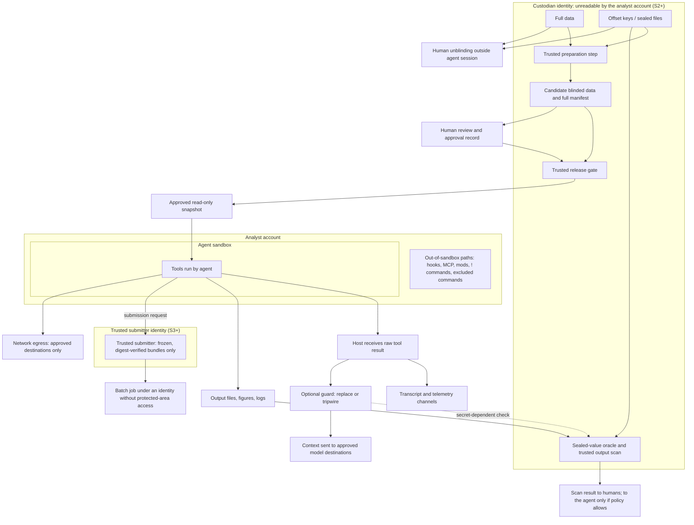

# hep-research Protected-Data Architecture: Blinding, Custodianship and Egress

Status: 2026-10-14, release 0.9.0 (contracts 2.8.0, core 1.0.0, project config schema 1.2.0). Version labels in §12 name the release that introduced each component.

This document describes the protected-data architecture of hep-research (planning ID AGENTIC-R5, from the R5.4 planning basis, kept for traceability; renamed from `docs/agentic-architecture.md` after release 0.14.1): its objectives, design principles, components, trust boundaries, data and execution flows, and the functions each part performs. Names of files, fields, commands, and states are those of this tree. Section 12 maps each architectural component to the plugin file that implements it, or marks it as a component outside the plugin. How the components outside the plugin are deployed, and how a host configuration is qualified, is in [deployment-model.md](deployment-model.md). Nothing here qualifies a host configuration or authorizes a use: no host configuration is qualified for private or blinded data.

---

## 1. Objective

Enable hep-research to support research on hosts with validated enforcement mechanisms while ensuring that:

- Information protected by blinding is not exposed to the agent, the model service, or analysts who lack unblinding authorization.
- Private collaboration data is not sent out without authorization.
- Agent automation remains subject to explicit scientific validation and review of intended use.

Blinded derivatives may be used within their approved scope, but this does not itself authorize egress or qualify them for formal analysis.

Protecting the analyst and protecting the agent are different boundaries. An agent sandbox runs under the analyst's own OS account, so it cannot keep data from that analyst, nor from components the host runs outside the sandbox as that account. For real protected data, the protected area therefore belongs to a separate **custodian identity**. This holds whether or not the collaboration's blinding policy covers analysts; that policy decides only whether analysts may also be granted the custodian's access by other means.

---

## 2. Design Principles

1. **Blinding is primarily an input-side control.** The agent reads only reviewed blinded derivatives. Full data, keys, and sealed files reside where operating-system controls deny access. Output scanning and hooks are safety nets only.
2. **Enforcement is outside the agent's control.** It is performed by the host, the OS, or a protected trusted execution/release step. Checks invoked by the agent itself are advisory only; in this tree every such plugin check says so in its output and never reports a use as allowed.
3. **Tool results are a major leakage channel.** They enter model context, transcripts, local logs, and telemetry. Hook replacement affects only channels downstream of its position.
4. **Capabilities are enabled in stages:** S0 isolated synthetic testing → S1 qualified synthetic workflow → S2 fixed blinded derivatives → S3 fixed-recipe execution → S4 autonomous modification by operation class. Stage qualification is separate from formal-use qualification.
5. **Protected data lives under a custodian identity, not merely behind the agent sandbox.** For real protected data, full data, keys, sealed files, unreleased candidates, and approval records belong to an identity the analyst's account cannot read. This keeps out-of-sandbox components (hooks, MCP servers, mods, `!` commands, batch jobs), which all run as the analyst's account, away from protected data. Release, scanning, and sealed-value checks are services of that identity.
6. **Anything that runs agent-influenced code outside the sandbox is unsandboxed execution.** This covers batch jobs, excluded commands, and any hook, skill, plugin, or mod the agent can write. These paths may run only approved, frozen content under an identity without access to protected data.
7. **Every channel out of the session is an egress path.** Model calls, network tools, sandbox network access, MCP servers, and telemetry all count. Derived content may reach only the destinations approved for it.
8. **The plugin's blinding tools change role.** For real data they become custodian-side preparation and scanning services; as agent-side tools they are used only with synthetic sentinels.
9. **Data and decision lineage, execution-bundle freezing, required capabilities, revocation, scoped scientific review, and separate capability/review/lifecycle axes are retained as hard requirements** of the scientific-integrity layer (§9).

---

## 3. hep-research Components

| Item | Description |
|---|---|
| Composition | 7 skills, `core/` (shared code), `contracts/` (artifact contracts, sidecar schemas and validation), `profiles/`, `adapters/`, `examples/`, `tools/` (maintainer checks), and `release-manifests/` (recorded code release manifests, one per published version from 0.5.0) |
| Execution model | No hooks, MCP server, commands, or background process; the agent runs scripts specified by skills with the user's privileges. Scripts locate the plugin root from `__file__`; skills name shared files relative to the plugin root (the folder two levels above each `SKILL.md`) |
| Hosts | Install, discovery, and invocation tested on Claude Code (macOS and Linux) and Codex CLI (macOS). “Tested” does not mean qualified: no host configuration is qualified for private or blinded data |
| Contracts | One `CONTRACTS_VERSION` (2.9.0) for every artifact schema family, validated by an in-repo schema engine (`contracts/schema.py`) restricted to a fixed keyword set. Sidecars carry their own versions: data release manifest, attestation, operator semantics, recipe, tool contract, revocation log and head, exposure and decision records, qualification record, analysis-level bundle, permit, scan submission and verdict |
| Blinding tools | `core/blinding/blinding.py` (`mask_binned`, `mask_ratio`, `seal`, `scan_text`/`scan_file`/`scan_paths`, `agent_view`, `check_figure`, `check_figure_report`, `load_project_blinding`); custodian-run transforms (`core/blinding/transforms.py`), residual checks (`core/blinding/residual.py`) and release preparation (`contracts/release_prepare.py`); CLIs `skills/hep-computing/scripts/audit_blinded_outputs.py` (`seal`, `scan`) and `skills/hep-measurement/scripts/mask_blinded_bins.py` |
| Protected use | `core/protected/` (`guard.py`, `trusted_input.py`, `revocation_log.py`, `identity.py`; standard library only) and the public interface `contracts/protected_use.py`: protected mode at every formal-use entry point (§6.3) |
| Execution reliability | `core/partition`: manifests, exclusive state and campaign locks, atomic write-once chunk outputs, duplicate-safe merge, bounded retries, quarantine, dry-run by default, write-ahead `submitting` records, submission tags and reconciliation, resource limits (`limits.py`), execution-bundle freezing (`bundle.py`) |
| Batch backends | Slurm and HTCondor adapters (`adapters/batch-schedulers`), demonstrated on synthetic data on real clusters (Slurm 24.05.1, HTCondor 24.12.16) |
| Orchestration layer | The future autonomous planning and execution layer built on top of these components |

---

## 4. Terminology

| Term | Definition |
|---|---|
| Sealed values / sealed file | The numbers `core.blinding.seal` lists as never allowed in an output (`SEALED_KINDS`): each blinded bin value and its square root, the blinded-region sum and its square root, the total, cumulative sums containing blinded bins, fractions of the total, and ratios, differences and (N−B)/√B relative to references, including the difference of blinded-region sums. Exact zero and any number the unblinded bins give on their own (sideband sums and their square roots) are not sealed; `NOT_SEALED` lists what stays unsealed. The sealed file also carries the scan tolerance (at most 10⁻⁶) and may record `nothing_sealable` |
| Input blinding | A trusted step produces derivatives with blinded-region information removed or hidden before the agent reads them |
| Blinded derivative | A product of input blinding; blinding does not automatically authorize sending it to a model |
| Data release manifest | A sidecar binding derivative content, protection targets, retained information, purposes, destinations, and verifiable approval records (`contracts/schemas/release_manifest.json`, §6.3) |
| Code release manifest | The manifest of the plugin's own release bundle: paths, full SHA-256, size and mode. Its digest is the plugin identity recorded in artifacts as `versions.plugin_release` (§9.2) |
| Data exposure | Whether and how data was seen before a decision; the envelope field `data_exposure` (`state`, `basis`, optional `record_ref`), named so because “exposure” already means a physics normalization in the contracts |
| Protected area | Storage for full data, keys, sealed files, unreleased candidates, and approval records. For real protected data it is owned by the custodian identity and unreadable by the analyst's account. In every configuration it is also unreadable by the agent's shell and file tools |
| Custodian identity | An OS account, service, or host distinct from the analyst's account. It owns the protected area and runs the release gate, sealed-value checks, and trusted output scanning. Agents, hooks, MCP servers, mods, `!` commands, and batch jobs launched by the analyst's account cannot assume it |
| Host adapter (enforcement adapter) | The host-specific configuration that implements the constraints on one host surface and version: settings (sandbox, permissions, network, telemetry), the protected launcher, the installation layout, and qualification records. It is deployment, not plugin code |
| Out-of-sandbox execution path | Any route by which code the agent wrote or influenced runs outside the agent sandbox: batch jobs, `excludedCommands`, hooks, skill/agent frontmatter hooks, plugins, MCP servers, mods |
| Guard | An optional PostToolUse hook that responds when a tool result matches sealed values: **replace** mode substitutes the entire result; **tripwire** mode also stops the session for human review (§6.5) |
| Oracle | Any mechanism whose observable response depends on secret values, such as guard replacement, scan pass/fail, or release rejection reasons |
| Orchestration layer | The autonomous planning and execution layer |
| Execution bundle | The frozen collection of five categories: physics, computation, data, randomness and precision, and governance. For batch campaigns, `core/partition/bundle.py` freezes the computational part and binds the data exposure (§9.1) |
| Attestation | A sidecar recording, for one frozen bundle and scope, the capability, review, and lifecycle axes separately (`contracts/schemas/attestation.json`) |
| Formal use | Producing formal analysis results, publication, or unblinding; requires a separate use gate. Unblinding is always performed by a human outside the agent session |
| Trusted release step | A process the agent cannot bypass or modify; it verifies the manifest, approval, and data bytes before providing a read-only snapshot to a specified session |
| Protected mode | The state of an entry point in a project that declares `agent_policy` (or given `--protected`): it reads its status from protected inputs and refuses protected use on any failure (§6.3). Omitting a flag cannot switch it off |
| Protected input | A file the plugin trusts only when it is a regular file with one link that the running account neither owns, nor can write, nor can replace along its path (`core/protected/trusted_input.py`): in a deployment, a file written by the custodian identity |
| Revocation log and head | The hash-chained, append-only JSON Lines log of revoked subjects (`revocation_event.json`; kinds artifact, release, recipe, source, attestation, qualification, permit) and the custodian-written head that binds its length and last record (`revocation_head.json`) |
| Qualification record | A custodian-written record (`qualification_record.json`) that binds a stage, host, the authoritative policy digest and the plugin's code identity for a validity period; protected mode requires a valid one |
| Exposure record, decision record | Append-only records of which releases reached a session or relay and what kinds of data were seen (`exposure_record.json`), and of a decision with the exposure prefix it had seen (`decision_record.json`) |
| Analysis-level bundle | One digest over what a formal result depends on: measurement spec, recipes, semantics tables, calibrations, tool contracts, environment lock, reviews and the plugin release (`analysis_bundle.json`) |
| Permit | A custodian-issued protected input (`permit.json`) for one formal use or S3 execution, bound to an analysis or execution bundle, the input digests, a purpose, an actor, a nonce budget, a validity window and, for formal use, an accepting attestation |

---

## 5. Architectural Constraints

These constraints define the architecture. Collaboration or institutional policy may add restrictions on top of them but cannot lower them. Actual host permissions are facts about what must be enforced, never authorization for a use.

| ID | Constraint |
|---|---|
| HC-01 | Full data, offset keys, sealed files, unreleased candidates, and approval records reside only in the protected area. **(a) Agent layer, every stage:** the host adapter configures both the OS sandbox read denial (`sandbox.filesystem.denyRead`) and native file-tool Read/Edit deny rules; one layer alone is insufficient. Other hosts must provide an equivalent two-layer boundary. **(b) Identity layer, S2 and above:** whenever real protected data exists, the protected area belongs to a custodian identity that the analyst's OS account cannot read, which excludes every component launched by that account, sandboxed or not |
| HC-02 | Public or synthetic data is used under its approved classification. Private research inputs are limited to blinded derivatives approved by a valid data release manifest. Unapproved, mismatched, revoked, or wrong-destination content is rejected before the agent or its tools can read it |
| HC-03 | Scientific blinding and data egress are independent policies; both must permit access. Whether private collaboration data may be sent to external model services is decided by the collaboration and institution, not by the plugin or agent |
| HC-04 | A human performs unblinding outside the agent session; it is never delegated to the agent or run through `!` in the same conversation |
| HC-05 | Checks invoked by the agent itself (contracts, dependencies, review scripts, scans, release-manifest and attestation checks run by the agent) are advisory only and are never represented or used as authorization or enforcement |
| HC-06 | Output scanning and the guard are safety nets, not boundaries. A passing scan does not authorize unblinding, publication, or egress |
| HC-07 | The agent cannot modify anything the host loads and runs outside the sandbox, in this or a later session: settings files, plugins (including the installed hep-research copy), skills and agents whose frontmatter can register hooks, hook scripts, MCP server definitions, mods, and status-line or helper commands, together with their code, dependencies, interpreters, configuration, and output destinations. From S1 on, all of these load from locations outside agent-writable paths; an agent-editable development checkout is loaded only in S0 |
| HC-08 | No oracle response visible to the agent contains secret values, match counts, locations, or diagnostics that vary with secret values. Even a fixed pass/fail response is an information channel and acts as a group test (§6.5); such responses are restricted, audited, and their residual risk accepted by the policy owner |
| HC-09 | Formal use passes revocation and qualification checks; omitting an argument cannot bypass them |
| HC-10 | Ambiguous batch submissions are never resubmitted automatically. A human reconciles the outcome before confirming or abandoning; from S2 the code path that confirms or abandons is not callable by the agent |
| HC-11 | All leakage tests use synthetic sentinels; real secrets and real blinded data are never included |
| HC-12 | Passing software tests establishes software consistency only, not physics validity, enforced blinding, or deployment readiness |
| HC-13 | A host configuration processes only public or synthetic data until it has passed S2 qualification for the data and destinations concerned; S1 qualification is the precondition. Qualification is per surface and version (CLI, Desktop, IDE extensions, Agent SDK, background and cloud sessions each read different settings sources) |
| HC-14 | The retained scientific-integrity requirements (§9.1) are never removed; they may be deferred only while the uses they protect are not enabled |
| HC-15 | Data approval binds the actual supplied content and effective destinations. The agent cannot replace the approval trust anchor, release process, or approved snapshot. Changes to models, tools, policy, or data require reevaluation |
| HC-16 | Every out-of-sandbox execution path is unsandboxed execution. From S2 on, such a path runs only content the agent cannot alter after approval (for example a frozen bundle verified by digest at submission), under an identity that cannot read the protected area, and its outputs return through the same release and scanning rules. A path that lets the agent run code it has just written outside the sandbox is disabled in S2 and above |
| HC-17 | Derived content reaches only the destinations its manifest approves. Model services, network tools, sandboxed network access, MCP servers, mods, git remotes, and telemetry all count as egress. Calls not covered by an allow rule are denied, not left for an unattended prompt; persistent mid-session approvals that widen the allowlist are disabled in protected sessions |
| HC-18 | Instructions shipped with the plugin (skills, references, assets, profiles, script help, README, example prompts) never direct the agent to act against a constraint, and never present agent-invoked checks as enforcement. `tools/check_instruction_text.py`, run by `tools/run_all_checks.py`, guards the known non-conforming phrases |

---

## 6. Target Architecture

### 6.1 Planes



| Plane | Governs | Enforcement mechanism | Role |
|---|---|---|---|
| Data plane | Location and read access for full data, keys, sealed files, candidates, and approval records | OS controls: a custodian identity the analyst account cannot read (real protected data); agent sandbox read denials and file-tool deny rules (every configuration) | **Primary control** |
| Egress plane | Where session content can go: model services, network tools, sandbox network, MCP, mods, telemetry | Destination policy in the manifest, host network allowlists, permission rules, telemetry configuration, per-tool inventory | **Primary control** for derived content |
| Context plane | What enters the model, transcripts, local logs, and telemetry | Hook replacement, tripwire, skill instructions; affect only downstream channels | Safety net |
| Decision plane | Contracts, dependencies, review, approval, revocation, freezing | Programmatic decisions; blocking relies on the data and egress planes or on a human | Scientific and process quality |

In S0 and S1, synthetic data and sentinels may sit under the analyst's account behind agent-layer controls. The custodian identity is required once real protected data exists. It may be a separate POSIX account with group-restricted directories, a service account behind a narrow local interface, or a separate host.

**Custodian interface.** Only these requests cross from the analyst side to the custodian side: release requests, sealed-value checks, and output-scan submissions. In return, an approved release yields its read-only snapshot. Every status response crossing back is policy-approved and fixed in form.

### 6.2 Input-Blinding Modes

| Mode | Hides | Retains (declared in the manifest) | Bypass checks required |
|---|---|---|---|
| Remove events in the blinded region | Blinded-region content | Everything outside the blinded region | Original totals remaining in cutflows, metadata, indices, old figures, or caches; subtraction revealing removed counts; repeated requests changing the blinded-region definition; event identifiers, run/luminosity-block sequences, or index gaps revealing how many events were removed; smooth sideband extrapolation being itself the protected quantity |
| Hidden common offset `x+c` | Absolute location | Differences `x_i−x_j` | Physical boundaries or reference points that reconstruct `c` (resonances, calibration peaks, kinematic endpoints, non-negative quantities). For counts or event weights, statistical structure exposes the offset (Poisson variance ≈ mean − `c`). Uncertainties computed before the offset |
| Hidden common scale `a·x` | Normalization | Ratios, shape, temporal variation | Unit-area shapes and densities. For counts, integer quantization (multiples of `a`) and variance/mean ≈ `a`. Per-event weights reveal `a` directly. Unscaled predictions, simulation, or control regions in the same release reveal `a` through ratios |
| Hidden offset on the result only | The final fitted value | The full analysis chain | **Not an input-blinding mode**: an agent that can run code on the released inputs can recompute the result. Use only inside a trusted computation whose inputs the agent cannot access, or combined with a data-level mode |
| Holdout data split | Final confirmation set | All information in the development set | Number of queries to the holdout; statistical independence (event- vs run-level correlations); custody of the holdout by the custodian rather than merely another directory |

Rules:

1. Whether to blind, which mode to use, and what to protect are analysis and collaboration policy decisions. In the project they are recorded in the `blinding` block (`blinded` observable IDs, `regions` as `{variable, low, high}`, `allowed_outputs`); a measurement-spec records its own `blinding.mask` and a `blinding.unblinding_record_ref` that only an authorized person fills.
2. Each application requires counterexample tests for the features to be concealed. Hiding only an overall scale is not represented as protecting shape or relative structure.
3. Scanning for sealed numbers alone is insufficient for low-count analyses; the default is qualified input blinding. In `seal`, low counts are partly excluded by construction (exact zero is not sealed), and sealed values with fewer than 3 significant digits match only standalone numbers and are marked weak.
4. Output scanning requires the sealed file, so it is performed by a custodian-side service or a human outside the session. A guard hook calls that service rather than reading the sealed file. Agent feedback, if any, is a fixed status approved by policy.
5. Review covers combinations of released data: multiple removed regions, different offsets/scales, cutflows, and shared calibrations may jointly reconstruct information. Previous releases are recorded by analysis and source snapshot (`related_releases`, `composition_review`); a new session does not reset this record.
6. The agent is treated as able to run arbitrary analysis code on everything released to it. A mode is acceptable only if the protected feature cannot be recovered from the released data together with the declared retained information, standard physics knowledge (PDG values, detector geometry, calibration signals), and the statistical structure of the data.
7. Statistical outputs inherit the transform: uncertainties, covariances, χ², pulls, and goodness-of-fit numbers are computed on the transformed data or withheld. `mask_binned(..., errors=)` masks an error array with the values' mask.

The plugin implements the first four modes as custodian-run transforms (`core/blinding/transforms.py`: released data, sealed values, `protected`/`retained`; keys are inputs only; offsets on counts and scales with per-event weights are refused; input uncertainties are masked or withheld), `core/blinding/residual.py` reports what a prepared release can still give away (codes only), `contracts/release_prepare.py` writes the release directory, the sealed file outside it and a draft manifest, and `core/blinding/README.md` states what each mode does not protect. Holdout splits stay a deployment matter (DP-3).

### 6.3 Data Release Manifest, `agent_policy`, and Trusted Release

#### Data release manifest

A sidecar (`contracts/schemas/release_manifest.json`, `manifest_version` 1.0.0; not an artifact envelope type), restricted to the keywords the schema engine supports. `contracts/release_manifest.py` performs the checks the schema cannot express. It is meant to run on the custodian side from protected copies of every input; run by an agent it is advisory only, and passing it never releases data.

| Field | Content |
|---|---|
| `manifest_version`, `release_id` | Schema version and a release identifier that is never reused |
| `source` | `snapshot_id` and `sha256`: trusted identity of the original data snapshot; sensitive paths and metadata remain on the restricted side |
| `artifacts` | Per derivative: `path`, `sha256`, `size`, `format`; binds the actual output bytes |
| `artifact_rules` | `symlinks` and `unlisted_files` handling in the release directory |
| `transform` | `code_sha256`, `parameters`, `keys_recorded`; keys themselves are never recorded |
| `protected` | Estimand or features being concealed |
| `retained` | Explicitly allowed retained information: differences, ratios, shapes, etc. |
| `review`, `approval_ref` | `review` = `reviewer`, `date`, `scope`; `approval_ref` names a protected approval record. A self-populated “approved” string is not approval |
| `purposes` | Permitted uses, such as exploration or fixed execution. Formal analysis is not a release purpose; it requires a separate use gate |
| `destinations` | `services[]` (`service`, `tenant`, `region`, `model_families`, optional exact `models`, `data_handling`), `tools`, `network`, `recipients`, `logging` (`transcripts`, `telemetry`). Model scope covers every model that can receive session content: subagent models, the background model for summaries and compaction, models called by prompt- or agent-type hooks, and host-initiated or server-side fallback models. An unverifiable model change is treated as a destination change |
| `validity` | `effective`, `expires`, `revocation_ref`, `status_source`, `max_status_age_s`; new access is rejected when validity cannot be established |
| `related_releases`, `composition_review` | Previous releases for the same analysis and source, and review of the combined information (`reviewer`, `date`, `conclusion`) |

**Checker inputs and rules** (`release_manifest.py`). Every input is required; a check that cannot run is a failure (fail closed), never a skip.

| Input | Rule |
|---|---|
| `--root` (release directory) | Holds exactly the listed artifacts as regular files with the listed size and SHA-256; links and unlisted files are refused, and a directory the check cannot list fails |
| `--approval` (protected approval record) | `approval_id`, `manifest_sha256`, `approver`, `authority`, `purposes`, `destinations_sha256`, `valid_from`, `valid_until`. It must bind this manifest's digest (canonical JSON without `approval_ref`), cover its purposes, destinations digest, and validity period, and be valid now |
| `--approvers` | `{approver: [authorities]}`; the approval's authority must be `data-release`, held by that approver |
| `--ledger` (custodian release ledger) | `[{release_id, manifest_sha256}]`; a `release_id` recorded for other content is reuse |
| `--revocations`, or `--revocation-log` with `--revocation-head` | Either the flat status `{as_of, source, revoked: [{ref, time, reason}]}` or the verified hash-chained log and head (§9.1), from `validity.status_source`, no older than `max_status_age_s`; the `release_id` or `revocation_ref` revoked means revoked (`release.status_unverified` for a log that does not verify) |
| `--effective` | The session's effective destinations, in the same structure as `destinations`; every key must be present (an absent list is not “none used”) and every entry allowed |

Always checked, from the manifest alone: no transform parameter name may look like key material (`KEY_LIKE`: key, secret, offset, scale, seed, password, token; the schema already fixes `transform.keys_recorded` to `false`), and no destination may contain a wildcard.

**Custodian options.** Each adds checks; none is needed for a pass, and a custodian gives all of them:

| Option | Rule |
|---|---|
| `--code-digest` | `transform.code_sha256` equals the code-release digest of the transform code the custodian runs |
| `--destination-sets` | `{name: destinations}` held by the custodian, one per qualified configuration; the manifest's destinations equal one of them exactly (a superset is a different set) |
| `--analysis` | Every ledger entry of the same analysis or source (entries may carry `analysis` and `source_sha256`) is listed in `related_releases`, and every listed release is in the ledger; a revoked related release is a warning that the composition review must cover |
| `--exposure-record` (with `--analysis`) | The analysis's exposure record is a second release history: a release it names must be in `related_releases` (`release.related_incomplete`) and in the ledger (`release.exposure_release_unknown`) |
| `--sealed` | The release's sealed file (`audit_blinded_outputs.py seal` format, or `nothing_sealable`); every artifact is scanned for a sealed value, JSON objects without their declared structure keys (`STRUCTURE_KEYS`: bin edges, masks, region), other files as `core.blinding.scan_file` reads them. An artifact that cannot be scanned fails |

The output is a status (`pass`/`fail`), the manifest digest, findings, and a note. A finding never names a sealed value or a count of matches. Rejection details are for the custodian; what an agent sees of a refusal is a fixed status. The checker verifies bindings, not the trust anchor: where approval records and the approver list live, and who may write them, is the approval trust anchor, which may be a local administrative record the agent cannot rewrite or a verified signed record. Complete records remain on the restricted side; if the agent needs to inspect a manifest, only an approved minimal view is released.

#### Project `agent_policy`

Part of the project configuration (`hep-research.project.json`) from schema 1.1.0; `protected_inputs` from 1.2.0:

```json
{
  "schema_version": "1.2.0",
  "blinding": {
    "blinded": ["<observable id>"],
    "regions": [{"variable": "<name>", "low": 0.0, "high": 1.0}]
  },
  "agent_policy": {
    "policy_version": "1.0.0",
    "model_context_allowed": ["public", "synthetic", "blinded-derivative:approved-manifest"],
    "protected_paths": ["private/", "data/unblinded/"],
    "release_manifests": [
      {"ref": "manifests/blinded-v1.json", "sha256": "<64 hex>"}
    ],
    "unblinding": "outside-agent-session",
    "authoritative_copy": {"location": "<launcher or custodian store>", "sha256": "<64 hex>"},
    "protected_inputs": {
      "revocation_log": "<custodian path>", "revocation_head": "<custodian path>",
      "status_source": "<source name>", "max_status_age_s": 3600, "qualification_record": "<custodian path>",
      "nonce_ledger": "<custodian path>"
    }
  }
}
```

- Required keys: `policy_version`, `model_context_allowed`, `unblinding`. `model_context_allowed` takes `public`, `synthetic`, `collaboration-internal`, and `blinded-derivative:approved-manifest`; `unblinding` takes only `outside-agent-session`.
- Each manifest reference carries a digest, because a bare path does not bind content.
- The project configuration lives in the agent-writable project directory, so the copy there is advisory; `contracts/project.py` only checks it (path rules, manifest digests, `schema_version`). Enforcement needs a launcher that compares it by digest with an `authoritative_copy` the agent cannot write.
- `protected_paths` entries are relative paths without `..`.
- Older readers reject a 1.1.0 project config, and `project.py` refuses a newer minor or another major schema version (fail closed). A project with `agent_policy` must declare its `blinding` block, which is closed from 1.1.0; `contracts.project.load_blinding` reads it validated, and `core.blinding.load_project_blinding` refuses a policy without a blinding block instead of reporting nothing blinded.
- A `blinded-derivative` is readable only when a valid manifest approves the current destinations, purpose, and content; anything unlisted is denied. The JSON is a policy declaration; enforcement comes from the release gate and host configuration.
- Private local and companion profiles are read only when `agent_policy` allows that classification on a qualified host configuration.
- **Protected mode** (DP-2, HC-09): a project with `agent_policy`, or an entry point given `--protected`, runs every formal-use entry point in protected mode; omitting a flag cannot switch it off. The entry point first reads, as protected inputs (regular files with one link that the session's account neither owns, nor can write, nor can replace along their path), the authoritative copy of the policy (its digest and content must match the project copy), then from it `protected_inputs` (schema 1.2.0): the hash-chained revocation log and its head, verified against `status_source` and `max_status_age_s`, and the qualification record (`qualification_record.json`), which must be valid now, bound to the authoritative policy's digest and to the running plugin's code identity, and not revoked. Any failure, a revoked input, or an input that needs an unknown capability is a refusal (exit 3, `"status": "refused"`, codes only). Formal use (publication) additionally needs a formal-use permit (`contracts/permit.py`, `permit.json`): a custodian-issued protected input binding the analysis-level bundle (`contracts/analysis_bundle.py`) and the digests of the inputs, one purpose, an actor, a nonce whose uses the custodian's nonce ledger counts (`protected_inputs.nonce_ledger`), a validity window, and the attestation whose review must accept the recipe for the required roles and cover the use; the plugin never records a use. The guard is `core/protected/guard.py`, standard library only, so lower-level functions in `core/` call it too and a direct call does not skip it; `contracts/protected_use.py` is the public interface. The checks run in the agent's process: they stop an omitted or accidental bypass, not a process that rewrites the code, which the data and egress planes address. `release_manifest.py` and `attestation.py` are custodian tools (the custodian owns the protected inputs) and are not guarded; a command's context is not re-evaluated while it runs.

#### Trusted release and session qualification

1. Candidate data and the complete manifest remain in a preparation area owned by the custodian identity. A trusted process running as the custodian checks the schema, content, approval trust anchor, revocation, and cross-release review (using `release_manifest.py` from protected copies).
2. It compares the actual effective host, model destinations, tool inventory, network allowlist, and logging configuration (`--effective`). On failure, data is not released and pending-review content is not sent to the model. Rejection messages visible to the agent are fixed in form and do not reveal which protected check failed.
3. Once checks pass, it atomically creates or mounts an immutable read-only snapshot, with writable outputs isolated. Files, symlinks, or mount targets cannot be swapped between validation and reading.
4. It creates a qualification record binding the release digest, policy version, and environment. Qualification is reevaluated for a new or resumed session, model/tool/configuration changes, or revocation events. Hosts unable to maintain these guarantees use only fixed-configuration sessions; a change stops protected work.
5. Revocation prevents subsequent access, execution, and formal use, and marks affected products through lineage. It cannot retract information already in model context, logs, or human memory; deleting files is not represented as forgetting.

#### Protected launcher

The launcher has three jobs:

1. Start the host with a fixed configuration (managed settings, or for Claude Code `--settings` with `sandbox.allowUnsandboxedCommands: false`, which makes the sandbox admin-required so that repository settings cannot loosen it).
2. Record the effective-configuration digest, and compare the project's `agent_policy` with its `authoritative_copy`.
3. Refuse to start if that configuration differs from the qualified one.

The launcher is code the agent cannot modify. It protects against the agent, not against the analyst, who could run the host without it; that is why real protected data relies on the custodian identity. The release gate extends the same launcher.

### 6.4 Host Enforcement Points: Claude Code

| Control | Mechanism | Not covered |
|---|---|---|
| Protected area is unreadable by the agent | `sandbox.filesystem.denyRead` **plus** `Read(...)`/`Edit(...)` deny; Read deny also governs user `@`-mentioned files, for which no PreToolUse hook fires | Everything running outside the sandbox as the analyst's account: MCP servers, command hooks, mods, plugin monitors, LSP servers, status-line/helper commands, `!` commands (except under strict sandbox mode), `excludedCommands`; native Windows. The custodian identity covers this gap for real protected data |
| Cannot leave the sandbox | `allowUnsandboxedCommands: false`, `failIfUnavailable: true` | Tools under `excludedCommands`: anything they execute runs with full access, and the agent can write that file. In S2 and above `excludedCommands` is empty unless every excluded command runs only content the agent cannot write |
| Cannot relax settings | Sandbox write denial and Edit deny for `.claude` settings, skills, agents, commands, hooks, `.mcp.json`, `~/.claude`; `disableBypassPermissionsMode`, `disableAutoMode`; managed settings or launcher `--settings` | The user; protected-path writes in auto mode delegated to the classifier; instruction files such as `CLAUDE.md`; an agent-writable development checkout |
| Host extensions | Mods run inside the Claude Code process with the user's permissions, unsandboxed, and can approve calls that `ask` rules or PreToolUse hooks would stop. Controls: managed `allowManagedModsOnly`, `allowManagedHooksOnly`, user `disableAllHooks` | Built-in mods are not stopped by `disableAllHooks` or `--safe-mode` and must be inventoried; skill frontmatter hooks register when the skill is invoked |
| Network egress | Sandbox `allowedDomains` with `strictAllowlist` or managed `allowManagedDomainsOnly`; `deniedDomains`; WebFetch/WebSearch permission rules | WebFetch/WebSearch are not restricted by `allowedDomains`; broad domains allow domain fronting; MCP servers and mods have their own network access; “don't ask again” saves an allow rule that also pre-allows the domain for sandboxed commands |
| Telemetry content | OpenTelemetry export requires `CLAUDE_CODE_ENABLE_TELEMETRY`; content capture is opt-in per flag (`OTEL_LOG_TOOL_CONTENT`, `OTEL_LOG_TOOL_DETAILS`, `OTEL_LOG_USER_PROMPTS`, `OTEL_LOG_RAW_API_BODIES`); repository settings cannot enable exporters | Managed settings, user settings, or the launch environment can enable them |
| Tool-result replacement | PostToolUse `updatedToolOutput`; `continue: false` stops processing; PostToolBatch can stop the loop before the next model call | See §6.5–6.6 |

Design notes:

- Native Read is not controlled by sandbox `denyRead` alone; scripts require an OS boundary. Both layers are configured explicitly and verified against the effective configuration.
- Bash deny rules match command text and are not a security boundary.
- WebFetch allow rules waive per-call approval and are not an exclusive allowlist. In unattended protected sessions, a call outside the allow rules is denied rather than left at an unanswered prompt.
- Configuration checks inspect effective rules: a narrower `allowRead` can reopen paths under a broader `denyRead`; settings from multiple sources are merged; excluding a settings source with `--setting-sources` drops its Read deny rules from the sandbox.
- In-session enforcement candidates: `ConfigChange` hooks block configuration changes; `PreModelSwitch` blocks requested model switches; `PostModelSwitch` reports host-initiated changes. Hooks fail open on timeout or error, so they supplement the launcher's start-time check.
- Optional hardening (not a replacement for the custodian identity): `permissions.blockReadsOutsideWorkingDirectories`; `sandbox.credentials` deny entries; `CLAUDE_CODE_SUBPROCESS_ENV_SCRUB`.

Other hosts: Codex legacy sandbox modes can read the entire filesystem, and permission profiles are needed to deny reads; Codex hooks are guardrails. Claude Chat cannot read local files. Hosts without a qualified two-layer boundary are treated as lacking enforcement.

### 6.5 Guard (Optional Safety Net)

The guard lives outside the hep-research core to preserve host neutrality, as a separate plugin or a protected project tool; the plugin ships no guard. It replaces the whole tool result rather than redacting parts, uses a fixed message without values, match counts, or line numbers, and scans every string, numeric field, and supported content type of a result. Unsupported output types (images, binary resources, some metadata) are listed as unscanned, not claimed as covered. Replacement values must match each built-in tool's output schema. Its matching would reuse `core.blinding.scan_text` and inherits its limits (`OUT_OF_SCOPE_RENDERINGS`, weak low-count matches).

**Modes:**

| Mode | On a match | Agent-visible effect | Use |
|---|---|---|---|
| Replace | Substitute the entire result with a fixed message | One bit per tool call; the session continues, so the agent can probe repeatedly | S0/S1, unless policy explicitly accepts a per-call oracle |
| Tripwire (default when enabled) | Substitute the result, return `continue: false`, quarantine the transcript and logs, notify the policy owner. The session is not resumed; a new session requires human review | Each match ends the session and triggers review | S2 and above, with policy acceptance |

PostToolBatch is a candidate checkpoint for stopping before the next model call. Neither mode protects channels that record before the hook.

**The guard is an oracle.** In a correctly blinded session it should never fire, so its informational effect is to answer “does this output contain a sealed value?”. Because the agent controls the output and one call can contain many candidate numbers, each call is a **group test**: printing 0–20 reveals whether any sealed value lies in that range, and halving finds it in about log₂ steps. Per-call rate limits do not bound this; low-count sealed values make it worse. Silent no-matches also leak by elimination, in both modes; tripwire mode bounds only the positive channel. Query limits therefore count candidate values tested, not only calls, and are shared across sessions, subagents, concurrency, and replay. After the limit, secret-dependent decisions stop. Encoded, split, rounded, or unit-converted renderings defeat literal matching and are out of scope; the guard addresses accidental exposure only.

**Custodian-side check (S2 and above).** The interface is `contracts/scan_verdict.py`: a submission digests the outputs and counts their candidate values; the agent-visible verdict is closed (status `pass`, `fail`, `incomplete`, `refused-budget` or `refused`, and the budget state); the service charges every submission against a per-analysis budget counted in candidate values, on its own recount of the received bytes. The guard does not read the sealed file. It sends the candidate output to a custodian-side check and receives only `match` or `no-match`. The check enforces shared query state and limits. An unreachable check is treated as a match (so a tripwire fires), implemented in the guard script itself because HTTP-hook transport fails open; the guard's deadline for the check is shorter than the configured hook timeout. In S0/S1 with synthetic sentinels, the guard may read a synthetic sealed file locally.

**Failure semantics.** Command, HTTP, and MCP-tool hooks fail open: a timeout discards output (default 600 s), exit codes other than 2 without valid JSON are non-blocking errors, a hook that cannot start is a non-blocking error, and HTTP non-2xx or connection failure is non-blocking. Agent SDK callback hooks on PreToolUse block the call on timeout, so a custom Agent SDK harness is the candidate where fail-closed semantics are required. A guard that is registered but missing its configuration, or whose sealed file is malformed, must refuse to start or withhold results. An empty sealed list is a configuration error unless the sealed file records `nothing_sealable`.

**Configurations:**

- **Disabled:** recorded as not installed; no output-replacement guarantee is claimed. With qualified input blinding this is legitimate and often preferable, because it removes the guard oracle (release-gate and scan responses remain oracles).
- **Enabled:** mode recorded; integrity of its install location, absolute interpreter path, dependencies, and settings protected (outside agent-writable paths); replacement and failure behavior validated per tool.

Neither configuration relies on the guard to block secrets: inputs readable by the agent and their permitted uses must already be qualified. If policy does not accept secret-dependent feedback, the guard is disabled and sealed-value scanning happens outside the session.

### 6.6 Context-Plane Channels

| Channel | Affected by PostToolUse replacement? | Treatment |
|---|---|---|
| Context sent to the model | Yes, for successful tool calls when the host accepts the replacement | Per-tool replacement formats |
| UI and transcript files | Not guaranteed; transcripts are local plaintext in the host's per-project session store under its configuration directory, retained per `cleanupPeriodDays` | Tripwire mode quarantines the transcript; channel recorded |
| Telemetry/analytics | Cannot retract output already recorded; the `tool.output` span event (with `OTEL_LOG_TOOL_CONTENT=1`) and raw API bodies may precede the hook | Enablement, recipient, and retention recorded per channel; protected sessions disable content-capturing flags unless the recipient is an approved destination |
| Failed tool calls | No: PostToolUseFailure has no output-replacement field | Addressed through input blinding |
| Other model destinations | No: prompt- and agent-type hooks send their input to a model; subagents and background tasks (summaries, compaction) receive context | Treated as destinations in the manifest and inventoried |

### 6.7 Layered Threat Model

| Layer | Examples | Initial controls | Later stages |
|---|---|---|---|
| T1 Accidental exposure | Debug output of blinded-region histograms; unmasked figures; float caches | Input blinding, denyRead, custodian identity, output scanning, guard | — |
| T2 Injection through external content | Instructions in papers, webpages, package READMEs; instructions planted in files the next session loads (`CLAUDE.md`, notes) | denyRead, custodian identity, egress controls, WebFetch domain restrictions, no credentials in the sandbox, loaded code not agent-writable | Automated review of external content |
| T3 Honest scientific mistakes | Repeated corrections, units, normalization, denominators | Contracts and validators, operator-semantics tables and recipe checks with correction keys, cross-checks against reference implementations, closure | General Recipe IR, operator registry |
| T4 Adaptive analysis | Exploring many analysis branches at machine speed | Structured `data_exposure` records, change review that reports unknown exposure, preregistration | Decision lineage, reusable holdout |
| T5 Adversarial code | Encoding blinded-region information in valid fields; probing an oracle; submitting agent-written code to run outside the sandbox | Arbitrary code never reaches full data: custodian identity, out-of-sandbox paths run only frozen content, guard disabled or in tripwire mode | Trusted executor under the custodian or a dedicated account |
| T6 Host extension and supply chain | Third-party plugin, mod, MCP server, or hook running with the analyst's permissions; a package installed into an interpreter an out-of-sandbox component uses | Inventory and disable; managed-only hooks/mods; loaded code not agent-writable; installed release identified by its code release manifest; custodian identity limits damage to released data | Signed or pinned extension allowlists |

T1 and T2 are the priority threat classes for the first stages. T6 controls apply from S1 because they are configuration properties.

---

## 7. Capability Stages

Stages define permitted operational capabilities. They do not automatically qualify formal analysis, publication, or unblinding. No host configuration is qualified for S2 or above, the stages that admit private or blinded data, so every use is limited to public or synthetic data. Whether a given host configuration holds S1 is a record of its deployment, not a property of the plugin ([deployment-model.md](deployment-model.md)).

| Stage | Enabled scope | Architectural prerequisites |
|---|---|---|
| S0 Isolated synthetic testing | Public/synthetic data, sentinels, patches, and tests in a disposable environment | Environment confirmed to contain no real private data, secrets, or production privileges |
| S1 Qualified synthetic workflow | Synthetic work in a validated configuration on one named surface and host version | Identified plugin release (recorded code release manifest) installed outside agent-writable paths; two-layer agent boundary; protected launcher; tool/extension inventory; context-channel records; code-loading integrity; skills with non-conforming instructions disabled. Batch submission is not part of S1 |
| S2 Reviewed fixed blinded derivatives | Read released, approved inputs; explore within approved scope and write outputs to a separate directory; no autonomous modification of release transforms; no out-of-sandbox execution of agent-written code | Custodian identity; trusted release gate and session qualification; data release manifests; residual-information review; cross-release records; egress controls; guard disabled or in tripwire mode |
| S3 Restricted fixed-recipe execution | Specified computation using immutable, reviewed code/bundles; outputs non-formal by default | Trusted gate with revocation; execution-bundle freezing; human approval process; for batch, the trusted submitter. The agent cannot modify a recipe and then approve it itself |
| S4 Autonomous modification and learning | Modifications within explicitly listed scopes; new recipes do not inherit the original recipe's qualification | Operator semantics, complete bundles, decision lineage, separate review axes within the enabled scope; structured exposure records and machine-readable tool contracts; policies for memory/learning data, destinations, and validation |

**Formal-use gate.** Before an S3 or S4 product is promoted to formal analysis or publication: revocation and qualification checks, a complete execution bundle, decision lineage, operator semantics and separate review axes within the use's scope, continued validity of the release, session, and egress qualifications it depended on, assigned formal-use reviewers, and valid data-egress/publication authorization. A fixed recipe may satisfy operator semantics through a bounded operator-semantics table and targeted validation without a general Recipe IR, but never omits scientific review. Unblinding always remains a human action outside the session.

Work may stop at S2 or S3 when only fixed, non-formal analysis is needed. New hosts, versions, tools, or data destinations require reevaluation of affected qualifications.

---

## 8. Component Roles under the Target Architecture

| Component | S0–S1 (synthetic) | S2 and above (real protected data) |
|---|---|---|
| `mask_blinded_bins.py`, `blinding.mask_binned`, `mask_ratio` | Agent tool | Custodian preparation step; the agent never holds the unmasked input |
| `audit_blinded_outputs.py seal` | Agent tool with synthetic sentinels | Custodian only; the sealed file stays in the protected area |
| `audit_blinded_outputs.py scan`, `check_figure(…, sealed)` | Agent tool with synthetic sentinels; prints a fixed status only, details go to `--report` | Custodian-side scanning service or a human outside the session; the agent receives at most a fixed status (`agent_view`) if policy allows |
| `check_figure(fig, region)` without sealed values | Agent tool (positional check) | Agent tool (positional check) |
| `review_analysis_change.py` | Agent tool, advisory; reports `data_exposure` per change | Agent tool, advisory, fed by structured `data_exposure` records |
| `contracts/validate.py`, `dependencies.py`, `project.py`, `verify_run.py` | Agent tools, advisory | Agent tools, advisory; the same checks also run inside the trusted gate and the launcher, which are not agent-controlled |
| `contracts/release_manifest.py` (with the custodian options), `attestation.py` | Agent tools on synthetic records, advisory | Custodian / trusted gate, from protected copies; agent runs remain advisory |
| `contracts/recipe_semantics.py`, `tool_contract.py` | Agent tools, advisory | Agent tools, advisory; also run inside the trusted gate for the enabled scope |
| `batch_campaign.py` `check-config`, `plan`, `freeze`, `verify-bundle`, `status`, `watch`, `reconcile`, `merge`, `report` | Agent tool | Agent tool (prepare, freeze, request, sync, reconcile, merge, report); `status` reads submitter receipts |
| `batch_campaign.py` `submit`, `resubmit`, `confirm`, `abandon`, `cancel`, `reset`, `clear-orphans` | S0 only: agent tool, each submission explicitly approved by the user, synthetic data only. In protected mode refused (`protected.batch_needs_trusted_submitter`): a real `submit`, `resubmit` or `cancel`, and `confirm`, `abandon`, `reset`, `clear-orphans` in any form; dry runs stay | Trusted submitter only (S3+); the agent cannot call confirm, abandon, cancel, reset, or clear-orphans |
| `core/partition/runner.py` on workers | Read from the campaign directory | Copied from the installed plugin into a frozen, digest-verified bundle; a copied runner cannot check protected inputs and refuses in protected mode, so protected batch execution runs through the trusted submitter |
| `core/blinding/transforms.py`, `residual.py`, `contracts/release_prepare.py` | Agent tools on synthetic data (an exercise) | Custodian preparation: transform, residual review, release directory, sealed file outside it, draft manifest |
| `contracts/protected_use.py status`, and the guard in every formal-use entry point | Off unless the project declares `agent_policy` | In protected mode: reads the authoritative policy, revocation log and head, and qualification record as protected inputs; refuses with codes only; never reports a use as allowed |
| `contracts/lineage.py`, `contracts/revocation.py` (verify, index) | Agent tools, advisory | The custodian writes exposure records and the revocation log and head; agent-run code derives `data_exposure` and reads the verified log |
| `contracts/analysis_bundle.py`, `contracts/permit.py` | Agent tools on synthetic records | The custodian's gate freezes bundles and issues permits; formal-use entry points verify the permit as a protected input |
| `contracts/scan_verdict.py` | Agent tool (submission, verdict check) | The custodian's scan service charges the budget and returns the closed verdict |

**Blinding-tool behavior** (agent-visible, as implemented):

- `scan` prints a fixed status only: `pass`, `fail`, or `incomplete`, the unreadable files, and the limits of the scan. It never prints a sealed value, matching token, file, line, or hit count; those go to `--report`, which is for the custodian or a person outside the session. The tolerance comes from the sealed file, not the caller. Exit codes: 0 pass, 1 leak or strict failure, 2 usage or input error, 3 incomplete.
- `seal` prints only where it wrote the sealed file, seals the derived quantities listed in `SEALED_KINDS`, excludes exact zero and numbers the unblinded bins give alone, and writes `nothing_sealable` when nothing is left.
- Signs, the Unicode minus, percentages, and thousands separators are matched; `OUT_OF_SCOPE_RENDERINGS` (fewer than 3 significant digits, unit-scaled values, and others) are listed as not detected.
- Text that cannot be decoded (including numeric dumps that decode only as UTF-16 noise), non-real or unreadable numeric caches (object `.npy`, pickled or corrupt `.npz`), and symlinked directories are unscanned (`incomplete`), never a pass.
- Bin edges must be finite and strictly increasing; `seal` and `mask_blinded_bins` stop with exit 2 otherwise. `mask_binned`, `mask_ratio`, and `seal` refuse strings, booleans, non-finite numbers, and arrays of different lengths; `flow=True` adds underflow and overflow bins.
- `check_figure` checks x positions of every drawn artist (lines, markers, error bars, bars, steps, histogram outlines, filled areas, contour fills, 2D histograms, images) and, given sealed numbers, every figure text and line/marker y value; `check_figure_report` lists what it did not check (`FIGURE_LIMITS`, such as a blinded variable on the y axis).
- `--strict` (publication) fails an incomplete scan, requires a reason for every exemption, and, with `--outputs`, a scan record or named exemption for every output to publish.

---

## 9. Scientific-Integrity Layer

### 9.1 Retained Requirements

| Requirement | Function | Plugin support |
|---|---|---|
| Data and decision lineage | Identify immutable data snapshots, transforms, and shared calibrations; record data seen before recipe selection, human and agent decisions, and derivation relationships. A new session does not clear exposure | Envelope `data_exposure`, derived by one function (`contracts.lineage.derive_exposure`) from the custodian's append-only exposure record (`exposure_record.json`: release, session or relay, kinds of data seen, time, actor per entry); decision records (`decision_record.json`: decision, human or agent actor, the exposure-record prefix seen, artifacts produced, recipe digest); dependency resolution (`dependencies.py`); exposure bound into frozen bundles (`batch_campaign.py freeze --exposure-record`); the release-manifest check takes the exposure record as a second release history; the reverse index follows both records |
| Execution bundle | Freeze physics definitions, code and environment, data and calibrations, seeds/precision, policy, and review. Each item has a resolvable identity and digest; a change after approval invalidates the original qualification. Container images are pinned by digest | `core/partition/bundle.py` for batch campaigns; `contracts/analysis_bundle.py` for the analysis level (measurement spec, recipes, semantics tables, calibrations, tool contracts, environment lock, reviews, plugin release), which attestations and formal-use permits bind |
| Required capabilities | Reject protected use if the reader does not recognize any required capability. Parsing an old artifact does not qualify it under new requirements. Newer contract versions are errors for protected use and warnings otherwise | Envelope `required_capabilities` against `KNOWN_CAPABILITIES`; the stricter version policy in protected mode, or alone with `validate.py --strict-versions` / `dependencies.py --strict-versions` |
| Revocation and qualification | Every entry point for protected use passes a trusted gate. Revocation events live outside artifacts so artifact bytes and hashes are unchanged; missing, empty, truncated, stale, or corrupted status is rejected; a reverse index propagates revocation through dependents | `contracts/revocation.py`: append-only, hash-chained log with a custodian-written head (`count`, `last_sha256`, `as_of`, `source`); an empty, cut, edited, reordered or truncated log, a head for another log, from another source or stale is refused and answers no lookup. `build_index`/`affected` propagate a revoked artifact, release, recipe, source or attestation to every dependent without changing bytes. The same verified log is the status source of `dependencies.py --revocations`, the attestation lifecycle and the release-manifest check; protected use reads it only from files the running account cannot write or replace (`core/protected/trusted_input.py`). Every formal-use entry point of the R5.4 code change map runs in protected mode when the project declares `agent_policy` and refuses missing, empty, truncated, replaced, stale or writable revocation and qualification inputs, revoked inputs and unknown capabilities (`core/protected/guard.py`; bypass suite `tests/contracts/test_protected_entry_points.py`). Formal use additionally needs a valid permit (`contracts/permit.py`). The trusted gate itself, and who writes the log and issues permits, are outside the plugin |
| Scientific review by scope | Review binds the observable, data, recipe, calibrations, assumptions, validation evidence, and purpose; use beyond that scope requires a new review | Attestation reviews bind bundle digest, scope digest, and evidence SHA-256; `--use` beyond the scope is `out-of-scope`; a formal-use permit requires an active attestation whose review accepts the recipe for the required roles and covers the use (`permit.review_*`) |
| Separate axes | Capability support, scientific review, and lifecycle/revocation are recorded separately and never collapsed into a single Boolean granting blanket authorization | `contracts/attestation.py` |

Supporting functions:

- **Trusted gate.** Distinct scopes for S3 execution and formal use; lives outside the plugin's agent-run code. Plugin functions report advisory results only: `dependencies.py` reports `dependency_consistency_ok`, and `formal_use_allowed` is always `false` (“decided only by the trusted gate”). On the plugin side, protected mode (§6.3) makes every formal-use entry point check the revocation and qualification inputs, and the lower-level functions check them as well, so a direct call does not skip them.
- **Structured `data_exposure`.** Enum `unexposed`, `exposed`, `unknown`, `incomplete`, with a `basis` (`structured-record`, `legacy-text`, `none`) and optional `record_ref`. Missing or unparseable records never default to `unexposed`; `review_analysis_change.py` gives such a change the decision `exposure-unknown` instead of `accept`, and legacy text can only raise a structured state. With an exposure record, `contracts.lineage.derive_exposure` gives `exposed` as soon as an entry names `signal-region`, `unblinded-result` or `sealed-value`; records are append-only (`check_append`), so a new session never clears exposure. A decision record binds the prefix of the exposure record it had seen by digest, which later appends keep and edits break; a decision that leaves out earlier entries is `lineage.seen_understated`. `lineage.py decision` also compares each `artifacts[].sha256` with the file it names (`lineage.artifact_mismatch`, `lineage.artifact_missing`).
- **Attestations.** Subject: a frozen bundle digest and a scope (observable, data, recipe digest, calibrations, assumptions, purposes). Capability axis: `supported`/`unsupported` by this reader. Review axis: `absent`, `unbound`, `rejected`, `bindings-unchecked`, `evidence-unverified`, `roles-unchecked`, `roles-incomplete`, `out-of-scope`, `accepted-as-recorded`. Lifecycle axis: `unknown`, `draft`, `withdrawn`, `superseded`, `not-yet-effective`, `expired`, `revoked`, `active`, from a status source no older than one day. The exit code says only whether the attestation was evaluated.
- **Operator semantics.** Operator-semantics tables (`contracts/semantics/tables/`, for example `differential_flux.json`) and bounded recipes (`contracts/semantics/recipes/`, for example `flux_from_counts.json`) bound to their table by canonical SHA-256. `recipe_semantics.py` checks that quantity kinds chain from input to estimand, that required effects are applied and forbidden ones are not, that no effect is applied twice (including effects recorded by `--upstream` artifacts), and that every other effect is applied or listed in `not_applied`. From `recipe_version` 1.1.0 an optional R4 correction key `(target_scope, calibration_digest, variation_id, stage)` per effect separates a true repeat (`semantics.repeated_correction`) from a distinct instance (warning) and an undetermined repeat. A general Recipe IR is a later extension.
- **Machine-readable tool contracts.** `contracts/tool_contracts/` (`cosmic_ray_flux.json`, `mask_blinded_bins.json`, `audit_blinded_outputs.json` with one operation per subcommand, `release_prepare.json`; scopes in `contracts/tool_scopes/`): per operation, every command-line option mapped to one input; inputs and outputs with quantity kind and unit; failure states by exit code; required capabilities; purposes (`exploration`, `fixed-execution`, `validation`; never formal analysis); operators from a semantics table; side effects. `tool_contract.py` compares the declared options with the tool's `--help` in both directions and checks scope coverage. A contract authorizes nothing.
- **Run verification.** `contracts/verify_run.py` recomputes the input and output hashes a `computational-run` records; a match shows the files are the ones recorded, not who produced them.
- **No agent-fillable authorization fields.** Records of human decisions (the measurement-spec field `blinding.unblinding_record_ref`) are references to records outside the session, never filled by the agent.

### 9.2 Code Identity

1. The object identified is the **release bundle**: the git-listed plugin files or, in an installed copy, every regular file except caches; recorded manifests under `release-manifests/` are never part of a bundle.
2. `tools/release_manifest.py` writes the manifest (format `hep-research-code-release-manifest/1`): per file the relative POSIX path, full SHA-256, size, and mode (`100755` or `100644`), sorted by UTF-8 path bytes; symlinks and other non-regular files are refused. The digest is the SHA-256 of the canonical JSON of `{format, files}`.
3. The full SHA-256 is preserved; abbreviations are for display only. Batch computational-run records carry full runner, resource-request, and manifest hashes.
4. Published tags are immutable: CI checks that every recorded `release-manifests/<version>.json` matches its published tag and that recorded manifests are only ever added. An Unreleased working tree is not checked for immutability.
5. Artifacts separately retain code, operator, data, and environment bundles; plugin identity cannot replace these. Producers record identity through one helper, `contracts.identity.plugin_release()`: `{release, digest}` when the installed tree matches its own recorded manifest, otherwise `{"release": "unreleased", "digest": "unknown"}`. Identity is provenance only and never qualifies or authorizes a use.

### 9.3 Contract Placement

- Core envelope (contracts 2.1.0 and later): `versions.plugin_release`, `required_capabilities`, `data_exposure`. `inputs[].version` must be a version; `versions.contracts` must equal `contract_version`; unknown top-level keys are warnings.
- Sidecars with their own versions: data release manifest (`manifest_version`), attestation (`attestation_version`), operator-semantics table, recipe (`recipe_version`), tool contract (`contract_version` 1.0.0 or 1.1.0; 1.1.0 from contracts 3.11.0 adds positional arguments, config-file fields and the design block). Revocation is a hash-chained JSON Lines log (`revocation_event.json`) with a separate head (`revocation_head.json`, `head_version`), outside every artifact. Exposure and decision records (`exposure_record.json`, `decision_record.json`, `record_version`; decision record 1.1.0 from contracts 3.11.0 adds the six detector-design categories, the seen marker `{"state": "not-applicable"}` and `dispositions[]`, for design categories only, and refuses the marker when the input closure of `artifacts[]` holds published or preliminary datasets, observed, external or protected inputs). Qualification record, analysis-level bundle (`analysis_bundle.json`), permit (`permit.json`, `permit_version`), scan submission and verdict. Capability IDs `core:revocation-log`, `core:exposure-record`, `core:decision-lineage` mark artifacts that rely on them. Permits and analysis-level bundles get no capability ID (decision of 2026-10-14, task P3.4): no artifact declares a dependency on them; they are read as protected inputs by `contracts/permit.py` and `contracts/analysis_bundle.py`, whose own checks refuse a missing, changed or unverifiable one. An ID is added only when an artifact type starts to require one of them.
- Project configuration (schema 1.1.0; 1.2.0 adds `agent_policy.protected_inputs`): `agent_policy`, a closed `blinding` block with `regions`, `schema_version` checked, and blinding configuration loaded only through the validated project loader. Qualification record sidecar (`qualification_record.json`, `record_version`).

---

## 10. Batch Execution Architecture

### 10.1 Campaign State Machine

The campaign keeps dry-run by default, write-ahead `submitting` intent, refusal to submit while a submission is unconfirmed, exclusive locks, atomic write-once outputs, duplicate-safe merge, and quarantine with reasons. On top of these, the plugin implements:

- **Timeouts.** Every scheduler client call has `scheduler_timeout_s` (default 120 s); the runner's worker command has `worker_timeout_s`; the local executor and `local_partition.py run --timeout` follow the same rule. `watch` refuses to run without a `monitor` section (`poll_interval_s` of at least 60 s, `max_polls`, `deadline_s`) and stops as soon as nothing is queued or running.
- **Ambiguity classification.** `SubmitRefused` (the scheduler client could not start) settles as `not-submitted`. `SubmitAmbiguous` (timeout, exit 0 without a job ID, failure after the call) keeps the submission unconfirmed. `abandoned` is a separate state: a person found no jobs, which does not prove the scheduler never accepted them. A few observed HTCondor refusal texts (credential step, rejected transaction) also settle as `not-submitted`.
- **States.** `planned`, `queued`, `running`, `done`, `failed`, `timeout`, `out-of-memory`, `preempted-or-evicted`, `node-failure`, `held`, `cancelled`, `lost`, `unknown`, plus campaign states `submitting`, `not-submitted`, `abandoned`. Retry classes: `retryable`, `needs-resource-change`, `needs-reset`. Unknown native states map to `unknown` (fail closed).
- **Reconciliation by tag.** Each campaign has a random `campaign_uid`; each submission a tag `hepr-<campaign_uid>-<submission>`, used as the Slurm job name and as the HTCondor `batch_name` and `HepResearchTag` ClassAd. `reconcile` lists the scheduler's jobs under the tag (read-only); `confirm` refuses any job ID not in that list. HTCondor campaigns record their schedd and stay on it.
- **Resource limits** (`limits` section, values from the site and the person, never defaulted): `max_submissions`, `max_total_jobs`, `max_concurrent_jobs`, `max_core_hours`, `max_gpu_hours`, `max_resets_per_chunk`, plus the factor `alloc_cpu_factor`. Unknown and abandoned attempts count as used and as running until `clear-orphans` records that every job under the tag has ended. A limit that would be exceeded stops the new submission or reset before anything is written (`limits.exceeded`); resets are capped (`resets-exhausted`). Attempts carry `global_attempt_id` (`<campaign_uid>:<attempt_id>`). Unknown, abandoned, and orphan jobs leave append-only `resource_risk` records.
- **Cancellation.** Each cancel command's exit is recorded per job (`requested`, `request-failed`, `request-unconfirmed`); jobs found under the tag of unconfirmed or abandoned submissions are targeted too; an attempt is `termination_observed` only when a later poll sees a final state.
- **Input hardening.** Command templates allow only `{start}`, `{stop}`, `{seed}`, `{out}`, `{id}`; chunk IDs are safe names, so `../` cannot escape the campaign; templates and manifests are validated before anything is written; configuration strings are single-line with strict names; `worker_python` and `transfer_input_files` are absolute.
- **Environment isolation.** Scheduler clients get an allow-listed environment (`env_passthrough` adds names; credential-like names are refused); Slurm jobs use `--export=NONE`, HTCondor jobs `getenv = false`.
- **Collection and merge provenance.** Collection never follows symbolic links and caps output size; `merge` reads canonical chunk files only, refuses chunk files `collect` did not record, and warns about collected orphan outputs. `submit --plan-digest` binds a submission to its reviewed dry run.
- **Execution-bundle freezing.** `freeze` writes a write-once `bundles/<digest>.json` with full SHA-256, size, and mode of `manifest.json`, `spec.json`, `runner.py`, the worker tree, the resolved interpreter, the worker's `#!` interpreter, an environment lock, and the container image pinned by digest; the digest also binds the campaign uid, manifest hash, and the data exposure at freezing. The command follows a closed grammar (absolute interpreter, absolute bundled worker, then flags, single placeholders, numbers, plain words, or absolute bundled paths); launchers such as `env`, `nice`, or `nohup` are refused as interpreters. The file carries an approval request (`bundle_digest`, `config_hash`, limits, scope) and approves nothing. `verify-bundle` re-hashes; `submit`/`resubmit --bundle` refuse a changed campaign (`bundle.changed`) and record the digest.

These controls read agent-writable state: they bound mistakes, not a forged `state.json` or a modified bundle. In a protected project (DP-2: the project's `agent_policy`, never the campaign config) `core/partition/campaign.py` refuses every command that reaches a scheduler or settles a submission's outcome (`protected.batch_needs_trusted_submitter`; HC-10, HC-16), so no agent-side batch path exists there until a trusted submitter does. Outside protected mode confirming, abandoning, cancelling, resetting, and clearing orphans are still CLI commands the agent could call; removing them from the agent is the trusted submitter's role (§10.2).

### 10.2 Trusted Submitter

Scheduler clients need non-HTTP connections (Slurm controller and authentication socket, HTCondor schedd), so submission runs outside the sandbox and is unsandboxed execution. The trusted submitter is the only path that reaches workers from S3 on; it is not part of the plugin.

The existing `prepare(ctx) → plan` and `submit(plan)` split stays. Rendering runs on the trusted side, because that is where injection happens; an agent-side preview is advisory. Asynchronous submission maps onto the existing intent mechanism, so “no new submission while unconfirmed” holds unchanged.

**Agent side** (inside the sandbox; `engine.py`, `campaign.py`, and a reduced `batch_campaign.py`):

1. `plan`: as today, with template and manifest checks; the command refers only to paths inside the bundle.
2. `freeze`: as today: write the bundle file with full SHA-256 and its approval request (`bundle_digest`, `config_hash`, limits, scope) for a human decision through the trusted gate.
3. `request` (new): write a `SubmissionRequest` to a spool directory and leave the submission as intent (intent, tag, and attempts are recorded as before).
4. `sync` (new): read receipts (readable, not writable by the agent) and apply them: accepted → queued with job IDs; refused before execution → `not-submitted`; ambiguous → stays unconfirmed; verification rejected → `not-submitted` with a reason code.
5. `confirm`, `abandon`, `cancel`, `reset`, and `clear-orphans` are not agent commands; the agent only syncs the trusted side's decisions.
6. Which side holds these commands is decided by protected mode and the authoritative policy, never by an agent-writable setting such as a `submitter` key in the campaign config: an agent could set it back. In protected mode they are refused already (§10.1).

**Trusted submitter** (outside the sandbox, under its own account; jobs run under a further identity with no read access to the protected area or the analyst's home and tokens):

1. **Verify:** strict, bounded request schema; `bundle_digest` approved in a store the agent cannot write; `config_hash` (the same `core.partition.bundle.config_hash` formula both sides use) within the approval; limits checked against the submitter's own ledger; unused request ID (replays are harmless).
2. **Stage:** copy the bundle from a content-addressed store into a read-only stage directory, re-hash it, write `map.json` and `items.txt`. Job outputs go to a directory jobs can write and the agent cannot read.
3. **Render:** with the plugin's installed templates and a re-validated configuration; record rendered-file digests.
4. **Submit:** ledger intent first; fixed absolute tool paths; environment allow-list; timeout and classification; receipt last.
5. **Observe, reconcile, cancel:** with timeouts; human decisions recorded as receipts.
6. **Collect and release:** walk job outputs without following symlinks; validate with the existing chunk checks; scan custodian-side; copy released files into the agent's `outputs/`, so the existing `collect`, `merge`, and `report` work unchanged.

**Interface documents (JSON):**

| Document | Fields |
|---|---|
| `SubmissionRequest` | request_id (the tag), campaign_uid, sid, origin, pilot, backend, bundle_digest, manifest_hash, config_hash, rows[{index, chunk_id, attempt_id}], requested_at |
| `Receipt` | request_id, outcome, job_ids{attempt: job}, reason_code, rendered_digests, submitter_version, time |
| `ReconcileDecision` | request_id, decided_by, candidates, outcome (confirmed with job IDs, or abandoned with reason) |
| `CancelReceipt` | request_id, commands[{argv, exit}], terminated{job: bool} |

An `InProcessSubmitter` keeps today's direct-submission behavior for S0.

**Design risks:**

- Site policy may forbid service accounts or require jobs to run as the analyst's UID; batch use then stays at S0/S1 on that site.
- World- or group-readable files on shared filesystems remain readable to jobs; site storage that mounts credentials into jobs (for example EOS with tokens) widens what a job can reach.
- The spool is an agent-controlled input and needs bounded parsing and rate limits.
- Status polling also needs scheduler access, so it depends on the submitter.
- `--export=NONE` rebuilds or strips the job environment (site-dependent), so jobs need explicit interpreter and PATH settings.
- Images pinned by tag are mutable; pin by digest.

---

## 11. Architectural Invariants

These properties of hep-research are relied on by the architecture and must be preserved:

- No hooks, MCP servers, commands, background processes, or required subagents in the plugin.
  The independent review is agent-driven but optional to the plugin: its driver prints the next action and a fixed
  dispatch message; the author agent dispatches through the host's own mechanism, and no plugin component dispatches
  or requires a subagent (maintainer decision 2026-10-21, docs/dev/decision-independent-review.md).
- Skills reference scripts by `<plugin root>` paths and scripts import from the plugin root, which makes the install location the trust boundary.
- Dry-run by default; write-ahead `submitting` intents; refusal to submit while a submission is unconfirmed; exclusive campaign and partition-state locks; atomic write-once outputs; duplicate-safe merge; quarantine with reasons.
- Contracts reject a missing or malformed envelope version and a newer major version; the schema engine fails any schema that uses an unsupported keyword; the project config schema is closed at the top level.
- Artifacts and local profiles are never stored inside the plugin; `contracts/project.py` rejects them there.
- No credentials are read, stored, or recorded by the plugin's scripts.
- Agent-run checks never report a use as allowed: `formal_use_allowed` is always `false`, and release-manifest, attestation, tool-contract, and bundle outputs state that they authorize nothing.
- Passing checks establish neither physical validity nor authorization.
- The protected-use guard (`core/protected/`) uses the standard library only, so `core/` functions call it and a direct call does not skip it.
- The guard, launcher, trusted gate, custodian services, and trusted submitter stay outside the plugin core.

---

## 12. Where Each Component Lives

| Architectural component | Location | State |
|---|---|---|
| Advisory blinding tools (mask, seal, scan, figure checks) | `core/blinding/blinding.py`, `audit_blinded_outputs.py`, `mask_blinded_bins.py` | Implemented; custodian-side role is a deployment choice |
| Input-blinding transforms for the DP-3 modes (`binned-mask`, `event-removal`, `common-offset`, `common-scale`), residual-information checks, release preparation | `core/blinding/transforms.py`, `core/blinding/residual.py`, `contracts/release_prepare.py` | Implemented (0.9.0); run by the custodian; counterexample suite `tests/core/test_blinding_residual.py` |
| Instruction-text conformance | `tools/check_instruction_text.py` | Implemented |
| Code release identity | `tools/release_manifest.py`, `contracts/identity.py`, `release-manifests/` | Implemented |
| Envelope `plugin_release`, `required_capabilities`, `data_exposure`; version policy | `contracts/schemas/envelope.json`, `contracts/validate.py` | Implemented (contracts 2.1.0+) |
| Protected-use mode at the formal-use entry points (K08): mode from the project, protected-input source checks, revocation and qualification checks, refusal of revoked inputs and unknown capabilities, formal use only with a permit | `core/protected/` (`guard.py`, `trusted_input.py`, `revocation_log.py`, `identity.py`), `contracts/protected_use.py`, `contracts/schemas/qualification_record.json`, project schema 1.2.0 | Implemented (0.8.0; permits 0.9.0); the custodian writes the inputs, the launcher the authoritative policy |
| Dependency consistency and revocation events | `contracts/dependencies.py` | Implemented (advisory); reads the verified revocation log, the legacy format is refused in protected mode (0.8.0) |
| Hash-chained revocation log, head and reverse index; protected-input source checks | `contracts/revocation.py`, `contracts/schemas/revocation_{event,head}.json`, `core/protected/trusted_input.py` | Implemented (0.8.0); the custodian writes the log and head |
| Run hash verification | `contracts/verify_run.py` | Implemented |
| `agent_policy` and closed blinding block | `contracts/schemas/project_config.json`, `contracts/project.py` | Implemented (schema 1.1.0; `protected_inputs` 1.2.0; the project copy is advisory, the authoritative copy is read in protected mode) |
| Data release manifest and its checker, with the custodian options (code digest, destination sets, release history, sealed-value scan) | `contracts/schemas/release_manifest.json`, `contracts/release_manifest.py` | Implemented (custodian options 0.8.0); to be run by the custodian |
| Attestation with separate axes | `contracts/schemas/attestation.json`, `contracts/attestation.py` | Implemented |
| Operator semantics and bounded recipes, with correction keys | `contracts/schemas/{operator_semantics,recipe}.json`, `contracts/recipe_semantics.py`, `contracts/semantics/` | Implemented (one table, one recipe) |
| Machine-readable tool contracts | `contracts/schemas/tool_contract.json`, `contracts/tool_contract.py`, `contracts/tool_contracts/`, `contracts/tool_scopes/` | Implemented (four contracts: the shipped recipe's tool, the blinding CLIs, release preparation; scopes checked in CI; 0.9.0) |
| Structured exposure in change review | `skills/hep-measurement/scripts/review_analysis_change.py` | Implemented |
| Execution-bundle freezing | `core/partition/bundle.py`, `batch_campaign.py freeze`/`verify-bundle` | Implemented (batch campaigns) |
| Analysis-level bundles; formal-use and S3-execution permits; recipe-use review before formal use | `contracts/analysis_bundle.py`, `contracts/permit.py`, `contracts/schemas/{analysis_bundle,permit}.json` | Implemented (0.9.0); the custodian's gate issues permits and records their use |
| Scan-service interface: submission, agent-visible verdict, query budget in candidate values | `contracts/scan_verdict.py`, `contracts/schemas/scan_{submission,verdict}.json` | Implemented (0.9.0); the scan service runs at the custodian |
| Campaign timeouts, ambiguity, tags, reconcile, limits, cancellation, provenance | `core/partition/`, `adapters/batch-schedulers/` | Implemented; demonstrated on synthetic data on real Slurm and HTCondor |
| Trusted gate (S3 execution and formal use): issuing permits and analysis-bundle digests, recording uses | Deployment repository (custodian, `hep-custodian gate`) | Design; the plugin checks the permits it issues |
| Exposure records, decision lineage across recipes, `data_exposure` derivation | `contracts/lineage.py`, `contracts/schemas/{exposure,decision}_record.json` | Implemented (0.8.0); the custodian writes exposure records at every release and relay |
| Custodian identity, trusted preparation, release gate, sealed-value and scan services | Deployment repository (custodian) | Built outside this repository for synthetic data; see deployment-model.md |
| Protected launcher and session qualification | Deployment repository (host adapter) | Built outside this repository for one host surface; see deployment-model.md |
| Network-egress and telemetry configuration | Deployment repository (host adapter) | Part of the launcher's fixed settings |
| Guard (replace or tripwire) | Separate package | Design (no guard shipped) |
| Trusted submitter (`request`/`sync`, receipts) | Trusted submitter identity | Design |
