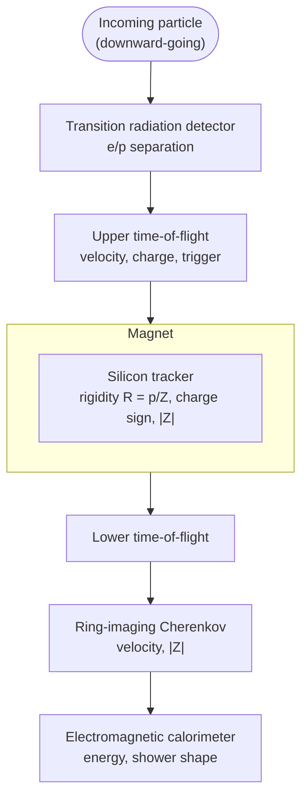

# HEP 9: Stacked space-borne spectrometer (generic schematic)

**Request:** "Draw a schematic of a magnetic spectrometer for cosmic rays in space, top to bottom."
**Type:** conceptual stacked schematic. **Assumption:** a generic instrument with a transition radiation detector,
time-of-flight counters, a permanent magnet with a silicon tracker inside, a ring-imaging Cherenkov detector and an
electromagnetic calorimeter along one vertical axis; no dimensions, layer counts or performance numbers, and not any
specific experiment (an instrument's parameters belong in its profile).

**Checks:** order along the particle's path is the drawing order; every box names what it measures, not a
performance number; the magnet is a container for the tracker (its field bends the track); no experiment name or
parameter appears. Rendered with `check_diagram_sources.py`.
**Caption:** Schematic of a generic space-borne magnetic spectrometer (not to scale). Subdetectors are stacked along
the path of a downward-going particle: transition radiation detector, upper time-of-flight counters, silicon tracker
inside a permanent magnet (rigidity, charge sign and charge magnitude), lower time-of-flight counters, ring-imaging
Cherenkov detector and electromagnetic calorimeter.
