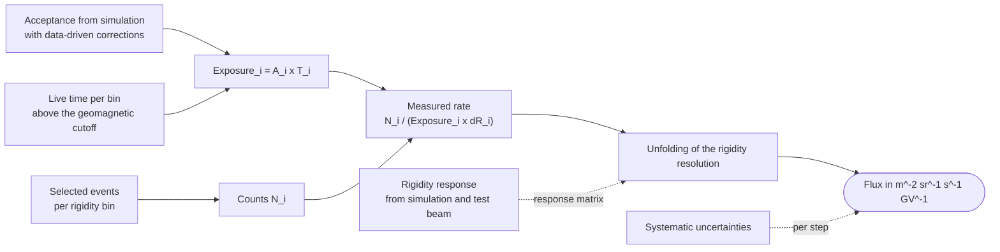

# HEP 10: Cosmic-ray flux analysis chain

**Request:** "Show how a cosmic-ray flux is obtained from selected events."
**Type:** workflow. **Assumption:** a rigidity-binned flux from a space-borne spectrometer; generic steps only. The
formula is the analysis's (hep-measurement); the unfolding and its uncertainties are hep-statistics'.

**Checks:** live time is counted only where the geomagnetic cutoff lets the bin's particles in; acceptance and live
time enter once each (exposure folds both); the response enters the unfolding, not the counts; systematics attach to
the steps they come from. Rendered with `check_diagram_sources.py`.
**Caption:** Flux analysis chain. Event counts per rigidity bin are divided by the exposure (acceptance times live
time above the geomagnetic cutoff) and the bin width, then unfolded for the rigidity resolution with a response
matrix from simulation; systematic uncertainties (dotted) are evaluated at each step.
