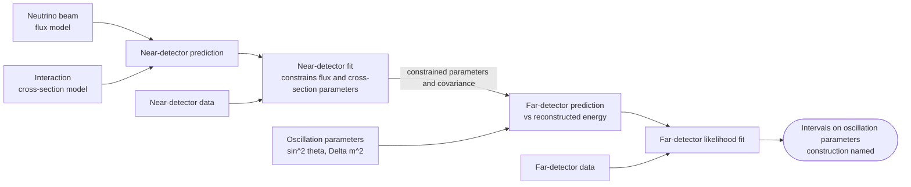

# HEP 11: Neutrino oscillation analysis with near and far detectors

**Request:** "Diagram a long-baseline oscillation analysis with a near and a far detector."
**Type:** workflow + statistical architecture. **Assumption:** generic accelerator experiment; the near detector
constrains flux and cross-section model parameters that are then applied to the far-detector prediction; no
experiment's numbers. The fit and the interval construction are hep-statistics'.

**Checks:** the near-detector data constrain the shared model parameters, not the oscillation parameters directly;
oscillation enters only the far prediction; the result names its interval construction (Feldman-Cousins or other).
Rendered with `check_diagram_sources.py`.
**Caption:** Near/far oscillation analysis. A fit to near-detector data constrains the flux and cross-section model
parameters; the far-detector prediction, which depends on the oscillation parameters, is fitted to far-detector data
to obtain intervals on the oscillation parameters.
